# User journeys: SkillsFundingAgency/das-admin-roatp-web

Generated from `main/src`: 40 pages, 90 transitions, 15 journeys. 🔒 means sign-in is required. Dotted arrows return to a hub.

## Add a New Training Provider

An admin searches for a provider by UKPRN, supplies and reviews details, selects provider configurations, and adds the provider.

```mermaid
flowchart LR
  p0["AddProvider"] -->|"when provider found in UKRLP and not already registered"| p1["ProviderDetails"]
  p1["ProviderDetails"] --> p2["SelectProviderType"]
  p2["SelectProviderType"] -->|"when selected provider type is not 'Supporting'"| p3["SelectOfferApprenticeships"]
  p3["SelectOfferApprenticeships"] -->|"otherwise after saving selection"| p4["SelectOfferApprenticeshipUnits"]
  p4["SelectOfferApprenticeshipUnits"] -->|"otherwise after saving selection"| p5["SelectOrganisationType"]
  p5["SelectOrganisationType"] -->|"after successfully selecting organisation type"| p6["ProviderDetailsSummary"]
  p6["ProviderDetailsSummary"] -->|"after successful provider submission"| p7["AddProviderConfirmation"]
```

## Add a Provider and Mark as Supporting

Admins add a provider, select 'Supporting' type, and skip the additional configuration steps.

```mermaid
flowchart LR
  p0["AddProvider"] -->|"when provider found in UKRLP and not already registered"| p1["ProviderDetails"]
  p1["ProviderDetails"] --> p2["SelectProviderType"]
  p2["SelectProviderType"] -->|"when selected provider type is 'Supporting'"| p3["SelectOrganisationType"]
  p3["SelectOrganisationType"] -->|"after successfully selecting organisation type"| p4["ProviderDetailsSummary"]
  p4["ProviderDetailsSummary"] -->|"after successful provider submission"| p5["AddProviderConfirmation"]
```

## Restrict an Approved Course

An admin searches for an unrestricted course, chooses to restrict it, and confirms the restriction.

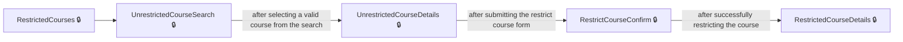

## Add a Provider to a Restricted Course

An admin selects a restricted course and adds a provider to its delivery list.

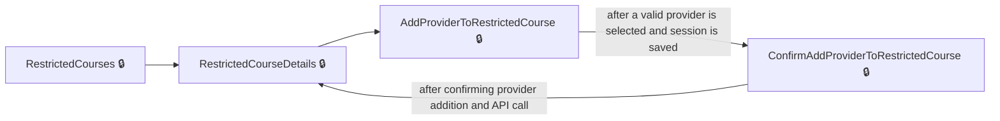

## Change Provider Restriction or Delivery Dates for a Course

An admin changes restriction settings or delivery dates for a course at a provider.

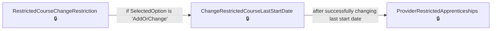

## Remove a Restricted Course from a Provider

An admin removes a restricted course from a provider's allowed list.

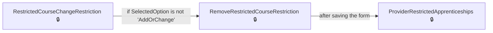

## Manage a Training Provider

An admin accesses a provider via search, then manages all aspects of that provider from a hub page.

Complete the sections in any order, returning to the hub.

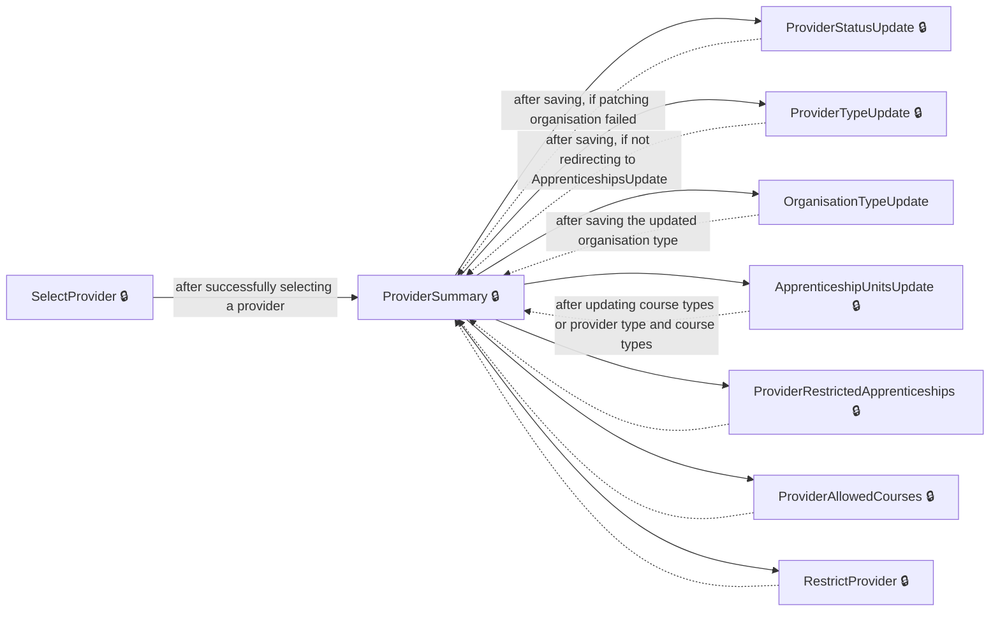

## Update Provider Status (including Removal)

An admin changes a provider's status, with a conditional removal path if needed.

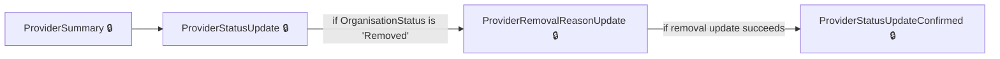

## Restrict a Provider

An admin restricts a provider so they may deliver only approved courses.

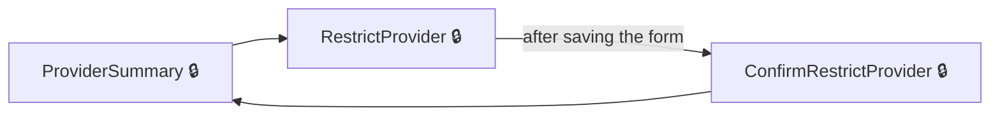

## Manage a Provider’s Restricted Apprenticeships

An admin views a provider’s restricted courses and adds or updates restrictions as needed.

Complete the sections in any order, returning to the hub.

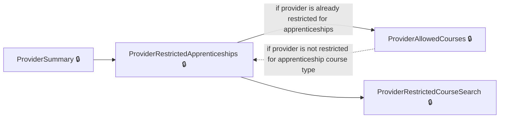

## Add a Restricted Course to a Provider

Adds a restricted course for a provider including setting special dates or confirming as needed.

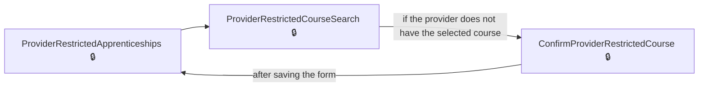

## Add a Restricted Course Last Start Date for Provider

Sets a last start date for a specific restricted course and provider.

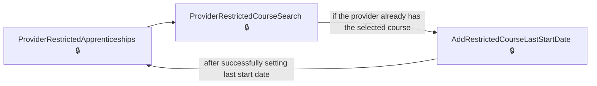

## Change a Provider's Organisation or Route Type

Provides the workflow for updating the organisation or delivery type for a provider.

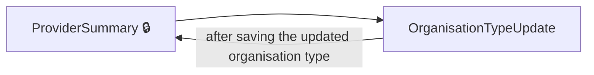

## Update Provider Apprenticeship Offering

Update if a provider offers apprenticeships and their units.

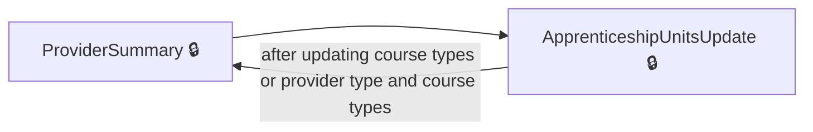

## Browse and Manage Restricted Courses

An admin browses all restricted courses and manages restrictions for each.

Complete the sections in any order, returning to the hub.

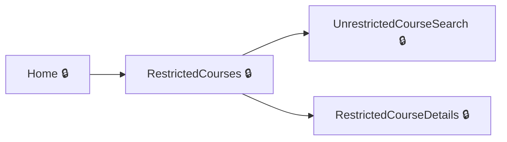

## Pages

| Page | Route | Sign-in | Purpose |
| --- | --- | --- | --- |
| `Account.SignedOut` | `SignedOut` | Unknown | Shows that the user has been signed out. |
| `AddProvider` | `providers/new/select` | Unknown | Allows the user to enter the UKPRN to start adding a new provider. |
| `AddProviderConfirmation` | `providers/new/provider-details-summary/providers/new/provider-added` | Unknown | Confirms that a provider has been added. |
| `AddProviderToRestrictedCourse` | `restricted-courses/{larsCode}/providers/add` | Yes | Lets the user add a training provider to a restricted course. |
| `AddRestrictedCourseLastStartDate` | `providers/{ukprn}/restricted-courses/add/set-last-start-date` | Yes | Lets the admin set the last start date for a restricted course at a provider. |
| `ApprenticeshipUnitsUpdate` | `providers/{ukprn}/apprenticeship-units` | Yes | Lets the user specify whether the provider offers apprenticeship units. |
| `ApprenticeshipsUpdate` | `providers/{ukprn}/apprenticeships` | Unknown | Lets the user specify whether the provider offers apprenticeships. |
| `ChangeCourseRestriction` | `restricted-courses/{larsCode}/providers/{ukprn}/change-restriction` | Yes | Allows the user to select an option for changing a provider's restriction status for the course. |
| `ChangeRestrictedCourseLastStartDate` | `providers/{ukprn}/restricted-courses/{larsCode}/change-restriction/set-last-start-date` | Yes | Lets the admin change the last start date for a provider's restricted course. |
| `ConfirmAddProviderToRestrictedCourse` | `restricted-courses/{larsCode}/providers/confirm-add` | Yes | Lets the user confirm adding a provider to a restricted course. |
| `ConfirmProviderRestrictedCourse` | `providers/{ukprn}/restricted-courses/add/confirm` | Yes | Lets the user confirm adding a course to the provider's restricted apprenticeships list. |
| `ConfirmRestrictProvider` | `providers/{ukprn}/restrict/confirm` | Yes | Lets the user confirm restricting a provider to deliver only approved courses. |
| `Dashboard` | `/dashboard` | Unknown | Provides access to the main admin dashboard. |
| `Home` | — | Yes | Provides links to manage training providers and restricted courses. |
| `OrganisationTypeUpdate` | `providers/{ukprn}/type` | Unknown | Lets the user update the organisation type for a provider. |
| `ProviderAllowedCourses` | `providers/{ukprn}/{routeLearningType}/allowed-courses` | Yes | Shows the list of courses a provider is allowed for a specific learning type. |
| `ProviderDetails` | `providers/new/details` | Unknown | Displays the details for the provider being added. |
| `ProviderDetailsSummary` | `providers/new/provider-details-summary` | Unknown | Summarises the provider details before final submission. |
| `ProviderNotFoundInUkrlp` | `providers/new/not-found` | Unknown | Informs the user the provider was not found in the UKRLP database. |
| `ProviderRemovalReasonUpdate` | `providers/{ukprn}/removal-reason` | Yes | Lets the user select a reason for removing a training provider. |
| `ProviderRestrictedApprenticeships` | `providers/{ukprn}/restricted-courses` | Yes | Displays the list of apprenticeships restricted for a provider and enables filtering them. |
| `ProviderRestrictedCourseSearch` | `providers/{ukprn}/restricted-courses/add` | Yes | Lets the user select a course to add to the provider's restricted list. |
| `ProviderStatusUpdate` | `providers/{ukprn}/status` | Yes | Lets the user update the status of a provider. |
| `ProviderStatusUpdateConfirmed` | `providers/{ukprn}/status/confirmed` | Yes | Shows confirmation of a provider's status update. |
| `ProviderSummary` | `providers/{ukprn}` | Yes | Shows the summary details for a provider. |
| `ProviderTypeUpdate` | `providers/{ukprn}/route` | Yes | Lets the user update the provider's route type. |
| `RegisteredProviders.Index` | — | Unknown | Allows searching for providers by query. |
| `RemoveRestrictedCourseRestriction` | `providers/{ukprn}/restricted-courses/{larsCode}/change-restriction/remove-restriction` | Yes | Lets the user confirm removal of a course from the provider's restricted apprenticeships list. |
| `RestrictCourseConfirm` | `restricted-courses/add/{larsCode}/confirm` | Yes | Allows the user to confirm restricting a course. |
| `RestrictProvider` | `providers/{ukprn}/restrict` | Yes | Shows information before restricting the provider and allows the user to proceed. |
| `RestrictedCourseChangeRestriction` | `providers/{ukprn}/restricted-courses/{larsCode}/change-restriction` | Yes | Lets the user choose what restriction to change for a specific course offered by a provider. |
| `RestrictedCourseDetails` | `restricted-courses/{larsCode}` | Yes | Shows the details of a restricted course, including its providers. |
| `RestrictedCourses` | `restricted-courses` | Yes | Shows the list of all restricted courses. |
| `SelectOfferApprenticeshipUnits` | `providers/new/offer-apprenticeship-units` | Unknown | Lets the user select whether the provider offers apprenticeship units. |
| `SelectOfferApprenticeships` | `providers/new/offer-apprenticeships` | Unknown | Lets the user select whether the provider offers apprenticeships. |
| `SelectOrganisationType` | `providers/new/organisation-type` | Unknown | Lets the user choose the type of organisation for the new provider. |
| `SelectProvider` | `providers` | Yes | Lets the user search for and select a training provider. |
| `SelectProviderType` | `providers/new/provider-type` | Unknown | Lets the user select which provider route the new provider will use. |
| `UnrestrictedCourseDetails` | `unrestricted-courses/{larsCode}` | Yes | Shows details for a course that is not currently restricted. |
| `UnrestrictedCourseSearch` | `unrestricted-courses/search` | Yes | Allows searching for an unrestricted course by name. |

## Form fields

Field definitions only: no values a user enters are recorded.

### `AddProvider`

| Field | Type | Label | Required | Rules | Options |
| --- | --- | --- | --- | --- | --- |
| `Ukprn` | text | — | — | required; must be a valid UKPRN not matching an existing provider | — |

### `AddProviderToRestrictedCourse`

| Field | Type | Label | Required | Rules | Options |
| --- | --- | --- | --- | --- | --- |
| `SelectedUkprn` | select | Start typing the provider’s legal name or UKPRN | — | optional; must match an available provider for the course | — |

### `AddRestrictedCourseLastStartDate`

| Field | Type | Label | Required | Rules | Options |
| --- | --- | --- | --- | --- | --- |
| `Day` | text | — | — | required; must be a valid day | — |
| `Month` | text | Month | — | required; must be a valid month | — |
| `Year` | text | Year | — | required; must be a valid year | — |

### `ApprenticeshipUnitsUpdate`

| Field | Type | Label | Required | Rules | Options |
| --- | --- | --- | --- | --- | --- |
| `ApprenticeshipUnitsSelectionId` | radios | Do they offer apprenticeship units? | — | required; must be 'Yes' if provider does not offer apprenticeships | — |

### `ApprenticeshipsUpdate`

| Field | Type | Label | Required | Rules | Options |
| --- | --- | --- | --- | --- | --- |
| `IsApprenticeshipsOffered` | radios | Do they offer apprenticeships? | — | required | — |

### `ChangeCourseRestriction`

| Field | Type | Label | Required | Rules | Options |
| --- | --- | --- | --- | --- | --- |
| `nameof(Model.SelectedOption)` | radios | What would you like to change? | — | optional; must be a valid radio option | — |

### `ChangeRestrictedCourseLastStartDate`

| Field | Type | Label | Required | Rules | Options |
| --- | --- | --- | --- | --- | --- |
| `Day` | text | — | — | required; must be a valid day | — |
| `Month` | text | Month | — | required; must be a valid month | — |
| `Year` | text | Year | — | required; must be a valid year | — |

### `OrganisationTypeUpdate`

| Field | Type | Label | Required | Rules | Options |
| --- | --- | --- | --- | --- | --- |
| `OrganisationTypeId` | radios | Choose the type of organisation for | — | required; must be a valid organisation type | — |

### `ProviderRemovalReasonUpdate`

| Field | Type | Label | Required | Rules | Options |
| --- | --- | --- | --- | --- | --- |
| `RemovalReasonId` | radios | Why do you want to remove this provider? | — | required | — |

### `ProviderRestrictedApprenticeships`

| Field | Type | Label | Required | Rules | Options |
| --- | --- | --- | --- | --- | --- |
| `For` | text | — | — | — | — |

### `ProviderRestrictedCourseSearch`

| Field | Type | Label | Required | Rules | Options |
| --- | --- | --- | --- | --- | --- |
| `SelectedLarsCode` | select | Start typing in the box and its name will appear | — | — | — |

### `ProviderStatusUpdate`

| Field | Type | Label | Required | Rules | Options |
| --- | --- | --- | --- | --- | --- |
| `OrganisationStatus` | radios | Update the status for this provider | — | required; must be a valid status | — |

### `ProviderTypeUpdate`

| Field | Type | Label | Required | Rules | Options |
| --- | --- | --- | --- | --- | --- |
| `ProviderTypeId` | radios | What provider route are they using? | — | required; must be a valid provider type | — |

### `RestrictedCourseChangeRestriction`

| Field | Type | Label | Required | Rules | Options |
| --- | --- | --- | --- | --- | --- |
| `nameof(Model.SelectedOption)` | radios | What would you like to change? | — | required; must be a valid option | — |

### `RestrictedCourseDetails`

| Field | Type | Label | Required | Rules | Options |
| --- | --- | --- | --- | --- | --- |
| `For` | text | — | — | — | — |

### `RestrictedCourses`

| Field | Type | Label | Required | Rules | Options |
| --- | --- | --- | --- | --- | --- |
| `For` | text | — | — | — | — |

### `SelectOfferApprenticeshipUnits`

| Field | Type | Label | Required | Rules | Options |
| --- | --- | --- | --- | --- | --- |
| `IsApprenticeshipUnitsOffered` | radios | Do they offer apprenticeship units? | — | required; must be Yes or No; available only if provider is not Supporting type | — |

### `SelectOfferApprenticeships`

| Field | Type | Label | Required | Rules | Options |
| --- | --- | --- | --- | --- | --- |
| `IsApprenticeshipsOffered` | radios | Do they offer apprenticeships? | — | required; must be Yes or No; available only if provider is not Supporting type | — |

### `SelectOrganisationType`

| Field | Type | Label | Required | Rules | Options |
| --- | --- | --- | --- | --- | --- |
| `OrganisationTypeId` | radios | Choose the type of organisation for | — | required; must be a valid organisation type | — |

### `SelectProvider`

| Field | Type | Label | Required | Rules | Options |
| --- | --- | --- | --- | --- | --- |
| `SearchTerm` | text | Search Result:, | — | required | — |

### `SelectProviderType`

| Field | Type | Label | Required | Rules | Options |
| --- | --- | --- | --- | --- | --- |
| `SelectedProviderTypeId` | radios | What provider route are they using? | — | required; must be one of the designated provider types | — |

### `UnrestrictedCourseSearch`

| Field | Type | Label | Required | Rules | Options |
| --- | --- | --- | --- | --- | --- |
| `SelectedLarsCode` | select | Start typing in the box and its name will appear | — | required; must be a valid course code present in the list | — |

