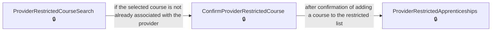
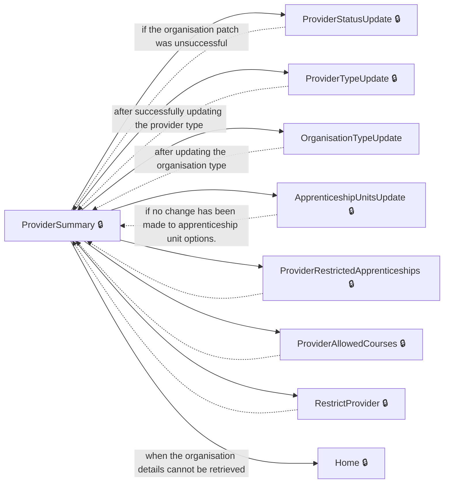
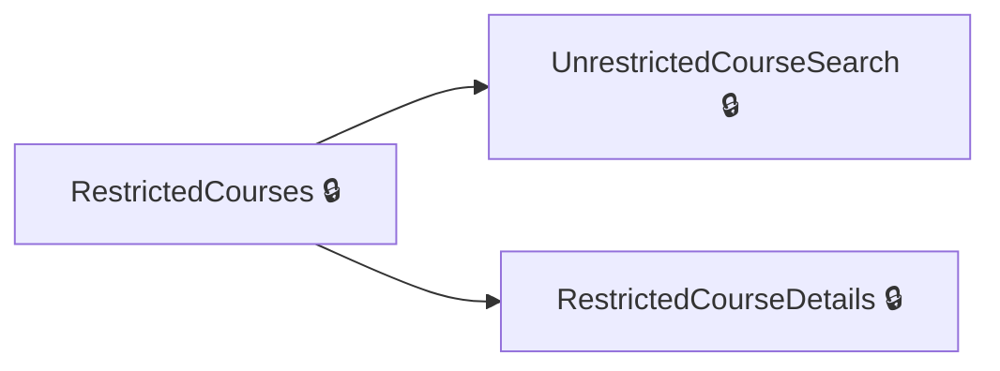
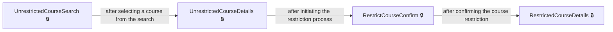
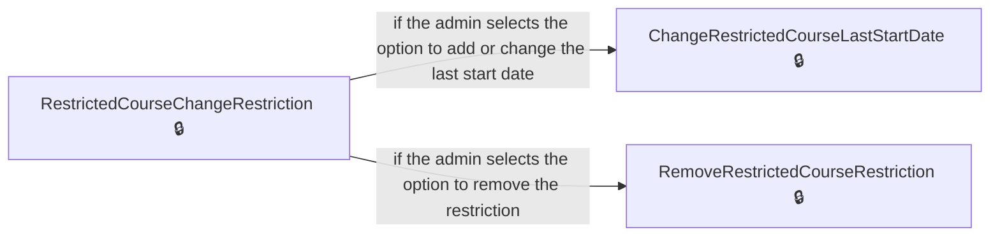
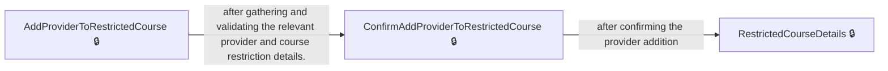
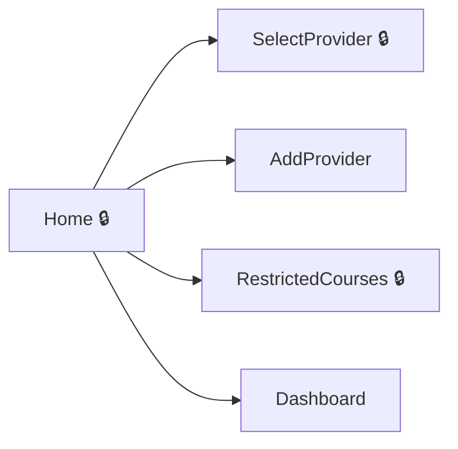

# User journeys: SkillsFundingAgency/das-admin-roatp-web

Generated from `main/src`: 40 pages, 90 transitions, 7 journeys. 🔒 means sign-in is required. Dotted arrows return to a hub.

## Restrict a course for a provider

Enables administrators to add a course to the restricted apprenticeship list for a specific training provider.

## Update Provider Information

Allows updating the provider details, including type, status, restrictions, and available courses.

Complete the sections in any order, returning to the hub.

## Manage restricted courses

Allows administrators to manage restricted courses and providers.

Complete the sections in any order, returning to the hub.

## Restrict a course

Allows adding restrictions to a course once it is selected from the unrestricted courses page.

## Change or remove restrictions for a provider's course

Enables administrators to change or remove restrictions for a specific apprenticeship course for a provider.

Complete the sections in any order, returning to the hub.

## Add a provider to a restricted course

Allows administrators to associate a provider with a restricted apprenticeship course and confirm the addition.

## Admin Dashboard

Redirects the user to the application's main dashboard for general management tasks.

Complete the sections in any order, returning to the hub.

## Pages

| Page | Route | Sign-in | Purpose |
| --- | --- | --- | --- |
| `Account.SignedOut` | `SignedOut` | Unknown | Displays a confirmation page after the user has signed out. |
| `AddProvider` | `providers/new/select` | Unknown | Allows the user to add a new provider by entering their UKPRN. |
| `AddProviderConfirmation` | `providers/new/provider-details-summary/providers/new/provider-added` | Unknown | Shows confirmation that a new provider has been successfully added. |
| `AddProviderToRestrictedCourse` | `restricted-courses/{larsCode}/providers/add` | Yes | Allows the user to add a provider to a course that has specific restrictions. |
| `AddRestrictedCourseLastStartDate` | `providers/{ukprn}/restricted-courses/add/set-last-start-date` | Yes | Allows setting a last start date for courses added to the restricted apprenticeships list. |
| `ApprenticeshipUnitsUpdate` | `providers/{ukprn}/apprenticeship-units` | Yes | Enables the user to update apprenticeship unit options for a given provider. |
| `ApprenticeshipsUpdate` | `providers/{ukprn}/apprenticeships` | Unknown | Allows the user to specify whether apprenticeships are offered by a given provider. |
| `ChangeCourseRestriction` | `restricted-courses/{larsCode}/providers/{ukprn}/change-restriction` | Yes | Enables the user to change the restriction options for a provider in a specific course. |
| `ChangeRestrictedCourseLastStartDate` | `providers/{ukprn}/restricted-courses/{larsCode}/change-restriction/set-last-start-date` | Yes | Allows updating the last start date of restricted courses. |
| `ConfirmAddProviderToRestrictedCourse` | `restricted-courses/{larsCode}/providers/confirm-add` | Yes | Allows administrators to confirm the addition of a provider to a restricted course. |
| `ConfirmProviderRestrictedCourse` | `providers/{ukprn}/restricted-courses/add/confirm` | Yes | Confirms the addition of a course to the restricted apprenticeships list. |
| `ConfirmRestrictProvider` | `providers/{ukprn}/restrict/confirm` | Yes | Confirms restricting a training provider to delivering only approved courses. |
| `Dashboard` | `/dashboard` | Unknown | Redirects the user to the application's main dashboard. |
| `Home` | — | Yes | Serves as the landing page for managing training provider actions. |
| `OrganisationTypeUpdate` | `providers/{ukprn}/type` | Unknown | Allows updating of an organisation's type. |
| `ProviderAllowedCourses` | `providers/{ukprn}/{routeLearningType}/allowed-courses` | Yes | Displays courses that a training provider is allowed to deliver. |
| `ProviderDetails` | `providers/new/details` | Unknown | Allows a user to input and review detailed information about a new provider. |
| `ProviderDetailsSummary` | `providers/new/provider-details-summary` | Unknown | Summarizes the details entered for a new provider, allowing the user to make changes. |
| `ProviderNotFoundInUkrlp` | `providers/new/not-found` | Unknown | Informs the user when the submitted UKPRN is not found in the UK Register of Learning Providers (UKRLP). |
| `ProviderRemovalReasonUpdate` | `providers/{ukprn}/removal-reason` | Yes | Allows the admin to specify a reason for removing a training provider. |
| `ProviderRestrictedApprenticeships` | `providers/{ukprn}/restricted-courses` | Yes | Displays and manages the list of restricted apprenticeship courses for a provider. |
| `ProviderRestrictedCourseSearch` | `providers/{ukprn}/restricted-courses/add` | Yes | Allows the admin to search and add new restricted apprenticeship courses for a provider. |
| `ProviderStatusUpdate` | `providers/{ukprn}/status` | Yes | Allows the admin to update the status of a training provider. |
| `ProviderStatusUpdateConfirmed` | `providers/{ukprn}/status/confirmed` | Yes | Confirms the successful update of a training provider's status. |
| `ProviderSummary` | `providers/{ukprn}` | Yes | Displays detailed information about a specific training provider. |
| `ProviderTypeUpdate` | `providers/{ukprn}/route` | Yes | Allows the admin to update the type of a training provider. |
| `RegisteredProviders.Index` | — | Unknown | Lists or searches for registered training providers based on a query. |
| `RemoveRestrictedCourseRestriction` | `providers/{ukprn}/restricted-courses/{larsCode}/change-restriction/remove-restriction` | Yes | Enables the admin to remove a restriction from a specific apprenticeship course for a provider. |
| `RestrictCourseConfirm` | `restricted-courses/add/{larsCode}/confirm` | Yes | Enables administrators to confirm the restriction of a course. |
| `RestrictProvider` | `providers/{ukprn}/restrict` | Yes | Allows the admin to restrict a training provider based on predefined criteria. |
| `RestrictedCourseChangeRestriction` | `providers/{ukprn}/restricted-courses/{larsCode}/change-restriction` | Yes | Provides options to change or remove restrictions for a specific apprenticeship course. |
| `RestrictedCourseDetails` | `restricted-courses/{larsCode}` | Yes | Displays details about a restricted course, including its allowed providers. |
| `RestrictedCourses` | `restricted-courses` | Yes | Lists all restricted courses and provides filtering options. |
| `SelectOfferApprenticeshipUnits` | `providers/new/offer-apprenticeship-units` | Unknown | Allows the user to indicate whether the provider offers apprenticeship units. |
| `SelectOfferApprenticeships` | `providers/new/offer-apprenticeships` | Unknown | Allows the user to indicate whether the provider offers apprenticeships. |
| `SelectOrganisationType` | `providers/new/organisation-type` | Unknown | Allows the user to select the organisation type of the provider. |
| `SelectProvider` | `providers` | Yes | Allows the admin to select a training provider from a list. |
| `SelectProviderType` | `providers/new/provider-type` | Unknown | Allows the user to select the type of a provider while adding a new training provider. |
| `UnrestrictedCourseDetails` | `unrestricted-courses/{larsCode}` | Yes | Provides details about an unrestricted course and allows restriction initiation. |
| `UnrestrictedCourseSearch` | `unrestricted-courses/search` | Yes | Allows administrators to search for unrestricted courses. |
