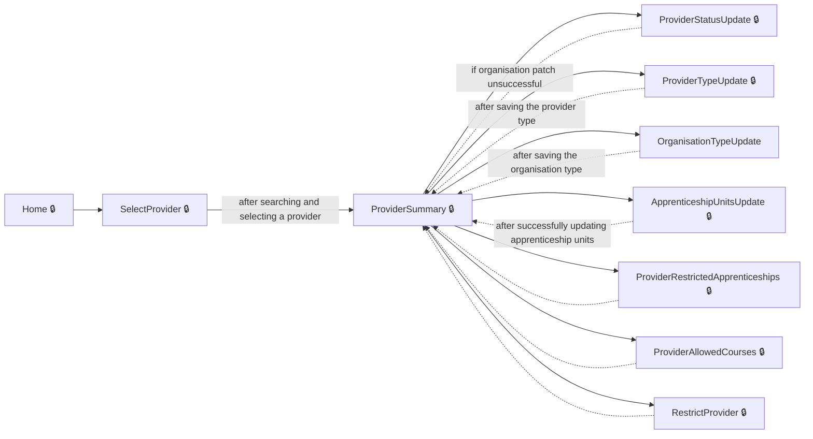
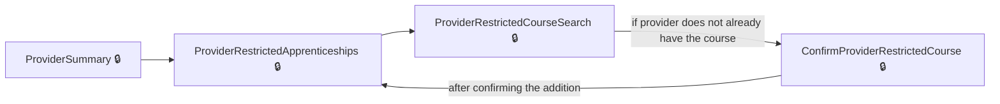
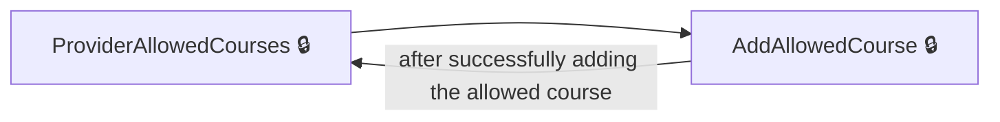
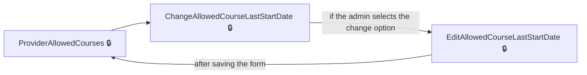
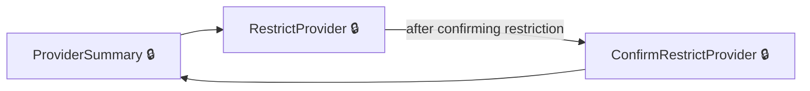
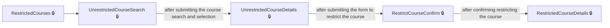
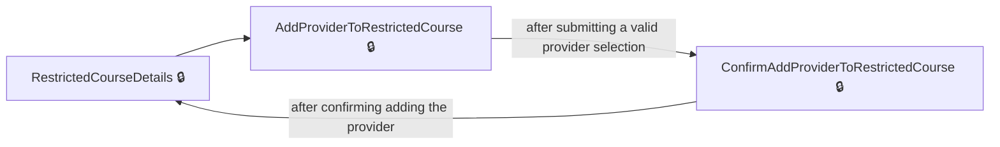
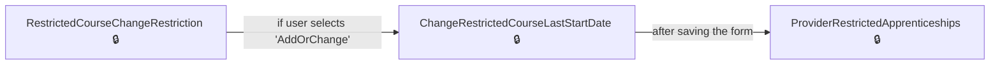
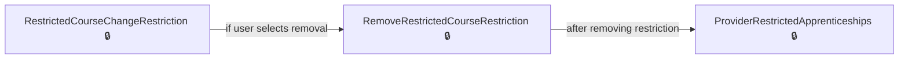

# User journeys: SkillsFundingAgency/das-admin-roatp-web

Generated from `main/src`: 45 pages, 103 transitions, 11 journeys. 🔒 means sign-in is required. Dotted arrows return to a hub.

## Add a new provider

Add a new provider by searching for a UKPRN, completing required details, and confirming the addition.

```mermaid
flowchart LR
  p0["AddProvider"] -->|"when provider UKPRN is found in UKRLP and does not already exist"| p1["ProviderDetails"]
  p1["ProviderDetails"] --> p2["SelectProviderType"]
  p2["SelectProviderType"] -->|"when 'Supporting' provider type is selected"| p3["SelectOrganisationType"]
  p3["SelectOrganisationType"] -->|"after submitting valid organisation type selection"| p4["ProviderDetailsSummary"]
  p4["ProviderDetailsSummary"] -->|"after successfully validating and submitting the provider details"| p5["AddProviderConfirmation"]
  p5["AddProviderConfirmation"] --> p6["Home 🔒"]
```

## Manage an existing provider

Select a provider to update their details, status, type, courses, or view summaries.

Complete the sections in any order, returning to the hub.

## Add a restricted apprenticeship course to a provider

Add a restricted apprenticeship course for a provider, including setting last allowed start date if needed.

## Add an allowed course to a restricted provider

Add an allowed course to a restricted provider and set its last allowed start date if required.

## Set or change last allowed start date for provider’s course

Set, change, or remove the last allowed start date for an allowed course for a provider.

## Restrict a provider’s delivery to specific courses

Restrict a provider's ability to deliver apprenticeships only to specific, approved courses.

## Search and view all restricted courses

View the list of all restricted courses and see their details or manage providers for those courses.

## Restrict a course

Restrict an unrestricted apprenticeship course and confirm restriction.

## Add a provider to a restricted course

Add a new provider to an apprenticeship course that is already restricted.

## Change or remove a restriction for a provider’s restricted course

Change or remove restriction details (e.g. last start date) for a restricted course for a provider.

## Remove a restriction from a provider’s restricted course

Remove the restriction from a restricted course for a provider.

## Pages

| Page | Route | Sign-in | Purpose |
| --- | --- | --- | --- |
| `Account.SignedOut` | `SignedOut` | Unknown | Shows that the user has signed out of their account. |
| `AddAllowedCourse` | `providers/{ukprn}/{routeLearningType}/allowed-courses/add` | Yes | Lets the admin add a new allowed course for a restricted training provider. |
| `AddAllowedCourseLastStartDate` | `providers/{ukprn}/{routeLearningType}/allowed-courses/{larsCode}/set-last-date-start` | Yes | Lets the admin set the last possible start date for a newly allowed course. |
| `AddProvider` | `providers/new/select` | Unknown | Lets the user enter a provider UKPRN to search for their details. |
| `AddProviderConfirmation` | `providers/new/provider-details-summary/providers/new/provider-added` | Unknown | Confirms the provider has been successfully added. |
| `AddProviderToRestrictedCourse` | `restricted-courses/{larsCode}/providers/add` | Yes | Lets the admin select a provider to be added to a restricted course. |
| `AddRestrictedCourseLastStartDate` | `providers/{ukprn}/restricted-courses/add/set-last-start-date` | Yes | Lets the user set the last date for new starts when restricting a provider's course. |
| `ApprenticeshipUnitsUpdate` | `providers/{ukprn}/apprenticeship-units` | Yes | Lets the user update whether a provider offers apprenticeship units. |
| `ApprenticeshipsUpdate` | `providers/{ukprn}/apprenticeships` | Unknown | Lets the user update whether a provider offers apprenticeships. |
| `ChangeAllowedCourseLastStartDate` | `providers/{ukprn}/{routeLearningType}/allowed-courses/{larsCode}/change` | Yes | Allows the admin to choose whether to change or remove the last possible start date for an allowed course. |
| `ChangeCourseRestriction` | `restricted-courses/{larsCode}/providers/{ukprn}/change-restriction` | Yes | Lets the admin choose what restriction to change for a provider on a restricted course. |
| `ChangeRestrictedCourseLastStartDate` | `providers/{ukprn}/restricted-courses/{larsCode}/change-restriction/set-last-start-date` | Yes | Lets the user change the last date for new starts for a restricted provider's course. |
| `ConfirmAddProviderToRestrictedCourse` | `restricted-courses/{larsCode}/providers/confirm-add` | Yes | Allows the admin to confirm adding a provider to a restricted course. |
| `ConfirmProviderRestrictedCourse` | `providers/{ukprn}/restricted-courses/add/confirm` | Yes | Lets the user confirm that the course has been added to the provider's list of restricted apprenticeships. |
| `ConfirmRestrictProvider` | `providers/{ukprn}/restrict/confirm` | Yes | Lets the user confirm restricting a provider to only deliver approved courses. |
| `Dashboard` | `/dashboard` | Unknown | Provides an entry point to administer the application. |
| `EditAllowedCourseLastStartDate` | `providers/{ukprn}/{routeLearningType}/allowed-courses/{larsCode}/set-last-date-starts` | Yes | Lets the user edit the last date that new starts are allowed for a provider's course. |
| `Home` | — | Yes | Serves as the start page for managing training providers and restricted courses. |
| `OrganisationTypeUpdate` | `providers/{ukprn}/type` | Unknown | Lets the user change the type of organisation for a provider. |
| `ProviderAllowedCourses` | `providers/{ukprn}/{routeLearningType}/allowed-courses` | Yes | Shows the list of courses that are currently allowed for a provider, with options to edit or add. |
| `ProviderDetails` | `providers/new/details` | Unknown | Displays provider details before beginning the provider addition process. |
| `ProviderDetailsSummary` | `providers/new/provider-details-summary` | Unknown | Lets the user review and submit a summary of provider details before adding a provider. |
| `ProviderNotFoundInUkrlp` | `providers/new/not-found` | Unknown | Tells the user that the provider UKPRN was not found in UKRLP. |
| `ProviderRemovalReasonUpdate` | `providers/{ukprn}/removal-reason` | Yes | Lets the user select the reason for removing a provider. |
| `ProviderRestrictedApprenticeships` | `providers/{ukprn}/restricted-courses` | Yes | Shows a list of restricted apprenticeships for a provider and allows filtering, viewing, or managing them. |
| `ProviderRestrictedCourseSearch` | `providers/{ukprn}/restricted-courses/add` | Yes | Lets the user search for and select an apprenticeship course to restrict for a provider. |
| `ProviderStatusUpdate` | `providers/{ukprn}/status` | Yes | Lets the user update the status for a training provider. |
| `ProviderStatusUpdateConfirmed` | `providers/{ukprn}/status/confirmed` | Yes | Shows a confirmation after updating a provider's status. |
| `ProviderSummary` | `providers/{ukprn}` | Yes | Shows a summary and management links for a training provider. |
| `ProviderTypeUpdate` | `providers/{ukprn}/route` | Yes | Lets the user change what provider route a provider is using. |
| `RegisteredProviders.Index` | — | Unknown | Lets the user search for registered providers by query. |
| `RemoveAllowedCourseLastStartDate` | `providers/{ukprn}/{routeLearningType}/allowed-courses/{larsCode}/remove-last-date-starts` | Yes | Lets the user remove the last date for new starts from a provider's allowed course. |
| `RemoveRestrictedCourseRestriction` | `providers/{ukprn}/restricted-courses/{larsCode}/change-restriction/remove-restriction` | Yes | Lets the user remove a restriction from a restricted course for a provider. |
| `RestrictCourseConfirm` | `restricted-courses/add/{larsCode}/confirm` | Yes | Lets the admin confirm restricting a course. |
| `RestrictProvider` | `providers/{ukprn}/restrict` | Yes | Lets the user begin restricting a provider's courses. |
| `RestrictedCourseChangeRestriction` | `providers/{ukprn}/restricted-courses/{larsCode}/change-restriction` | Yes | Lets the user choose how to change a restriction for a specific course for a provider. |
| `RestrictedCourseDetails` | `restricted-courses/{larsCode}` | Yes | Shows details of a restricted course and its allowed providers. |
| `RestrictedCourses` | `restricted-courses` | Yes | Shows a list of all restricted courses, with optional filtering. |
| `SelectOfferApprenticeshipUnits` | `providers/new/offer-apprenticeship-units` | Unknown | Lets the user specify if the provider offers apprenticeship units. |
| `SelectOfferApprenticeships` | `providers/new/offer-apprenticeships` | Unknown | Lets the user specify if the provider offers apprenticeships. |
| `SelectOrganisationType` | `providers/new/organisation-type` | Unknown | Lets the user choose the organisation type for a new provider. |
| `SelectProvider` | `providers` | Yes | Lets the user search for and select a training provider. |
| `SelectProviderType` | `providers/new/provider-type` | Unknown | Lets the user choose the provider type for a new provider. |
| `UnrestrictedCourseDetails` | `unrestricted-courses/{larsCode}` | Yes | Displays details for a course that is not currently restricted. |
| `UnrestrictedCourseSearch` | `unrestricted-courses/search` | Yes | Allows searching for and selecting an unrestricted course to view details or restrict. |

## Form fields

Field definitions only: no values a user enters are recorded.

### `AddAllowedCourse`

| Field | Type | Label | Required | Rules | Options |
| --- | --- | --- | --- | --- | --- |
| `SelectedLarsCode` | select | Start typing in the box and its name will appear | — | required; must be a valid value from the list of allowable courses for the provider | — |

### `AddAllowedCourseLastStartDate`

| Field | Type | Label | Required | Rules | Options |
| --- | --- | --- | --- | --- | --- |
| `Day` | text | — | — | required; must form a valid date with Month and Year | — |
| `Month` | text | Month | — | required; must form a valid date with Day and Year | — |
| `Year` | text | Year | — | required; must form a valid date with Day and Month | — |

### `AddProvider`

| Field | Type | Label | Required | Rules | Options |
| --- | --- | --- | --- | --- | --- |
| `Ukprn` | text | — | — | required; must be a valid UKPRN; must not already exist as a provider | — |

### `AddProviderToRestrictedCourse`

| Field | Type | Label | Required | Rules | Options |
| --- | --- | --- | --- | --- | --- |
| `SelectedUkprn` | select | Start typing the provider’s legal name or UKPRN | — | required; must match a provider's UKPRN for the course | — |

### `AddRestrictedCourseLastStartDate`

| Field | Type | Label | Required | Rules | Options |
| --- | --- | --- | --- | --- | --- |
| `Day` | text | — | — | — | — |
| `Month` | text | Month | — | — | — |
| `Year` | text | Year | — | — | — |

### `ApprenticeshipUnitsUpdate`

| Field | Type | Label | Required | Rules | Options |
| --- | --- | --- | --- | --- | --- |
| `ApprenticeshipUnitsSelectionId` | radios | Do they offer apprenticeship units? | — | required; training providers must offer either apprenticeships or apprenticeship units; required when offersApprenticeships is false | — |

### `ApprenticeshipsUpdate`

| Field | Type | Label | Required | Rules | Options |
| --- | --- | --- | --- | --- | --- |
| `IsApprenticeshipsOffered` | radios | Do they offer apprenticeships? | — | required; must select if apprenticeships are offered | — |

### `ChangeAllowedCourseLastStartDate`

| Field | Type | Label | Required | Rules | Options |
| --- | --- | --- | --- | --- | --- |
| `nameof(Model.SelectedOption)` | radios | What would you like to change? | — | required; must be a valid option | — |

### `ChangeCourseRestriction`

| Field | Type | Label | Required | Rules | Options |
| --- | --- | --- | --- | --- | --- |
| `nameof(Model.SelectedOption)` | radios | What would you like to change? | — | required; must be a valid option | — |

### `ChangeRestrictedCourseLastStartDate`

| Field | Type | Label | Required | Rules | Options |
| --- | --- | --- | --- | --- | --- |
| `Day` | text | — | — | — | — |
| `Month` | text | Month | — | — | — |
| `Year` | text | Year | — | — | — |

### `EditAllowedCourseLastStartDate`

| Field | Type | Label | Required | Rules | Options |
| --- | --- | --- | --- | --- | --- |
| `Day` | text | — | — | — | — |
| `Month` | text | Month | — | — | — |
| `Year` | text | Year | — | — | — |

### `OrganisationTypeUpdate`

| Field | Type | Label | Required | Rules | Options |
| --- | --- | --- | --- | --- | --- |
| `OrganisationTypeId` | radios | Choose the type of organisation for | — | — | — |

### `ProviderRemovalReasonUpdate`

| Field | Type | Label | Required | Rules | Options |
| --- | --- | --- | --- | --- | --- |
| `RemovalReasonId` | radios | Why do you want to remove this provider? | — | required | — |

### `ProviderRestrictedApprenticeships`

| Field | Type | Label | Required | Rules | Options |
| --- | --- | --- | --- | --- | --- |
| `For` | text | — | — | — | — |

### `ProviderRestrictedCourseSearch`

| Field | Type | Label | Required | Rules | Options |
| --- | --- | --- | --- | --- | --- |
| `SelectedLarsCode` | select | Start typing in the box and its name will appear | — | required; must be a valid course selection | — |

### `ProviderStatusUpdate`

| Field | Type | Label | Required | Rules | Options |
| --- | --- | --- | --- | --- | --- |
| `OrganisationStatus` | radios | Update the status for this provider | — | — | — |

### `ProviderTypeUpdate`

| Field | Type | Label | Required | Rules | Options |
| --- | --- | --- | --- | --- | --- |
| `ProviderTypeId` | radios | What provider route are they using? | — | — | — |

### `RestrictedCourseChangeRestriction`

| Field | Type | Label | Required | Rules | Options |
| --- | --- | --- | --- | --- | --- |
| `nameof(Model.SelectedOption)` | radios | What would you like to change? | — | required | — |

### `RestrictedCourseDetails`

| Field | Type | Label | Required | Rules | Options |
| --- | --- | --- | --- | --- | --- |
| `For` | text | — | — | — | — |

### `RestrictedCourses`

| Field | Type | Label | Required | Rules | Options |
| --- | --- | --- | --- | --- | --- |
| `For` | text | — | — | — | — |

### `SelectOfferApprenticeshipUnits`

| Field | Type | Label | Required | Rules | Options |
| --- | --- | --- | --- | --- | --- |
| `IsApprenticeshipUnitsOffered` | radios | Do they offer apprenticeship units? | — | null | — |

### `SelectOfferApprenticeships`

| Field | Type | Label | Required | Rules | Options |
| --- | --- | --- | --- | --- | --- |
| `IsApprenticeshipsOffered` | radios | Do they offer apprenticeships? | — | null | — |

### `SelectOrganisationType`

| Field | Type | Label | Required | Rules | Options |
| --- | --- | --- | --- | --- | --- |
| `OrganisationTypeId` | radios | Choose the type of organisation for | — | required; must select an organisation type | — |

### `SelectProvider`

| Field | Type | Label | Required | Rules | Options |
| --- | --- | --- | --- | --- | --- |
| `SearchTerm` | text | Search Result:, | — | required | — |

### `SelectProviderType`

| Field | Type | Label | Required | Rules | Options |
| --- | --- | --- | --- | --- | --- |
| `SelectedProviderTypeId` | radios | What provider route are they using? | — | required; must select a provider type | — |

### `UnrestrictedCourseSearch`

| Field | Type | Label | Required | Rules | Options |
| --- | --- | --- | --- | --- | --- |
| `SelectedLarsCode` | select | Start typing in the box and its name will appear | — | required; must be a valid value from the list of unrestricted courses | — |

