# User journeys: SkillsFundingAgency/das-admin-roatp-web

Generated from `main/src`: 40 pages, 90 transitions, 14 journeys. 🔒 means sign-in is required. Dotted arrows return to a hub.

## Add a new training provider

Allows an administrator to add a new training provider to the register by searching UKPRN, entering details, and confirming submission.

```mermaid
flowchart LR
  p0["AddProvider"] -->|"if the UKPRN is found in UKRLP"| p1["ProviderDetails"]
  p1["ProviderDetails"] --> p2["SelectProviderType"]
  p2["SelectProviderType"] -->|"if the provider type is not Supporting"| p3["SelectOfferApprenticeships"]
  p3["SelectOfferApprenticeships"] -->|"after submitting selection"| p4["SelectOfferApprenticeshipUnits"]
  p4["SelectOfferApprenticeshipUnits"] -->|"after submitting selection"| p5["SelectOrganisationType"]
  p5["SelectOrganisationType"] -->|"after submitting selection"| p6["ProviderDetailsSummary"]
  p6["ProviderDetailsSummary"] -->|"after submitting valid provider details"| p7["AddProviderConfirmation"]
```

## Manage a provider

Enables an administrator to select a registered provider and perform management actions such as updating status, type, or allowed courses.

Complete the sections in any order, returning to the hub.

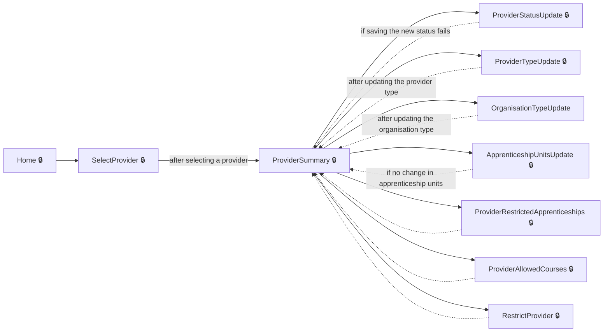

## Restrict a provider to specific courses

Lets an administrator restrict a provider to deliver only approved courses.

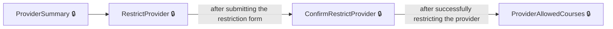

## Add a restricted course to a provider

Allows administrators to add a restricted apprenticeship course to a training provider and confirm the details.

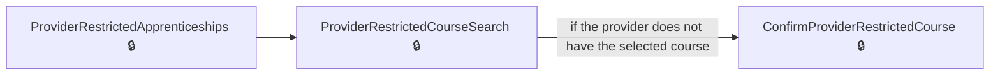

## Browse and manage restricted apprenticeship courses

Lets administrators review all restricted courses and access management options for them.

Complete the sections in any order, returning to the hub.

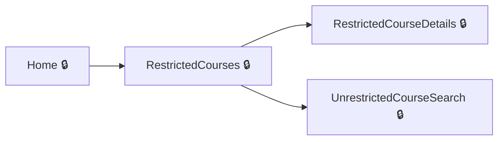

## Restrict an unrestricted apprenticeship course

Enables an administrator to take an unrestricted course and apply restriction, making it restricted for providers.

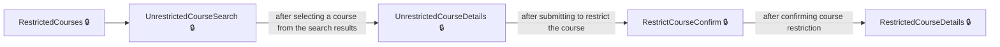

## Add a provider to a restricted course

Lets an administrator add a training provider to deliver a restricted course and confirm this action.

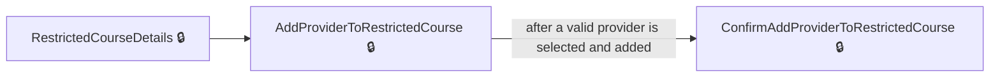

## Manage a specific training provider

Allows the user to select a provider and manage their details, type, status, or allowed courses.

Complete the sections in any order, returning to the hub.

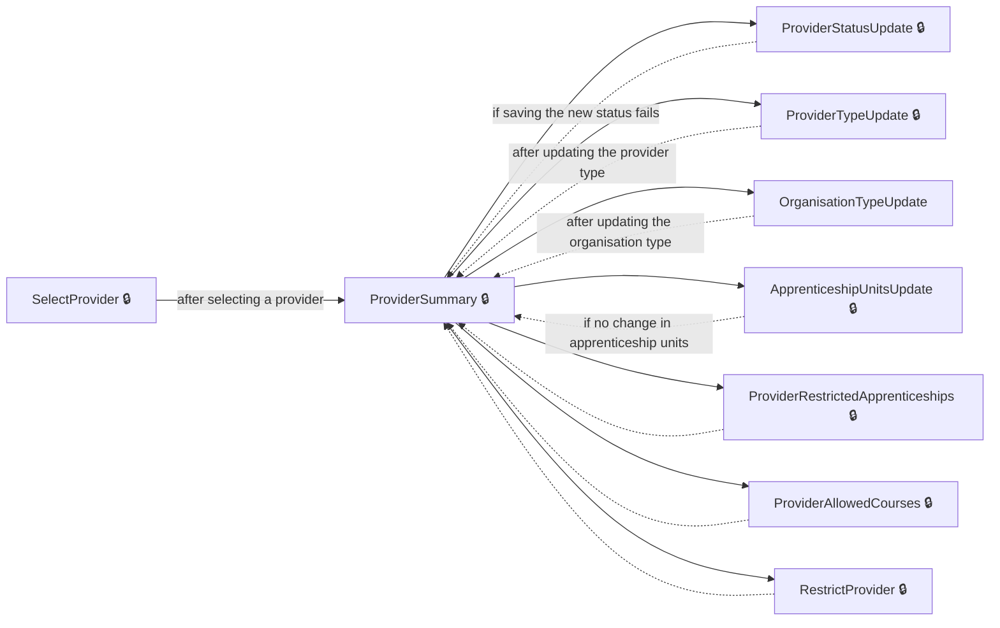

## Add a restricted course for a provider

Enables administrators to add a new restricted apprenticeship course for a provider.

## Change last start date for a restricted course of a provider

Allows administrators to change or set the last allowed start date for a restricted course a provider can deliver.

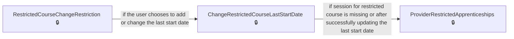

## Remove a restricted course from a provider

Allows administrators to remove a course restriction from a provider.

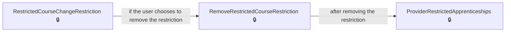

## Restrict a provider

Allows administrators to restrict a provider to only deliver approved courses.

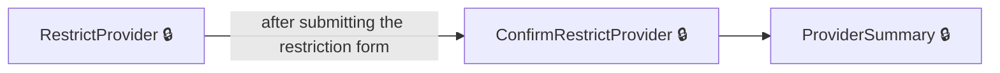

## Search and restrict an unrestricted course

Allows the user to search for an unrestricted course and restrict it.

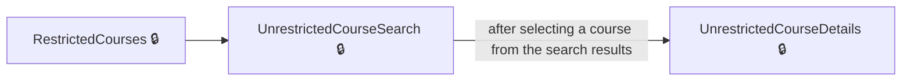

## Restrict an unrestricted course

Lets administrators restrict a course from unrestricted to restricted status.

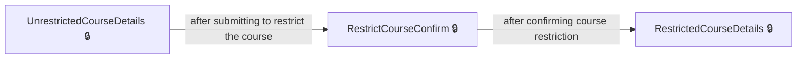

## Pages

| Page | Route | Sign-in | Purpose |
| --- | --- | --- | --- |
| `Account.SignedOut` | `SignedOut` | Unknown | Informs the user they have signed out of their account. |
| `AddProvider` | `providers/new/select` | Unknown | Lets the user enter a provider UKPRN and search for an organisation to add as a training provider. |
| `AddProviderConfirmation` | `providers/new/provider-details-summary/providers/new/provider-added` | Unknown | Confirms that a new provider has been added successfully. |
| `AddProviderToRestrictedCourse` | `restricted-courses/{larsCode}/providers/add` | Yes | Lets the user select and add a provider to a restricted course by UKPRN. |
| `AddRestrictedCourseLastStartDate` | `providers/{ukprn}/restricted-courses/add/set-last-start-date` | Yes | Lets administrators set the last allowed start date when adding a restricted course for a provider. |
| `ApprenticeshipUnitsUpdate` | `providers/{ukprn}/apprenticeship-units` | Yes | Lets the user select whether the provider offers apprenticeship units and updates their allowed course types. |
| `ApprenticeshipsUpdate` | `providers/{ukprn}/apprenticeships` | Unknown | Lets the user indicate whether the provider offers apprenticeships as part of updating provider course types. |
| `ChangeCourseRestriction` | `restricted-courses/{larsCode}/providers/{ukprn}/change-restriction` | Yes | Lets the user change the course restriction for a provider, including the last start date. |
| `ChangeRestrictedCourseLastStartDate` | `providers/{ukprn}/restricted-courses/{larsCode}/change-restriction/set-last-start-date` | Yes | Lets administrators change the last allowed start date for an existing restricted course for a provider. |
| `ConfirmAddProviderToRestrictedCourse` | `restricted-courses/{larsCode}/providers/confirm-add` | Yes | Lets the admin confirm adding a provider to deliver a restricted course. |
| `ConfirmProviderRestrictedCourse` | `providers/{ukprn}/restricted-courses/add/confirm` | Yes | Allows administrators to confirm adding a course to the provider's restricted apprenticeships list. |
| `ConfirmRestrictProvider` | `providers/{ukprn}/restrict/confirm` | Yes | Enables administrators to confirm restricting a provider to only deliver approved courses. |
| `Dashboard` | `/dashboard` | Unknown | Provides the main dashboard for administrators to access key management features. |
| `Home` | — | Yes | Serves as the home page for administrators to manage training providers and courses. |
| `OrganisationTypeUpdate` | `providers/{ukprn}/type` | Unknown | Lets the user update the organisation type for a provider. |
| `ProviderAllowedCourses` | `providers/{ukprn}/{routeLearningType}/allowed-courses` | Yes | Shows the list of allowed courses for a training provider based on learning type. |
| `ProviderDetails` | `providers/new/details` | Unknown | Shows the form for entering a new training provider's details. |
| `ProviderDetailsSummary` | `providers/new/provider-details-summary` | Unknown | Displays a summary of the new provider's details for review before submission. |
| `ProviderNotFoundInUkrlp` | `providers/new/not-found` | Unknown | Informs the user that the entered UKPRN was not found in UKRLP and allows them to try again. |
| `ProviderRemovalReasonUpdate` | `providers/{ukprn}/removal-reason` | Yes | Lets the user specify the reason for removing a provider from the register. |
| `ProviderRestrictedApprenticeships` | `providers/{ukprn}/restricted-courses` | Yes | Allows the user to view and manage the list of restricted apprenticeship courses for a provider. |
| `ProviderRestrictedCourseSearch` | `providers/{ukprn}/restricted-courses/add` | Yes | Lets the user search for and select an apprenticeship course to add to the provider's restricted courses. |
| `ProviderStatusUpdate` | `providers/{ukprn}/status` | Yes | Lets the user update the status of an individual training provider. |
| `ProviderStatusUpdateConfirmed` | `providers/{ukprn}/status/confirmed` | Yes | Shows confirmation that a provider's status has been updated. |
| `ProviderSummary` | `providers/{ukprn}` | Yes | Displays a summary of information and management links for a specific training provider. |
| `ProviderTypeUpdate` | `providers/{ukprn}/route` | Yes | Lets the user change the provider type for a training provider. |
| `RegisteredProviders.Index` | — | Unknown | Allows searching for registered providers by name or identifier. |
| `RemoveRestrictedCourseRestriction` | `providers/{ukprn}/restricted-courses/{larsCode}/change-restriction/remove-restriction` | Yes | Allows the user to remove restriction from a specific apprenticeship course for a provider. |
| `RestrictCourseConfirm` | `restricted-courses/add/{larsCode}/confirm` | Yes | Lets the admin confirm restricting a course from unrestricted to restricted status. |
| `RestrictProvider` | `providers/{ukprn}/restrict` | Yes | Lets the user start the process to restrict a provider for apprenticeship courses. |
| `RestrictedCourseChangeRestriction` | `providers/{ukprn}/restricted-courses/{larsCode}/change-restriction` | Yes | Allows the user to change restriction details or remove restriction for a specific apprenticeship course. |
| `RestrictedCourseDetails` | `restricted-courses/{larsCode}` | Yes | Shows details of a restricted course, including allowed providers and options to manage them. |
| `RestrictedCourses` | `restricted-courses` | Yes | Lists all restricted courses, with filtering and pagination options. |
| `SelectOfferApprenticeshipUnits` | `providers/new/offer-apprenticeship-units` | Unknown | Allows the user to specify whether the provider offers apprenticeship units. |
| `SelectOfferApprenticeships` | `providers/new/offer-apprenticeships` | Unknown | Allows the user to specify whether the provider offers apprenticeships. |
| `SelectOrganisationType` | `providers/new/organisation-type` | Unknown | Lets the user choose the type of organisation for the new provider. |
| `SelectProvider` | `providers` | Yes | Allows the user to select a training provider to manage. |
| `SelectProviderType` | `providers/new/provider-type` | Unknown | Lets the user choose the type of provider they are adding (e.g., Main, Employer, Supporting). |
| `UnrestrictedCourseDetails` | `unrestricted-courses/{larsCode}` | Yes | Shows details of an unrestricted course, with options to restrict it. |
| `UnrestrictedCourseSearch` | `unrestricted-courses/search` | Yes | Lets the admin search and select an unrestricted course to view details. |
