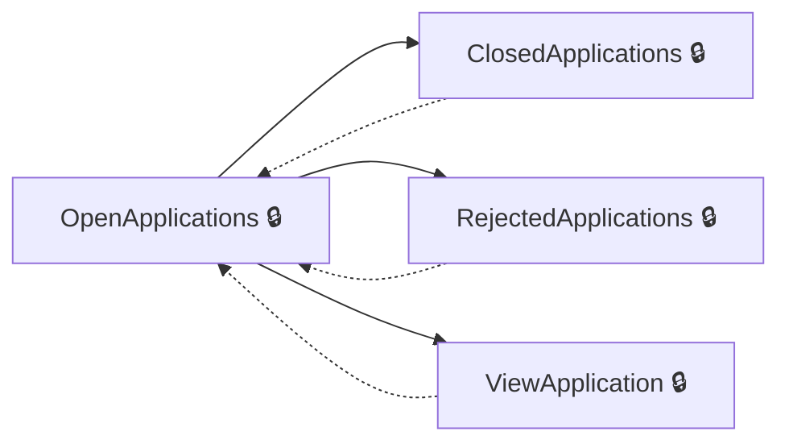
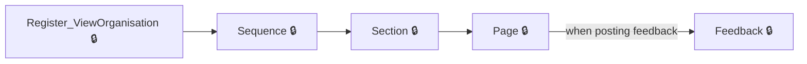
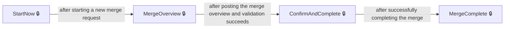

# User journeys: SkillsFundingAgency/das-admin-service

Generated from `master/src`: 216 pages, 244 transitions, 5 journeys. 🔒 means sign-in is required. Dotted arrows return to a hub.

## Review and manage financial applications

The user reviews open, closed, and rejected financial applications and grades them as appropriate.

Complete the sections in any order, returning to the hub.

## Amend or reprint a certificate

The user selects a certificate, provides amendment or reprint reasons, reviews, and confirms the request.

## Search and review a learner

The user searches for a learner and views their certificate details, including frameworks and standards.

## Review and give feedback on an application

A user reviews application sequences, completes assessments, and provides feedback page by page.

## Merge organisations

The user starts, reviews, and completes the merge process for two EPAOs, including confirmation and effective dates.

## Pages

| Page | Route | Sign-in | Purpose |
| --- | --- | --- | --- |
| `Account.AccessDenied` | — | Unknown | Shows a message when the user is denied access due to lack of valid role. |
| `Account.PostSignIn` | — | Unknown | Redirects the user after sign-in based on their role. |
| `Account.SignIn` | — | Unknown | Starts the sign-in process using the appropriate authentication scheme. |
| `Account.SignOut` | — | Unknown | Signs the user out by clearing cookies and ending authentication session. |
| `Account.SignedOut` | — | Unknown | Redirects the user after sign-out. |
| `Application.ActiveSequence` | `/Applications/{applicationId}/{backAction}/{backController}/{backOrganisationId?}` | Yes | Shows the currently active application sequence for review. |
| `Application.Assessment` | `/Applications/{applicationId}/{backAction}/{backController}/Sequence/{sequenceNo}/Assessment/{backOrganisationId?}` | Yes | Allows reviewing the assessment of the application sequence. |
| `Application.DeleteFeedback` | `/Applications/{applicationId}/{backAction}/{backController}/Sequence/{sequenceNo}/Section/{sectionNo}/Page/{pageId}/{feedbackId}/{backOrganisationId?}` | Yes | Deletes feedback from a page of an application section. |
| `Application.DownloadFile` | `Application/{applicationId}/Sequence/{sequenceNo}/Section/{sectionNo}/Page/{pageId}/Question/{questionId}/{filename}/Download` | Yes | Allows downloading a file that was uploaded as part of an application. |
| `Application.EvaluateSection` | `/Applications/{applicationId}/{backAction}/{backController}/Sequence/{sequenceNo}/Section/{sectionNo}/{backOrganisationId?}` | Yes | Lets the reviewer mark an application section as complete or incomplete. |
| `Application.Feedback` | `/Applications/{applicationId}/{backAction}/{backController}/Sequence/{sequenceNo}/Section/{sectionNo}/Page/{pageId}/{backOrganisationId?}` | Yes | Allows posting feedback about a specific application page. |
| `Application.Page` | `/Applications/{applicationId}/{backAction}/{backController}/Sequence/{sequenceNo}/Section/{sectionNo}/Page/{pageId}/{backOrganisationId?}` | Yes | Shows the details of a specific page within an application section, and allows feedback. |
| `Application.Return` | `/Applications/{applicationId}/{backAction}/{backController}/Sequence/{sequenceNo}/Return/{backOrganisationId?}` | Yes | Handles returning an application sequence for further actions. |
| `Application.Section` | `/Applications/{applicationId}/{backAction}/{backController}/Sequence/{sequenceNo}/Section/{sectionNo}/{backOrganisationId?}` | Yes | Shows the details of a section within an application sequence, and allows marking it complete. |
| `Application.Sequence` | `/Applications/{applicationId}/{backAction}/{backController}/Sequence/{sequenceNo}/{backOrganisationId?}` | Yes | Displays information about a specific sequence in the application. |
| `Application.WithdrawalDateChange` | `/Applications/{applicationId}/{backAction}/{backController}/Sequence/{sequenceNo}/WithdrawalDateChange/{backOrganisationId?}` | Yes | Allows the user to enter a new withdrawal date for an application. |
| `Application.WithdrawalDateCheck` | `/Applications/{applicationId}/{backAction}/{backController}/Sequence/{sequenceNo}/WithdrawalDateCheck/{backOrganisationId?}` | Yes | Allows the user to approve or reject the proposed withdrawal date for an application. |
| `Application.WithdrawalDateCheckSave` | `/Applications/{applicationId}/{backAction}/{backController}/Sequence/{sequenceNo}/WithdrawalDateCheck/{backOrganisationId?}` | Yes | Handles approval or rejection of the withdrawal date after user input. |
| `AuditDetails` | `audit-details` | Yes | Lets the user provide audit details for deleting a certificate, including ticket/incident number and reason for change. |
| `BatchSearch.Index` | — | Yes | Lets the user search and view batches for certificate processing. |
| `BatchSearch.Results` | — | Yes | Shows the results for a batch search. |
| `CertificateAddress.Address` | — | Unknown | Allows the user to view and edit the address on a certificate. |
| `CertificateAmend.AmendReason` | — | Yes | Lets the user supply a reason for amending certificate information. |
| `CertificateAmend.Check` | — | Yes | Allows the user to review the details of a certificate change or reprint request. |
| `CertificateAmend.ConfirmAmend` | — | Yes | Allows the user to confirm the amendment of certificate information. |
| `CertificateAmend.ConfirmReprint` | — | Yes | Allows the user to confirm the reprint of a certificate. |
| `CertificateAmend.ReprintReason` | — | Yes | Lets the user specify reasons and details for requesting a certificate reprint. |
| `CertificateDate.Date` | — | Unknown | Lets the user enter or confirm the certificate date. |
| `CertificateGrade.Grade` | — | Unknown | Lets the user enter or confirm the grade for the certificate. |
| `CertificateNames.FamilyName` | `certificate/familyname` | Yes | Allows the user to enter or amend the family name on the certificate. |
| `CertificateNames.GivenNames` | `certificate/givennames` | Yes | Allows the user to enter or amend the given names on the certificate. |
| `CertificateOption.Option` | — | Unknown | Lets the user select or review the course option for the certificate. |
| `CertificateSendTo.SendTo` | — | Unknown | Lets the user specify the recipient of the certificate. |
| `CertificateVersion.Version` | — | Unknown | Lets the user select or review the version of the standard for the certificate. |
| `ConfirmAndSubmit` | `confirm-delete-certificate` | Yes | Lets the user confirm if they wish to delete a certificate. |
| `ConfirmDelete` | `check-your-answers` | Yes | Lets the user check their answers before deleting a certificate. |
| `Dashboard.Index` | — | Yes | Shows the main dashboard with application review statistics. |
| `Date` | — | Unknown | Lets the user enter or confirm the certificate date. |
| `DigitalAccessController.CertificateChangeRequest` | `digital-access/reference/{referenceNumber}/certificate-change-request` | Yes | Displays a request page for certificate changes for a user reference. |
| `DigitalAccessController.CertificatePrintRequest` | `digital-access/reference/{referenceNumber}/certificate-print-request` | Yes | Displays a request page for certificate reprint for a user reference. |
| `DigitalAccessController.DigitalAccessReferenceSearch` | `digital-access/reference` | Yes | Lets the user search for digital access by entering a reference number. |
| `DigitalAccessController.NonSpecificContactRequest` | `digital-access/reference/{referenceNumber}/non-specific-contact-request` | Yes | Displays a page for making a non-specific contact request for a user reference. |
| `DigitalAccessController.RestoreAccess` | `digital-access/reference/{referenceNumber}/restore` | Yes | Allows an administrator to restore access for a user reference. |
| `DigitalAccessController.UserNotFound` | `digital-access/reference/{referenceNumber}/not-found` | Yes | Shows a message when a user reference cannot be found. |
| `DigitalAccessController.UserNotMatched` | `digital-access/reference/{referenceNumber}/not-matched` | Yes | Shows a message when a user reference does not match any records. |
| `DownloadRoatp.ApplicationDownload` | `application-download` | Yes | Lets the user request a CSV download of application oversight outcomes within a date range. |
| `DownloadRoatp.ApplicationDownloadCsv` | `application-download/download` | Yes | Returns the CSV download of application oversight outcomes for the requested date range. |
| `DownloadRoatp.Download` | `download-register` | Yes | Allows the user to download the register of apprenticeship training providers. |
| `ExternalApi.DeleteUser` | — | Yes | Deletes a user from the external API system. |
| `ExternalApi.DisableUser` | — | Yes | Disables a user in the external API system. |
| `ExternalApi.EnableUser` | — | Yes | Enables a user in the external API system. |
| `ExternalApi.Index` | — | Yes | Shows a list of external API users. |
| `ExternalApi.RenewPrimaryKey` | — | Yes | Renews the primary subscription key for a user. |
| `ExternalApi.RenewSecondaryKey` | — | Yes | Renews the secondary subscription key for a user. |
| `ExternalApi.UserDetails` | — | Yes | Shows the details for a user in the external API system. |
| `Financial.ClosedApplications` | `/Financial/Closed` | Yes | Displays closed financial applications for review. |
| `Financial.DownloadFiles` | `/Financial/Download/Organisation/{OrgId}/Application/{ApplicationId}` | Yes | Allows the user to download financial documents for an organisation's application. |
| `Financial.Evaluated` | `/Financial/{Id}/Evaluated` | Yes | Shows the graded (evaluated) financial application. |
| `Financial.Grade` | `/Financial` | Yes | Allows the user to set a grade and financial due date for a financial application. |
| `Financial.OpenApplications` | `/Financial/Open` | Yes | Displays open financial applications for review. |
| `Financial.RejectedApplications` | `/Financial/Rejected` | Yes | Displays financial applications which received feedback or were graded as Inadequate. |
| `Financial.ViewApplication` | `/Financial/{Id}` | Yes | Lets the user review or grade a financial application. |
| `Financial.ViewGradedApplication` | `/Financial/{Id}/Graded` | Yes | Displays the graded financial application in a read-only format. |
| `Grade` | — | Unknown | Allows the user to set or update the certificate grade. |
| `Home.Index` | — | Unknown | Landing page for users, redirects to dashboard if signed in. |
| `Home.InvalidRole` | — | Unknown | Shows an error page for users with invalid roles. |
| `MergeOrganisations.ChangeMergeEntriesPerPage` | `merge-organisations/log/change-entries-per-page` | Yes | Allows the user to change the number of merge log entries displayed per page. |
| `MergeOrganisations.ChangeMergeLogEntriesPageIndex` | `merge-organisations/log/change-page` | Yes | Allows the user to change the current page of the merge log list. |
| `MergeOrganisations.CompletedMergeOverview` | `merge-organisations/log/{logId}` | Yes | Shows the completed merge details for a given log entry. |
| `MergeOrganisations.ConfirmAndComplete` | `merge-organisations/confirm-and-complete` | Yes | Allows the user to confirm the organisation merge and finish the process. |
| `MergeOrganisations.ConfirmEpao` | `merge-organisations/confirm/{mergeOrganisationType}/{epaoId}` | Yes | Lets the user confirm the selected EPAO for merging as either primary or secondary. |
| `MergeOrganisations.EpaoSearchResults` | `merge-organisations/results/{mergeOrganisationType}` | Yes | Shows search results for EPAOs when merging organisations. |
| `MergeOrganisations.Index` | `merge-organisations` | Yes | Starting point for merge organisations functionality. |
| `MergeOrganisations.MergeComplete` | `merge-organisations/complete` | Yes | Shows a summary of the completed merge between organisations. |
| `MergeOrganisations.MergeLog` | `merge-organisations/log` | Yes | Displays a log of past merge operations between organisations. |
| `MergeOrganisations.MergeOverview` | `merge-organisations/overview` | Yes | Shows a summary of the current merge request, including details of the primary and secondary EPAOs. |
| `MergeOrganisations.SearchEpao` | `merge-organisations/search/{mergeOrganisationType}` | Yes | Allows the user to search for an EPAO to select for merging. |
| `MergeOrganisations.SetSecondaryEpaoEffectiveToDate` | `merge-organisations/set-effective-to` | Yes | Lets the user set the 'effective to' date for the secondary EPAO in the merge. |
| `MergeOrganisations.SortMergeLogEntries` | — | Yes | — |
| `MergeOrganisations.Start` | `merge-organisations/start` | Yes | Lets the user begin the process of merging organisations. |
| `MergeOrganisations.StartNow` | `merge-organisations/start` | Yes | — |
| `Option` | — | Unknown | Lets the user select or review the course option for the certificate. |
| `OrganisationApplication.ChangeApplicationsPerPageApprovedApplications` | — | Yes | Handles changing the number of approved applications shown per page. |
| `OrganisationApplication.ChangeApplicationsPerPageApprovedApplicationsPartial` | — | Yes | Handles updating the approved applications shown per page in a partial view. |
| `OrganisationApplication.ChangeApplicationsPerPageFeedbackApplications` | — | Yes | Handles changing the number of feedback applications shown per page. |
| `OrganisationApplication.ChangeApplicationsPerPageFeedbackApplicationsPartial` | — | Yes | Handles updating the feedback applications shown per page in a partial view. |
| `OrganisationApplication.ChangeApplicationsPerPageInProgressApplications` | — | Yes | Lets the user change the number of in-progress organisation applications shown per page. |
| `OrganisationApplication.ChangeApplicationsPerPageInProgressApplicationsPartial` | — | Yes | Lets the user change the number of in-progress organisation applications shown per page in a partial view. |
| `OrganisationApplication.ChangeApplicationsPerPageNewApplications` | — | Yes | Lets the user change the number of new organisation applications shown per page. |
| `OrganisationApplication.ChangeApplicationsPerPageNewApplicationsPartial` | — | Yes | Lets the user change the number of new organisation applications shown per page in a partial view. |
| `OrganisationApplication.ChangePageApprovedApplications` | — | Yes | Lets the user change the page of approved organisation applications being viewed. |
| `OrganisationApplication.ChangePageApprovedApplicationsPartial` | — | Yes | Lets the user change the page of approved organisation applications being viewed in a partial view. |
| `OrganisationApplication.ChangePageFeedbackApplications` | — | Yes | Lets the user change the page of organisation applications that have feedback being viewed. |
| `OrganisationApplication.ChangePageFeedbackApplicationsPartial` | — | Yes | Lets the user change the page of organisation applications that have feedback being viewed in a partial view. |
| `OrganisationApplication.ChangePageInProgressApplications` | — | Yes | Lets the user change the page of in-progress organisation applications being viewed. |
| `OrganisationApplication.ChangePageInProgressApplicationsPartial` | — | Yes | Lets the user change the page of in-progress organisation applications being viewed in a partial view. |
| `OrganisationApplication.ChangePageNewApplications` | — | Yes | Lets the user change the page of new organisation applications being viewed. |
| `OrganisationApplication.ChangePageNewApplicationsPartial` | — | Yes | Lets the user change the page of new organisation applications being viewed in a partial view. |
| `OrganisationApplication.Index` | — | Yes | Shows the entry point for managing organisation applications, resetting settings related to paging and sorting. |
| `OrganisationApplication.OrganisationApplications` | — | Yes | Displays lists of organisation applications in various statuses such as new, in progress, feedback, and approved. |
| `OrganisationApplication.ResetSession` | — | Yes | Lets the user reset paging, sorting, and session settings for organisation applications. |
| `OrganisationApplication.SortApprovedApplications` | — | Yes | Allows sorting of approved organisation applications in the dashboard. |
| `OrganisationApplication.SortApprovedApplicationsPartial` | — | Yes | Allows partial sorting (AJAX update) of approved organisation applications in the dashboard. |
| `OrganisationApplication.SortFeedbackApplications` | — | Yes | Allows sorting of organisation applications that have feedback in the dashboard. |
| `OrganisationApplication.SortFeedbackApplicationsPartial` | — | Yes | Allows partial sorting (AJAX update) of organisation applications that have feedback in the dashboard. |
| `OrganisationApplication.SortInProgressApplications` | — | Yes | Allows sorting of in-progress organisation applications in the dashboard. |
| `OrganisationApplication.SortInProgressApplicationsPartial` | — | Yes | Allows partial sorting (AJAX update) of in-progress organisation applications in the dashboard. |
| `OrganisationApplication.SortNewApplications` | — | Yes | Allows sorting of new organisation applications in the dashboard. |
| `OrganisationApplication.SortNewApplicationsPartial` | — | Yes | Allows partial sorting (AJAX update) of new organisation applications in the dashboard. |
| `Register.AddContact` | `register/add-contact/{organisationId}` | Yes | Lets the user add a new contact for an organisation. |
| `Register.AddOrganisation` | `register/add-organisation` | Yes | Lets the user add a new organisation to the system. |
| `Register.ChangePageViewOrganisationApprovedStandardsPartial` | — | Yes | Allows changing the number of items per page shown for approved standards of an organisation (via partial update). |
| `Register.ChangeStandardsPerPageViewOrganisationApprovedStandards` | — | Yes | Changes the number of approved standards shown per page for an organisation. |
| `Register.ChangeStandardsPerPageViewOrganisationApprovedStandardsPartial` | — | Yes | Allows changing the number of standards per page for an organisation's approved standards (via partial update). |
| `Register.EditContact` | `register/edit-contact/{contactId}` | Yes | Lets the user edit a contact's details. |
| `Register.EditOrganisation` | `register/edit-organisation/{organisationId}` | Yes | Lets the user edit an organisation's details. |
| `Register.EditOrganisationStandard` | `register/edit-standard/{organisationStandardId}` | Yes | Lets the user edit an organisation's approved standard details. |
| `Register.EditStandardVersion` | `register/edit-standard/{organisationStandardId}/{organisationStandardVersion}` | Yes | Allows editing the effective from and to dates for a specific version of an organisation's standard. |
| `Register.Index` | — | Yes | Lets the user search for an organisation in the register. |
| `Register.Results` | `register/results` | Yes | Shows results of an organisation search. |
| `Register.SearchStandards` | `register/search-standards/{organisationId}` | Yes | Lets the user search for standards to add to an organisation. |
| `Register.SearchStandardsResults` | `register/search-standards-results` | Yes | Shows results of a standard search for an organisation. |
| `Register.SortViewOrganisationApprovedStandards` | — | Yes | Allows sorting the approved standards for an organisation. |
| `Register.SortViewOrganisationApprovedStandardsPartial` | — | Yes | Allows sorting the approved standards for an organisation (via partial update). |
| `Register.ViewContact` | `register/view-contact/{contactId}` | Yes | Shows the details for a contact. |
| `RegisterUserController_Details` | `register/view-user/{contactId}` | Yes | Displays contact details for a user. |
| `RegisterUser_EditPermissions` | `register/{contactId}/user-permissions` | Yes | Lets the user edit permissions for another user. |
| `RegisterUser_Remove` | `register/{contactId}/remove` | Yes | Lets the user confirm removal of a user from an organisation. |
| `RegisterUser_Removed` | `register/{contactId}/removedFrom/{organisationId}` | Yes | Shows confirmation that a user was removed from an organisation. |
| `Register_ChangePageViewOrganisationApprovedStandards` | `register/view-organisation-approved-standards/{organisationId}/page-index/{pageIndex}` | Yes | Handles changing the page index for viewing approved standards of an organisation. |
| `Register_SetStatusAndNotify` | `register/set-status-user/{organisationId}/{contactId}/{status}` | Yes | Sets a user's status for an organisation and optionally notifies them. |
| `Register_ViewOrganisation` | `register/view-organisation/{organisationId}` | Yes | Shows the details for an organisation, including approved standards. |
| `Register_ViewStandard` | `register/view-standard/{organisationStandardId}` | Yes | Shows the details of an organisation's approved standard. |
| `Reports.Index` | — | Yes | Lets the user select a report to view or download. |
| `Reports.Run` | — | Yes | Runs and displays the selected report. |
| `RoatpAllowedProviders.AddUkprn` | `/Roatp/AllowedProviders` | Yes | Lets the user add a new provider UKPRN to the allowed providers list. |
| `RoatpAllowedProviders.ConfirmRemoveUkprn` | `/Roatp/AllowedProviders/{ukprn}/ConfirmRemove` | Yes | Lets the user confirm removal of a provider from the allowed list. |
| `RoatpAllowedProviders.Index` | `/Roatp/AllowedProviders` | Yes | Allows the user to view and add allowed providers, specifying UKPRN and date range. |
| `RoatpAllowedProviders.RemoveUkprn` | `/Roatp/AllowedProviders/{ukprn}/ConfirmRemove` | Yes | Lets the user confirm removal of a provider UKPRN from the allowed providers list. |
| `RoatpAllowedProviders.UkprnRemoved` | `/Roatp/AllowedProviders/{ukprn}/Removed` | Yes | Shows confirmation that a provider UKPRN was removed from the allowed providers list. |
| `ScheduleConfig.Create` | — | Yes | Lets the user create a scheduled job specifying the date, time, and recurrence. |
| `ScheduleConfig.Delete` | — | Yes | Allows the user to delete a scheduled job. |
| `ScheduleConfig.Index` | — | Yes | Displays the list of scheduled jobs. |
| `ScheduleConfig.Restart` | — | Yes | Lets the user restart a scheduled job. |
| `ScheduleConfig.RunNow` | — | Yes | Lets the user run a scheduled job immediately. |
| `Search.FrameworkLearnerDetails` | — | Yes | Shows details of a selected framework learner. |
| `Search.FrameworkLearnerDetailsBackAction` | — | Yes | Handles back navigation for framework learner details. |
| `Search.FrameworkMultipleResults` | — | Yes | Lets the user select from multiple framework learner search results. |
| `Search.FrameworkNoResults` | — | Yes | Tells the user that no framework learner results were found. |
| `Search.FrameworkReprintAddress` | — | Yes | Collects the address where the reprinted certificate should be sent. |
| `Search.FrameworkReprintCheckDetails` | — | Yes | Shows all details to check before requesting a certificate reprint for a framework learner. |
| `Search.FrameworkReprintReason` | — | Yes | Collects the reason for requesting a reprint of a framework certificate. |
| `Search.FrameworkReprintSubmit` | — | Yes | Submits the certificate reprint request for a framework learner. |
| `Search.FrameworkReprintSubmitted` | `FrameworkReprintSubmitted` | Yes | Confirms that the certificate reprint request was submitted. |
| `Search.Index` | — | Yes | Lets the user search for learners (standards or frameworks) by name, code, and (for frameworks) date of birth. |
| `Search.LearnerDetails` | `learner-details` | Yes | Shows details of a selected standard learner. |
| `Search.ResetBackToCheckAnswersAndRedirect` | — | Yes | Resets the workflow and redirects back to check answers. |
| `Search.Results` | — | Yes | Shows search results for learners based on the search criteria. |
| `Search.SelectFrameworkLearner` | — | Yes | Handles framework learner selection from multiple results. |
| `SendTo` | — | Unknown | Lets the user specify the recipient of the certificate. |
| `StandardApplication.ChangeApplicationsPerPageApprovedApplications` | — | Yes | Lets the user change the number of approved standard applications displayed per page. |
| `StandardApplication.ChangeApplicationsPerPageApprovedApplicationsPartial` | — | Yes | Lets the user change the number of approved standard applications displayed per page, with partial (AJAX) update. |
| `StandardApplication.ChangeApplicationsPerPageFeedbackApplications` | — | Yes | Lets the user change the number of standard applications with feedback displayed per page. |
| `StandardApplication.ChangeApplicationsPerPageFeedbackApplicationsPartial` | — | Yes | Lets the user change the number of standard applications with feedback displayed per page, with partial (AJAX) update. |
| `StandardApplication.ChangeApplicationsPerPageInProgressApplications` | — | Yes | Lets the user change the number of in-progress standard applications displayed per page. |
| `StandardApplication.ChangeApplicationsPerPageInProgressApplicationsPartial` | — | Yes | Lets the user change the number of in-progress standard applications displayed per page, with partial (AJAX) update. |
| `StandardApplication.ChangeApplicationsPerPageNewApplications` | — | Yes | Lets the user change the number of new standard applications displayed per page. |
| `StandardApplication.ChangeApplicationsPerPageNewApplicationsPartial` | — | Yes | Lets the user change how many new standard applications are shown per page in the partial view. |
| `StandardApplication.ChangePageApprovedApplications` | — | Yes | Lets the user navigate to a different page of approved standard applications. |
| `StandardApplication.ChangePageApprovedApplicationsPartial` | — | Yes | Lets the user navigate to a different page of approved standard applications in the partial view. |
| `StandardApplication.ChangePageFeedbackApplications` | — | Yes | Lets the user navigate to a different page of standard applications with feedback. |
| `StandardApplication.ChangePageFeedbackApplicationsPartial` | — | Yes | Lets the user navigate to a different page of standard applications with feedback in the partial view. |
| `StandardApplication.ChangePageInProgressApplications` | — | Yes | Lets the user navigate to a different page of standard applications in progress. |
| `StandardApplication.ChangePageInProgressApplicationsPartial` | — | Yes | Lets the user navigate to a different page of standard applications in progress in the partial view. |
| `StandardApplication.ChangePageNewApplications` | — | Yes | Lets the user navigate to a different page of new standard applications. |
| `StandardApplication.ChangePageNewApplicationsPartial` | — | Yes | Lets the user navigate to a different page of new standard applications in the partial view. |
| `StandardApplication.Index` | — | Yes | Lets the user reset sorting and paging for the standard applications list. |
| `StandardApplication.ResetSession` | — | Yes | Resets paging and sorting session settings for the standard applications list. |
| `StandardApplication.SortApprovedApplications` | — | Yes | Lets the user change the sorting of approved standard applications. |
| `StandardApplication.SortApprovedApplicationsPartial` | — | Yes | Lets the user change the sorting of approved standard applications in the partial view. |
| `StandardApplication.SortFeedbackApplications` | — | Yes | Lets the user change the sorting of standard applications with feedback. |
| `StandardApplication.SortFeedbackApplicationsPartial` | — | Yes | Lets the user change the sorting of standard applications with feedback in the partial view. |
| `StandardApplication.SortInProgressApplications` | — | Yes | Allows the user to sort in-progress standard applications. |
| `StandardApplication.SortInProgressApplicationsPartial` | — | Yes | Allows the user to sort in-progress standard applications in a partial view. |
| `StandardApplication.SortNewApplications` | — | Yes | Allows the user to sort new standard applications. |
| `StandardApplication.SortNewApplicationsPartial` | — | Yes | Allows the user to sort new standard applications in a partial view. |
| `StandardApplication.StandardApplications` | — | Yes | Displays a dashboard of standard applications with options to filter, sort and change pagination. |
| `SuccessfulDelete` | `successfully-deleted-this-certificate` | Yes | Shows that the certificate has been successfully deleted. |
| `Version` | — | Unknown | Lets the user select or review the version of the standard for the certificate. |
| `WithdrawalApplication.ChangeApplicationsPerPageApprovedApplications` | — | Yes | Lets the user change the number of approved withdrawal applications shown per page. |
| `WithdrawalApplication.ChangeApplicationsPerPageApprovedApplicationsPartial` | — | Yes | Lets the user change the number of approved withdrawal applications shown per page in a partial view. |
| `WithdrawalApplication.ChangeApplicationsPerPageFeedbackApplications` | — | Yes | Lets the user change the number of feedback withdrawal applications shown per page. |
| `WithdrawalApplication.ChangeApplicationsPerPageFeedbackApplicationsPartial` | — | Yes | Lets the user change the number of feedback withdrawal applications shown per page in a partial view. |
| `WithdrawalApplication.ChangeApplicationsPerPageInProgressApplications` | — | Yes | Lets the user change the number of in-progress withdrawal applications shown per page. |
| `WithdrawalApplication.ChangeApplicationsPerPageInProgressApplicationsPartial` | — | Yes | Lets the user change the number of in-progress withdrawal applications shown per page in a partial view. |
| `WithdrawalApplication.ChangeApplicationsPerPageNewApplications` | — | Yes | Lets the user change the number of new withdrawal applications shown per page. |
| `WithdrawalApplication.ChangeApplicationsPerPageNewApplicationsPartial` | — | Yes | Lets the user change the number of new withdrawal applications shown per page in a partial view. |
| `WithdrawalApplication.ChangePageApprovedApplications` | — | Yes | Lets the user change the page of approved withdrawal applications. |
| `WithdrawalApplication.ChangePageApprovedApplicationsPartial` | — | Yes | Lets the user change the page of approved withdrawal applications in a partial view. |
| `WithdrawalApplication.ChangePageFeedbackApplications` | — | Yes | Lets the user change the page of feedback withdrawal applications. |
| `WithdrawalApplication.ChangePageFeedbackApplicationsPartial` | — | Yes | Lets the user change the page of feedback withdrawal applications in a partial view. |
| `WithdrawalApplication.ChangePageInProgressApplications` | — | Yes | Lets the user change the page of in-progress withdrawal applications. |
| `WithdrawalApplication.ChangePageInProgressApplicationsPartial` | — | Yes | Lets the user change the page of in-progress withdrawal applications in a partial view. |
| `WithdrawalApplication.ChangePageNewApplications` | — | Yes | Lets the user change the page of new withdrawal applications. |
| `WithdrawalApplication.ChangePageNewApplicationsPartial` | — | Yes | Shows a partial view to change the page of new withdrawal applications. |
| `WithdrawalApplication.Index` | — | Yes | Allows the user to reset view sorting and paging for withdrawal applications. |
| `WithdrawalApplication.ResetSession` | — | Yes | Resets the session state for withdrawal applications and paging settings. |
| `WithdrawalApplication.SortApprovedApplications` | — | Yes | Lets the user sort approved withdrawal applications. |
| `WithdrawalApplication.SortApprovedApplicationsPartial` | — | Yes | Displays a partial view for sorting approved withdrawal applications. |
| `WithdrawalApplication.SortFeedbackApplications` | — | Yes | Lets the user sort withdrawal applications that have feedback. |
| `WithdrawalApplication.SortFeedbackApplicationsPartial` | — | Yes | Displays a partial view for sorting withdrawal applications with feedback. |
| `WithdrawalApplication.SortInProgressApplications` | — | Yes | Lets the user sort withdrawal applications that are in progress. |
| `WithdrawalApplication.SortInProgressApplicationsPartial` | — | Yes | Displays a partial view for sorting in-progress withdrawal applications. |
| `WithdrawalApplication.SortNewApplications` | — | Yes | Lets the user sort new withdrawal applications. |
| `WithdrawalApplication.SortNewApplicationsPartial` | — | Yes | Displays a partial view for sorting new withdrawal applications. |
| `WithdrawalApplication.WithdrawalApplications` | — | Yes | Displays a dashboard of withdrawal applications segmented by review status. |

## Form fields

Field definitions only: no values a user enters are recorded.

### `Application.Page`

| Field | Type | Label | Required | Rules | Options |
| --- | --- | --- | --- | --- | --- |
| `FeedbackMessage` | textarea | — | — | required if posting feedback; must not be empty or whitespace | — |

### `Application.Section`

| Field | Type | Label | Required | Rules | Options |
| --- | --- | --- | --- | --- | --- |
| `IsSectionComplete` | radios | Is this section complete? | — | required; must specify if the section is complete | Yes, No |

### `Application.WithdrawalDateChange`

| Field | Type | Label | Required | Rules | Options |
| --- | --- | --- | --- | --- | --- |
| `EffectiveToDay` | text | Day | — | required; must form a valid date with month and year; date must be entered. | — |
| `EffectiveToMonth` | text | Month | — | required; must form a valid date with day and year; date must be entered. | — |
| `EffectiveToYear` | text | Year | — | required; must form a valid date with day and month; date must be entered. | — |

### `Application.WithdrawalDateCheck`

| Field | Type | Label | Required | Rules | Options |
| --- | --- | --- | --- | --- | --- |
| `dateApproved` | radios | Do you approve this withdrawal date? | — | required; must be 'YES' or 'NO'. | Yes, No, input date manually |

### `AuditDetails`

| Field | Type | Label | Required | Rules | Options |
| --- | --- | --- | --- | --- | --- |
| `ReasonForChange` | textarea | What’s the relevant Zendesk ticket number or Servicenow incident number? | — | required; at most 500 words | — |
| `IncidentNumber` | text | — | — | required | — |

### `BatchSearch.Index`

| Field | Type | Label | Required | Rules | Options |
| --- | --- | --- | --- | --- | --- |
| `BatchNumber` | number | — | — | — | — |

### `CertificateAmend.AmendReason`

| Field | Type | Label | Required | Rules | Options |
| --- | --- | --- | --- | --- | --- |
| `IncidentNumber` | text | Enter the ticket reference number | — | required | — |
| `reasons` | checkboxes | Reason for amending certificate information | — | required | Other |
| `OtherReason` | textarea | Give details | — | required when 'Other' is selected; at most 200 characters | — |

### `CertificateAmend.ReprintReason`

| Field | Type | Label | Required | Rules | Options |
| --- | --- | --- | --- | --- | --- |
| `IncidentNumber` | text | Enter the ticket reference number | — | required | — |
| `reasons` | checkboxes | Reason for requesting a certificate reprint | — | required | Other |
| `OtherReason` | textarea | Give details | — | required when 'Other' is selected in reasons; at most 200 characters | — |

### `ConfirmAndSubmit`

| Field | Type | Label | Required | Rules | Options |
| --- | --- | --- | --- | --- | --- |
| `IsDeleteConfirmed` | radios | Are you sure you want to delete 's certificate? | — | required | Yes, No |

### `DigitalAccessController.DigitalAccessReferenceSearch`

| Field | Type | Label | Required | Rules | Options |
| --- | --- | --- | --- | --- | --- |
| `ReferenceNumber` | text | Digital access reference | — | required; must be alphanumeric | — |

### `DownloadRoatp.ApplicationDownload`

| Field | Type | Label | Required | Rules | Options |
| --- | --- | --- | --- | --- | --- |
| `FromDate` | text | Date from | — | required; ToDate must be on or after FromDate when both are provided | — |
| `ToDate` | text | Date to | — | required | — |

### `DownloadRoatp.ApplicationDownloadCsv`

| Field | Type | Label | Required | Rules | Options |
| --- | --- | --- | --- | --- | --- |
| `FromDate` | text | Date from | — | required; ToDate must be on or after FromDate when both are provided | — |
| `ToDate` | text | Date to | — | required | — |

### `Financial.Grade`

| Field | Type | Label | Required | Rules | Options |
| --- | --- | --- | --- | --- | --- |
| `Grade.SelectedGrade` | radios | — | — | required; must select a grade. | — |
| `OutstandingFinancialDueDate.Day` | number | — | — | required if 'Outstanding' grade selected; must form a valid date; must be a future date. | — |
| `OutstandingFinancialDueDate.Month` | number | — | — | required if 'Outstanding' grade selected; must form a valid date; must be a future date. | — |
| `OutstandingFinancialDueDate.Year` | number | — | — | required if 'Outstanding' grade selected; must form a valid date; must be a future date. | — |
| `GoodFinancialDueDate.Day` | number | — | — | required if 'Good' grade selected; must form a valid date; must be a future date. | — |
| `GoodFinancialDueDate.Month` | number | — | — | required if 'Good' grade selected; must form a valid date; must be a future date. | — |
| `GoodFinancialDueDate.Year` | number | — | — | required if 'Good' grade selected; must form a valid date; must be a future date. | — |
| `SatisfactoryFinancialDueDate.Day` | number | — | — | required if 'Satisfactory' grade selected; must form a valid date; must be a future date. | — |
| `SatisfactoryFinancialDueDate.Month` | number | — | — | required if 'Satisfactory' grade selected; must form a valid date; must be a future date. | — |
| `SatisfactoryFinancialDueDate.Year` | number | — | — | required if 'Satisfactory' grade selected; must form a valid date; must be a future date. | — |
| `MonitoringFinancialDueDate.Day` | number | — | — | required if 'Monitoring' grade selected; must form a valid date; must be a future date. | — |
| `MonitoringFinancialDueDate.Month` | number | — | — | required if 'Monitoring' grade selected; must form a valid date; must be a future date. | — |
| `MonitoringFinancialDueDate.Year` | number | — | — | required if 'Monitoring' grade selected; must form a valid date; must be a future date. | — |
| `Grade.InadequateMoreInformation` | textarea | — | — | required if 'Inadequate' grade selected. | — |

### `Financial.ViewApplication`

| Field | Type | Label | Required | Rules | Options |
| --- | --- | --- | --- | --- | --- |
| `Grade.SelectedGrade` | radios | — | — | required; must select a grade. | — |
| `OutstandingFinancialDueDate.Day` | number | — | — | required if 'Outstanding' grade selected; must form a valid date; must be a future date. | — |
| `OutstandingFinancialDueDate.Month` | number | — | — | required if 'Outstanding' grade selected; must form a valid date; must be a future date. | — |
| `OutstandingFinancialDueDate.Year` | number | — | — | required if 'Outstanding' grade selected; must form a valid date; must be a future date. | — |
| `GoodFinancialDueDate.Day` | number | — | — | required if 'Good' grade selected; must form a valid date; must be a future date. | — |
| `GoodFinancialDueDate.Month` | number | — | — | required if 'Good' grade selected; must form a valid date; must be a future date. | — |
| `GoodFinancialDueDate.Year` | number | — | — | required if 'Good' grade selected; must form a valid date; must be a future date. | — |
| `SatisfactoryFinancialDueDate.Day` | number | — | — | required if 'Satisfactory' grade selected; must form a valid date; must be a future date. | — |
| `SatisfactoryFinancialDueDate.Month` | number | — | — | required if 'Satisfactory' grade selected; must form a valid date; must be a future date. | — |
| `SatisfactoryFinancialDueDate.Year` | number | — | — | required if 'Satisfactory' grade selected; must form a valid date; must be a future date. | — |
| `MonitoringFinancialDueDate.Day` | number | — | — | required if 'Monitoring' grade selected; must form a valid date; must be a future date. | — |
| `MonitoringFinancialDueDate.Month` | number | — | — | required if 'Monitoring' grade selected; must form a valid date; must be a future date. | — |
| `MonitoringFinancialDueDate.Year` | number | — | — | required if 'Monitoring' grade selected; must form a valid date; must be a future date. | — |
| `Grade.InadequateMoreInformation` | textarea | — | — | required if 'Inadequate' grade selected. | — |

### `MergeOrganisations.ConfirmAndComplete`

| Field | Type | Label | Required | Rules | Options |
| --- | --- | --- | --- | --- | --- |
| `AcceptWarning` | checkboxes | — | — | required; must be checked | — |

### `MergeOrganisations.MergeLog`

| Field | Type | Label | Required | Rules | Options |
| --- | --- | --- | --- | --- | --- |
| `ItemsPerPage` | select | — | — | — | — |

### `MergeOrganisations.SearchEpao`

| Field | Type | Label | Required | Rules | Options |
| --- | --- | --- | --- | --- | --- |
| `SearchString` | text | — | — | must be at least 2 characters; required | — |

### `MergeOrganisations.SetSecondaryEpaoEffectiveToDate`

| Field | Type | Label | Required | Rules | Options |
| --- | --- | --- | --- | --- | --- |
| `Day` | text | — | — | required unless Month and Year are also null; must be numeric and non-zero; must form a real date with Month and Year | — |
| `Month` | text | — | — | required unless Day and Year are also null; must be numeric and non-zero; must form a real date with Day and Year | — |
| `Year` | text | — | — | required unless Day and Month are also null; must be numeric and non-zero; must form a real date with Day and Month | — |

### `Register.AddContact`

| Field | Type | Label | Required | Rules | Options |
| --- | --- | --- | --- | --- | --- |
| `FirstName` | text | Given name | — | must pass external validation for creating a contact; validation checks FirstName, LastName, organisation, Email and PhoneNumber | — |
| `LastName` | text | Family name | — | must pass external validation for creating a contact; validation checks FirstName, LastName, organisation, Email and PhoneNumber | — |
| `Email` | text | Email | — | must pass external validation for creating a contact; validation checks FirstName, LastName, organisation, Email and PhoneNumber | — |
| `PhoneNumber` | text | Phone number | — | must pass external validation for creating a contact; validation checks FirstName, LastName, organisation, Email and PhoneNumber | — |

### `Register.AddOrganisation`

| Field | Type | Label | Required | Rules | Options |
| --- | --- | --- | --- | --- | --- |
| `Name` | text | Organisation name | — | must pass external validation for creating an organisation; validation checks Name, Ukprn, OrganisationTypeId, CompanyNumber, CharityNumber, RecognitionNumber | — |
| `LegalName` | text | Legal name (optional) | — | — | — |
| `TradingName` | text | Trading name (optional) | — | — | — |
| `CompanyNumber` | text | Company number (optional) | — | — | — |
| `CharityNumber` | text | Charity number (optional) | — | — | — |
| `Ukprn` | text | UKPRN (optional) | — | must pass external validation for creating an organisation; validation checks Name, Ukprn, OrganisationTypeId, CompanyNumber, CharityNumber, RecognitionNumber | — |
| `RecognitionNumber` | text | Ofqual Recognition Number (optional) | — | — | — |
| `OrganisationTypeId` | radios | — | — | must pass external validation for creating an organisation; validation checks Name, Ukprn, OrganisationTypeId, CompanyNumber, CharityNumber, RecognitionNumber | — |
| `Email` | text | Email | — | — | — |
| `PhoneNumber` | text | PhoneNumber | — | — | — |
| `WebsiteLink` | text | Website | — | — | — |
| `Address1` | text | Street address | — | — | — |
| `Address2` | text | Address 2 | — | — | — |
| `Address3` | text | Address 3 | — | — | — |
| `Address4` | text | City / Town | — | — | — |
| `Postcode` | text | Postcode | — | — | — |

### `Register.ChangePageViewOrganisationApprovedStandardsPartial`

| Field | Type | Label | Required | Rules | Options |
| --- | --- | --- | --- | --- | --- |
| `PaginationViewModel.ItemsPerPage` | select | — | — | — | — |

### `Register.ChangeStandardsPerPageViewOrganisationApprovedStandardsPartial`

| Field | Type | Label | Required | Rules | Options |
| --- | --- | --- | --- | --- | --- |
| `PaginationViewModel.ItemsPerPage` | select | — | — | — | — |

### `Register.EditContact`

| Field | Type | Label | Required | Rules | Options |
| --- | --- | --- | --- | --- | --- |
| `FirstName` | text | Given name | — | must pass external validation for updating contact; validation checks ContactId, FirstName, LastName, Email, PhoneNumber | — |
| `LastName` | text | Family name | — | must pass external validation for updating contact; validation checks ContactId, FirstName, LastName, Email, PhoneNumber | — |
| `Email` | text | Email | — | must pass external validation for updating contact; validation checks ContactId, FirstName, LastName, Email, PhoneNumber | — |
| `PhoneNumber` | text | Phone number | — | must pass external validation for updating contact; validation checks ContactId, FirstName, LastName, Email, PhoneNumber | — |

### `Register.EditOrganisation`

| Field | Type | Label | Required | Rules | Options |
| --- | --- | --- | --- | --- | --- |
| `Name` | text | Organisation name | — | must pass external validation for updating organisation; validation checks OrganisationId, Name, Ukprn, OrganisationTypeId, Address1, Address2, Address3, Address4, Postcode, Status, ActionChoice, CompanyNumber, CharityNumber, RecognitionNumber | — |
| `LegalName` | text | Legal name (optional) | — | — | — |
| `TradingName` | text | Trading name (optional) | — | — | — |
| `CompanyNumber` | text | Company number (optional) | — | — | — |
| `CharityNumber` | text | Charity number (optional) | — | — | — |
| `Ukprn` | text | UKPRN | — | must pass external validation for updating organisation; validation checks OrganisationId, Name, Ukprn, OrganisationTypeId, Address1, Address2, Address3, Address4, Postcode, Status, ActionChoice, CompanyNumber, CharityNumber, RecognitionNumber | — |
| `RecognitionNumber` | text | Ofqual Recognition Number (optional) | — | — | — |
| `OrganisationTypeId` | radios | — | — | must pass external validation for updating organisation; validation checks OrganisationId, Name, Ukprn, OrganisationTypeId, Address1, Address2, Address3, Address4, Postcode, Status, ActionChoice, CompanyNumber, CharityNumber, RecognitionNumber | — |
| `Email` | text | Email | — | — | — |
| `PhoneNumber` | text | PhoneNumber | — | — | — |
| `WebsiteLink` | text | Website | — | — | — |
| `Address1` | text | Street address | — | must pass external validation for updating organisation; validation checks OrganisationId, Name, Ukprn, OrganisationTypeId, Address1, Address2, Address3, Address4, Postcode, Status, ActionChoice, CompanyNumber, CharityNumber, RecognitionNumber | — |
| `Address2` | text | Address 2 | — | must pass external validation for updating organisation; validation checks OrganisationId, Name, Ukprn, OrganisationTypeId, Address1, Address2, Address3, Address4, Postcode, Status, ActionChoice, CompanyNumber, CharityNumber, RecognitionNumber | — |
| `Address3` | text | Address 3 | — | must pass external validation for updating organisation; validation checks OrganisationId, Name, Ukprn, OrganisationTypeId, Address1, Address2, Address3, Address4, Postcode, Status, ActionChoice, CompanyNumber, CharityNumber, RecognitionNumber | — |
| `Address4` | text | City / Town | — | must pass external validation for updating organisation; validation checks OrganisationId, Name, Ukprn, OrganisationTypeId, Address1, Address2, Address3, Address4, Postcode, Status, ActionChoice, CompanyNumber, CharityNumber, RecognitionNumber | — |
| `Postcode` | text | Postcode | — | must pass external validation for updating organisation; validation checks OrganisationId, Name, Ukprn, OrganisationTypeId, Address1, Address2, Address3, Address4, Postcode, Status, ActionChoice, CompanyNumber, CharityNumber, RecognitionNumber | — |

### `Register.EditOrganisationStandard`

| Field | Type | Label | Required | Rules | Options |
| --- | --- | --- | --- | --- | --- |
| `EffectiveFromDay` | text | Day | — | must be empty or a valid day for a date | — |
| `EffectiveFromMonth` | text | Month | — | must be empty or a valid month for a date | — |
| `EffectiveFromYear` | text | Year | — | must be empty or a valid year for a date | — |
| `EffectiveToDay` | text | Day | — | must be empty or a valid day for a date | — |
| `EffectiveToMonth` | text | Month | — | must be empty or a valid month for a date | — |
| `EffectiveToYear` | text | Year | — | must be empty or a valid year for a date | — |
| `ContactId` | radios | — | — | must pass external validation for updating organisation standard, including ContactId | — |
| `DeliveryAreas` | checkboxes | — | — | must pass external validation for updating organisation standard, including DeliveryAreas | — |
| `DeliveryAreasComments` | textarea | Delivery Area Notes | — | — | — |
| `Comments` | textarea | Comments | — | — | — |

### `Register.EditStandardVersion`

| Field | Type | Label | Required | Rules | Options |
| --- | --- | --- | --- | --- | --- |
| `EffectiveFromDay` | text | Day | — | — | — |
| `EffectiveFromMonth` | text | Month | — | — | — |
| `EffectiveFromYear` | text | Year | — | — | — |
| `EffectiveToDay` | text | Day | — | — | — |
| `EffectiveToMonth` | text | Month | — | — | — |
| `EffectiveToYear` | text | Year | — | — | — |

### `Register.Index`

| Field | Type | Label | Required | Rules | Options |
| --- | --- | --- | --- | --- | --- |
| `SearchString` | text | Organisation search | — | required; must be at least 2 characters | — |

### `Register.Results`

| Field | Type | Label | Required | Rules | Options |
| --- | --- | --- | --- | --- | --- |
| `SearchString` | text | Organisation search | — | required; must be at least 2 characters | — |

### `Register.SearchStandards`

| Field | Type | Label | Required | Rules | Options |
| --- | --- | --- | --- | --- | --- |
| `StandardSearchString` | text | Add a standard to | — | validated via API: checks for valid characters and terms | — |

### `Register.SearchStandardsResults`

| Field | Type | Label | Required | Rules | Options |
| --- | --- | --- | --- | --- | --- |
| `StandardSearchString` | text | Add a standard to | — | validated via API: checks for valid characters and terms | — |

### `Register.SortViewOrganisationApprovedStandardsPartial`

| Field | Type | Label | Required | Rules | Options |
| --- | --- | --- | --- | --- | --- |
| `PaginationViewModel.ItemsPerPage` | select | — | — | — | — |

### `RegisterUser_EditPermissions`

| Field | Type | Label | Required | Rules | Options |
| --- | --- | --- | --- | --- | --- |
| `viewDashboard` | checkboxes | Permissions | — | — | View dashboard |

### `Register_ViewOrganisation`

| Field | Type | Label | Required | Rules | Options |
| --- | --- | --- | --- | --- | --- |
| `PaginationViewModel.ItemsPerPage` | select | — | — | — | — |

### `Reports.Index`

| Field | Type | Label | Required | Rules | Options |
| --- | --- | --- | --- | --- | --- |
| `ReportId` | radios | — | — | — | — |

### `RoatpAllowedProviders.ConfirmRemoveUkprn`

| Field | Type | Label | Required | Rules | Options |
| --- | --- | --- | --- | --- | --- |
| `Confirm` | radios | Yes | — | required | Yes, No |

### `RoatpAllowedProviders.Index`

| Field | Type | Label | Required | Rules | Options |
| --- | --- | --- | --- | --- | --- |
| `Ukprn` | text | UKPRN | — | required; must be an 8-digit number between 10000000 and 19999999; must not already exist in the allow list | — |
| `StartDate` | text | Start date | — | required; must be less than or equal to EndDate when both are provided | — |
| `EndDate` | text | End date | — | required | — |

### `ScheduleConfig.Create`

| Field | Type | Label | Required | Rules | Options |
| --- | --- | --- | --- | --- | --- |
| `Day` | text | Hour | — | between 1 and 31; must be between 1 and 31 | — |
| `Month` | text | Minute | — | between 1 and 12; must be between 1 and 12 | — |
| `Year` | text | Year | — | between 2018 and 9999; must be between 2018 and 9999 | — |
| `Hour` | text | — | — | between 0 and 23; must be between 0 and 23 | — |
| `Minute` | text | — | — | between 0 and 59; must be between 0 and 59 | — |
| `ScheduleInterval` | radios | Is this a recurring job? | — | — | — |

### `Search.FrameworkMultipleResults`

| Field | Type | Label | Required | Rules | Options |
| --- | --- | --- | --- | --- | --- |
| `SelectedResult` | radios | Course name | — | required | — |

### `Search.FrameworkReprintAddress`

| Field | Type | Label | Required | Rules | Options |
| --- | --- | --- | --- | --- | --- |
| `AddressLine1` | text | Address line 1 | — | required; must not include @#$^=+\/<%>% special characters | — |
| `AddressLine2` | text | Address line (optional) | — | must not include @#$^=+\/<%>% special characters | — |
| `TownOrCity` | text | Town or city | — | required; must not include @#$^=+\/<%>% special characters | — |
| `County` | text | County (optional) | — | must not include @#$^=+\/<%>% special characters | — |
| `Postcode` | text | Postcode | — | required; must not include @#$^=+\/<%>% special characters; must be a valid UK postcode | — |

### `Search.FrameworkReprintReason`

| Field | Type | Label | Required | Rules | Options |
| --- | --- | --- | --- | --- | --- |
| `TicketNumber` | text | Enter the ticket reference number | — | required; at most 20 characters; only alphanumeric characters | — |
| `SelectedReprintReasons` | checkboxes | Reason for requesting a reprint | — | required | Other |
| `OtherReason` | textarea | Give details | — | required when 'Other' is selected; at most 200 characters | — |

### `Search.Index`

| Field | Type | Label | Required | Rules | Options |
| --- | --- | --- | --- | --- | --- |
| `SearchString` | text | Search standards | — | required for standards; at least 2 characters | — |
| `FirstName` | text | First name | — | required for frameworks; at least 2 characters | — |
| `LastName` | text | Last name | — | required for frameworks; at least 2 characters | — |
| `Day` | text | Day | — | required for frameworks; part of date of birth | — |
| `Month` | text | Month | — | required for frameworks; part of date of birth | — |
| `Year` | text | Year | — | required for frameworks; part of date of birth; date must be real; date must be in the past; year must be after 1753 | — |

