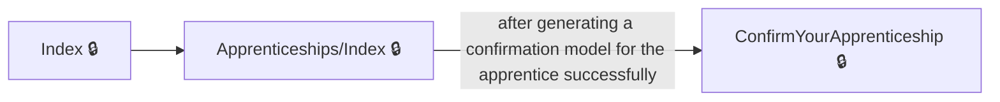
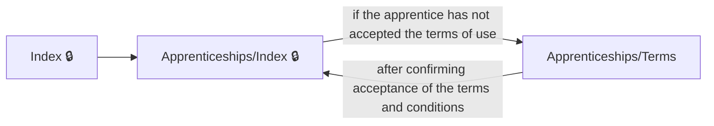
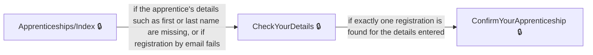
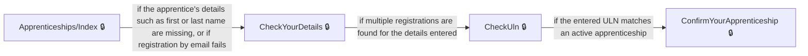
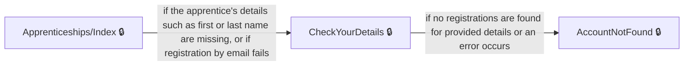
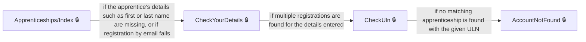
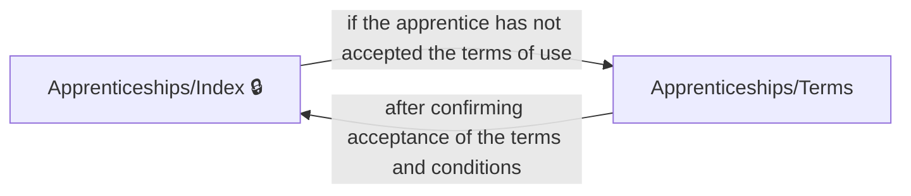

# User journeys: SkillsFundingAgency/das-apprentice-commitments-web

Generated from `main/src`: 19 pages, 11 transitions, 9 journeys. 🔒 means sign-in is required. Dotted arrows return to a hub.

## Review and Confirm Apprenticeship Details

A signed-in apprentice views an overview of their account, reviews, and confirms their apprenticeship details.

## Accept Terms and Set Up Account

A newly signed-in apprentice accepts terms and conditions before accessing their apprenticeship overview.

## Find and Confirm Apprenticeship by Personal Details

An apprentice enters their details to locate their apprenticeship, resolves ambiguity by providing a ULN if needed, and confirms the details.

## Find and Confirm Apprenticeship with Multiple Matches

An apprentice enters personal details, uses their ULN to resolve multiple matches, and confirms their apprenticeship.

## Onboard and Confirm Apprenticeship Details

A user enters their details, locates their apprenticeship, and confirms their apprenticeship information.

## Onboard with Multiple Registrations

A user enters their details, is asked for their ULN due to multiple records, and confirms their apprenticeship.

## Account Not Found After Details Entry

A user begins onboarding but is shown an account not found message after entering their details.

## Account Not Found After ULN Entry

A user enters their details and ULN but is shown an account not found message.

## Accept Terms to Access Apprenticeship Overview

A user who has not accepted the terms completes this step before accessing their apprenticeship overview.

## Pages

| Page | Route | Sign-in | Purpose |
| --- | --- | --- | --- |
| `/AccountNotFound` | `/AccountNotFound` | Yes | Informs the user that their apprenticeship account was not found and provides guidance. |
| `/Apprenticeships/CannotConfirm` | `/apprenticeships/{apprenticeshipId}/cannotconfirm/{entity?}` | Yes | Shows the apprentice why they cannot confirm their apprenticeship details and advises what to do next depending on which details are incorrect. |
| `/Apprenticeships/ConfirmYourApprenticeshipDetails` | `/apprenticeships/{apprenticeshipId}/checkyourapprenticeshipdetails` | Yes | Allows the apprentice to review and confirm that their apprenticeship details are correct. |
| `/Apprenticeships/Index` | `/apprenticeships` | Yes | Displays an overview of the apprentice's account and initiates onboarding or redirects based on their status. |
| `/Apprenticeships/Terms` | `/Apprenticeships/Terms` | No | Lets the apprentice accept the terms and conditions to use the service. |
| `/Apprenticeships/TransactionComplete` | `/apprenticeships/{apprenticeshipId}/transactioncomplete` | Yes | Shows confirmation that the apprentice has confirmed their apprenticeship details. |
| `/Apprenticeships/View` | `/apprenticeships/{apprenticeshipId}/{handler?}` | Yes | Displays the apprentice's detailed apprenticeship information. |
| `/ChangeYourEmailAddress` | `/ChangeYourEmailAddress` | Yes | Redirects the apprentice to a service where they can change their email address. |
| `/CheckUln` | `/CheckUln` | Yes | Asks the apprentice for their Unique Learner Number (ULN) to help find their apprenticeship. |
| `/CheckYourDetails` | `/CheckYourDetails` | Yes | Lets the apprentice enter their personal details to help locate their apprenticeship account. |
| `/ConfirmYourApprenticeship` | `/ConfirmYourApprenticeship` | Yes | Lets the apprentice review and confirm the details of their apprenticeship. |
| `/ConfirmYourIdentityNew` | `/ConfirmYourIdentityNew` | Yes | Processes user authentication to ensure the current identity is correct before continuing. |
| `/Index` | `/Index` | Yes | Provides the home page and redirects users to the apprenticeships overview. |
| `/Privacy` | `/Privacy` | Yes | Displays the site's privacy policy to the user. |
| `/SignOut` | `/SignOut` | Yes | Signs the user out of the application. |
| `Legacy.Account` | `/account` | No | Redirects the user to their personal details section. |
| `Legacy.Register` | `/termsofuse` | No | Redirects the user to the terms of use section. |
| `Profile.Confirm` | `/profile/{clientId}/changeemail/confirm` | Yes | Redirects the user to confirm their email change for their profile. |
| `Registration.Register` | `/register` | Yes | Matches the apprentice to their apprenticeship registration and redirects based on success or failure. |
