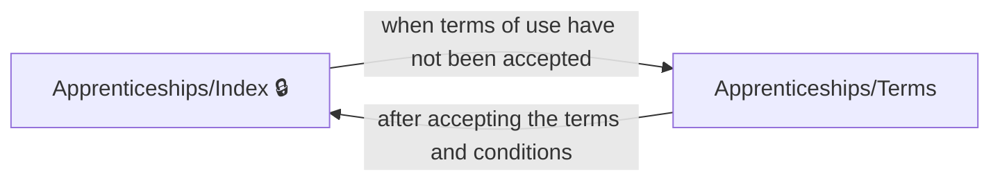
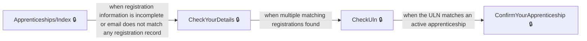
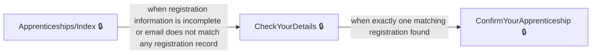
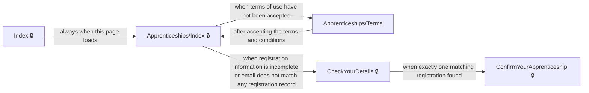
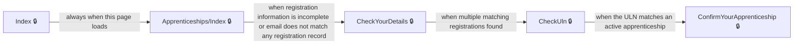
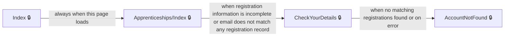
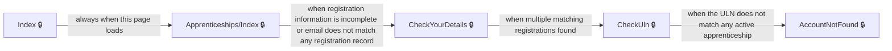

# User journeys: SkillsFundingAgency/das-apprentice-commitments-web

Generated from `main/src`: 19 pages, 11 transitions, 7 journeys. 🔒 means sign-in is required. Dotted arrows return to a hub.

## Accept terms and access dashboard

After being prompted to accept the service terms, the apprentice accesses their dashboard.

## Find and confirm your apprenticeship

A registered apprentice finds and confirms their apprenticeship using their details, unique learner number, and confirmation steps.

## Find and confirm your apprenticeship (direct path)

An apprentice with just one matching registration can confirm their apprenticeship without providing ULN.

## Apprentice finds and confirms their apprenticeship

An apprentice accesses their account, is prompted to accept terms, confirms details, and completes their registration.

## Find apprenticeship via personal details or unique learner number

An apprentice who is prompted for further details can try both personal details and unique learner number to find their apprenticeship.

## Handle account not found after details entry

If an apprentice cannot be matched via details or ULN, they are shown guidance that no account was found.

## Handle account not found after ULN entry

If multiple registrations are found, apprentice can enter a ULN and, if not found, is informed the account cannot be found.

## Pages

| Page | Route | Sign-in | Purpose |
| --- | --- | --- | --- |
| `/AccountNotFound` | `/AccountNotFound` | Yes | Informs the user that their apprenticeship account could not be found and provides guidance. |
| `/Apprenticeships/CannotConfirm` | `/apprenticeships/{apprenticeshipId}/cannotconfirm/{entity?}` | Yes | Informs the apprentice they cannot confirm their apprenticeship because their employer, provider, apprenticeship details, or other information are incorrect. |
| `/Apprenticeships/ConfirmYourApprenticeshipDetails` | `/apprenticeships/{apprenticeshipId}/checkyourapprenticeshipdetails` | Yes | Lets the apprentice review their apprenticeship details and confirm they are correct before proceeding. |
| `/Apprenticeships/Index` | `/apprenticeships` | Yes | Provides an overview or starting point for the apprentice’s account, handling redirections based on account and apprenticeship status. |
| `/Apprenticeships/Terms` | `/Apprenticeships/Terms` | No | Lets the apprentice accept the terms and conditions to use the service. |
| `/Apprenticeships/TransactionComplete` | `/apprenticeships/{apprenticeshipId}/transactioncomplete` | Yes | Shows confirmation that the apprentice has confirmed their apprenticeship details. |
| `/Apprenticeships/View` | `/apprenticeships/{apprenticeshipId}/{handler?}` | Yes | Displays details of the apprentice's apprenticeship. |
| `/ChangeYourEmailAddress` | `/ChangeYourEmailAddress` | Yes | Redirects the user to the email change service. |
| `/CheckUln` | `/CheckUln` | Yes | Lets the user submit their unique learner number (ULN) to find their apprenticeship. |
| `/CheckYourDetails` | `/CheckYourDetails` | Yes | Lets the user confirm their personal details to help find their apprenticeship. |
| `/ConfirmYourApprenticeship` | `/ConfirmYourApprenticeship` | Yes | Lets the apprentice review their apprenticeship details and confirm they are correct. |
| `/ConfirmYourIdentityNew` | `/ConfirmYourIdentityNew` | Yes | Ensures any already logged-in user is signed out after entering a password as a new user. |
| `/Index` | `/Index` | Yes | Home page for the application; currently redirects to the apprenticeships list. |
| `/Privacy` | `/Privacy` | Yes | Shows the site's privacy policy. |
| `/SignOut` | `/SignOut` | Yes | Signs the user out of the application. |
| `Legacy.Account` | `/account` | No | Redirects the user to the Personal Details section. |
| `Legacy.Register` | `/termsofuse` | No | Redirects the user to the Terms of Use section. |
| `Profile.Confirm` | `/profile/{clientId}/changeemail/confirm` | Yes | Redirects the user to confirm a change of email address for their profile. |
| `Registration.Register` | `/register` | Yes | Matches the apprentice to an apprenticeship using a registration code, or redirects to appropriate pages based on account status. |

## Form fields

Field definitions only: no values a user enters are recorded.

### `/Apprenticeships/ConfirmYourApprenticeshipDetails`

| Field | Type | Label | Required | Rules | Options |
| --- | --- | --- | --- | --- | --- |
| `accept-terms` | checkboxes | — | — | must be checked to enable form submission | I confirm that my apprenticeship details are correct |

### `/Apprenticeships/Terms`

| Field | Type | Label | Required | Rules | Options |
| --- | --- | --- | --- | --- | --- |
| `TermsOfUseAccepted` | checkboxes | — | Yes | required; must be checked | I accept the terms and conditions and consent to the use of cookies |

### `/CheckUln`

| Field | Type | Label | Required | Rules | Options |
| --- | --- | --- | --- | --- | --- |
| `Uln` | text | Your ULN | — | required | — |

### `/CheckYourDetails`

| Field | Type | Label | Required | Rules | Options |
| --- | --- | --- | --- | --- | --- |
| `FirstName` | text | First name | — | required; must not be empty | — |
| `LastName` | text | Last name | — | required; must not be empty | — |
| `DateOfBirth.Day` | text | Day | — | required; must be a valid day | — |
| `DateOfBirth.Month` | text | Month | — | required; must be a valid month | — |
| `DateOfBirth.Year` | text | Year | — | required; must be a valid year | — |

### `/ConfirmYourApprenticeship`

| Field | Type | Label | Required | Rules | Options |
| --- | --- | --- | --- | --- | --- |
| `accept-terms` | checkboxes | — | — | must be checked; apprentice cannot continue unless confirmed | I confirm that my apprenticeship details are correct |

