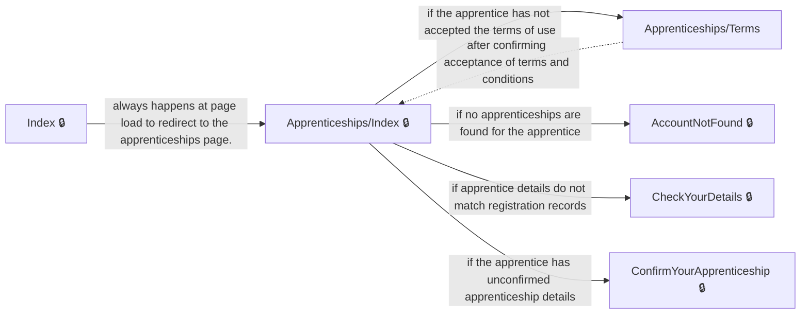

# User journeys: SkillsFundingAgency/das-apprentice-commitments-web

Generated from `main/src`: 19 pages, 11 transitions, 1 journeys. 🔒 means sign-in is required. Dotted arrows return to a hub.

## Account Overview

Access and manage apprenticeship details from the account overview page.

Complete the sections in any order, returning to the hub.

## Pages

| Page | Route | Sign-in | Purpose |
| --- | --- | --- | --- |
| `/AccountNotFound` | `/AccountNotFound` | Yes | Informs the apprentice that their account could not be found and provides guidance on resolving the issue. |
| `/Apprenticeships/CannotConfirm` | `/apprenticeships/{apprenticeshipId}/cannotconfirm/{entity?}` | Yes | Provides feedback to the apprentice when apprenticeship details or related entities cannot be confirmed and guides them on next steps. |
| `/Apprenticeships/ConfirmYourApprenticeshipDetails` | `/apprenticeships/{apprenticeshipId}/checkyourapprenticeshipdetails` | Yes | Allows the apprentice to review and confirm their apprenticeship details, including employer, provider, and course information. |
| `/Apprenticeships/Index` | `/apprenticeships` | Yes | Serves as the account overview page for apprenticeships. |
| `/Apprenticeships/Terms` | `/Apprenticeships/Terms` | No | Allows the apprentice to accept terms and conditions required to use the service. |
| `/Apprenticeships/TransactionComplete` | `/apprenticeships/{apprenticeshipId}/transactioncomplete` | Yes | Confirms that apprenticeship details have been successfully submitted and provides next steps. |
| `/Apprenticeships/View` | `/apprenticeships/{apprenticeshipId}/{handler?}` | Yes | Displays detailed information about the apprentice's apprenticeship, such as training provider and employer details. |
| `/ChangeYourEmailAddress` | `/ChangeYourEmailAddress` | Yes | Redirects the user to a page where they can change their email address based on external authentication configuration. |
| `/CheckUln` | `/CheckUln` | Yes | Allows the user to enter their unique learner number (ULN) to match them to their apprenticeship. |
| `/CheckYourDetails` | `/CheckYourDetails` | Yes | Enables the user to confirm basic details such as name and date of birth to help locate their apprenticeship registration. |
| `/ConfirmYourApprenticeship` | `/ConfirmYourApprenticeship` | Yes | Allows the apprentice to review and confirm the details of their apprenticeship. |
| `/ConfirmYourIdentityNew` | `/ConfirmYourIdentityNew` | Yes | Ensures a new user is logged out of any existing session before redirecting to the account setup page. |
| `/Index` | `/Index` | Yes | Serves as the home page of the web application, providing a welcome message and redirecting to the apprenticeships page. |
| `/Privacy` | `/Privacy` | Yes | Offers details about the site's privacy policy. |
| `/SignOut` | `/SignOut` | Yes | Allows the user to sign out and clears relevant authentication cookies. |
| `Legacy.Account` | `/account` | No | Redirects the user to their personal details page. |
| `Legacy.Register` | `/termsofuse` | No | Redirects the user to the terms of use page. |
| `Profile.Confirm` | `/profile/{clientId}/changeemail/confirm` | Yes | Confirms an email change request for the user profile. |
| `Registration.Register` | `/register` | Yes | Registers a new apprentice by matching their apprenticeship and redirecting to the appropriate notification or error page as needed. |
