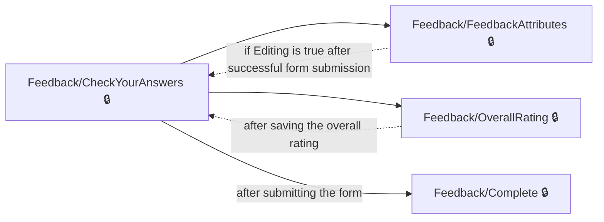
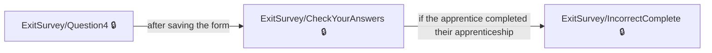
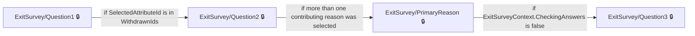
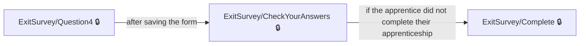

# User journeys: SkillsFundingAgency/das-apprentice-feedback-web

Generated from `main/src`: 17 pages, 17 transitions, 6 journeys. 🔒 means sign-in is required. Dotted arrows return to a hub.

## Edit and submit your apprenticeship feedback before final submission

The apprentice reviews and can amend sections of their feedback before submitting.

Complete the sections in any order, returning to the hub.

## Complete exit survey after withdrawing from apprenticeship

The apprentice answers exit questions about their withdrawal, reviews their answers, and submits the survey.

```mermaid
flowchart LR
  p0["ExitSurvey/Question1 🔒"] -->|"if SelectedAttributeId is in WithdrawnIds"| p1["ExitSurvey/Question2 🔒"]
  p1["ExitSurvey/Question2 🔒"] -->|"if more than one contributing reason was selected"| p2["ExitSurvey/PrimaryReason 🔒"]
  p2["ExitSurvey/PrimaryReason 🔒"] -->|"if ExitSurveyContext.CheckingAnswers is true"| p3["ExitSurvey/CheckYourAnswers 🔒"]
  p3["ExitSurvey/CheckYourAnswers 🔒"] -->|"if the apprentice did not complete their apprenticeship"| p4["ExitSurvey/Complete 🔒"]
```

## Complete exit survey after finishing apprenticeship

The apprentice answers exit survey questions about their next steps after completing their apprenticeship.

## Provide feedback on apprenticeship training

The apprentice begins the feedback process, rates specific aspects, gives an overall rating, reviews their answers, and submits their feedback.

```mermaid
flowchart LR
  p0["Feedback/Start 🔒"] -->|"when the apprentice clicks 'Start now'"| p1["Feedback/FeedbackAttributes 🔒"]
  p1["Feedback/FeedbackAttributes 🔒"] -->|"if Editing is not true after successful form submission"| p2["Feedback/OverallRating 🔒"]
  p2["Feedback/OverallRating 🔒"] -->|"after saving the overall rating"| p3["Feedback/CheckYourAnswers 🔒"]
  p3["Feedback/CheckYourAnswers 🔒"] -->|"after submitting the form"| p4["Feedback/Complete 🔒"]
```

## Complete an exit survey after not completing apprenticeship

The apprentice answers questions about leaving their apprenticeship and submits the exit survey for non-completion.

## Review and submit exit survey after leaving apprenticeship for another reason

The apprentice indicates a reason for leaving, what they did afterwards, reviews and submits the exit survey.

## Pages

| Page | Route | Sign-in | Purpose |
| --- | --- | --- | --- |
| `/Engagement/Links` | `/links/{linkName}/{feedbackTransactionId}/{apprenticeFeedbackTargetId}` | No | Lets the user know that the requested page was not found, and provides advice on what to do next. |
| `/ExitSurvey/CheckYourAnswers` | `/exit/checkyouranswers` | Yes | Lets the apprentice review and confirm their answers to the exit survey before submitting. |
| `/ExitSurvey/Complete` | `/exit/complete` | Yes | Confirms that the apprentice has completed the exit survey, showing either a completion message or reminding them they have already completed the survey. |
| `/ExitSurvey/IncorrectComplete` | `/exit/incorrectcomplete` | Yes | Informs the user that no further questions need to be answered and advises contacting their training provider and employer. |
| `/ExitSurvey/PrimaryReason` | `/exit/primaryreason` | Yes | Lets the apprentice select the main reason for leaving their apprenticeship. |
| `/ExitSurvey/Question1` | `/exit/question1` | Yes | Lets the apprentice indicate their current status with their apprenticeship. |
| `/ExitSurvey/Question2` | `/exit/question2` | Yes | Lets the apprentice select what contributed to leaving their apprenticeship. |
| `/ExitSurvey/Question3` | `/exit/question3` | Yes | Lets the apprentice select what would have helped them stay in their apprenticeship. |
| `/ExitSurvey/Question4` | `/exit/question4` | Yes | Lets the apprentice select what they did after leaving their apprenticeship. |
| `/ExitSurvey/Start` | `/exit/start/{apprenticeFeedbackTargetId}` | Yes | Introduces the exit survey for apprentices who did not finish their apprenticeship. |
| `/Feedback/CheckYourAnswers` | `/check-answers` | Yes | Lets the apprentice review their feedback answers before submission, and indicate if they consent to being contacted. |
| `/Feedback/Complete` | `/complete` | Yes | Shows the apprentice that their feedback has been submitted, including guidance and links based on their rating. |
| `/Feedback/FeedbackAttributes` | `/feedback-attributes` | Yes | Lets the apprentice rate specific aspects of their apprenticeship training. |
| `/Feedback/OverallRating` | `/overall-rating` | Yes | Lets the apprentice give an overall rating of their apprenticeship training. |
| `/Feedback/Start` | `/start/{ukprn:int}` | Yes | Introduces the feedback process and provides information about how feedback will be used and privacy protections. |
| `/Feedback/Status` | `/status` | Yes | Shows the apprentice their current feedback status and eligibility, including reasons why feedback cannot be submitted. |
| `/Index` | `/Index` | Yes | Allows the apprentice to select a training provider from their current or recent apprenticeships to give feedback on. |

## Form fields

Field definitions only: no values a user enters are recorded.

### `/ExitSurvey/CheckYourAnswers`

| Field | Type | Label | Required | Rules | Options |
| --- | --- | --- | --- | --- | --- |
| `AllowContact` | text | I'm happy to be contacted by the Apprenticeship service | — | — | — |

### `/ExitSurvey/Question1`

| Field | Type | Label | Required | Rules | Options |
| --- | --- | --- | --- | --- | --- |
| `SelectedAttributeId` | radios | Where are you with your apprenticeship? | Yes | required | — |

### `/ExitSurvey/Question4`

| Field | Type | Label | Required | Rules | Options |
| --- | --- | --- | --- | --- | --- |
| `SelectedAttributeId` | radios | What did you do after leaving your apprenticeship? | Yes | required; one option must be selected | — |

### `/Feedback/CheckYourAnswers`

| Field | Type | Label | Required | Rules | Options |
| --- | --- | --- | --- | --- | --- |
| `ContactConsent` | checkboxes | Contact preferences | — | — | — |

### `/Feedback/FeedbackAttributes`

| Field | Type | Label | Required | Rules | Options |
| --- | --- | --- | --- | --- | --- |
| `FeedbackAttributes[i].Status` | radios | — | — | required; must select an option for each aspect | — |

### `/Feedback/OverallRating`

| Field | Type | Label | Required | Rules | Options |
| --- | --- | --- | --- | --- | --- |
| `OverallRating` | radios | How would you rate? "'": "'s")) training? | Yes | required | — |

