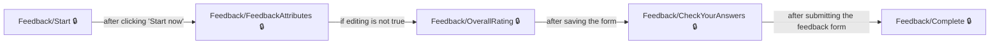
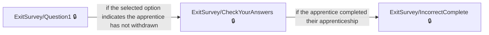
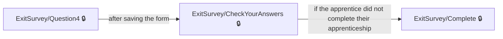

# User journeys: SkillsFundingAgency/das-apprentice-feedback-web

Generated from `main/src`: 17 pages, 17 transitions, 4 journeys. 🔒 means sign-in is required. Dotted arrows return to a hub.

## Give apprenticeship feedback

The apprentice gives structured feedback on their training provider by completing and submitting the feedback form.

## Leave feedback after withdrawing from apprenticeship

After withdrawing from their apprenticeship, the apprentice completes the exit survey and submits their responses.

```mermaid
flowchart LR
  p0["ExitSurvey/Question1 🔒"] -->|"if the selected option indicates the apprentice has withdrawn"| p1["ExitSurvey/Question2 🔒"]
  p1["ExitSurvey/Question2 🔒"] -->|"if more than one attribute is selected after saving the form and not checking answers"| p2["ExitSurvey/PrimaryReason 🔒"]
  p2["ExitSurvey/PrimaryReason 🔒"] -->|"if the user is on the 'checking answers' journey"| p3["ExitSurvey/CheckYourAnswers 🔒"]
  p3["ExitSurvey/CheckYourAnswers 🔒"] -->|"if the apprentice did not complete their apprenticeship"| p4["ExitSurvey/Complete 🔒"]
```

## Leave feedback after completing an apprenticeship

The apprentice who has completed their apprenticeship answers the exit survey and submits final feedback.

## Give feedback on life after leaving an apprenticeship

The apprentice provides information about their activities after leaving their apprenticeship and submits the exit survey.

## Pages

| Page | Route | Sign-in | Purpose |
| --- | --- | --- | --- |
| `/Engagement/Links` | `/links/{linkName}/{feedbackTransactionId}/{apprenticeFeedbackTargetId}` | No | Shows a 'Page not found' message and guidance if the engagement link is not available. |
| `/ExitSurvey/CheckYourAnswers` | `/exit/checkyouranswers` | Yes | Lets the apprentice review their answers to the exit survey and submit them. |
| `/ExitSurvey/Complete` | `/exit/complete` | Yes | Confirms that the apprentice has completed the exit survey and offers next steps. |
| `/ExitSurvey/IncorrectComplete` | `/exit/incorrectcomplete` | Yes | Tells the user that no further questions need to be answered and advises contacting their training provider and employer. |
| `/ExitSurvey/PrimaryReason` | `/exit/primaryreason` | Yes | Lets the user select the main reason for leaving their apprenticeship from available categories. |
| `/ExitSurvey/Question1` | `/exit/question1` | Yes | Asks the user about their current status regarding their apprenticeship. |
| `/ExitSurvey/Question2` | `/exit/question2` | Yes | Allows the apprentice to select factors that contributed to leaving their apprenticeship. |
| `/ExitSurvey/Question3` | `/exit/question3` | Yes | Lets the apprentice indicate what could have helped them stay in their apprenticeship. |
| `/ExitSurvey/Question4` | `/exit/question4` | Yes | Asks the apprentice what they did after leaving their apprenticeship. |
| `/ExitSurvey/Start` | `/exit/start/{apprenticeFeedbackTargetId}` | Yes | Introduces the exit survey for apprentices who did not finish their apprenticeship. |
| `/Feedback/CheckYourAnswers` | `/check-answers` | Yes | Allows the user to review and confirm their feedback answers, including contact preferences. |
| `/Feedback/Complete` | `/complete` | Yes | Shows confirmation that the feedback submission is complete and provides next steps. |
| `/Feedback/FeedbackAttributes` | `/feedback-attributes` | Yes | Lets the apprentice rate specific aspects of their apprenticeship training provider. |
| `/Feedback/OverallRating` | `/overall-rating` | Yes | Allows the apprentice to give an overall rating of their training provider. |
| `/Feedback/Start` | `/start/{ukprn:int}` | Yes | Introduces the apprentice feedback process and explains how feedback will be used, before the apprentice begins. |
| `/Feedback/Status` | `/status` | Yes | Shows the apprentice their feedback eligibility status or completion, including any restrictions on giving feedback. |
| `/Index` | `/Index` | Yes | Lets the apprentice select a training provider to give feedback on or view eligibility information for feedback. |
