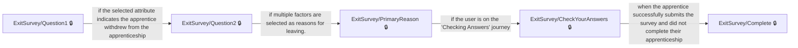
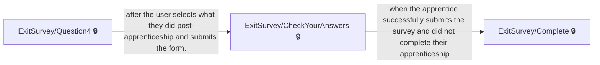

# User journeys: SkillsFundingAgency/das-apprentice-feedback-web

Generated from `main/src`: 17 pages, 17 transitions, 5 journeys. 🔒 means sign-in is required. Dotted arrows return to a hub.

## Provide overall feedback on training provider

The apprentice provides comprehensive feedback on their training provider, including an overall rating.

## Start and complete exit survey after withdrawal

The apprentice completes an exit survey starting with their status after leaving the apprenticeship.

## Start and complete exit survey with further engagement status

The apprentice completes an exit survey starting with their engagement status, covering post-apprenticeship actions.

## Complete Feedback Submission

Allows the apprentice to submit their feedback for their training provider.

```mermaid
flowchart LR
  p0["Feedback/Start 🔒"] -->|"after the user clicks 'Start now'"| p1["Feedback/FeedbackAttributes 🔒"]
  p1["Feedback/FeedbackAttributes 🔒"] -->|"after completing feedback attributes and editing mode is inactive"| p2["Feedback/OverallRating 🔒"]
  p2["Feedback/OverallRating 🔒"] -->|"after submitting the overall rating"| p3["Feedback/CheckYourAnswers 🔒"]
  p3["Feedback/CheckYourAnswers 🔒"] -->|"after submitting the feedback"| p4["Feedback/Complete 🔒"]
```

## Exit Survey with Post-Apprenticeship Submission

Allows apprentices to provide exit survey information and details about their activities post-apprenticeship.

## Pages

| Page | Route | Sign-in | Purpose |
| --- | --- | --- | --- |
| `/Engagement/Links` | `/links/{linkName}/{feedbackTransactionId}/{apprenticeFeedbackTargetId}` | No | Displays a 'Page not found' message and instructions on what to do if a web address is incorrect or typed incorrectly. |
| `/ExitSurvey/CheckYourAnswers` | `/exit/checkyouranswers` | Yes | Allows the apprentice to review their answers and confirm the submission of their exit survey. |
| `/ExitSurvey/Complete` | `/exit/complete` | Yes | Thanks the apprentice for completing the exit survey and provides links for further career advice and apprenticeship opportunities. |
| `/ExitSurvey/IncorrectComplete` | `/exit/incorrectcomplete` | Yes | Displays a message indicating no further survey questions need to be answered and advises the apprentice to contact their training provider and employer. |
| `/ExitSurvey/PrimaryReason` | `/exit/primaryreason` | Yes | Allows the apprentice to select the main reason for leaving their apprenticeship from categorized options. |
| `/ExitSurvey/Question1` | `/exit/question1` | Yes | Lets the apprentice specify their current status with their apprenticeship. |
| `/ExitSurvey/Question2` | `/exit/question2` | Yes | Allows the apprentice to indicate the factors that contributed to leaving their apprenticeship. |
| `/ExitSurvey/Question3` | `/exit/question3` | Yes | Lets the apprentice identify what could have helped them stay in their apprenticeship. |
| `/ExitSurvey/Question4` | `/exit/question4` | Yes | Captures information about what the apprentice did after leaving their apprenticeship. |
| `/ExitSurvey/Start` | `/exit/start/{apprenticeFeedbackTargetId}` | Yes | Allows the apprentice to start an exit survey about why they did not complete their apprenticeship. |
| `/Feedback/CheckYourAnswers` | `/check-answers` | Yes | Allows the apprentice to review and confirm their feedback before submitting it. |
| `/Feedback/Complete` | `/complete` | Yes | Shows the apprentice a confirmation that their feedback has been successfully submitted. |
| `/Feedback/FeedbackAttributes` | `/feedback-attributes` | Yes | Allows apprentices to provide feedback on specific aspects of their apprenticeship training. |
| `/Feedback/OverallRating` | `/overall-rating` | Yes | Allows apprentices to provide an overall rating of their training provider. |
| `/Feedback/Start` | `/start/{ukprn:int}` | Yes | Introduces apprentices to the process of giving feedback on their training provider and its importance. |
| `/Feedback/Status` | `/status` | Yes | Allows the apprentice to view the status of their ability to provide feedback on their training provider. |
| `/Index` | `/Index` | Yes | Lets the apprentice select a training provider to give feedback on. |
