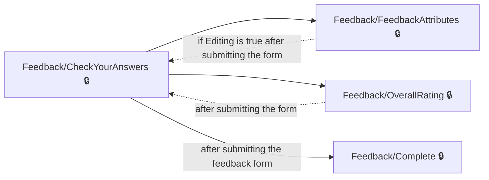
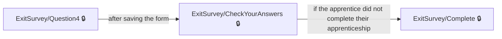
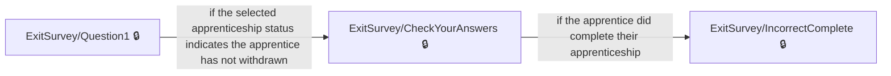

# User journeys: SkillsFundingAgency/das-apprentice-feedback-web

Generated from `main/src`: 17 pages, 17 transitions, 4 journeys. 🔒 means sign-in is required. Dotted arrows return to a hub.

## Resume or Edit Feedback Before Submitting

The apprentice reviews and edits their feedback before final submission.

Complete the sections in any order, returning to the hub.

## Provide Exit Feedback Based On Post-Apprenticeship Activity

The apprentice starts the exit survey from post-apprenticeship activity and completes the survey.

## Provide Exit Feedback After Completing Apprenticeship

The apprentice completes the exit survey indicating they finished their apprenticeship.

## Give Feedback on Training Provider

The apprentice starts the provider feedback process and submits it after confirming answers.

```mermaid
flowchart LR
  p0["Feedback/Start 🔒"] -->|"after clicking 'Start now'"| p1["Feedback/FeedbackAttributes 🔒"]
  p1["Feedback/FeedbackAttributes 🔒"] -->|"after submitting the form when not editing"| p2["Feedback/OverallRating 🔒"]
  p2["Feedback/OverallRating 🔒"] -->|"after submitting the form"| p3["Feedback/CheckYourAnswers 🔒"]
  p3["Feedback/CheckYourAnswers 🔒"] -->|"after submitting the feedback form"| p4["Feedback/Complete 🔒"]
```

## Pages

| Page | Route | Sign-in | Purpose |
| --- | --- | --- | --- |
| `/Engagement/Links` | `/links/{linkName}/{feedbackTransactionId}/{apprenticeFeedbackTargetId}` | No | Shows an error page when an engagement link is not configured or has an empty URL. |
| `/ExitSurvey/CheckYourAnswers` | `/exit/checkyouranswers` | Yes | Allows the apprentice to review their answers for the exit survey and opt in to be contacted by the Apprenticeship service. |
| `/ExitSurvey/Complete` | `/exit/complete` | Yes | Displays confirmation and guidance after the apprentice completes the exit survey. |
| `/ExitSurvey/IncorrectComplete` | `/exit/incorrectcomplete` | Yes | Informs the user that no further questions need to be answered and advises them to contact their training provider and employer for updated information. |
| `/ExitSurvey/PrimaryReason` | `/exit/primaryreason` | Yes | Lets the apprentice select their main reason for leaving their apprenticeship. |
| `/ExitSurvey/Question1` | `/exit/question1` | Yes | Lets the apprentice indicate their current status regarding their apprenticeship. |
| `/ExitSurvey/Question2` | `/exit/question2` | Yes | Lets the apprentice select factors that contributed to them leaving their apprenticeship. |
| `/ExitSurvey/Question3` | `/exit/question3` | Yes | Lets the apprentice indicate what would have helped them stay in their apprenticeship. |
| `/ExitSurvey/Question4` | `/exit/question4` | Yes | Lets the apprentice specify what they did after leaving their apprenticeship. |
| `/ExitSurvey/Start` | `/exit/start/{apprenticeFeedbackTargetId}` | Yes | Lets the apprentice begin the exit survey if they did not finish their apprenticeship. |
| `/Feedback/CheckYourAnswers` | `/check-answers` | Yes | Allows the apprentice to review their feedback answers and select contact preferences before submitting. |
| `/Feedback/Complete` | `/complete` | Yes | Confirms that the apprentice's feedback is complete and provides information and next steps. |
| `/Feedback/FeedbackAttributes` | `/feedback-attributes` | Yes | Lets the apprentice rate whether specific aspects of their apprenticeship training are provided to a reasonable standard. |
| `/Feedback/OverallRating` | `/overall-rating` | Yes | Lets the apprentice give an overall rating for their training provider. |
| `/Feedback/Start` | `/start/{ukprn:int}` | Yes | Introduces the apprentice feedback process and explains how their identity is protected, before starting the survey. |
| `/Feedback/Status` | `/status` | Yes | Shows the user's eligibility status for giving feedback on their training provider. |
| `/Index` | `/Index` | Yes | Lets the apprentice select a training provider to give feedback on. |

## Form fields

Field definitions only: no values a user enters are recorded.

### `/ExitSurvey/CheckYourAnswers`

| Field | Type | Label | Required | Rules | Options |
| --- | --- | --- | --- | --- | --- |
| `AllowContact` | text | I'm happy to be contacted by the Apprenticeship service | — | — | — |

### `/ExitSurvey/Question1`

| Field | Type | Label | Required | Rules | Options |
| --- | --- | --- | --- | --- | --- |
| `SelectedAttributeId` | radios | Where are you with your apprenticeship? | Yes | required | — |

### `/ExitSurvey/Question4`

| Field | Type | Label | Required | Rules | Options |
| --- | --- | --- | --- | --- | --- |
| `SelectedAttributeId` | radios | What did you do after leaving your apprenticeship? | Yes | required | — |

### `/Feedback/CheckYourAnswers`

| Field | Type | Label | Required | Rules | Options |
| --- | --- | --- | --- | --- | --- |
| `ContactConsent` | checkboxes | Contact preferences | — | — | — |

### `/Feedback/FeedbackAttributes`

| Field | Type | Label | Required | Rules | Options |
| --- | --- | --- | --- | --- | --- |
| `FeedbackAttributes[i].Status` | radios | — | — | required; must be either 'Agree' or 'Disagree' | — |

### `/Feedback/OverallRating`

| Field | Type | Label | Required | Rules | Options |
| --- | --- | --- | --- | --- | --- |
| `OverallRating` | radios | How would you rate? "'": "'s")) training? | Yes | required | — |

