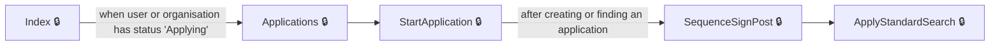
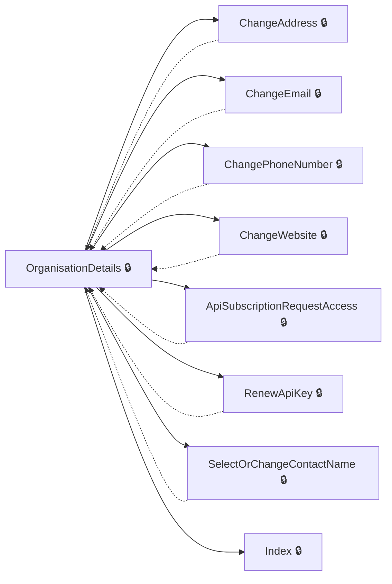
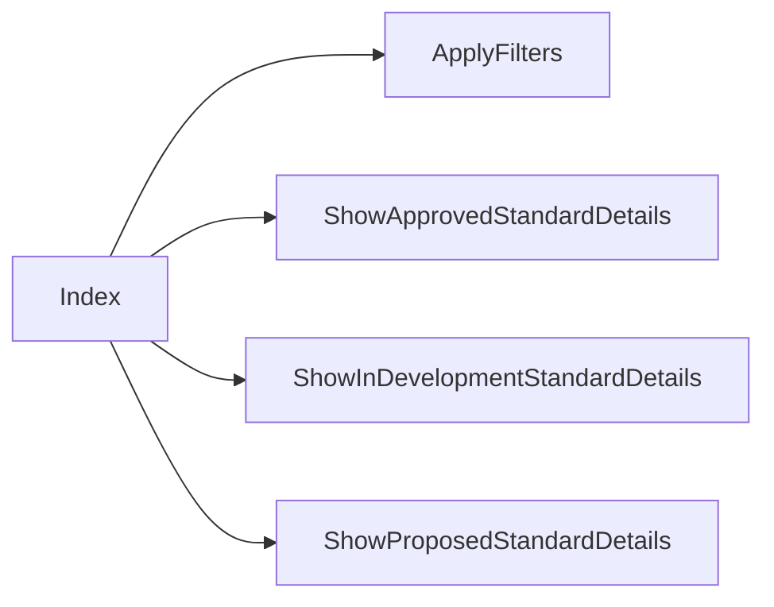
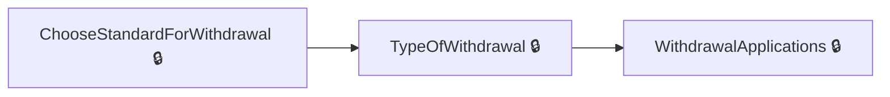
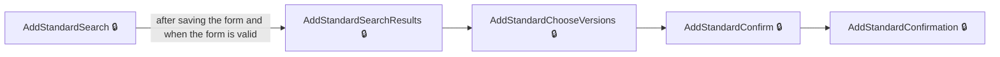

# User journeys: SkillsFundingAgency/das-assessor-service

Generated from `master/src`: 165 pages, 234 transitions, 5 journeys. 🔒 means sign-in is required. Dotted arrows return to a hub.

## Apply for Assessment Approval

A user applies to become an approved assessment organisation for a standard.

## Manage Organisation Details

A user edits organisation details, such as address, contact or API access.

Complete the sections in any order, returning to the hub.

## Search Assessment Opportunities

A user searches and applies filters for available assessment opportunities.

Complete the sections in any order, returning to the hub.

## Withdraw from an Assessment Standard

A user initiates and completes the process of withdrawing from an approved assessment standard.

## Add a Standard to Your Organisation

A user adds a new assessment standard to their organisation's approved list.

## Pages

| Page | Route | Sign-in | Purpose |
| --- | --- | --- | --- |
| `Account.AccessDenied` | — | Unknown | Shows the user they do not have access to a feature or privilege. |
| `Account.Callback` | — | Unknown | — |
| `Account.ChangeSignInDetails` | — | Yes | Lets the user change their sign-in details. |
| `Account.CreateAnAccount` | — | Yes | Allows a user to create an account by providing given and family name. |
| `Account.PostSignIn` | — | Unknown | — |
| `Account.SignIn` | — | Unknown | Initiates the sign-in process for the user. |
| `Account.SignedOut` | — | Unknown | Shows the user they have signed out. |
| `Address` | `certificate/address/enter` | Yes | Lets the user enter a certificate delivery address. |
| `Application.ApplicationCancelled` | `/Application/{id}/Cancelled` | Yes | Shows confirmation that the application has been cancelled. |
| `Application.Applications` | `/Application` | Yes | Shows the user's applications and routes them based on status or allows starting a new application. |
| `Application.ConfirmCancelApplication` | `/Application/{id}/ConfirmCancel` | Yes | Allows the user to confirm cancellation of their application. |
| `Application.DeleteAnswer` | `/Application/DeleteAnswer` | Yes | Handles deletion of an answer in an application. |
| `Application.DeleteFile` | `Application/{Id}/SequenceNo/{sequenceNo}/Section/{sectionId}/Page/{pageId}/Question/{questionId}/Filename/{filename}/RedirectAction/{__redirectAction}` | Yes | Handles deletion of a file in the application. |
| `Application.Download` | `Application/{Id}/Section/{sectionId}/Page/{pageId}/Question/{questionId}/{filename}/Download` | Yes | Lets the user download a file associated with their application. |
| `Application.Feedback` | `/Application/{id}/Feedback` | Yes | Shows feedback for an application sequence. |
| `Application.FinancialExpiredRedir` | — | Yes | Shows the user that financial assessment is due or expired. |
| `Application.NotSubmitted` | `/Application/{Id}/NotSubmitted` | Yes | Shows the user that their application was not submitted. |
| `Application.Page` | `/Application/{Id}/Sequences/{sequenceNo}/Sections/{sectionNo}/Pages/{pageId}` | Yes | Displays a single application page within a sequence and section for the user to answer questions. |
| `Application.SaveAnswers` | `/Application/{Id}/Sequences/{sequenceNo}/Sections/{sectionNo}/Pages/{pageId}` | Yes | Processes and saves answers to an application page submitted by the user. |
| `Application.SaveMultiplePageAnswers` | `/Application/{Id}/Sequences/{sequenceNo}/Sections/{sectionNo}/Pages/{pageId}/multiple` | Yes | Processes and saves answers to an application page that allows multiple answers. |
| `Application.Section` | `/Application/{Id}/Sequences/{sequenceNo}/Sections/{sectionNo}` | Yes | Shows the user a section of an application sequence. |
| `Application.SequenceSignPost` | `/Application/{Id}` | Yes | Shows an overview or signpost for a given application, guiding users to the correct sequence or action. |
| `Application.StartApplication` | `/Application` | Yes | Starts a new application for the user. |
| `Application.StartOrResumeApplication` | — | Yes | Starts or resumes an application, specifically for financial assessment. |
| `Application.Submit` | `/Application/{Id}/Submit/{sequenceNo}` | Yes | Submits a sequence of an application for review. |
| `Application.Submitted` | `/Application/{Id}/Submitted` | Yes | Shows the user that their application has been submitted. |
| `ApplicationController.Sequence` | `/Application/{Id}/Sequence/{sequenceNo}` | Yes | Shows the user a sequence of their application with available sections. |
| `ApplicationController.StandardApplications` | `/Application/StandardApplications` | Yes | Displays the user's current standard applications and financial assessment information, if required. |
| `ApplyForWithdrawal.CheckWithdrawalRequest` | — | Yes | Lets the user confirm if they want to continue with a withdrawal request. |
| `ApplyForWithdrawal.ChooseStandardForWithdrawal` | — | Yes | Lets the user choose which standard to withdraw from. |
| `ApplyForWithdrawal.Index` | — | Yes | Shows the withdrawal application dashboard or start page. |
| `ApplyForWithdrawal.TypeOfWithdrawal` | — | Yes | Lets the user select what they are withdrawing from. |
| `ApplyForWithdrawalController.WithdrawalApplications` | `withdrawal/requests` | Yes | Shows a list of withdrawal requests/applications. |
| `ApplyToAssessStandard.GoToApplyToAssessStandard` | — | Unknown | Redirects the user to the application page to apply to assess a standard. |
| `ApplyToAssessStandard.Index` | — | Unknown | Allows the user to start an application to assess a standard. |
| `Back` | `certificate/declaration/back` | Yes | Lets the user go back from the certificate declaration page. |
| `Certificate.Start` | `certificate` | Yes | Starts the certificate creation process. |
| `CertificateAddress.Address` | `certificate/address/enter` | Yes | Lets the user enter a certificate delivery address. |
| `CertificateAddress.ConfirmAddress` | `certificate/address/confirm` | Yes | Lets the user confirm the certificate delivery address. |
| `CertificateAddress.PreviousAddress` | `certificate/address/select-previous` | Yes | Lets the user select a previously used address for certificate delivery. |
| `CertificateAddress.Recipient` | `certificate/address/recipient` | Yes | Lets the user specify the recipient for certificate delivery. |
| `CertificateCheck.Check` | `certificate/check` | Yes | Lets the user check certificate details before finalising submission. |
| `CertificateConfirmation.Confirm` | `certificate/confirmation` | Yes | Confirms the completion of the certificate submission. |
| `CertificateDate.Date` | `certificate/date` | Yes | Lets the user enter and review the achievement date for the certificate. |
| `CertificateDeclaration.Declare` | `certificate/declaration` | Yes | Shows the certificate declaration for confirmation. |
| `CertificateFamilyName.FamilyName` | `certificate/familyname` | Unknown | Lets the user enter the apprentice's last name. |
| `CertificateGivenNames.GivenNames` | `certificate/givennames` | Unknown | Lets the user enter the apprentice's given names. |
| `CertificateGrade.Grade` | `certificate/grade` | Yes | Lets the user select or view the grade for a certificate. |
| `CertificateHistory.ChangePageCertificateHistory` | — | Unknown | Lets the user change which page of certificate history results they are viewing. |
| `CertificateHistory.Index` | — | Unknown | Displays the user's certificate history and allows searching and navigation. |
| `CertificateHistory.ResetSession` | — | Unknown | Resets the certificate history session and returns to the certificate history page. |
| `CertificateHistory.Search` | — | Unknown | Performs a search on the user's certificate history using the provided search term. |
| `CertificateHistory.SortCertificateHistory` | — | Unknown | Sorts the certificate history records by a selected column and direction. |
| `CertificateOption.Option` | `certificate/option` | Yes | Lets the user choose an available option for the selected certificate. |
| `CertificateOptionBack` | `certificate/option/back` | Yes | Handles the back navigation from the certificate option selection process. |
| `CertificateSendTo.SendTo` | `certificate/sendto` | Yes | Lets the user view and choose who to send the certificate to. |
| `CertificateVersion.Version` | `certificate/version` | Yes | Lets the user choose a version for the certificate from available versions. |
| `CertificateVersionNotApproved.NotApprovedToAssess` | `certificate/version/not-approved` | Yes | Informs the user that the selected certificate version is not approved for assessment. |
| `Check` | `certificate/check` | Yes | Lets the user check certificate details before finalising submission. |
| `ConfirmAddress` | `certificate/address/confirm` | Yes | Lets the user confirm the certificate delivery address. |
| `Dashboard.Index` | — | Yes | Displays the user's dashboard, redirecting to other pages if prerequisites are not met. |
| `Date` | `certificate/date` | Yes | Lets the user input the day, month, and year of achievement. |
| `Declare` | `certificate/declaration` | Yes | Lets the user confirm the certificate declaration. |
| `Grade` | `certificate/grade` | Yes | Lets the user submit the selected certificate grade. |
| `Home.AccessDenied` | — | Unknown | Shows the user that they do not have access to the requested area. |
| `Home.Accessibility` | — | Unknown | Provides accessibility information for using the site. |
| `Home.ContactUs` | — | Unknown | Lets the user see information about how to contact support or the organisation. |
| `Home.CookieDetails` | — | Unknown | Displays details about cookies used on the site. |
| `Home.Cookies` | — | Unknown | Lets the user manage their cookie preferences. |
| `Home.Index` | `/` | Unknown | Shows the homepage to the user. |
| `Home.InvalidRole` | — | Yes | Informs the user that they have an invalid role for the requested action. |
| `Home.InvitePending` | — | Yes | Shows the user their invitation is pending and displays the organisation name. |
| `Home.NotActivated` | — | Yes | Informs the user that their organisation has not been activated yet. |
| `Home.NotRegistered` | — | Yes | Informs the user that they are not registered with an organisation. |
| `Home.Privacy` | — | Unknown | Displays information about site privacy and data use. |
| `Home.Rejected` | — | Yes | Lets the user know their registration was rejected and displays the organisation name. |
| `InviteUser.Invite` | `/ManageUsers/Invite` | Unknown | Allows a user to invite a new user to their organisation by entering their details and assigning privileges. |
| `InviteUser.Invited` | `/ManageUsers/{contactId}/Invited` | Unknown | Shows confirmation that a user has been invited, including their email and organisation. |
| `ManageUsers.Index` | — | Unknown | Displays a list of users for the organisation, including their privileges. |
| `ManageUsers.SetStatusAndNotify` | — | Unknown | Lets the admin approve or reject a user and sends a notification. |
| `OppFinder.ApplyFilters` | — | Unknown | Lets the user apply filter criteria to search for assessment opportunities. |
| `OppFinder.ApplyFiltersPartial` | — | Unknown | Lets the user update filters for sectors and levels in part of the assessment opportunity search interface. |
| `OppFinder.ChangePageApprovedStandards` | — | Unknown | Lets the user change pagination for approved standards. |
| `OppFinder.ChangePageApprovedStandardsPartial` | — | Unknown | Lets the user update the number of approved standards shown per page in a partial view. |
| `OppFinder.ChangePageInDevelopmentStandards` | — | Unknown | Lets the user change pagination for in-development standards. |
| `OppFinder.ChangePageInDevelopmentStandardsPartial` | — | Unknown | Lets the user update the number of in-development standards shown per page in a partial view. |
| `OppFinder.ChangePageProposedStandards` | — | Unknown | Lets the user change pagination for proposed standards. |
| `OppFinder.ChangePageProposedStandardsPartial` | — | Unknown | Lets the user update the number of proposed standards shown per page in a partial view. |
| `OppFinder.ContactUs` | — | Unknown | Provides a page for contacting the service. |
| `OppFinder.Cookies` | — | Unknown | Lets the user configure cookie preferences for analytics and marketing. |
| `OppFinder.ExpressionOfInterest` | — | Unknown | Lets the user express interest in an assessment opportunity. |
| `OppFinder.Index` | — | Unknown | Lets the user search for assessment opportunities and apply filters or paging. |
| `OppFinder.Privacy` | — | Unknown | Displays the privacy policy. |
| `OppFinder.RefreshFiltersPartial` | — | Unknown | Lets the user refresh sector and level filter options in a partial view. |
| `OppFinder.ResetFilters` | — | Unknown | Lets the user reset all filters in the assessment opportunity finder. |
| `OppFinder.ResetFiltersPartial` | — | Unknown | Lets the user reset sector and level filters when searching for assessment opportunities. |
| `OppFinder.ResetSession` | — | Unknown | Resets all filters and search terms when searching for assessment opportunities. |
| `OppFinder.Search` | — | Unknown | Enables the user to search for assessment opportunities using a search term. |
| `OppFinder.SearchPartial` | — | Unknown | Allows partial updating of search results and filters for assessment opportunities. |
| `OppFinder.ShowApprovedStandardDetails` | — | Unknown | Displays detailed information about an approved assessment standard. |
| `OppFinder.ShowApprovedStandardsPerPage` | — | Unknown | Lets the user change how many approved standards are shown per page. |
| `OppFinder.ShowApprovedStandardsPerPagePartial` | — | Unknown | Updates the partial view for approved standards per page. |
| `OppFinder.ShowInDevelopmentStandardDetails` | — | Unknown | Displays details about a standard that is still in development. |
| `OppFinder.ShowInDevelopmentStandardsPerPage` | — | Unknown | Lets the user change how many in-development standards are shown per page. |
| `OppFinder.ShowInDevelopmentStandardsPerPagePartial` | — | Unknown | Updates the partial view for in-development standards per page. |
| `OppFinder.ShowProposedStandardDetails` | — | Unknown | Displays details about a proposed standard. |
| `OppFinder.ShowProposedStandardsPerPage` | — | Unknown | Lets the user change how many proposed standards are shown per page. |
| `OppFinder.ShowProposedStandardsPerPagePartial` | — | Unknown | Updates the partial view for proposed standards per page. |
| `OppFinder.SortApprovedStandards` | — | Unknown | Lets the user sort the list of approved standards. |
| `OppFinder.SortApprovedStandardsPartial` | — | Unknown | Updates the sorting of approved standards in a partial view. |
| `OppFinder.SortInDevelopmentStandards` | — | Unknown | Sorts the list of in-development assessment standards for opportunities. |
| `OppFinder.SortInDevelopmentStandardsPartial` | — | Unknown | Sorts the list of in-development assessment standards in a partial view for opportunities. |
| `OppFinder.SortProposedStandards` | — | Unknown | Sorts the list of proposed assessment standards for opportunities. |
| `OppFinder.SortProposedStandardsPartial` | — | Unknown | Sorts the list of proposed assessment standards in a partial view for opportunities. |
| `Option` | `certificate/option` | Yes | Lets the user submit the chosen option for the selected certificate. |
| `Organisation.ApiSubscriptionRequestAccess` | — | Yes | Lets the user request access to an API subscription for the organisation. |
| `Organisation.ChangeAddress` | — | Yes | Lets the user view and update the organisation's address details. |
| `Organisation.ChangeEmail` | — | Yes | Lets the user view and update the organisation's contact email. |
| `Organisation.ChangePhoneNumber` | — | Yes | Lets the user view and update the organisation's phone number. |
| `Organisation.ChangeWebsite` | — | Yes | Lets the user view and update the organisation's website address. |
| `Organisation.Index` | — | Yes | Shows the organisation's main information. |
| `Organisation.OrganisationDetails` | — | Yes | Shows the organisation's detailed information and options for editing details. |
| `Organisation.RenewApiKey` | — | Yes | Lets the user renew the organisation's API key. |
| `Organisation.SelectOrChangeContactName` | — | Yes | Lets the user select or change the organisation's primary contact. |
| `OrganisationSearch.Confirm` | — | Yes | Lets the user confirm the details of their chosen organisation after searching. |
| `OrganisationSearch.DealingWithRequest` | — | Yes | Handles the user's access request for the chosen organisation after confirmation. |
| `OrganisationSearch.FromResults` | — | Yes | Shows search results for organisations from a previous query, allowing the user to refine or select again. |
| `OrganisationSearch.Index` | — | Yes | Lets the user search for organisations by entering a search string. |
| `OrganisationSearch.NextResults` | — | Yes | Shows the next page of search results for organisations. |
| `OrganisationSearch.NoAccess` | — | Yes | Shows access restriction information and provides next steps if the user can't access a selected organisation. |
| `OrganisationSearch.OrganisationChosen` | — | Yes | Lets the user specify an organisation type after selecting an organisation. |
| `OrganisationSearch.Results` | — | Yes | Shows search results for organisations based on a search string criteria. |
| `OrganisationStandards.Index` | — | Yes | Displays a list of approved standards for the user's organisation. |
| `OrganisationStandards.OrderPipeline` | — | Yes | Lets the user filter and order the pipeline of standards by different criteria (standard, training provider, estimated date). |
| `OrganisationStandards.Pipeline` | — | Yes | Shows the organisation's pipeline standards with filter and sorting options. |
| `PreviousAddress` | `certificate/address/select-previous` | Yes | Lets the user select a previously used address for certificate delivery. |
| `Recipient` | `certificate/address/recipient` | Yes | Lets the user specify the recipient for certificate delivery. |
| `RequestAccess.RequestAccess` | — | Yes | Allows a user to request access to a privilege. |
| `RequestAccess.RequestSent` | `/RequestAccess/RequestSent/{privilegeId}` | Yes | Shows confirmation that a privilege access request has been sent. |
| `Search.Index` | — | Unknown | Lets the user search for a learner by surname and unique learner number (ULN). |
| `Search.PrivatelyFundedDraft` | — | Unknown | Informs the user about privately funded draft certificates in search results. |
| `Search.Result` | — | Unknown | Displays the result of a learner search, allowing the user to select a standard if needed. |
| `SendTo` | `certificate/sendto` | Yes | Lets the user submit the selection of recipient for the certificate. |
| `StandardController.AddStandardChooseVersions` | `standard/add-standard/{search}/{referenceNumber}/choose-versions`, `standard/add-standard/choose-versions` | Yes | Allows the user to select one or more versions of a standard to add. |
| `StandardController.AddStandardConfirm` | `standard/add-standard/{search}/{referenceNumber}/confirm`, `standard/add-standard/confirm` | Yes | Lets the user confirm adding the selected standard and versions. |
| `StandardController.AddStandardConfirmation` | `standard/add-standard/{referenceNumber}/confirmation` | Yes | Shows a confirmation page after the user has added a standard to their organisation. |
| `StandardController.AddStandardSearch` | `standard/add-standard/{search?}`, `standard/add-standard` | Yes | Lets the user search for a standard to add. |
| `StandardController.AddStandardSearchResults` | `standard/add-standard/{search}/results` | Yes | Shows the results of the user's standard search. |
| `StandardController.ApplyStandardConfirm` | `standard/{id}/apply-standard/{search}/{referenceNumber}/confirm` | Yes | Allows the user to confirm applying for a standard, showing standard details. |
| `StandardController.ApplyStandardConfirmOfqual` | `standard/{id}/apply-standard/{search}/{referenceNumber}/confirm-ofqual` | Yes | Shows confirmation for applying for a standard regulated by Ofqual. |
| `StandardController.ApplyStandardOfsShutterPage` | `standard/{id}/confirm-ofs` | Yes | Shows information when applying for a standard checked by the Office for Students. |
| `StandardController.ApplyStandardSearch` | `standard/{id}/apply-standard/{search?}`, `standard/{id}/apply-standard` | Yes | Allows the user to search for a standard to apply for. |
| `StandardController.ApplyStandardSearchResults` | `standard/{id}/apply-standard/{search}/results` | Yes | Displays matching standards based on the search criteria entered. |
| `StandardController.OptInStandardVersion` | `standard/opt-in/{referenceNumber}/{version}`, `standard/opt-in` | Yes | Lets the user opt in to a specific version of a standard. |
| `StandardController.OptInStandardVersionConfirmation` | `standard/opt-in/{referenceNumber}/{version}/confirmation` | Yes | Confirms that the user has opted into a particular version of a standard. |
| `StandardController.OptOutStandardVersion` | `standard/opt-out/{referenceNumber}/{version}`, `standard/opt-out` | Yes | Lets the user opt out of a specific version of a standard. |
| `StandardController.OptOutStandardVersionConfirmation` | `standard/opt-out/{referenceNumber}/{version}/confirmation` | Yes | Confirms that the user has opted out of a particular version of a standard. |
| `StandardController.StandardDetails` | `standard/standard-details/{referenceNumber}` | Yes | Shows details for a specific standard, including its versions and approval status. |
| `UserDetails.Details` | — | Unknown | Displays detailed information about a user, including assigned privileges. |
| `UserDetails.EditPermissions` | `/ManageUsers/{contactId}/permissions` | Unknown | Allows editing of a user's permissions. |
| `UserDetails.Remove` | — | Unknown | Shows a confirmation page before removing a user from the organisation. |
| `UserDetails.RemoveConfirmed` | — | Unknown | Processes removal of a user from the organisation. |
| `UserDetails.Removed` | — | Unknown | Shows confirmation that a user has been removed from the organisation. |
| `Version` | `certificate/version` | Yes | Lets the user submit the chosen version for the certificate. |
| `choose` | — | Unknown | Lets the user choose a standard from a list of available standards when multiple match their search. |

## Form fields

Field definitions only: no values a user enters are recorded.

### `Account.CreateAnAccount`

| Field | Type | Label | Required | Rules | Options |
| --- | --- | --- | --- | --- | --- |
| `GivenName` | text | Given name | — | required | — |
| `FamilyName` | text | Family name | — | required | — |

### `Application.ConfirmCancelApplication`

| Field | Type | Label | Required | Rules | Options |
| --- | --- | --- | --- | --- | --- |
| `AreYouSure` | radios | Are you sure you want to cancel your application to assess this standard?! Warning If you select yes, we will not take into account any answers you entered as part of your application to assess If you | — | required | Yes, No |

### `ApplyForWithdrawal.CheckWithdrawalRequest`

| Field | Type | Label | Required | Rules | Options |
| --- | --- | --- | --- | --- | --- |
| `Continue` | radios | Do you want to continue with this withdrawal request? | — | required; must be 'yes' or 'no' | Yes, No, return to your withdrawal requests |

### `ApplyForWithdrawal.TypeOfWithdrawal`

| Field | Type | Label | Required | Rules | Options |
| --- | --- | --- | --- | --- | --- |
| `TypeOfWithdrawal` | radios | What are you withdrawing from? | — | required; must be 'StandardWithdrawal' or 'OrganisationWithdrawal' | — |

### `CertificateFamilyName.FamilyName`

| Field | Type | Label | Required | Rules | Options |
| --- | --- | --- | --- | --- | --- |
| `FamilyName` | text | What is the apprentice's last name? | — | — | — |

### `CertificateGivenNames.GivenNames`

| Field | Type | Label | Required | Rules | Options |
| --- | --- | --- | --- | --- | --- |
| `GivenNames` | text | — | — | — | — |

### `CertificateHistory.Index`

| Field | Type | Label | Required | Rules | Options |
| --- | --- | --- | --- | --- | --- |
| `SearchTerm` | text | — | — | — | — |

### `Date`

| Field | Type | Label | Required | Rules | Options |
| --- | --- | --- | --- | --- | --- |
| `Day` | text | Day | — | required; must be a number; must be between 1 and 31; must form a valid date with month and year; date must not be in the future; date must not be before 1 January 2017 | — |
| `Month` | text | Month | — | required; must be a number; must be between 1 and 12; must form a valid date with day and year; date must not be in the future; date must not be before 1 January 2017 | — |
| `Year` | text | Year | — | required; must be 4 characters; must be a number; must form a valid date with day and month; date must not be in the future; date must not be before 1 January 2017 | — |

### `Home.Cookies`

| Field | Type | Label | Required | Rules | Options |
| --- | --- | --- | --- | --- | --- |
| `cookies-AnalyticsConsent` | radios | Cookies that measure website use | — | — | Use cookies that measure my website use, Do not use cookies that measure my website use |
| `cookies-MarketingConsent` | radios | Cookies that help with our communications and marketing | — | — | Use cookies that help with communications and marketing, Do not use cookies that help with communications and marketing |

### `InviteUser.Invite`

| Field | Type | Label | Required | Rules | Options |
| --- | --- | --- | --- | --- | --- |
| `GivenName` | text | Given name | Yes | required | — |
| `FamilyName` | text | Family name | Yes | required | — |
| `Email` | text | Email address | Yes | email address; required; must be a valid email address | — |
| `ViewDashboard` | checkboxes | — | — | — | View dashboard |

### `OppFinder.ApplyFiltersPartial`

| Field | Type | Label | Required | Rules | Options |
| --- | --- | --- | --- | --- | --- |
| `sectorFilters` | checkboxes | Sectors | — | — | — |
| `levelFilters` | checkboxes | Levels | — | — | — |

### `OppFinder.ChangePageApprovedStandardsPartial`

| Field | Type | Label | Required | Rules | Options |
| --- | --- | --- | --- | --- | --- |
| `ApprovedStandardsPerPage` | select | Standards per page | — | — | — |

### `OppFinder.ChangePageInDevelopmentStandardsPartial`

| Field | Type | Label | Required | Rules | Options |
| --- | --- | --- | --- | --- | --- |
| `InDevelopmentStandardsPerPage` | select | Standards per page | — | — | — |

### `OppFinder.ChangePageProposedStandardsPartial`

| Field | Type | Label | Required | Rules | Options |
| --- | --- | --- | --- | --- | --- |
| `ProposedStandardsPerPage` | select | Standards per page | — | — | — |

### `OppFinder.Cookies`

| Field | Type | Label | Required | Rules | Options |
| --- | --- | --- | --- | --- | --- |
| `cookies-AnalyticsConsent` | radios | Cookies that measure website use | — | — | Use cookies that measure my website use, Do not use cookies that measure my website use |
| `cookies-MarketingConsent` | radios | Cookies that help with our communications and marketing | — | — | Use cookies that help with communications and marketing, Do not use cookies that help with communications and marketing |

### `OppFinder.ExpressionOfInterest`

| Field | Type | Label | Required | Rules | Options |
| --- | --- | --- | --- | --- | --- |
| `Email` | email | Email address | Yes | required | — |
| `OrganisationName` | text | Organisation name | Yes | required | — |
| `ContactName` | text | Full name | Yes | required | — |
| `ContactNumber` | telephone | Telephone number (optional) | — | — | — |

### `OppFinder.Index`

| Field | Type | Label | Required | Rules | Options |
| --- | --- | --- | --- | --- | --- |
| `SearchTerm` | text | — | — | — | — |
| `sectorFilters` | checkboxes | Sectors | — | — | — |
| `levelFilters` | checkboxes | Levels | — | — | — |
| `ApprovedStandardsPerPage` | select | Standards per page | — | — | — |
| `InDevelopmentStandardsPerPage` | select | Standards per page | — | — | — |
| `ProposedStandardsPerPage` | select | Standards per page | — | — | — |

### `OppFinder.RefreshFiltersPartial`

| Field | Type | Label | Required | Rules | Options |
| --- | --- | --- | --- | --- | --- |
| `sectorFilters` | checkboxes | Sectors | — | — | — |
| `levelFilters` | checkboxes | Levels | — | — | — |

### `OppFinder.ResetFiltersPartial`

| Field | Type | Label | Required | Rules | Options |
| --- | --- | --- | --- | --- | --- |
| `sectorFilters` | checkboxes | Sectors | — | — | — |
| `levelFilters` | checkboxes | Levels | — | — | — |

### `OppFinder.SearchPartial`

| Field | Type | Label | Required | Rules | Options |
| --- | --- | --- | --- | --- | --- |
| `sectorFilters` | checkboxes | Sectors | — | — | — |
| `levelFilters` | checkboxes | Levels | — | — | — |

### `Organisation.ChangeAddress`

| Field | Type | Label | Required | Rules | Options |
| --- | --- | --- | --- | --- | --- |
| `postcodeSearch` | text | — | — | — | — |
| `AddressLine1` | text | Building and street line 1 of 2 | Yes | required | — |
| `AddressLine2` | text | Building and street line 2 of 2 | — | — | — |
| `AddressLine3` | text | Town or city | Yes | required | — |
| `AddressLine4` | text | County | — | — | — |
| `Postcode` | text | Postcode | Yes | required | — |

### `Organisation.ChangeEmail`

| Field | Type | Label | Required | Rules | Options |
| --- | --- | --- | --- | --- | --- |
| `Email` | text | Contact email | Yes | required | — |

### `Organisation.ChangePhoneNumber`

| Field | Type | Label | Required | Rules | Options |
| --- | --- | --- | --- | --- | --- |
| `PhoneNumber` | text | Phone number | Yes | required | — |

### `Organisation.ChangeWebsite`

| Field | Type | Label | Required | Rules | Options |
| --- | --- | --- | --- | --- | --- |
| `WebsiteLink` | text | — | Yes | required | — |

### `Organisation.SelectOrChangeContactName`

| Field | Type | Label | Required | Rules | Options |
| --- | --- | --- | --- | --- | --- |
| `PrimaryContact` | radios | Contacts | Yes | required | — |

### `OrganisationSearch.Confirm`

| Field | Type | Label | Required | Rules | Options |
| --- | --- | --- | --- | --- | --- |
| `OrganisationType` | radios | — | — | — | — |

### `OrganisationSearch.Index`

| Field | Type | Label | Required | Rules | Options |
| --- | --- | --- | --- | --- | --- |
| `SearchString` | text | — | — | — | — |

### `OrganisationSearch.OrganisationChosen`

| Field | Type | Label | Required | Rules | Options |
| --- | --- | --- | --- | --- | --- |
| `OrganisationType` | radios | — | — | — | — |

### `OrganisationSearch.Results`

| Field | Type | Label | Required | Rules | Options |
| --- | --- | --- | --- | --- | --- |
| `SearchString` | text | — | — | required; minimum length 2 characters | — |

### `OrganisationStandards.OrderPipeline`

| Field | Type | Label | Required | Rules | Options |
| --- | --- | --- | --- | --- | --- |
| `SelectedStandard` | select | Standard | — | — | — |
| `SelectedProvider` | select | Training provider | — | — | — |
| `SelectedEPADate` | select | Estimated EPA date | — | — | — |

### `OrganisationStandards.Pipeline`

| Field | Type | Label | Required | Rules | Options |
| --- | --- | --- | --- | --- | --- |
| `SelectedStandard` | select | Standard | — | — | — |
| `SelectedProvider` | select | Training provider | — | — | — |
| `SelectedEPADate` | select | Estimated EPA date | — | — | — |

### `Search.Index`

| Field | Type | Label | Required | Rules | Options |
| --- | --- | --- | --- | --- | --- |
| `Surname` | text | ["Lastname"] | — | required | — |
| `Uln` | text | Unique learner number ( ULN ) | — | required; must be exactly 10 digits | — |

### `Search.Result`

| Field | Type | Label | Required | Rules | Options |
| --- | --- | --- | --- | --- | --- |
| `StdCode` | radios | — | — | required | — |

### `StandardController.AddStandardChooseVersions`

| Field | Type | Label | Required | Rules | Options |
| --- | --- | --- | --- | --- | --- |
| `SelectedVersions` | checkboxes | Select all that apply | — | required; must select at least one version | — |
| `IsConfirmed` | checkboxes | — | — | required; must confirm you have read the assessment plan | — |

### `StandardController.AddStandardSearch`

| Field | Type | Label | Required | Rules | Options |
| --- | --- | --- | --- | --- | --- |
| `Search` | text | Which standard would you like to add? | — | required; must be at least 3 characters and not only whitespace | — |

### `StandardController.ApplyStandardSearch`

| Field | Type | Label | Required | Rules | Options |
| --- | --- | --- | --- | --- | --- |
| `Search` | text | What standard are you applying for? | — | required; must be at least 3 characters | — |

### `UserDetails.EditPermissions`

| Field | Type | Label | Required | Rules | Options |
| --- | --- | --- | --- | --- | --- |
| `viewDashboard` | checkboxes | Permissions | — | — | View dashboard |

### `choose`

| Field | Type | Label | Required | Rules | Options |
| --- | --- | --- | --- | --- | --- |
| `StdCode` | radios | — | — | required | — |

