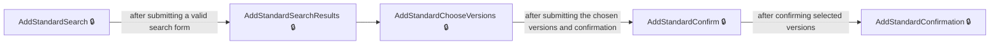
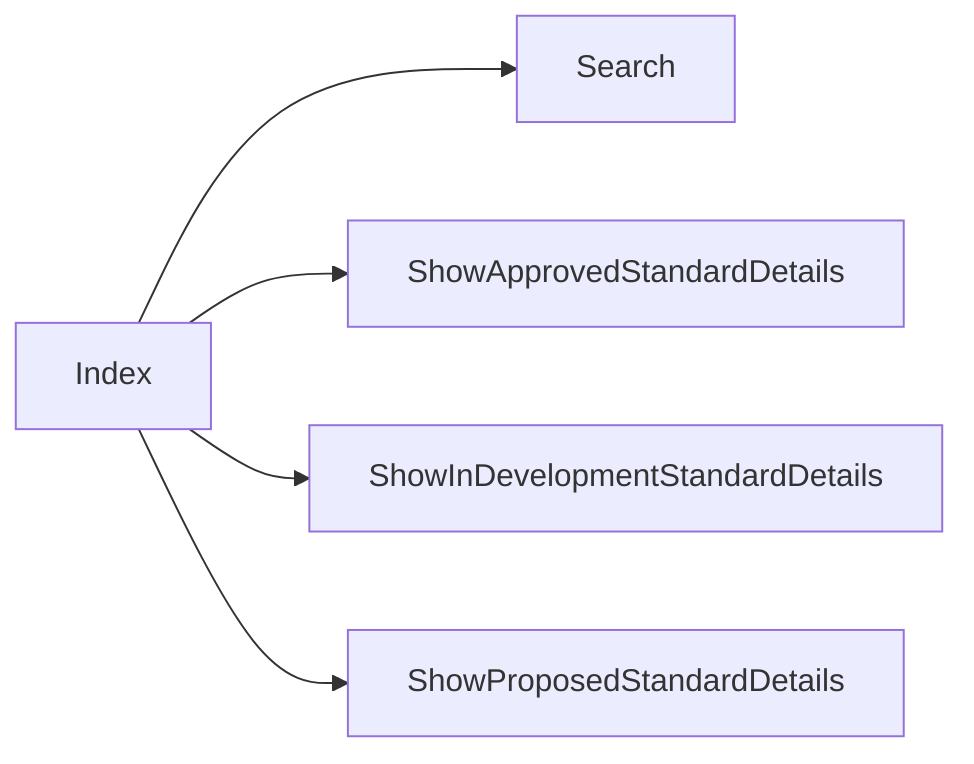
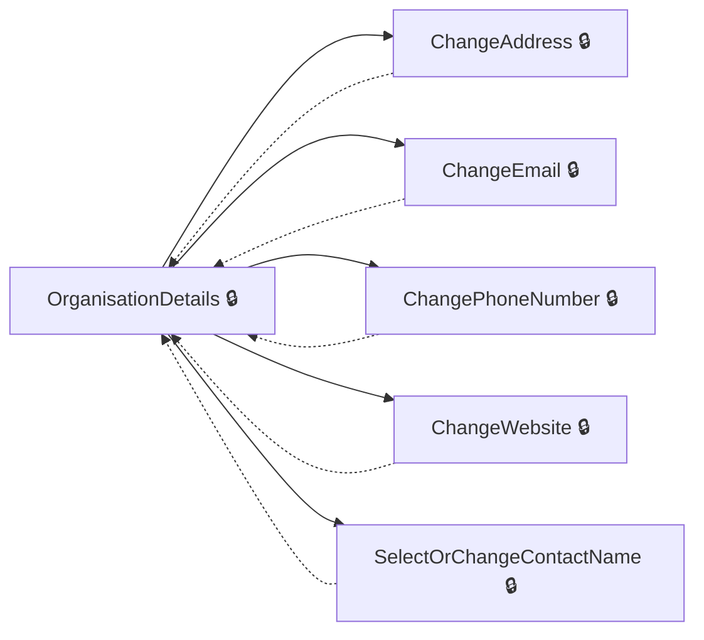
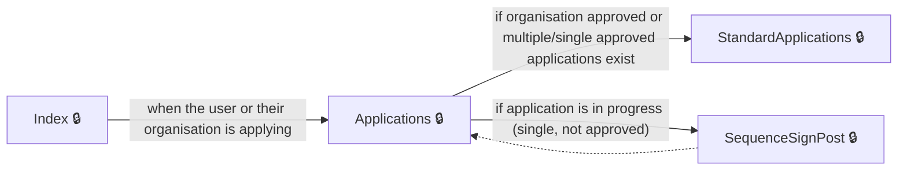
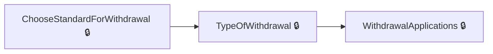

# User journeys: SkillsFundingAgency/das-assessor-service

Generated from `master/src`: 165 pages, 234 transitions, 7 journeys. 🔒 means sign-in is required. Dotted arrows return to a hub.

## Add a Standard to Organisation

A user searches for a standard, chooses versions, confirms, and completes the addition to their organisation.

## Assessment Opportunity Finder

A (potential) assessor browses, filters, and expresses interest in assessment opportunities, including navigating to standard details.

Complete the sections in any order, returning to the hub.

## Manage Organisation Profile

A user views and edits detailed organisation information such as address, email, phone, website, and contacts.

Complete the sections in any order, returning to the hub.

## Complete an End-Point Assessment Application

A user starts from the applications dashboard, chooses to apply, selects a standard, completes the application sections, and submits.

Complete the sections in any order, returning to the hub.

## Create and Confirm a Certificate

A user initiates certificate creation and proceeds through version selection, declaration, grading, date, delivery options, address steps, and final confirmation.

```mermaid
flowchart LR
  p0["Start 🔒"] -->|"when more than one certificate version is available"| p1["Version 🔒"]
  p1["Version 🔒"] -->|"after saving or when only one version and only one option (or no options)"| p2["Declare 🔒"]
  p2["Declare 🔒"] -->|"after saving the declaration form"| p3["Grade 🔒"]
  p3["Grade 🔒"] -->|"after saving the form"| p4["Date 🔒"]
  p4["Date 🔒"] -->|"when SelectedGrade is not 'Fail'"| p5["SendTo 🔒"]
  p5["SendTo 🔒"] -->|"if SendTo is Apprentice"| p6["Address 🔒"]
  p6["Address 🔒"] --> p7["Recipient 🔒"]
  p7["Recipient 🔒"] --> p8["ConfirmAddress 🔒"]
  p8["ConfirmAddress 🔒"] --> p9["Check 🔒"]
  p9["Check 🔒"] --> p10["Confirm 🔒"]
```

## Apply for Withdrawal of a Standard

A user initiates a withdrawal, selects the type, and proceeds to view submitted withdrawal applications.

## Organisational Registration (New User Onboarding)

A new user creates an account and finds or creates their organisation before entering the system dashboard.

## Pages

| Page | Route | Sign-in | Purpose |
| --- | --- | --- | --- |
| `Account.AccessDenied` | — | Unknown | Shows the user that access was denied, with possible redirects if conditions are met. |
| `Account.Callback` | — | Unknown | — |
| `Account.ChangeSignInDetails` | — | Yes | Allows the user to change their sign-in details. |
| `Account.CreateAnAccount` | — | Yes | Allows a new user to create an account by entering their given and family names. |
| `Account.PostSignIn` | — | Unknown | Handles post-sign-in logic to determine where the user should be redirected based on their account status. |
| `Account.SignIn` | — | Unknown | Starts the sign-in process for the user. |
| `Account.SignedOut` | — | Unknown | Displays the signed-out page or redirects if the user is already authenticated. |
| `Address` | `certificate/address/enter` | Yes | Allows the user to enter a certificate address. |
| `Application.ApplicationCancelled` | `/Application/{id}/Cancelled` | Yes | Informs the user that their application has been cancelled. |
| `Application.Applications` | `/Application` | Yes | Displays a list of the user's applications and handles starting a new application. |
| `Application.ConfirmCancelApplication` | `/Application/{id}/ConfirmCancel` | Yes | Lets the user confirm whether they want to cancel their application. |
| `Application.DeleteAnswer` | `/Application/DeleteAnswer` | Yes | Allows the user to delete a specific answer from their application. |
| `Application.DeleteFile` | `Application/{Id}/SequenceNo/{sequenceNo}/Section/{sectionId}/Page/{pageId}/Question/{questionId}/Filename/{filename}/RedirectAction/{__redirectAction}` | Yes | Allows the user to delete an uploaded file from their application. |
| `Application.Download` | `Application/{Id}/Section/{sectionId}/Page/{pageId}/Question/{questionId}/{filename}/Download` | Yes | Lets the user download a file related to an application question. |
| `Application.Feedback` | `/Application/{id}/Feedback` | Yes | Displays the feedback page for an application. |
| `Application.FinancialExpiredRedir` | — | Yes | Shows the user a page indicating that a financial assessment is due or expired. |
| `Application.NotSubmitted` | `/Application/{Id}/NotSubmitted` | Yes | Shows that an application was not successfully submitted. |
| `Application.Page` | `/Application/{Id}/Sequences/{sequenceNo}/Sections/{sectionNo}/Pages/{pageId}` | Yes | Displays a question page within a specific section and sequence of the application. |
| `Application.SaveAnswers` | `/Application/{Id}/Sequences/{sequenceNo}/Sections/{sectionNo}/Pages/{pageId}` | Yes | Handles saving answers to a question page in the application. |
| `Application.SaveMultiplePageAnswers` | `/Application/{Id}/Sequences/{sequenceNo}/Sections/{sectionNo}/Pages/{pageId}/multiple` | Yes | Handles saving answers when a question page allows multiple sets of answers. |
| `Application.Section` | `/Application/{Id}/Sequences/{sequenceNo}/Sections/{sectionNo}` | Yes | Displays a section of the application, which may include one or more pages or questions. |
| `Application.SequenceSignPost` | `/Application/{Id}` | Yes | Provides an overview or signposting for the application, redirecting to the relevant sequence or section. |
| `Application.StartApplication` | `/Application` | Yes | Begins a new application for the user. |
| `Application.StartOrResumeApplication` | — | Yes | Starts or resumes a finance-related application. |
| `Application.Submit` | `/Application/{Id}/Submit/{sequenceNo}` | Yes | Handles submission of a sequence within an application. |
| `Application.Submitted` | `/Application/{Id}/Submitted` | Yes | Shows that an application has been successfully submitted. |
| `ApplicationController.Sequence` | `/Application/{Id}/Sequence/{sequenceNo}` | Yes | Displays a sequence step within an application flow. |
| `ApplicationController.StandardApplications` | `/Application/StandardApplications` | Yes | Shows the standard applications available to the user. |
| `ApplyForWithdrawal.CheckWithdrawalRequest` | — | Yes | Lets the user confirm whether they wish to submit their withdrawal request. |
| `ApplyForWithdrawal.ChooseStandardForWithdrawal` | — | Yes | Allows the user to select a standard for withdrawal. |
| `ApplyForWithdrawal.Index` | — | Yes | Shows the initial withdrawal page, listing available withdrawal types or requests. |
| `ApplyForWithdrawal.TypeOfWithdrawal` | — | Yes | Lets the user select what they are withdrawing from. |
| `ApplyForWithdrawalController.WithdrawalApplications` | `withdrawal/requests` | Yes | Displays the user's withdrawal applications. |
| `ApplyToAssessStandard.GoToApplyToAssessStandard` | — | Unknown | Redirects the user to the application page for assessing a standard. |
| `ApplyToAssessStandard.Index` | — | Unknown | Displays the main page for applying to assess a standard. |
| `Back` | `certificate/declaration/back` | Yes | Lets the user go back from the certificate declaration step. |
| `Certificate.Start` | `certificate` | Yes | Starts the certificate creation process. |
| `CertificateAddress.Address` | `certificate/address/enter` | Yes | Allows the user to enter a certificate address. |
| `CertificateAddress.ConfirmAddress` | `certificate/address/confirm` | Yes | Allows the user to confirm the address for the certificate. |
| `CertificateAddress.PreviousAddress` | `certificate/address/select-previous` | Yes | Allows the user to select a previous address for the certificate. |
| `CertificateAddress.Recipient` | `certificate/address/recipient` | Yes | Allows the user to specify the certificate recipient. |
| `CertificateCheck.Check` | `certificate/check` | Yes | Lets the user check and confirm certificate details before submission. |
| `CertificateConfirmation.Confirm` | `certificate/confirmation` | Yes | Shows confirmation that the certificate process has been completed. |
| `CertificateDate.Date` | `certificate/date` | Yes | Shows the achievement date form for the certificate. |
| `CertificateDeclaration.Declare` | `certificate/declaration` | Yes | Displays the declaration form for the certificate process. |
| `CertificateFamilyName.FamilyName` | `certificate/familyname` | Unknown | Lets the user enter the apprentice's last name for the certificate. |
| `CertificateGivenNames.GivenNames` | `certificate/givennames` | Unknown | Lets the user enter the apprentice's given names for the certificate. |
| `CertificateGrade.Grade` | `certificate/grade` | Yes | Lets the user select the grade for a certificate. |
| `CertificateHistory.ChangePageCertificateHistory` | — | Unknown | Lets the user change the results page in certificate history. |
| `CertificateHistory.Index` | — | Unknown | Displays a history of certificates with search and paging. |
| `CertificateHistory.ResetSession` | — | Unknown | Resets the session data for certificate history and returns to the main history page. |
| `CertificateHistory.Search` | — | Unknown | Performs a search of the certificate history with a search term. |
| `CertificateHistory.SortCertificateHistory` | — | Unknown | Changes the sorting order in certificate history. |
| `CertificateOption.Option` | `certificate/option` | Yes | Lets the user select an option for the certificate after choosing a version. |
| `CertificateOptionBack` | `certificate/option/back` | Yes | Handles the back navigation from the certificate option page, returning to the appropriate previous page based on session state. |
| `CertificateSendTo.SendTo` | `certificate/sendto` | Yes | Lets the user choose who the certificate should be sent to (apprentice or previous address). |
| `CertificateVersion.Version` | `certificate/version` | Yes | Lets the user select the version for the certificate. |
| `CertificateVersionNotApproved.NotApprovedToAssess` | `certificate/version/not-approved` | Yes | Informs the user that their chosen certificate version is not approved to assess. |
| `Check` | `certificate/check` | Yes | Lets the user check and confirm certificate details before submission. |
| `ConfirmAddress` | `certificate/address/confirm` | Yes | Allows the user to confirm the address for the certificate. |
| `Dashboard.Index` | — | Yes | Shows the user's assessment dashboard, if their account and organisation are active. |
| `Date` | `certificate/date` | Yes | Lets the user enter and validate the achievement date for the certificate. |
| `Declare` | `certificate/declaration` | Yes | Lets the user submit their declaration for the certificate. |
| `Grade` | `certificate/grade` | Yes | Lets the user select the grade for a certificate. |
| `Home.AccessDenied` | — | Unknown | Informs the user they do not have access to the requested resource. |
| `Home.Accessibility` | — | Unknown | Provides accessibility information for the application. |
| `Home.ContactUs` | — | Unknown | Lets the user contact support or submit an enquiry. |
| `Home.CookieDetails` | — | Unknown | Shows details about cookies used on the site. |
| `Home.Cookies` | — | Unknown | Lets the user set their cookie preferences for analytics and marketing. |
| `Home.Index` | `/` | Unknown | Displays the site's home page. |
| `Home.InvalidRole` | — | Yes | Informs the user their role is invalid for the requested operation. |
| `Home.InvitePending` | — | Yes | Informs the user their invite is pending activation. |
| `Home.NotActivated` | — | Yes | Informs the user their organisation is not yet activated. |
| `Home.NotRegistered` | — | Yes | Informs the user they are not registered with an organisation. |
| `Home.Privacy` | — | Unknown | Displays the site's privacy policy. |
| `Home.Rejected` | — | Yes | Informs the user their registration or invitation has been rejected. |
| `InviteUser.Invite` | `/ManageUsers/Invite` | Unknown | Lets a user invite someone to join their organisation, specifying their details and privileges. |
| `InviteUser.Invited` | `/ManageUsers/{contactId}/Invited` | Unknown | Confirms that a user has been successfully invited to join. |
| `ManageUsers.Index` | — | Unknown | Displays a list of users and their privileges for the organisation. |
| `ManageUsers.SetStatusAndNotify` | — | Unknown | Lets the approver set a user's status to approved or rejected and optionally notify them. |
| `OppFinder.ApplyFilters` | — | Unknown | Lets the user apply filters to the assessment opportunities search. |
| `OppFinder.ApplyFiltersPartial` | — | Unknown | Lets the user select sectors and levels to filter assessment opportunities (partial view). |
| `OppFinder.ChangePageApprovedStandards` | — | Unknown | Lets the user change the page of approved standards displayed. |
| `OppFinder.ChangePageApprovedStandardsPartial` | — | Unknown | Lets the user change the page of approved standards in a partial view. |
| `OppFinder.ChangePageInDevelopmentStandards` | — | Unknown | Lets the user change the page of in-development standards displayed. |
| `OppFinder.ChangePageInDevelopmentStandardsPartial` | — | Unknown | Lets the user change the page of in-development standards in a partial view. |
| `OppFinder.ChangePageProposedStandards` | — | Unknown | Lets the user change the page of proposed standards displayed. |
| `OppFinder.ChangePageProposedStandardsPartial` | — | Unknown | Lets the user change the page of proposed standards in a partial view. |
| `OppFinder.ContactUs` | — | Unknown | Lets the user view contact information or a contact form. |
| `OppFinder.Cookies` | — | Unknown | Lets the user set preferences for analytics and marketing cookies. |
| `OppFinder.ExpressionOfInterest` | — | Unknown | Lets the user express an interest in an assessment opportunity by entering their details. |
| `OppFinder.Index` | — | Unknown | Lets the user browse and search for assessment opportunities, including filters and pagination options. |
| `OppFinder.Privacy` | — | Unknown | Displays the privacy policy to the user. |
| `OppFinder.RefreshFiltersPartial` | — | Unknown | Lets the user refresh filters for sectors and levels (partial view). |
| `OppFinder.ResetFilters` | — | Unknown | Lets the user reset all applied filters on assessment opportunities. |
| `OppFinder.ResetFiltersPartial` | — | Unknown | Lets the user reset sector and level filters for the assessment opportunity finder. |
| `OppFinder.ResetSession` | — | Unknown | Resets all session data for the assessment opportunity finder. |
| `OppFinder.Search` | — | Unknown | Lets the user search for assessment opportunities using a search term. |
| `OppFinder.SearchPartial` | — | Unknown | Lets the user update sector and level filters for the assessment opportunity finder, in a partial view. |
| `OppFinder.ShowApprovedStandardDetails` | — | Unknown | Shows detailed information about an approved assessment standard. |
| `OppFinder.ShowApprovedStandardsPerPage` | — | Unknown | Lets the user set the number of approved standards displayed per page. |
| `OppFinder.ShowApprovedStandardsPerPagePartial` | — | Unknown | Lets the user set the number of approved standards displayed per page in a partial view. |
| `OppFinder.ShowInDevelopmentStandardDetails` | — | Unknown | Shows detailed information about an in-development assessment standard. |
| `OppFinder.ShowInDevelopmentStandardsPerPage` | — | Unknown | Lets the user set the number of in-development standards displayed per page. |
| `OppFinder.ShowInDevelopmentStandardsPerPagePartial` | — | Unknown | Lets the user set the number of in-development standards displayed per page in a partial view. |
| `OppFinder.ShowProposedStandardDetails` | — | Unknown | Shows detailed information about a proposed assessment standard. |
| `OppFinder.ShowProposedStandardsPerPage` | — | Unknown | Lets the user set the number of proposed standards displayed per page. |
| `OppFinder.ShowProposedStandardsPerPagePartial` | — | Unknown | Lets the user set the number of proposed standards displayed per page in a partial view. |
| `OppFinder.SortApprovedStandards` | — | Unknown | Lets the user sort the list of approved standards. |
| `OppFinder.SortApprovedStandardsPartial` | — | Unknown | Lets the user sort the list of approved standards in a partial view. |
| `OppFinder.SortInDevelopmentStandards` | — | Unknown | Lets the user sort the list of in-development standards in the assessment opportunity finder. |
| `OppFinder.SortInDevelopmentStandardsPartial` | — | Unknown | Lets the user apply sorting to a partial view of in-development standards in the assessment opportunity finder. |
| `OppFinder.SortProposedStandards` | — | Unknown | Lets the user sort the list of proposed standards in the assessment opportunity finder. |
| `OppFinder.SortProposedStandardsPartial` | — | Unknown | Lets the user apply sorting to a partial view of proposed standards in the assessment opportunity finder. |
| `Option` | `certificate/option` | Yes | Lets the user select an option after choosing a version for the certificate. |
| `Organisation.ApiSubscriptionRequestAccess` | — | Yes | Lets the user request access to the organisation's API subscription. |
| `Organisation.ChangeAddress` | — | Yes | Lets the user change the organisation's address. |
| `Organisation.ChangeEmail` | — | Yes | Lets the user change the organisation's contact email. |
| `Organisation.ChangePhoneNumber` | — | Yes | Lets the user change the organisation's phone number. |
| `Organisation.ChangeWebsite` | — | Yes | Lets the user change the organisation's website address. |
| `Organisation.Index` | — | Yes | Shows an overview of the organisation. |
| `Organisation.OrganisationDetails` | — | Yes | Lets the user view and edit detailed information about the organisation. |
| `Organisation.RenewApiKey` | — | Yes | Lets the user renew the organisation's API key. |
| `Organisation.SelectOrChangeContactName` | — | Yes | Lets the user select or change the primary contact name for the organisation. |
| `OrganisationSearch.Confirm` | — | Yes | Lets the user confirm organisation search selection and type. |
| `OrganisationSearch.DealingWithRequest` | — | Yes | Handles the process after the user submits a request related to the organisation search. |
| `OrganisationSearch.FromResults` | — | Yes | Displays search results for organisations after the user navigates from a previous results page. |
| `OrganisationSearch.Index` | — | Yes | Lets the user start an organisation search by entering a search string. |
| `OrganisationSearch.NextResults` | — | Yes | Shows the next page of organisation search results. |
| `OrganisationSearch.NoAccess` | — | Yes | Informs the user they do not have access to the requested organisation or action. |
| `OrganisationSearch.OrganisationChosen` | — | Yes | Lets the user choose the type of an organisation after selecting it from search results. |
| `OrganisationSearch.Results` | — | Yes | Shows organisation search results based on the provided search string. |
| `OrganisationStandards.Index` | — | Yes | Shows the registered standards (with versions) for the user's organisation. |
| `OrganisationStandards.OrderPipeline` | — | Yes | Lets the user view or order their EPA pipeline standards using filters and sorting. |
| `OrganisationStandards.Pipeline` | — | Yes | Shows the end-point assessment organisation's pipeline standards with available filters. |
| `PreviousAddress` | `certificate/address/select-previous` | Yes | Allows the user to select a previous address for the certificate. |
| `Recipient` | `certificate/address/recipient` | Yes | Allows the user to specify the certificate recipient. |
| `RequestAccess.RequestAccess` | — | Yes | Lets a user request access to a specific privilege. |
| `RequestAccess.RequestSent` | `/RequestAccess/RequestSent/{privilegeId}` | Yes | Informs the user that their privilege access request has been sent. |
| `Search.Index` | — | Unknown | Lets the user search for a learner by surname and unique learner number. |
| `Search.PrivatelyFundedDraft` | — | Unknown | Shows draft privately funded certificates from search. |
| `Search.Result` | — | Unknown | Displays individual search result details and lets the user choose a standard. |
| `SendTo` | `certificate/sendto` | Yes | Lets the user choose who the certificate should be sent to (apprentice or previous address). |
| `StandardController.AddStandardChooseVersions` | `standard/add-standard/{search}/{referenceNumber}/choose-versions`, `standard/add-standard/choose-versions` | Yes | Lets the user choose which versions of a standard to add and confirm they have read the assessment plan. |
| `StandardController.AddStandardConfirm` | `standard/add-standard/{search}/{referenceNumber}/confirm`, `standard/add-standard/confirm` | Yes | Lets the user confirm their choice to add selected versions of a standard. |
| `StandardController.AddStandardConfirmation` | `standard/add-standard/{referenceNumber}/confirmation` | Yes | Shows confirmation that a standard has been added to the organisation. |
| `StandardController.AddStandardSearch` | `standard/add-standard/{search?}`, `standard/add-standard` | Yes | Allows the user to search for an apprenticeship standard to add. |
| `StandardController.AddStandardSearchResults` | `standard/add-standard/{search}/results` | Yes | Shows the results for the apprenticeship standard search. |
| `StandardController.ApplyStandardConfirm` | `standard/{id}/apply-standard/{search}/{referenceNumber}/confirm` | Yes | Lets the user confirm their intention to apply for a standard. |
| `StandardController.ApplyStandardConfirmOfqual` | `standard/{id}/apply-standard/{search}/{referenceNumber}/confirm-ofqual` | Yes | Lets the user confirm applying for a standard regulated by Ofqual. |
| `StandardController.ApplyStandardOfsShutterPage` | `standard/{id}/confirm-ofs` | Yes | Shows information about Office for Students restrictions when applying for a standard. |
| `StandardController.ApplyStandardSearch` | `standard/{id}/apply-standard/{search?}`, `standard/{id}/apply-standard` | Yes | Lets the user search for the standard they want to apply for. |
| `StandardController.ApplyStandardSearchResults` | `standard/{id}/apply-standard/{search}/results` | Yes | Displays the results for searched standards to apply for. |
| `StandardController.OptInStandardVersion` | `standard/opt-in/{referenceNumber}/{version}`, `standard/opt-in` | Yes | Allows the user to opt in to a specific version of a standard. |
| `StandardController.OptInStandardVersionConfirmation` | `standard/opt-in/{referenceNumber}/{version}/confirmation` | Yes | Confirms that the user has opted in to a specific version of a standard. |
| `StandardController.OptOutStandardVersion` | `standard/opt-out/{referenceNumber}/{version}`, `standard/opt-out` | Yes | Allows the user to opt out of a specific version of a standard. |
| `StandardController.OptOutStandardVersionConfirmation` | `standard/opt-out/{referenceNumber}/{version}/confirmation` | Yes | Confirms that the user has opted out of a specific version of a standard. |
| `StandardController.StandardDetails` | `standard/standard-details/{referenceNumber}` | Yes | Shows detailed information about a particular standard, including its versions. |
| `UserDetails.Details` | — | Unknown | Shows details of a user's account and assigned privileges. |
| `UserDetails.EditPermissions` | `/ManageUsers/{contactId}/permissions` | Unknown | Lets the user or approver edit permissions for a user. |
| `UserDetails.Remove` | — | Unknown | Shows a confirmation page for removing a user from the organisation. |
| `UserDetails.RemoveConfirmed` | — | Unknown | Processes removal of a user from the organisation. |
| `UserDetails.Removed` | — | Unknown | Informs the user that the removal action has been completed. |
| `Version` | `certificate/version` | Yes | Lets the user select the version for the certificate. |
| `choose` | — | Unknown | Lets the user choose a standard from multiple search results. |

## Form fields

Field definitions only: no values a user enters are recorded.

### `Account.CreateAnAccount`

| Field | Type | Label | Required | Rules | Options |
| --- | --- | --- | --- | --- | --- |
| `GivenName` | text | Given name | — | required | — |
| `FamilyName` | text | Family name | — | required | — |

### `Application.ConfirmCancelApplication`

| Field | Type | Label | Required | Rules | Options |
| --- | --- | --- | --- | --- | --- |
| `AreYouSure` | radios | Are you sure you want to cancel your application to assess this standard?! Warning If you select yes, we will not take into account any answers you entered as part of your application to assess If you | — | required | Yes, No |

### `ApplyForWithdrawal.CheckWithdrawalRequest`

| Field | Type | Label | Required | Rules | Options |
| --- | --- | --- | --- | --- | --- |
| `Continue` | radios | Do you want to continue with this withdrawal request? | — | required; must be 'yes' or 'no' | Yes, No, return to your withdrawal requests |

### `ApplyForWithdrawal.TypeOfWithdrawal`

| Field | Type | Label | Required | Rules | Options |
| --- | --- | --- | --- | --- | --- |
| `TypeOfWithdrawal` | radios | What are you withdrawing from? | — | required; must be either 'StandardWithdrawal' or 'OrganisationWithdrawal' | — |

### `CertificateFamilyName.FamilyName`

| Field | Type | Label | Required | Rules | Options |
| --- | --- | --- | --- | --- | --- |
| `FamilyName` | text | What is the apprentice's last name? | — | — | — |

### `CertificateGivenNames.GivenNames`

| Field | Type | Label | Required | Rules | Options |
| --- | --- | --- | --- | --- | --- |
| `GivenNames` | text | — | — | — | — |

### `CertificateHistory.Index`

| Field | Type | Label | Required | Rules | Options |
| --- | --- | --- | --- | --- | --- |
| `SearchTerm` | text | — | — | — | — |

### `Date`

| Field | Type | Label | Required | Rules | Options |
| --- | --- | --- | --- | --- | --- |
| `Day` | text | Day | — | required; must be numeric; must be in range 1-31; must form a valid date with Month and Year; date must not be in the future; date must not be before January 1, 2017 | — |
| `Month` | text | Month | — | required; must be numeric; must be in range 1-12; must form a valid date with Day and Year; date must not be in the future; date must not be before January 1, 2017 | — |
| `Year` | text | Year | — | required; must be exactly 4 digits; must be numeric; must form a valid date with Day and Month; date must not be in the future; date must not be before January 1, 2017 | — |

### `Home.Cookies`

| Field | Type | Label | Required | Rules | Options |
| --- | --- | --- | --- | --- | --- |
| `cookies-AnalyticsConsent` | radios | Cookies that measure website use | — | — | Use cookies that measure my website use, Do not use cookies that measure my website use |
| `cookies-MarketingConsent` | radios | Cookies that help with our communications and marketing | — | — | Use cookies that help with communications and marketing, Do not use cookies that help with communications and marketing |

### `InviteUser.Invite`

| Field | Type | Label | Required | Rules | Options |
| --- | --- | --- | --- | --- | --- |
| `GivenName` | text | Given name | Yes | required | — |
| `FamilyName` | text | Family name | Yes | required | — |
| `Email` | text | Email address | Yes | email address; required; must be a valid email address | — |
| `ViewDashboard` | checkboxes | — | — | — | View dashboard |

### `OppFinder.ApplyFiltersPartial`

| Field | Type | Label | Required | Rules | Options |
| --- | --- | --- | --- | --- | --- |
| `sectorFilters` | checkboxes | Sectors | — | — | — |
| `levelFilters` | checkboxes | Levels | — | — | — |

### `OppFinder.ChangePageApprovedStandardsPartial`

| Field | Type | Label | Required | Rules | Options |
| --- | --- | --- | --- | --- | --- |
| `ApprovedStandardsPerPage` | select | Standards per page | — | — | — |

### `OppFinder.ChangePageInDevelopmentStandardsPartial`

| Field | Type | Label | Required | Rules | Options |
| --- | --- | --- | --- | --- | --- |
| `InDevelopmentStandardsPerPage` | select | Standards per page | — | — | — |

### `OppFinder.ChangePageProposedStandardsPartial`

| Field | Type | Label | Required | Rules | Options |
| --- | --- | --- | --- | --- | --- |
| `ProposedStandardsPerPage` | select | Standards per page | — | — | — |

### `OppFinder.Cookies`

| Field | Type | Label | Required | Rules | Options |
| --- | --- | --- | --- | --- | --- |
| `cookies-AnalyticsConsent` | radios | Cookies that measure website use | — | — | Use cookies that measure my website use, Do not use cookies that measure my website use |
| `cookies-MarketingConsent` | radios | Cookies that help with our communications and marketing | — | — | Use cookies that help with communications and marketing, Do not use cookies that help with communications and marketing |

### `OppFinder.ExpressionOfInterest`

| Field | Type | Label | Required | Rules | Options |
| --- | --- | --- | --- | --- | --- |
| `Email` | email | Email address | Yes | required; must be a valid email address | — |
| `OrganisationName` | text | Organisation name | Yes | required | — |
| `ContactName` | text | Full name | Yes | required | — |
| `ContactNumber` | telephone | Telephone number (optional) | — | optional; must be a valid phone number if entered | — |

### `OppFinder.Index`

| Field | Type | Label | Required | Rules | Options |
| --- | --- | --- | --- | --- | --- |
| `SearchTerm` | text | — | — | — | — |
| `sectorFilters` | checkboxes | Sectors | — | — | — |
| `levelFilters` | checkboxes | Levels | — | — | — |
| `ApprovedStandardsPerPage` | select | Standards per page | — | — | — |
| `InDevelopmentStandardsPerPage` | select | Standards per page | — | — | — |
| `ProposedStandardsPerPage` | select | Standards per page | — | — | — |

### `OppFinder.RefreshFiltersPartial`

| Field | Type | Label | Required | Rules | Options |
| --- | --- | --- | --- | --- | --- |
| `sectorFilters` | checkboxes | Sectors | — | — | — |
| `levelFilters` | checkboxes | Levels | — | — | — |

### `OppFinder.ResetFiltersPartial`

| Field | Type | Label | Required | Rules | Options |
| --- | --- | --- | --- | --- | --- |
| `sectorFilters` | checkboxes | Sectors | — | — | — |
| `levelFilters` | checkboxes | Levels | — | — | — |

### `OppFinder.SearchPartial`

| Field | Type | Label | Required | Rules | Options |
| --- | --- | --- | --- | --- | --- |
| `sectorFilters` | checkboxes | Sectors | — | — | — |
| `levelFilters` | checkboxes | Levels | — | — | — |

### `Organisation.ChangeAddress`

| Field | Type | Label | Required | Rules | Options |
| --- | --- | --- | --- | --- | --- |
| `postcodeSearch` | text | — | — | — | — |
| `AddressLine1` | text | Building and street line 1 of 2 | Yes | required | — |
| `AddressLine2` | text | Building and street line 2 of 2 | — | — | — |
| `AddressLine3` | text | Town or city | Yes | required | — |
| `AddressLine4` | text | County | — | — | — |
| `Postcode` | text | Postcode | Yes | required | — |

### `Organisation.ChangeEmail`

| Field | Type | Label | Required | Rules | Options |
| --- | --- | --- | --- | --- | --- |
| `Email` | text | Contact email | Yes | required | — |

### `Organisation.ChangePhoneNumber`

| Field | Type | Label | Required | Rules | Options |
| --- | --- | --- | --- | --- | --- |
| `PhoneNumber` | text | Phone number | Yes | required | — |

### `Organisation.ChangeWebsite`

| Field | Type | Label | Required | Rules | Options |
| --- | --- | --- | --- | --- | --- |
| `WebsiteLink` | text | — | Yes | required | — |

### `Organisation.SelectOrChangeContactName`

| Field | Type | Label | Required | Rules | Options |
| --- | --- | --- | --- | --- | --- |
| `PrimaryContact` | radios | Contacts | Yes | required | — |

### `OrganisationSearch.Confirm`

| Field | Type | Label | Required | Rules | Options |
| --- | --- | --- | --- | --- | --- |
| `OrganisationType` | radios | — | — | — | — |

### `OrganisationSearch.Index`

| Field | Type | Label | Required | Rules | Options |
| --- | --- | --- | --- | --- | --- |
| `SearchString` | text | — | — | — | — |

### `OrganisationSearch.OrganisationChosen`

| Field | Type | Label | Required | Rules | Options |
| --- | --- | --- | --- | --- | --- |
| `OrganisationType` | radios | — | — | — | — |

### `OrganisationSearch.Results`

| Field | Type | Label | Required | Rules | Options |
| --- | --- | --- | --- | --- | --- |
| `SearchString` | text | — | — | — | — |

### `OrganisationStandards.OrderPipeline`

| Field | Type | Label | Required | Rules | Options |
| --- | --- | --- | --- | --- | --- |
| `SelectedStandard` | select | Standard | — | — | — |
| `SelectedProvider` | select | Training provider | — | — | — |
| `SelectedEPADate` | select | Estimated EPA date | — | — | — |

### `OrganisationStandards.Pipeline`

| Field | Type | Label | Required | Rules | Options |
| --- | --- | --- | --- | --- | --- |
| `SelectedStandard` | select | Standard | — | — | — |
| `SelectedProvider` | select | Training provider | — | — | — |
| `SelectedEPADate` | select | Estimated EPA date | — | — | — |

### `Search.Index`

| Field | Type | Label | Required | Rules | Options |
| --- | --- | --- | --- | --- | --- |
| `Surname` | text | ["Lastname"] | — | required | — |
| `Uln` | text | Unique learner number ( ULN ) | — | required; must be exactly 10 digits | — |

### `Search.Result`

| Field | Type | Label | Required | Rules | Options |
| --- | --- | --- | --- | --- | --- |
| `StdCode` | radios | — | — | required | — |

### `StandardController.AddStandardChooseVersions`

| Field | Type | Label | Required | Rules | Options |
| --- | --- | --- | --- | --- | --- |
| `SelectedVersions` | checkboxes | Select all that apply | — | required; must select at least one version | — |
| `IsConfirmed` | checkboxes | — | — | required; must be true (Confirm you have read the assessment plan) | — |

### `StandardController.AddStandardSearch`

| Field | Type | Label | Required | Rules | Options |
| --- | --- | --- | --- | --- | --- |
| `Search` | text | Which standard would you like to add? | — | required; must be at least 3 characters and not whitespace | — |

### `StandardController.ApplyStandardSearch`

| Field | Type | Label | Required | Rules | Options |
| --- | --- | --- | --- | --- | --- |
| `Search` | text | What standard are you applying for? | — | required; must be at least 3 characters; cannot be whitespace | — |

### `UserDetails.EditPermissions`

| Field | Type | Label | Required | Rules | Options |
| --- | --- | --- | --- | --- | --- |
| `viewDashboard` | checkboxes | Permissions | — | — | View dashboard |

### `choose`

| Field | Type | Label | Required | Rules | Options |
| --- | --- | --- | --- | --- | --- |
| `StdCode` | radios | — | — | required | — |

