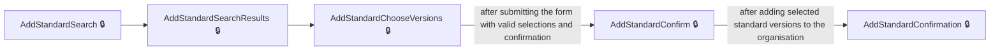
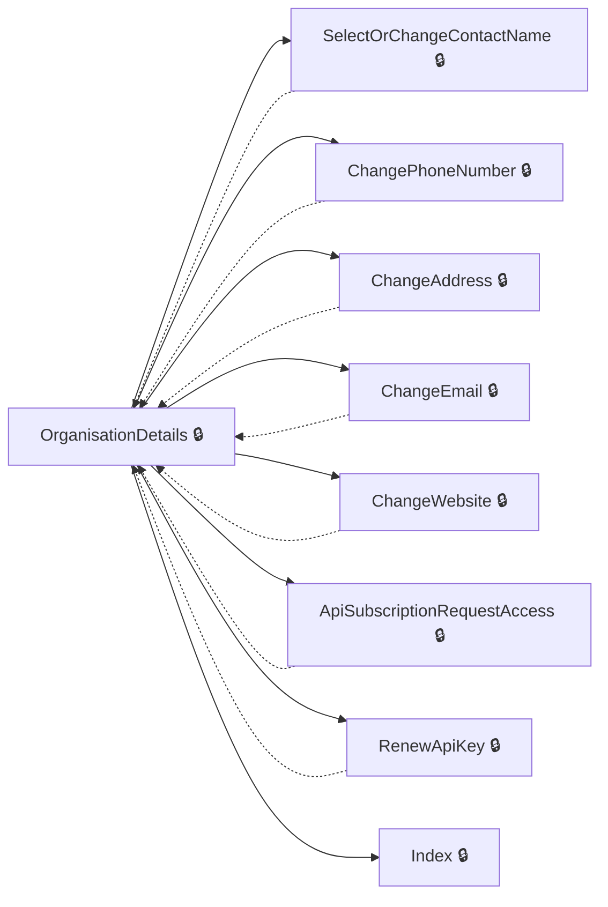
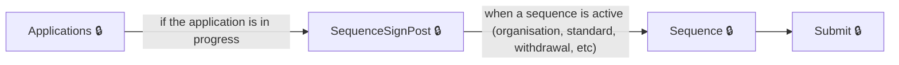
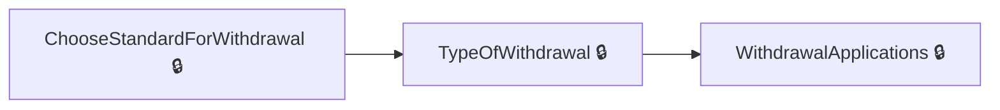

# User journeys: SkillsFundingAgency/das-assessor-service

Generated from `master/src`: 165 pages, 234 transitions, 5 journeys. 🔒 means sign-in is required. Dotted arrows return to a hub.

## Search and add a standard to your organisation

A user finds a standard and adds it to their organisation for delivery.

## Manage organisation details

A user manages the organisation’s details such as contact, address, email, and website.

Complete the sections in any order, returning to the hub.

## Work through an application to assess a standard

A user views their application dashboard, navigates to a sequence, and submits their application.

## Add a standard to your organisation

A user searches for a standard to add, selects versions, and confirms the addition, ending with confirmation.

## Request withdrawal from a standard

A user initiates and confirms a withdrawal request from a standard, then views withdrawal applications.

## Pages

| Page | Route | Sign-in | Purpose |
| --- | --- | --- | --- |
| `Account.AccessDenied` | — | Unknown | Informs the user they do not have the required access privileges. |
| `Account.Callback` | — | Unknown | — |
| `Account.ChangeSignInDetails` | — | Yes | Displays a page for the user to change their sign-in details. |
| `Account.CreateAnAccount` | — | Yes | Lets a new user create an account by providing their given and family names. |
| `Account.PostSignIn` | — | Unknown | Handles logic after the user attempts to sign in, redirecting to relevant pages based on account status. |
| `Account.SignIn` | — | Unknown | Starts the sign-in process for the user. |
| `Account.SignedOut` | — | Unknown | Shows a page indicating the user has successfully signed out. |
| `Address` | `certificate/address/enter` | Yes | Lets the user enter the certificate address. |
| `Application.ApplicationCancelled` | `/Application/{id}/Cancelled` | Yes | Shows confirmation that an application has been cancelled. |
| `Application.Applications` | `/Application` | Yes | Shows the user's applications or redirects based on application and organisation status. |
| `Application.ConfirmCancelApplication` | `/Application/{id}/ConfirmCancel` | Yes | Lets the user confirm cancelling their application to assess a standard. |
| `Application.DeleteAnswer` | `/Application/DeleteAnswer` | Yes | Handles deletion of an answer from an application. |
| `Application.DeleteFile` | `Application/{Id}/SequenceNo/{sequenceNo}/Section/{sectionId}/Page/{pageId}/Question/{questionId}/Filename/{filename}/RedirectAction/{__redirectAction}` | Yes | Handles deletion of a file from an application page. |
| `Application.Download` | `Application/{Id}/Section/{sectionId}/Page/{pageId}/Question/{questionId}/{filename}/Download` | Yes | Allows the user to download a file associated with their application. |
| `Application.Feedback` | `/Application/{id}/Feedback` | Yes | Shows feedback for the user's application and allows submission. |
| `Application.FinancialExpiredRedir` | — | Yes | Displays a page when financial review has expired, prompting for assessment. |
| `Application.NotSubmitted` | `/Application/{Id}/NotSubmitted` | Yes | Shows the user that their application was not submitted. |
| `Application.Page` | `/Application/{Id}/Sequences/{sequenceNo}/Sections/{sectionNo}/Pages/{pageId}` | Yes | Shows a specific page of questions within a section of the user's application. |
| `Application.SaveAnswers` | `/Application/{Id}/Sequences/{sequenceNo}/Sections/{sectionNo}/Pages/{pageId}` | Yes | — |
| `Application.SaveMultiplePageAnswers` | `/Application/{Id}/Sequences/{sequenceNo}/Sections/{sectionNo}/Pages/{pageId}/multiple` | Yes | — |
| `Application.Section` | `/Application/{Id}/Sequences/{sequenceNo}/Sections/{sectionNo}` | Yes | Displays a section within an application sequence for the user to complete. |
| `Application.SequenceSignPost` | `/Application/{Id}` | Yes | Guides the user to the relevant sequence within their application based on current status. |
| `Application.StartApplication` | `/Application` | Yes | Starts a new application for the user or resumes an in-progress one. |
| `Application.StartOrResumeApplication` | — | Yes | Starts or resumes the financial assessment application for the user. |
| `Application.Submit` | `/Application/{Id}/Submit/{sequenceNo}` | Yes | Handles the submission of a sequence within the user's application. |
| `Application.Submitted` | `/Application/{Id}/Submitted` | Yes | Shows the user that their application has been submitted. |
| `ApplicationController.Sequence` | `/Application/{Id}/Sequence/{sequenceNo}` | Yes | Displays a sequence within the user's application for completion. |
| `ApplicationController.StandardApplications` | `/Application/StandardApplications` | Yes | Shows the user's standard applications and their status. |
| `ApplyForWithdrawal.CheckWithdrawalRequest` | — | Yes | Lets the user confirm whether to continue with a withdrawal request. |
| `ApplyForWithdrawal.ChooseStandardForWithdrawal` | — | Yes | Lets the user choose a standard to withdraw from. |
| `ApplyForWithdrawal.Index` | — | Yes | Shows the withdrawal application overview. |
| `ApplyForWithdrawal.TypeOfWithdrawal` | — | Yes | Lets the user choose what they are withdrawing from. |
| `ApplyForWithdrawalController.WithdrawalApplications` | `withdrawal/requests` | Yes | Shows all withdrawal requests the user has made. |
| `ApplyToAssessStandard.GoToApplyToAssessStandard` | — | Unknown | Redirects the user to apply for assessment for a standard. |
| `ApplyToAssessStandard.Index` | — | Unknown | Starts the process to apply to assess a standard. |
| `Back` | `certificate/declaration/back` | Yes | Lets the user go back to the relevant previous step in the certificate process. |
| `Certificate.Start` | `certificate` | Yes | Starts a new certificate process for an apprentice. |
| `CertificateAddress.Address` | `certificate/address/enter` | Yes | Lets the user enter the certificate address. |
| `CertificateAddress.ConfirmAddress` | `certificate/address/confirm` | Yes | Lets the user confirm the certificate address details. |
| `CertificateAddress.PreviousAddress` | `certificate/address/select-previous` | Yes | Lets the user select a previously used certificate address. |
| `CertificateAddress.Recipient` | `certificate/address/recipient` | Yes | Lets the user choose the recipient of the certificate. |
| `CertificateCheck.Check` | `certificate/check` | Yes | Lets the user check certificate details before submission. |
| `CertificateConfirmation.Confirm` | `certificate/confirmation` | Yes | Shows certificate confirmation after successful submission. |
| `CertificateDate.Date` | `certificate/date` | Yes | Shows or loads the form for entering the achievement date. |
| `CertificateDeclaration.Declare` | `certificate/declaration` | Yes | Shows the certificate declaration form to declare the accuracy of details. |
| `CertificateFamilyName.FamilyName` | `certificate/familyname` | Unknown | Lets the user enter the apprentice's last name for the certificate. |
| `CertificateGivenNames.GivenNames` | `certificate/givennames` | Unknown | Lets the user enter the apprentice's given names for the certificate. |
| `CertificateGrade.Grade` | `certificate/grade` | Yes | Lets the user select or review the grade for a certificate. |
| `CertificateHistory.ChangePageCertificateHistory` | — | Unknown | Shows a specific page of certificate history results. |
| `CertificateHistory.Index` | — | Unknown | Shows a list of completed certificate assessments, with a form for searching. |
| `CertificateHistory.ResetSession` | — | Unknown | Resets the certificate history search session, starting the history list from the defaults. |
| `CertificateHistory.Search` | — | Unknown | Shows certificate history search results based on a search term. |
| `CertificateHistory.SortCertificateHistory` | — | Unknown | Sorts the certificate history results by a selected column and direction. |
| `CertificateOption.Option` | `certificate/option` | Yes | Lets the user select a course option for a certificate. |
| `CertificateOptionBack` | `certificate/option/back` | Yes | Handles navigation back from the certificate option selection, returning the user to the previous relevant step. |
| `CertificateSendTo.SendTo` | `certificate/sendto` | Yes | Lets the user choose who should receive the certificate. |
| `CertificateVersion.Version` | `certificate/version` | Yes | Lets the user select the version of a certificate standard. |
| `CertificateVersionNotApproved.NotApprovedToAssess` | `certificate/version/not-approved` | Yes | Informs the user that the selected certificate version is not approved for their organisation. |
| `Check` | `certificate/check` | Yes | Lets the user check certificate details before submission. |
| `ConfirmAddress` | `certificate/address/confirm` | Yes | Lets the user confirm the certificate address details. |
| `Dashboard.Index` | — | Yes | Shows an overview dashboard for the user's organisation. |
| `Date` | `certificate/date` | Yes | Lets the user enter the achievement date for the certificate. |
| `Declare` | `certificate/declaration` | Yes | Submits the certificate declaration. |
| `Grade` | `certificate/grade` | Yes | Lets the user select or review the grade for a certificate. |
| `Home.AccessDenied` | — | Unknown | Displays a message when the user tries to access a page they do not have permission for. |
| `Home.Accessibility` | — | Unknown | Provides information about accessibility features of the website. |
| `Home.ContactUs` | — | Unknown | Allows the user to contact the website administrators. |
| `Home.CookieDetails` | — | Unknown | Shows information about specific cookies used by the website. |
| `Home.Cookies` | — | Unknown | Lets the user set cookie preferences regarding analytics and marketing. |
| `Home.Index` | `/` | Unknown | Displays the home page of the application. |
| `Home.InvalidRole` | — | Yes | Shows a message when a user's role does not allow access. |
| `Home.InvitePending` | — | Yes | Tells the user that their invite is pending. |
| `Home.NotActivated` | — | Yes | Informs the user that their organisation has not been activated. |
| `Home.NotRegistered` | — | Yes | Informs the user that their organisation is not registered. |
| `Home.Privacy` | — | Unknown | Provides information about the website's privacy policy. |
| `Home.Rejected` | — | Yes | Notifies the user that their invite or access request was rejected. |
| `InviteUser.Invite` | `/ManageUsers/Invite` | Unknown | Lets an existing user invite another user to their organisation. |
| `InviteUser.Invited` | `/ManageUsers/{contactId}/Invited` | Unknown | Confirms that a user has been successfully invited. |
| `ManageUsers.Index` | — | Unknown | Displays the list of users for the organisation, including their privileges. |
| `ManageUsers.SetStatusAndNotify` | — | Unknown | Allows the administrator to approve or reject a user's status and notifies them. |
| `OppFinder.ApplyFilters` | — | Unknown | Applies the selected filters to the assessment opportunity search results. |
| `OppFinder.ApplyFiltersPartial` | — | Unknown | Lets the user apply filters (sectors and levels) to standards via a partial view. |
| `OppFinder.ChangePageApprovedStandards` | — | Unknown | Shows the approved standards page for a specified page index. |
| `OppFinder.ChangePageApprovedStandardsPartial` | — | Unknown | Shows the approved standards for a specified page index via a partial view. |
| `OppFinder.ChangePageInDevelopmentStandards` | — | Unknown | Shows the 'in development' standards page for a specified page index. |
| `OppFinder.ChangePageInDevelopmentStandardsPartial` | — | Unknown | Shows the 'in development' standards for a specified page index via a partial view. |
| `OppFinder.ChangePageProposedStandards` | — | Unknown | Shows the 'proposed' standards page for a specified page index. |
| `OppFinder.ChangePageProposedStandardsPartial` | — | Unknown | Shows the 'proposed' standards for a specified page index via a partial view. |
| `OppFinder.ContactUs` | — | Unknown | Shows contact information for the assessment opportunity finder. |
| `OppFinder.Cookies` | — | Unknown | Lets the user set website cookie preferences for analytics and marketing. |
| `OppFinder.ExpressionOfInterest` | — | Unknown | Lets the user submit an expression of interest for a standard, including contact details. |
| `OppFinder.Index` | — | Unknown | Shows the main search page for assessment opportunities including filters and pagination. |
| `OppFinder.Privacy` | — | Unknown | Shows the privacy information for the assessment opportunity finder. |
| `OppFinder.RefreshFiltersPartial` | — | Unknown | Updates the displayed sector and level filters in a partial view. |
| `OppFinder.ResetFilters` | — | Unknown | Clears all filters applied to the standards search. |
| `OppFinder.ResetFiltersPartial` | — | Unknown | Lets the user reset sector and level filters in the opportunity finder, shown as a partial view. |
| `OppFinder.ResetSession` | — | Unknown | Clears all filters and search terms, resetting the opportunity finder session. |
| `OppFinder.Search` | — | Unknown | Lets the user search for assessment opportunities. |
| `OppFinder.SearchPartial` | — | Unknown | Lets the user search for assessment opportunities and updates filter values, shown as a partial view. |
| `OppFinder.ShowApprovedStandardDetails` | — | Unknown | Shows details about an approved apprenticeship standard. |
| `OppFinder.ShowApprovedStandardsPerPage` | — | Unknown | Lets the user change how many approved standards appear per page. |
| `OppFinder.ShowApprovedStandardsPerPagePartial` | — | Unknown | Lets the user change how many approved standards appear per page within a partial view. |
| `OppFinder.ShowInDevelopmentStandardDetails` | — | Unknown | Shows details about an apprenticeship standard in development. |
| `OppFinder.ShowInDevelopmentStandardsPerPage` | — | Unknown | Lets the user change how many in-development standards appear per page. |
| `OppFinder.ShowInDevelopmentStandardsPerPagePartial` | — | Unknown | Lets the user change how many in-development standards appear per page within a partial view. |
| `OppFinder.ShowProposedStandardDetails` | — | Unknown | Shows details about a proposed apprenticeship standard. |
| `OppFinder.ShowProposedStandardsPerPage` | — | Unknown | Lets the user change how many proposed standards appear per page. |
| `OppFinder.ShowProposedStandardsPerPagePartial` | — | Unknown | Lets the user change how many proposed standards appear per page within a partial view. |
| `OppFinder.SortApprovedStandards` | — | Unknown | Lets the user sort the list of approved standards. |
| `OppFinder.SortApprovedStandardsPartial` | — | Unknown | Lets the user sort the list of approved standards within a partial view. |
| `OppFinder.SortInDevelopmentStandards` | — | Unknown | Lets the user sort the list of in-development standards in the Opportunity Finder. |
| `OppFinder.SortInDevelopmentStandardsPartial` | — | Unknown | Allows updating the partial view for sorted in-development standards in the Opportunity Finder. |
| `OppFinder.SortProposedStandards` | — | Unknown | Lets the user sort the list of proposed standards in the Opportunity Finder. |
| `OppFinder.SortProposedStandardsPartial` | — | Unknown | Allows updating the partial view for sorted proposed standards in the Opportunity Finder. |
| `Option` | `certificate/option` | Yes | Lets the user select a course option for a certificate. |
| `Organisation.ApiSubscriptionRequestAccess` | — | Yes | Redirects users to request API subscription access for their organisation. |
| `Organisation.ChangeAddress` | — | Yes | Lets the user change the organisation's address. |
| `Organisation.ChangeEmail` | — | Yes | Lets the user change the organisation's contact email address. |
| `Organisation.ChangePhoneNumber` | — | Yes | Lets the user change the organisation's contact phone number. |
| `Organisation.ChangeWebsite` | — | Yes | Lets the user change the organisation's website address. |
| `Organisation.Index` | — | Yes | Shows the organisation overview and details to the user. |
| `Organisation.OrganisationDetails` | — | Yes | Shows detailed information for the user's organisation and enables management options. |
| `Organisation.RenewApiKey` | — | Yes | Lets the user renew the organisation's API key. |
| `Organisation.SelectOrChangeContactName` | — | Yes | Lets the user select or change the organisation's primary contact. |
| `OrganisationSearch.Confirm` | — | Yes | Lets the user confirm details about a searched organisation before proceeding. |
| `OrganisationSearch.DealingWithRequest` | — | Yes | Lets the user deal with or complete their organisation access request. |
| `OrganisationSearch.FromResults` | — | Yes | Lets the user view organisation search results again after requesting them from the results page. |
| `OrganisationSearch.Index` | — | Yes | Lets the user start a search for an organisation by entering a search string. |
| `OrganisationSearch.NextResults` | — | Yes | Lets the user page through the organisation search results. |
| `OrganisationSearch.NoAccess` | — | Yes | Shows the user they do not have access to the selected organisation and provides options for next steps. |
| `OrganisationSearch.OrganisationChosen` | — | Yes | Lets the user select an organisation type for the organisation they've chosen. |
| `OrganisationSearch.Results` | — | Yes | Displays organisation search results based on the entered search string. |
| `OrganisationStandards.Index` | — | Yes | Displays the list of standards approved for the user's organisation. |
| `OrganisationStandards.OrderPipeline` | — | Yes | Displays the pipeline of standards, sorted by the selected order. |
| `OrganisationStandards.Pipeline` | — | Yes | Displays the pipeline of standards for the organisation with filtering options. |
| `PreviousAddress` | `certificate/address/select-previous` | Yes | Lets the user select a previously used certificate address. |
| `Recipient` | `certificate/address/recipient` | Yes | Lets the user choose the recipient of the certificate. |
| `RequestAccess.RequestAccess` | — | Yes | Lets a user request access to a privilege. |
| `RequestAccess.RequestSent` | `/RequestAccess/RequestSent/{privilegeId}` | Yes | Shows confirmation that a privilege access request has been sent. |
| `Search.Index` | — | Unknown | Allows the user to search for a learner using their surname and unique learner number (ULN). |
| `Search.PrivatelyFundedDraft` | — | Unknown | Informs the user that a privately funded certificate is in draft status. |
| `Search.Result` | — | Unknown | Shows the result for the selected standard, allowing the user to review details and grades. |
| `SendTo` | `certificate/sendto` | Yes | Lets the user choose who should receive the certificate. |
| `StandardController.AddStandardChooseVersions` | `standard/add-standard/{search}/{referenceNumber}/choose-versions`, `standard/add-standard/choose-versions` | Yes | Lets the user select standard versions to add to their organisation and confirm having read the relevant assessment plan. |
| `StandardController.AddStandardConfirm` | `standard/add-standard/{search}/{referenceNumber}/confirm`, `standard/add-standard/confirm` | Yes | Confirms the addition of selected versions of a standard to the organisation. |
| `StandardController.AddStandardConfirmation` | `standard/add-standard/{referenceNumber}/confirmation` | Yes | Shows confirmation after a standard has been added to the organisation. |
| `StandardController.AddStandardSearch` | `standard/add-standard/{search?}`, `standard/add-standard` | Yes | Lets the user search for a standard to add. |
| `StandardController.AddStandardSearchResults` | `standard/add-standard/{search}/results` | Yes | Shows the results for the user's search for a standard to add. |
| `StandardController.ApplyStandardConfirm` | `standard/{id}/apply-standard/{search}/{referenceNumber}/confirm` | Yes | Allows the user to confirm application for a chosen standard. |
| `StandardController.ApplyStandardConfirmOfqual` | `standard/{id}/apply-standard/{search}/{referenceNumber}/confirm-ofqual` | Yes | Lets the user confirm application for a standard regulated by Ofqual. |
| `StandardController.ApplyStandardOfsShutterPage` | `standard/{id}/confirm-ofs` | Yes | Informs the user of Office for Students-specific requirements before applying for a standard. |
| `StandardController.ApplyStandardSearch` | `standard/{id}/apply-standard/{search?}`, `standard/{id}/apply-standard` | Yes | Lets the user search for standards to apply for. |
| `StandardController.ApplyStandardSearchResults` | `standard/{id}/apply-standard/{search}/results` | Yes | Shows a list of matching standards for the user's search query when applying for a standard. |
| `StandardController.OptInStandardVersion` | `standard/opt-in/{referenceNumber}/{version}`, `standard/opt-in` | Yes | Lets the user opt-in to a version of a standard. |
| `StandardController.OptInStandardVersionConfirmation` | `standard/opt-in/{referenceNumber}/{version}/confirmation` | Yes | Confirms the user has opted in to a specified version of a standard. |
| `StandardController.OptOutStandardVersion` | `standard/opt-out/{referenceNumber}/{version}`, `standard/opt-out` | Yes | Lets the user opt-out of a version of a standard. |
| `StandardController.OptOutStandardVersionConfirmation` | `standard/opt-out/{referenceNumber}/{version}/confirmation` | Yes | Confirms the user has opted out of a specified version of a standard. |
| `StandardController.StandardDetails` | `standard/standard-details/{referenceNumber}` | Yes | Displays detailed information about a particular standard and its versions. |
| `UserDetails.Details` | — | Unknown | Shows details of a selected user, including assigned privileges. |
| `UserDetails.EditPermissions` | `/ManageUsers/{contactId}/permissions` | Unknown | Allows editing of a user's permissions within the organisation. |
| `UserDetails.Remove` | — | Unknown | Lets an administrator confirm the removal of a user from the organisation. |
| `UserDetails.RemoveConfirmed` | — | Unknown | Processes the removal of a user from the organisation. |
| `UserDetails.Removed` | — | Unknown | Displays confirmation that the user has been removed from the organisation. |
| `Version` | `certificate/version` | Yes | Lets the user select the version of a certificate standard. |
| `choose` | — | Unknown | Lets the user choose a standard from multiple search results. |

## Form fields

Field definitions only: no values a user enters are recorded.

### `Account.CreateAnAccount`

| Field | Type | Label | Required | Rules | Options |
| --- | --- | --- | --- | --- | --- |
| `GivenName` | text | Given name | — | required | — |
| `FamilyName` | text | Family name | — | required | — |

### `Application.ConfirmCancelApplication`

| Field | Type | Label | Required | Rules | Options |
| --- | --- | --- | --- | --- | --- |
| `AreYouSure` | radios | Are you sure you want to cancel your application to assess this standard?! Warning If you select yes, we will not take into account any answers you entered as part of your application to assess If you | — | required; must be selected | Yes, No |

### `ApplyForWithdrawal.CheckWithdrawalRequest`

| Field | Type | Label | Required | Rules | Options |
| --- | --- | --- | --- | --- | --- |
| `Continue` | radios | Do you want to continue with this withdrawal request? | — | required; must be 'yes' or 'no' | Yes, No, return to your withdrawal requests |

### `ApplyForWithdrawal.TypeOfWithdrawal`

| Field | Type | Label | Required | Rules | Options |
| --- | --- | --- | --- | --- | --- |
| `TypeOfWithdrawal` | radios | What are you withdrawing from? | — | required; must be either 'StandardWithdrawal' or 'OrganisationWithdrawal' | — |

### `CertificateFamilyName.FamilyName`

| Field | Type | Label | Required | Rules | Options |
| --- | --- | --- | --- | --- | --- |
| `FamilyName` | text | What is the apprentice's last name? | — | — | — |

### `CertificateGivenNames.GivenNames`

| Field | Type | Label | Required | Rules | Options |
| --- | --- | --- | --- | --- | --- |
| `GivenNames` | text | — | — | — | — |

### `CertificateHistory.Index`

| Field | Type | Label | Required | Rules | Options |
| --- | --- | --- | --- | --- | --- |
| `SearchTerm` | text | — | — | — | — |

### `Date`

| Field | Type | Label | Required | Rules | Options |
| --- | --- | --- | --- | --- | --- |
| `Day` | text | Day | — | required; must be a number; must be between 1 and 31 | — |
| `Month` | text | Month | — | required; must be a number; must be between 1 and 12 | — |
| `Year` | text | Year | — | required; must be 4 characters; must be a number | — |

### `Home.Cookies`

| Field | Type | Label | Required | Rules | Options |
| --- | --- | --- | --- | --- | --- |
| `cookies-AnalyticsConsent` | radios | Cookies that measure website use | — | — | Use cookies that measure my website use, Do not use cookies that measure my website use |
| `cookies-MarketingConsent` | radios | Cookies that help with our communications and marketing | — | — | Use cookies that help with communications and marketing, Do not use cookies that help with communications and marketing |

### `InviteUser.Invite`

| Field | Type | Label | Required | Rules | Options |
| --- | --- | --- | --- | --- | --- |
| `GivenName` | text | Given name | Yes | required | — |
| `FamilyName` | text | Family name | Yes | required | — |
| `Email` | text | Email address | Yes | email address; required; must be a valid email address | — |
| `ViewDashboard` | checkboxes | — | — | — | View dashboard |

### `OppFinder.ApplyFiltersPartial`

| Field | Type | Label | Required | Rules | Options |
| --- | --- | --- | --- | --- | --- |
| `sectorFilters` | checkboxes | Sectors | — | — | — |
| `levelFilters` | checkboxes | Levels | — | — | — |

### `OppFinder.ChangePageApprovedStandardsPartial`

| Field | Type | Label | Required | Rules | Options |
| --- | --- | --- | --- | --- | --- |
| `ApprovedStandardsPerPage` | select | Standards per page | — | — | — |

### `OppFinder.ChangePageInDevelopmentStandardsPartial`

| Field | Type | Label | Required | Rules | Options |
| --- | --- | --- | --- | --- | --- |
| `InDevelopmentStandardsPerPage` | select | Standards per page | — | — | — |

### `OppFinder.ChangePageProposedStandardsPartial`

| Field | Type | Label | Required | Rules | Options |
| --- | --- | --- | --- | --- | --- |
| `ProposedStandardsPerPage` | select | Standards per page | — | — | — |

### `OppFinder.Cookies`

| Field | Type | Label | Required | Rules | Options |
| --- | --- | --- | --- | --- | --- |
| `cookies-AnalyticsConsent` | radios | Cookies that measure website use | — | — | Use cookies that measure my website use, Do not use cookies that measure my website use |
| `cookies-MarketingConsent` | radios | Cookies that help with our communications and marketing | — | — | Use cookies that help with communications and marketing, Do not use cookies that help with communications and marketing |

### `OppFinder.ExpressionOfInterest`

| Field | Type | Label | Required | Rules | Options |
| --- | --- | --- | --- | --- | --- |
| `Email` | email | Email address | Yes | required | — |
| `OrganisationName` | text | Organisation name | Yes | required | — |
| `ContactName` | text | Full name | Yes | required | — |
| `ContactNumber` | telephone | Telephone number (optional) | — | — | — |

### `OppFinder.Index`

| Field | Type | Label | Required | Rules | Options |
| --- | --- | --- | --- | --- | --- |
| `SearchTerm` | text | — | — | — | — |
| `sectorFilters` | checkboxes | Sectors | — | — | — |
| `levelFilters` | checkboxes | Levels | — | — | — |
| `ApprovedStandardsPerPage` | select | Standards per page | — | — | — |
| `InDevelopmentStandardsPerPage` | select | Standards per page | — | — | — |
| `ProposedStandardsPerPage` | select | Standards per page | — | — | — |

### `OppFinder.RefreshFiltersPartial`

| Field | Type | Label | Required | Rules | Options |
| --- | --- | --- | --- | --- | --- |
| `sectorFilters` | checkboxes | Sectors | — | — | — |
| `levelFilters` | checkboxes | Levels | — | — | — |

### `OppFinder.ResetFiltersPartial`

| Field | Type | Label | Required | Rules | Options |
| --- | --- | --- | --- | --- | --- |
| `sectorFilters` | checkboxes | Sectors | — | — | — |
| `levelFilters` | checkboxes | Levels | — | — | — |

### `OppFinder.SearchPartial`

| Field | Type | Label | Required | Rules | Options |
| --- | --- | --- | --- | --- | --- |
| `sectorFilters` | checkboxes | Sectors | — | — | — |
| `levelFilters` | checkboxes | Levels | — | — | — |

### `Organisation.ChangeAddress`

| Field | Type | Label | Required | Rules | Options |
| --- | --- | --- | --- | --- | --- |
| `postcodeSearch` | text | — | — | — | — |
| `AddressLine1` | text | Building and street line 1 of 2 | Yes | required | — |
| `AddressLine2` | text | Building and street line 2 of 2 | — | — | — |
| `AddressLine3` | text | Town or city | Yes | required | — |
| `AddressLine4` | text | County | — | — | — |
| `Postcode` | text | Postcode | Yes | required | — |

### `Organisation.ChangeEmail`

| Field | Type | Label | Required | Rules | Options |
| --- | --- | --- | --- | --- | --- |
| `Email` | text | Contact email | Yes | required | — |

### `Organisation.ChangePhoneNumber`

| Field | Type | Label | Required | Rules | Options |
| --- | --- | --- | --- | --- | --- |
| `PhoneNumber` | text | Phone number | Yes | required | — |

### `Organisation.ChangeWebsite`

| Field | Type | Label | Required | Rules | Options |
| --- | --- | --- | --- | --- | --- |
| `WebsiteLink` | text | — | Yes | required | — |

### `Organisation.SelectOrChangeContactName`

| Field | Type | Label | Required | Rules | Options |
| --- | --- | --- | --- | --- | --- |
| `PrimaryContact` | radios | Contacts | Yes | required | — |

### `OrganisationSearch.Confirm`

| Field | Type | Label | Required | Rules | Options |
| --- | --- | --- | --- | --- | --- |
| `OrganisationType` | radios | — | — | — | — |

### `OrganisationSearch.Index`

| Field | Type | Label | Required | Rules | Options |
| --- | --- | --- | --- | --- | --- |
| `SearchString` | text | — | — | required; must be at least 2 characters | — |

### `OrganisationSearch.OrganisationChosen`

| Field | Type | Label | Required | Rules | Options |
| --- | --- | --- | --- | --- | --- |
| `OrganisationType` | radios | — | — | required; must select an organisation type | — |

### `OrganisationSearch.Results`

| Field | Type | Label | Required | Rules | Options |
| --- | --- | --- | --- | --- | --- |
| `SearchString` | text | — | — | required; must be at least 2 characters | — |

### `OrganisationStandards.OrderPipeline`

| Field | Type | Label | Required | Rules | Options |
| --- | --- | --- | --- | --- | --- |
| `SelectedStandard` | select | Standard | — | — | — |
| `SelectedProvider` | select | Training provider | — | — | — |
| `SelectedEPADate` | select | Estimated EPA date | — | — | — |

### `OrganisationStandards.Pipeline`

| Field | Type | Label | Required | Rules | Options |
| --- | --- | --- | --- | --- | --- |
| `SelectedStandard` | select | Standard | — | — | — |
| `SelectedProvider` | select | Training provider | — | — | — |
| `SelectedEPADate` | select | Estimated EPA date | — | — | — |

### `Search.Index`

| Field | Type | Label | Required | Rules | Options |
| --- | --- | --- | --- | --- | --- |
| `Surname` | text | ["Lastname"] | — | required | — |
| `Uln` | text | Unique learner number ( ULN ) | — | required; must be exactly 10 digits | — |

### `Search.Result`

| Field | Type | Label | Required | Rules | Options |
| --- | --- | --- | --- | --- | --- |
| `StdCode` | radios | — | — | required; must select a Standard | — |

### `StandardController.AddStandardChooseVersions`

| Field | Type | Label | Required | Rules | Options |
| --- | --- | --- | --- | --- | --- |
| `SelectedVersions` | checkboxes | Select all that apply | — | required; must select at least one version | — |
| `IsConfirmed` | checkboxes | — | — | required; must be true | — |

### `StandardController.AddStandardSearch`

| Field | Type | Label | Required | Rules | Options |
| --- | --- | --- | --- | --- | --- |
| `Search` | text | Which standard would you like to add? | — | required; must be at least 3 characters and not only whitespace | — |

### `StandardController.ApplyStandardSearch`

| Field | Type | Label | Required | Rules | Options |
| --- | --- | --- | --- | --- | --- |
| `Search` | text | What standard are you applying for? | — | required; must be at least 3 characters | — |

### `UserDetails.EditPermissions`

| Field | Type | Label | Required | Rules | Options |
| --- | --- | --- | --- | --- | --- |
| `viewDashboard` | checkboxes | Permissions | — | — | View dashboard |

### `choose`

| Field | Type | Label | Required | Rules | Options |
| --- | --- | --- | --- | --- | --- |
| `StdCode` | radios | — | — | required; must select a Standard | — |

