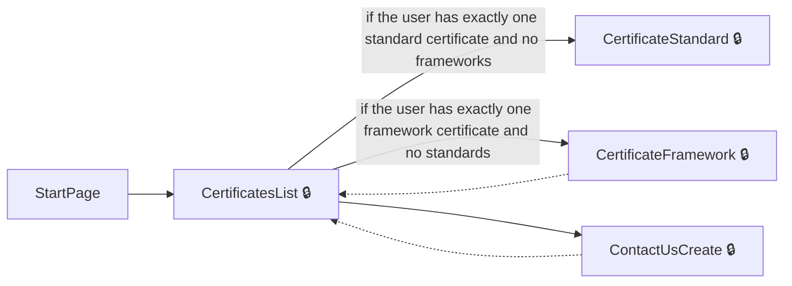
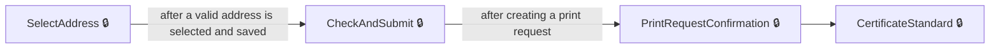
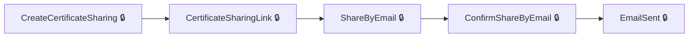
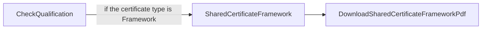

# User journeys: SkillsFundingAgency/das-digital-certification-web

Generated from `main/src`: 45 pages, 78 transitions, 5 journeys. 🔒 means sign-in is required. Dotted arrows return to a hub.

## Access My Certificates

The user enters the system and accesses their available certificates.

Complete the sections in any order, returning to the hub.

## Verify Identity to Access Certificates

The user completes an identity and apprenticeship matching process to gain access to certificates.

```mermaid
flowchart LR
  p0["KnowYourUln 🔒"] -->|"if match outcome is NoData or NoMatch"| p1["SelectCourse 🔒"]
  p1["SelectCourse 🔒"] -->|"if match outcome is NoMatch"| p2["KnowYear 🔒"]
  p2["KnowYear 🔒"] -->|"in all other cases after saving the year"| p3["SelectProvider 🔒"]
  p3["SelectProvider 🔒"] --> p4["CheckAnswers 🔒"]
  p4["CheckAnswers 🔒"] -->|"when answers are matched to one or more certificates"| p5["CertificatesList 🔒"]
```

## Request Delivery of a Certificate

A user requests postal delivery of a certificate, including address selection and confirmation.

## Share a Certificate with Others

The user creates or manages sharing links for their certificate and shares it by email.

## Download a Shared Framework Certificate

An external user views a shared framework certificate and downloads a PDF copy.

## Pages

| Page | Route | Sign-in | Purpose |
| --- | --- | --- | --- |
| `AuthoriseController.CannotMatch` | `authorise/cannot-match` | No | Shows a message when the system cannot match the user's information to any results. |
| `AuthoriseController.CheckAnswers` | `authorise/check-answers` | Yes | Allows the user to review the information they have entered before submitting. |
| `AuthoriseController.KnowYear` | `authorise/know-year` | Yes | Asks the user if they know the year they completed their apprenticeship and to enter the year if so. |
| `AuthoriseController.KnowYourUln` | `authorise/know-your-uln` | Yes | Asks the user if they know their unique learner number (ULN) and to enter it if so. |
| `AuthoriseController.NeedMoreInformation` | `authorise/need-more-information` | Yes | Informs the user that more information is needed to try to match them with their apprenticeship results. |
| `AuthoriseController.NeedMoreInformationContinue` | `authorise/need-more-information` | Yes | Clears previous answers and starts the identification process again. |
| `AuthoriseController.NotFound` | `authorise/not-found` | No | Shows a message when the system cannot find any user data for the provided details. |
| `AuthoriseController.SelectCourse` | `authorise/select-course` | Yes | Lets the user select their course from a list. |
| `AuthoriseController.SelectProvider` | `authorise/select-provider` | Yes | Lets the user select their training provider from a list. |
| `CertificatesController.AddAddress` | `{certificateId}/delivery-request/add-address` | Yes | Lets the user manually add a delivery address for a certificate. |
| `CertificatesController.CertificateFramework` | `{certificateId}/framework` | Yes | Displays the user's framework certificate. |
| `CertificatesController.CertificateSharingLink` | `{certificateId}/sharing/{sharingId}` | Yes | Displays a sharing link for a certificate and allows input of an email address to share by email. |
| `CertificatesController.CertificateStandard` | `{certificateId}/standard` | Yes | Displays the user's standard certificate. |
| `CertificatesController.CertificatesList` | `list` | Yes | Shows a list of certificates available for the user. |
| `CertificatesController.CheckAndSubmit` | `{certificateId}/delivery-request/check-and-submit` | Yes | Lets the user check and confirm their delivery address before requesting certificate delivery. |
| `CertificatesController.CheckQualification` | `sharing/{sharingLinkCode}/check-code` | No | Lets a visitor check a certificate's details using a sharing code. |
| `CertificatesController.CheckQualificationExpired` | `/certificates/expired` | No | Informs the user that the certificate sharing link or qualification has expired. |
| `CertificatesController.ConfirmShareByEmail` | `{certificateId}/sharing/{sharingId}/confirm-email` | Yes | Lets the user confirm sharing their certificate by email before sending. |
| `CertificatesController.ContactUs` | `contact` | Yes | Lets the user view or interact with a contact/support page related to certificates. |
| `CertificatesController.ContactUsCreate` | `contact/create` | Yes | Initiates a new contact/support request related to certificates. |
| `CertificatesController.ContactUsForCertificate` | `{certificateId}/contact` | Yes | Lets the user contact support about a specific certificate. |
| `CertificatesController.ContactUsForCertificateCreate` | `{certificateId}/contact/create` | Yes | Initiates a new contact/support request about a specific certificate. |
| `CertificatesController.CreateCertificateSharing` | `{certificateId}/sharing` | Yes | Allows the user to manage sharing options and links for a certificate. |
| `CertificatesController.DeleteSharing` | `{certificateId}/sharing/{sharingId}/delete` | Yes | Lets the user confirm or view the deletion of a certificate sharing link. |
| `CertificatesController.DownloadCertificateFrameworkPdf` | `{certificateId}/framework/download` | Yes | Enables the user to download the framework version of their certificate as a PDF. |
| `CertificatesController.DownloadCertificateStandardPdf` | `{certificateId}/standard/download` | Yes | Enables the user to download the standard version of their certificate as a PDF. |
| `CertificatesController.DownloadSharedCertificateFrameworkPdf` | `shared/{sharingLinkCode}/framework/download` | No | Allows an external user with a sharing link to download a shared framework certificate as a PDF. |
| `CertificatesController.DownloadSharedCertificateStandardPdf` | `shared/{sharingLinkCode}/standard/download` | No | Allows an external user with a sharing link to download a shared standard certificate as a PDF. |
| `CertificatesController.EmailSent` | `{certificateId}/sharing/{sharingId}/email-sent/{sharingEmailId}` | Yes | Shows the user confirmation and details after a certificate sharing email has been sent. |
| `CertificatesController.PrintRequestConfirmation` | `{certificateId}/delivery-request/confirmation` | Yes | Provides confirmation that a print (delivery) request for a certificate has been made. |
| `CertificatesController.SelectAddress` | `{certificateId}/delivery-request/select-address` | Yes | Lets the user search for and select an existing address for delivery of a certificate. |
| `CertificatesController.ShareByEmail` | `{certificateId}/sharing/{sharingId}/send-email` | Yes | Lets the user submit an email address to share their certificate. |
| `CertificatesController.SharedCertificateFramework` | `shared/{sharingLinkCode}/framework` | No | Displays a shared copy of a framework apprenticeship certificate to users with a sharing link. |
| `CertificatesController.SharedCertificateStandard` | `shared/{sharingLinkCode}/standard` | No | Displays a shared copy of a standard apprenticeship certificate to users with a sharing link. |
| `Home.AccessDenied` | `error/403` | No | Informs the user that they do not have permission to access this resource. |
| `HomeController.AccessibilityStatement` | `accessibility-statement` | No | Displays the accessibility statement for the service. |
| `HomeController.Check` | `check` | Yes | Lets the user confirm they wish to continue and checks account status before proceeding. |
| `HomeController.CookieDetails` | `cookie-details` | No | Shows details about the service's use of cookies. |
| `HomeController.Cookies` | `cookies` | No | Lets the user select their preferences for analytics cookies. |
| `HomeController.Help` | `help` | No | Provides help information for using the service. |
| `HomeController.StartPage` | `start-page` | No | The start page for the digital certificates service. |
| `HomeController.Verified` | `verified` | Yes | Redirects the user to their certificates list after verification. |
| `Locations.Get` | `locations` | Yes | Returns locations matching the search term for address selection via JSON. |
| `Service.ServiceSignOut` | `service/signout` | Yes | Signs the user out of the service and clears session data. |
| `ServiceController.SignedOut` | `service/signed-out` | Unknown | Informs the user they have signed out of the service. |

## Form fields

Field definitions only: no values a user enters are recorded.

### `AuthoriseController.KnowYear`

| Field | Type | Label | Required | Rules | Options |
| --- | --- | --- | --- | --- | --- |
| `KnowYear` | radios | Do you know the year you completed your apprenticeship? | — | required | Yes, No |
| `YearCompleted` | text | Year you completed your apprenticeship, for example 2017 | — | required when KnowYear is true; must be a 4-digit number between 2012 and the current year | — |

### `AuthoriseController.KnowYourUln`

| Field | Type | Label | Required | Rules | Options |
| --- | --- | --- | --- | --- | --- |
| `KnowUln` | radios | Do you know your unique learner number? | — | required | Yes, No, I'll answer more questions |
| `Uln` | text | Unique learner number | — | required when KnowUln is true; must be a 10-digit number | — |

### `AuthoriseController.SelectCourse`

| Field | Type | Label | Required | Rules | Options |
| --- | --- | --- | --- | --- | --- |
| `SelectedCourseCode` | radios | Select your course | — | required | — |

### `AuthoriseController.SelectProvider`

| Field | Type | Label | Required | Rules | Options |
| --- | --- | --- | --- | --- | --- |
| `SelectedProviderName` | radios | Who was your training provider? | — | required unless SelectedProviderUnknown is true | — |

### `CertificatesController.AddAddress`

| Field | Type | Label | Required | Rules | Options |
| --- | --- | --- | --- | --- | --- |
| `Organisation` | text | Organisation (optional) | — | optional; at most 200 characters; must not contain HTML tags | — |
| `AddressLine1` | text | Address line 1 | — | required; at most 200 characters; must not contain HTML tags | — |
| `AddressLine2` | text | Address line 2 (optional) | — | optional; at most 200 characters; must not contain HTML tags | — |
| `TownOrCity` | text | Town or city | — | required; at most 200 characters; must not contain HTML tags | — |
| `County` | text | County (optional) | — | optional; at most 200 characters; must not contain HTML tags | — |
| `Postcode` | text | Postcode | — | required; must not contain HTML tags; must match full UK postcode format; must exist in the postcode lookup | — |

### `CertificatesController.CertificateSharingLink`

| Field | Type | Label | Required | Rules | Options |
| --- | --- | --- | --- | --- | --- |
| `secureWebLink` | text | — | — | — | — |
| `EmailAddress` | email | Share by email | — | — | — |

### `CertificatesController.SelectAddress`

| Field | Type | Label | Required | Rules | Options |
| --- | --- | --- | --- | --- | --- |
| `SearchTerm` | text | Select the address that you’d like us to send your certificate to | — | required; at least 3 characters; must not contain HTML tags; must match a valid address from postcode lookup | — |

### `HomeController.Cookies`

| Field | Type | Label | Required | Rules | Options |
| --- | --- | --- | --- | --- | --- |
| `ConsentAnalyticsCookie` | radios | Do you want to accept analytics cookies? | — | optional | Yes, No |

