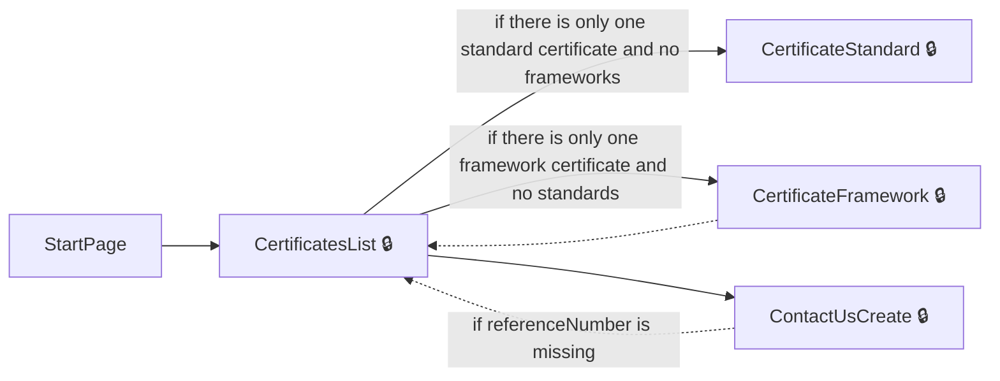
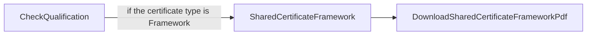
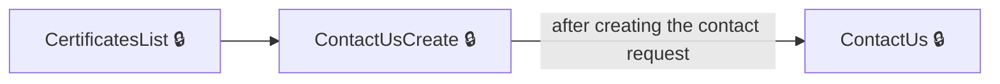
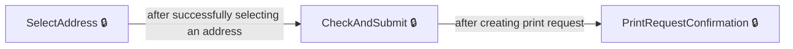
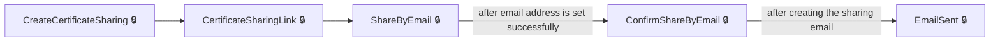
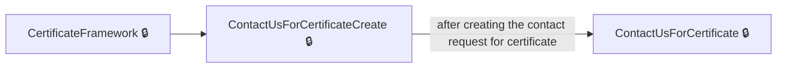

# User journeys: SkillsFundingAgency/das-digital-certification-web

Generated from `main/src`: 45 pages, 78 transitions, 7 journeys. 🔒 means sign-in is required. Dotted arrows return to a hub.

## View and Manage Your Certificates

The user enters the service and views their available certificates, with options to contact support or select a certificate to manage.

Complete the sections in any order, returning to the hub.

## Download a Shared Framework Certificate PDF

A third party downloads the PDF of a shared framework certificate after accessing the sharing link.

## Contact Support

The user starts from the certificates list or a specific certificate and submits a support request.

## Authorise and Match to Results

The user enters personal details to try to match their records and, if successful, sees their certificates.

```mermaid
flowchart LR
  p0["KnowYourUln 🔒"] -->|"if match outcome is NoData or NoMatch"| p1["SelectCourse 🔒"]
  p1["SelectCourse 🔒"] -->|"if match outcome is NoMatch"| p2["KnowYear 🔒"]
  p2["KnowYear 🔒"] -->|"otherwise"| p3["SelectProvider 🔒"]
  p3["SelectProvider 🔒"] -->|"after saving selected provider"| p4["CheckAnswers 🔒"]
  p4["CheckAnswers 🔒"] -->|"after successful match submission"| p5["CertificatesList 🔒"]
```

## Initiate Print Request for a Certificate

The user selects an address, reviews the delivery request, and confirms the print request for their certificate.

## Create and Share a Certificate Digitally

The user creates a sharing link for a certificate, proceeds to share it by email, and receives email confirmation.

## Contact Support About a Specific Framework Certificate

The user contacts support regarding a specific framework certificate and submits a help request.

## Pages

| Page | Route | Sign-in | Purpose |
| --- | --- | --- | --- |
| `AuthoriseController.CannotMatch` | `authorise/cannot-match` | No | Notifies the user that their information could not be matched to any results and provides a reference number. |
| `AuthoriseController.CheckAnswers` | `authorise/check-answers` | Yes | Lets the user review and confirm their entered details for matching. |
| `AuthoriseController.KnowYear` | `authorise/know-year` | Yes | Allows the user to specify the year of their qualification or result. |
| `AuthoriseController.KnowYourUln` | `authorise/know-your-uln` | Yes | Allows the user to enter their Unique Learner Number (ULN) to try to match their results. |
| `AuthoriseController.NeedMoreInformation` | `authorise/need-more-information` | Yes | Informs the user that more information is needed to attempt a match with their results. |
| `AuthoriseController.NeedMoreInformationContinue` | `authorise/need-more-information` | Yes | Processes the user's action to continue after being informed more information is needed. |
| `AuthoriseController.NotFound` | `authorise/not-found` | No | Informs the user that no relevant results were found for their information. |
| `AuthoriseController.SelectCourse` | `authorise/select-course` | Yes | Lets the user select their course from a list to help match their results. |
| `AuthoriseController.SelectProvider` | `authorise/select-provider` | Yes | Lets the user select their training provider to assist with matching. |
| `CertificatesController.AddAddress` | `{certificateId}/delivery-request/add-address` | Yes | Allows the user to add a delivery address for their certificate. |
| `CertificatesController.CertificateFramework` | `{certificateId}/framework` | Yes | Displays details of a framework certificate to the user. |
| `CertificatesController.CertificateSharingLink` | `{certificateId}/sharing/{sharingId}` | Yes | Shows the sharing link for a certificate and options for sharing. |
| `CertificatesController.CertificateStandard` | `{certificateId}/standard` | Yes | Displays details of a standard certificate to the user. |
| `CertificatesController.CertificatesList` | `list` | Yes | Shows a list of certificates available to the user. |
| `CertificatesController.CheckAndSubmit` | `{certificateId}/delivery-request/check-and-submit` | Yes | Lets the user check and confirm their certificate delivery request before submission. |
| `CertificatesController.CheckQualification` | `sharing/{sharingLinkCode}/check-code` | No | Lets users check the qualification linked to a certificate sharing link. |
| `CertificatesController.CheckQualificationExpired` | `/certificates/expired` | No | Shows that the certificate sharing link has expired or cannot be used. |
| `CertificatesController.ConfirmShareByEmail` | `{certificateId}/sharing/{sharingId}/confirm-email` | Yes | Allows users to confirm sharing a certificate by email. |
| `CertificatesController.ContactUs` | `contact` | Yes | Lets users contact support or request help. |
| `CertificatesController.ContactUsCreate` | `contact/create` | Yes | Creates a new contact request for non-specific help. |
| `CertificatesController.ContactUsForCertificate` | `{certificateId}/contact` | Yes | Lets users contact support about a specific certificate. |
| `CertificatesController.ContactUsForCertificateCreate` | `{certificateId}/contact/create` | Yes | Creates a new contact request related to a specific certificate. |
| `CertificatesController.CreateCertificateSharing` | `{certificateId}/sharing` | Yes | Allows users to create and manage certificate sharing links. |
| `CertificatesController.DeleteSharing` | `{certificateId}/sharing/{sharingId}/delete` | Yes | Lets users delete a certificate sharing link. |
| `CertificatesController.DownloadCertificateFrameworkPdf` | `{certificateId}/framework/download` | Yes | Lets users download the PDF version of a framework certificate. |
| `CertificatesController.DownloadCertificateStandardPdf` | `{certificateId}/standard/download` | Yes | Lets users download the PDF version of a standard certificate. |
| `CertificatesController.DownloadSharedCertificateFrameworkPdf` | `shared/{sharingLinkCode}/framework/download` | No | Allows download of a shared framework certificate PDF via a sharing link. |
| `CertificatesController.DownloadSharedCertificateStandardPdf` | `shared/{sharingLinkCode}/standard/download` | No | Allows download of a shared standard certificate PDF via a sharing link. |
| `CertificatesController.EmailSent` | `{certificateId}/sharing/{sharingId}/email-sent/{sharingEmailId}` | Yes | Displays confirmation that the certificate sharing email has been sent. |
| `CertificatesController.PrintRequestConfirmation` | `{certificateId}/delivery-request/confirmation` | Yes | Shows confirmation that a print request for a certificate has been made. |
| `CertificatesController.SelectAddress` | `{certificateId}/delivery-request/select-address` | Yes | Lets the user select an address for certificate delivery. |
| `CertificatesController.ShareByEmail` | `{certificateId}/sharing/{sharingId}/send-email` | Yes | Lets the user send a certificate sharing link to someone's email address. |
| `CertificatesController.SharedCertificateFramework` | `shared/{sharingLinkCode}/framework` | No | Shows a shared certificate for a framework once a sharing link is used. |
| `CertificatesController.SharedCertificateStandard` | `shared/{sharingLinkCode}/standard` | No | Shows a shared certificate for a standard once a sharing link is used. |
| `Home.AccessDenied` | `error/403` | No | Informs the user they do not have access to the requested resource. |
| `HomeController.AccessibilityStatement` | `accessibility-statement` | No | Displays the accessibility statement for the service. |
| `HomeController.Check` | `check` | Yes | Lets the user check their identity before accessing digital certificates. |
| `HomeController.CookieDetails` | `cookie-details` | No | Shows details about cookies used by the website. |
| `HomeController.Cookies` | `cookies` | No | Lets the user view and manage their cookie settings. |
| `HomeController.Help` | `help` | No | Provides help and information about digital certificates. |
| `HomeController.StartPage` | `start-page` | No | Serves as the starting page for digital certificates. |
| `HomeController.Verified` | `verified` | Yes | Redirects the user after their account has been verified. |
| `Locations.Get` | `locations` | Yes | Lets the user search for locations, usually for address entry. |
| `Service.ServiceSignOut` | `service/signout` | Yes | Signs the user out of the digital certificates service. |
| `ServiceController.SignedOut` | `service/signed-out` | Unknown | Shows confirmation that the user has signed out. |
