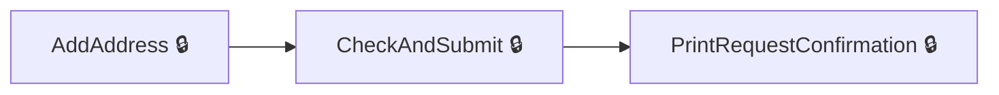
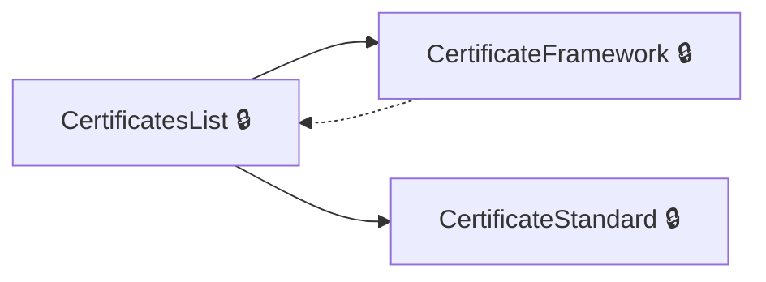
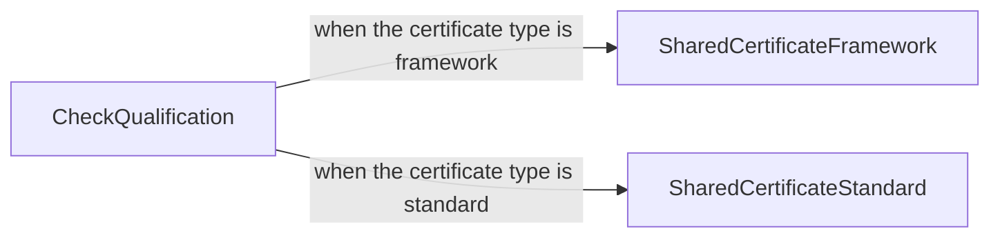
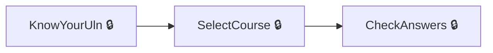
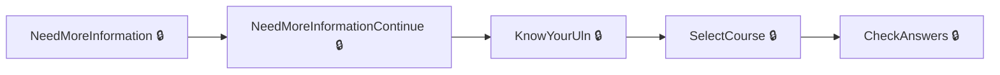
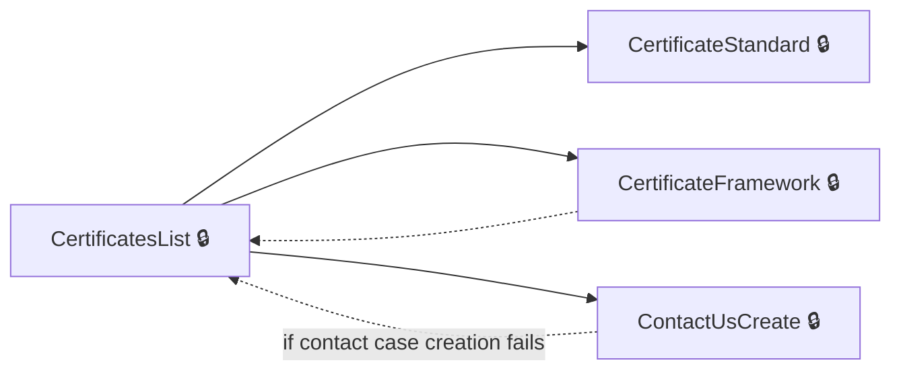

# User journeys: SkillsFundingAgency/das-digital-certification-web

Generated from `main/src`: 45 pages, 78 transitions, 6 journeys. 🔒 means sign-in is required. Dotted arrows return to a hub.

## Specify delivery address for certificate

Allows the user to add a delivery address and finalize the certificate delivery request.

## Download a certificate

Allows users to view and download certificates in framework or standard-based formats.

Complete the sections in any order, returning to the hub.

## Access a shared certificate

Allows external users to validate a sharing code and view as well as download shared certificates in framework or standard-based formats.

Complete the sections in any order, returning to the hub.

## Search for qualifications

Allows the user to search for qualifications using their Unique Learner Number and confirm relevant details.

## Provide additional qualification information

Enables the user to provide extra details to accurately find their qualifications.

## View and manage certificates

Displays a hub for users to view and manage certificates they own.

Complete the sections in any order, returning to the hub.

## Pages

| Page | Route | Sign-in | Purpose |
| --- | --- | --- | --- |
| `AuthoriseController.CannotMatch` | `authorise/cannot-match` | No | Informs the user that their information cannot be matched to the desired item. |
| `AuthoriseController.CheckAnswers` | `authorise/check-answers` | Yes | Allows the user to review and confirm their entered details for authorization. |
| `AuthoriseController.KnowYear` | `authorise/know-year` | Yes | Enables the user to provide the year related to their qualification data. |
| `AuthoriseController.KnowYourUln` | `authorise/know-your-uln` | Yes | Lets the user search for their information using their Unique Learner Number. |
| `AuthoriseController.NeedMoreInformation` | `authorise/need-more-information` | Yes | Prompts the user for additional information to narrow their qualifications. |
| `AuthoriseController.NeedMoreInformationContinue` | `authorise/need-more-information` | Yes | Continues after the user provides extra information. |
| `AuthoriseController.NotFound` | `authorise/not-found` | No | Notifies the user that no results were found based on their input. |
| `AuthoriseController.SelectCourse` | `authorise/select-course` | Yes | Lets the user select a course corresponding to their qualifications. |
| `AuthoriseController.SelectProvider` | `authorise/select-provider` | Yes | Helps the user choose the relevant provider for their qualifications. |
| `CertificatesController.AddAddress` | `{certificateId}/delivery-request/add-address` | Yes | Allows the user to add a delivery address for receiving their certificate. |
| `CertificatesController.CertificateFramework` | `{certificateId}/framework` | Yes | Displays details about a specific certificate framework. |
| `CertificatesController.CertificateSharingLink` | `{certificateId}/sharing/{sharingId}` | Yes | Lets the user share their certificate information via a link. |
| `CertificatesController.CertificateStandard` | `{certificateId}/standard` | Yes | Displays details about a specific certificate standard. |
| `CertificatesController.CertificatesList` | `list` | Yes | Provides the user with a list of all certificates they hold. |
| `CertificatesController.CheckAndSubmit` | `{certificateId}/delivery-request/check-and-submit` | Yes | Allows the user to review and finalize their certificate delivery request. |
| `CertificatesController.CheckQualification` | `sharing/{sharingLinkCode}/check-code` | No | Allows users to validate a sharing link code. |
| `CertificatesController.CheckQualificationExpired` | `/certificates/expired` | No | Displays a message when a qualification sharing link has expired. |
| `CertificatesController.ConfirmShareByEmail` | `{certificateId}/sharing/{sharingId}/confirm-email` | Yes | Enables users to confirm sending a certificate sharing link via email. |
| `CertificatesController.ContactUs` | `contact` | Yes | Provides a page for contacting support about certificates. |
| `CertificatesController.ContactUsCreate` | `contact/create` | Yes | Creates a generic contact case and redirects to contact details. |
| `CertificatesController.ContactUsForCertificate` | `{certificateId}/contact` | Yes | Provides contact options for a specific certificate. |
| `CertificatesController.ContactUsForCertificateCreate` | `{certificateId}/contact/create` | Yes | Creates a specific contact case related to a certificate and redirects to contact details. |
| `CertificatesController.CreateCertificateSharing` | `{certificateId}/sharing` | Yes | Provides options to create certificate sharing links for a specific certificate. |
| `CertificatesController.DeleteSharing` | `{certificateId}/sharing/{sharingId}/delete` | Yes | Allows users to delete an existing certificate sharing link. |
| `CertificatesController.DownloadCertificateFrameworkPdf` | `{certificateId}/framework/download` | Yes | Lets users download a framework-based certificate as a PDF. |
| `CertificatesController.DownloadCertificateStandardPdf` | `{certificateId}/standard/download` | Yes | Lets users download a standard-based certificate as a PDF. |
| `CertificatesController.DownloadSharedCertificateFrameworkPdf` | `shared/{sharingLinkCode}/framework/download` | No | Allows the holder of a sharing link to download a framework certificate as a PDF. |
| `CertificatesController.DownloadSharedCertificateStandardPdf` | `shared/{sharingLinkCode}/standard/download` | No | Allows the holder of a sharing link to download a standard certificate as a PDF. |
| `CertificatesController.EmailSent` | `{certificateId}/sharing/{sharingId}/email-sent/{sharingEmailId}` | Yes | Shows a confirmation screen after sending a certificate sharing email. |
| `CertificatesController.PrintRequestConfirmation` | `{certificateId}/delivery-request/confirmation` | Yes | Displays confirmation for a print delivery request. |
| `CertificatesController.SelectAddress` | `{certificateId}/delivery-request/select-address` | Yes | Allows the user to select an address for certificate delivery. |
| `CertificatesController.ShareByEmail` | `{certificateId}/sharing/{sharingId}/send-email` | Yes | Enables the user to share a certificate via email. |
| `CertificatesController.SharedCertificateFramework` | `shared/{sharingLinkCode}/framework` | No | Allows viewing of a shared framework certificate. |
| `CertificatesController.SharedCertificateStandard` | `shared/{sharingLinkCode}/standard` | No | Allows viewing of a shared standard certificate. |
| `Home.AccessDenied` | `error/403` | No | Displays an access denied message for unauthorized users. |
| `HomeController.AccessibilityStatement` | `accessibility-statement` | No | Provides information about the accessibility of the application. |
| `HomeController.Check` | `check` | Yes | Lets the user confirm their account status before navigation. |
| `HomeController.CookieDetails` | `cookie-details` | No | Provides details about the cookies used in the application. |
| `HomeController.Cookies` | `cookies` | No | Allows the user to manage their cookie preferences. |
| `HomeController.Help` | `help` | No | Provides help and support information for users. |
| `HomeController.StartPage` | `start-page` | No | Serves as the starting page for new users. |
| `HomeController.Verified` | `verified` | Yes | Redirects verified users to the certificates list. |
| `Locations.Get` | `locations` | Yes | Enables users to search for and retrieve location information. |
| `Service.ServiceSignOut` | `service/signout` | Yes | Allows the user to sign out of the application. |
| `ServiceController.SignedOut` | `service/signed-out` | Unknown | Confirms to the user that they have successfully signed out. |
