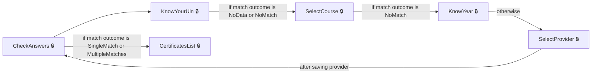
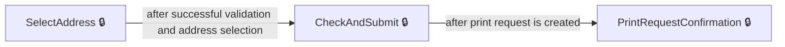
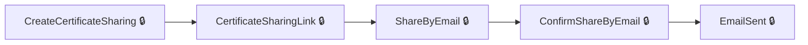
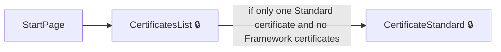
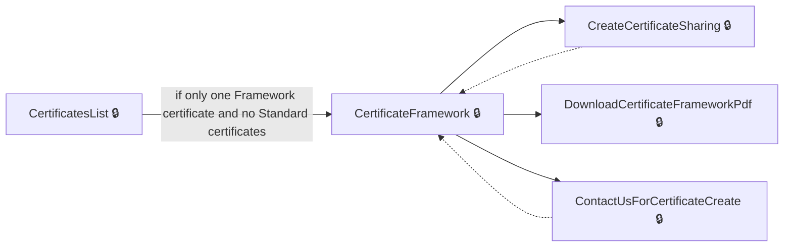
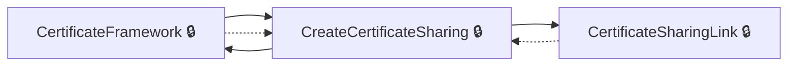
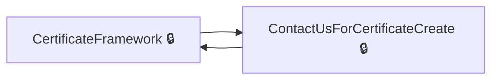
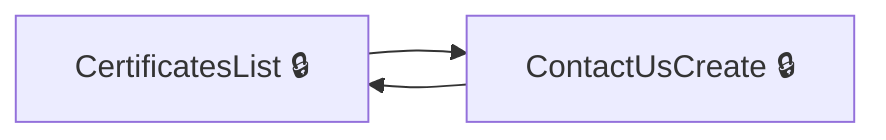
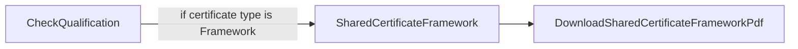

# User journeys: SkillsFundingAgency/das-digital-certification-web

Generated from `main/src`: 46 pages, 78 transitions, 9 journeys. 🔒 means sign-in is required. Dotted arrows return to a hub.

## Match Learner Information for Certificate Access

User provides their details step-by-step until their identity is verified and certificates are found.

## Request Certificate Delivery

User requests delivery of a certificate by entering or selecting an address and confirming the request.

## Send Certificate Sharing Link via Email

User sends a previously generated certificate sharing link via email and receives a confirmation.

## Authorise and Access Your Certificates

User goes through the identity/ULN authorisation journey and lands on their certificates list.

## Certificate Framework Actions

User visits their framework certificate and can share, download, or contact support.

Complete the sections in any order, returning to the hub.

## Share a Framework Certificate

User generates or manages sharing links on their framework certificate.

Complete the sections in any order, returning to the hub.

## Contact Support for a Framework Certificate

User raises a support request for a specific framework certificate and returns to view it.

## Contact Support (General)

User raises a generic support request from their certificates list and returns.

## Access Shared Framework Certificate and Download PDF

External user accesses a shared framework certificate and downloads the PDF.

## Pages

| Page | Route | Sign-in | Purpose |
| --- | --- | --- | --- |
| `AuthoriseController.CannotMatch` | `authorise/cannot-match` | No | Shows a message when the user's information cannot be matched to any results. |
| `AuthoriseController.CheckAnswers` | `authorise/check-answers` | Yes | Lets the user review and check their entered answers before submitting. |
| `AuthoriseController.KnowYear` | `authorise/know-year` | Yes | Lets the user state if they know the year of apprenticeship completion and enter the year if so. |
| `AuthoriseController.KnowYourUln` | `authorise/know-your-uln` | Yes | Lets the user state if they know their unique learner number and enter it if so. |
| `AuthoriseController.NeedMoreInformation` | `authorise/need-more-information` | Yes | Informs the user that more information is needed to continue. |
| `AuthoriseController.NeedMoreInformationContinue` | `authorise/need-more-information` | Yes | Processes the user's continuation after being told more information is needed. |
| `AuthoriseController.NotFound` | `authorise/not-found` | No | Shows a message when no matching records can be found for the user. |
| `AuthoriseController.SelectCourse` | `authorise/select-course` | Yes | Lets the user select their apprenticeship course from available options. |
| `AuthoriseController.SelectProvider` | `authorise/select-provider` | Yes | Lets the user select their training provider from available options. |
| `CertificatesController.AddAddress` | `{certificateId}/delivery-request/add-address` | Yes | Lets the user manually specify a delivery address for their certificate. |
| `CertificatesController.CertificateFramework` | `{certificateId}/framework` | Yes | Displays information about the user's framework certificate. |
| `CertificatesController.CertificateSharingLink` | `{certificateId}/sharing/{sharingId}` | Yes | Lets the user share their certificate via a secure web link or email. |
| `CertificatesController.CertificateStandard` | `{certificateId}/standard` | Yes | Displays information about the user's standard certificate. |
| `CertificatesController.CertificatesList` | `list` | Yes | Shows a list of certificates matched to the user. |
| `CertificatesController.CheckAndSubmit` | `{certificateId}/delivery-request/check-and-submit` | Yes | Lets the user review and confirm their certificate delivery request. |
| `CertificatesController.CheckQualification` | `sharing/{sharingLinkCode}/check-code` | No | Lets users check the qualification associated with a shared certificate link. |
| `CertificatesController.CheckQualificationExpired` | `/certificates/expired` | No | Informs the user that a qualification sharing link has expired. |
| `CertificatesController.ConfirmShareByEmail` | `{certificateId}/sharing/{sharingId}/confirm-email` | Yes | Allows the user to confirm the email address for sharing a certificate. |
| `CertificatesController.ContactUs` | `contact` | Yes | Lets the user contact support regarding certificates. |
| `CertificatesController.ContactUsCreate` | `contact/create` | Yes | Creates a new 'Contact Us' request for support regarding certificates. |
| `CertificatesController.ContactUsForCertificate` | `{certificateId}/contact` | Yes | Lets the user contact support specifically about a selected certificate. |
| `CertificatesController.ContactUsForCertificateCreate` | `{certificateId}/contact/create` | Yes | Creates a new support request for a specific certificate. |
| `CertificatesController.CreateCertificateSharing` | `{certificateId}/sharing` | Yes | Lets the user create or view certificate sharing links. |
| `CertificatesController.DeleteSharing` | `{certificateId}/sharing/{sharingId}/delete` | Yes | Allows the user to delete a certificate sharing link. |
| `CertificatesController.DownloadCertificateFrameworkPdf` | `{certificateId}/framework/download` | Yes | Lets the user download a PDF version of a framework certificate. |
| `CertificatesController.DownloadCertificateStandardPdf` | `{certificateId}/standard/download` | Yes | Lets the user download a PDF version of a standard certificate. |
| `CertificatesController.DownloadSharedCertificateFrameworkPdf` | `shared/{sharingLinkCode}/framework/download` | No | Lets anyone download a shared framework certificate PDF via link. |
| `CertificatesController.DownloadSharedCertificateStandardPdf` | `shared/{sharingLinkCode}/standard/download` | No | Lets anyone download a shared standard certificate PDF via link. |
| `CertificatesController.EmailSent` | `{certificateId}/sharing/{sharingId}/email-sent/{sharingEmailId}` | Yes | Shows confirmation that a certificate sharing email was sent. |
| `CertificatesController.PrintRequestConfirmation` | `{certificateId}/delivery-request/confirmation` | Yes | Shows confirmation for a certificate print request. |
| `CertificatesController.SelectAddress` | `{certificateId}/delivery-request/select-address` | Yes | Lets the user find and select a predefined address for certificate delivery. |
| `CertificatesController.ShareByEmail` | `{certificateId}/sharing/{sharingId}/send-email` | Yes | Lets the user send a certificate sharing link by email. |
| `CertificatesController.SharedCertificateFramework` | `shared/{sharingLinkCode}/framework` | No | Displays a shared apprenticeship certificate framework for a specific sharing link. |
| `CertificatesController.SharedCertificateStandard` | `shared/{sharingLinkCode}/standard` | No | Displays a shared apprenticeship certificate standard for a specific sharing link. |
| `Home.AccessDenied` | `error/403` | No | Shows a page when the user does not have permission to access the requested resource. |
| `HomeController.AccessibilityStatement` | `accessibility-statement` | No | Displays the accessibility statement for the application. |
| `HomeController.Antiforgery` | `error/session-expired` | No | Shows an error page if the session has expired or an antiforgery error occurred. |
| `HomeController.Check` | `check` | Yes | Lets the user review or confirm their account status before continuing. |
| `HomeController.CookieDetails` | `cookie-details` | No | Displays details about the application's cookies. |
| `HomeController.Cookies` | `cookies` | No | Lets the user review and consent to analytics cookies. |
| `HomeController.Help` | `help` | No | Offers help or guidance to the user. |
| `HomeController.StartPage` | `start-page` | No | Provides an entry point to the service for users. |
| `HomeController.Verified` | `verified` | Yes | Shows a verified account page and redirects to the certificate list. |
| `Locations.Get` | `locations` | Yes | Lets the user search for address locations to assist with delivery address selection. |
| `Service.ServiceSignOut` | `service/signout` | Yes | Signs the user out of the service. |
| `ServiceController.SignedOut` | `service/signed-out` | Unknown | Shows a confirmation page indicating the user has signed out. |

## Form fields

Field definitions only: no values a user enters are recorded.

### `AuthoriseController.KnowYear`

| Field | Type | Label | Required | Rules | Options |
| --- | --- | --- | --- | --- | --- |
| `KnowYear` | radios | Do you know the year you completed your apprenticeship? | — | required; must be true (checked) to enter year | Yes, No |
| `YearCompleted` | text | Year you completed your apprenticeship, for example 2017 | — | required when KnowYear is true; must be a 4-digit number; must be between 2012 and the current year | — |

### `AuthoriseController.KnowYourUln`

| Field | Type | Label | Required | Rules | Options |
| --- | --- | --- | --- | --- | --- |
| `KnowUln` | radios | Do you know your unique learner number? | — | required; must be true (checked) to enter ULN | Yes, No, I'll answer more questions |
| `Uln` | text | Unique learner number | — | required when KnowUln is true; must be a 10-digit number | — |

### `AuthoriseController.SelectCourse`

| Field | Type | Label | Required | Rules | Options |
| --- | --- | --- | --- | --- | --- |
| `SelectedCourseCode` | radios | Select your course | — | required | — |

### `AuthoriseController.SelectProvider`

| Field | Type | Label | Required | Rules | Options |
| --- | --- | --- | --- | --- | --- |
| `SelectedProviderName` | radios | Who was your training provider? | — | required unless 'Unknown'; required when SelectedProviderUnknown is not true | — |

### `CertificatesController.AddAddress`

| Field | Type | Label | Required | Rules | Options |
| --- | --- | --- | --- | --- | --- |
| `Organisation` | text | Organisation (optional) | — | optional; at most 200 characters; must not contain HTML tags | — |
| `AddressLine1` | text | Address line 1 | — | required; at most 200 characters; must not contain HTML tags | — |
| `AddressLine2` | text | Address line 2 (optional) | — | optional; at most 200 characters; must not contain HTML tags | — |
| `TownOrCity` | text | Town or city | — | required; at most 200 characters; must not contain HTML tags | — |
| `County` | text | County (optional) | — | optional; at most 200 characters; must not contain HTML tags | — |
| `Postcode` | text | Postcode | — | required; must match full UK postcode format; must not contain HTML tags; must match an existing location | — |

### `CertificatesController.CertificateSharingLink`

| Field | Type | Label | Required | Rules | Options |
| --- | --- | --- | --- | --- | --- |
| `secureWebLink` | text | — | — | — | — |
| `EmailAddress` | email | Share by email | — | — | — |

### `CertificatesController.SelectAddress`

| Field | Type | Label | Required | Rules | Options |
| --- | --- | --- | --- | --- | --- |
| `SearchTerm` | text | Select the address that you’d like us to send your certificate to | — | must not contain HTML tags; must be at least 3 characters; must match a valid location name; must not contain '<' or '>' characters | — |

### `HomeController.Cookies`

| Field | Type | Label | Required | Rules | Options |
| --- | --- | --- | --- | --- | --- |
| `ConsentAnalyticsCookie` | radios | Do you want to accept analytics cookies? | — | — | Yes, No |

