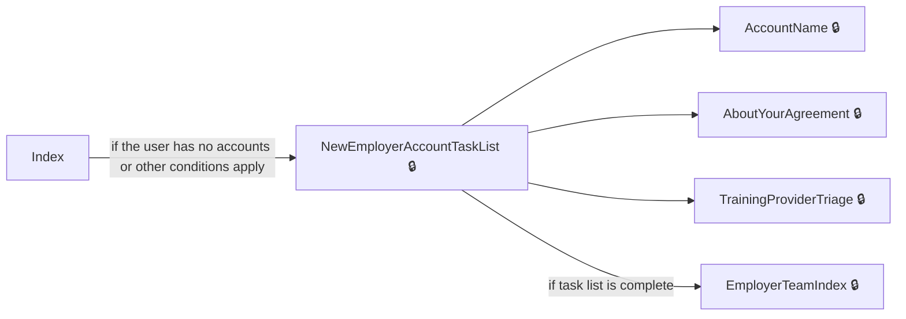
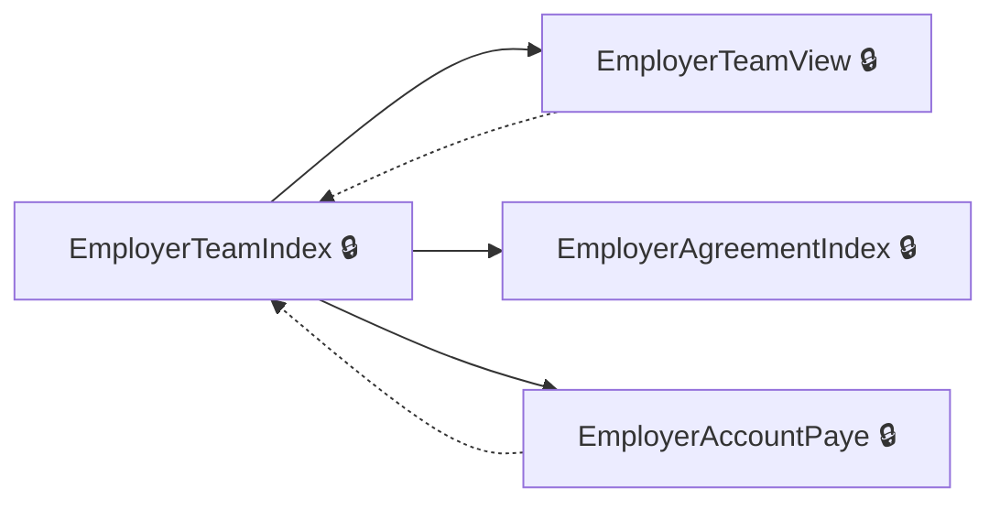
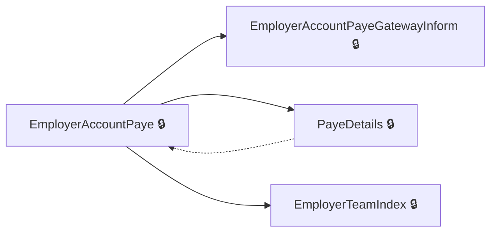
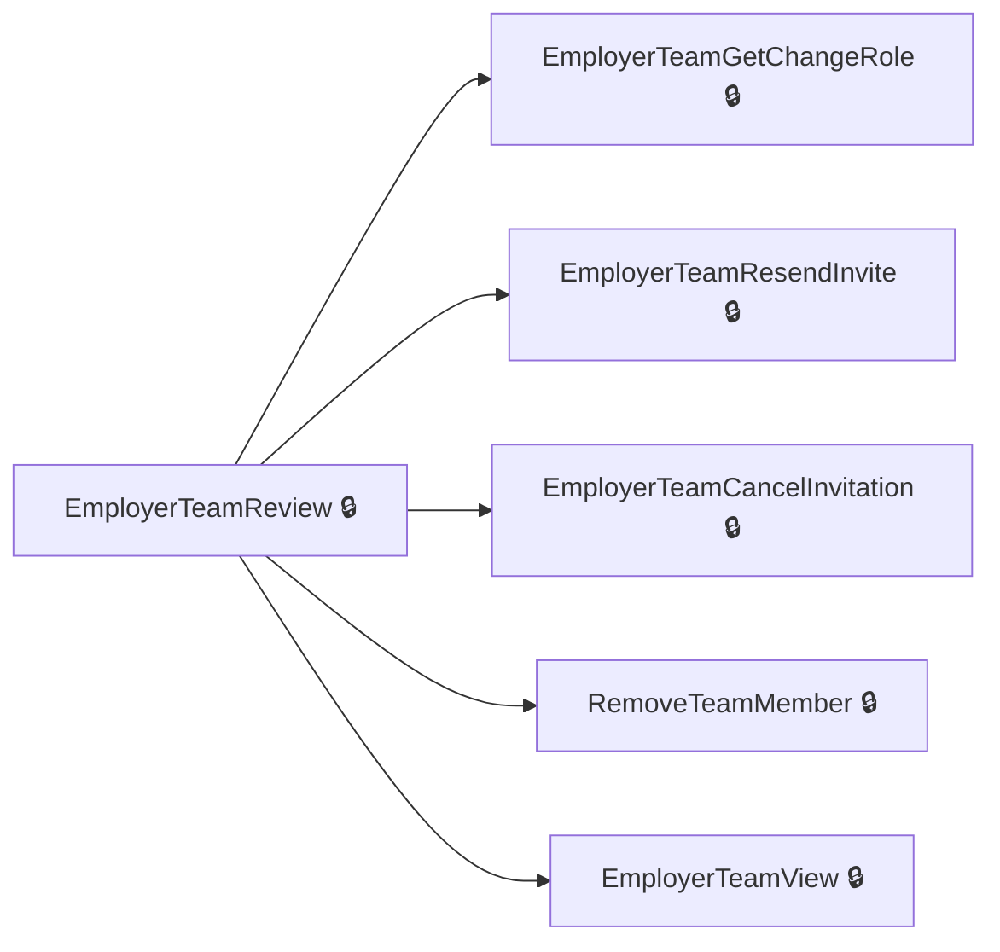
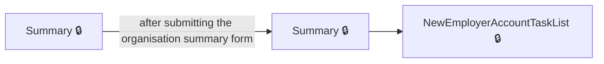
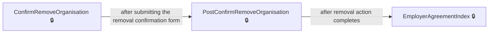
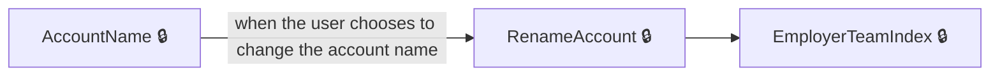
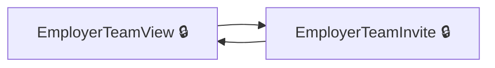

# User journeys: SkillsFundingAgency/das-employer-accounts

Generated from `main/src`: 111 pages, 96 transitions, 8 journeys. 🔒 means sign-in is required. Dotted arrows return to a hub.

## Create a New Employer Account

Guides a new employer through the process of account creation, including naming the account, adding an organisation and PAYE scheme, confirming agreements, and setting up the account.

Complete the sections in any order, returning to the hub.

## Manage Employer Team Members

Allows an employer to view, invite, update, and remove team members associated with their account.

Complete the sections in any order, returning to the hub.

## Add and Manage PAYE Schemes

Lets an employer add, confirm, manage, and remove PAYE schemes linked to their account.

Complete the sections in any order, returning to the hub.

## Review Details of a Team Member

Allows an employer to review, change the role, resend the invite, cancel invitation, or remove a team member.

Complete the sections in any order, returning to the hub.

## Confirm Organisation Details During Creation

Lets an employer review and confirm the organisation's details before finalising account creation.

## Remove an Organisation from Account

Enables the employer to confirm and process the removal of an organisation from their account.

## Change Account Name

Allows an employer to begin the process to change the account name and save the new name.

## Invite and View Team Members

Enables an employer to view the team, invite a new member, and return to the team list.

## Pages

| Page | Route | Sign-in | Purpose |
| --- | --- | --- | --- |
| `AboutYourAgreement` | `accounts/{HashedAccountId}/agreements/{hashedAgreementId}/about-your-agreement` | Yes | Shows information about a specific employer agreement. |
| `AccessDenied.Index` | — | Unknown | Shows an access denied message. |
| `AccessibilityStatement` | `service/accessibility-statement` | No | Shows the accessibility statement for the service. |
| `AccountName` | `accounts/{HashedAccountId}/create/accountName` | Yes | Lets you choose whether to change your account name and enter a new name if desired. |
| `AccountNameConfirm` | `accounts/{HashedAccountId}/create/accountName/confirm` | Yes | Lets the employer confirm the new account name before proceeding. |
| `AccountNameConfirmSuccess` | `accounts/{HashedAccountId}/create/accountName/confirm/success` | Yes | Confirms that your account name change was successful. |
| `AccountNameSuccess` | `accounts/{HashedAccountId}/create/accountName/success` | Yes | Shows confirmation that your account name was saved. |
| `AccountsIndex` | `service/accounts` | Yes | Displays the accounts available to the signed-in user. |
| `AddPayeShutter` | `accounts/{HashedAccountId}/cannotAddPaye` | Yes | Informs you that you cannot add a PAYE scheme. |
| `AgreementView` | `accounts/{HashedAccountId}/agreements/{hashedAgreementId}/view` | Yes | Displays a signed employer agreement for review. |
| `ConfirmRemoveTeamMember` | `accounts/{HashedAccountId}/teams/{hashedUserId}/remove` | Yes | Shows a page to confirm removal of a team member. |
| `CookieConsent.Details` | `accounts/{HashedAccountId}/cookieConsent/details` | Unknown | Shows details about your cookie consent choices. |
| `CookieConsent.Settings` | `accounts/{HashedAccountId}/cookieConsent` | Unknown | Lets you set your preferences for website analytic cookies. |
| `CreateAccountSuccess` | `accounts/{HashedAccountId}/create/success` | Yes | Shows confirmation that your account was successfully created. |
| `CreateAdvert` | `accounts/{HashedAccountId}/teams/continuesetupcreateadvert` | Yes | Lets the user choose whether an advert is required for recruiting. |
| `EmployerAccount.AmendOrganisation` | `accounts/amendOrganisation` | Yes | Lets you amend organisation details if necessary. |
| `EmployerAccount.GateWayResponse` | `accounts/gatewayResponse` | Yes | Processes the response from the government gateway after PAYE authentication. |
| `EmployerAccount.Gateway` | `accounts/gateway` | Yes | Redirects to the government gateway for authentication. |
| `EmployerAccount.GatewayInform` | `accounts/{hashedAccountId}/gatewayInform` | Yes | Shows information after returning from the government gateway. |
| `EmployerAccount.Summary` | `accounts/summary` | Yes | Lets you confirm your organisation and address details before creating an account. |
| `EmployerAccountGetApprenticeshipFundingInAccount` | `accounts/{HashedAccountId}/getApprenticeshipFunding` | Yes | Lets you choose how to add your PAYE scheme for apprenticeship funding. |
| `EmployerAccountPayBillTriage` | `accounts/payBill` | Yes | Lets you specify your organisation's annual pay bill. |
| `EmployerAccountPaye` | `accounts/{HashedAccountId}/schemes` | Yes | Shows PAYE schemes associated with the employer account. |
| `EmployerAccountPaye.ConfirmPayeScheme` | `accounts/{HashedAccountId}/schemes/confirm` | Yes | Lets the employer confirm adding a new PAYE scheme. |
| `EmployerAccountPaye.NextSteps` | `accounts/{HashedAccountId}/schemes/next` | Yes | Shows next steps after adding or managing PAYE schemes. |
| `EmployerAccountPaye.Remove` | `accounts/{HashedAccountId}/schemes/{empRef}/remove` | Yes | Lets the employer choose to remove a PAYE scheme from their account. |
| `EmployerAccountPayeGateway` | `accounts/{HashedAccountId}/schemes/gateway` | Yes | Redirects the user to the HMRC Government Gateway for PAYE scheme linking. |
| `EmployerAccountPayeGatewayInform` | `accounts/{HashedAccountId}/schemes/gatewayInform` | Yes | Informs the user about the process to add a PAYE scheme through Government Gateway. |
| `EmployerAccountPostApprenticeshipFundingInAccount` | `accounts/{hashedAccountId}/getApprenticeshipFunding` | Yes | Lets the employer choose how to add a PAYE scheme for apprenticeship funding. |
| `EmployerAccountTransactions.Index` | `accounts/{HashedAccountId}/finance` | Yes | Redirects the user to the finance section for their employer account. |
| `EmployerAgreement.ConfirmRemoveOrganisation` | `accounts/{HashedAccountId}/agreements/{accountLegalEntityHashedId}/remove` | Yes | Lets the employer confirm removal of an organisation from the account. |
| `EmployerAgreement.Details` | `accounts/{HashedAccountId}/agreements/{hashedAgreementId}/details` | Yes | Shows detailed information about an employer agreement. |
| `EmployerAgreement.ViewUnsignedAgreements` | `accounts/{HashedAccountId}/agreements/unsigned/view` | Yes | Displays unsigned employer agreements or redirects to the next step if none remain. |
| `EmployerAgreement.WhenDoYouWantToView` | `accounts/{HashedAccountId}/agreements/{hashedAgreementId}/whenDoYouWantToView` | Yes | Lets the employer choose whether to view or acknowledge the agreement now or later. |
| `EmployerAgreementIndex` | `accounts/{HashedAccountId}/agreements` | Yes | Shows a list of employer agreements for the account. |
| `EmployerAgreementSign` | `accounts/{HashedAccountId}/agreements/{hashedAgreementId}/sign` | Yes | Lets the user sign or acknowledge the employer agreement. |
| `EmployerAgreementSignYourAgreement` | `accounts/{HashedAccountId}/agreements/{hashedAgreementId}/sign-your-agreement` | Yes | Shows the agreement ready to be signed by the employer. |
| `EmployerTeam.AddedProvider` | `accounts/{HashedAccountId}/teams/AddedProvider/{providerName}` | Yes | Confirms that your account has been created and provider permissions have been updated. |
| `EmployerTeam.NextSteps` | `accounts/{HashedAccountId}/teams/invite/next` | Yes | Lets you decide what to do next after inviting a team member. |
| `EmployerTeamCancelInvitation` | `accounts/{HashedAccountId}/teams/{hashedInvitationId}/cancel` | Yes | Lets you cancel a pending team member invitation. |
| `EmployerTeamChangeRole` | `accounts/{HashedAccountId}/teams/{hashedUserId}/role/change` | Yes | Lets you change a team member's role. |
| `EmployerTeamGetChangeRole` | `accounts/{HashedAccountId}/teams/{hashedUserId}/role/change` | Yes | Lets you view and set a team member's role. |
| `EmployerTeamIndex` | `accounts/{HashedAccountId}/teams` | Yes | Shows the dashboard or home page for your team/account. |
| `EmployerTeamInvite` | `accounts/{HashedAccountId}/teams/invite` | Yes | Lets you invite a new team member by entering their details. |
| `EmployerTeamInviteNext` | `accounts/{HashedAccountId}/teams/invite/next` | Yes | Lets you select the next step after sending a team invitation. |
| `EmployerTeamResendInvite` | `accounts/{HashedAccountId}/teams/resend` | Yes | Lets you resend an invitation to a team member. |
| `EmployerTeamReview` | `accounts/{HashedAccountId}/teams/{hashedUserId}/review` | Yes | Lets you review details of a team member including options to resend invite, cancel invitation or remove. |
| `EmployerTeamView` | `accounts/{HashedAccountId}/teams/view` | Yes | Shows the list of current team members. |
| `GetPdfAgreement` | `accounts/{HashedAccountId}/agreements/{hashedAgreementId}/agreement-pdf` | Yes | Provides a PDF version of the employer agreement for download. |
| `GetSignedPdfAgreement` | `accounts/{HashedAccountId}/agreements/{hashedAgreementId}/signed-agreement-pdf` | Yes | Provides a PDF version of the signed employer agreement. |
| `Home.GovSignIn` | `service` | Yes | Redirects the user to the GOV.UK sign-in process. |
| `Home.HandleEmailChanged` | `service/email/change` | Yes | Handles the process after a user's email address is changed. |
| `Home.HandleNewRegistration` | `service/register/new/{correlationId?}` | Yes | Handles new user registration completion. |
| `Home.HandlePasswordChanged` | `service/password/change` | Yes | Handles the process after a user's password is changed. |
| `Home.Help` | `service/help` | Unknown | Provides help or support information. |
| `Home.Index` | `service/~/` | Unknown | Landing page for the service; routes the user depending on authentication and account status. |
| `Home.Privacy` | `service/{HashedAccountId}/privacy` | Unknown | Shows the privacy policy for the service. |
| `Home.RegisterUser` | `service/register` | Unknown | Initiates the registration process for a new user. |
| `Home.ServiceStartPage` | `service/start` | Unknown | Allows users to start the service and begin their journey, especially if not signed in. |
| `Home.ShowLegalAgreement` | `service/CreateLegalAgreement/{showSubFields}` | Unknown | Displays a legal agreement for review, primarily for debugging purposes. |
| `Home.SignIn` | `service/signIn` | Yes | Redirects the user to the main page after authentication. |
| `Home.TermsAndConditions` | `service/termsAndConditions` | Yes | Lets the user review and accept the terms and conditions for using the service. |
| `Home.TermsAndConditionsOverview` | `service/termsAndConditions/overview` | Unknown | Shows an overview of the service's terms and conditions. |
| `Invitation.AcceptInvitationExistingUser` | `invitations/accept` | Unknown | Redirects an existing user to the main dashboard after accepting an invitation. |
| `Invitation.AcceptInvitationNewUser` | `invitations/register-and-accept` | Unknown | Redirects a new user to the main dashboard after accepting an invitation. |
| `Invitation.All` | `invitations` | Yes | Allows users to view all pending invitations addressed to them. |
| `Invitation.Create` | `invitations/create` | Yes | Lets a user create a new invitation for someone to join the account. |
| `Invitation.Details` | `invitations/view` | Yes | Displays the details of a specific invitation. |
| `Invitation.Invite` | `invitations/invite` | Unknown | Starts the invitation process for inviting someone to join. |
| `InvitationAccept` | `invitations/accept` | Yes | Processes the acceptance of an invitation. |
| `NewAccountSaveProgress` | `accounts/create/progress-saved` | Yes | Informs the user that their account creation progress has been saved. |
| `NewEmployerAccountTaskList` | `accounts/create/tasklist` | Yes | Shows the task list for creating a new employer account. |
| `Organisation.OrganisationAddedNextSteps` | `accounts/{HashedAccountId}/organisations/nextStep` | Yes | Lets the user choose their next step after adding an organisation. |
| `Organisation.OrganisationAddedNextStepsSearch` | `accounts/{HashedAccountId}/organisations/nextStepSearch` | Yes | Shows options for what to do after adding an organisation. |
| `Organisation.Review` | `accounts/{HashedAccountId}/organisations/review` | Yes | Lets the user review an organisation's details and choose how to proceed. |
| `OrganisationAgreements` | `accounts/{HashedAccountId}/organisations/{accountLegalEntityHashedId}/agreements` | Yes | Lists all agreements associated with an organisation. |
| `OrganisationAndPayeAddedSuccess` | `accounts/{HashedAccountId}/create/orgAndPaye/success` | Yes | Confirms successful addition of organisation and PAYE scheme to the account. |
| `OrganisationConfirm` | `accounts/{HashedAccountId}/organisations/confirm` | Yes | Processes confirmation of organisation details before adding. |
| `OrganisationGoToNextStep` | `accounts/{HashedAccountId}/organisations/nextStep` | Yes | Carries out selected next step after adding organisation. |
| `OrganisationPostUpdateSelection` | `accounts/{HashedAccountId}/organisations/PostUpdateSelection` | Yes | Processes a user's selection after updating an organisation's details. |
| `OrganisationWrongAddress` | `accounts/organisation-wrong-address` | Yes | Lets the employer address issues if their organisation address is incorrect. |
| `PayeDetails` | `accounts/{HashedAccountId}/schemes/{empRef}/details` | Yes | Shows the details for a specific PAYE scheme linked to the account. |
| `PayePostNextSteps` | `accounts/{HashedAccountId}/schemes/next` | Yes | Lets the user choose their next step after managing PAYE schemes. |
| `PayePostRemove` | `accounts/{HashedAccountId}/schemes/remove` | Yes | Processes the removal of a PAYE scheme from the account. |
| `PostConfirmRemoveOrganisation` | `accounts/{HashedAccountId}/agreements/{accountLegalEntityHashedId}/remove` | Yes | Processes the confirmation to remove an organisation. |
| `PreviewEmployerAgreement.Index` | `agreements/preview` | Yes | Lets the user preview the latest employer agreement template. |
| `ProcessOrganisationReview` | `accounts/{HashedAccountId}/organisations/review` | Yes | Processes the user's review selection for an organisation. |
| `RemoveTeamMember` | `accounts/{HashedAccountId}/teams/{hashedUserId}/remove` | Yes | Lets you begin the process of removing a team member from the account. |
| `RenameAccount` | `accounts/{HashedAccountId}/rename` | Yes | Lets the employer change the name of their account. |
| `SearchOrganisation.Confirm` | `accounts/{HashedAccountId}/organisations/search/confirm` | Yes | Allows the user to confirm the selected organisation's details after searching. |
| `SearchOrganisation.SearchForOrganisation` | `accounts/{HashedAccountId}/organisations/search` | Yes | Lets the user enter a term to search for an organisation by name. |
| `SearchOrganisation.SearchForOrganisationResults` | `accounts/{HashedAccountId}/organisations/search/results` | Yes | Displays search results for organisations and allows filtering by organisation type. |
| `SearchPensionRegulator.SearchPensionRegulator` | `accounts/{HashedAccountId}/pensionregulator` | Yes | Searches organisations using the Pension Regulator using an existing PAYE reference. |
| `SearchPensionRegulator.SearchPensionRegulatorByAorn` | `accounts/{HashedAccountId}/pensionregulator/aorn` | Yes | Allows the user to search the Pension Regulator using an Accounts Office Reference Number (AORN) and PAYE reference. |
| `SearchPensionRegulatorAddOrganisation` | `accounts/{HashedAccountId}/pensionregulator` | Yes | Adds an organisation by searching the Pension Regulator using a PAYE reference. |
| `Settings.NotificationSettings` | `settings/notifications` | Yes | Allows the user to manage and update their notification settings. |
| `Settings.NotificationUnsubscribe` | `settings/notifications/unsubscribe/{hashedAccountId}` | Yes | Lets the user unsubscribe from notifications for a specific employer account. |
| `SignOut` | `service/signout` | Unknown | Allows the user to sign out of their account. |
| `SignedOut` | `service/signed-out` | No | Informs the user that they have signed out. |
| `Summary` | `accounts/summary` | Yes | Lets the employer confirm if the shown organisation is correct. |
| `TaskListSignedAgreementSuccess` | `accounts/{HashedAccountId}/create/agreement/success` | Yes | Indicates the agreement has been signed successfully. |
| `TrainingProviderSuccess` | `accounts/{HashedAccountId}/training-provider-success` | Yes | Indicates a training provider has been successfully added. |
| `TrainingProviderTriage` | `accounts/{HashedAccountId}/training-provider-triage`, `accounts/{hashedAccountId}/training-provider-triage` | Yes | Lets the employer decide whether to add a training provider now. |
| `TriageCannotSetupWithoutApproximateStartDate` | `accounts/{HashedAccountId}/teams/triageyoucannotsetupanapprenticeshipyetapproximatestartdate` | Yes | Informs you that you cannot set up an apprenticeship yet because the approximate start date isn't known. |
| `TriageCannotSetupWithoutChosenCourseAndProvider` | `accounts/{HashedAccountId}/teams/triageyoucannotsetupanapprenticeshipyetcourseprovider` | Yes | Informs you that you cannot set up an apprenticeship yet because neither a course nor provider have been selected. |
| `TriageCannotSetupWithoutChosenProvider` | `accounts/{HashedAccountId}/teams/triageyoucannotsetupanapprenticeshipyetprovider` | Yes | Informs you that you cannot set up an apprenticeship yet because a provider has not been chosen. |
| `TriageCannotSetupWithoutStartDate` | `accounts/{HashedAccountId}/teams/triageyoucannotsetupanapprenticeshipyetstartdate` | Yes | Tells the employer they cannot set up an apprenticeship yet because they do not have a planned start date. |
| `TriageChosenProvider` | `accounts/{HashedAccountId}/teams/triagehaveyouchosenatrainingprovider` | Yes | Asks the employer if they have chosen a training provider for their apprentice. |
| `TriageCourse` | `accounts/{HashedAccountId}/teams/triagewhichcourseyourapprenticewilltake` | Yes | Asks the employer if they know which course their apprentice will take. |
| `TriageWhenApprenticeshipForExistingEmployee` | `accounts/{HashedAccountId}/teams/triageapprenticeforexistingemployee` | Yes | Asks the employer if the apprenticeship is for an existing employee. |
| `TriageWhenWillApprenticeshipStart` | `accounts/{HashedAccountId}/teams/triagewillapprenticeshiptrainingstart` | Yes | Asks the employer when apprenticeship training will start. |

## Form fields

Field definitions only: no values a user enters are recorded.

### `AccountName`

| Field | Type | Label | Required | Rules | Options |
| --- | --- | --- | --- | --- | --- |
| `ChangeAccountName` | radios | Do you want to change your apprenticeship service account name? | — | required; must be selected | — |
| `NewName` | text | Enter new account name. Do not use your own name unless it is the same as your organisation’s trading name | — | required if ChangeAccountName is true; must not be the same as current name; must only include valid free text characters | — |

### `CookieConsent.Settings`

| Field | Type | Label | Required | Rules | Options |
| --- | --- | --- | --- | --- | --- |
| `cookies-AnalyticsConsent` | radios | Cookies that measure website use | — | — | Use cookies that measure my service use, Do not use cookies that measure my service use |

### `CreateAdvert`

| Field | Type | Label | Required | Rules | Options |
| --- | --- | --- | --- | --- | --- |
| `requiresAdvert` | radios | (!ViewData.ModelState.IsValid) { ["Choice"].Errors[0].ErrorMessage } | — | required; must select an option | — |

### `EmployerAccount.Summary`

| Field | Type | Label | Required | Rules | Options |
| --- | --- | --- | --- | --- | --- |
| `isOrganisationWithCorrectAddress` | radios | Is this your organisation? | — | required; must be selected | — |

### `EmployerAccountGetApprenticeshipFundingInAccount`

| Field | Type | Label | Required | Rules | Options |
| --- | --- | --- | --- | --- | --- |
| `choice` | radios | How do you want to add your PAYE scheme | — | required; must be selected | Use Government Gateway log in, Use Accounts Office reference and Employer PAYE reference. |

### `EmployerAccountPayBillTriage`

| Field | Type | Label | Required | Rules | Options |
| --- | --- | --- | --- | --- | --- |
| `choice` | radios | How much is your organisation's annual pay bill? | — | required; must be selected | Over £3 million, Close to £3 million, Less than £3 million |

### `EmployerAccountPaye.NextSteps`

| Field | Type | Label | Required | Rules | Options |
| --- | --- | --- | --- | --- | --- |
| `choice` | radios | What's next? (!string.IsNullOrWhiteSpace(Model.Data.ErrorMessage)) { } | — | optional; must be an integer if present; must select an option to continue | Add another PAYE scheme, Check finances, Return to homepage |

### `EmployerAccountPaye.Remove`

| Field | Type | Label | Required | Rules | Options |
| --- | --- | --- | --- | --- | --- |
| `RemoveScheme` | radios | Remove this PAYE scheme | — | optional; must be an integer if present | Yes, remove scheme, No, don't remove |

### `EmployerAccountPostApprenticeshipFundingInAccount`

| Field | Type | Label | Required | Rules | Options |
| --- | --- | --- | --- | --- | --- |
| `choice` | radios | How do you want to add your PAYE scheme | — | optional; must be an integer if present | Use Government Gateway log in, Use Accounts Office reference and Employer PAYE reference. |

### `EmployerAgreement.ConfirmRemoveOrganisation`

| Field | Type | Label | Required | Rules | Options |
| --- | --- | --- | --- | --- | --- |
| `Remove` | radios | — | — | required; must be true to proceed with removal | Yes, No |

### `EmployerAgreement.WhenDoYouWantToView`

| Field | Type | Label | Required | Rules | Options |
| --- | --- | --- | --- | --- | --- |
| `choice` | radios | — | — | required; must be 1 (now) or 2 (later) | I'll view it now, I'll view it later, after I've created an account |

### `EmployerTeam.NextSteps`

| Field | Type | Label | Required | Rules | Options |
| --- | --- | --- | --- | --- | --- |
| `choice` | radios | What's next? (!string.IsNullOrWhiteSpace(Model.Data.ErrorMessage)) { } | — | — | Add another team member, View all team members, Return to homepage |

### `EmployerTeamChangeRole`

| Field | Type | Label | Required | Rules | Options |
| --- | --- | --- | --- | --- | --- |
| `Role` | radios | Select a role for (!string.IsNullOrWhiteSpace(errorMessage)) { } | — | — | ), ), ), ) |

### `EmployerTeamGetChangeRole`

| Field | Type | Label | Required | Rules | Options |
| --- | --- | --- | --- | --- | --- |
| `Role` | radios | Select a role for (!string.IsNullOrWhiteSpace(errorMessage)) { } | — | — | ), ), ), ) |

### `EmployerTeamInvite`

| Field | Type | Label | Required | Rules | Options |
| --- | --- | --- | --- | --- | --- |
| `Email` | text | Email | — | — | — |
| `Name` | text | Full name | — | — | — |
| `Role` | radios | Team member access | — | — | ), ), ), ) |

### `EmployerTeamInviteNext`

| Field | Type | Label | Required | Rules | Options |
| --- | --- | --- | --- | --- | --- |
| `choice` | radios | What's next? (!string.IsNullOrWhiteSpace(Model.Data.ErrorMessage)) { } | — | — | Add another team member, View all team members, Return to homepage |

### `Organisation.OrganisationAddedNextSteps`

| Field | Type | Label | Required | Rules | Options |
| --- | --- | --- | --- | --- | --- |
| `nextStep` | radios | What's next? (!string.IsNullOrEmpty(Model.Data.ErrorMessage)) { } | — | null | Sign an agreement to allow to spend funds, Check which team members can sign the agreement, Add another organisation, Return to homepage |

### `Organisation.Review`

| Field | Type | Label | Required | Rules | Options |
| --- | --- | --- | --- | --- | --- |
| `updateChoice` | radios | Are these details correct? | — | — | Yes, update my details using this information, No, these details are incorrect |
| `nextStep` | radios | — | — | — | Go to your organisations and agreements, Go to the homepage |

### `PayePostNextSteps`

| Field | Type | Label | Required | Rules | Options |
| --- | --- | --- | --- | --- | --- |
| `choice` | radios | What's next? (!string.IsNullOrWhiteSpace(Model.Data.ErrorMessage)) { } | — | required; must select one of the available options | Add another PAYE scheme, Check finances, Return to homepage |

### `ProcessOrganisationReview`

| Field | Type | Label | Required | Rules | Options |
| --- | --- | --- | --- | --- | --- |
| `nextStep` | radios | — | — | — | Go to your organisations and agreements, Go to the homepage |

### `RenameAccount`

| Field | Type | Label | Required | Rules | Options |
| --- | --- | --- | --- | --- | --- |
| `NewName` | text | New account name | — | required; must not be whitespace; must not match current name; must use valid free text characters (letters a-z, numbers 0-9, and special characters such as hyphens, spaces, apostrophes) | — |

### `SearchOrganisation.SearchForOrganisation`

| Field | Type | Label | Required | Rules | Options |
| --- | --- | --- | --- | --- | --- |
| `searchTerm` | text | — | — | required | — |

### `SearchOrganisation.SearchForOrganisationResults`

| Field | Type | Label | Required | Rules | Options |
| --- | --- | --- | --- | --- | --- |
| `searchTerm` | text | Search results | — | required | — |
| `organisationType` | radios | Filter by Organisation type | — | — | Company, Charity, Public sector |

### `SearchPensionRegulator.SearchPensionRegulatorByAorn`

| Field | Type | Label | Required | Rules | Options |
| --- | --- | --- | --- | --- | --- |
| `aorn` | text | Accounts office reference number | — | required; must be 13 characters; uppercase letters and digits only | — |
| `payeRef` | text | Employer PAYE scheme reference | — | required; must be in the format NNN/XXXXXXX where N and X are uppercase letters or digits | — |

### `Summary`

| Field | Type | Label | Required | Rules | Options |
| --- | --- | --- | --- | --- | --- |
| `isOrganisationWithCorrectAddress` | radios | Is this your organisation? | — | optional (validated on submit); required to proceed | — |

### `TrainingProviderTriage`

| Field | Type | Label | Required | Rules | Options |
| --- | --- | --- | --- | --- | --- |
| `choice` | radios | Do you want to add a training provider now? | — | optional; must be an integer if present | Yes, I'll add a training provider now, No, I want to finish setting up my account and add one later |

### `TriageChosenProvider`

| Field | Type | Label | Required | Rules | Options |
| --- | --- | --- | --- | --- | --- |
| `TriageOption` | radios | — | Yes | required | — |

### `TriageCourse`

| Field | Type | Label | Required | Rules | Options |
| --- | --- | --- | --- | --- | --- |
| `TriageOption` | radios | — | Yes | required | — |

### `TriageWhenApprenticeshipForExistingEmployee`

| Field | Type | Label | Required | Rules | Options |
| --- | --- | --- | --- | --- | --- |
| `TriageOption` | radios | — | Yes | required | — |

### `TriageWhenWillApprenticeshipStart`

| Field | Type | Label | Required | Rules | Options |
| --- | --- | --- | --- | --- | --- |
| `TriageOption` | radios | — | Yes | required | — |

