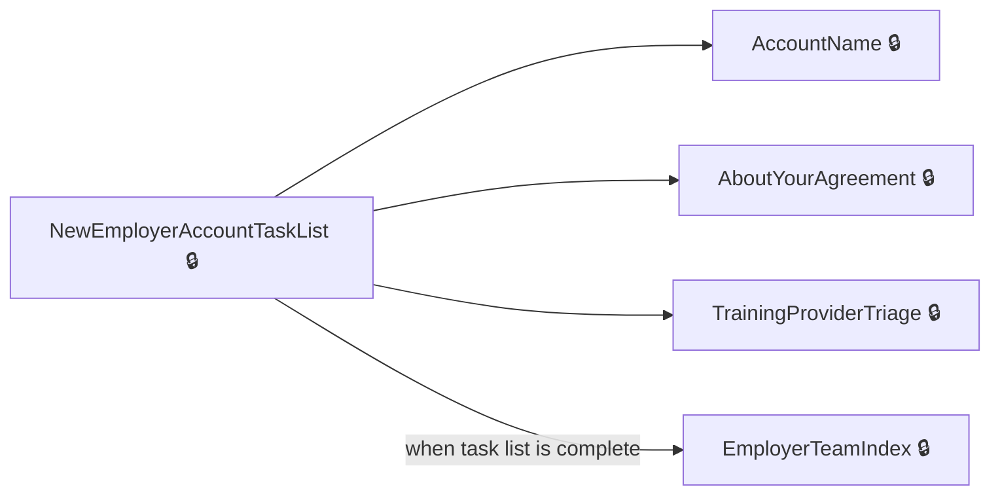
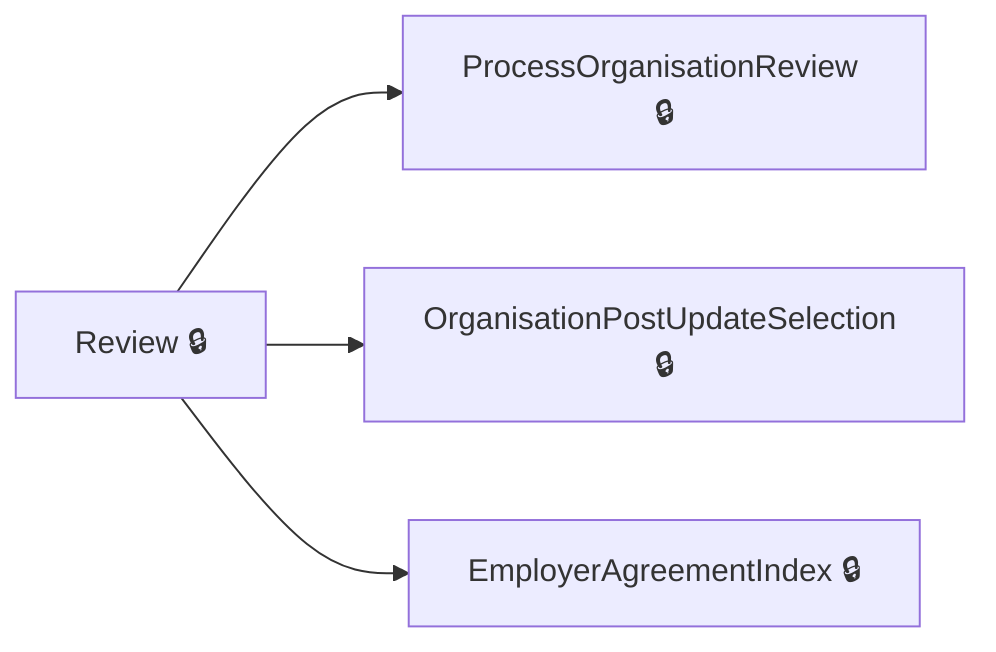
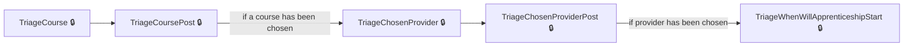

# User journeys: SkillsFundingAgency/das-employer-accounts

Generated from `main/src`: 123 pages, 113 transitions, 3 journeys. 🔒 means sign-in is required. Dotted arrows return to a hub.

## Create Employer Account

Guides the user through the creation of a new employer account, including naming, setup tasks, and confirmations.

Complete the sections in any order, returning to the hub.

## Review Organisation Details

Allows users to review, update, and confirm organisation details linked to their account.

Complete the sections in any order, returning to the hub.

## Set Up Apprenticeship

Guides employers through the steps of setting up an apprenticeship, including course and provider selection.

## Pages

| Page | Route | Sign-in | Purpose |
| --- | --- | --- | --- |
| `AboutYourAgreement` | `accounts/{HashedAccountId}/agreements/{hashedAgreementId}/about-your-agreement` | Yes | Provides details about a specific agreement for the employer to review. |
| `AccessDenied.Index` | — | Unknown | Displays an access denied page to the user. |
| `AccessibilityStatement` | `service/accessibility-statement` | No | Provides information about the website's accessibility features. |
| `AccountName` | `accounts/{HashedAccountId}/create/accountName` | Yes | Allows the user to enter a new account name for their employer account. |
| `AccountNameConfirm` | `accounts/{HashedAccountId}/create/accountName/confirm` | Yes | Allows the user to confirm the new account name they have entered. |
| `AccountNameConfirmPost` | `accounts/{HashedAccountId}/create/accountName/confirm` | Yes | Processes the user's confirmation of a new account name and redirects accordingly. |
| `AccountNameConfirmSuccess` | `accounts/{HashedAccountId}/create/accountName/confirm/success` | Yes | Displays a success message after the user confirms a new account name. |
| `AccountNamePost` | `accounts/{HashedAccountId}/create/accountName` | Yes | Processes the account name entered by the user and redirects accordingly. |
| `AccountNameSuccess` | `accounts/{HashedAccountId}/create/accountName/success` | Yes | Displays a success message after an account name is created successfully. |
| `AccountsIndex` | `service/accounts` | Yes | Displays the user's accounts dashboard. |
| `AddPayeShutter` | `accounts/{HashedAccountId}/cannotAddPaye` | Yes | Informs the user that adding PAYE is unavailable for their account. |
| `AgreementView` | `accounts/{HashedAccountId}/agreements/{hashedAgreementId}/view` | Yes | Allows employers to view a specific agreement for their account. |
| `ConfirmRemoveTeamMember` | `accounts/{HashedAccountId}/teams/{hashedUserId}/remove` | Yes | Allows the user to confirm the removal of a team member from an account. |
| `CookieConsent.Details` | `accounts/{HashedAccountId}/cookieConsent/details` | Unknown | Shows detailed information about cookie consent for a specific account. |
| `CookieConsent.Settings` | `accounts/{HashedAccountId}/cookieConsent` | Unknown | Allows the user to set their cookie preferences for a specific account. |
| `CreateAccountSuccess` | `accounts/{HashedAccountId}/create/success` | Yes | Displays a success message after the creation of a new employer account. |
| `CreateAdvert` | `accounts/{HashedAccountId}/teams/continuesetupcreateadvert` | Yes | Displays options for creating an advert as part of account setup. |
| `CreateAdvertPost` | `accounts/{HashedAccountId}/teams/continuesetupcreateadvert` | Yes | Processes the selection to determine whether to create an advert. |
| `EmployerAccount.AmendOrganisation` | `accounts/amendOrganisation` | Yes | Allows the user to amend details about their organization. |
| `EmployerAccount.GateWayResponse` | `accounts/gatewayResponse` | Yes | Handles the gateway response during the account setup process. |
| `EmployerAccount.Gateway` | `accounts/gateway` | Yes | Redirects the user to the gateway for further processing during account setup. |
| `EmployerAccount.GatewayInform` | `accounts/{hashedAccountId}/gatewayInform` | Yes | Informs the user about their next steps after completing the gateway process. |
| `EmployerAccount.Summary` | `accounts/summary` | Yes | Provides a summary of the employer's account details. |
| `EmployerAccountGetApprenticeshipFundingInAccount` | `accounts/{HashedAccountId}/getApprenticeshipFunding` | Yes | Allows employers to obtain funding for apprenticeships. |
| `EmployerAccountPayBillTriage` | `accounts/payBill` | Yes | Displays triage options for paying the apprentice levy bill. |
| `EmployerAccountPayBillTriagePost` | `accounts/payBill` | Yes | Processes the user's choice for paying the apprentice levy bill. |
| `EmployerAccountPaye` | `accounts/{HashedAccountId}/schemes` | Yes | Allows employers to view and manage PAYE schemes linked to their account. |
| `EmployerAccountPaye.ConfirmPayeScheme` | `accounts/{HashedAccountId}/schemes/confirm` | Yes | Lets employers confirm the addition of a PAYE scheme to their account. |
| `EmployerAccountPaye.NextSteps` | `accounts/{HashedAccountId}/schemes/next` | Yes | Guides employers on the next steps after adding a PAYE scheme. |
| `EmployerAccountPaye.Remove` | `accounts/{HashedAccountId}/schemes/{empRef}/remove` | Yes | Allows employers to initiate the removal of a PAYE scheme from their account. |
| `EmployerAccountPayeGateway` | `accounts/{HashedAccountId}/schemes/gateway` | Yes | Redirects employers to the PAYE scheme gateway for verification purposes. |
| `EmployerAccountPayeGatewayInform` | `accounts/{HashedAccountId}/schemes/gatewayInform` | Yes | Provides information and confirms details regarding the PAYE gateway process. |
| `EmployerAccountPostApprenticeshipFundingInAccount` | `accounts/{hashedAccountId}/getApprenticeshipFunding` | Yes | Processes funding options for apprenticeships. |
| `EmployerAccountTransactions.Index` | `accounts/{HashedAccountId}/finance` | Yes | Redirects employers to view financial details associated with their account. |
| `EmployerAgreement.ConfirmRemoveOrganisation` | `accounts/{HashedAccountId}/agreements/{accountLegalEntityHashedId}/remove` | Yes | Allows employers to confirm the removal of an organisation from their account. |
| `EmployerAgreement.Details` | `accounts/{HashedAccountId}/agreements/{hashedAgreementId}/details` | Yes | Displays specific details about an agreement. |
| `EmployerAgreement.ViewUnsignedAgreements` | `accounts/{HashedAccountId}/agreements/unsigned/view` | Yes | Displays unsigned agreements for the employer. |
| `EmployerAgreement.WhenDoYouWantToView` | `accounts/{HashedAccountId}/agreements/{hashedAgreementId}/whenDoYouWantToView` | Yes | Allows the user to choose when to view an employer agreement. |
| `EmployerAgreementIndex` | `accounts/{HashedAccountId}/agreements` | Yes | Lists all agreements associated with the employer's account. |
| `EmployerAgreementSign` | `accounts/{HashedAccountId}/agreements/{hashedAgreementId}/sign` | Yes | Provides the option to sign an agreement. |
| `EmployerAgreementSignYourAgreement` | `accounts/{HashedAccountId}/agreements/{hashedAgreementId}/sign-your-agreement` | Yes | Displays the details of an agreement for the employer to sign. |
| `EmployerTeam.AddedProvider` | `accounts/{HashedAccountId}/teams/AddedProvider/{providerName}` | Yes | Confirms that permissions for a provider have been successfully updated and redirects to the account's team page. |
| `EmployerTeam.NextSteps` | `accounts/{HashedAccountId}/teams/invite/next` | Yes | Displays next steps after inviting a team member. |
| `EmployerTeamCancelInvitation` | `accounts/{HashedAccountId}/teams/{hashedInvitationId}/cancel` | Yes | Displays a confirmation page for canceling a team member invitation. |
| `EmployerTeamCancelInvitationPost` | `accounts/{HashedAccountId}/teams/{hashedInvitationId}/cancel` | Yes | Processes the form submission to cancel a team member invitation. |
| `EmployerTeamChangeRolePost` | `accounts/{HashedAccountId}/teams/{hashedUserId}/role/change` | Yes | Processes a request to change a team member's role. |
| `EmployerTeamGetChangeRole` | `accounts/{HashedAccountId}/teams/{hashedUserId}/role/change` | Yes | Provides a page for selecting a new role for a team member. |
| `EmployerTeamIndex` | `accounts/{HashedAccountId}/teams` | Yes | Displays the account's team management dashboard. |
| `EmployerTeamInvite` | `accounts/{HashedAccountId}/teams/invite` | Yes | Displays the form to invite a new team member. |
| `EmployerTeamInviteNextPost` | `accounts/{HashedAccountId}/teams/invite/next` | Yes | Processes the selection of the next step after sending an invitation. |
| `EmployerTeamInvitePost` | `accounts/{HashedAccountId}/teams/invite` | Yes | Processes the form submission for inviting a new team member. |
| `EmployerTeamResendInvite` | `accounts/{HashedAccountId}/teams/resend` | Yes | Resends an invitation email to a team member. |
| `EmployerTeamReview` | `accounts/{HashedAccountId}/teams/{hashedUserId}/review` | Yes | Provides a detailed review of a team member's invitation or role. |
| `EmployerTeamView` | `accounts/{HashedAccountId}/teams/view` | Yes | Allows the user to view team members associated with an employer account. |
| `GetPdfAgreement` | `accounts/{HashedAccountId}/agreements/{hashedAgreementId}/agreement-pdf` | Yes | Generates and allows the download of an agreement in PDF format. |
| `GetSignedPdfAgreement` | `accounts/{HashedAccountId}/agreements/{hashedAgreementId}/signed-agreement-pdf` | Yes | Generates and allows the download of a signed agreement in PDF format. |
| `Home.GovSignIn` | `service` | Yes | Redirects the user to the Gov.UK sign-in page. |
| `Home.HandleEmailChanged` | `service/email/change` | Yes | Allows the user to process their email change. |
| `Home.HandleNewRegistration` | `service/register/new/{correlationId?}` | Yes | Handles new user registrations. |
| `Home.HandlePasswordChanged` | `service/password/change` | Yes | Allows the user to process their password change. |
| `Home.Help` | `service/help` | Unknown | Redirects the user to the help center or support page. |
| `Home.Index` | `service/~/` | Unknown | The homepage for the service, leading users to accounts or registration options. |
| `Home.Privacy` | `service/{HashedAccountId}/privacy` | Unknown | Displays the privacy information for a user's account. |
| `Home.RegisterUser` | `service/register` | Unknown | Allows the user to register for the service. |
| `Home.ServiceStartPage` | `service/start` | Unknown | Shows the starting page of the service and welcomes the user. |
| `Home.ShowLegalAgreement` | `service/CreateLegalAgreement/{showSubFields}` | Unknown | Displays a legal agreement form. |
| `Home.SignIn` | `service/signIn` | Yes | Allows the user to sign in to the service. |
| `Home.TermsAndConditions` | `service/termsAndConditions` | Yes | Presents the terms and conditions for the service. |
| `Home.TermsAndConditionsOverview` | `service/termsAndConditions/overview` | Unknown | Shows an overview of the terms and conditions. |
| `Invitation.AcceptInvitationExistingUser` | `invitations/accept` | Unknown | Allows existing users to accept an invitation to join an account. |
| `Invitation.AcceptInvitationNewUser` | `invitations/register-and-accept` | Unknown | Enables new users to register and accept an invitation to join an account. |
| `Invitation.All` | `invitations` | Yes | Lists all invitations for the logged-in user. |
| `Invitation.Create` | `invitations/create` | Yes | Allows users to create an invitation to add new team members to an account. |
| `Invitation.Details` | `invitations/view` | Yes | Displays detailed information about a specific invitation. |
| `Invitation.Invite` | `invitations/invite` | Unknown | Provides a view for users to send invitations to team members. |
| `InvitationAcceptPost` | `invitations/accept` | Yes | Handles the form submission for accepting an invitation. |
| `NewAccountSaveProgress` | `accounts/create/progress-saved` | Yes | Saves progress while creating a new account. |
| `NewEmployerAccountTaskList` | `accounts/create/tasklist` | Yes | Displays a task list for the employer during account creation. |
| `Organisation.OrganisationAddedNextSteps` | `accounts/{HashedAccountId}/organisations/nextStep` | Yes | Guides users on the next steps after adding an organisation. |
| `Organisation.OrganisationAddedNextStepsSearch` | `accounts/{HashedAccountId}/organisations/nextStepSearch` | Yes | Provides a search-based view for users after adding an organisation. |
| `Organisation.Review` | `accounts/{HashedAccountId}/organisations/review` | Yes | Allows users to review organisation details and identify updates. |
| `OrganisationAgreements` | `accounts/{HashedAccountId}/organisations/{accountLegalEntityHashedId}/agreements` | Yes | Lists all agreements related to a specific organisation within the employer's account. |
| `OrganisationAndPayeAddedSuccess` | `accounts/{HashedAccountId}/create/orgAndPaye/success` | Yes | Confirms successful addition of organisation and PAYE details. |
| `OrganisationConfirm` | `accounts/{HashedAccountId}/organisations/confirm` | Yes | Confirms the addition of a new organisation. |
| `OrganisationGoToNextStep` | `accounts/{HashedAccountId}/organisations/nextStep` | Yes | Handles the navigation to the next step after an organisation is added. |
| `OrganisationPostUpdateSelection` | `accounts/{HashedAccountId}/organisations/PostUpdateSelection` | Yes | Handles post-update selection steps for an organisation. |
| `OrganisationWrongAddress` | `accounts/organisation-wrong-address` | Yes | Allows users to address issues with incorrect organisation data. |
| `OrganisationWrongAddressPost` | `accounts/organisation-wrong-address` | Yes | Processes corrections for incorrect organisation data. |
| `PayeDetails` | `accounts/{HashedAccountId}/schemes/{empRef}/details` | Yes | Displays detailed information about a specific PAYE scheme. |
| `PayePostNextSteps` | `accounts/{HashedAccountId}/schemes/next` | Yes | — |
| `PayePostRemove` | `accounts/{HashedAccountId}/schemes/remove` | Yes | — |
| `PostConfirmRemoveOrganisation` | `accounts/{HashedAccountId}/agreements/{accountLegalEntityHashedId}/remove` | Yes | Allows the removal of an organisation from an employer's account agreements. |
| `PreviewEmployerAgreement.Index` | `agreements/preview` | Yes | Lets the employer preview the details of an employer agreement before signing. |
| `ProcessOrganisationReview` | `accounts/{HashedAccountId}/organisations/review` | Yes | Processes user review choices for organisation details. |
| `RemoveTeamMember` | `accounts/{HashedAccountId}/teams/{hashedUserId}/remove` | Yes | Enables the user to begin the process of removing a team member from an employer account. |
| `RenameAccount` | `accounts/{HashedAccountId}/rename` | Yes | Lets users rename their employer account. |
| `RenameAccountPost` | `accounts/{HashedAccountId}/rename` | Yes | Processes account renaming requests. |
| `SearchOrganisation.Confirm` | `accounts/{HashedAccountId}/organisations/search/confirm` | Yes | Confirms the selection of an organisation after completion of a search. |
| `SearchOrganisation.SearchForOrganisation` | `accounts/{HashedAccountId}/organisations/search` | Yes | Allows the employer to search for an organisation based on specific criteria. |
| `SearchOrganisation.SearchForOrganisationResults` | `accounts/{HashedAccountId}/organisations/search/results` | Yes | Displays the search results for organisations based on the employer's query. |
| `SearchPensionRegulator.SearchPensionRegulator` | `accounts/{HashedAccountId}/pensionregulator` | Yes | Allows the user to search the pensions regulator using PAYE and organization data. |
| `SearchPensionRegulator.SearchPensionRegulatorByAorn` | `accounts/{HashedAccountId}/pensionregulator/aorn` | Yes | Enables the user to search the pensions regulator using their Accounts Office Reference Number (AORN) and PAYE reference. |
| `SearchPensionRegulatorAddOrganisation` | `accounts/{HashedAccountId}/pensionregulator` | Yes | Allows the user to add an organization during a pensions regulator search. |
| `Settings.NotificationSettings` | `settings/notifications` | Yes | Allows the user to view and update notification settings. |
| `Settings.NotificationUnsubscribe` | `settings/notifications/unsubscribe/{hashedAccountId}` | Yes | Lets the user unsubscribe from notifications for a specific account. |
| `SignOut` | `service/signout` | Unknown | Signs the user out of the service. |
| `SignedOut` | `service/signed-out` | No | Provides a view for users after they are signed out. |
| `SummaryPost` | `accounts/summary` | Yes | Processes user's input on the account summary page. |
| `TaskListSignedAgreementSuccess` | `accounts/{HashedAccountId}/create/agreement/success` | Yes | Confirms successful signing of the employer agreement. |
| `TrainingProviderSuccess` | `accounts/{HashedAccountId}/training-provider-success` | Yes | Confirms the successful selection of a training provider. |
| `TrainingProviderTriage` | `accounts/{HashedAccountId}/training-provider-triage`, `accounts/{hashedAccountId}/training-provider-triage` | Yes | Helps employers decide if they want to add a training provider to their account. |
| `TriageCannotSetupWithoutApproximateStartDate` | `accounts/{HashedAccountId}/teams/triageyoucannotsetupanapprenticeshipyetapproximatestartdate` | Yes | Confirms the user cannot set up an apprenticeship due to an approximate start date not being provided. |
| `TriageCannotSetupWithoutChosenCourseAndProvider` | `accounts/{HashedAccountId}/teams/triageyoucannotsetupanapprenticeshipyetcourseprovider` | Yes | Confirms the user cannot set up an apprenticeship due to a course and training provider not being chosen. |
| `TriageCannotSetupWithoutChosenProvider` | `accounts/{HashedAccountId}/teams/triageyoucannotsetupanapprenticeshipyetprovider` | Yes | Confirms the user cannot set up an apprenticeship due to a training provider not being chosen. |
| `TriageCannotSetupWithoutStartDate` | `accounts/{HashedAccountId}/teams/triageyoucannotsetupanapprenticeshipyetstartdate` | Yes | Confirms the user cannot set up an apprenticeship due to a training start date not being provided. |
| `TriageChosenProvider` | `accounts/{HashedAccountId}/teams/triagehaveyouchosenatrainingprovider` | Yes | Asks the user to confirm if they have chosen a training provider. |
| `TriageChosenProviderPost` | `accounts/{HashedAccountId}/teams/triagehaveyouchosenatrainingprovider` | Yes | Processes user input to confirm whether a training provider has been chosen. |
| `TriageCourse` | `accounts/{HashedAccountId}/teams/triagewhichcourseyourapprenticewilltake` | Yes | Asks the user to confirm which course their apprentice will be taking. |
| `TriageCoursePost` | `accounts/{HashedAccountId}/teams/triagewhichcourseyourapprenticewilltake` | Yes | Processes user input to confirm the chosen course for the apprentice. |
| `TriageWhenApprenticeshipForExistingEmployee` | `accounts/{HashedAccountId}/teams/triageapprenticeforexistingemployee` | Yes | Asks whether the apprenticeship being set up is for an existing employee. |
| `TriageWhenApprenticeshipForExistingEmployeePost` | `accounts/{HashedAccountId}/teams/triageapprenticeforexistingemployee` | Yes | Processes user input regarding whether the apprenticeship is for an existing employee. |
| `TriageWhenWillApprenticeshipStart` | `accounts/{HashedAccountId}/teams/triagewillapprenticeshiptrainingstart` | Yes | Asks the user when the apprenticeship training will start. |
| `TriageWhenWillApprenticeshipStartPost` | `accounts/{HashedAccountId}/teams/triagewillapprenticeshiptrainingstart` | Yes | Processes user input regarding the apprenticeship start date. |
