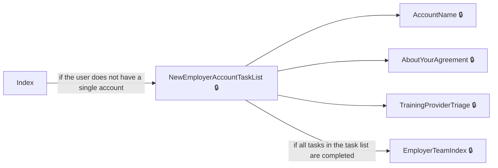
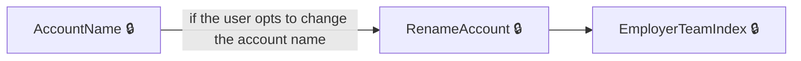
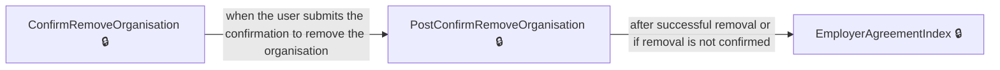
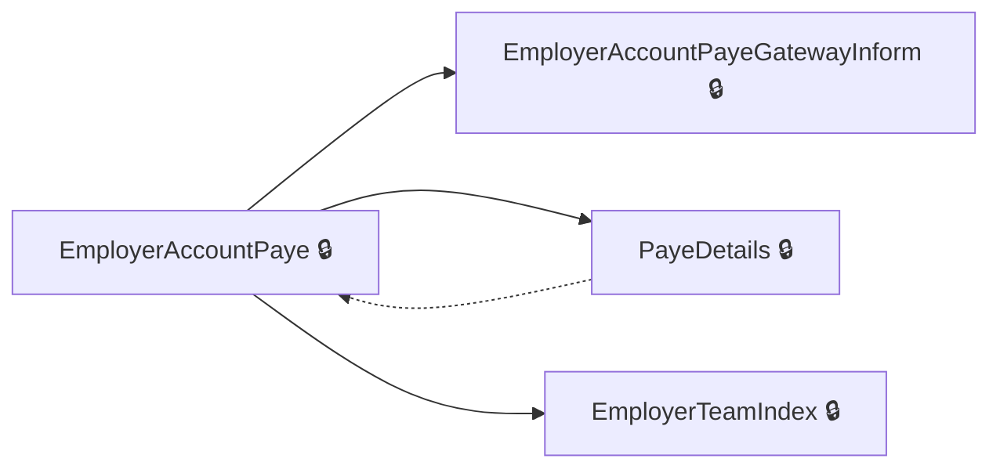
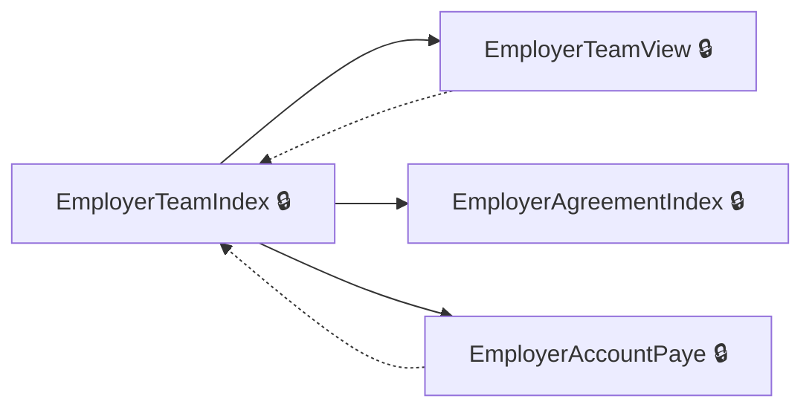
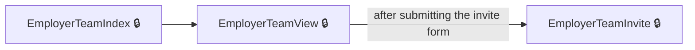
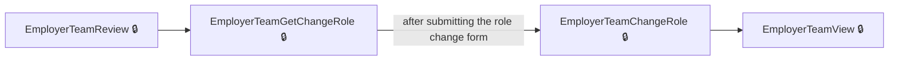
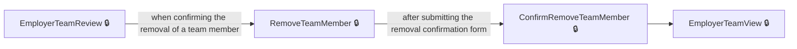

# User journeys: SkillsFundingAgency/das-employer-accounts

Generated from `main/src`: 111 pages, 96 transitions, 8 journeys. 🔒 means sign-in is required. Dotted arrows return to a hub.

## Create a new employer account

The user creates a new employer account by completing all tasks in the account creation task list.

Complete the sections in any order, returning to the hub.

## Set or change employer account name

The user sets or updates their employer account name during account management or creation.

## Remove an organisation from account agreements

The user confirms and completes the removal of an organisation from their account agreements.

## Manage PAYE schemes

The user manages PAYE schemes for their employer account, including confirming, viewing details, and removing a scheme.

Complete the sections in any order, returning to the hub.

## Manage employer team members

The user manages team members of their employer account, including inviting, reviewing, removing, and changing roles.

Complete the sections in any order, returning to the hub.

## Invite a team member

The user invites a new team member and completes the invitation process.

## Review and change a team member's role

The user reviews a team member and proceeds to update their role.

## Remove a team member

The user removes a team member from their employer account.

## Pages

| Page | Route | Sign-in | Purpose |
| --- | --- | --- | --- |
| `AboutYourAgreement` | `accounts/{HashedAccountId}/agreements/{hashedAgreementId}/about-your-agreement` | Yes | Provides information about a specific employer agreement. |
| `AccessDenied.Index` | — | Unknown | Displays an access denied message to users who are not authorized. |
| `AccessibilityStatement` | `service/accessibility-statement` | No | Provides information about the service's accessibility features. |
| `AccountName` | `accounts/{HashedAccountId}/create/accountName` | Yes | Lets the user set or change the employer account name during account creation. |
| `AccountNameConfirm` | `accounts/{HashedAccountId}/create/accountName/confirm` | Yes | Allows the user to confirm their choice of a new employer account name. |
| `AccountNameConfirmSuccess` | `accounts/{HashedAccountId}/create/accountName/confirm/success` | Yes | Shows a success message after the account name is confirmed. |
| `AccountNameSuccess` | `accounts/{HashedAccountId}/create/accountName/success` | Yes | Shows a summary or confirmation of the newly set account name. |
| `AccountsIndex` | `service/accounts` | Yes | Displays a list or overview of employer accounts for the signed-in user. |
| `AddPayeShutter` | `accounts/{HashedAccountId}/cannotAddPaye` | Yes | Informs the user that they cannot add a PAYE scheme at this time. |
| `AgreementView` | `accounts/{HashedAccountId}/agreements/{hashedAgreementId}/view` | Yes | Displays the signed employer agreement to the user. |
| `ConfirmRemoveTeamMember` | `accounts/{HashedAccountId}/teams/{hashedUserId}/remove` | Yes | Lets the user confirm the removal of a team member. |
| `CookieConsent.Details` | `accounts/{HashedAccountId}/cookieConsent/details` | Unknown | Shows details about the site's cookie consent policy. |
| `CookieConsent.Settings` | `accounts/{HashedAccountId}/cookieConsent` | Unknown | Allows users to configure their cookie consent preferences. |
| `CreateAccountSuccess` | `accounts/{HashedAccountId}/create/success` | Yes | Shows a success message after the employer account creation process is complete. |
| `CreateAdvert` | `accounts/{HashedAccountId}/teams/continuesetupcreateadvert` | Yes | Allows the user to decide whether they need to create an advert during the account setup process. |
| `EmployerAccount.AmendOrganisation` | `accounts/amendOrganisation` | Yes | Directs the user to amend or update their selected organisation details. |
| `EmployerAccount.GateWayResponse` | `accounts/gatewayResponse` | Yes | Processes and responds to HMRC gateway authentication responses. |
| `EmployerAccount.Gateway` | `accounts/gateway` | Yes | Redirects the user to the HMRC authentication gateway. |
| `EmployerAccount.GatewayInform` | `accounts/{hashedAccountId}/gatewayInform` | Yes | Provides information and next steps after HMRC authentication. |
| `EmployerAccount.Summary` | `accounts/summary` | Yes | Displays a summary of entered employer account details before final creation. |
| `EmployerAccountGetApprenticeshipFundingInAccount` | `accounts/{HashedAccountId}/getApprenticeshipFunding` | Yes | Shows information about apprenticeship funding for the employer account. |
| `EmployerAccountPayBillTriage` | `accounts/payBill` | Yes | Lets the employer determine their status regarding paying the apprenticeship levy. |
| `EmployerAccountPaye` | `accounts/{HashedAccountId}/schemes` | Yes | Displays a list of PAYE schemes associated with the employer account. |
| `EmployerAccountPaye.ConfirmPayeScheme` | `accounts/{HashedAccountId}/schemes/confirm` | Yes | Lets the employer confirm adding a PAYE scheme after HMRC gateway authentication. |
| `EmployerAccountPaye.NextSteps` | `accounts/{HashedAccountId}/schemes/next` | Yes | Shows the next actions the employer can take after managing PAYE schemes. |
| `EmployerAccountPaye.Remove` | `accounts/{HashedAccountId}/schemes/{empRef}/remove` | Yes | Lets the employer start removing a PAYE scheme from the account. |
| `EmployerAccountPayeGateway` | `accounts/{HashedAccountId}/schemes/gateway` | Yes | Redirects the user to the Government Gateway for PAYE scheme authentication. |
| `EmployerAccountPayeGatewayInform` | `accounts/{HashedAccountId}/schemes/gatewayInform` | Yes | Informs the user about needing to use the Government Gateway for PAYE schemes. |
| `EmployerAccountPostApprenticeshipFundingInAccount` | `accounts/{hashedAccountId}/getApprenticeshipFunding` | Yes | Lets the employer choose how to add a PAYE scheme for apprenticeship funding to their account. |
| `EmployerAccountTransactions.Index` | `accounts/{HashedAccountId}/finance` | Yes | Displays the financial transactions and balance for the employer's account. |
| `EmployerAgreement.ConfirmRemoveOrganisation` | `accounts/{HashedAccountId}/agreements/{accountLegalEntityHashedId}/remove` | Yes | Lets the user confirm whether they wish to remove an organisation from their account agreements. |
| `EmployerAgreement.Details` | `accounts/{HashedAccountId}/agreements/{hashedAgreementId}/details` | Yes | Shows detailed information about a specific employer agreement. |
| `EmployerAgreement.ViewUnsignedAgreements` | `accounts/{HashedAccountId}/agreements/unsigned/view` | Yes | Redirects the user to the next unsigned employer agreement or back to the agreements page. |
| `EmployerAgreement.WhenDoYouWantToView` | `accounts/{HashedAccountId}/agreements/{hashedAgreementId}/whenDoYouWantToView` | Yes | Allows the user to choose when they want to view the employer agreement. |
| `EmployerAgreementIndex` | `accounts/{HashedAccountId}/agreements` | Yes | Lists all employer agreements associated with the account. |
| `EmployerAgreementSign` | `accounts/{HashedAccountId}/agreements/{hashedAgreementId}/sign` | Yes | Allows the user to sign an employer agreement or acknowledge it for review later. |
| `EmployerAgreementSignYourAgreement` | `accounts/{HashedAccountId}/agreements/{hashedAgreementId}/sign-your-agreement` | Yes | Displays the agreement document for the user to sign. |
| `EmployerTeam.AddedProvider` | `accounts/{HashedAccountId}/teams/AddedProvider/{providerName}` | Yes | Notifies the user that a provider has been added to the account and updates permissions. |
| `EmployerTeam.NextSteps` | `accounts/{HashedAccountId}/teams/invite/next` | Yes | Shows next step instructions to the user after inviting a team member. |
| `EmployerTeamCancelInvitation` | `accounts/{HashedAccountId}/teams/{hashedInvitationId}/cancel` | Yes | Lets the user review or cancel a sent team member invitation. |
| `EmployerTeamChangeRole` | `accounts/{HashedAccountId}/teams/{hashedUserId}/role/change` | Yes | Handles the role change for a team member after submission. |
| `EmployerTeamGetChangeRole` | `accounts/{HashedAccountId}/teams/{hashedUserId}/role/change` | Yes | Shows the form for changing a team member's role. |
| `EmployerTeamIndex` | `accounts/{HashedAccountId}/teams` | Yes | Displays the dashboard and main page for managing an employer's team. |
| `EmployerTeamInvite` | `accounts/{HashedAccountId}/teams/invite` | Yes | Allows the user to invite a new team member to the employer account. |
| `EmployerTeamInviteNext` | `accounts/{HashedAccountId}/teams/invite/next` | Yes | Shows instructions or options after inviting a team member. |
| `EmployerTeamResendInvite` | `accounts/{HashedAccountId}/teams/resend` | Yes | Lets the user resend an invitation to a team member. |
| `EmployerTeamReview` | `accounts/{HashedAccountId}/teams/{hashedUserId}/review` | Yes | Provides a review of a team member's details and potential invitation status. |
| `EmployerTeamView` | `accounts/{HashedAccountId}/teams/view` | Yes | Shows the team members for an employer account. |
| `GetPdfAgreement` | `accounts/{HashedAccountId}/agreements/{hashedAgreementId}/agreement-pdf` | Yes | Allows the user to download the PDF version of their employer agreement. |
| `GetSignedPdfAgreement` | `accounts/{HashedAccountId}/agreements/{hashedAgreementId}/signed-agreement-pdf` | Yes | Allows the user to download the signed PDF version of their employer agreement. |
| `Home.GovSignIn` | `service` | Yes | Redirects the user to the sign-in process. |
| `Home.HandleEmailChanged` | `service/email/change` | Yes | Handles the process after a user changes their email address. |
| `Home.HandleNewRegistration` | `service/register/new/{correlationId?}` | Yes | Handles actions after a new user registration. |
| `Home.HandlePasswordChanged` | `service/password/change` | Yes | Handles the process after a user changes their password. |
| `Home.Help` | `service/help` | Unknown | Redirects the user to the help or support centre. |
| `Home.Index` | `service/~/` | Unknown | The entry point for the service; shows the start page or redirects to an appropriate dashboard or task list. |
| `Home.Privacy` | `service/{HashedAccountId}/privacy` | Unknown | Displays the privacy policy for the employer service. |
| `Home.RegisterUser` | `service/register` | Unknown | Redirects the user to add their profile details to register for the service. |
| `Home.ServiceStartPage` | `service/start` | Unknown | Shows the start page for the employer service, including links for sign-in. |
| `Home.ShowLegalAgreement` | `service/CreateLegalAgreement/{showSubFields}` | Unknown | Displays the legal agreement content for review. |
| `Home.SignIn` | `service/signIn` | Yes | Redirects the user to initiate the sign-in process. |
| `Home.TermsAndConditions` | `service/termsAndConditions` | Yes | Displays the terms and conditions for the user to review and accept. |
| `Home.TermsAndConditionsOverview` | `service/termsAndConditions/overview` | Unknown | Shows an overview of the service's terms and conditions. |
| `Invitation.AcceptInvitationExistingUser` | `invitations/accept` | Unknown | Handles existing users accepting an invitation to join an account. |
| `Invitation.AcceptInvitationNewUser` | `invitations/register-and-accept` | Unknown | Directs new users to accept an invitation after registering. |
| `Invitation.All` | `invitations` | Yes | Shows all invitations the user has received to join employer accounts. |
| `Invitation.Create` | `invitations/create` | Yes | Allows a user to send an invitation to another team member. |
| `Invitation.Details` | `invitations/view` | Yes | Displays the details of a specific invitation. |
| `Invitation.Invite` | `invitations/invite` | Unknown | Lets a user start the process to invite someone to their team. |
| `InvitationAccept` | `invitations/accept` | Yes | Lets the user accept an invitation to join an employer account. |
| `NewAccountSaveProgress` | `accounts/create/progress-saved` | Yes | Shows confirmation that the progress of creating a new employer account has been saved. |
| `NewEmployerAccountTaskList` | `accounts/create/tasklist` | Yes | Displays the list of tasks required to complete employer account creation. |
| `Organisation.OrganisationAddedNextSteps` | `accounts/{HashedAccountId}/organisations/nextStep` | Yes | Shows what to do next after successfully adding a new organisation. |
| `Organisation.OrganisationAddedNextStepsSearch` | `accounts/{HashedAccountId}/organisations/nextStepSearch` | Yes | Shows next steps after adding a new organisation from a search flow. |
| `Organisation.Review` | `accounts/{HashedAccountId}/organisations/review` | Yes | Lets the user review and update organisation details. |
| `OrganisationAgreements` | `accounts/{HashedAccountId}/organisations/{accountLegalEntityHashedId}/agreements` | Yes | Shows all agreements associated with a specific organisation for the user's account. |
| `OrganisationAndPayeAddedSuccess` | `accounts/{HashedAccountId}/create/orgAndPaye/success` | Yes | Shows a success message after both organisation details and PAYE have been added to the account. |
| `OrganisationConfirm` | `accounts/{HashedAccountId}/organisations/confirm` | Yes | Lets the user confirm adding a new organisation to the account. |
| `OrganisationGoToNextStep` | `accounts/{HashedAccountId}/organisations/nextStep` | Yes | Handles user selection of what to do after adding an organisation. |
| `OrganisationPostUpdateSelection` | `accounts/{HashedAccountId}/organisations/PostUpdateSelection` | Yes | Handles the user's choice after updating organisation details. |
| `OrganisationWrongAddress` | `accounts/organisation-wrong-address` | Yes | Allows the employer to proceed if their organisation's address was recorded incorrectly. |
| `PayeDetails` | `accounts/{HashedAccountId}/schemes/{empRef}/details` | Yes | Shows details of a specific PAYE scheme registered to the employer's account. |
| `PayePostNextSteps` | `accounts/{HashedAccountId}/schemes/next` | Yes | Handles the user's next steps after managing PAYE schemes and redirects based on their selection. |
| `PayePostRemove` | `accounts/{HashedAccountId}/schemes/remove` | Yes | Processes the user's request to remove a PAYE scheme from their account. |
| `PostConfirmRemoveOrganisation` | `accounts/{HashedAccountId}/agreements/{accountLegalEntityHashedId}/remove` | Yes | Lets the user confirm and complete the removal of an organisation from their account agreements. |
| `PreviewEmployerAgreement.Index` | `agreements/preview` | Yes | Shows a preview of the employer agreement for the organisation. |
| `ProcessOrganisationReview` | `accounts/{HashedAccountId}/organisations/review` | Yes | Processes the user's review and update choices for organisation details. |
| `RemoveTeamMember` | `accounts/{HashedAccountId}/teams/{hashedUserId}/remove` | Yes | Supports the review or initial confirmation before removing a team member. |
| `RenameAccount` | `accounts/{HashedAccountId}/rename` | Yes | Lets the employer change the name of their account. |
| `SearchOrganisation.Confirm` | `accounts/{HashedAccountId}/organisations/search/confirm` | Yes | Displays confirmation details for an organisation found in search. |
| `SearchOrganisation.SearchForOrganisation` | `accounts/{HashedAccountId}/organisations/search` | Yes | Lets the user search for an organisation to add to the account. |
| `SearchOrganisation.SearchForOrganisationResults` | `accounts/{HashedAccountId}/organisations/search/results` | Yes | Displays a list of organisations matching the search criteria. |
| `SearchPensionRegulator.SearchPensionRegulator` | `accounts/{HashedAccountId}/pensionregulator` | Yes | Allows the user to search the Pension Regulator and view organisation results using a PAYE reference. |
| `SearchPensionRegulator.SearchPensionRegulatorByAorn` | `accounts/{HashedAccountId}/pensionregulator/aorn` | Yes | Lets the user search the Pension Regulator using an Accounts Office Reference Number (AORN) and PAYE reference. |
| `SearchPensionRegulatorAddOrganisation` | `accounts/{HashedAccountId}/pensionregulator` | Yes | Lets the user add an organisation found from Pension Regulator search based on PAYE reference. |
| `Settings.NotificationSettings` | `settings/notifications` | Yes | Allows the user to view and update their notification settings. |
| `Settings.NotificationUnsubscribe` | `settings/notifications/unsubscribe/{hashedAccountId}` | Yes | Lets the user unsubscribe from notifications for a specific account. |
| `SignOut` | `service/signout` | Unknown | Signs the user out of the employer service. |
| `SignedOut` | `service/signed-out` | No | Confirms to the user that they have been signed out of the employer service. |
| `Summary` | `accounts/summary` | Yes | Displays a summary of the entered account details before final creation. |
| `TaskListSignedAgreementSuccess` | `accounts/{HashedAccountId}/create/agreement/success` | Yes | Shows confirmation that an agreement has been successfully signed during account creation. |
| `TrainingProviderSuccess` | `accounts/{HashedAccountId}/training-provider-success` | Yes | Shows confirmation that a training provider has been successfully added. |
| `TrainingProviderTriage` | `accounts/{HashedAccountId}/training-provider-triage`, `accounts/{hashedAccountId}/training-provider-triage` | Yes | Lets the employer choose how to add a training provider to their account. |
| `TriageCannotSetupWithoutApproximateStartDate` | `accounts/{HashedAccountId}/teams/triageyoucannotsetupanapprenticeshipyetapproximatestartdate` | Yes | Informs the user that they cannot set up an apprenticeship without an approximate start date. |
| `TriageCannotSetupWithoutChosenCourseAndProvider` | `accounts/{HashedAccountId}/teams/triageyoucannotsetupanapprenticeshipyetcourseprovider` | Yes | Shows that the user cannot set up an apprenticeship until they have chosen both a course and a training provider. |
| `TriageCannotSetupWithoutChosenProvider` | `accounts/{HashedAccountId}/teams/triageyoucannotsetupanapprenticeshipyetprovider` | Yes | Informs the user that they cannot set up an apprenticeship yet because they have not chosen a training provider. |
| `TriageCannotSetupWithoutStartDate` | `accounts/{HashedAccountId}/teams/triageyoucannotsetupanapprenticeshipyetstartdate` | Yes | Explains that the user cannot proceed with setting up an apprenticeship because they have not selected a start date. |
| `TriageChosenProvider` | `accounts/{HashedAccountId}/teams/triagehaveyouchosenatrainingprovider` | Yes | Lets the user indicate whether they have chosen a training provider. |
| `TriageCourse` | `accounts/{HashedAccountId}/teams/triagewhichcourseyourapprenticewilltake` | Yes | Lets the user specify which course their apprentice will take. |
| `TriageWhenApprenticeshipForExistingEmployee` | `accounts/{HashedAccountId}/teams/triageapprenticeforexistingemployee` | Yes | Asks if the apprenticeship training is for an existing employee. |
| `TriageWhenWillApprenticeshipStart` | `accounts/{HashedAccountId}/teams/triagewillapprenticeshiptrainingstart` | Yes | Lets the user indicate when the apprenticeship training will start. |
