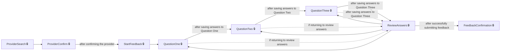

# User journeys: SkillsFundingAgency/das-employer-feedback-web

Generated from `main/src`: 12 pages, 19 transitions, 3 journeys. 🔒 means sign-in is required. Dotted arrows return to a hub.

## Submit Feedback for a Training Provider

Users search for, select, and confirm a provider, answer feedback questions, review their responses, and submit feedback.

```mermaid
flowchart LR
  p0["ProviderSearch 🔒"] --> p1["ProviderConfirm 🔒"]
  p1["ProviderConfirm 🔒"] -->|"after confirming the provider"| p2["StartFeedback 🔒"]
  p2["StartFeedback 🔒"] --> p3["QuestionOne 🔒"]
  p3["QuestionOne 🔒"] -->|"after saving answers to Question One"| p4["QuestionTwo 🔒"]
  p4["QuestionTwo 🔒"] -->|"after saving answers to Question Two"| p5["QuestionThree 🔒"]
  p5["QuestionThree 🔒"] -->|"after saving answers to Question Three"| p6["ReviewAnswers 🔒"]
  p6["ReviewAnswers 🔒"] -->|"after successfully submitting feedback"| p7["FeedbackConfirmation 🔒"]
```

## Return to Edit Feedback Answers

Users revisit and edit specific feedback questions from the review screen before submission.

Complete the sections in any order, returning to the hub.

## Attempt to Submit Duplicate Feedback

Users are informed that feedback has already been submitted for a selected provider when attempting to resubmit.

```mermaid
flowchart LR
  p0["ProviderSearch 🔒"] --> p1["ProviderConfirm 🔒"]
  p1["ProviderConfirm 🔒"] -->|"after confirming the provider"| p2["StartFeedback 🔒"]
  p2["StartFeedback 🔒"] --> p3["QuestionOne 🔒"]
  p3["QuestionOne 🔒"] -->|"after saving answers to Question One"| p4["QuestionTwo 🔒"]
  p4["QuestionTwo 🔒"] -->|"after saving answers to Question Two"| p5["QuestionThree 🔒"]
  p5["QuestionThree 🔒"] -->|"after saving answers to Question Three"| p6["ReviewAnswers 🔒"]
  p6["ReviewAnswers 🔒"] -->|"if feedback has already been submitted"| p7["FeedbackAlreadySubmitted 🔒"]
```

## Pages

| Page | Route | Sign-in | Purpose |
| --- | --- | --- | --- |
| `Home.Index` | — | No | Displays the home page or redirects the user to their accounts page, depending on the environment. |
| `ProviderController.ClearFilters` | `providers/clearfilters` | Yes | Removes all filters from the provider search and resets the search results. |
| `ProviderController.ProviderConfirm` | `providers/{providerId}` | Yes | Allows the user to confirm their selected training provider before starting feedback. |
| `ProviderController.ProviderSearch` | `providers` | Yes | Lets the user search and view a list of training providers to give feedback about. |
| `ProviderController.SortProviders` | `providers/sort` | Yes | Sorts the provider search results by the chosen column and order. |
| `QuestionsController.QuestionOne` | `question-one` | Yes | Lets the user answer the first feedback question, which relates to strengths. |
| `QuestionsController.QuestionThree` | `question-three` | Yes | Lets the user answer the third feedback question, which relates to rating. |
| `QuestionsController.QuestionTwo` | `question-two` | Yes | Lets the user answer the second feedback question, which relates to weaknesses. |
| `QuestionsController.StartFeedback` | `landing` | Yes | Starts the feedback process after the provider is confirmed. |
| `ReviewAnswersController.FeedbackAlreadySubmitted` | `feedback-submitted` | Yes | Informs the user that feedback has already been submitted for the selected provider. |
| `ReviewAnswersController.FeedbackConfirmation` | `feedback-confirmation` | Yes | Displays a confirmation that the user's feedback has been submitted successfully. |
| `ReviewAnswersController.ReviewAnswers` | `review-answers` | Yes | Allows the user to review and confirm their feedback answers before final submission. |
