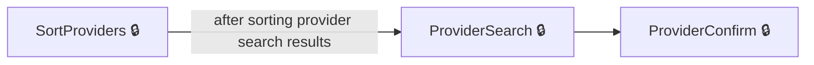
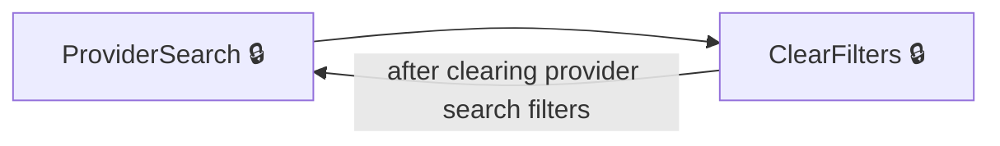

# User journeys: SkillsFundingAgency/das-employer-feedback-web

Generated from `main/src`: 12 pages, 19 transitions, 4 journeys. 🔒 means sign-in is required. Dotted arrows return to a hub.

## Search and Select a Training Provider

The user searches for and selects a training provider to give feedback about.

## Give Feedback on a Training Provider

The user proceeds through all feedback questions, reviews their answers, and submits their feedback for a selected provider.

```mermaid
flowchart LR
  p0["ProviderConfirm 🔒"] -->|"after confirming the provider and successfully creating new survey"| p1["StartFeedback 🔒"]
  p1["StartFeedback 🔒"] --> p2["QuestionOne 🔒"]
  p2["QuestionOne 🔒"] -->|"after updating answers and ReturnToReviewAnswers is false"| p3["QuestionTwo 🔒"]
  p3["QuestionTwo 🔒"] -->|"after saving valid form and 'ReturnToReviewAnswers' is false"| p4["QuestionThree 🔒"]
  p4["QuestionThree 🔒"] -->|"after saving the rating"| p5["ReviewAnswers 🔒"]
  p5["ReviewAnswers 🔒"] -->|"after successfully submitting feedback"| p6["FeedbackConfirmation 🔒"]
```

## Clear Search Filters When Searching Providers

The user clears filters while searching for a provider and continues searching.

## Handle Already Submitted Feedback

The user attempts to submit feedback but is notified that feedback has already been submitted for a provider.

```mermaid
flowchart LR
  p0["ProviderConfirm 🔒"] -->|"after confirming the provider and successfully creating new survey"| p1["StartFeedback 🔒"]
  p1["StartFeedback 🔒"] --> p2["QuestionOne 🔒"]
  p2["QuestionOne 🔒"] -->|"after updating answers and ReturnToReviewAnswers is false"| p3["QuestionTwo 🔒"]
  p3["QuestionTwo 🔒"] -->|"after saving valid form and 'ReturnToReviewAnswers' is false"| p4["QuestionThree 🔒"]
  p4["QuestionThree 🔒"] -->|"after saving the rating"| p5["ReviewAnswers 🔒"]
  p5["ReviewAnswers 🔒"] -->|"if feedback cannot be submitted"| p6["FeedbackAlreadySubmitted 🔒"]
```

## Pages

| Page | Route | Sign-in | Purpose |
| --- | --- | --- | --- |
| `Home.Index` | — | No | Displays the main landing page for the web application, or redirects to an account page if not running locally. |
| `ProviderController.ClearFilters` | `providers/clearfilters` | Yes | Clears any search filters applied when searching for training providers. |
| `ProviderController.ProviderConfirm` | `providers/{providerId}` | Yes | Lets the user confirm that the selected training provider is the one they want to give feedback on. |
| `ProviderController.ProviderSearch` | `providers` | Yes | Lets the user search for and filter training providers by name and feedback status. |
| `ProviderController.SortProviders` | `providers/sort` | Yes | Sorts the provider search results by selected criteria. |
| `QuestionsController.QuestionOne` | `question-one` | Yes | Lets the user answer the first feedback question about provider strengths. |
| `QuestionsController.QuestionThree` | `question-three` | Yes | Lets the user rate the training provider’s overall training and service. |
| `QuestionsController.QuestionTwo` | `question-two` | Yes | Lets the user answer the second feedback question regarding weaknesses. |
| `QuestionsController.StartFeedback` | `landing` | Yes | Starts the feedback process for the selected training provider. |
| `ReviewAnswersController.FeedbackAlreadySubmitted` | `feedback-submitted` | Yes | Informs the user that feedback has already been submitted. |
| `ReviewAnswersController.FeedbackConfirmation` | `feedback-confirmation` | Yes | Confirms to the user that their feedback was successfully submitted. |
| `ReviewAnswersController.ReviewAnswers` | `review-answers` | Yes | Lets the user review their feedback answers before submitting. |

## Form fields

Field definitions only: no values a user enters are recorded.

### `ProviderController.ProviderConfirm`

| Field | Type | Label | Required | Rules | Options |
| --- | --- | --- | --- | --- | --- |
| `Confirmed` | radios | Is this the training provider you want to give feedback on? | — | required; must not be null | Yes, No, select a different training provider |

### `ProviderController.ProviderSearch`

| Field | Type | Label | Required | Rules | Options |
| --- | --- | --- | --- | --- | --- |
| `SelectedProviderName` | select | Training provider | — | — | — |
| `SelectedFeedbackStatus` | select | Feedback status | — | — | — |

### `QuestionsController.QuestionThree`

| Field | Type | Label | Required | Rules | Options |
| --- | --- | --- | --- | --- | --- |
| `Rating` | radios | How would you rate?: $"{ }'s") training and service overall? | — | required; must not be null | — |

