# User journeys: SkillsFundingAgency/das-employer-feedback-web

Generated from `main/src`: 12 pages, 19 transitions, 4 journeys. 🔒 means sign-in is required. Dotted arrows return to a hub.

## Submit provider feedback

An employer searches for a provider, confirms their choice, gives feedback through a set of questions, reviews their answers, and submits the feedback.

```mermaid
flowchart LR
  p0["ProviderSearch 🔒"] --> p1["ProviderConfirm 🔒"]
  p1["ProviderConfirm 🔒"] -->|"after successful confirmation and creating new survey"| p2["StartFeedback 🔒"]
  p2["StartFeedback 🔒"] --> p3["QuestionOne 🔒"]
  p3["QuestionOne 🔒"] -->|"after updating answers when returnToReviewAnswers is false and validation succeeds"| p4["QuestionTwo 🔒"]
  p4["QuestionTwo 🔒"] -->|"after saving the form and not returning to review answers"| p5["QuestionThree 🔒"]
  p5["QuestionThree 🔒"] -->|"after updating answers and validation succeeds"| p6["ReviewAnswers 🔒"]
  p6["ReviewAnswers 🔒"] -->|"after submitting feedback successfully"| p7["FeedbackConfirmation 🔒"]
```

## Review and update feedback answers before submission

Allows the employer to revisit and update any feedback question from the review page before submitting their feedback.

Complete the sections in any order, returning to the hub.

```mermaid
flowchart LR
  p0["ProviderSearch 🔒"] --> p1["ProviderConfirm 🔒"]
  p1["ProviderConfirm 🔒"] -->|"after successful confirmation and creating new survey"| p2["StartFeedback 🔒"]
  p2["StartFeedback 🔒"] --> p3["QuestionOne 🔒"]
  p3["QuestionOne 🔒"] -->|"after updating answers when returnToReviewAnswers is false and validation succeeds"| p4["QuestionTwo 🔒"]
  p4["QuestionTwo 🔒"] -->|"after saving the form and not returning to review answers"| p5["QuestionThree 🔒"]
  p5["QuestionThree 🔒"] -->|"after updating answers and validation succeeds"| p6["ReviewAnswers 🔒"]
  p6["ReviewAnswers 🔒"] --> p3["QuestionOne 🔒"]
  p3["QuestionOne 🔒"] -.->|"if returnToReviewAnswers is true after validation"| p6["ReviewAnswers 🔒"]
  p6["ReviewAnswers 🔒"] --> p4["QuestionTwo 🔒"]
  p4["QuestionTwo 🔒"] -.->|"if returning to review answers after saving the form"| p6["ReviewAnswers 🔒"]
  p6["ReviewAnswers 🔒"] --> p5["QuestionThree 🔒"]
  p5["QuestionThree 🔒"] -.->|"after updating answers and validation succeeds"| p6["ReviewAnswers 🔒"]
  p6["ReviewAnswers 🔒"] -->|"after submitting feedback successfully"| p7["FeedbackConfirmation 🔒"]
```

## Attempt to submit duplicate feedback

An employer attempts to resubmit feedback for a provider they already reviewed and sees the duplicate submission notice.

```mermaid
flowchart LR
  p0["ProviderSearch 🔒"] --> p1["ProviderConfirm 🔒"]
  p1["ProviderConfirm 🔒"] -->|"after successful confirmation and creating new survey"| p2["StartFeedback 🔒"]
  p2["StartFeedback 🔒"] --> p3["QuestionOne 🔒"]
  p3["QuestionOne 🔒"] -->|"after updating answers when returnToReviewAnswers is false and validation succeeds"| p4["QuestionTwo 🔒"]
  p4["QuestionTwo 🔒"] -->|"after saving the form and not returning to review answers"| p5["QuestionThree 🔒"]
  p5["QuestionThree 🔒"] -->|"after updating answers and validation succeeds"| p6["ReviewAnswers 🔒"]
  p6["ReviewAnswers 🔒"] -->|"if feedback has already been submitted"| p7["FeedbackAlreadySubmitted 🔒"]
```

## Give feedback on a training provider

An employer selects a provider and completes the end-to-end feedback process, reviewing and submitting their responses.

## Pages

| Page | Route | Sign-in | Purpose |
| --- | --- | --- | --- |
| `Home.Index` | — | No | Displays the home page if running locally or in development, otherwise redirects to the accounts link. |
| `ProviderController.ClearFilters` | `providers/clearfilters` | Yes | Clears all filters applied to the provider list. |
| `ProviderController.ProviderConfirm` | `providers/{providerId}` | Yes | Lets the user confirm the selected training provider before giving feedback. |
| `ProviderController.ProviderSearch` | `providers` | Yes | Lets the user search for and filter training providers. |
| `ProviderController.SortProviders` | `providers/sort` | Yes | Sorts the list of providers based on selected criteria. |
| `QuestionsController.QuestionOne` | `question-one` | Yes | Lets the user select up to 3 strengths of the provider. |
| `QuestionsController.QuestionThree` | `question-three` | Yes | Lets the user rate the provider's training and service overall. |
| `QuestionsController.QuestionTwo` | `question-two` | Yes | Lets the employer select weaknesses of the provider for feedback. |
| `QuestionsController.StartFeedback` | `landing` | Yes | Starts the feedback process for the selected provider. |
| `ReviewAnswersController.FeedbackAlreadySubmitted` | `feedback-submitted` | Yes | Informs the employer that feedback was already submitted for this provider. |
| `ReviewAnswersController.FeedbackConfirmation` | `feedback-confirmation` | Yes | Confirms to the employer that their feedback was submitted successfully. |
| `ReviewAnswersController.ReviewAnswers` | `review-answers` | Yes | Allows the employer to review their answers before submitting feedback. |

## Form fields

Field definitions only: no values a user enters are recorded.

### `ProviderController.ProviderConfirm`

| Field | Type | Label | Required | Rules | Options |
| --- | --- | --- | --- | --- | --- |
| `Confirmed` | radios | Is this the training provider you want to give feedback on? | — | required | Yes, No, select a different training provider |

### `ProviderController.ProviderSearch`

| Field | Type | Label | Required | Rules | Options |
| --- | --- | --- | --- | --- | --- |
| `SelectedProviderName` | select | Training provider | — | — | — |
| `SelectedFeedbackStatus` | select | Feedback status | — | — | — |

### `QuestionsController.QuestionThree`

| Field | Type | Label | Required | Rules | Options |
| --- | --- | --- | --- | --- | --- |
| `Rating` | radios | How would you rate?: $"{ }'s") training and service overall? | — | required | — |

