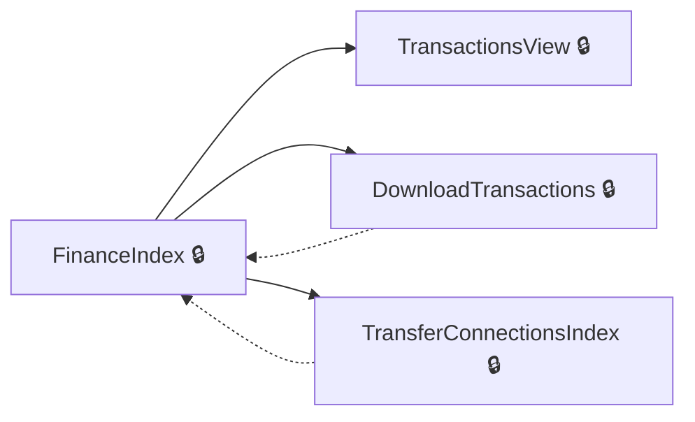
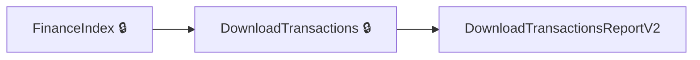
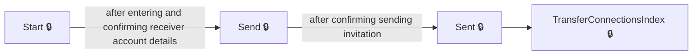
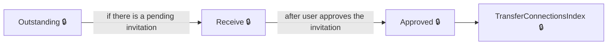
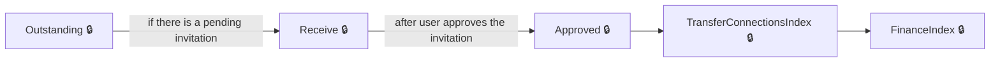
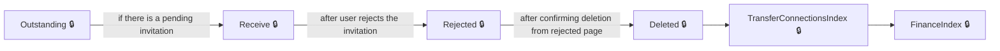

# User journeys: SkillsFundingAgency/das-employer-finance

Generated from `main/src`: 31 pages, 27 transitions, 7 journeys. 🔒 means sign-in is required. Dotted arrows return to a hub.

## View Account Finance Dashboard and Details

The user views their account finance dashboard and can access transaction history, download reports, or manage transfer connections.

Complete the sections in any order, returning to the hub.

## Download Account Transactions

The user downloads their account transactions in a specific format or version.

## Send a Transfer Connection Invitation

The user initiates and completes the process to send a new transfer connection invitation.

## Respond to a Received Transfer Connection Invitation

The user receives a transfer connection invitation and chooses to approve or reject it, confirming the outcome.

## Download Account Transactions Report

The user downloads a report of their financial transactions from the finance dashboard.

## Handle Transfer Connection Invitations

The user goes through the process to receive, approve or reject, delete, and confirm invitations for transfer connections.

## Delete a Transfer Connection Invitation After Rejection

The user rejects a transfer connection invitation and deletes its record.

## Pages

| Page | Route | Sign-in | Purpose |
| --- | --- | --- | --- |
| `AccessDenied.Index` | `error/403` | Unknown | Informs the user they do not have permission to access the requested page. |
| `DownloadTransactions` | `accounts/{HashedAccountId}/finance/downloadtransactions` | Yes | Lets the user download their account transactions in a specified format. |
| `DownloadTransactionsReportV2` | `reports/transactions/v2` | Unknown | Provides access to download the version 2 transactions report. |
| `EmployerAccountTransactions.CourseFrameworkPaymentSummary` | `accounts/{HashedAccountId}/finance/course/framework/summary` | Yes | Shows a summary of payments for a specified framework course. |
| `EmployerAccountTransactions.CourseStandardPaymentSummary` | `accounts/{HashedAccountId}/finance/course/standard/summary` | Yes | Displays a summary of payments for a standard course. |
| `EmployerAccountTransactions.ExpiredFundsDetails` | `accounts/{HashedAccountId}/finance/expiredfunds/details` | Yes | Shows details about funds in the user's account that have expired. |
| `EmployerAccountTransactions.LevyDeclarationDetail` | `accounts/{HashedAccountId}/finance/levyDeclaration/details` | Yes | Displays details about the user's levy declaration transactions. |
| `EmployerAccountTransactions.ProviderPaymentSummary` | `accounts/{HashedAccountId}/finance/provider/summary` | Yes | Shows a summary of payments to a specific provider. |
| `EmployerAccountTransactions.TransferDetail` | `accounts/{HashedAccountId}/finance/transfer/details` | Yes | Displays details about a specific transfer transaction. |
| `FinanceIndex` | `accounts/{HashedAccountId}/finance` | Yes | Provides a dashboard overview of the user's account finances. |
| `Home.CookieConsent` | `service/{HashedAccountId}/cookieConsent` | Unknown | Lets the user view and update their cookie consent preferences. |
| `Home.Help` | `service/help` | Unknown | Redirects the user to the help centre for assistance. |
| `Home.Index` | `service` | Unknown | Redirects to the main service home or landing page. |
| `Home.Privacy` | `service/{HashedAccountId}/privacy` | Unknown | Displays the privacy policy for the service. |
| `Home.SignIn` | `service/signIn` | Yes | Redirects the user to the main landing page after sign in. |
| `Home.SignedIn` | `service` | Yes | Shows the signed-in home page for the user. |
| `SignOut` | `service/signOut` | Unknown | Signs the user out of the application. |
| `TransactionsView` | `accounts/{HashedAccountId}/finance/{year}/{month}` | Yes | Shows transactions for a selected year and month. |
| `TransferConnectionInvitations.Approved` | `accounts/{HashedAccountId}/transfers/connections/requests/{transferConnectionInvitationId}/approved` | Yes | Shows confirmation that a transfer connection invitation has been approved. |
| `TransferConnectionInvitations.Deleted` | `accounts/{HashedAccountId}/transfers/connections/requests/{transferConnectionInvitationId}/deleted` | Yes | Shows confirmation that a transfer connection invitation has been deleted. |
| `TransferConnectionInvitations.Details` | `accounts/{HashedAccountId}/transfers/connections/requests/{transferConnectionInvitationId}/details` | Yes | Shows details for a specific transfer connection invitation. |
| `TransferConnectionInvitations.Index` | `accounts/{HashedAccountId}/transfers/connections/requests` | Yes | Displays a list of transfer connection invitations for the user's account. |
| `TransferConnectionInvitations.Outstanding` | `accounts/{HashedAccountId}/transfers/connections/requests/outstanding` | Yes | Redirects the user to their latest pending transfer connection invitation or the connections page. |
| `TransferConnectionInvitations.Receive` | `accounts/{HashedAccountId}/transfers/connections/requests/{transferConnectionInvitationId}/receive` | Yes | Allows the user to make a decision (approve or reject) on a received transfer connection invitation. |
| `TransferConnectionInvitations.Rejected` | `accounts/{HashedAccountId}/transfers/connections/requests/{transferConnectionInvitationId}/rejected` | Yes | Shows confirmation that a transfer connection invitation has been rejected. |
| `TransferConnectionInvitations.Send` | `accounts/{HashedAccountId}/transfers/connections/requests/send` | Yes | Allows the user to send a transfer connection invitation to another account. |
| `TransferConnectionInvitations.Sent` | `accounts/{HashedAccountId}/transfers/connections/requests/{transferConnectionInvitationId}/sent` | Yes | Shows confirmation that a transfer connection invitation has been sent. |
| `TransferConnectionInvitations.Start` | `accounts/{HashedAccountId}/transfers/connections/requests/start` | Yes | Starts the process of creating and sending a new transfer connection invitation. |
| `TransferConnectionsIndex` | `accounts/{HashedAccountId}/transfers/connections` | Yes | Shows the main transfer connections page, with transfer allowance, invitations, and requests. |
| `Transfers.FinancialBreakdown` | `accounts/{HashedAccountId}/transfers/financial-breakdown` | Yes | Displays the financial breakdown for account transfers, but currently redirects to an error page. |
| `Transfers.Index` | `accounts/{HashedAccountId}/transfers` | Yes | Shows an overview of transfers for a specific account. |
