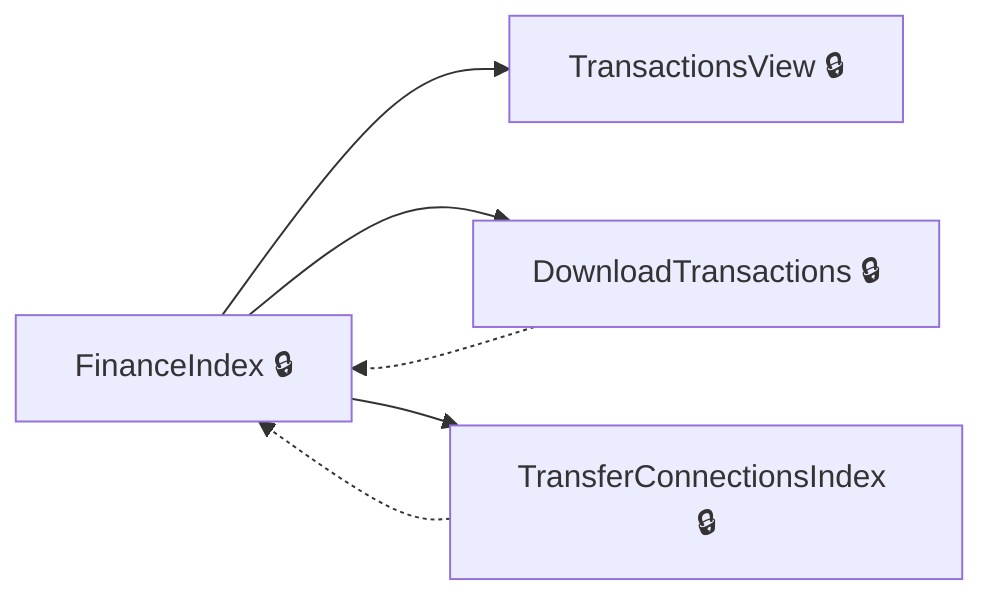
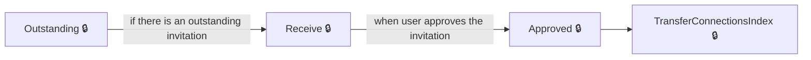
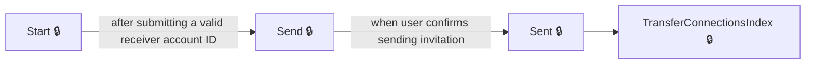
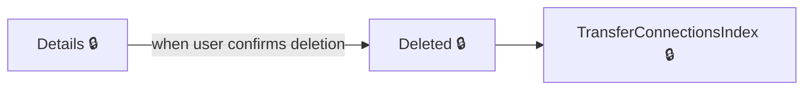
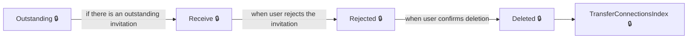
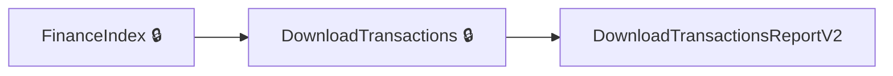

# User journeys: SkillsFundingAgency/das-employer-finance

Generated from `e7794faa88428dfdb66448ca9d709c1320851fd3/src`: 31 pages, 27 transitions, 10 journeys. 🔒 means sign-in is required. Dotted arrows return to a hub.

## View Financial Dashboard and Transactions

The user views their financial dashboard and inspects account transactions or downloads transaction details.

Complete the sections in any order, returning to the hub.

## Respond to a Received Transfer Invitation

The user checks outstanding invitations, responds to a transfer invitation, and completes the approval or rejection process.

## Send a New Transfer Invitation

The user starts and confirms the sending of a new transfer connection invitation.

## Delete or Manage an Existing Transfer Invitation

The user views the details of a transfer invitation and chooses to delete it, with follow up.

## Reject an Incoming Transfer Invitation

The user receives a transfer invitation, rejects it, and may delete it after rejection.

## Download Transaction Reports

The user downloads financial transaction statements for their account.

## Start a Transfer Connection Invitation

The user initiates, composes, and sends a transfer connection invitation to another employer.

## Respond to an Outstanding Transfer Invitation

The user responds to an outstanding transfer connection invitation by approving or rejecting it, and is redirected appropriately.

## Reject and Delete a Transfer Invitation

The user rejects a transfer connection invitation and deletes it, then is returned to the transfer connections index.

## Delete a Transfer Invitation from Details

The user reviews details of a transfer connection invitation and confirms deletion, returning to the connections index.

## Pages

| Page | Route | Sign-in | Purpose |
| --- | --- | --- | --- |
| `AccessDenied.Index` | `error/403` | Unknown | Informs the user that access is denied. |
| `DownloadTransactions` | `accounts/{HashedAccountId}/finance/downloadtransactions` | Yes | Lets the user download financial transactions for this account. |
| `DownloadTransactionsReportV2` | `reports/transactions/v2` | Unknown | Lets the user view or download the version 2 transactions report. |
| `EmployerAccountTransactions.CourseFrameworkPaymentSummary` | `accounts/{HashedAccountId}/finance/course/framework/summary` | Yes | Shows a summary of payments for a course framework. |
| `EmployerAccountTransactions.CourseStandardPaymentSummary` | `accounts/{HashedAccountId}/finance/course/standard/summary` | Yes | Shows a summary of payments for a course standard. |
| `EmployerAccountTransactions.ExpiredFundsDetails` | `accounts/{HashedAccountId}/finance/expiredfunds/details` | Yes | Shows details of expired funds for this account. |
| `EmployerAccountTransactions.LevyDeclarationDetail` | `accounts/{HashedAccountId}/finance/levyDeclaration/details` | Yes | Shows details of levy declaration transactions. |
| `EmployerAccountTransactions.ProviderPaymentSummary` | `accounts/{HashedAccountId}/finance/provider/summary` | Yes | Shows payment summary for a training provider. |
| `EmployerAccountTransactions.TransferDetail` | `accounts/{HashedAccountId}/finance/transfer/details` | Yes | Shows details for a transfer transaction. |
| `FinanceIndex` | `accounts/{HashedAccountId}/finance` | Yes | Shows the financial dashboard for the selected account. |
| `Home.CookieConsent` | `service/{HashedAccountId}/cookieConsent` | Unknown | Lets the user manage their cookie consent preferences. |
| `Home.Help` | `service/help` | Unknown | Provides help and redirects to the help centre. |
| `Home.Index` | `service` | Unknown | Redirects to the legacy employer account service home. |
| `Home.Privacy` | `service/{HashedAccountId}/privacy` | Unknown | Shows privacy information for the service. |
| `Home.SignIn` | `service/signIn` | Yes | Lets the user sign in to the service. |
| `Home.SignedIn` | `service` | Yes | Shows the user they are signed in to the service. |
| `SignOut` | `service/signOut` | Unknown | Lets the user sign out of the service. |
| `TransactionsView` | `accounts/{HashedAccountId}/finance/{year}/{month}` | Yes | Shows transactions for a specific month and year for the account. |
| `TransferConnectionInvitations.Approved` | `accounts/{HashedAccountId}/transfers/connections/requests/{transferConnectionInvitationId}/approved` | Yes | Shows that a transfer connection invitation has been approved, and lets the user choose what to do next. |
| `TransferConnectionInvitations.Deleted` | `accounts/{HashedAccountId}/transfers/connections/requests/{transferConnectionInvitationId}/deleted` | Yes | Shows that a transfer connection invitation has been deleted, and lets the user choose what to do next. |
| `TransferConnectionInvitations.Details` | `accounts/{HashedAccountId}/transfers/connections/requests/{transferConnectionInvitationId}/details` | Yes | Lets the user review and optionally delete a transfer connection invitation request. |
| `TransferConnectionInvitations.Index` | `accounts/{HashedAccountId}/transfers/connections/requests` | Yes | Lists all transfer connection invitation requests for the account. |
| `TransferConnectionInvitations.Outstanding` | `accounts/{HashedAccountId}/transfers/connections/requests/outstanding` | Yes | Checks for the latest outstanding received transfer connection invitation and redirects accordingly. |
| `TransferConnectionInvitations.Receive` | `accounts/{HashedAccountId}/transfers/connections/requests/{transferConnectionInvitationId}/receive` | Yes | Lets the user respond to a received transfer connection invitation (approve or reject). |
| `TransferConnectionInvitations.Rejected` | `accounts/{HashedAccountId}/transfers/connections/requests/{transferConnectionInvitationId}/rejected` | Yes | Shows that a transfer connection invitation has been rejected, and lets the user choose whether to delete it. |
| `TransferConnectionInvitations.Send` | `accounts/{HashedAccountId}/transfers/connections/requests/send` | Yes | Lets the user confirm sending a transfer connection invitation to another employer. |
| `TransferConnectionInvitations.Sent` | `accounts/{HashedAccountId}/transfers/connections/requests/{transferConnectionInvitationId}/sent` | Yes | Shows that a transfer connection invitation has been sent, and lets the user choose what to do next. |
| `TransferConnectionInvitations.Start` | `accounts/{HashedAccountId}/transfers/connections/requests/start` | Yes | Lets the user start a transfer connection invitation by entering the receiver's apprenticeship account ID. |
| `TransferConnectionsIndex` | `accounts/{HashedAccountId}/transfers/connections` | Yes | Shows transfer connections, allowances, and related information for the account. |
| `Transfers.FinancialBreakdown` | `accounts/{HashedAccountId}/transfers/financial-breakdown` | Yes | Displays the transfers financial breakdown, but currently redirects to a 404 error. |
| `Transfers.Index` | `accounts/{HashedAccountId}/transfers` | Yes | Shows an overview or index of transfers for the account. |

## Form fields

Field definitions only: no values a user enters are recorded.

### `DownloadTransactions`

| Field | Type | Label | Required | Rules | Options |
| --- | --- | --- | --- | --- | --- |
| `StartDate.Month` | number | Month | — | — | — |
| `StartDate.Year` | number | Year | — | — | — |
| `EndDate.Month` | number | Month | — | — | — |
| `EndDate.Year` | number | Year | — | — | — |
| `DownloadFormat` | select | — | Yes | required | — |
| `Version` | select | — | Yes | required | Version 1, Version 2 |

### `TransferConnectionInvitations.Approved`

| Field | Type | Label | Required | Rules | Options |
| --- | --- | --- | --- | --- | --- |
| `Choice` | radios | What next? | Yes | required | Start adding apprentices, Go to the homepage |

### `TransferConnectionInvitations.Deleted`

| Field | Type | Label | Required | Rules | Options |
| --- | --- | --- | --- | --- | --- |
| `Choice` | radios | What next? | Yes | required | Go to transfers, Go to the homepage |

### `TransferConnectionInvitations.Details`

| Field | Type | Label | Required | Rules | Options |
| --- | --- | --- | --- | --- | --- |
| `Choice` | radios | Do you want to delete this connection request? | Yes | required | Yes, delete this connection, No, go back to transfers |

### `TransferConnectionInvitations.Receive`

| Field | Type | Label | Required | Rules | Options |
| --- | --- | --- | --- | --- | --- |
| `Choice` | radios | Do you wish to connect to this employer? | Yes | required | Yes, I want to approve the connection request, No, I want to reject this request |

### `TransferConnectionInvitations.Rejected`

| Field | Type | Label | Required | Rules | Options |
| --- | --- | --- | --- | --- | --- |
| `Choice` | radios | Do you want to delete this connection request? | Yes | required | Yes, delete this connection, No, go back to transfers |

### `TransferConnectionInvitations.Send`

| Field | Type | Label | Required | Rules | Options |
| --- | --- | --- | --- | --- | --- |
| `Choice` | radios | Do you want to connect with this receiving employer? | Yes | required | Yes, I want to send a request to connect, No, I want to re-enter the account ID |

### `TransferConnectionInvitations.Sent`

| Field | Type | Label | Required | Rules | Options |
| --- | --- | --- | --- | --- | --- |
| `Choice` | radios | What next? | Yes | required | Go to transfers, Go to the homepage |

### `TransferConnectionInvitations.Start`

| Field | Type | Label | Required | Rules | Options |
| --- | --- | --- | --- | --- | --- |
| `ReceiverAccountPublicHashedId` | text | Enter the employer's apprenticeship account ID | Yes | required | — |

