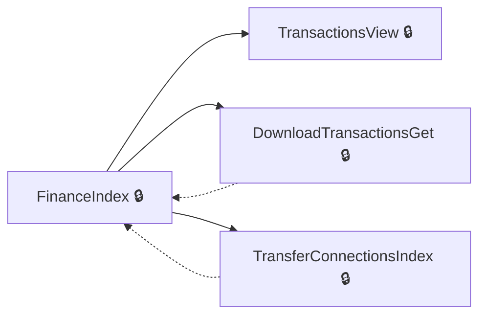
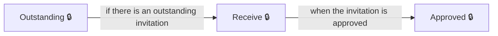
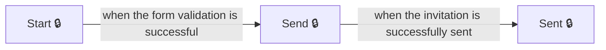

# User journeys: SkillsFundingAgency/das-employer-finance

Generated from `main/src`: 32 pages, 29 transitions, 3 journeys. 🔒 means sign-in is required. Dotted arrows return to a hub.

## View Financial Dashboard

Enables users to manage their financial accounts through a central dashboard.

Complete the sections in any order, returning to the hub.

## Handle Transfer Invitation

Manages received transfer invitations, including approving, rejecting, or deleting them.

## Send Transfer Invitation

Guides the user through creating and sending a transfer connection invitation.

## Pages

| Page | Route | Sign-in | Purpose |
| --- | --- | --- | --- |
| `AccessDenied.Index` | `error/403` | Unknown | Informs the user that access to the resource is denied. |
| `DownloadTransactionsGet` | `accounts/{HashedAccountId}/finance/downloadtransactions` | Yes | Allows the user to access the transaction download page to specify download options. |
| `DownloadTransactionsPost` | `accounts/{HashedAccountId}/finance/downloadtransactions` | Yes | Handles the submission for downloading transactions based on user inputs. |
| `DownloadTransactionsReportV2` | `reports/transactions/v2` | Unknown | Provides a downloadable report of transactions in version 2 format. |
| `EmployerAccountTransactions.CourseFrameworkPaymentSummary` | `accounts/{HashedAccountId}/finance/course/framework/summary` | Yes | Displays a summary of payments for courses within the framework. |
| `EmployerAccountTransactions.CourseStandardPaymentSummary` | `accounts/{HashedAccountId}/finance/course/standard/summary` | Yes | Shows a summary of payments for courses using standard pathways. |
| `EmployerAccountTransactions.ExpiredFundsDetails` | `accounts/{HashedAccountId}/finance/expiredfunds/details` | Yes | Provides details on expired funds in the user's account. |
| `EmployerAccountTransactions.LevyDeclarationDetail` | `accounts/{HashedAccountId}/finance/levyDeclaration/details` | Yes | Displays details of levy declaration transactions. |
| `EmployerAccountTransactions.ProviderPaymentSummary` | `accounts/{HashedAccountId}/finance/provider/summary` | Yes | Presents a summary of payments made to training providers. |
| `EmployerAccountTransactions.TransferDetail` | `accounts/{HashedAccountId}/finance/transfer/details` | Yes | Shows detailed information about transfer transactions. |
| `FinanceIndex` | `accounts/{HashedAccountId}/finance` | Yes | Serves as the main page for financial account management. |
| `Home.CookieConsent` | `service/{HashedAccountId}/cookieConsent` | Unknown | Redirects to a page where the user can manage cookie consent settings. |
| `Home.Help` | `service/help` | Unknown | Redirects the user to the help center for support and additional resources. |
| `Home.Index` | `service` | Unknown | Redirects the user to the legacy Employer support service homepage. |
| `Home.Privacy` | `service/{HashedAccountId}/privacy` | Unknown | Allows the user to view the privacy information of the service. |
| `Home.SignIn` | `service/signIn` | Yes | Redirects the user to the sign-in page. |
| `Home.SignedIn` | `service` | Yes | Displays the main page after a successful login. |
| `SignOut` | `service/signOut` | Unknown | Signs the user out of the service. |
| `TransactionsView` | `accounts/{HashedAccountId}/finance/{year}/{month}` | Yes | Displays transaction details for a specific year and month. |
| `TransferConnectionInvitations.Approved` | `accounts/{HashedAccountId}/transfers/connections/requests/{transferConnectionInvitationId}/approved` | Yes | Displays the details of an approved transfer connection invitation. |
| `TransferConnectionInvitations.Deleted` | `accounts/{HashedAccountId}/transfers/connections/requests/{transferConnectionInvitationId}/deleted` | Yes | Displays confirmation of a deleted transfer connection invitation. |
| `TransferConnectionInvitations.Details` | `accounts/{HashedAccountId}/transfers/connections/requests/{transferConnectionInvitationId}/details` | Yes | Provides detailed information about a specific transfer connection invitation. |
| `TransferConnectionInvitations.Index` | `accounts/{HashedAccountId}/transfers/connections/requests` | Yes | Shows all transfer connection invitations for a specific account. |
| `TransferConnectionInvitations.Outstanding` | `accounts/{HashedAccountId}/transfers/connections/requests/outstanding` | Yes | Redirects to the next pending transfer connection invitation, if available. |
| `TransferConnectionInvitations.Receive` | `accounts/{HashedAccountId}/transfers/connections/requests/{transferConnectionInvitationId}/receive` | Yes | Allows the user to manage a received transfer connection invitation. |
| `TransferConnectionInvitations.Rejected` | `accounts/{HashedAccountId}/transfers/connections/requests/{transferConnectionInvitationId}/rejected` | Yes | Displays details of a rejected transfer connection invitation. |
| `TransferConnectionInvitations.Send` | `accounts/{HashedAccountId}/transfers/connections/requests/send` | Yes | Guides the user through sending a transfer connection invitation. |
| `TransferConnectionInvitations.Sent` | `accounts/{HashedAccountId}/transfers/connections/requests/{transferConnectionInvitationId}/sent` | Yes | Confirms the successful sending of a transfer connection invitation. |
| `TransferConnectionInvitations.Start` | `accounts/{HashedAccountId}/transfers/connections/requests/start` | Yes | Allows the user to initiate a new transfer connection invitation. |
| `TransferConnectionsIndex` | `accounts/{HashedAccountId}/transfers/connections` | Yes | Provides an overview of transfer connections for the current account. |
| `Transfers.FinancialBreakdown` | `accounts/{HashedAccountId}/transfers/financial-breakdown` | Yes | Redirects the user to an error page with a 404 status. |
| `Transfers.Index` | `accounts/{HashedAccountId}/transfers` | Yes | Displays transfer-related information for the employer account. |
