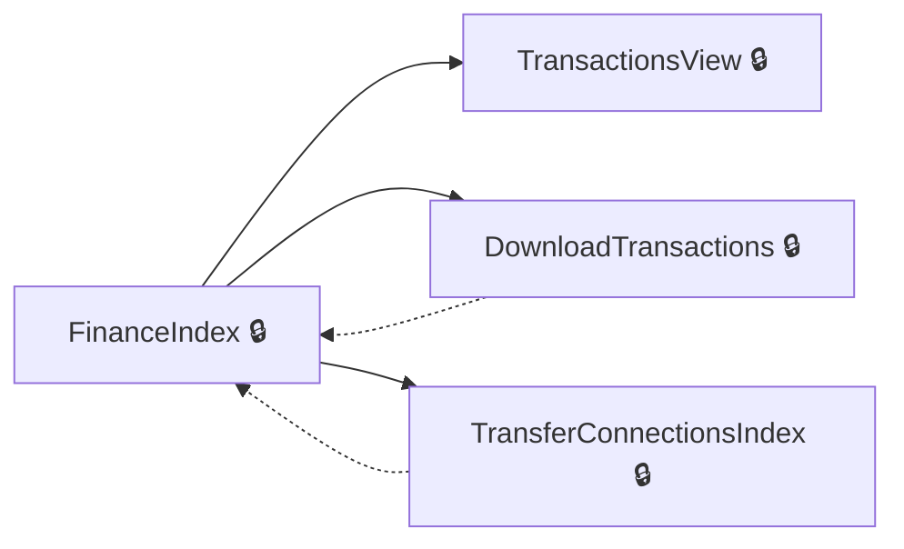
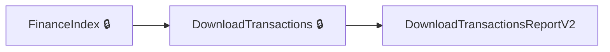
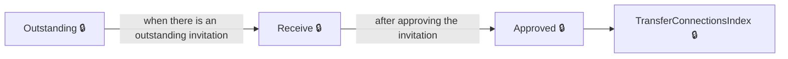
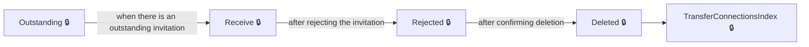
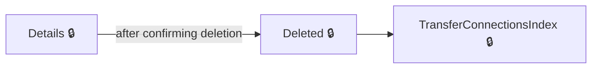
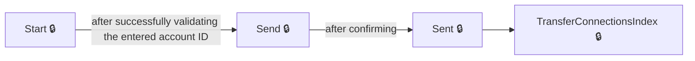

# User journeys: SkillsFundingAgency/das-employer-finance

Generated from `main/src`: 31 pages, 27 transitions, 7 journeys. 🔒 means sign-in is required. Dotted arrows return to a hub.

## View Finance Dashboard and Transaction Reports

Lets the user review their finance dashboard, view recent transactions, and download transaction reports.

Complete the sections in any order, returning to the hub.

## Download Detailed Account Transactions

Allows the user to download a detailed report of account transactions.

## Manage Transfer Connection Invitations (Receive)

Allows the user to handle received transfer connection invitations, approve or reject, and manage their status.

## Manage Transfer Connection Invitations (Reject and Delete)

Lets the user reject received transfer connection invitations and delete them if desired.

## Delete an Existing Transfer Connection Invitation

Enables the user to review a transfer connection invitation, delete it and return to the transfer connections index.

## Send a Transfer Connection Invitation

Lets the user initiate and send a transfer connection invitation to another employer.

## Download Transactions Report

Enables the user to access and download the latest transactions report for their account.

## Pages

| Page | Route | Sign-in | Purpose |
| --- | --- | --- | --- |
| `AccessDenied.Index` | `error/403` | Unknown | Informs the user they do not have access to this resource. |
| `DownloadTransactions` | `accounts/{HashedAccountId}/finance/downloadtransactions` | Yes | Lets the user choose download parameters for account transactions and retrieve a file. |
| `DownloadTransactionsReportV2` | `reports/transactions/v2` | Unknown | Lets the user access the latest version of the transactions report. |
| `EmployerAccountTransactions.CourseFrameworkPaymentSummary` | `accounts/{HashedAccountId}/finance/course/framework/summary` | Yes | Shows the user a summary of payments for a course framework. |
| `EmployerAccountTransactions.CourseStandardPaymentSummary` | `accounts/{HashedAccountId}/finance/course/standard/summary` | Yes | Shows the user a summary of payments for a course standard. |
| `EmployerAccountTransactions.ExpiredFundsDetails` | `accounts/{HashedAccountId}/finance/expiredfunds/details` | Yes | Displays details of expired funds for the account. |
| `EmployerAccountTransactions.LevyDeclarationDetail` | `accounts/{HashedAccountId}/finance/levyDeclaration/details` | Yes | Shows detailed information about levy declarations. |
| `EmployerAccountTransactions.ProviderPaymentSummary` | `accounts/{HashedAccountId}/finance/provider/summary` | Yes | Shows a summary of payments made to a provider. |
| `EmployerAccountTransactions.TransferDetail` | `accounts/{HashedAccountId}/finance/transfer/details` | Yes | Displays details of individual transfer transactions. |
| `FinanceIndex` | `accounts/{HashedAccountId}/finance` | Yes | Displays the main finance dashboard for an employer account. |
| `Home.CookieConsent` | `service/{HashedAccountId}/cookieConsent` | Unknown | Handles cookie consent for the user. |
| `Home.Help` | `service/help` | Unknown | Provides help and support to the user. |
| `Home.Index` | `service` | Unknown | Redirects the user to the legacy system homepage. |
| `Home.Privacy` | `service/{HashedAccountId}/privacy` | Unknown | Displays the privacy information page for the service. |
| `Home.SignIn` | `service/signIn` | Yes | Redirects the user to the main entry point after signing in. |
| `Home.SignedIn` | `service` | Yes | Shows the signed-in home page for the user. |
| `SignOut` | `service/signOut` | Unknown | Signs the user out of the application. |
| `TransactionsView` | `accounts/{HashedAccountId}/finance/{year}/{month}` | Yes | Displays detailed account transactions for a specific year and month. |
| `TransferConnectionInvitations.Approved` | `accounts/{HashedAccountId}/transfers/connections/requests/{transferConnectionInvitationId}/approved` | Yes | Displays a confirmation of the approved transfer connection invitation and lets the user choose what to do next. |
| `TransferConnectionInvitations.Deleted` | `accounts/{HashedAccountId}/transfers/connections/requests/{transferConnectionInvitationId}/deleted` | Yes | Displays confirmation that a transfer connection invitation is deleted and lets the user choose what to do next. |
| `TransferConnectionInvitations.Details` | `accounts/{HashedAccountId}/transfers/connections/requests/{transferConnectionInvitationId}/details` | Yes | Shows the details of a transfer connection invitation and asks if the user wants to delete it. |
| `TransferConnectionInvitations.Index` | `accounts/{HashedAccountId}/transfers/connections/requests` | Yes | Lists transfer connection requests for the account. |
| `TransferConnectionInvitations.Outstanding` | `accounts/{HashedAccountId}/transfers/connections/requests/outstanding` | Yes | Redirects the user based on the latest pending received transfer connection invitation. |
| `TransferConnectionInvitations.Receive` | `accounts/{HashedAccountId}/transfers/connections/requests/{transferConnectionInvitationId}/receive` | Yes | Lets the user decide whether to connect to another employer through a received transfer connection invitation. |
| `TransferConnectionInvitations.Rejected` | `accounts/{HashedAccountId}/transfers/connections/requests/{transferConnectionInvitationId}/rejected` | Yes | Shows the rejected transfer connection invitation and asks if the user wants to delete it. |
| `TransferConnectionInvitations.Send` | `accounts/{HashedAccountId}/transfers/connections/requests/send` | Yes | Lets the user confirm or re-enter the receiving employer's account ID for sending a transfer connection invitation. |
| `TransferConnectionInvitations.Sent` | `accounts/{HashedAccountId}/transfers/connections/requests/{transferConnectionInvitationId}/sent` | Yes | Displays confirmation that a transfer connection invitation has been sent and lets the user choose what to do next. |
| `TransferConnectionInvitations.Start` | `accounts/{HashedAccountId}/transfers/connections/requests/start` | Yes | Lets the user enter the receiving employer's apprenticeship account ID to start a transfer connection invitation. |
| `TransferConnectionsIndex` | `accounts/{HashedAccountId}/transfers/connections` | Yes | Shows the index page for transfer connections within the user's account. |
| `Transfers.FinancialBreakdown` | `accounts/{HashedAccountId}/transfers/financial-breakdown` | Yes | Indicates a financial breakdown page for transfers, but currently always redirects to a 404 error. |
| `Transfers.Index` | `accounts/{HashedAccountId}/transfers` | Yes | Displays an overview of transfers for the specified account. |

## Form fields

Field definitions only: no values a user enters are recorded.

### `DownloadTransactions`

| Field | Type | Label | Required | Rules | Options |
| --- | --- | --- | --- | --- | --- |
| `StartDate.Month` | number | Month | — | — | — |
| `StartDate.Year` | number | Year | — | — | — |
| `EndDate.Month` | number | Month | — | — | — |
| `EndDate.Year` | number | Year | — | — | — |
| `DownloadFormat` | select | — | Yes | required | — |
| `Version` | select | — | Yes | required | Version 1, Version 2 |

### `TransferConnectionInvitations.Approved`

| Field | Type | Label | Required | Rules | Options |
| --- | --- | --- | --- | --- | --- |
| `Choice` | radios | What next? | Yes | required | Start adding apprentices, Go to the homepage |

### `TransferConnectionInvitations.Deleted`

| Field | Type | Label | Required | Rules | Options |
| --- | --- | --- | --- | --- | --- |
| `Choice` | radios | What next? | Yes | required | Go to transfers, Go to the homepage |

### `TransferConnectionInvitations.Details`

| Field | Type | Label | Required | Rules | Options |
| --- | --- | --- | --- | --- | --- |
| `Choice` | radios | Do you want to delete this connection request? | Yes | required | Yes, delete this connection, No, go back to transfers |

### `TransferConnectionInvitations.Receive`

| Field | Type | Label | Required | Rules | Options |
| --- | --- | --- | --- | --- | --- |
| `Choice` | radios | Do you wish to connect to this employer? | Yes | required | Yes, I want to approve the connection request, No, I want to reject this request |

### `TransferConnectionInvitations.Rejected`

| Field | Type | Label | Required | Rules | Options |
| --- | --- | --- | --- | --- | --- |
| `Choice` | radios | Do you want to delete this connection request? | Yes | required | Yes, delete this connection, No, go back to transfers |

### `TransferConnectionInvitations.Send`

| Field | Type | Label | Required | Rules | Options |
| --- | --- | --- | --- | --- | --- |
| `Choice` | radios | Do you want to connect with this receiving employer? | Yes | required | Yes, I want to send a request to connect, No, I want to re-enter the account ID |

### `TransferConnectionInvitations.Sent`

| Field | Type | Label | Required | Rules | Options |
| --- | --- | --- | --- | --- | --- |
| `Choice` | radios | What next? | Yes | required | Go to transfers, Go to the homepage |

### `TransferConnectionInvitations.Start`

| Field | Type | Label | Required | Rules | Options |
| --- | --- | --- | --- | --- | --- |
| `ReceiverAccountPublicHashedId` | text | Enter the employer's apprenticeship account ID | Yes | required | — |

