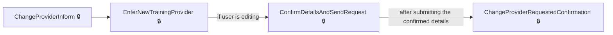
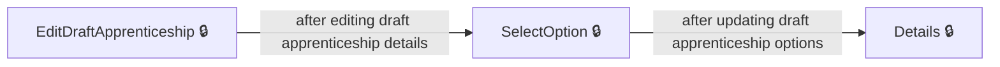
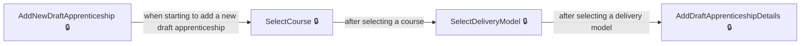

# User journeys: SkillsFundingAgency/das-employercommitments-v2

Generated from `master/src`: 117 pages, 105 transitions, 3 journeys. 🔒 means sign-in is required. Dotted arrows return to a hub.

## Change apprenticeship provider

Change the training provider for an apprentice, including reviewing provider details and confirming the request.

## Edit draft apprenticeship details

Edit the details of a draft apprenticeship in an unapproved cohort.

## Add draft apprenticeship to existing cohort

Add a draft apprenticeship to an existing unapproved cohort.

## Pages

| Page | Route | Sign-in | Purpose |
| --- | --- | --- | --- |
| `Apprentice.ApprenticeshipApprovalRequestConfirmed` | `{accountHashedId}/apprentices/{apprenticeshipHashedId}/approvals/{approvalRequestId}/confirmed` | Yes | Shows the confirmation of an apprenticeship approval request. |
| `Apprentice.ApprenticeshipNeverStarted` | `{accountHashedId}/apprentices/{apprenticeshipHashedId}/details/apprenticeshipneverstarted` | Yes | Lets the user handle cases where the apprenticeship never started. |
| `Apprentice.ApprenticeshipNotEnded` | `{accountHashedId}/apprentices/{apprenticeshipHashedId}/details/apprenticeshipnotended` | Yes | Informs the user about apprenticeships that have not yet ended. |
| `Apprentice.ApprenticeshipStoppedInform` | `{accountHashedId}/apprentices/{apprenticeshipHashedId}/change-provider/apprenticeshipStopped` | Yes | Provides information about the stopped apprenticeship to the user. |
| `Apprentice.ChangeHistory` | `{accountHashedId}/apprentices/{apprenticeshipHashedId}/change-history` | Yes | Displays the change history for an apprentice. |
| `Apprentice.ChangeOption` | `{accountHashedId}/apprentices/{apprenticeshipHashedId}/change-option` | Yes | Lets the user select a new option for the apprenticeship. |
| `Apprentice.ChangePayments` | `{accountHashedId}/apprentices/{apprenticeshipHashedId}/payments` | Yes | Lets the user make changes to apprenticeship payment details. |
| `Apprentice.ChangeStatus` | `{accountHashedId}/apprentices/{apprenticeshipHashedId}/details/changestatus` | Yes | Lets the user change the status of an apprenticeship record. |
| `Apprentice.ChangeVersion` | `{accountHashedId}/apprentices/{apprenticeshipHashedId}/change-version` | Yes | Lets the user change the version of the apprenticeship training. |
| `Apprentice.ConfirmEditApprenticeship` | `{accountHashedId}/apprentices/{apprenticeshipHashedId}/edit/confirm` | Yes | Lets the user confirm their edits to the apprenticeship details. |
| `Apprentice.ConfirmHasNotStop` | `{accountHashedId}/apprentices/{apprenticeshipHashedId}/details/confirmHasNotStop` | Yes | Lets the user confirm that an apprenticeship has not been stopped. |
| `Apprentice.ConfirmHasNotStopChanges` | `{accountHashedId}/apprentices/{apprenticeshipHashedId}/details/confirmHasNotStop` | Yes | Lets the user confirm changes regarding stopping the apprenticeship. |
| `Apprentice.ConfirmHasValidEndDate` | `{accountHashedId}/apprentices/{apprenticeshipHashedId}/details/confirmHasValidEndDate` | Yes | Lets the user confirm that the apprenticeship has a valid end date. |
| `Apprentice.ConfirmHasValidEndDateChanges` | `{accountHashedId}/apprentices/{apprenticeshipHashedId}/details/confirmHasValidEndDate` | Yes | Lets the user confirm changes related to the apprenticeship's end date. |
| `Apprentice.ConfirmStop` | `{accountHashedId}/apprentices/{apprenticeshipHashedId}/details/confirmStop` | Yes | Lets the user confirm stopping the apprenticeship. |
| `Apprentice.ConfirmWhenApprenticeshipStopped` | `{accountHashedId}/apprentices/{apprenticeshipHashedId}/details/confirmWhenApprenticeshipStopped` | Yes | Lets the employer confirm if the stop date for the apprenticeship is correct. |
| `Apprentice.DataLockRequestChanges` | `{accountHashedId}/apprentices/{apprenticeshipHashedId}/changes/request` | Yes | Lets the employer review and accept or reject data lock changes for an apprenticeship. |
| `Apprentice.DataLockRequestRestart` | `{accountHashedId}/apprentices/{apprenticeshipHashedId}/changes/restart` | Yes | Lets the employer review requests to restart an apprenticeship after a data lock. |
| `Apprentice.EditApprenticeship` | `{accountHashedId}/apprentices/{apprenticeshipHashedId}/edit` | Yes | Lets the employer edit the details of an apprenticeship. |
| `Apprentice.GetAllChangeHistory` | `{accountHashedId}/apprentices/change-history` | Yes | Shows the history of all changes made to apprenticeships for the account. |
| `Apprentice.GetApprenticeshipApprovalRequest` | `{accountHashedId}/apprentices/{apprenticeshipHashedId}/approvals/{approvalRequestId}` | Yes | Shows an approval request for apprenticeship changes. |
| `Apprentice.HasTheApprenticeBeenMadeRedundant` | `{accountHashedId}/apprentices/{apprenticeshipHashedId}/details/madeRedundant` | Yes | Lets the employer indicate if the apprentice has been made redundant. |
| `Apprentice.PostApprenticeshipApprovalRequest` | `{accountHashedId}/apprentices/{apprenticeshipHashedId}/approvals/{approvalRequestId}` | Yes | Processes the employer's decision to approve or decline an apprenticeship approval request. |
| `Apprentice.ReconfirmHasNotStop` | `{accountHashedId}/apprentices/{apprenticeshipHashedId}/details/reconfirmHasNotStop` | Yes | Lets the employer reconfirm that the apprenticeship has not been stopped. |
| `Apprentice.ReconfirmHasNotStopChangesAsync` | `{accountHashedId}/apprentices/{apprenticeshipHashedId}/details/reconfirmHasNotStop` | Yes | Processes the employer's confirmation that the apprenticeship has not been stopped. |
| `Apprentice.ResendEmailInvitation` | `{accountHashedId}/apprentices/{apprenticeshipHashedId}/details/resend-email-invitation` | Yes | Lets the employer resend the invitation email to the apprentice. |
| `Apprentice.ReviewApprenticeshipUpdates` | `{accountHashedId}/apprentices/{apprenticeshipHashedId}/changes/review` | Yes | Lets the employer review and approve or reject updates to apprenticeship details. |
| `Apprentice.SelectCourseForEdit` | `{accountHashedId}/apprentices/{apprenticeshipHashedId}/edit/select-course` | Yes | Lets the employer select a new training course for an apprenticeship being edited. |
| `Apprentice.SelectDeliveryModelForEdit` | `{accountHashedId}/apprentices/{apprenticeshipHashedId}/edit/select-delivery-model` | Yes | Lets the employer select a new delivery model for an apprenticeship being edited. |
| `Apprentice.SetCourseForEdit` | `{accountHashedId}/apprentices/{apprenticeshipHashedId}/edit/select-course` | Yes | Processes the employer's selection of a training course when editing an apprenticeship. |
| `Apprentice.SetDeliveryModelForEdit` | `{accountHashedId}/apprentices/{ApprenticeshipHashedId}/edit/select-delivery-model` | Yes | Lets the employer select or change the apprenticeship delivery model for an apprentice's record. |
| `Apprentice.StopApprenticeship` | `{accountHashedId}/apprentices/{apprenticeshipHashedId}/details/stop` | Yes | Allows the employer to initiate stopping an apprentice’s training and specify the stop date. |
| `Apprentice.ViewApprenticeshipUpdates` | `{accountHashedId}/apprentices/{apprenticeshipHashedId}/changes/view` | Yes | Shows the employer a summary of proposed or pending changes to the apprentice's record. |
| `Apprentice.ViewApprovalRequestAlerts` | `{accountHashedId}/apprentices/{apprenticeshipHashedId}/view-alerts` | Yes | Displays alerts relating to approval requests for changes to the apprentice’s details. |
| `Apprentice.WhyStopApprenticeship` | `{accountHashedId}/apprentices/{apprenticeshipHashedId}/details/whystopapprenticeship` | Yes | Lets the employer choose the reason for stopping the apprenticeship. |
| `ApprenticeDetail` | `{accountHashedId}/apprentices/{apprenticeshipHashedId}/details` | Yes | Displays the detailed record and progress information for a specific apprentice. |
| `ApprenticeEditEndDate` | `{accountHashedId}/apprentices/{apprenticeshipHashedId}/details/editenddate` | Yes | Allows the employer to edit and update the planned end date for the apprentice’s training. |
| `ApprenticeViewUpdates` | `{accountHashedId}/apprentices/{apprenticeshipHashedId}/changes/view` | Yes | Shows the changes made to the apprentice’s record that can be reviewed or undone. |
| `ApprenticesDownload` | `{accountHashedId}/apprentices/download` | Yes | Lets the employer download a file containing details of their apprentices. |
| `ApprenticesIndex` | `{accountHashedId}/apprentices` | Yes | Provides a list of all apprentices for the employer’s account. |
| `ApprenticeshipNeverStarted` | `{accountHashedId}/apprentices/{apprenticeshipHashedId}/details/apprenticeshipneverstarted` | Yes | Allows the employer to indicate that an apprenticeship never began. |
| `CancelChangeOfProviderRequest` | `{accountHashedId}/apprentices/{apprenticeshipHashedId}/change-provider/cancel` | Yes | Lets the employer cancel a request to change the apprentice's training provider. |
| `CancelInProgressChangeOfCircumstance` | `{accountHashedId}/apprentices/{apprenticeshipHashedId}/cancel-change-of-circumstance` | Yes | Cancels an in-progress change to the apprentice’s circumstances and returns to the details page. |
| `ChangeOption` | `{accountHashedId}/apprentices/{apprenticeshipHashedId}/change-option` | Yes | Allows the employer to select or change the apprenticeship course options for the apprentice. |
| `ChangePayments` | `{accountHashedId}/apprentices/{apprenticeshipHashedId}/payments` | Yes | Lets the employer change how payments are made for the apprenticeship. |
| `ChangeProviderInform` | `{accountHashedId}/apprentices/{apprenticeshipHashedId}/change-provider` | Yes | Informs the user about starting the process to change the training provider for an apprentice. |
| `ChangeProviderRequestedConfirmation` | `{accountHashedId}/apprentices/{apprenticeshipHashedId}/change-provider/change-provider-requested/{providerId}` | Yes | Shows confirmation that a request to change the training provider has been submitted for the apprentice. |
| `ChangeVersion` | `{accountHashedId}/apprentices/{apprenticeshipHashedId}/change-version` | Yes | Allows the user to change the apprenticeship course version for an apprentice. |
| `Cohort.AddDraftApprenticeship` | `{accountHashedId}/unapproved/add/apprenticeship` | Yes | Lets the employer add details for a new draft apprenticeship to a cohort. |
| `Cohort.AddDraftApprenticeshipOrRoute` | `{accountHashedId}/unapproved/add/apprenticeship` | Yes | Handles saving the draft apprenticeship or choosing to edit its course or delivery model. |
| `Cohort.AgreementNotSigned` | `{accountHashedId}/unapproved` | Yes | Shows that the employer agreement has not been signed for the account. |
| `Cohort.Apprentice` | `{accountHashedId}/unapproved/add/apprentice` | Yes | Handles the adding of an apprentice to the cohort. |
| `Cohort.Approved` | `{accountHashedId}/unapproved/{cohortReference}/approved` | Yes | Displays the confirmation that the cohort has been approved. |
| `Cohort.Assign` | `{accountHashedId}/unapproved/add/assign` | Yes | Lets the employer specify who will add apprentices to the cohort. |
| `Cohort.ConfirmDelete` | `{accountHashedId}/unapproved/{cohortReference}/delete` | Yes | Shows a confirmation step before deleting a cohort. |
| `Cohort.ConfirmProvider` | `{accountHashedId}/unapproved/add/confirm-provider` | Yes | Lets the employer confirm the selected training provider before proceeding. |
| `Cohort.Delete` | `{accountHashedId}/unapproved/{cohortReference}/delete` | Yes | Handles deletion of a cohort based on employer confirmation. |
| `Cohort.Details` | `{accountHashedId}/unapproved/{cohortReference}` | Yes | Displays the details of a particular cohort. |
| `Cohort.Draft` | `{accountHashedId}/unapproved/draft` | Yes | Shows a list or details of draft cohorts for the account. |
| `Cohort.Finished` | `{accountHashedId}/unapproved/add/finished` | Yes | Shows the completion of adding a new cohort for apprenticeships. |
| `Cohort.Index` | `{accountHashedId}/unapproved/add` | Yes | Lets the employer start adding a new cohort of apprentices. |
| `Cohort.SaveDraftApprenticeship` | `{accountHashedId}/unapproved` | Yes | Saves a draft apprenticeship in a cohort. |
| `Cohort.SelectAcceptedLevyTransferConnection` | `{accountHashedId}/unapproved/add/select-funding/select-accepted-levy-connection` | Yes | Lets the employer select an accepted levy transfer connection for funding apprenticeships. |
| `Cohort.SelectCourse` | `{accountHashedId}/unapproved/add/select-course` | Yes | Allows the employer to select the training course for an apprenticeship. |
| `Cohort.SelectDeliveryModel` | `{accountHashedId}/unapproved/add/select-delivery-model` | Yes | Lets the employer choose the delivery model for the apprenticeship training. |
| `Cohort.SelectDirectTransferConnection` | `{accountHashedId}/unapproved/add/select-funding/select-direct-connection` | Yes | Lets the employer select a direct transfer connection for apprenticeship funding. |
| `Cohort.SelectFunding` | `{accountHashedId}/unapproved/add/select-funding` | Yes | Lets the employer choose the funding type for apprenticeships. |
| `Cohort.SelectFundingType` | `{accountHashedId}/unapproved/add/select-funding` | Yes | Lets the employer confirm or select the funding type for apprenticeships. |
| `Cohort.SelectLegalEntity` | `{accountHashedId}/unapproved/legalEntity/create` | Yes | Allows the employer to select or confirm the legal entity linked to the apprenticeship cohort. |
| `Cohort.SelectProvider` | `{accountHashedId}/unapproved/add/select-provider` | Yes | Lets the employer choose a training provider for the apprenticeship. |
| `Cohort.Sent` | `{accountHashedId}/unapproved/{cohortReference}/sent` | Yes | Shows confirmation that the cohort has been sent for approval. |
| `Cohort.SetDeliveryModel` | `{accountHashedId}/unapproved/add/select-delivery-model` | Yes | Saves the delivery model selection for an apprenticeship. |
| `Cohort.SetReservation` | `{accountHashedId}/unapproved/add/set-reservation` | Yes | Sets the reservation details for an apprenticeship cohort. |
| `Cohort.WithTrainingProvider` | `{accountHashedId}/unapproved/with-training-provider` | Yes | Shows a list of cohorts currently with a training provider. |
| `Cohort.WithTransferSender` | `{accountHashedId}/unapproved/with-transfer-sender` | Yes | Shows cohorts that have a transfer sender assigned. |
| `CohortDetails` | `{accountHashedId}/unapproved/{cohortReference}` | Yes | Displays details for a specific cohort that has not yet been approved. |
| `CohortReview` | `{accountHashedId}/unapproved` | Yes | Lists all unapproved cohorts for the employer. |
| `ConfirmDetailsAndSendRequest` | `{accountHashedId}/apprentices/{apprenticeshipHashedId}/change-provider/confirm-details` | Yes | Lets the user review and confirm new apprenticeship details and submit the change provider request. |
| `DeleteDraftApprenticeship` | `{AccountHashedId}/unapproved/{cohortReference}/apprentices/{DraftApprenticeshipHashedId}/Delete` | Yes | Shows a confirmation page for deleting a draft apprenticeship. |
| `Details` | `{AccountHashedId}/unapproved/{cohortReference}/apprentices/{DraftApprenticeshipHashedId}` | Yes | Displays details for a draft apprenticeship in a cohort. |
| `Details-View` | `{AccountHashedId}/unapproved/{cohortReference}/apprentices/{DraftApprenticeshipHashedId}/view` | Yes | Shows a read-only view of draft apprenticeship details. |
| `DraftApprenticeship.AddDraftApprenticeshipDetails` | `{AccountHashedId}/unapproved/{cohortReference}/apprentices/add-another` | Yes | Allows the user to add details for another draft apprenticeship to a cohort. |
| `DraftApprenticeship.AddNewDraftApprenticeship` | `{AccountHashedId}/unapproved/{cohortReference}/apprentices/add` | Yes | Starts the process to add a new draft apprenticeship to a cohort. |
| `DraftApprenticeship.DeleteDraftApprenticeship` | `{AccountHashedId}/unapproved/{cohortReference}/apprentices/{DraftApprenticeshipHashedId}/Delete` | Yes | Shows a confirmation page for deleting a draft apprenticeship. |
| `DraftApprenticeship.EditDraftApprenticeship` | `{AccountHashedId}/unapproved/{cohortReference}/apprentices/{DraftApprenticeshipHashedId}` | Yes | Allows editing of an existing draft apprenticeship's details. |
| `DraftApprenticeship.SelectCourse` | `{AccountHashedId}/unapproved/{cohortReference}/apprentices/add/select-course` | Yes | Lets the user select a training course for a new draft apprenticeship. |
| `DraftApprenticeship.SelectCourseForEdit` | `{AccountHashedId}/unapproved/{cohortReference}/apprentices/{DraftApprenticeshipHashedId}/edit/select-course` | Yes | Lets the user select a training course when editing a draft apprenticeship. |
| `DraftApprenticeship.SelectDeliveryModel` | `{AccountHashedId}/unapproved/{cohortReference}/apprentices/add/select-delivery-model` | Yes | Lets the user choose a delivery model for a new draft apprenticeship. |
| `DraftApprenticeship.SelectDeliveryModelForEdit` | `{AccountHashedId}/unapproved/{cohortReference}/apprentices/{DraftApprenticeshipHashedId}/edit/select-delivery-model` | Yes | Lets the user select or change the delivery model for a draft apprenticeship that is being edited. |
| `DraftApprenticeship.SelectOption` | `{AccountHashedId}/unapproved/{cohortReference}/apprentices/{DraftApprenticeshipHashedId}/select-option` | Yes | Lets the user choose options for a draft apprenticeship, such as course options or details. |
| `DraftApprenticeship.SetCourseForEdit` | `{AccountHashedId}/unapproved/{cohortReference}/apprentices/{DraftApprenticeshipHashedId}/edit/select-course` | Yes | Enables the user to select a training course when editing a draft apprenticeship. |
| `DraftApprenticeship.SetDeliveryModel` | `{AccountHashedId}/unapproved/{cohortReference}/apprentices/add/select-delivery-model` | Yes | Allows the user to select a delivery model when adding a new draft apprenticeship. |
| `DraftApprenticeship.SetDeliveryModelForEdit` | `{AccountHashedId}/unapproved/{cohortReference}/apprentices/{DraftApprenticeshipHashedId}/edit/select-delivery-model` | Yes | Lets the user set or update the delivery model for an apprenticeship during editing. |
| `EditApprenticeship` | `{accountHashedId}/apprentices/{apprenticeshipHashedId}/edit` | Yes | Allows the user to edit apprenticeship details for an apprentice. |
| `EditDraftApprenticeshipDisplay` | `{AccountHashedId}/unapproved/{cohortReference}/apprentices/{DraftApprenticeshipHashedId}/edit-display` | Yes | Displays the editable details of a draft apprenticeship for review and further changes. |
| `EditStopDateOption` | `{accountHashedId}/apprentices/{apprenticeshipHashedId}/details/editstopdate` | Yes | Lets the user edit the stop date of an apprenticeship. |
| `EnterNewTrainingProvider` | `{accountHashedId}/apprentices/{apprenticeshipHashedId}/change-provider/select-provider` | Yes | Enables the user to select and enter the new training provider for an apprentice. |
| `HasTheApprenticeBeenMadeRedundant` | `{accountHashedId}/apprentices/{apprenticeshipHashedId}/details/madeRedundant` | Yes | Lets the user indicate whether the apprentice has been made redundant. |
| `Home.Index` | `{accountHashedId}` | Yes | Shows the main home page for the employer account, including overview and navigation. |
| `Inform` | `{accountHashedId}/unapproved/Inform` | Yes | Informs the employer about something related to unapproved cohorts. |
| `PaymentOrder.ProviderPaymentOrder` | `accounts/{accountHashedId}/apprentices/manage/paymentorder` | Yes | Allows the user to view and update the order in which providers are paid for apprenticeships. |
| `PaymentsPausedConfirmation` | `{accountHashedId}/apprentices/{apprenticeshipHashedId}/payments/paused` | Yes | Displays confirmation that apprenticeship payments have been paused. |
| `PaymentsResumedConfirmation` | `{accountHashedId}/apprentices/{apprenticeshipHashedId}/payments/resumed` | Yes | Displays confirmation that apprenticeship payments have been resumed. |
| `PostEditStopDate` | `{accountHashedId}/apprentices/{apprenticeshipHashedId}/details/editstopdate` | Yes | Processes the update to the apprenticeship stop date. |
| `ProviderPaymentOrder` | `accounts/{accountHashedId}/apprentices/manage/paymentorder` | Yes | Lets the user manage the payment order for training providers in the employer account. |
| `SendRequestNewTrainingProvider` | `{accountHashedId}/apprentices/{apprenticeshipHashedId}/change-provider/send-request` | Yes | Lets the user send a request to the new training provider for the apprenticeship. |
| `TransferRequest.TransferConfirmation` | `{accountHashedId}/sender/transfers/{transferRequestHashedId}/confirmation` | Yes | Shows confirmation for a transfer request after sender actions have been completed. |
| `TransferRequest.TransferDetailsForReceiver` | `{accountHashedId}/receiver/transfers/{transferRequestHashedId}` | Yes | Displays the details of a transfer request to the receiving employer. |
| `TransferRequest.TransferDetailsForSender` | `{accountHashedId}/sender/transfers/{transferRequestHashedId}` | Yes | Displays the details of a transfer request to the sending employer for review or action. |
| `ViewAgreement` | `{accountHashedId}/unapproved/viewAgreement` | Yes | Displays the employer agreement for review. |
| `ViewChanges` | `{accountHashedId}/apprentices/{apprenticeshipHashedId}/view-changes` | Yes | Displays the changes made to an apprenticeship for review. |
| `WhatIsTheNewEndDate` | `{accountHashedId}/apprentices/{apprenticeshipHashedId}/change-provider/end-date` | Yes | Allows the user to enter the new planned end date for the apprentice's training with the new provider. |
| `WhatIsTheNewPrice` | `{accountHashedId}/apprentices/{apprenticeshipHashedId}/change-provider/price` | Yes | Allows the user to enter the new training price for the apprentice with the new provider. |
| `WhatIsTheNewStartDate` | `{accountHashedId}/apprentices/{apprenticeshipHashedId}/change-provider/start-date` | Yes | Lets the employer enter the new apprenticeship start date when changing provider. |
| `WhenToApplyStopApprentice` | `{accountHashedId}/apprentices/{apprenticeshipHashedId}/details/stop` | Yes | Allows the employer to choose when to apply to stop the apprenticeship. |
| `WhoWillEnterTheDetails` | `{accountHashedId}/apprentices/{apprenticeshipHashedId}/change-provider/who-enter-details` | Yes | Lets the employer choose who will enter new provider details for the apprentice. |
| `WhyStopApprenticeship` | `{accountHashedId}/apprentices/{apprenticeshipHashedId}/details/whystopapprenticeship` | Yes | Allows the employer to select the reason for stopping an apprenticeship. |
