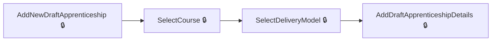
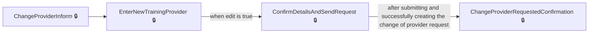
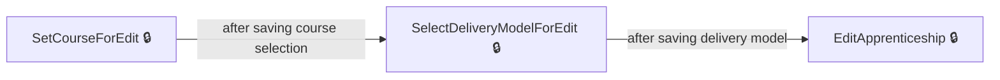

# User journeys: SkillsFundingAgency/das-employercommitments-v2

Generated from `master/src`: 119 pages, 107 transitions, 3 journeys. 🔒 means sign-in is required. Dotted arrows return to a hub.

## Add a New Draft Apprenticeship to a Cohort

Create a new draft apprenticeship, specify course and delivery model, and add all required details to the cohort.

## Change Training Provider for an Apprenticeship

Start the process to change the training provider for an apprenticeship and confirm the new provider details.

## Edit Course and Delivery Model for an Apprenticeship

Edit the course and delivery model for an apprenticeship and confirm the changes.

## Pages

| Page | Route | Sign-in | Purpose |
| --- | --- | --- | --- |
| `Apprentice.ApprenticeshipApprovalRequestConfirmed` | `{accountHashedId}/apprentices/{apprenticeshipHashedId}/approvals/confirmed` | Yes | Shows confirmation that the apprenticeship approval request has been handled. |
| `Apprentice.ApprenticeshipApprovalRequestConfirmedLegacy` | `{accountHashedId}/apprentices/{apprenticeshipHashedId}/approvals/{approvalRequestId:guid}/confirmed` | Yes | Redirects the user to the current apprenticeship approval request confirmation page. |
| `Apprentice.ApprenticeshipNeverStarted` | `{accountHashedId}/apprentices/{apprenticeshipHashedId}/details/apprenticeshipneverstarted` | Yes | Allows the user to confirm that the apprenticeship never started. |
| `Apprentice.ApprenticeshipNotEnded` | `{accountHashedId}/apprentices/{apprenticeshipHashedId}/details/apprenticeshipnotended` | Yes | Informs the user that the apprenticeship has not ended. |
| `Apprentice.ApprenticeshipStoppedInform` | `{accountHashedId}/apprentices/{apprenticeshipHashedId}/change-provider/apprenticeshipStopped` | Yes | Informs the user that the apprenticeship has been stopped. |
| `Apprentice.ChangeHistory` | `{accountHashedId}/apprentices/{apprenticeshipHashedId}/change-history` | Yes | Allows the user to view the change history for a specific apprenticeship. |
| `Apprentice.ChangeOption` | `{accountHashedId}/apprentices/{apprenticeshipHashedId}/change-option` | Yes | Allows the user to select a new apprenticeship option when editing details. |
| `Apprentice.ChangePayments` | `{accountHashedId}/apprentices/{apprenticeshipHashedId}/payments` | Yes | Lets the employer confirm pausing or resuming payments to the training provider. |
| `Apprentice.ChangeStatus` | `{accountHashedId}/apprentices/{apprenticeshipHashedId}/details/changestatus` | Yes | Allows the user to select a status change for the apprenticeship. |
| `Apprentice.ChangeVersion` | `{accountHashedId}/apprentices/{apprenticeshipHashedId}/change-version` | Yes | Allows the user to change the version of the apprenticeship. |
| `Apprentice.ConfirmEditApprenticeship` | `{accountHashedId}/apprentices/{apprenticeshipHashedId}/edit/confirm` | Yes | Lets the employer confirm whether to make the proposed changes to the apprenticeship. |
| `Apprentice.ConfirmHasNotStop` | `{accountHashedId}/apprentices/{apprenticeshipHashedId}/details/confirmHasNotStop` | Yes | Lets the employer confirm whether the apprenticeship has stopped. |
| `Apprentice.ConfirmHasNotStopChanges` | `{accountHashedId}/apprentices/{apprenticeshipHashedId}/details/confirmHasNotStop` | Yes | Allows the user to confirm whether the apprenticeship should be stopped or not. |
| `Apprentice.ConfirmHasValidEndDate` | `{accountHashedId}/apprentices/{apprenticeshipHashedId}/details/confirmHasValidEndDate` | Yes | Lets the employer confirm if the planned apprenticeship end date is correct. |
| `Apprentice.ConfirmHasValidEndDateChanges` | `{accountHashedId}/apprentices/{apprenticeshipHashedId}/details/confirmHasValidEndDate` | Yes | Allows the user to confirm whether the apprenticeship's end date is valid. |
| `Apprentice.ConfirmStop` | `{accountHashedId}/apprentices/{apprenticeshipHashedId}/details/confirmStop` | Yes | Lets the employer confirm whether to stop the apprenticeship. |
| `Apprentice.ConfirmWhenApprenticeshipStopped` | `{accountHashedId}/apprentices/{apprenticeshipHashedId}/details/confirmWhenApprenticeshipStopped` | Yes | Lets the employer confirm if the apprenticeship stop date is correct. |
| `Apprentice.DataLockRequestChanges` | `{accountHashedId}/apprentices/{apprenticeshipHashedId}/changes/request` | Yes | Lets the employer approve or reject changes requested via a data lock. |
| `Apprentice.DataLockRequestRestart` | `{accountHashedId}/apprentices/{apprenticeshipHashedId}/changes/restart` | Yes | Allows the user to restart the apprenticeship after a data lock request. |
| `Apprentice.EditApprenticeship` | `{accountHashedId}/apprentices/{apprenticeshipHashedId}/edit` | Yes | Lets the user edit the details of an apprenticeship. |
| `Apprentice.GetAllChangeHistory` | `{accountHashedId}/apprentices/change-history` | Yes | Lets the user view change history for all apprenticeships in the account. |
| `Apprentice.GetApprenticeshipApprovalRequest` | `{accountHashedId}/apprentices/{apprenticeshipHashedId}/approvals` | Yes | Lets the employer review and approve or decline pending changes to the apprenticeship. |
| `Apprentice.GetApprenticeshipApprovalRequestLegacy` | `{accountHashedId}/apprentices/{apprenticeshipHashedId}/approvals/{approvalRequestId:guid}` | Yes | Redirects the user to the current apprenticeship approval request page. |
| `Apprentice.HasTheApprenticeBeenMadeRedundant` | `{accountHashedId}/apprentices/{apprenticeshipHashedId}/details/madeRedundant` | Yes | Lets the user indicate if the apprentice has been made redundant. |
| `Apprentice.PostApprenticeshipApprovalRequest` | `{accountHashedId}/apprentices/{apprenticeshipHashedId}/approvals` | Yes | Lets the employer approve or decline requested apprenticeship changes. |
| `Apprentice.ReconfirmHasNotStop` | `{accountHashedId}/apprentices/{apprenticeshipHashedId}/details/reconfirmHasNotStop` | Yes | Lets the employer reconfirm that the apprenticeship has not stopped. |
| `Apprentice.ReconfirmHasNotStopChangesAsync` | `{accountHashedId}/apprentices/{apprenticeshipHashedId}/details/reconfirmHasNotStop` | Yes | Lets the employer confirm the apprenticeship is still active after reviewing possible stop date overlap. |
| `Apprentice.ResendEmailInvitation` | `{accountHashedId}/apprentices/{apprenticeshipHashedId}/details/resend-email-invitation` | Yes | Resends the invitation email to the apprentice. |
| `Apprentice.ReviewApprenticeshipUpdates` | `{accountHashedId}/apprentices/{apprenticeshipHashedId}/changes/review` | Yes | Lets the employer approve or undo pending apprenticeship changes. |
| `Apprentice.SelectCourseForEdit` | `{accountHashedId}/apprentices/{apprenticeshipHashedId}/edit/select-course` | Yes | Lets the employer select which course the apprenticeship should be changed to. |
| `Apprentice.SelectDeliveryModelForEdit` | `{accountHashedId}/apprentices/{apprenticeshipHashedId}/edit/select-delivery-model` | Yes | Lets the employer select the delivery model for the apprenticeship. |
| `Apprentice.SetCourseForEdit` | `{accountHashedId}/apprentices/{apprenticeshipHashedId}/edit/select-course` | Yes | Saves the employer's course selection and proceeds to the next step. |
| `Apprentice.SetDeliveryModelForEdit` | `{accountHashedId}/apprentices/{ApprenticeshipHashedId}/edit/select-delivery-model` | Yes | Saves the employer's delivery model selection and proceeds to the next step. |
| `Apprentice.StopApprenticeship` | `{accountHashedId}/apprentices/{apprenticeshipHashedId}/details/stop` | Yes | Lets the employer begin the process to stop an apprenticeship. |
| `Apprentice.ViewApprenticeshipUpdates` | `{accountHashedId}/apprentices/{apprenticeshipHashedId}/changes/view` | Yes | Shows pending apprenticeship updates for employer review. |
| `Apprentice.ViewApprovalRequestAlerts` | `{accountHashedId}/apprentices/{apprenticeshipHashedId}/view-alerts` | Yes | Lets the employer view alerts related to approval requests for apprenticeship changes. |
| `Apprentice.WhyStopApprenticeship` | `{accountHashedId}/apprentices/{apprenticeshipHashedId}/details/whystopapprenticeship` | Yes | Lets the user select why they want to stop the apprentice's training. |
| `ApprenticeDetail` | `{accountHashedId}/apprentices/{apprenticeshipHashedId}/details` | Yes | Shows the details of an apprentice and available actions. |
| `ApprenticeEditEndDate` | `{accountHashedId}/apprentices/{apprenticeshipHashedId}/details/editenddate` | Yes | Lets the employer edit the planned training end date for an apprenticeship. |
| `ApprenticeViewUpdates` | `{accountHashedId}/apprentices/{apprenticeshipHashedId}/changes/view` | Yes | Lets the user confirm if they want to undo recent changes to an apprentice's record. |
| `ApprenticesDownload` | `{accountHashedId}/apprentices/download` | Yes | Lets the employer download a list of apprentices. |
| `ApprenticesIndex` | `{accountHashedId}/apprentices` | Yes | Allows an employer to search, filter, and view a list of apprentices. |
| `ApprenticeshipNeverStarted` | `{accountHashedId}/apprentices/{apprenticeshipHashedId}/details/apprenticeshipneverstarted` | Yes | Lets the employer confirm the apprenticeship never started and proceed accordingly. |
| `CancelChangeOfProviderRequest` | `{accountHashedId}/apprentices/{apprenticeshipHashedId}/change-provider/cancel` | Yes | Lets the employer confirm cancellation of a change of provider request. |
| `CancelInProgressChangeOfCircumstance` | `{accountHashedId}/apprentices/{apprenticeshipHashedId}/cancel-change-of-circumstance` | Yes | Lets the employer cancel an in-progress change of apprenticeship circumstance. |
| `ChangeOption` | `{accountHashedId}/apprentices/{apprenticeshipHashedId}/change-option` | Yes | Lets the employer select an option for changing apprenticeship details. |
| `ChangePayments` | `{accountHashedId}/apprentices/{apprenticeshipHashedId}/payments` | Yes | Lets the employer confirm pausing or resuming payments to the training provider. |
| `ChangeProviderInform` | `{accountHashedId}/apprentices/{apprenticeshipHashedId}/change-provider` | Yes | Informs the employer about changing the training provider for the apprenticeship. |
| `ChangeProviderRequestedConfirmation` | `{accountHashedId}/apprentices/{apprenticeshipHashedId}/change-provider/change-provider-requested/{providerId}` | Yes | Shows confirmation that the request to change provider has been submitted. |
| `ChangeVersion` | `{accountHashedId}/apprentices/{apprenticeshipHashedId}/change-version` | Yes | Lets the employer select the version of the apprenticeship course. |
| `Cohort.AddDraftApprenticeship` | `{accountHashedId}/unapproved/add/apprenticeship` | Yes | — |
| `Cohort.AddDraftApprenticeshipOrRoute` | `{accountHashedId}/unapproved/add/apprenticeship` | Yes | — |
| `Cohort.AgreementNotSigned` | `{accountHashedId}/unapproved` | Yes | — |
| `Cohort.Apprentice` | `{accountHashedId}/unapproved/add/apprentice` | Yes | — |
| `Cohort.Approved` | `{accountHashedId}/unapproved/{cohortReference}/approved` | Yes | — |
| `Cohort.Assign` | `{accountHashedId}/unapproved/add/assign` | Yes | Lets the user choose who will add apprentices and optionally provide a message. |
| `Cohort.ConfirmDelete` | `{accountHashedId}/unapproved/{cohortReference}/delete` | Yes | Asks the user to confirm the deletion of a cohort. |
| `Cohort.ConfirmProvider` | `{accountHashedId}/unapproved/add/confirm-provider` | Yes | Lets the employer confirm if this is the main training provider. |
| `Cohort.Delete` | `{accountHashedId}/unapproved/{cohortReference}/delete` | Yes | — |
| `Cohort.Details` | `{accountHashedId}/unapproved/{cohortReference}` | Yes | — |
| `Cohort.Draft` | `{accountHashedId}/unapproved/draft` | Yes | — |
| `Cohort.Finished` | `{accountHashedId}/unapproved/add/finished` | Yes | — |
| `Cohort.Index` | `{accountHashedId}/unapproved/add` | Yes | — |
| `Cohort.SaveDraftApprenticeship` | `{accountHashedId}/unapproved` | Yes | — |
| `Cohort.SelectAcceptedLevyTransferConnection` | `{accountHashedId}/unapproved/add/select-funding/select-accepted-levy-connection` | Yes | Lets the employer select a levy transfer connection for funding. |
| `Cohort.SelectCourse` | `{accountHashedId}/unapproved/add/select-course` | Yes | — |
| `Cohort.SelectDeliveryModel` | `{accountHashedId}/unapproved/add/select-delivery-model` | Yes | — |
| `Cohort.SelectDirectTransferConnection` | `{accountHashedId}/unapproved/add/select-funding/select-direct-connection` | Yes | Lets the employer select a direct transfer connection for apprenticeship funding. |
| `Cohort.SelectFunding` | `{accountHashedId}/unapproved/add/select-funding` | Yes | Allows the employer to select the funding type for the cohort. |
| `Cohort.SelectFundingType` | `{accountHashedId}/unapproved/add/select-funding` | Yes | Allows the user to choose the funding type for a new cohort. |
| `Cohort.SelectLegalEntity` | `{accountHashedId}/unapproved/legalEntity/create` | Yes | Lets the employer select the legal entity associated with the contract. |
| `Cohort.SelectProvider` | `{accountHashedId}/unapproved/add/select-provider` | Yes | Lets the employer select a training provider for their apprenticeship cohort. |
| `Cohort.Sent` | `{accountHashedId}/unapproved/{cohortReference}/sent` | Yes | Shows confirmation that a cohort has been sent. |
| `Cohort.SetDeliveryModel` | `{accountHashedId}/unapproved/add/select-delivery-model` | Yes | Allows the user to select a delivery model for the apprenticeship. |
| `Cohort.SetReservation` | `{accountHashedId}/unapproved/add/set-reservation` | Yes | Lets the user set a reservation for a cohort. |
| `Cohort.WithTrainingProvider` | `{accountHashedId}/unapproved/with-training-provider` | Yes | Displays cohorts with a training provider. |
| `Cohort.WithTransferSender` | `{accountHashedId}/unapproved/with-transfer-sender` | Yes | Displays cohorts with a transfer sender. |
| `CohortDetails` | `{accountHashedId}/unapproved/{cohortReference}` | Yes | Shows details about the unapproved cohort and allows the employer to approve, send, or choose other options. |
| `CohortReview` | `{accountHashedId}/unapproved` | Yes | Shows a review of all unapproved cohorts for the account. |
| `ConfirmDetailsAndSendRequest` | `{accountHashedId}/apprentices/{apprenticeshipHashedId}/change-provider/confirm-details` | Yes | Lets the employer review and confirm details before sending the change of provider request. |
| `DeleteDraftApprenticeship` | `{AccountHashedId}/unapproved/{cohortReference}/apprentices/{DraftApprenticeshipHashedId}/Delete` | Yes | Lets the employer confirm if they want to delete the draft apprentice record. |
| `Details` | `{AccountHashedId}/unapproved/{cohortReference}/apprentices/{DraftApprenticeshipHashedId}` | Yes | Shows the details of a draft apprenticeship for review or editing. |
| `Details-View` | `{AccountHashedId}/unapproved/{cohortReference}/apprentices/{DraftApprenticeshipHashedId}/view` | Yes | Shows a read-only view of a draft apprenticeship's details. |
| `DraftApprenticeship.AddDraftApprenticeshipDetails` | `{AccountHashedId}/unapproved/{cohortReference}/apprentices/add-another` | Yes | Lets the user enter all details for a new draft apprenticeship before saving. |
| `DraftApprenticeship.AddNewDraftApprenticeship` | `{AccountHashedId}/unapproved/{cohortReference}/apprentices/add` | Yes | Starts the process to add a new draft apprenticeship. |
| `DraftApprenticeship.DeleteDraftApprenticeship` | `{AccountHashedId}/unapproved/{cohortReference}/apprentices/{DraftApprenticeshipHashedId}/Delete` | Yes | Allows the user to delete a draft apprenticeship. |
| `DraftApprenticeship.EditDraftApprenticeship` | `{AccountHashedId}/unapproved/{cohortReference}/apprentices/{DraftApprenticeshipHashedId}` | Yes | Allows the user to edit the details of a draft apprenticeship. |
| `DraftApprenticeship.SelectCourse` | `{AccountHashedId}/unapproved/{cohortReference}/apprentices/add/select-course` | Yes | Lets the user select a course for the new draft apprenticeship. |
| `DraftApprenticeship.SelectCourseForEdit` | `{AccountHashedId}/unapproved/{cohortReference}/apprentices/{DraftApprenticeshipHashedId}/edit/select-course` | Yes | Lets the user select a course while editing a draft apprenticeship. |
| `DraftApprenticeship.SelectDeliveryModel` | `{AccountHashedId}/unapproved/{cohortReference}/apprentices/add/select-delivery-model` | Yes | Lets the user select the apprenticeship delivery model when adding a draft apprenticeship. |
| `DraftApprenticeship.SelectDeliveryModelForEdit` | `{AccountHashedId}/unapproved/{cohortReference}/apprentices/{DraftApprenticeshipHashedId}/edit/select-delivery-model` | Yes | Lets the user select or change the delivery model while editing a draft apprenticeship. |
| `DraftApprenticeship.SelectOption` | `{AccountHashedId}/unapproved/{cohortReference}/apprentices/{DraftApprenticeshipHashedId}/select-option` | Yes | Lets the employer select an option for the draft apprenticeship record. |
| `DraftApprenticeship.SetCourseForEdit` | `{AccountHashedId}/unapproved/{cohortReference}/apprentices/{DraftApprenticeshipHashedId}/edit/select-course` | Yes | Handles changes to the course selection for an apprenticeship being edited. |
| `DraftApprenticeship.SetDeliveryModel` | `{AccountHashedId}/unapproved/{cohortReference}/apprentices/add/select-delivery-model` | Yes | Handles setting the delivery model for a new draft apprenticeship. |
| `DraftApprenticeship.SetDeliveryModelForEdit` | `{AccountHashedId}/unapproved/{cohortReference}/apprentices/{DraftApprenticeshipHashedId}/edit/select-delivery-model` | Yes | Handles updating the delivery model during apprenticeship editing. |
| `EditApprenticeship` | `{accountHashedId}/apprentices/{apprenticeshipHashedId}/edit` | Yes | Lets the employer edit the details of an apprentice's record. |
| `EditDraftApprenticeshipDisplay` | `{AccountHashedId}/unapproved/{cohortReference}/apprentices/{DraftApprenticeshipHashedId}/edit-display` | Yes | Lets the employer edit details for a draft apprentice. |
| `EditStopDateOption` | `{accountHashedId}/apprentices/{apprenticeshipHashedId}/details/editstopdate` | Yes | Lets the employer edit the stop date for an apprenticeship. |
| `EnterNewTrainingProvider` | `{accountHashedId}/apprentices/{apprenticeshipHashedId}/change-provider/select-provider` | Yes | Lets the employer select a new training provider for the apprenticeship. |
| `HasTheApprenticeBeenMadeRedundant` | `{accountHashedId}/apprentices/{apprenticeshipHashedId}/details/madeRedundant` | Yes | Lets the employer indicate if the apprentice has been made redundant. |
| `Home.Index` | `{accountHashedId}` | Yes | Displays the home page for the employer account. |
| `Inform` | `{accountHashedId}/unapproved/Inform` | Yes | Provides information to the user regarding cohort actions. |
| `PaymentOrder.ProviderPaymentOrder` | `accounts/{accountHashedId}/apprentices/manage/paymentorder` | Yes | Lets the employer view and manage the payment order for training providers. |
| `PaymentsPausedConfirmation` | `{accountHashedId}/apprentices/{apprenticeshipHashedId}/payments/paused` | Yes | Shows confirmation that payments to the training provider have been paused. |
| `PaymentsResumedConfirmation` | `{accountHashedId}/apprentices/{apprenticeshipHashedId}/payments/resumed` | Yes | Shows confirmation that payments to the training provider have been resumed. |
| `PostEditStopDate` | `{accountHashedId}/apprentices/{apprenticeshipHashedId}/details/editstopdate` | Yes | Confirms the updated stop date for the apprenticeship. |
| `ProviderPaymentOrder` | `accounts/{accountHashedId}/apprentices/manage/paymentorder` | Yes | Lets the employer set the payment order priority for training providers. |
| `SendRequestNewTrainingProvider` | `{accountHashedId}/apprentices/{apprenticeshipHashedId}/change-provider/send-request` | Yes | Lets the employer send the request for a new training provider. |
| `TransferRequest.TransferConfirmation` | `{accountHashedId}/sender/transfers/{transferRequestHashedId}/confirmation` | Yes | Allows the sender to confirm what action to take after a transfer request. |
| `TransferRequest.TransferDetailsForReceiver` | `{accountHashedId}/receiver/transfers/{transferRequestHashedId}` | Yes | Shows the details of a transfer request to the receiver. |
| `TransferRequest.TransferDetailsForSender` | `{accountHashedId}/sender/transfers/{transferRequestHashedId}` | Yes | Shows the details of a transfer request to the sender and asks for approval. |
| `ViewAgreement` | `{accountHashedId}/unapproved/viewAgreement` | Yes | Allows the user to view the employer agreement related to a cohort. |
| `ViewChanges` | `{accountHashedId}/apprentices/{apprenticeshipHashedId}/view-changes` | Yes | Displays changes made to the apprenticeship record. |
| `WhatIsTheNewEndDate` | `{accountHashedId}/apprentices/{apprenticeshipHashedId}/change-provider/end-date` | Yes | Lets the user enter the new planned training end date with a new training provider. |
| `WhatIsTheNewPrice` | `{accountHashedId}/apprentices/{apprenticeshipHashedId}/change-provider/price` | Yes | Lets the user enter the agreed price for completing training with the new provider. |
| `WhatIsTheNewStartDate` | `{accountHashedId}/apprentices/{apprenticeshipHashedId}/change-provider/start-date` | Yes | Lets the user enter the new planned training start date with a new training provider. |
| `WhenToApplyStopApprentice` | `{accountHashedId}/apprentices/{apprenticeshipHashedId}/details/stop` | Yes | Lets the user enter when to stop the apprentice's training. |
| `WhoWillEnterTheDetails` | `{accountHashedId}/apprentices/{apprenticeshipHashedId}/change-provider/who-enter-details` | Yes | Lets the user specify who will enter the new course dates and price when changing training provider. |
| `WhyStopApprenticeship` | `{accountHashedId}/apprentices/{apprenticeshipHashedId}/details/whystopapprenticeship` | Yes | Lets the employer specify the reason for stopping the apprenticeship. |

## Form fields

Field definitions only: no values a user enters are recorded.

### `Apprentice.ChangePayments`

| Field | Type | Label | Required | Rules | Options |
| --- | --- | --- | --- | --- | --- |
| `ChangeConfirmed` | radios | Do you want to payments to your training provider? | — | required | true, No |

### `Apprentice.ConfirmEditApprenticeship`

| Field | Type | Label | Required | Rules | Options |
| --- | --- | --- | --- | --- | --- |
| `ConfirmChanges` | radios | Do you want to make these changes? | — | required | Yes, change these details, No, don't change these details |

### `Apprentice.ConfirmHasNotStop`

| Field | Type | Label | Required | Rules | Options |
| --- | --- | --- | --- | --- | --- |
| `StopConfirmed` | radios | — | — | required | Yes, this apprenticeship has stopped, No, this apprenticeship has not stopped |

### `Apprentice.ConfirmHasValidEndDate`

| Field | Type | Label | Required | Rules | Options |
| --- | --- | --- | --- | --- | --- |
| `EndDateConfirmed` | radios | — | — | required | No, that is the wrong date, No, that is the wrong date |

### `Apprentice.ConfirmStop`

| Field | Type | Label | Required | Rules | Options |
| --- | --- | --- | --- | --- | --- |
| `StopConfirmed` | radios | — | — | required | Yes, stop this training, No, go back to learner details |

### `Apprentice.ConfirmWhenApprenticeshipStopped`

| Field | Type | Label | Required | Rules | Options |
| --- | --- | --- | --- | --- | --- |
| `IsCorrectStopDate` | radios | — | — | required | Yes, that date is correct, No, that is the wrong date |

### `Apprentice.DataLockRequestChanges`

| Field | Type | Label | Required | Rules | Options |
| --- | --- | --- | --- | --- | --- |
| `AcceptChanges` | radios | Are you happy to approve these changes? | — | required | Yes, approve these changes, No, reject these changes |

### `Apprentice.EditApprenticeship`

| Field | Type | Label | Required | Rules | Options |
| --- | --- | --- | --- | --- | --- |
| `FirstName` | text | — | — | — | — |
| `LastName` | text | — | — | — | — |
| `BirthDay` | text | — | — | — | — |
| `BirthMonth` | text | — | — | — | — |
| `BirthYear` | text | — | — | — | — |
| `StartMonth` | text | — | — | — | — |
| `StartYear` | text | — | — | — | — |
| `EndMonth` | text | — | — | — | — |
| `EndYear` | text | — | — | — | — |
| `EmploymentEndMonth` | number | Month | — | — | — |
| `EmploymentEndYear` | number | Year | — | — | — |
| `EmploymentPrice` | number | Agreed training price for this period of employment (excluding VAT) | — | — | — |
| `Cost` | number | — | — | — | — |
| `EmployerReference` | text | — | — | — | — |
| `Email` | text | — | — | — | — |

### `Apprentice.GetApprenticeshipApprovalRequest`

| Field | Type | Label | Required | Rules | Options |
| --- | --- | --- | --- | --- | --- |
| `ApproveChanges` | radios | Do you want to approve these changes? | — | required | Yes, approve these changes, No, decline changes and send messages to training provider |

### `Apprentice.ReconfirmHasNotStop`

| Field | Type | Label | Required | Rules | Options |
| --- | --- | --- | --- | --- | --- |
| `StopConfirmed` | checkboxes | — | — | required (must confirm the apprenticeship has not stopped) | The apprenticeship has not stopped |

### `Apprentice.ReviewApprenticeshipUpdates`

| Field | Type | Label | Required | Rules | Options |
| --- | --- | --- | --- | --- | --- |
| `ApproveChanges` | radios | Are you happy to approve these changes? | — | required (must confirm if happy to approve changes) | Yes, approve these changes, No, reject these changes |
| `UndoChanges` | radios | Do you want to undo these changes? | — | required (must confirm if wish to undo changes) | Yes, undo these changes, No, keep these changes |

### `Apprentice.SelectDeliveryModelForEdit`

| Field | Type | Label | Required | Rules | Options |
| --- | --- | --- | --- | --- | --- |
| `DeliveryModel` | radios | Select delivery model | — | required | — |

### `Apprentice.WhyStopApprenticeship`

| Field | Type | Label | Required | Rules | Options |
| --- | --- | --- | --- | --- | --- |
| `SelectedStatusChange` | radios | Select an option why you want to stop this training | — | required; must select why you want to stop this apprenticeship | — |

### `ApprenticeEditEndDate`

| Field | Type | Label | Required | Rules | Options |
| --- | --- | --- | --- | --- | --- |
| `EndMonth` | number | Month | — | required; must be a real month; planned training end date must include a month | — |
| `EndYear` | number | Year | — | required; must be a real year; planned training end date must include a year | — |

### `ApprenticeViewUpdates`

| Field | Type | Label | Required | Rules | Options |
| --- | --- | --- | --- | --- | --- |
| `UndoChanges` | radios | Do you want to undo these changes? | — | required | Yes, undo these changes, No, keep these changes |

### `ApprenticesIndex`

| Field | Type | Label | Required | Rules | Options |
| --- | --- | --- | --- | --- | --- |
| `searchTerm` | text | Search by learner name or unique learner number (ULN) | — | — | — |
| `selectedProvider` | select | Training provider | — | — | — |
| `selectedCourse` | select | Training course | — | — | — |
| `selectedEndDate` | select | Planned end date | — | — | — |
| `selectedStatus` | select | Status | — | — | — |
| `selectedAlert` | select | Alerts | — | — | — |
| `selectedApprenticeConfirmation` | select | Learner confirmation | — | — | — |

### `CancelChangeOfProviderRequest`

| Field | Type | Label | Required | Rules | Options |
| --- | --- | --- | --- | --- | --- |
| `CancelRequest` | radios | — | — | required | Yes, No |

### `ChangeOption`

| Field | Type | Label | Required | Rules | Options |
| --- | --- | --- | --- | --- | --- |
| `SelectedOption` | radios | — | — | required; must not equal the current option unless returning to change version or edit | Confirm option at a later date |

### `ChangePayments`

| Field | Type | Label | Required | Rules | Options |
| --- | --- | --- | --- | --- | --- |
| `ChangeConfirmed` | radios | Do you want to payments to your training provider? | — | required | true, No |

### `ChangeVersion`

| Field | Type | Label | Required | Rules | Options |
| --- | --- | --- | --- | --- | --- |
| `SelectedVersion` | radios | — | — | required | — |

### `Cohort.Assign`

| Field | Type | Label | Required | Rules | Options |
| --- | --- | --- | --- | --- | --- |
| `WhoIsAddingApprentices` | radios | How would you like to add learners? | Yes | required | — |
| `Message` | textarea | — | — | must use valid free text characters when 'Provider' is selected | — |

### `Cohort.ConfirmDelete`

| Field | Type | Label | Required | Rules | Options |
| --- | --- | --- | --- | --- | --- |
| `ConfirmDeletion` | radios | — | — | required | Yes, delete the record for, No, don't delete |

### `Cohort.ConfirmProvider`

| Field | Type | Label | Required | Rules | Options |
| --- | --- | --- | --- | --- | --- |
| `UseThisProvider` | radios | Is this the main training provider? | — | required | Yes, it's, No, I'd like to change the training provider |

### `Cohort.SelectAcceptedLevyTransferConnection`

| Field | Type | Label | Required | Rules | Options |
| --- | --- | --- | --- | --- | --- |
| `ApplicationAndSenderHashedId` | radios | — | — | required | — |

### `Cohort.SelectDirectTransferConnection`

| Field | Type | Label | Required | Rules | Options |
| --- | --- | --- | --- | --- | --- |
| `TransferConnectionCode` | radios | — | — | required | — |

### `Cohort.SelectFunding`

| Field | Type | Label | Required | Rules | Options |
| --- | --- | --- | --- | --- | --- |
| `FundingType` | radios | — | — | required | Transfer funds, Transfer funds from a connection, Reserved funds, I want to reserve new funds, Current levy funds |

### `Cohort.SelectLegalEntity`

| Field | Type | Label | Required | Rules | Options |
| --- | --- | --- | --- | --- | --- |
| `LegalEntityId` | radios | — | — | required | — |

### `Cohort.SelectProvider`

| Field | Type | Label | Required | Rules | Options |
| --- | --- | --- | --- | --- | --- |
| `ProviderId` | select | — | — | required; must be a number greater than zero | — |

### `CohortDetails`

| Field | Type | Label | Required | Rules | Options |
| --- | --- | --- | --- | --- | --- |
| `selection` | radios | — | — | required | — |
| `approvemessage` | textarea | — | — | — | — |
| `sendmessage` | textarea | — | — | — | — |

### `DeleteDraftApprenticeship`

| Field | Type | Label | Required | Rules | Options |
| --- | --- | --- | --- | --- | --- |
| `confirmDelete` | radios | — | — | required | true |
| `ConfirmDelete` | radios | Are you sure you want to delete the record for? | — | required | Yes, delete the record for, No, don't delete |

### `DraftApprenticeship.AddDraftApprenticeshipDetails`

| Field | Type | Label | Required | Rules | Options |
| --- | --- | --- | --- | --- | --- |
| `FirstName` | text | First name | — | required | — |
| `LastName` | text | Last name | — | required | — |
| `Email` | text | Email Address | — | required; must be a valid email address | — |
| `BirthDay` | text | Day | — | — | — |
| `BirthMonth` | text | Month | — | — | — |
| `BirthYear` | text | Year | — | — | — |
| `StartMonth` | text | Month | — | — | — |
| `StartYear` | text | Year | — | — | — |
| `EndMonth` | text | Month | — | — | — |
| `EndYear` | text | Year | — | — | — |
| `EmploymentEndMonth` | text | Month | — | — | — |
| `EmploymentEndYear` | text | Year | — | — | — |
| `Cost` | text | Total agreed training price (excluding VAT) | — | — | — |
| `EmploymentPrice` | text | Agreed training price for this period of employment (excluding VAT) | — | — | — |
| `Reference` | text | Reference (optional) | — | — | — |

### `DraftApprenticeship.SelectDeliveryModelForEdit`

| Field | Type | Label | Required | Rules | Options |
| --- | --- | --- | --- | --- | --- |
| `DeliveryModel` | radios | Select delivery model | — | — | — |

### `DraftApprenticeship.SelectOption`

| Field | Type | Label | Required | Rules | Options |
| --- | --- | --- | --- | --- | --- |
| `CourseOption` | radios | — | — | required | Confirm option at a later date |

### `EditDraftApprenticeshipDisplay`

| Field | Type | Label | Required | Rules | Options |
| --- | --- | --- | --- | --- | --- |
| `FirstName` | text | First name | — | required | — |
| `LastName` | text | Last name | — | required | — |
| `Email` | text | Email Address | — | required; must be a valid email address | — |
| `BirthDay` | text | Day | — | — | — |
| `BirthMonth` | text | Month | — | — | — |
| `BirthYear` | text | Year | — | — | — |
| `StartMonth` | text | Month | — | — | — |
| `StartYear` | text | Year | — | — | — |
| `EndMonth` | text | Month | — | — | — |
| `EndYear` | text | Year | — | — | — |
| `EmploymentEndMonth` | text | Month | — | — | — |
| `EmploymentEndYear` | text | Year | — | — | — |
| `Cost` | text | Total agreed training price (excluding VAT) | — | — | — |
| `EmploymentPrice` | text | Agreed training price for this period of employment (excluding VAT) | — | — | — |
| `Reference` | text | Reference (optional) | — | — | — |

### `EditStopDateOption`

| Field | Type | Label | Required | Rules | Options |
| --- | --- | --- | --- | --- | --- |
| `NewStopDate.Month` | text | — | — | required; must be a real month; stop date cannot be in the future; stop month cannot be before the apprenticeship started; must be different from the current stopped date | — |
| `NewStopDate.Year` | text | — | — | required; must be a real year; stop date cannot be in the future; stop month cannot be before the apprenticeship started; must be different from the current stopped date | — |

### `EnterNewTrainingProvider`

| Field | Type | Label | Required | Rules | Options |
| --- | --- | --- | --- | --- | --- |
| `ProviderId` | select | — | — | required; must be a positive value; must not equal current provider id | — |

### `HasTheApprenticeBeenMadeRedundant`

| Field | Type | Label | Required | Rules | Options |
| --- | --- | --- | --- | --- | --- |
| `MadeRedundant` | radios | — | — | required (must select yes or no) | Yes, No |

### `ProviderPaymentOrder`

| Field | Type | Label | Required | Rules | Options |
| --- | --- | --- | --- | --- | --- |
| `ProviderPaymentOrder[priority-1]` | select | — | — | required; each provider can only appear once in the list | — |

### `SendRequestNewTrainingProvider`

| Field | Type | Label | Required | Rules | Options |
| --- | --- | --- | --- | --- | --- |
| `Confirm` | radios | — | — | required (must select whether to send the request) | Yes, No, return to record |

### `TransferRequest.TransferConfirmation`

| Field | Type | Label | Required | Rules | Options |
| --- | --- | --- | --- | --- | --- |
| `SelectedOption` | radios | — | — | required | — |

### `TransferRequest.TransferDetailsForSender`

| Field | Type | Label | Required | Rules | Options |
| --- | --- | --- | --- | --- | --- |
| `ApprovalConfirmed` | radios | — | — | required | Yes, approve the request, No, reject the request |

### `WhatIsTheNewEndDate`

| Field | Type | Label | Required | Rules | Options |
| --- | --- | --- | --- | --- | --- |
| `NewEndMonth` | text | Month | — | required together with NewEndYear; must form a real date; must include a month; must be after the new start date | — |
| `NewEndYear` | text | Year | — | required together with NewEndMonth; must form a real date; must include a year; must be after the new start date | — |

### `WhatIsTheNewPrice`

| Field | Type | Label | Required | Rules | Options |
| --- | --- | --- | --- | --- | --- |
| `NewPrice` | text | — | — | required; must be an integer between 1 and 100000 | — |

### `WhatIsTheNewStartDate`

| Field | Type | Label | Required | Rules | Options |
| --- | --- | --- | --- | --- | --- |
| `NewStartMonth` | text | — | — | required together with NewStartYear; must form a real date; must include a month; must be on or after stop date; must be before the new end date; must not be later than one year after the end of the current teaching year | — |
| `NewStartYear` | text | — | — | required together with NewStartMonth; must form a real date; must include a year; must be on or after stop date; must be before the new end date; must not be later than one year after the end of the current teaching year | — |

### `WhenToApplyStopApprentice`

| Field | Type | Label | Required | Rules | Options |
| --- | --- | --- | --- | --- | --- |
| `StopMonth` | text | — | — | required together with StopYear; must form a real date; must not be before the training start date; must not be in the future | — |
| `StopYear` | text | — | — | required together with StopMonth; must form a real date; must not be before the training start date; must not be in the future | — |

### `WhoWillEnterTheDetails`

| Field | Type | Label | Required | Rules | Options |
| --- | --- | --- | --- | --- | --- |
| `EmployerWillAdd` | radios | Who will enter the new course dates and price? | — | required; must select who will enter the new course dates and price | I'll add them now, will add them later |

