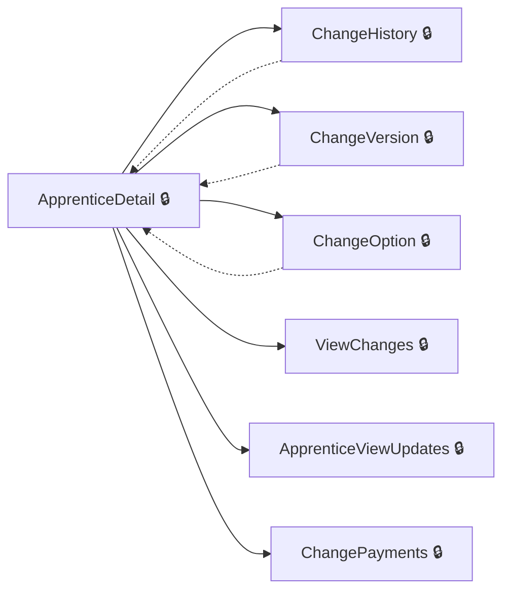
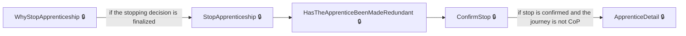
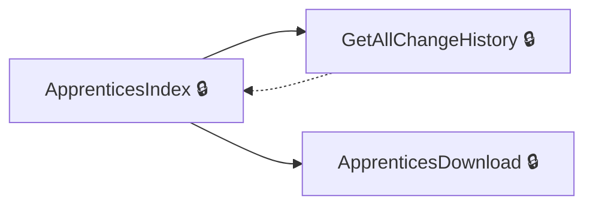
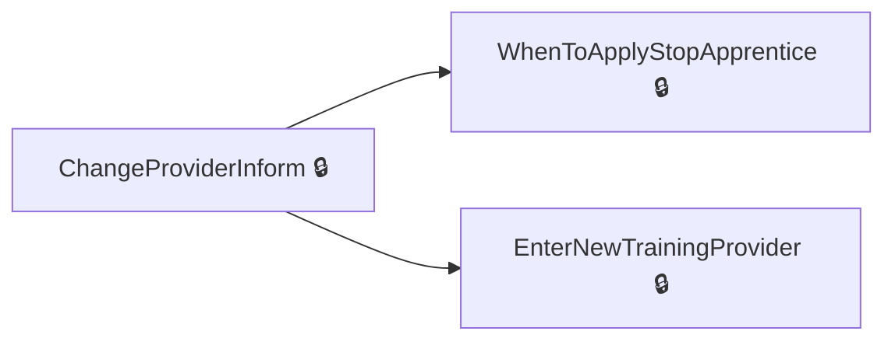

# User journeys: SkillsFundingAgency/das-employercommitments-v2

Generated from `master/src`: 115 pages, 105 transitions, 4 journeys. 🔒 means sign-in is required. Dotted arrows return to a hub.

## Update Apprenticeship Details

Allows employers to make changes to apprenticeship details, such as status, payments, or version.

Complete the sections in any order, returning to the hub.

## Stop an Apprenticeship

Guides the employer through stopping an apprenticeship, including specifying reasons and confirming.

## View and Manage Apprenticeships

Provides a dashboard for viewing apprenticeships and their histories.

Complete the sections in any order, returning to the hub.

## Change Provider for Apprenticeship

Supports the process of changing the training provider for an apprenticeship.

Complete the sections in any order, returning to the hub.

## Pages

| Page | Route | Sign-in | Purpose |
| --- | --- | --- | --- |
| `Apprentice.ApprenticeshipApprovalRequestConfirmed` | `{accountHashedId}/apprentices/{apprenticeshipHashedId}/approvals/{approvalRequestId}/confirmed` | Yes | Confirms an apprenticeship approval request has been processed. |
| `Apprentice.ApprenticeshipNeverStarted` | `{accountHashedId}/apprentices/{apprenticeshipHashedId}/details/apprenticeshipneverstarted` | Yes | Indicates the apprenticeship never started. |
| `Apprentice.ApprenticeshipNotEnded` | `{accountHashedId}/apprentices/{apprenticeshipHashedId}/details/apprenticeshipnotended` | Yes | Indicates the apprenticeship has not ended. |
| `Apprentice.ApprenticeshipStoppedInform` | `{accountHashedId}/apprentices/{apprenticeshipHashedId}/change-provider/apprenticeshipStopped` | Yes | Shows information that an apprenticeship has been stopped. |
| `Apprentice.ChangeHistory` | `{accountHashedId}/apprentices/{apprenticeshipHashedId}/change-history` | Yes | Displays the change history for an apprenticeship. |
| `Apprentice.ChangeOption` | `{accountHashedId}/apprentices/{apprenticeshipHashedId}/change-option` | Yes | Allows the user to change the options for an apprenticeship. |
| `Apprentice.ChangePayments` | `{accountHashedId}/apprentices/{apprenticeshipHashedId}/payments` | Yes | Updates payment information for an apprenticeship. |
| `Apprentice.ChangeStatus` | `{accountHashedId}/apprentices/{apprenticeshipHashedId}/details/changestatus` | Yes | Changes the status of an apprenticeship. |
| `Apprentice.ChangeVersion` | `{accountHashedId}/apprentices/{apprenticeshipHashedId}/change-version` | Yes | Changes the version of an apprenticeship program. |
| `Apprentice.ConfirmEditApprenticeship` | `{accountHashedId}/apprentices/{apprenticeshipHashedId}/edit/confirm` | Yes | Confirms edits made to an apprenticeship. |
| `Apprentice.ConfirmHasNotStop` | `{accountHashedId}/apprentices/{apprenticeshipHashedId}/details/confirmHasNotStop` | Yes | Confirms that the apprenticeship has not been stopped. |
| `Apprentice.ConfirmHasNotStopChanges` | `{accountHashedId}/apprentices/{apprenticeshipHashedId}/details/confirmHasNotStop` | Yes | Confirms changes related to not stopping the apprenticeship. |
| `Apprentice.ConfirmHasValidEndDate` | `{accountHashedId}/apprentices/{apprenticeshipHashedId}/details/confirmHasValidEndDate` | Yes | Confirms the apprenticeship has a valid end date. |
| `Apprentice.ConfirmHasValidEndDateChanges` | `{accountHashedId}/apprentices/{apprenticeshipHashedId}/details/confirmHasValidEndDate` | Yes | Confirms changes to ensure the apprenticeship has a valid end date. |
| `Apprentice.ConfirmStop` | `{accountHashedId}/apprentices/{apprenticeshipHashedId}/details/confirmStop` | Yes | Finalizes the decision to stop the apprenticeship. |
| `Apprentice.ConfirmWhenApprenticeshipStopped` | `{accountHashedId}/apprentices/{apprenticeshipHashedId}/details/confirmWhenApprenticeshipStopped` | Yes | Confirms when an apprenticeship was stopped. |
| `Apprentice.DataLockRequestChanges` | `{accountHashedId}/apprentices/{apprenticeshipHashedId}/changes/request` | Yes | Allows the employer to request changes to the apprenticeship due to data lock issues. |
| `Apprentice.DataLockRequestRestart` | `{accountHashedId}/apprentices/{apprenticeshipHashedId}/changes/restart` | Yes | Enables the employer to restart the apprenticeship after resolving a data lock. |
| `Apprentice.EditApprenticeship` | `{accountHashedId}/apprentices/{apprenticeshipHashedId}/edit` | Yes | Allows editing of apprenticeship details such as course or delivery model. |
| `Apprentice.EditStopDate` | `{accountHashedId}/apprentices/{apprenticeshipHashedId}/details/editstopdate` | Yes | Allows employers to edit the stop date of an apprenticeship. |
| `Apprentice.GetAllChangeHistory` | `{accountHashedId}/apprentices/change-history` | Yes | Displays the change history for apprenticeships associated with the employer's account. |
| `Apprentice.GetApprenticeshipApprovalRequest` | `{accountHashedId}/apprentices/{apprenticeshipHashedId}/approvals/{approvalRequestId}` | Yes | Views details of an apprenticeship approval request. |
| `Apprentice.HasTheApprenticeBeenMadeRedundant` | `{accountHashedId}/apprentices/{apprenticeshipHashedId}/details/madeRedundant` | Yes | Confirms whether the apprentice has been made redundant. |
| `Apprentice.PostApprenticeshipApprovalRequest` | `{accountHashedId}/apprentices/{apprenticeshipHashedId}/approvals/{approvalRequestId}` | Yes | Processes changes or approvals made to an apprenticeship. |
| `Apprentice.ReconfirmHasNotStop` | `{accountHashedId}/apprentices/{apprenticeshipHashedId}/details/reconfirmHasNotStop` | Yes | Reconfirms that the apprenticeship has not stopped. |
| `Apprentice.ReconfirmHasNotStopChangesAsync` | `{accountHashedId}/apprentices/{apprenticeshipHashedId}/details/reconfirmHasNotStop` | Yes | Updates apprenticeship status and reconfirms that it has not stopped asynchronously. |
| `Apprentice.ResendEmailInvitation` | `{accountHashedId}/apprentices/{apprenticeshipHashedId}/details/resend-email-invitation` | Yes | Resends an email invitation related to apprenticeship participation. |
| `Apprentice.ReviewApprenticeshipUpdates` | `{accountHashedId}/apprentices/{apprenticeshipHashedId}/changes/review` | Yes | Allows employers to review updates or changes to an apprenticeship. |
| `Apprentice.SelectCourseForEdit` | `{accountHashedId}/apprentices/{apprenticeshipHashedId}/edit/select-course` | Yes | Facilitates selection of a new course when editing apprenticeship details. |
| `Apprentice.SelectDeliveryModelForEdit` | `{accountHashedId}/apprentices/{apprenticeshipHashedId}/edit/select-delivery-model` | Yes | Enables selecting a new delivery model during apprenticeship edits. |
| `Apprentice.SetCourseForEdit` | `{accountHashedId}/apprentices/{apprenticeshipHashedId}/edit/select-course` | Yes | Allows the user to select a course for editing an apprentice's details. |
| `Apprentice.SetDeliveryModelForEdit` | `{accountHashedId}/apprentices/{ApprenticeshipHashedId}/edit/select-delivery-model` | Yes | Allows the user to select a delivery model for editing an apprentice's details. |
| `Apprentice.StopApprenticeship` | `{accountHashedId}/apprentices/{apprenticeshipHashedId}/details/stop` | Yes | Guides the user through stopping an apprenticeship. |
| `Apprentice.UpdateApprenticeshipStopDate` | `{accountHashedId}/apprentices/{apprenticeshipHashedId}/details/editstopdate` | Yes | Lets the user update the stop date of an apprenticeship. |
| `Apprentice.ViewApprenticeshipUpdates` | `{accountHashedId}/apprentices/{apprenticeshipHashedId}/changes/view` | Yes | Shows the list of updates made to an apprenticeship. |
| `Apprentice.ViewApprovalRequestAlerts` | `{accountHashedId}/apprentices/{apprenticeshipHashedId}/view-alerts` | Yes | Displays alerts and notifications related to approval requests for apprenticeship changes. |
| `Apprentice.WhyStopApprenticeship` | `{accountHashedId}/apprentices/{apprenticeshipHashedId}/details/whystopapprenticeship` | Yes | Allows the user to specify the reasons for stopping an apprenticeship. |
| `ApprenticeDetail` | `{accountHashedId}/apprentices/{apprenticeshipHashedId}/details` | Yes | Shows detailed information about an apprenticeship. |
| `ApprenticeEditEndDate` | `{accountHashedId}/apprentices/{apprenticeshipHashedId}/details/editenddate` | Yes | Lets the user update the planned end date of an apprenticeship. |
| `ApprenticeViewUpdates` | `{accountHashedId}/apprentices/{apprenticeshipHashedId}/changes/view` | Yes | Shows a detailed view of updates made to an apprenticeship. |
| `ApprenticesDownload` | `{accountHashedId}/apprentices/download` | Yes | Allows the user to download apprentice details in a file format. |
| `ApprenticesIndex` | `{accountHashedId}/apprentices` | Yes | Displays a list of all apprentices for the selected account. |
| `ApprenticeshipNeverStarted` | `{accountHashedId}/apprentices/{apprenticeshipHashedId}/details/apprenticeshipneverstarted` | Yes | Allows the user to mark an apprenticeship as never started. |
| `CancelChangeOfProviderRequest` | `{accountHashedId}/apprentices/{apprenticeshipHashedId}/change-provider/cancel` | Yes | Cancels a request to change the apprenticeship provider. |
| `CancelInProgressChangeOfCircumstance` | `{accountHashedId}/apprentices/{apprenticeshipHashedId}/cancel-change-of-circumstance` | Yes | Cancels ongoing changes made to an apprenticeship's circumstances. |
| `ChangeOption` | `{accountHashedId}/apprentices/{apprenticeshipHashedId}/change-option` | Yes | Allows the employer to update options for an apprentice's training details. |
| `ChangePayments` | `{accountHashedId}/apprentices/{apprenticeshipHashedId}/payments` | Yes | Enables the employer to modify payment settings for the apprentice. |
| `ChangeProviderInform` | `{accountHashedId}/apprentices/{apprenticeshipHashedId}/change-provider` | Yes | Notifies the employer about the process of changing the training provider for an apprentice. |
| `ChangeProviderRequestedConfirmation` | `{accountHashedId}/apprentices/{apprenticeshipHashedId}/change-provider/change-provider-requested/{providerId}` | Yes | Confirms the request for a provider change initiated by the employer. |
| `ChangeVersion` | `{accountHashedId}/apprentices/{apprenticeshipHashedId}/change-version` | Yes | Lets the employer select a new version of the apprenticeship standards for an apprentice. |
| `Cohort.AddDraftApprenticeship` | `{accountHashedId}/unapproved/add/apprenticeship` | Yes | Initiates the process of adding a draft apprentice to a cohort. |
| `Cohort.AddDraftApprenticeshipOrRoute` | `{accountHashedId}/unapproved/add/apprenticeship` | Yes | Handles adding a draft apprenticeship or redirecting users to select other options. |
| `Cohort.AgreementNotSigned` | `{accountHashedId}/unapproved` | Yes | Displays a message indicating that the agreement for apprenticeships has not been signed. |
| `Cohort.Apprentice` | `{accountHashedId}/unapproved/add/apprentice` | Yes | Directs the employer to add an apprentice to the cohort. |
| `Cohort.Approved` | `{accountHashedId}/unapproved/{cohortReference}/approved` | Yes | Shows the page confirming that a cohort has been successfully approved. |
| `Cohort.Assign` | `{accountHashedId}/unapproved/add/assign` | Yes | Allows the employer to assign elements or decisions to the apprenticeship cohort. |
| `Cohort.ConfirmDelete` | `{accountHashedId}/unapproved/{cohortReference}/delete` | Yes | Confirms whether the employer wants to delete the cohort. |
| `Cohort.ConfirmProvider` | `{accountHashedId}/unapproved/add/confirm-provider` | Yes | Confirms the selection of the training provider for a cohort. |
| `Cohort.Delete` | `{accountHashedId}/unapproved/{cohortReference}/delete` | Yes | Processes the deletion of a cohort after confirmation. |
| `Cohort.Details` | `{accountHashedId}/unapproved/{cohortReference}` | Yes | Provides detailed information about the apprenticeship cohort. |
| `Cohort.Draft` | `{accountHashedId}/unapproved/draft` | Yes | Shows a page for drafting apprenticeship details within a cohort. |
| `Cohort.Finished` | `{accountHashedId}/unapproved/add/finished` | Yes | This page confirms the addition process for an unapproved cohort is complete. |
| `Cohort.Index` | `{accountHashedId}/unapproved/add` | Yes | This page allows the employer to start the process of adding an unapproved cohort. |
| `Cohort.Inform` | `{accountHashedId}/unapproved/Inform` | Yes | Provides information to the employer before starting the unapproved cohort process. |
| `Cohort.SaveDraftApprenticeship` | `{accountHashedId}/unapproved` | Yes | Saves a draft apprenticeship to an unapproved cohort. |
| `Cohort.SelectAcceptedLevyTransferConnection` | `{accountHashedId}/unapproved/add/select-funding/select-accepted-levy-connection` | Yes | Selects levy transfer connections approved for funding. |
| `Cohort.SelectCourse` | `{accountHashedId}/unapproved/add/select-course` | Yes | Allows the employer to select a course for the cohort. |
| `Cohort.SelectDeliveryModel` | `{accountHashedId}/unapproved/add/select-delivery-model` | Yes | Enables selection of the delivery model for apprenticeships in the cohort. |
| `Cohort.SelectDirectTransferConnection` | `{accountHashedId}/unapproved/add/select-funding/select-direct-connection` | Yes | Selects direct transfer connections eligible for funding. |
| `Cohort.SelectFunding` | `{accountHashedId}/unapproved/add/select-funding` | Yes | Allows the employer to specify the funding source for the cohort. |
| `Cohort.SelectFundingType` | `{accountHashedId}/unapproved/add/select-funding` | Yes | Allows the user to choose between different funding types for the cohort. |
| `Cohort.SelectLegalEntity` | `{accountHashedId}/unapproved/legalEntity/create` | Yes | Enables selection of the legal entity associated with the cohort. |
| `Cohort.SelectProvider` | `{accountHashedId}/unapproved/add/select-provider` | Yes | Allows the employer to choose a training provider for the cohort. |
| `Cohort.Sent` | `{accountHashedId}/unapproved/{cohortReference}/sent` | Yes | Confirms the cohort has been successfully sent for processing. |
| `Cohort.SetDeliveryModel` | `{accountHashedId}/unapproved/add/select-delivery-model` | Yes | Sets the delivery model for apprenticeships during cohort creation. |
| `Cohort.SetReservation` | `{accountHashedId}/unapproved/add/set-reservation` | Yes | Sets up a reservation for apprenticeships in the cohort. |
| `Cohort.ViewAgreement` | `{accountHashedId}/unapproved/viewAgreement` | Yes | Allows the user to view information about the employer agreement related to cohorts. |
| `Cohort.WithTrainingProvider` | `{accountHashedId}/unapproved/with-training-provider` | Yes | Displays cohorts created with a training provider. |
| `Cohort.WithTransferSender` | `{accountHashedId}/unapproved/with-transfer-sender` | Yes | Shows cohorts created with a transfer sender. |
| `CohortDetails` | `{accountHashedId}/unapproved/{cohortReference}` | Yes | Displays detailed information for a specific cohort. |
| `CohortReview` | `{accountHashedId}/unapproved` | Yes | Presents an overview and review of cohorts that are not yet approved. |
| `ConfirmDetailsAndSendRequest` | `{accountHashedId}/apprentices/{apprenticeshipHashedId}/change-provider/confirm-details` | Yes | Allows the employer to confirm the new provider details before sending the request. |
| `DraftApprenticeship.AddDraftApprenticeshipDetails` | `{AccountHashedId}/unapproved/{cohortReference}/apprentices/add-another` | Yes | Allows the user to add details for a draft apprenticeship in an existing cohort. |
| `DraftApprenticeship.AddNewDraftApprenticeship` | `{AccountHashedId}/unapproved/{cohortReference}/apprentices/add` | Yes | Begins the process for adding a new draft apprenticeship to a cohort. |
| `DraftApprenticeship.DeleteDraftApprenticeship` | `{AccountHashedId}/unapproved/{cohortReference}/apprentices/{DraftApprenticeshipHashedId}/Delete` | Yes | Enables the user to delete a specific draft apprenticeship from a cohort. |
| `DraftApprenticeship.Details` | `{AccountHashedId}/unapproved/{cohortReference}/apprentices/{DraftApprenticeshipHashedId}` | Yes | Shows detailed information about a specific draft apprenticeship. |
| `DraftApprenticeship.EditDraftApprenticeship` | `{AccountHashedId}/unapproved/{cohortReference}/apprentices/{DraftApprenticeshipHashedId}` | Yes | Allows the user to edit details of a draft apprenticeship. |
| `DraftApprenticeship.EditDraftApprenticeshipDisplay` | `{AccountHashedId}/unapproved/{cohortReference}/apprentices/{DraftApprenticeshipHashedId}/edit-display` | Yes | Displays the editable fields for a draft apprenticeship. |
| `DraftApprenticeship.SelectCourse` | `{AccountHashedId}/unapproved/{cohortReference}/apprentices/add/select-course` | Yes | Allows the user to select a training course for a new apprenticeship. |
| `DraftApprenticeship.SelectCourseForEdit` | `{AccountHashedId}/unapproved/{cohortReference}/apprentices/{DraftApprenticeshipHashedId}/edit/select-course` | Yes | Allows the user to select or edit the training course for an existing apprenticeship. |
| `DraftApprenticeship.SelectDeliveryModel` | `{AccountHashedId}/unapproved/{cohortReference}/apprentices/add/select-delivery-model` | Yes | Allows the user to select the delivery model for a new apprenticeship. |
| `DraftApprenticeship.SelectDeliveryModelForEdit` | `{AccountHashedId}/unapproved/{cohortReference}/apprentices/{DraftApprenticeshipHashedId}/edit/select-delivery-model` | Yes | Allows the user to select or edit the delivery model for an existing apprenticeship. |
| `DraftApprenticeship.SelectOption` | `{AccountHashedId}/unapproved/{cohortReference}/apprentices/{DraftApprenticeshipHashedId}/select-option` | Yes | Allows the employer to choose options for managing a draft apprentice record. |
| `DraftApprenticeship.SetCourseForEdit` | `{AccountHashedId}/unapproved/{cohortReference}/apprentices/{DraftApprenticeshipHashedId}/edit/select-course` | Yes | Lets the employer select a course when editing a draft apprenticeship. |
| `DraftApprenticeship.SetDeliveryModel` | `{AccountHashedId}/unapproved/{cohortReference}/apprentices/add/select-delivery-model` | Yes | Lets the employer select the delivery model for a new draft apprenticeship. |
| `DraftApprenticeship.SetDeliveryModelForEdit` | `{AccountHashedId}/unapproved/{cohortReference}/apprentices/{DraftApprenticeshipHashedId}/edit/select-delivery-model` | Yes | Allows the employer to select the delivery model when editing a draft apprenticeship. |
| `DraftApprenticeship.ViewDetails` | `{AccountHashedId}/unapproved/{cohortReference}/apprentices/{DraftApprenticeshipHashedId}/view` | Yes | Displays the details of a specific draft apprenticeship to the employer. |
| `EditApprenticeship` | `{accountHashedId}/apprentices/{apprenticeshipHashedId}/edit` | Yes | Provides the employer the means to edit the apprentice's details. |
| `EnterNewTrainingProvider` | `{accountHashedId}/apprentices/{apprenticeshipHashedId}/change-provider/select-provider` | Yes | Allows the employer to select a new training provider for the apprentice. |
| `HasTheApprenticeBeenMadeRedundant` | `{accountHashedId}/apprentices/{apprenticeshipHashedId}/details/madeRedundant` | Yes | Helps the employer determine if the apprentice has been made redundant. |
| `Home.Index` | `{accountHashedId}` | Yes | Provides an overview page for managing employer accounts and apprenticeships. |
| `PaymentOrder.ProviderPaymentOrder` | `accounts/{accountHashedId}/apprentices/manage/paymentorder` | Yes | Allows the employer to manage the payment priority order of providers. |
| `PaymentsPausedConfirmation` | `{accountHashedId}/apprentices/{apprenticeshipHashedId}/payments/paused` | Yes | Confirms that payments to the apprentice have been successfully paused. |
| `PaymentsResumedConfirmation` | `{accountHashedId}/apprentices/{apprenticeshipHashedId}/payments/resumed` | Yes | Confirms that payments to the apprentice have been resumed successfully. |
| `SendRequestNewTrainingProvider` | `{accountHashedId}/apprentices/{apprenticeshipHashedId}/change-provider/send-request` | Yes | Sends a request for changing the training provider for an apprentice. |
| `TransferRequest.TransferConfirmation` | `{accountHashedId}/sender/transfers/{transferRequestHashedId}/confirmation` | Yes | Displays the transfer confirmation page for the sender of a transfer request. |
| `TransferRequest.TransferDetailsForReceiver` | `{accountHashedId}/receiver/transfers/{transferRequestHashedId}` | Yes | Provides details of a transfer request to the receiver. |
| `TransferRequest.TransferDetailsForSender` | `{accountHashedId}/sender/transfers/{transferRequestHashedId}` | Yes | Provides details of a transfer request to the sender. |
| `ViewChanges` | `{accountHashedId}/apprentices/{apprenticeshipHashedId}/view-changes` | Yes | Displays the changes made to the apprentice's details for employer review. |
| `WhatIsTheNewEndDate` | `{accountHashedId}/apprentices/{apprenticeshipHashedId}/change-provider/end-date` | Yes | Allows the employer to specify the new end date for the apprentice's training. |
| `WhatIsTheNewPrice` | `{accountHashedId}/apprentices/{apprenticeshipHashedId}/change-provider/price` | Yes | Allows the employer to specify the new price for the apprentice's training. |
| `WhatIsTheNewStartDate` | `{accountHashedId}/apprentices/{apprenticeshipHashedId}/change-provider/start-date` | Yes | Allows the employer to define the new apprenticeship start date when changing providers. |
| `WhenToApplyStopApprentice` | `{accountHashedId}/apprentices/{apprenticeshipHashedId}/details/stop` | Yes | Provides a page for the employer to select when to stop the apprenticeship. |
| `WhoWillEnterTheDetails` | `{accountHashedId}/apprentices/{apprenticeshipHashedId}/change-provider/who-enter-details` | Yes | Enables the employer to decide whether they or the new training provider will add the apprentice's details. |
| `WhyStopApprenticeship` | `{accountHashedId}/apprentices/{apprenticeshipHashedId}/details/whystopapprenticeship` | Yes | Captures the reason for stopping the apprenticeship. |
