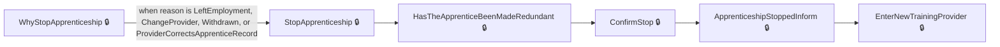
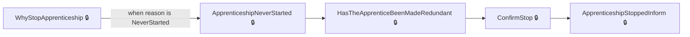
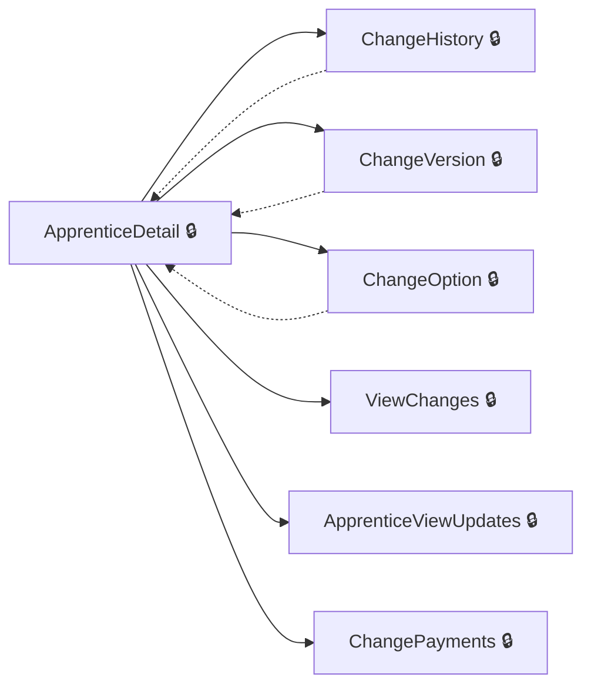
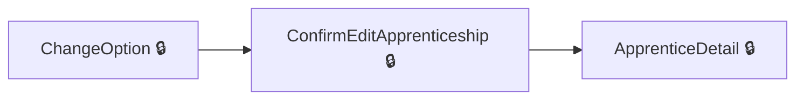
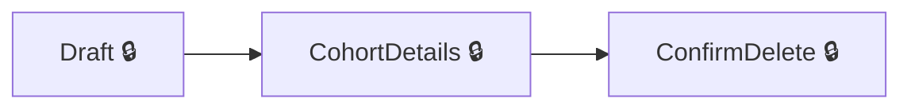

# User journeys: SkillsFundingAgency/das-employercommitments-v2

Generated from `master/src`: 117 pages, 105 transitions, 7 journeys. 🔒 means sign-in is required. Dotted arrows return to a hub.

## Stop an Apprenticeship

The employer stops an apprenticeship for a specified reason and confirms the outcome.

## Change an Apprentice’s Training Provider

The employer changes the training provider for an apprentice and submits a provider change request.

```mermaid
flowchart LR
  p0["ChangeProviderInform 🔒"] --> p1["EnterNewTrainingProvider 🔒"]
  p1["EnterNewTrainingProvider 🔒"] -->|"when Edit is false or not set"| p2["WhoWillEnterTheDetails 🔒"]
  p2["WhoWillEnterTheDetails 🔒"] -->|"when EmployerWillAdd is true"| p3["WhatIsTheNewStartDate 🔒"]
  p3["WhatIsTheNewStartDate 🔒"] -->|"if not editing"| p4["WhatIsTheNewEndDate 🔒"]
  p4["WhatIsTheNewEndDate 🔒"] -->|"if not editing"| p5["WhatIsTheNewPrice 🔒"]
  p5["WhatIsTheNewPrice 🔒"] --> p6["ConfirmDetailsAndSendRequest 🔒"]
  p6["ConfirmDetailsAndSendRequest 🔒"] -->|"after successfully creating the change of provider request"| p7["ChangeProviderRequestedConfirmation 🔒"]
```

## Handle Apprenticeship That Never Started

The employer records and confirms that an apprenticeship never started.

## View and Manage Apprentice Details

The employer reviews an apprentice’s history, updates, or payments from the details view.

Complete the sections in any order, returning to the hub.

## Edit Draft Apprenticeship in Cohort

The employer creates or edits a draft apprentice within a cohort and completes necessary details.

```mermaid
flowchart LR
  p0["AddNewDraftApprenticeship 🔒"] -->|"after starting to add a new draft apprenticeship"| p1["SelectCourse 🔒"]
  p1["SelectCourse 🔒"] -->|"after selecting a course"| p2["SelectDeliveryModel 🔒"]
  p2["SelectDeliveryModel 🔒"] -->|"after selecting a delivery model"| p3["AddDraftApprenticeshipDetails 🔒"]
  p3["AddDraftApprenticeshipDetails 🔒"] -->|"after adding draft apprenticeship details when course code is present"| p4["SelectOption 🔒"]
  p4["SelectOption 🔒"] --> p5["Details 🔒"]
```

## Edit an Apprentice’s Option or Version

The employer edits an apprentice’s course option or version, and confirms the change.

## Send a Cohort for Approval

The employer completes a draft cohort and submits it for approval, returning to the dashboard.

## Pages

| Page | Route | Sign-in | Purpose |
| --- | --- | --- | --- |
| `Apprentice.ApprenticeshipApprovalRequestConfirmed` | `{accountHashedId}/apprentices/{apprenticeshipHashedId}/approvals/{approvalRequestId}/confirmed` | Yes | Confirms that the apprenticeship approval request has been approved. |
| `Apprentice.ApprenticeshipNeverStarted` | `{accountHashedId}/apprentices/{apprenticeshipHashedId}/details/apprenticeshipneverstarted` | Yes | Lets the employer handle cases where the apprenticeship never started. |
| `Apprentice.ApprenticeshipNotEnded` | `{accountHashedId}/apprentices/{apprenticeshipHashedId}/details/apprenticeshipnotended` | Yes | Lets the employer handle cases where the apprenticeship has not ended. |
| `Apprentice.ApprenticeshipStoppedInform` | `{accountHashedId}/apprentices/{apprenticeshipHashedId}/change-provider/apprenticeshipStopped` | Yes | Informs the employer that the apprenticeship has been stopped. |
| `Apprentice.ChangeHistory` | `{accountHashedId}/apprentices/{apprenticeshipHashedId}/change-history` | Yes | Displays the change history for a particular apprenticeship. |
| `Apprentice.ChangeOption` | `{accountHashedId}/apprentices/{apprenticeshipHashedId}/change-option` | Yes | Lets the employer select a new course option for the apprenticeship. |
| `Apprentice.ChangePayments` | `{accountHashedId}/apprentices/{apprenticeshipHashedId}/payments` | Yes | Asks the employer to confirm if they want to change payment status to the training provider. |
| `Apprentice.ChangeStatus` | `{accountHashedId}/apprentices/{apprenticeshipHashedId}/details/changestatus` | Yes | Lets the employer change the status of an apprenticeship. |
| `Apprentice.ChangeVersion` | `{accountHashedId}/apprentices/{apprenticeshipHashedId}/change-version` | Yes | Lets the employer select a new course version for the apprenticeship. |
| `Apprentice.ConfirmEditApprenticeship` | `{accountHashedId}/apprentices/{apprenticeshipHashedId}/edit/confirm` | Yes | Lets the user confirm whether or not to apply the proposed changes to the apprenticeship. |
| `Apprentice.ConfirmHasNotStop` | `{accountHashedId}/apprentices/{apprenticeshipHashedId}/details/confirmHasNotStop` | Yes | Lets the user confirm if the apprenticeship has stopped. |
| `Apprentice.ConfirmHasNotStopChanges` | `{accountHashedId}/apprentices/{apprenticeshipHashedId}/details/confirmHasNotStop` | Yes | Prompts the employer to confirm whether the apprenticeship should be stopped. |
| `Apprentice.ConfirmHasValidEndDate` | `{accountHashedId}/apprentices/{apprenticeshipHashedId}/details/confirmHasValidEndDate` | Yes | Lets the user confirm if the planned end date for the apprenticeship is correct. |
| `Apprentice.ConfirmHasValidEndDateChanges` | `{accountHashedId}/apprentices/{apprenticeshipHashedId}/details/confirmHasValidEndDate` | Yes | Prompts the employer to confirm whether the apprenticeship has a valid end date. |
| `Apprentice.ConfirmStop` | `{accountHashedId}/apprentices/{apprenticeshipHashedId}/details/confirmStop` | Yes | Lets the user confirm whether to stop the apprenticeship. |
| `Apprentice.ConfirmWhenApprenticeshipStopped` | `{accountHashedId}/apprentices/{apprenticeshipHashedId}/details/confirmWhenApprenticeshipStopped` | Yes | Lets the user confirm if the stop date for this apprenticeship is correct. |
| `Apprentice.DataLockRequestChanges` | `{accountHashedId}/apprentices/{apprenticeshipHashedId}/changes/request` | Yes | Lets the user approve or reject requested data lock changes to the apprenticeship. |
| `Apprentice.DataLockRequestRestart` | `{accountHashedId}/apprentices/{apprenticeshipHashedId}/changes/restart` | Yes | Lets the employer request to restart the apprenticeship after a data lock. |
| `Apprentice.EditApprenticeship` | `{accountHashedId}/apprentices/{apprenticeshipHashedId}/edit` | Yes | Lets the employer edit the details of an apprenticeship. |
| `Apprentice.GetAllChangeHistory` | `{accountHashedId}/apprentices/change-history` | Yes | Displays all change history across apprentices in the employer's account. |
| `Apprentice.GetApprenticeshipApprovalRequest` | `{accountHashedId}/apprentices/{apprenticeshipHashedId}/approvals/{approvalRequestId}` | Yes | Lets the employer choose whether to approve or decline requested changes to the apprenticeship. |
| `Apprentice.HasTheApprenticeBeenMadeRedundant` | `{accountHashedId}/apprentices/{apprenticeshipHashedId}/details/madeRedundant` | Yes | Asks whether the apprentice has been made redundant. |
| `Apprentice.PostApprenticeshipApprovalRequest` | `{accountHashedId}/apprentices/{apprenticeshipHashedId}/approvals/{approvalRequestId}` | Yes | Processes the employer's decision to approve or decline a change request on the apprenticeship. |
| `Apprentice.ReconfirmHasNotStop` | `{accountHashedId}/apprentices/{apprenticeshipHashedId}/details/reconfirmHasNotStop` | Yes | Lets the employer reconfirm that the apprenticeship has not stopped. |
| `Apprentice.ReconfirmHasNotStopChangesAsync` | `{accountHashedId}/apprentices/{apprenticeshipHashedId}/details/reconfirmHasNotStop` | Yes | Lets the employer reconfirm whether the apprentice's status is unchanged after an initial negative confirmation. |
| `Apprentice.ResendEmailInvitation` | `{accountHashedId}/apprentices/{apprenticeshipHashedId}/details/resend-email-invitation` | Yes | Resends the invitation email to the apprentice. |
| `Apprentice.ReviewApprenticeshipUpdates` | `{accountHashedId}/apprentices/{apprenticeshipHashedId}/changes/review` | Yes | Lets the employer review proposed apprenticeship changes and choose to approve or undo them. |
| `Apprentice.SelectCourseForEdit` | `{accountHashedId}/apprentices/{apprenticeshipHashedId}/edit/select-course` | Yes | Allows the user to select a course for editing the apprentice's details. |
| `Apprentice.SelectDeliveryModelForEdit` | `{accountHashedId}/apprentices/{apprenticeshipHashedId}/edit/select-delivery-model` | Yes | Allows the user to select a delivery model for the apprentice's training. |
| `Apprentice.SetCourseForEdit` | `{accountHashedId}/apprentices/{apprenticeshipHashedId}/edit/select-course` | Yes | Processes the selection of a course for the apprentice's record. |
| `Apprentice.SetDeliveryModelForEdit` | `{accountHashedId}/apprentices/{ApprenticeshipHashedId}/edit/select-delivery-model` | Yes | Processes the selection of a delivery model for the apprentice's record. |
| `Apprentice.StopApprenticeship` | `{accountHashedId}/apprentices/{apprenticeshipHashedId}/details/stop` | Yes | Lets the user begin the process of stopping an apprenticeship. |
| `Apprentice.ViewApprenticeshipUpdates` | `{accountHashedId}/apprentices/{apprenticeshipHashedId}/changes/view` | Yes | Shows updates related to the apprentice's details. |
| `Apprentice.ViewApprovalRequestAlerts` | `{accountHashedId}/apprentices/{apprenticeshipHashedId}/view-alerts` | Yes | Displays alerts to the employer for any apprenticeship approval requests that need their attention. |
| `Apprentice.WhyStopApprenticeship` | `{accountHashedId}/apprentices/{apprenticeshipHashedId}/details/whystopapprenticeship` | Yes | Lets the user select the reason why they want to stop the apprenticeship. |
| `ApprenticeDetail` | `{accountHashedId}/apprentices/{apprenticeshipHashedId}/details` | Yes | Displays detailed information about the apprentice. |
| `ApprenticeEditEndDate` | `{accountHashedId}/apprentices/{apprenticeshipHashedId}/details/editenddate` | Yes | Allows the user to edit the planned end date for the apprenticeship. |
| `ApprenticeViewUpdates` | `{accountHashedId}/apprentices/{apprenticeshipHashedId}/changes/view` | Yes | Allows the employer to confirm whether they want to undo recent changes made to the apprentice's record. |
| `ApprenticesDownload` | `{accountHashedId}/apprentices/download` | Yes | Allows the user to download a list of apprentices. |
| `ApprenticesIndex` | `{accountHashedId}/apprentices` | Yes | Shows a list of apprentices with search and filter options. |
| `ApprenticeshipNeverStarted` | `{accountHashedId}/apprentices/{apprenticeshipHashedId}/details/apprenticeshipneverstarted` | Yes | Confirms that an apprenticeship never started. |
| `CancelChangeOfProviderRequest` | `{accountHashedId}/apprentices/{apprenticeshipHashedId}/change-provider/cancel` | Yes | Asks the employer if they want to cancel a request to change the training provider. |
| `CancelInProgressChangeOfCircumstance` | `{accountHashedId}/apprentices/{apprenticeshipHashedId}/cancel-change-of-circumstance` | Yes | Cancels changes in progress for an apprentice's record. |
| `ChangeOption` | `{accountHashedId}/apprentices/{apprenticeshipHashedId}/change-option` | Yes | Lets the employer select a new option for the apprenticeship (such as a pathway or specialization). |
| `ChangePayments` | `{accountHashedId}/apprentices/{apprenticeshipHashedId}/payments` | Yes | Asks the employer to confirm if they want to change payment status to the training provider. |
| `ChangeProviderInform` | `{accountHashedId}/apprentices/{apprenticeshipHashedId}/change-provider` | Yes | Informs the user about changing the apprentice's training provider. |
| `ChangeProviderRequestedConfirmation` | `{accountHashedId}/apprentices/{apprenticeshipHashedId}/change-provider/change-provider-requested/{providerId}` | Yes | Shows confirmation that a provider change has been requested. |
| `ChangeVersion` | `{accountHashedId}/apprentices/{apprenticeshipHashedId}/change-version` | Yes | Allows the apprentice's training version to be changed. |
| `Cohort.AddDraftApprenticeship` | `{accountHashedId}/unapproved/add/apprenticeship` | Yes | — |
| `Cohort.AddDraftApprenticeshipOrRoute` | `{accountHashedId}/unapproved/add/apprenticeship` | Yes | — |
| `Cohort.AgreementNotSigned` | `{accountHashedId}/unapproved` | Yes | — |
| `Cohort.Apprentice` | `{accountHashedId}/unapproved/add/apprentice` | Yes | — |
| `Cohort.Approved` | `{accountHashedId}/unapproved/{cohortReference}/approved` | Yes | — |
| `Cohort.Assign` | `{accountHashedId}/unapproved/add/assign` | Yes | Lets the user specify who will add apprentices and optionally provide a message. |
| `Cohort.ConfirmDelete` | `{accountHashedId}/unapproved/{cohortReference}/delete` | Yes | Lets the user confirm the deletion of a cohort. |
| `Cohort.ConfirmProvider` | `{accountHashedId}/unapproved/add/confirm-provider` | Yes | Lets the employer confirm if the selected training provider is the main provider. |
| `Cohort.Delete` | `{accountHashedId}/unapproved/{cohortReference}/delete` | Yes | — |
| `Cohort.Details` | `{accountHashedId}/unapproved/{cohortReference}` | Yes | — |
| `Cohort.Draft` | `{accountHashedId}/unapproved/draft` | Yes | — |
| `Cohort.Finished` | `{accountHashedId}/unapproved/add/finished` | Yes | — |
| `Cohort.Index` | `{accountHashedId}/unapproved/add` | Yes | — |
| `Cohort.SaveDraftApprenticeship` | `{accountHashedId}/unapproved` | Yes | — |
| `Cohort.SelectAcceptedLevyTransferConnection` | `{accountHashedId}/unapproved/add/select-funding/select-accepted-levy-connection` | Yes | Lets the employer select a levy transfer connection for funding the cohort. |
| `Cohort.SelectCourse` | `{accountHashedId}/unapproved/add/select-course` | Yes | — |
| `Cohort.SelectDeliveryModel` | `{accountHashedId}/unapproved/add/select-delivery-model` | Yes | — |
| `Cohort.SelectDirectTransferConnection` | `{accountHashedId}/unapproved/add/select-funding/select-direct-connection` | Yes | Lets the employer select a direct transfer connection for funding. |
| `Cohort.SelectFunding` | `{accountHashedId}/unapproved/add/select-funding` | Yes | Lets the employer select the funding type for the cohort. |
| `Cohort.SelectFundingType` | `{accountHashedId}/unapproved/add/select-funding` | Yes | Lets the user choose a funding option for adding apprenticeships. |
| `Cohort.SelectLegalEntity` | `{accountHashedId}/unapproved/legalEntity/create` | Yes | Lets the employer select the legal entity to be named on the apprenticeship contract. |
| `Cohort.SelectProvider` | `{accountHashedId}/unapproved/add/select-provider` | Yes | Lets the employer select a training provider for the cohort. |
| `Cohort.Sent` | `{accountHashedId}/unapproved/{cohortReference}/sent` | Yes | Shows a confirmation that the cohort has been sent. |
| `Cohort.SetDeliveryModel` | `{accountHashedId}/unapproved/add/select-delivery-model` | Yes | Lets the user select the apprenticeship delivery model. |
| `Cohort.SetReservation` | `{accountHashedId}/unapproved/add/set-reservation` | Yes | Lets the user set a reservation for apprenticeships. |
| `Cohort.WithTrainingProvider` | `{accountHashedId}/unapproved/with-training-provider` | Yes | Displays cohorts with a training provider assigned. |
| `Cohort.WithTransferSender` | `{accountHashedId}/unapproved/with-transfer-sender` | Yes | Displays cohorts with a transfer sender assigned. |
| `CohortDetails` | `{accountHashedId}/unapproved/{cohortReference}` | Yes | Shows the details of a cohort and lets the employer choose an action such as send, approve, or view the employer agreement. |
| `CohortReview` | `{accountHashedId}/unapproved` | Yes | Shows a summary and review of draft/unapproved cohorts for the employer account. |
| `ConfirmDetailsAndSendRequest` | `{accountHashedId}/apprentices/{apprenticeshipHashedId}/change-provider/confirm-details` | Yes | Allows the user to review and confirm the details for a change of provider request. |
| `DeleteDraftApprenticeship` | `{AccountHashedId}/unapproved/{cohortReference}/apprentices/{DraftApprenticeshipHashedId}/Delete` | Yes | Lets the user confirm deletion of a draft apprentice record. |
| `Details` | `{AccountHashedId}/unapproved/{cohortReference}/apprentices/{DraftApprenticeshipHashedId}` | Yes | Displays details for a specific draft apprenticeship in a cohort. |
| `Details-View` | `{AccountHashedId}/unapproved/{cohortReference}/apprentices/{DraftApprenticeshipHashedId}/view` | Yes | Shows a read-only view of the draft apprenticeship details. |
| `DraftApprenticeship.AddDraftApprenticeshipDetails` | `{AccountHashedId}/unapproved/{cohortReference}/apprentices/add-another` | Yes | Lets the employer enter details for a new draft apprenticeship. |
| `DraftApprenticeship.AddNewDraftApprenticeship` | `{AccountHashedId}/unapproved/{cohortReference}/apprentices/add` | Yes | Starts adding a new draft apprenticeship to a cohort. |
| `DraftApprenticeship.DeleteDraftApprenticeship` | `{AccountHashedId}/unapproved/{cohortReference}/apprentices/{DraftApprenticeshipHashedId}/Delete` | Yes | Allows the employer to delete a draft apprenticeship from a cohort. |
| `DraftApprenticeship.EditDraftApprenticeship` | `{AccountHashedId}/unapproved/{cohortReference}/apprentices/{DraftApprenticeshipHashedId}` | Yes | Lets the employer edit details of a draft apprenticeship in a cohort. |
| `DraftApprenticeship.SelectCourse` | `{AccountHashedId}/unapproved/{cohortReference}/apprentices/add/select-course` | Yes | Lets the employer select a training course for the draft apprenticeship. |
| `DraftApprenticeship.SelectCourseForEdit` | `{AccountHashedId}/unapproved/{cohortReference}/apprentices/{DraftApprenticeshipHashedId}/edit/select-course` | Yes | Lets the employer select a training course while editing a draft apprenticeship. |
| `DraftApprenticeship.SelectDeliveryModel` | `{AccountHashedId}/unapproved/{cohortReference}/apprentices/add/select-delivery-model` | Yes | Lets the employer choose the apprenticeship delivery model. |
| `DraftApprenticeship.SelectDeliveryModelForEdit` | `{AccountHashedId}/unapproved/{cohortReference}/apprentices/{DraftApprenticeshipHashedId}/edit/select-delivery-model` | Yes | Lets the employer choose the apprenticeship delivery model while editing. |
| `DraftApprenticeship.SelectOption` | `{AccountHashedId}/unapproved/{cohortReference}/apprentices/{DraftApprenticeshipHashedId}/select-option` | Yes | Lets the user select an option for the draft apprenticeship. |
| `DraftApprenticeship.SetCourseForEdit` | `{AccountHashedId}/unapproved/{cohortReference}/apprentices/{DraftApprenticeshipHashedId}/edit/select-course` | Yes | Processes course selection during editing and moves to delivery model selection. |
| `DraftApprenticeship.SetDeliveryModel` | `{AccountHashedId}/unapproved/{cohortReference}/apprentices/add/select-delivery-model` | Yes | Processes delivery model selection and moves to draft details. |
| `DraftApprenticeship.SetDeliveryModelForEdit` | `{AccountHashedId}/unapproved/{cohortReference}/apprentices/{DraftApprenticeshipHashedId}/edit/select-delivery-model` | Yes | Processes delivery model selection while editing and moves to edit display. |
| `EditApprenticeship` | `{accountHashedId}/apprentices/{apprenticeshipHashedId}/edit` | Yes | Allows the employer to edit details of an existing apprentice. |
| `EditDraftApprenticeshipDisplay` | `{AccountHashedId}/unapproved/{cohortReference}/apprentices/{DraftApprenticeshipHashedId}/edit-display` | Yes | Lets the user view and edit details of a draft apprentice. |
| `EditStopDateOption` | `{accountHashedId}/apprentices/{apprenticeshipHashedId}/details/editstopdate` | Yes | Lets the user specify a new stop date for the apprenticeship. |
| `EnterNewTrainingProvider` | `{accountHashedId}/apprentices/{apprenticeshipHashedId}/change-provider/select-provider` | Yes | Allows the user to select a new training provider for the apprenticeship. |
| `HasTheApprenticeBeenMadeRedundant` | `{accountHashedId}/apprentices/{apprenticeshipHashedId}/details/madeRedundant` | Yes | Lets the employer confirm whether the apprentice has been made redundant. |
| `Home.Index` | `{accountHashedId}` | Yes | Displays the home page for the employer. |
| `Inform` | `{accountHashedId}/unapproved/Inform` | Yes | Informs the user about a step in cohort creation. |
| `PaymentOrder.ProviderPaymentOrder` | `accounts/{accountHashedId}/apprentices/manage/paymentorder` | Yes | Allows the employer to set and review the payment order of providers responsible for apprenticeships. |
| `PaymentsPausedConfirmation` | `{accountHashedId}/apprentices/{apprenticeshipHashedId}/payments/paused` | Yes | Confirms to the employer that payments to the training provider for this apprentice have been paused. |
| `PaymentsResumedConfirmation` | `{accountHashedId}/apprentices/{apprenticeshipHashedId}/payments/resumed` | Yes | Confirms to the employer that payments to the training provider for this apprentice have been resumed. |
| `PostEditStopDate` | `{accountHashedId}/apprentices/{apprenticeshipHashedId}/details/editstopdate` | Yes | Updates the stop date of the apprenticeship and confirms the change. |
| `ProviderPaymentOrder` | `accounts/{accountHashedId}/apprentices/manage/paymentorder` | Yes | Lets the employer change and submit the priority of payment order for their providers. |
| `SendRequestNewTrainingProvider` | `{accountHashedId}/apprentices/{apprenticeshipHashedId}/change-provider/send-request` | Yes | Lets the employer confirm sending a request to change the apprentice's training provider. |
| `TransferRequest.TransferConfirmation` | `{accountHashedId}/sender/transfers/{transferRequestHashedId}/confirmation` | Yes | Lets the employer confirm what they want to do next after a transfer request. |
| `TransferRequest.TransferDetailsForReceiver` | `{accountHashedId}/receiver/transfers/{transferRequestHashedId}` | Yes | Shows the details of a transfer request to the receiving employer. |
| `TransferRequest.TransferDetailsForSender` | `{accountHashedId}/sender/transfers/{transferRequestHashedId}` | Yes | Shows the details of a transfer request to the sending employer and lets them confirm approval. |
| `ViewAgreement` | `{accountHashedId}/unapproved/viewAgreement` | Yes | Lets the user view the employer agreement related to cohorts. |
| `ViewChanges` | `{accountHashedId}/apprentices/{apprenticeshipHashedId}/view-changes` | Yes | Shows details of recent or pending changes to the apprentice's record. |
| `WhatIsTheNewEndDate` | `{accountHashedId}/apprentices/{apprenticeshipHashedId}/change-provider/end-date` | Yes | Lets the employer specify the new planned training end date with the new provider. |
| `WhatIsTheNewPrice` | `{accountHashedId}/apprentices/{apprenticeshipHashedId}/change-provider/price` | Yes | Lets the employer enter the agreed price for completing training with the new provider. |
| `WhatIsTheNewStartDate` | `{accountHashedId}/apprentices/{apprenticeshipHashedId}/change-provider/start-date` | Yes | Lets the employer specify the start date with the new training provider. |
| `WhenToApplyStopApprentice` | `{accountHashedId}/apprentices/{apprenticeshipHashedId}/details/stop` | Yes | Lets the employer specify when to stop the apprentice's training. |
| `WhoWillEnterTheDetails` | `{accountHashedId}/apprentices/{apprenticeshipHashedId}/change-provider/who-enter-details` | Yes | Lets the user specify who will enter the new course dates and price for the apprenticeship. |
| `WhyStopApprenticeship` | `{accountHashedId}/apprentices/{apprenticeshipHashedId}/details/whystopapprenticeship` | Yes | Lets the employer select a reason for stopping the apprenticeship. |

## Form fields

Field definitions only: no values a user enters are recorded.

### `Apprentice.ChangePayments`

| Field | Type | Label | Required | Rules | Options |
| --- | --- | --- | --- | --- | --- |
| `ChangeConfirmed` | radios | Do you want to payments to your training provider? | — | required | true, No |

### `Apprentice.ConfirmEditApprenticeship`

| Field | Type | Label | Required | Rules | Options |
| --- | --- | --- | --- | --- | --- |
| `ConfirmChanges` | radios | Do you want to make these changes? | — | required | Yes, change these details, No, don't change these details |

### `Apprentice.ConfirmHasNotStop`

| Field | Type | Label | Required | Rules | Options |
| --- | --- | --- | --- | --- | --- |
| `StopConfirmed` | radios | — | — | required | Yes, this apprenticeship has stopped, No, this apprenticeship has not stopped |

### `Apprentice.ConfirmHasValidEndDate`

| Field | Type | Label | Required | Rules | Options |
| --- | --- | --- | --- | --- | --- |
| `EndDateConfirmed` | radios | — | — | required | No, that is the wrong date, No, that is the wrong date |

### `Apprentice.ConfirmStop`

| Field | Type | Label | Required | Rules | Options |
| --- | --- | --- | --- | --- | --- |
| `StopConfirmed` | radios | — | — | required | Yes, stop this training, No, go back to learner details |

### `Apprentice.ConfirmWhenApprenticeshipStopped`

| Field | Type | Label | Required | Rules | Options |
| --- | --- | --- | --- | --- | --- |
| `IsCorrectStopDate` | radios | — | — | required | Yes, that date is correct, No, that is the wrong date |

### `Apprentice.DataLockRequestChanges`

| Field | Type | Label | Required | Rules | Options |
| --- | --- | --- | --- | --- | --- |
| `AcceptChanges` | radios | Are you happy to approve these changes? | — | required | Yes, approve these changes, No, reject these changes |

### `Apprentice.EditApprenticeship`

| Field | Type | Label | Required | Rules | Options |
| --- | --- | --- | --- | --- | --- |
| `FirstName` | text | — | — | — | — |
| `LastName` | text | — | — | — | — |
| `BirthDay` | text | — | — | — | — |
| `BirthMonth` | text | — | — | — | — |
| `BirthYear` | text | — | — | — | — |
| `StartMonth` | text | — | — | — | — |
| `StartYear` | text | — | — | — | — |
| `EndMonth` | text | — | — | — | — |
| `EndYear` | text | — | — | — | — |
| `EmploymentEndMonth` | number | Month | — | — | — |
| `EmploymentEndYear` | number | Year | — | — | — |
| `EmploymentPrice` | number | Agreed training price for this period of employment (excluding VAT) | — | — | — |
| `Cost` | number | — | — | — | — |
| `EmployerReference` | text | — | — | — | — |
| `Email` | text | — | — | — | — |

### `Apprentice.GetApprenticeshipApprovalRequest`

| Field | Type | Label | Required | Rules | Options |
| --- | --- | --- | --- | --- | --- |
| `ApproveChanges` | radios | Do you want to approve these changes? | — | required | Yes, approve these changes, No, decline changes and send messages to training provider |

### `Apprentice.ReconfirmHasNotStop`

| Field | Type | Label | Required | Rules | Options |
| --- | --- | --- | --- | --- | --- |
| `StopConfirmed` | checkboxes | — | — | required | The apprenticeship has not stopped |

### `Apprentice.ReviewApprenticeshipUpdates`

| Field | Type | Label | Required | Rules | Options |
| --- | --- | --- | --- | --- | --- |
| `ApproveChanges` | radios | Are you happy to approve these changes? | — | required | Yes, approve these changes, No, reject these changes |
| `UndoChanges` | radios | Do you want to undo these changes? | — | required | Yes, undo these changes, No, keep these changes |

### `Apprentice.SelectDeliveryModelForEdit`

| Field | Type | Label | Required | Rules | Options |
| --- | --- | --- | --- | --- | --- |
| `DeliveryModel` | radios | Select delivery model | — | required | — |

### `Apprentice.WhyStopApprenticeship`

| Field | Type | Label | Required | Rules | Options |
| --- | --- | --- | --- | --- | --- |
| `SelectedStatusChange` | radios | Select an option why you want to stop this training | — | required (must not be null; user must select a reason) | — |

### `ApprenticeEditEndDate`

| Field | Type | Label | Required | Rules | Options |
| --- | --- | --- | --- | --- | --- |
| `EndMonth` | number | Month | — | required when end date is given; must be a valid month; must be part of a real date | — |
| `EndYear` | number | Year | — | required when end date is given; must be a valid year; must be part of a real date | — |

### `ApprenticeViewUpdates`

| Field | Type | Label | Required | Rules | Options |
| --- | --- | --- | --- | --- | --- |
| `UndoChanges` | radios | Do you want to undo these changes? | — | required | Yes, undo these changes, No, keep these changes |

### `ApprenticesIndex`

| Field | Type | Label | Required | Rules | Options |
| --- | --- | --- | --- | --- | --- |
| `searchTerm` | text | Search by learner name or unique learner number (ULN) | — | — | — |
| `selectedProvider` | select | Training provider | — | — | — |
| `selectedCourse` | select | Training course | — | — | — |
| `selectedEndDate` | select | Planned end date | — | — | — |
| `selectedStatus` | select | Status | — | — | — |
| `selectedAlert` | select | Alerts | — | — | — |
| `selectedApprenticeConfirmation` | select | Learner confirmation | — | — | — |

### `CancelChangeOfProviderRequest`

| Field | Type | Label | Required | Rules | Options |
| --- | --- | --- | --- | --- | --- |
| `CancelRequest` | radios | — | — | required | Yes, No |

### `ChangeOption`

| Field | Type | Label | Required | Rules | Options |
| --- | --- | --- | --- | --- | --- |
| `SelectedOption` | radios | — | — | required; must differ from current option when not returning to version or edit selection | Confirm option at a later date |

### `ChangePayments`

| Field | Type | Label | Required | Rules | Options |
| --- | --- | --- | --- | --- | --- |
| `ChangeConfirmed` | radios | Do you want to payments to your training provider? | — | required | true, No |

### `ChangeVersion`

| Field | Type | Label | Required | Rules | Options |
| --- | --- | --- | --- | --- | --- |
| `SelectedVersion` | radios | — | — | required | — |

### `Cohort.Assign`

| Field | Type | Label | Required | Rules | Options |
| --- | --- | --- | --- | --- | --- |
| `WhoIsAddingApprentices` | radios | How would you like to add learners? | Yes | required | — |
| `Message` | textarea | — | — | If 'Provider' is selected as WhoIsAddingApprentices and Message is not empty, must contain valid free-text characters | — |

### `Cohort.ConfirmDelete`

| Field | Type | Label | Required | Rules | Options |
| --- | --- | --- | --- | --- | --- |
| `ConfirmDeletion` | radios | — | — | required | Yes, delete the record for, No, don't delete |

### `Cohort.ConfirmProvider`

| Field | Type | Label | Required | Rules | Options |
| --- | --- | --- | --- | --- | --- |
| `UseThisProvider` | radios | Is this the main training provider? | — | required | Yes, it's, No, I'd like to change the training provider |

### `Cohort.SelectAcceptedLevyTransferConnection`

| Field | Type | Label | Required | Rules | Options |
| --- | --- | --- | --- | --- | --- |
| `ApplicationAndSenderHashedId` | radios | — | — | required | — |

### `Cohort.SelectDirectTransferConnection`

| Field | Type | Label | Required | Rules | Options |
| --- | --- | --- | --- | --- | --- |
| `TransferConnectionCode` | radios | — | — | required | — |

### `Cohort.SelectFunding`

| Field | Type | Label | Required | Rules | Options |
| --- | --- | --- | --- | --- | --- |
| `FundingType` | radios | — | — | required | Transfer funds, Transfer funds from a connection, Reserved funds, I want to reserve new funds, Current levy funds |

### `Cohort.SelectLegalEntity`

| Field | Type | Label | Required | Rules | Options |
| --- | --- | --- | --- | --- | --- |
| `LegalEntityId` | radios | — | — | required | — |

### `Cohort.SelectProvider`

| Field | Type | Label | Required | Rules | Options |
| --- | --- | --- | --- | --- | --- |
| `ProviderId` | select | — | — | required; must be a number greater than zero | — |

### `CohortDetails`

| Field | Type | Label | Required | Rules | Options |
| --- | --- | --- | --- | --- | --- |
| `selection` | radios | — | — | required | — |
| `approvemessage` | textarea | — | — | — | — |
| `sendmessage` | textarea | — | — | — | — |

### `DeleteDraftApprenticeship`

| Field | Type | Label | Required | Rules | Options |
| --- | --- | --- | --- | --- | --- |
| `confirmDelete` | radios | — | — | — | true |
| `ConfirmDelete` | radios | Are you sure you want to delete the record for? | — | required | Yes, delete the record for, No, don't delete |

### `DraftApprenticeship.AddDraftApprenticeshipDetails`

| Field | Type | Label | Required | Rules | Options |
| --- | --- | --- | --- | --- | --- |
| `FirstName` | text | First name | — | required | — |
| `LastName` | text | Last name | — | required | — |
| `Email` | text | Email Address | — | required; must be a valid email address | — |
| `BirthDay` | text | Day | — | — | — |
| `BirthMonth` | text | Month | — | — | — |
| `BirthYear` | text | Year | — | — | — |
| `StartMonth` | text | Month | — | — | — |
| `StartYear` | text | Year | — | — | — |
| `EndMonth` | text | Month | — | — | — |
| `EndYear` | text | Year | — | — | — |
| `EmploymentEndMonth` | text | Month | — | — | — |
| `EmploymentEndYear` | text | Year | — | — | — |
| `Cost` | text | Total agreed training price (excluding VAT) | — | — | — |
| `EmploymentPrice` | text | Agreed training price for this period of employment (excluding VAT) | — | — | — |
| `Reference` | text | Reference (optional) | — | — | — |

### `DraftApprenticeship.SelectDeliveryModelForEdit`

| Field | Type | Label | Required | Rules | Options |
| --- | --- | --- | --- | --- | --- |
| `DeliveryModel` | radios | Select delivery model | — | required | — |

### `DraftApprenticeship.SelectOption`

| Field | Type | Label | Required | Rules | Options |
| --- | --- | --- | --- | --- | --- |
| `CourseOption` | radios | — | — | required | Confirm option at a later date |

### `EditDraftApprenticeshipDisplay`

| Field | Type | Label | Required | Rules | Options |
| --- | --- | --- | --- | --- | --- |
| `FirstName` | text | First name | — | required; must not be empty | — |
| `LastName` | text | Last name | — | required; must not be empty | — |
| `Email` | text | Email Address | — | required; must not be empty; must be valid email format | — |
| `BirthDay` | text | Day | — | — | — |
| `BirthMonth` | text | Month | — | — | — |
| `BirthYear` | text | Year | — | — | — |
| `StartMonth` | text | Month | — | — | — |
| `StartYear` | text | Year | — | — | — |
| `EndMonth` | text | Month | — | — | — |
| `EndYear` | text | Year | — | — | — |
| `EmploymentEndMonth` | text | Month | — | — | — |
| `EmploymentEndYear` | text | Year | — | — | — |
| `Cost` | text | Total agreed training price (excluding VAT) | — | — | — |
| `EmploymentPrice` | text | Agreed training price for this period of employment (excluding VAT) | — | — | — |
| `Reference` | text | Reference (optional) | — | — | — |

### `EditStopDateOption`

| Field | Type | Label | Required | Rules | Options |
| --- | --- | --- | --- | --- | --- |
| `NewStopDate.Month` | text | — | — | required; must not be in the future; must not be before apprenticeship start; must be different from current stop date | — |
| `NewStopDate.Year` | text | — | — | required; must not be in the future; must not be before apprenticeship start; must be different from current stop date | — |

### `EnterNewTrainingProvider`

| Field | Type | Label | Required | Rules | Options |
| --- | --- | --- | --- | --- | --- |
| `ProviderId` | select | — | — | required; must be a positive number; must not be the current provider | — |

### `HasTheApprenticeBeenMadeRedundant`

| Field | Type | Label | Required | Rules | Options |
| --- | --- | --- | --- | --- | --- |
| `MadeRedundant` | radios | — | — | required | Yes, No |

### `ProviderPaymentOrder`

| Field | Type | Label | Required | Rules | Options |
| --- | --- | --- | --- | --- | --- |
| `ProviderPaymentOrder[priority-1]` | select | — | — | required; list must not contain duplicates | — |

### `SendRequestNewTrainingProvider`

| Field | Type | Label | Required | Rules | Options |
| --- | --- | --- | --- | --- | --- |
| `Confirm` | radios | — | — | required | Yes, No, return to record |

### `TransferRequest.TransferConfirmation`

| Field | Type | Label | Required | Rules | Options |
| --- | --- | --- | --- | --- | --- |
| `SelectedOption` | radios | — | — | required | — |

### `TransferRequest.TransferDetailsForSender`

| Field | Type | Label | Required | Rules | Options |
| --- | --- | --- | --- | --- | --- |
| `ApprovalConfirmed` | radios | — | — | required | Yes, approve the request, No, reject the request |

### `WhatIsTheNewEndDate`

| Field | Type | Label | Required | Rules | Options |
| --- | --- | --- | --- | --- | --- |
| `NewEndMonth` | text | Month | — | required together with NewEndYear; must form a real date; must be after NewStartDate | — |
| `NewEndYear` | text | Year | — | required together with NewEndMonth; must form a real date; must be after NewStartDate | — |

### `WhatIsTheNewPrice`

| Field | Type | Label | Required | Rules | Options |
| --- | --- | --- | --- | --- | --- |
| `NewPrice` | text | — | — | required; must be at least 1 and at most 100000 | — |

### `WhatIsTheNewStartDate`

| Field | Type | Label | Required | Rules | Options |
| --- | --- | --- | --- | --- | --- |
| `NewStartMonth` | text | — | — | required together with NewStartYear; must form a real date; must be on or after StopDate; must be before NewEndDate (if provided); must be no later than one year after the end of current teaching year unless after NewEndDate | — |
| `NewStartYear` | text | — | — | required together with NewStartMonth; must form a real date; must be on or after StopDate; must be before NewEndDate (if provided); must be no later than one year after the end of current teaching year unless after NewEndDate | — |

### `WhenToApplyStopApprentice`

| Field | Type | Label | Required | Rules | Options |
| --- | --- | --- | --- | --- | --- |
| `StopMonth` | text | — | — | required together with StopYear; must form a real date; cannot be before the training started; cannot be in the future | — |
| `StopYear` | text | — | — | required together with StopMonth; must form a real date; cannot be before the training started; cannot be in the future | — |

### `WhoWillEnterTheDetails`

| Field | Type | Label | Required | Rules | Options |
| --- | --- | --- | --- | --- | --- |
| `EmployerWillAdd` | radios | Who will enter the new course dates and price? | — | required (must not be null; user must select who will enter the new course dates and price) | I'll add them now, will add them later |

