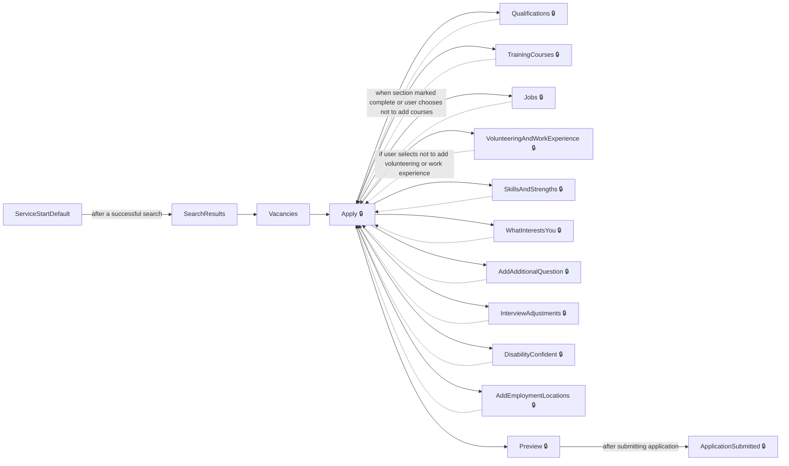
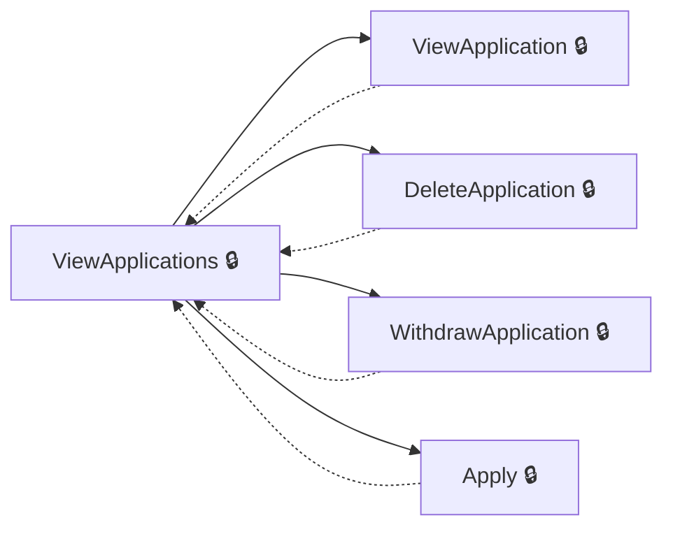
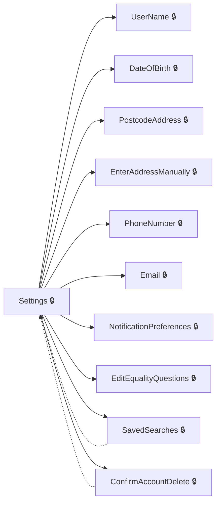
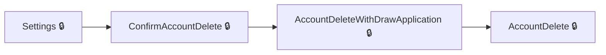
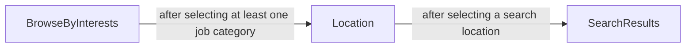
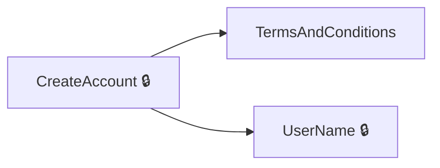

# User journeys: SkillsFundingAgency/das-findapprenticeship-web

Generated from `main/src`: 84 pages, 223 transitions, 6 journeys. 🔒 means sign-in is required. Dotted arrows return to a hub.

## Search and Apply for an Apprenticeship

A user searches for apprenticeship opportunities, views details, and applies by completing the application sections and submitting.

Complete the sections in any order, returning to the hub.

## Manage Applications

A signed-in user views, deletes, or withdraws their existing apprenticeship applications.

Complete the sections in any order, returning to the hub.

## Manage Account Settings

A signed-in user updates their settings such as personal details, notification preferences, and equality questions.

Complete the sections in any order, returning to the hub.

## Delete Account

A user initiates, reviews, and confirms the deletion of their account.

## Search for Apprenticeships by Interests

A user begins from job category interests to refine and start a location-based search.

## Start a New Account Registration

A user begins account registration and completes the initial details before choosing account preferences.

Complete the sections in any order, returning to the hub.

## Pages

| Page | Route | Sign-in | Purpose |
| --- | --- | --- | --- |
| `AccessibilityStatement` | `accessibility-statement` | No | Displays the site's accessibility statement for users. |
| `AccountDelete` | `account-delete` | Yes | Lets the user request deletion of their account. |
| `AccountDeleteWithDrawApplication` | `account-deletion-withdraw-applications` | Yes | Lets the user withdraw applications as part of account deletion. |
| `AccountUnavailable` | `account-unavailable` | Yes | Tells the user their account is unavailable. |
| `Applications.DeleteApplication` | `applications/{applicationId}/delete`, `applications/{applicationId:guid}/delete` | Yes | Lets the apprentice confirm deletion of a specific application. |
| `Applications.ViewApplication` | `applications/{applicationId}/view` | Yes | Shows the details of a specific application. |
| `Applications.ViewApplications` | `applications` | Yes | Displays a list of all the apprentice's applications. |
| `Applications.WithdrawApplication` | `applications/{applicationId:guid}/withdraw`, `applications/{applicationId}/withdraw` | Yes | Allows the apprentice to withdraw a specific application. |
| `Apply` | `applications/{applicationId}` | Yes | Displays an overview of the apprenticeship application and navigation to its sections. |
| `ApplyApprenticeship.AddAdditionalQuestion` | `apply/{applicationId}/additional-question/{additionalQuestion}/{additionalQuestionId}` | Yes | Lets the apprentice answer an additional question as part of their application. |
| `ApplyApprenticeship.AddEmploymentLocations` | `apply/{applicationId:guid}/employmentLocations` | Yes | Lets the user select the employment locations for their apprenticeship application. |
| `ApplyApprenticeship.AddJob` | `apply/{applicationId}/jobs/add` | Yes | Lets the applicant add a job to their work history. |
| `ApplyApprenticeship.AddQualification` | `apply/{applicationId}/qualifications/{qualificationReferenceId}/modify` | Yes | Lets the candidate add details about a qualification to their application. |
| `ApplyApprenticeship.AddQualificationSelectType` | `apply/{applicationId}/qualifications/add/select-type` | Yes | Lets the candidate select the type of qualification to add to their application. |
| `ApplyApprenticeship.AddTrainingCourse` | `apply/{applicationId}/trainingcourses/add` | Yes | Lets the applicant add information about a new training course to their application. |
| `ApplyApprenticeship.AddVolunteeringAndWorkExperience` | `apply/{applicationId}/volunteering-and-work-experience/add` | Yes | Lets the user add details about a volunteering or work experience position. |
| `ApplyApprenticeship.ApplicationSubmitted` | `applications/{applicationId}/application-submitted` | Yes | Lets the applicant decide whether to answer equality questions after submitting their application. |
| `ApplyApprenticeship.DeleteJob` | `apply/{applicationId}/jobs/{jobId}/delete` | Yes | Lets the applicant confirm and delete a job from their work history. |
| `ApplyApprenticeship.DeleteQualifications` | `apply/{applicationId}/qualifications/delete/{qualificationReferenceId}` | Yes | Lets the candidate review and confirm deletion of a qualification from their application. |
| `ApplyApprenticeship.DeleteTrainingCourse` | `apply/{applicationId}/trainingcourses/{trainingCourseId}/delete` | Yes | Allows the applicant to review and confirm deletion of a training course from their application. |
| `ApplyApprenticeship.DeleteVolunteeringOrWorkExperience` | `apply/{applicationId}/volunteering-and-work-experience/{volunteeringWorkExperienceId}/delete` | Yes | Allows the applicant to review and confirm removal of a volunteering or work experience entry. |
| `ApplyApprenticeship.DisabilityConfident` | `apply/{applicationId}/disability-confident` | Yes | Offers the apprentice the option to apply under the Disability Confident scheme. |
| `ApplyApprenticeship.DisabilityConfidentConfirmation` | `apply/{applicationId}/disability-confident/confirm` | Yes | Lets the apprentice confirm completion of the Disability Confident section. |
| `ApplyApprenticeship.EditJob` | `apply/{applicationId}/jobs/{jobId}` | Yes | Lets the applicant edit details of a previously entered job in their work history. |
| `ApplyApprenticeship.EditTrainingCourse` | `apply/{applicationId}/trainingcourses/{trainingCourseId}` | Yes | Lets the applicant edit details of an existing training course in their application. |
| `ApplyApprenticeship.EditVolunteeringAndWorkExperience` | `apply/{applicationId}/volunteering-and-work-experience/{volunteeringWorkExperienceId}` | Yes | Lets the user edit details about a volunteering or work experience position. |
| `ApplyApprenticeship.EmploymentLocationsSummary` | `apply/{applicationId:guid}/employmentLocations/summary` | Yes | Lets the user review and confirm completion of the employment locations section. |
| `ApplyApprenticeship.EqualityQuestions.EditEqualityQuestions` | `equality-questions/edit` | Yes | Starts editing equality questions for the apprenticeship application. |
| `ApplyApprenticeship.EqualityQuestions.EqualityFlowEthnicGroup` | `equality-questions/ethnic-group` | Yes | Lets the user select their ethnic group as part of the equality questions. |
| `ApplyApprenticeship.EqualityQuestions.EqualityFlowEthnicSubGroupAsian` | `equality-questions/ethnic-group/asian` | Yes | Lets the user select a specific Asian or Asian British ethnic subgroup or describe another background. |
| `ApplyApprenticeship.EqualityQuestions.EqualityFlowEthnicSubGroupBlack` | `equality-questions/ethnic-group/black` | Yes | Lets the user describe their Black, African, Caribbean or Black British background. |
| `ApplyApprenticeship.EqualityQuestions.EqualityFlowEthnicSubGroupMixed` | `equality-questions/ethnic-group/mixed` | Yes | Lets the user describe their mixed or multiple ethnic groups background. |
| `ApplyApprenticeship.EqualityQuestions.EqualityFlowEthnicSubGroupOther` | `equality-questions/ethnic-group/other` | Yes | Lets the user describe their background if it doesn't fall into a listed ethnic group. |
| `ApplyApprenticeship.EqualityQuestions.EqualityFlowEthnicSubGroupWhite` | `equality-questions/ethnic-group/white` | Yes | Lets the user describe their White background. |
| `ApplyApprenticeship.EqualityQuestions.EqualityFlowGender` | `equality-questions/gender` | Yes | Lets the user specify their sex and whether their gender identity matches their sex at birth. |
| `ApplyApprenticeship.EqualityQuestions.EqualityFlowSummary` | `equality-questions/summary` | Yes | Lets the user view a summary of their answers to the equality questions. |
| `ApplyApprenticeship.InterviewAdjustments` | `apply/{applicationId}/interview-adjustments` | Yes | Lets the candidate request support or adjustments for an interview. |
| `ApplyApprenticeship.InterviewAdjustmentsSummary` | `apply/{applicationId}/interview-adjustments/summary` | Yes | Lets the candidate confirm completion of the interview adjustments section and review their support request. |
| `ApplyApprenticeship.Jobs` | `apply/{applicationId}/jobs` | Yes | Lets the applicant review their job history and mark the section complete. |
| `ApplyApprenticeship.Preview` | `applications/{applicationId}/preview` | Yes | Lets the applicant review and submit their completed application, confirming consent. |
| `ApplyApprenticeship.Qualifications` | `apply/{applicationId}/qualifications` | Yes | Lets the candidate review their qualifications and indicate if they want to add more. |
| `ApplyApprenticeship.SkillsAndStrengths` | `apply/{applicationId}/skillsandstrengths/` | Yes | Lets the applicant enter and review their skills and strengths, and mark the section as complete. |
| `ApplyApprenticeship.TrainingCourses` | `apply/{applicationId}/training-courses/` | Yes | Allows the applicant to manage their list of training courses and indicate if the section is complete. |
| `ApplyApprenticeship.VolunteeringAndWorkExperience` | `apply/{applicationId}/volunteering-and-work-experience` | Yes | Lets the user specify if they want to add any volunteering or work experience. |
| `ApplyApprenticeship.VolunteeringAndWorkExperienceSummary` | `apply/{applicationId}/volunteering-and-work-experience/summary` | Yes | Shows a summary of volunteering and work experience positions and lets the user mark the section as complete. |
| `ApplyApprenticeship.WhatInterestsYou` | `apply/{applicationId}/what-interests-you` | Yes | Lets the applicant describe their interest in the apprenticeship and mark the section complete. |
| `BrowseByInterests` | `browse-by-interests` | Unknown | Lets the user choose job categories of interest. |
| `ConfirmAccountDelete` | `confirm-account-deletion` | Yes | Lets the user confirm account deletion. |
| `ConfirmAccountDetails` | `create-account/check-answers` | Yes | Lets the user review and confirm their account details before finalising account creation. |
| `ConfirmDeleteSavedSearch` | `saved-searches/{savedSearchId}/delete` | Yes | Allows the user to confirm deletion of a saved search. |
| `Cookies` | `Cookies` | No | Allows the user to set their preferences for functional and analytics cookies. |
| `CreateAccount` | `create-account` | Yes | Lets the user start creating a new account. |
| `DateOfBirth` | `date-of-birth` | Yes | Lets the user view or update their date of birth. |
| `DeleteSavedSearch` | `saved-searches/{savedSearchId}/delete` | Yes | Deletes a saved search after user confirmation. |
| `DeleteSavedVacancy` | `saved-vacancies/{vacancyReference}/delete` | Yes | Deletes a saved vacancy for the user. |
| `DeleteSavedVacancyFromDetailsPage` | `vacancy/delete/{vacancyId}` | Yes | Lets the user remove a saved vacancy. |
| `DeleteSavedVacancyFromSearchResultsPage` | `search-results/delete/{vacancyId}` | Yes | Lets the user remove a saved vacancy from the search results. |
| `Email` | `email` | Yes | Lets the user view or update their email address. |
| `EnterAddressManually` | `enter-address` | Yes | Lets the user manually enter their address details. |
| `FinishAccountSetup` | `finish-account-setup` | Yes | Finalizes the account setup process. |
| `GetHelp` | `get-help` | No | Provides help and support information to the user. |
| `GetSavedSearchesUnsubscribe` | `saved-searches/unsubscribe` | Unknown | Lets the user view and confirm unsubscribing from a saved search. |
| `Location` | `location` | Unknown | Lets the user specify where in the country they want to search. |
| `Locations.LocationsBySearch` | — | Unknown | Returns a list of locations based on a search term. |
| `MapSearchResults` | `map-search-results` | Unknown | Shows apprenticeships search results on a map. |
| `NotificationPreferences` | `notification-preferences` | Yes | Lets the user choose whether to get reminders about unfinished applications. |
| `PhoneNumber` | `phone-number` | Yes | Lets the user enter their telephone number. |
| `PostSavedSearchesUnsubscribe` | `saved-searches/unsubscribe` | Unknown | Processes the user's request to unsubscribe from a saved search. |
| `PostcodeAddress` | `postcode-address` | Yes | Lets the user enter their UK postcode to search for their address. |
| `SaveSearch` | `apprenticeships/save-search` | Yes | Lets the user save their current search criteria for later. |
| `SaveVacancyFromDetailsPage` | `vacancy/save/{vacancyId}` | Yes | Lets the user save a vacancy for later viewing. |
| `SaveVacancyFromSearchResultsPage` | `search-results/save/{vacancyId}` | Yes | Lets the user save a vacancy from the search results. |
| `SavedSearches` | `saved-searches` | Yes | Shows the user's saved searches. |
| `SavedVacancies` | `saved-vacancies` | Yes | Shows the user's saved vacancies and allows sorting or deletion. |
| `SearchResults` | `apprenticeships` | Unknown | Shows apprenticeship vacancies matching the user's search and filters. |
| `SelectAddress` | `select-address` | Yes | Lets the user select their address from a list retrieved by postcode. |
| `ServiceStartDefault` | — | Unknown | Shows the main apprenticeship search start page. |
| `Settings` | `settings` | Yes | Lets the user view and manage their account settings. |
| `SignIn` | `signin` | Yes | Redirects the user to sign in. |
| `SignOut` | `signout` | Unknown | Signs the user out of their account. |
| `TermsAndConditions` | `terms-and-conditions` | No | Shows the site's terms and conditions. |
| `UnsubscribeSavedSearchComplete` | `saved-searches/unsubscribe-complete` | Unknown | Confirms to the user that the saved search has been unsubscribed. |
| `UserName` | `user-name` | Yes | Lets the user enter their first and last names. |
| `Vacancies` | `apprenticeship/{vacancyReference}` | Unknown | Displays details of an apprenticeship vacancy, including options for directions and travel. |

## Form fields

Field definitions only: no values a user enters are recorded.

### `AccountDelete`

| Field | Type | Label | Required | Rules | Options |
| --- | --- | --- | --- | --- | --- |
| `Email` | text | Your email address | — | — | — |

### `Applications.WithdrawApplication`

| Field | Type | Label | Required | Rules | Options |
| --- | --- | --- | --- | --- | --- |
| `WithdrawApplication` | radios | Do you want to withdraw this application? | — | required | Yes, No |

### `ApplyApprenticeship.AddAdditionalQuestion`

| Field | Type | Label | Required | Rules | Options |
| --- | --- | --- | --- | --- | --- |
| `AdditionalQuestionAnswer` | textarea | — | — | required; at most 300 words; must contain only valid free text characters | — |
| `IsSectionCompleted` | radios | Have you completed this section? | — | required | Yes, I’ve completed this section, No, I’ll come back to it later (saves your answer) |

### `ApplyApprenticeship.AddEmploymentLocations`

| Field | Type | Label | Required | Rules | Options |
| --- | --- | --- | --- | --- | --- |
| `SelectedAddressIds` | checkboxes | Where do you want to apply for? | — | required; must select at least one address | — |

### `ApplyApprenticeship.AddJob`

| Field | Type | Label | Required | Rules | Options |
| --- | --- | --- | --- | --- | --- |
| `JobTitle` | text | Job title | — | required; must use valid free text characters | — |
| `EmployerName` | text | Company | — | required; must use valid free text characters | — |
| `JobDescription` | textarea | Responsibilities | — | required; at most 100 words; must use valid free text characters | — |
| `IsCurrentRole` | radios | Is this your current job? | — | required | Yes, No |

### `ApplyApprenticeship.AddQualification`

| Field | Type | Label | Required | Rules | Options |
| --- | --- | --- | --- | --- | --- |
| `subjects[0][name]` | select | — | — | required unless apprenticeship; must use valid free text characters | — |
| `subjects[0][level]` | select | — | — | required, must not be 'select' when applicable; must use valid free text characters | Select a level |
| `subjects[0][AdditionalInformation]` | text | — | — | required when applicable; at most 500 characters; must use valid free text characters | — |
| `subjects[0][grade]` | text | — | — | required when applicable; must use valid free text characters | — |
| `subjects[0][IsPredicted]` | checkboxes | — | — | — | Predicted grade |

### `ApplyApprenticeship.AddQualificationSelectType`

| Field | Type | Label | Required | Rules | Options |
| --- | --- | --- | --- | --- | --- |
| `QualificationReferenceId` | radios | — | — | required; must not be empty | — |

### `ApplyApprenticeship.AddTrainingCourse`

| Field | Type | Label | Required | Rules | Options |
| --- | --- | --- | --- | --- | --- |
| `CourseName` | text | Course name | — | required; only valid free text characters | — |
| `YearAchieved` | text | Year | — | required; must be a 4-digit year; must not be in the future; must be a real year | — |

### `ApplyApprenticeship.AddVolunteeringAndWorkExperience`

| Field | Type | Label | Required | Rules | Options |
| --- | --- | --- | --- | --- | --- |
| `CompanyName` | text | Company or organisation | — | required; must contain only allowed free text characters | — |
| `Description` | textarea | What you did | — | required; maximum 100 words; must contain only allowed free text characters | — |
| `IsCurrentRole` | radios | Are you still doing this volunteering or work experience? | — | required | Yes, No |

### `ApplyApprenticeship.ApplicationSubmitted`

| Field | Type | Label | Required | Rules | Options |
| --- | --- | --- | --- | --- | --- |
| `AnswerEqualityQuestions` | radios | Do you want to answer the equality questions? | — | required | Yes, answer the equality questions (4 questions), No, don't answer the equality questions |

### `ApplyApprenticeship.DisabilityConfident`

| Field | Type | Label | Required | Rules | Options |
| --- | --- | --- | --- | --- | --- |
| `ApplyUnderDisabilityConfidentScheme` | radios | Do you want to apply under the Disability Confident scheme? | — | required | Yes, No |

### `ApplyApprenticeship.DisabilityConfidentConfirmation`

| Field | Type | Label | Required | Rules | Options |
| --- | --- | --- | --- | --- | --- |
| `IsSectionCompleted` | radios | Have you completed this section? | — | required | Yes, I've completed this section, No, I'll come back to it later |

### `ApplyApprenticeship.EditJob`

| Field | Type | Label | Required | Rules | Options |
| --- | --- | --- | --- | --- | --- |
| `JobTitle` | text | Job title | — | required; must use valid free text characters | — |
| `EmployerName` | text | Company | — | required; must use valid free text characters | — |
| `JobDescription` | textarea | Responsibilities | — | required; at most 100 words; must use valid free text characters | — |
| `IsCurrentRole` | radios | Is this your current job? | — | required | Yes, No |

### `ApplyApprenticeship.EditTrainingCourse`

| Field | Type | Label | Required | Rules | Options |
| --- | --- | --- | --- | --- | --- |
| `CourseName` | text | Course name | — | required; only valid free text characters | — |
| `YearAchieved` | text | Year | — | required; must be a 4-digit year; must not be in the future; must be a real year | — |

### `ApplyApprenticeship.EditVolunteeringAndWorkExperience`

| Field | Type | Label | Required | Rules | Options |
| --- | --- | --- | --- | --- | --- |
| `CompanyName` | text | Company or organisation | — | required; must contain only allowed free text characters | — |
| `Description` | textarea | What you did | — | required; maximum 100 words; must contain only allowed free text characters | — |
| `IsCurrentRole` | radios | Are you still doing this volunteering or work experience? | — | required | Yes, No |

### `ApplyApprenticeship.EmploymentLocationsSummary`

| Field | Type | Label | Required | Rules | Options |
| --- | --- | --- | --- | --- | --- |
| `IsSectionCompleted` | radios | Have you completed this section? | — | required; must indicate whether the section is completed | Yes, I've completed this section, No, I'll come back to it later |

### `ApplyApprenticeship.EqualityQuestions.EqualityFlowEthnicGroup`

| Field | Type | Label | Required | Rules | Options |
| --- | --- | --- | --- | --- | --- |
| `EthnicGroup` | radios | Select your ethnic group | — | required; must select an ethnic group or 'Prefer not to say' | White, Mixed or multiple ethnic groups, Asian or Asian British, Black, African, Caribbean or Black British, Other ethnic group, Prefer not to say |

### `ApplyApprenticeship.EqualityQuestions.EqualityFlowEthnicSubGroupAsian`

| Field | Type | Label | Required | Rules | Options |
| --- | --- | --- | --- | --- | --- |
| `EthnicSubGroup` | radios | Which of the following best describes your Asian or Asian British background? | — | required; must select which Asian or Asian British subgroup or 'Prefer not to say' | Indian, Pakistani, Bangladeshi, Chinese, Any other Asian background, Prefer not to say |
| `OtherEthnicSubGroupAnswer` | text | How would you describe your background? (optional) | — | must use valid free text characters | — |

### `ApplyApprenticeship.EqualityQuestions.EqualityFlowEthnicSubGroupBlack`

| Field | Type | Label | Required | Rules | Options |
| --- | --- | --- | --- | --- | --- |
| `EthnicSubGroup` | radios | Which of the following best describes your Black, African, Caribbean or Black British background? | — | required; must not be empty | African, Caribbean, Any other Black, African or Caribbean background, Prefer not to say |
| `OtherEthnicSubGroupAnswer` | text | How would you describe your background? (optional) | — | must use only valid free text characters | — |

### `ApplyApprenticeship.EqualityQuestions.EqualityFlowEthnicSubGroupMixed`

| Field | Type | Label | Required | Rules | Options |
| --- | --- | --- | --- | --- | --- |
| `EthnicSubGroup` | radios | Which of the following best describes your mixed or multiple ethnic groups background? | — | required; must not be empty | White and Black Caribbean, White and Black African, White and Asian, Any other mixed or multiple ethnic background, Prefer not to say |
| `OtherEthnicSubGroupAnswer` | text | How would you describe your background? (optional) | — | must use only valid free text characters | — |

### `ApplyApprenticeship.EqualityQuestions.EqualityFlowEthnicSubGroupOther`

| Field | Type | Label | Required | Rules | Options |
| --- | --- | --- | --- | --- | --- |
| `EthnicSubGroup` | radios | Which of the following best describes your background? | — | required; must not be empty | Arab, Any other ethnic group, Prefer not to say |
| `OtherEthnicSubGroupAnswer` | text | How would you describe your background? (optional) | — | must use only valid free text characters | — |

### `ApplyApprenticeship.EqualityQuestions.EqualityFlowEthnicSubGroupWhite`

| Field | Type | Label | Required | Rules | Options |
| --- | --- | --- | --- | --- | --- |
| `EthnicSubGroup` | radios | Which of the following best describes your White background? | — | required; must not be empty | English, Welsh, Scottish, Northern Irish or British, Irish, Gypsy or Irish Traveller, Any other White background, Prefer not to say |
| `OtherEthnicSubGroupAnswer` | text | How would you describe your background? (optional) | — | must use only valid free text characters | — |

### `ApplyApprenticeship.EqualityQuestions.EqualityFlowGender`

| Field | Type | Label | Required | Rules | Options |
| --- | --- | --- | --- | --- | --- |
| `Sex` | radios | What is your sex? | — | required; must not be empty | Female, Male, Prefer not to say |
| `IsGenderIdentifySameSexAtBirth` | radios | Is the gender you identify with the same as your sex registered at birth? | — | required; must not be empty | Yes, No, Prefer not to say |

### `ApplyApprenticeship.InterviewAdjustments`

| Field | Type | Label | Required | Rules | Options |
| --- | --- | --- | --- | --- | --- |
| `DoYouWantInterviewAdjustments` | radios | Do you want to request support at an interview? | — | required | Yes, No, I don't need support or I'll discuss it if I get an interview |
| `InterviewAdjustmentsDescription` | textarea | Interview support request | — | required only when 'DoYouWantInterviewAdjustments' is true; at most 500 words; must use valid free text characters | — |

### `ApplyApprenticeship.InterviewAdjustmentsSummary`

| Field | Type | Label | Required | Rules | Options |
| --- | --- | --- | --- | --- | --- |
| `IsSectionCompleted` | radios | Have you completed this section? | — | required | Yes, I've completed this section, No, I'll come back to it later |

### `ApplyApprenticeship.Jobs`

| Field | Type | Label | Required | Rules | Options |
| --- | --- | --- | --- | --- | --- |
| `IsSectionCompleted` | radios | Have you completed this section? | — | required if ShowJobHistory is true | Yes, I’ve completed this section, No, I’ll come back to it later |
| `DoYouWantToAddAnyJobs` | radios | Do you want to add any jobs? | — | required if ShowJobHistory is false | Yes, No |

### `ApplyApprenticeship.Preview`

| Field | Type | Label | Required | Rules | Options |
| --- | --- | --- | --- | --- | --- |
| `IsConsentProvided` | checkboxes | Submit your application | — | — | I understand that I won't be able to make any changes after I submit my application |

### `ApplyApprenticeship.Qualifications`

| Field | Type | Label | Required | Rules | Options |
| --- | --- | --- | --- | --- | --- |
| `IsSectionCompleted` | radios | Have you completed this section? | — | required when showing qualifications | Yes, I’ve completed this section, No, I’ll come back to it later |
| `DoYouWantToAddAnyQualifications` | radios | Do you want to add any qualifications? | — | required when not showing qualifications | Yes, No |

### `ApplyApprenticeship.SkillsAndStrengths`

| Field | Type | Label | Required | Rules | Options |
| --- | --- | --- | --- | --- | --- |
| `SkillsAndStrengths` | textarea | Your skills and strengths | — | required if marking section complete; at most 300 words; only valid free text characters | — |
| `IsSectionComplete` | radios | Have you completed this section? | — | required unless auto-save is used | Yes, I've completed this section, No, I'll come back to it later (saves your answer) |

### `ApplyApprenticeship.TrainingCourses`

| Field | Type | Label | Required | Rules | Options |
| --- | --- | --- | --- | --- | --- |
| `IsSectionComplete` | radios | Have you completed this section? | — | required when any courses exist | Yes, I've completed this section, No, I'll come back to it later |
| `DoYouWantToAddAnyTrainingCourses` | radios | Do you want to add any training courses? | — | required when no training courses exist | Yes, No |

### `ApplyApprenticeship.VolunteeringAndWorkExperience`

| Field | Type | Label | Required | Rules | Options |
| --- | --- | --- | --- | --- | --- |
| `DoYouWantToAddAnyVolunteeringOrWorkExperience` | radios | Do you want to add any volunteering or work experience? | — | required | Yes, No |

### `ApplyApprenticeship.VolunteeringAndWorkExperienceSummary`

| Field | Type | Label | Required | Rules | Options |
| --- | --- | --- | --- | --- | --- |
| `IsSectionCompleted` | radios | Have you completed this section? | — | required | Yes, I’ve completed this section, No, I’ll come back to it later |

### `ApplyApprenticeship.WhatInterestsYou`

| Field | Type | Label | Required | Rules | Options |
| --- | --- | --- | --- | --- | --- |
| `AnswerText` | textarea | Your interest in this apprenticeship | — | required if IsSectionCompleted is true; must not be empty or whitespace; at most 300 words; must use valid free text characters | — |
| `IsSectionCompleted` | radios | Have you completed this section? | — | required if AutoSave is false | Yes, I’ve completed this section, No, I’ll come back to it later (saves your answer) |

### `BrowseByInterests`

| Field | Type | Label | Required | Rules | Options |
| --- | --- | --- | --- | --- | --- |
| `SelectedRouteIds` | checkboxes | — | — | required; must select at least one job category | — |

### `Cookies`

| Field | Type | Label | Required | Rules | Options |
| --- | --- | --- | --- | --- | --- |
| `ConsentFunctionalCookie` | radios | Do you want to accept functional cookies? | — | — | Yes, No |
| `ConsentAnalyticsCookie` | radios | Do you want to accept analytics cookies? | — | — | Yes, No |

### `EnterAddressManually`

| Field | Type | Label | Required | Rules | Options |
| --- | --- | --- | --- | --- | --- |
| `AddressLine1` | text | Address line 1 | Yes | required | — |
| `AddressLine2` | text | Address line 2 (optional) | — | — | — |
| `TownOrCity` | text | Town or city | — | — | — |
| `County` | text | County (optional) | — | — | — |
| `Postcode` | text | Postcode | Yes | required | — |

### `Location`

| Field | Type | Label | Required | Rules | Options |
| --- | --- | --- | --- | --- | --- |
| `NationalSearch` | radios | Question 2 of 2 Where would you like to search? | — | required; must select a search location | Enter a city or postcode, Search across all of England |
| `SearchTerm` | text | City or postcode | — | — | — |
| `Distance` | select | Within | — | — | 2 miles, 5 miles, 10 miles, 15 miles, 20 miles, 30 miles, 40 miles |

### `NotificationPreferences`

| Field | Type | Label | Required | Rules | Options |
| --- | --- | --- | --- | --- | --- |
| `UnfinishedApplicationReminders` | radios | Do you want to get reminders about unfinished applications? | — | required | Yes, No |

### `PhoneNumber`

| Field | Type | Label | Required | Rules | Options |
| --- | --- | --- | --- | --- | --- |
| `PhoneNumber` | text | Telephone number | — | required; must match UK telephone number format | — |

### `PostcodeAddress`

| Field | Type | Label | Required | Rules | Options |
| --- | --- | --- | --- | --- | --- |
| `Postcode` | text | UK postcode | — | required; at most 10 characters; must contain only letters, numbers and spaces | — |

### `SavedVacancies`

| Field | Type | Label | Required | Rules | Options |
| --- | --- | --- | --- | --- | --- |
| `SortOrder` | select | — | — | — | — |

### `SearchResults`

| Field | Type | Label | Required | Rules | Options |
| --- | --- | --- | --- | --- | --- |
| `SearchTerm` | text | What | — | — | — |
| `location` | text | Where | — | — | — |
| `distance` | select | — | — | — | 2 miles, 5 miles, 10 miles, 15 miles, 20 miles, 30 miles, 40 miles, across England |
| `ExcludeNational` | checkboxes | Hide companies recruiting nationally | — | — | Hide companies recruiting nationally |
| `DisabilityConfident` | checkboxes | Only show Disability Confident companies | — | — | Only show Disability Confident companies |
| `sort` | select | — | — | — | Distance, New, Closing soon, Wage, Start date |
| `QueryStringParameterName` | checkboxes | — | — | — | — |

### `SelectAddress`

| Field | Type | Label | Required | Rules | Options |
| --- | --- | --- | --- | --- | --- |
| `SelectedAddress` | select | Select an address from the list | — | required; must not be 'choose' | Select address |

### `ServiceStartDefault`

| Field | Type | Label | Required | Rules | Options |
| --- | --- | --- | --- | --- | --- |
| `WhatSearchTerm` | text | What | — | — | — |
| `WhereSearchTerm` | text | Where | — | — | — |

### `UserName`

| Field | Type | Label | Required | Rules | Options |
| --- | --- | --- | --- | --- | --- |
| `FirstName` | text | First name | — | required; must contain valid free text characters | — |
| `LastName` | text | Last name | — | required; must contain valid free text characters | — |

### `Vacancies`

| Field | Type | Label | Required | Rules | Options |
| --- | --- | --- | --- | --- | --- |
| `directions-postcode` | text | Postcode | — | — | — |
| `directions-location` | select | Select location | — | — | — |
| `directions-travelMode` | select | Select a method of travelling | — | — | Car, Cycling, Walking, Public transport |

