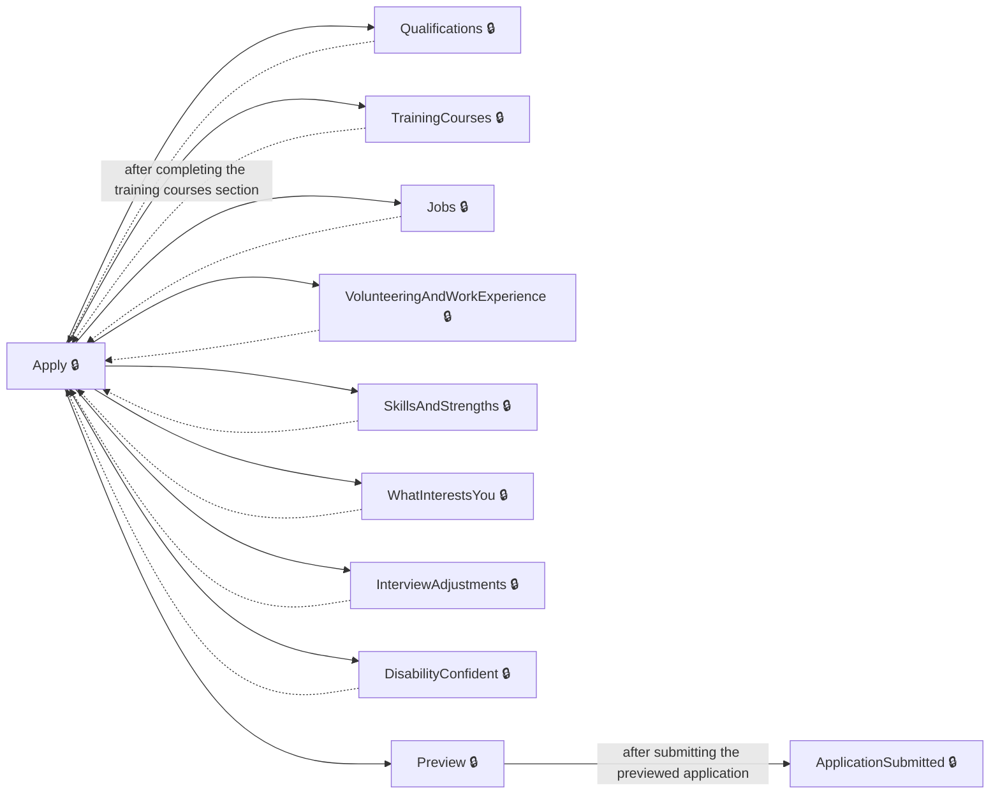
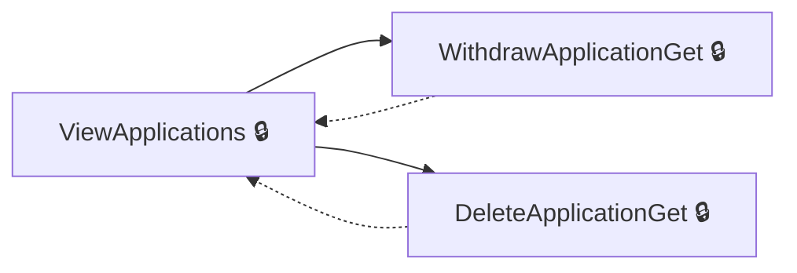
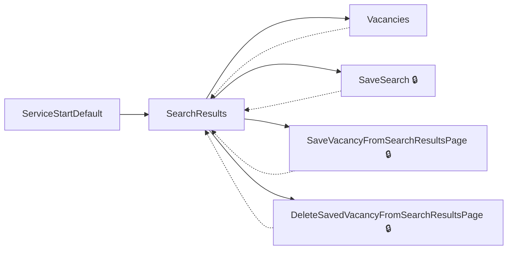
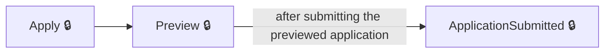

# User journeys: SkillsFundingAgency/das-findapprenticeship-web

Generated from `main/src`: 86 pages, 226 transitions, 4 journeys. 🔒 means sign-in is required. Dotted arrows return to a hub.

## Complete an Apprenticeship Application

Allows the user to complete their apprenticeship application by providing detailed information and submitting it.

Complete the sections in any order, returning to the hub.

## Withdraw or Delete an Application

Lets the user withdraw or delete their apprenticeship application.

Complete the sections in any order, returning to the hub.

## Search and Save Apprenticeship Vacancies

Allows users to search for apprenticeship opportunities and save them for later viewing.

Complete the sections in any order, returning to the hub.

## Finalize Apprenticeship Application

Guides the user through finalizing and successfully submitting an apprenticeship application.

## Pages

| Page | Route | Sign-in | Purpose |
| --- | --- | --- | --- |
| `AccessibilityStatement` | `accessibility-statement` | No | Provides information about the accessibility features and policies of the website. |
| `AccountDelete` | `account-delete` | Yes | Allows the user to initiate the account deletion process. |
| `AccountDeleteWithDrawApplication` | `account-deletion-withdraw-applications` | Yes | Allows the user to withdraw applications before completing account deletion. |
| `AccountUnavailable` | `account-unavailable` | Yes | Displays an account unavailable message to the user. |
| `Applications.DeleteApplicationGet` | `applications/{applicationId}/delete` | Yes | Allows the user to confirm deletion of their application. |
| `Applications.DeleteApplicationPost` | `applications/{applicationId:guid}/delete` | Yes | Deletes the user's application after confirmation. |
| `Applications.ViewApplication` | `applications/{applicationId}/view` | Yes | Displays details about a specific application. |
| `Applications.ViewApplications` | `applications` | Yes | Shows a list of all applications created by the user. |
| `Applications.WithdrawApplicationGet` | `applications/{applicationId:guid}/withdraw` | Yes | Allows the user to confirm withdrawal of their application. |
| `Applications.WithdrawApplicationPost` | `applications/{applicationId}/withdraw` | Yes | Processes the withdrawal of the user's application after confirmation. |
| `Apply` | `applications/{applicationId}` | Yes | Allows the user to start or review their application for an apprenticeship. |
| `ApplyApprenticeship.AddAdditionalQuestion` | `apply/{applicationId}/additional-question/{additionalQuestion}/{additionalQuestionId}` | Yes | Allows the user to answer an additional question related to an application. |
| `ApplyApprenticeship.AddEmploymentLocations` | `apply/{applicationId:guid}/employmentLocations` | Yes | Lets the user specify employment locations for an application. |
| `ApplyApprenticeship.AddJob` | `apply/{applicationId}/jobs/add` | Yes | Allows the user to add a new job to their work history. |
| `ApplyApprenticeship.AddQualification` | `apply/{applicationId}/qualifications/{qualificationReferenceId}/modify` | Yes | Allows the applicant to add or modify a qualification. |
| `ApplyApprenticeship.AddQualificationSelectType` | `apply/{applicationId}/qualifications/add/select-type` | Yes | Enables the applicant to select the type of qualification they want to add. |
| `ApplyApprenticeship.AddTrainingCourse` | `apply/{applicationId}/trainingcourses/add` | Yes | Enables the applicant to add a new training course to their application. |
| `ApplyApprenticeship.AddVolunteeringAndWorkExperience` | `apply/{applicationId}/volunteering-and-work-experience/add` | Yes | Enables the applicant to add volunteering or work experience to their application. |
| `ApplyApprenticeship.ApplicationSubmitted` | `applications/{applicationId}/application-submitted` | Yes | Shows the user confirmation that their apprenticeship application has been submitted successfully. |
| `ApplyApprenticeship.DeleteJob` | `apply/{applicationId}/jobs/{jobId}/delete` | Yes | Enables the user to delete a job from their work history. |
| `ApplyApprenticeship.DeleteQualifications` | `apply/{applicationId}/qualifications/delete/{qualificationReferenceId}` | Yes | Allows the applicant to delete a specific qualification. |
| `ApplyApprenticeship.DeleteTrainingCourse` | `apply/{applicationId}/trainingcourses/{trainingCourseId}/delete` | Yes | Allows the applicant to delete a training course from their application. |
| `ApplyApprenticeship.DeleteVolunteeringOrWorkExperience` | `apply/{applicationId}/volunteering-and-work-experience/{volunteeringWorkExperienceId}/delete` | Yes | Allows the applicant to delete specific volunteering or work experience from their application. |
| `ApplyApprenticeship.DisabilityConfident` | `apply/{applicationId}/disability-confident` | Yes | Allows the user to indicate whether they want to apply under the Disability Confident Scheme. |
| `ApplyApprenticeship.DisabilityConfidentConfirmation` | `apply/{applicationId}/disability-confident/confirm` | Yes | Displays a summary of the user's Disability Confident Scheme application. |
| `ApplyApprenticeship.EditJob` | `apply/{applicationId}/jobs/{jobId}` | Yes | Provides the user with a way to edit details for an existing job in their work history. |
| `ApplyApprenticeship.EditTrainingCourse` | `apply/{applicationId}/trainingcourses/{trainingCourseId}` | Yes | Lets the applicant edit details for a specific training course. |
| `ApplyApprenticeship.EditVolunteeringAndWorkExperience` | `apply/{applicationId}/volunteering-and-work-experience/{volunteeringWorkExperienceId}` | Yes | Lets the applicant edit details of a specific volunteering or work experience entry. |
| `ApplyApprenticeship.EmploymentLocationsSummary` | `apply/{applicationId:guid}/employmentLocations/summary` | Yes | Provides a summary of the employment locations specified for an application. |
| `ApplyApprenticeship.EqualityQuestions.EditEqualityQuestions` | `equality-questions/edit` | Yes | Starts the process for editing equality and diversity questions. |
| `ApplyApprenticeship.EqualityQuestions.EqualityFlowEthnicGroup` | `equality-questions/ethnic-group` | Yes | Allows the user to specify their ethnic group. |
| `ApplyApprenticeship.EqualityQuestions.EqualityFlowEthnicSubGroupAsian` | `equality-questions/ethnic-group/asian` | Yes | Lets the user specify their Asian ethnic subgroup. |
| `ApplyApprenticeship.EqualityQuestions.EqualityFlowEthnicSubGroupBlack` | `equality-questions/ethnic-group/black` | Yes | Allows the user to specify their Black ethnic subgroup. |
| `ApplyApprenticeship.EqualityQuestions.EqualityFlowEthnicSubGroupMixed` | `equality-questions/ethnic-group/mixed` | Yes | Allows the user to provide their ethnic subgroup information for the 'Mixed' category. |
| `ApplyApprenticeship.EqualityQuestions.EqualityFlowEthnicSubGroupOther` | `equality-questions/ethnic-group/other` | Yes | Allows the user to provide their ethnic subgroup information for the 'Other' category. |
| `ApplyApprenticeship.EqualityQuestions.EqualityFlowEthnicSubGroupWhite` | `equality-questions/ethnic-group/white` | Yes | Allows the user to provide their ethnic subgroup information for the 'White' category. |
| `ApplyApprenticeship.EqualityQuestions.EqualityFlowGender` | `equality-questions/gender` | Yes | Enables the user to provide information about their gender and related details. |
| `ApplyApprenticeship.EqualityQuestions.EqualityFlowSummary` | `equality-questions/summary` | Yes | Provides a summary of all equality-related answers submitted by the user. |
| `ApplyApprenticeship.InterviewAdjustments` | `apply/{applicationId}/interview-adjustments` | Yes | Allows the user to specify interview adjustments or support requirements. |
| `ApplyApprenticeship.InterviewAdjustmentsSummary` | `apply/{applicationId}/interview-adjustments/summary` | Yes | Summarizes the interview adjustments specified by the user. |
| `ApplyApprenticeship.Jobs` | `apply/{applicationId}/jobs` | Yes | Displays a list of jobs in the user's work history and options to add, edit, or delete jobs. |
| `ApplyApprenticeship.Preview` | `applications/{applicationId}/preview` | Yes | Allows the user to preview their application before submitting. |
| `ApplyApprenticeship.Qualifications` | `apply/{applicationId}/qualifications` | Yes | Displays the list of qualifications entered by the applicant. |
| `ApplyApprenticeship.SkillsAndStrengths` | `apply/{applicationId}/skillsandstrengths/` | Yes | Lets the applicant provide information about their skills and strengths. |
| `ApplyApprenticeship.TrainingCourses` | `apply/{applicationId}/training-courses/` | Yes | Shows the list of training courses the applicant has added. |
| `ApplyApprenticeship.VolunteeringAndWorkExperience` | `apply/{applicationId}/volunteering-and-work-experience` | Yes | Displays the initial page for volunteering and work experience, asking if the applicant wants to add details. |
| `ApplyApprenticeship.VolunteeringAndWorkExperienceSummary` | `apply/{applicationId}/volunteering-and-work-experience/summary` | Yes | Shows a summary of the applicant's volunteering and work experience entries. |
| `ApplyApprenticeship.WhatInterestsYou` | `apply/{applicationId}/what-interests-you` | Yes | Allows the applicant to describe what interests them regarding the apprenticeship. |
| `BrowseByInterests` | `browse-by-interests` | Unknown | Allows the user to browse apprenticeship opportunities based on their interests. |
| `ConfirmAccountDelete` | `confirm-account-deletion` | Yes | Allows the user to confirm account deletion. |
| `ConfirmAccountDetails` | `create-account/check-answers` | Yes | Allows the user to review and confirm their account details. |
| `ConfirmDeleteSavedSearch` | `saved-searches/{savedSearchId}/delete` | Yes | Allows the user to confirm the deletion of a saved search. |
| `Cookies` | `Cookies` | No | Informs the user about cookie usage on the website and allows managing cookie preferences. |
| `CreateAccount` | `create-account` | Yes | Allows the user to create a new account. |
| `DateOfBirth` | `date-of-birth` | Yes | Allows the user to enter or update their date of birth. |
| `DeleteSavedSearch` | `saved-searches/{savedSearchId}/delete` | Yes | Processes the deletion of a saved search. |
| `DeleteSavedVacancy` | `saved-vacancies/{vacancyReference}/delete` | Yes | Enables the user to delete a saved apprenticeship vacancy. |
| `DeleteSavedVacancyFromDetailsPage` | `vacancy/delete/{vacancyId}` | Yes | Allows the user to delete a saved vacancy from the vacancy details page. |
| `DeleteSavedVacancyFromSearchResultsPage` | `search-results/delete/{vacancyId}` | Yes | Enables the user to remove a saved vacancy directly from the search results page. |
| `Email` | `email` | Yes | Allows the user to update their email address. |
| `EnterAddressManually` | `enter-address` | Yes | Allows the user to manually enter their address details. |
| `FinishAccountSetup` | `finish-account-setup` | Yes | Completes the account setup process. |
| `GetHelp` | `get-help` | No | Provides help and support information to the user regarding apprenticeship applications. |
| `GetSavedSearchesUnsubscribe` | `saved-searches/unsubscribe` | Unknown | Allows the user to unsubscribe from saved apprenticeship search alerts. |
| `Location` | `location` | Unknown | Allows the user to specify and search for apprenticeships by location. |
| `Locations.LocationsBySearch` | — | Unknown | Returns location search results based on the user's input. |
| `MapSearchResults` | `map-search-results` | Unknown | Displays apprenticeship search results on a map. |
| `NotificationPreferences` | `notification-preferences` | Yes | Allows the user to specify notification preferences. |
| `PhoneNumber` | `phone-number` | Yes | Allows the user to provide or update their phone number. |
| `PostSavedSearchesUnsubscribe` | `saved-searches/unsubscribe` | Unknown | Processes the user's request to unsubscribe from saved apprenticeship search alerts. |
| `PostcodeAddress` | `postcode-address` | Yes | Allows the user to enter or validate their postcode. |
| `SaveSearch` | `apprenticeships/save-search` | Yes | Enables users to save their apprenticeship search criteria. |
| `SaveVacancyFromDetailsPage` | `vacancy/save/{vacancyId}` | Yes | Allows the user to save a vacancy from the vacancy details page. |
| `SaveVacancyFromSearchResultsPage` | `search-results/save/{vacancyId}` | Yes | Allows users to save a specific apprenticeship vacancy from the search results. |
| `SavedSearches` | `saved-searches` | Yes | Displays the user's saved searches for apprenticeship opportunities. |
| `SavedVacancies` | `saved-vacancies` | Yes | Displays a list of apprenticeship vacancies that the user has saved. |
| `SearchResults` | `apprenticeships` | Unknown | Shows available apprenticeship opportunities based on user search criteria. |
| `SelectAddress` | `select-address` | Yes | Lets the user choose their address based on a provided postcode. |
| `ServiceStartDefault` | — | Unknown | Serves as the starting point for the apprenticeship search service. |
| `Settings` | `settings` | Yes | Provides access to user account settings. |
| `SignIn` | `signin` | Yes | Allows the user to sign in to their account. |
| `SignOut` | `signout` | Unknown | Allows the user to sign out of their account. |
| `TermsAndConditions` | `terms-and-conditions` | No | Displays the terms and conditions for using the website. |
| `UnsubscribeSavedSearchComplete` | `saved-searches/unsubscribe-complete` | Unknown | Confirms that the user’s unsubscribe request from saved search alerts has been completed. |
| `UserName` | `user-name` | Yes | Allows the user to update their account name details. |
| `Vacancies` | `apprenticeship/{vacancyReference}` | Unknown | Displays details about apprenticeship vacancies. |
