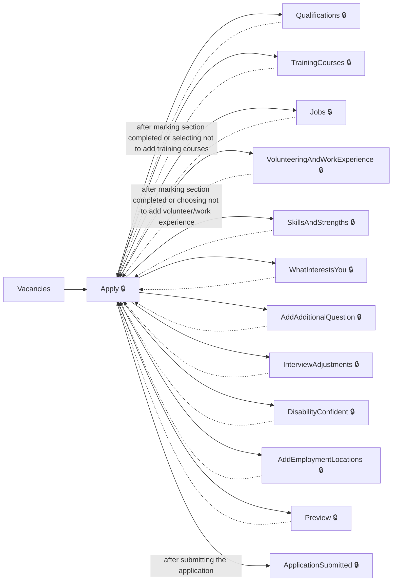
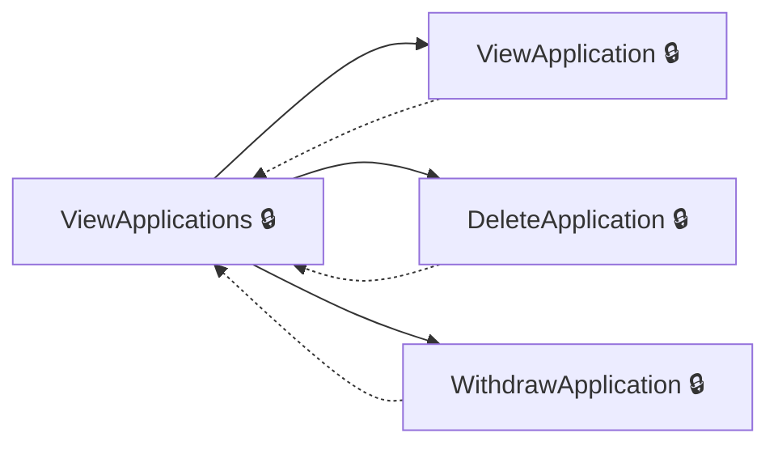
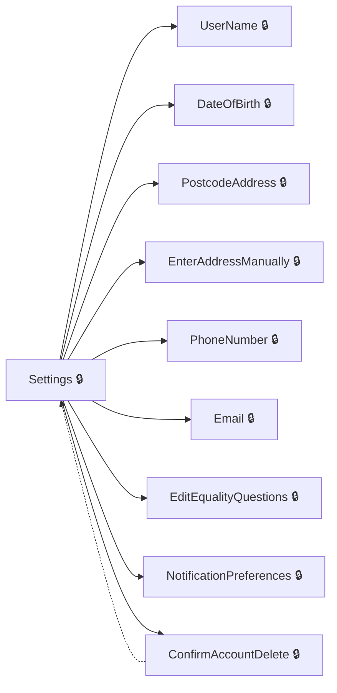
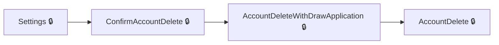
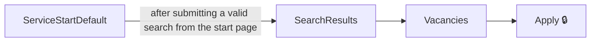
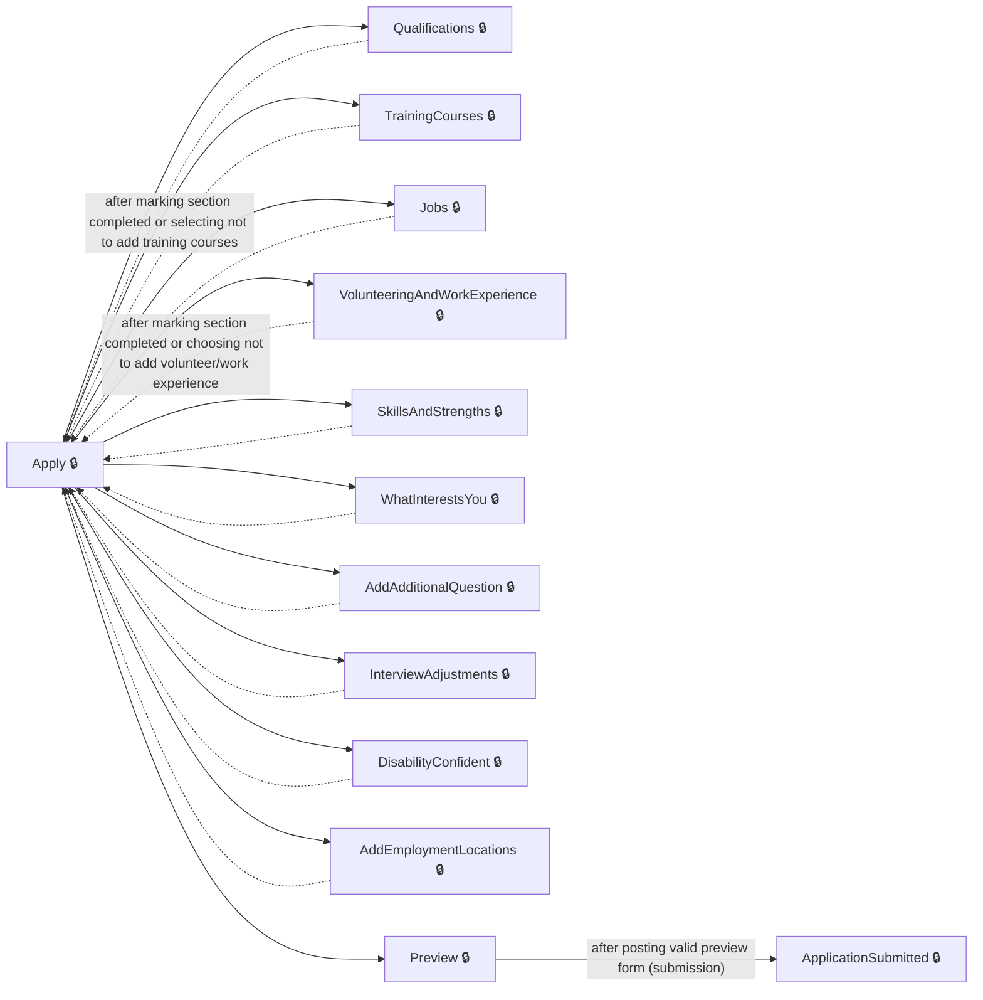
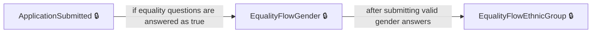
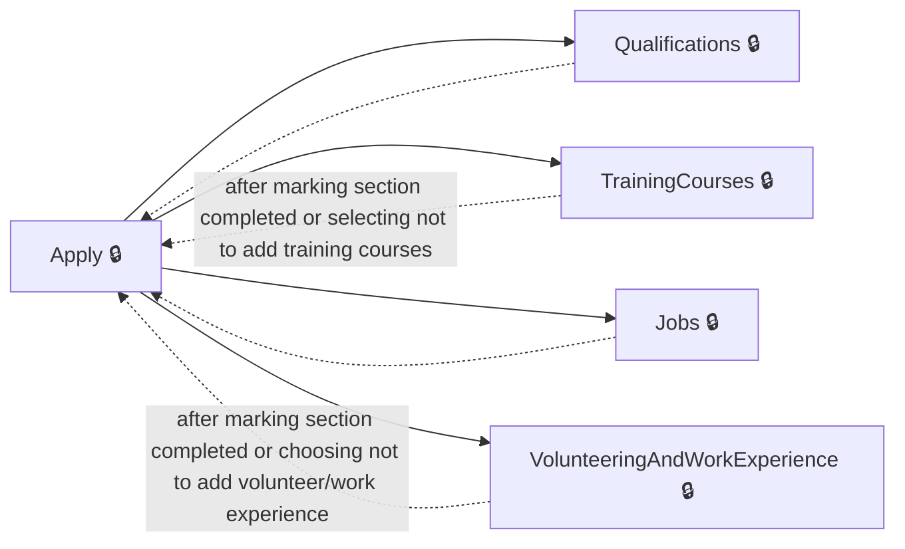

# User journeys: SkillsFundingAgency/das-findapprenticeship-web

Generated from `main/src`: 84 pages, 223 transitions, 8 journeys. 🔒 means sign-in is required. Dotted arrows return to a hub.

## Apply for an Apprenticeship

A user fills out, reviews, and submits an apprenticeship application.

Complete the sections in any order, returning to the hub.

## Manage Applications

A user reviews, deletes, or withdraws their apprenticeship applications.

Complete the sections in any order, returning to the hub.

## Manage Account Settings

A user manages personal details, notification preferences, and equality questions from account settings.

Complete the sections in any order, returning to the hub.

## Delete Account

A user starts from account settings to delete their account, including withdrawing any applications if required.

## Search and Apply for an Apprenticeship

A user searches for apprenticeship vacancies and proceeds to apply for one.

## Complete and Submit an Apprenticeship Application

A signed-in user completes different sections of the application and submits it.

Complete the sections in any order, returning to the hub.

## Complete Equality Questions After Application Submission

After submitting an application, the user is prompted to answer equality questions.

## Manage Application Sections

A user can manage (add/edit/delete) qualifications, jobs, training, or volunteering experience as part of their application.

Complete the sections in any order, returning to the hub.

## Pages

| Page | Route | Sign-in | Purpose |
| --- | --- | --- | --- |
| `AccessibilityStatement` | `accessibility-statement` | No | Displays information about accessibility for the web application. |
| `AccountDelete` | `account-delete` | Yes | Lets the user request deletion of their account. |
| `AccountDeleteWithDrawApplication` | `account-deletion-withdraw-applications` | Yes | Lets the user withdraw applications before deleting their account. |
| `AccountUnavailable` | `account-unavailable` | Yes | Informs the user that their account is unavailable. |
| `Applications.DeleteApplication` | `applications/{applicationId}/delete`, `applications/{applicationId:guid}/delete` | Yes | Lets the user confirm and delete an apprenticeship application. |
| `Applications.ViewApplication` | `applications/{applicationId}/view` | Yes | Shows the details of a specific apprenticeship application. |
| `Applications.ViewApplications` | `applications` | Yes | Displays a list of the user's apprenticeship applications, including status and notifications. |
| `Applications.WithdrawApplication` | `applications/{applicationId:guid}/withdraw`, `applications/{applicationId}/withdraw` | Yes | Lets the user withdraw an apprenticeship application. |
| `Apply` | `applications/{applicationId}` | Yes | Shows an overview and allows editing sections of the apprenticeship application. |
| `ApplyApprenticeship.AddAdditionalQuestion` | `apply/{applicationId}/additional-question/{additionalQuestion}/{additionalQuestionId}` | Yes | Lets the user answer additional questions for an apprenticeship application. |
| `ApplyApprenticeship.AddEmploymentLocations` | `apply/{applicationId:guid}/employmentLocations` | Yes | Lets the user select employment locations for the apprenticeship application. |
| `ApplyApprenticeship.AddJob` | `apply/{applicationId}/jobs/add` | Yes | Lets the user add a new job to their work history for the application. |
| `ApplyApprenticeship.AddQualification` | `apply/{applicationId}/qualifications/{qualificationReferenceId}/modify` | Yes | Lets the applicant add or modify details of a qualification as part of their apprenticeship application. |
| `ApplyApprenticeship.AddQualificationSelectType` | `apply/{applicationId}/qualifications/add/select-type` | Yes | Lets the applicant select the type of qualification to add to their application. |
| `ApplyApprenticeship.AddTrainingCourse` | `apply/{applicationId}/trainingcourses/add` | Yes | Lets the applicant add a new training course to their apprenticeship application. |
| `ApplyApprenticeship.AddVolunteeringAndWorkExperience` | `apply/{applicationId}/volunteering-and-work-experience/add` | Yes | Lets the applicant add details about volunteering or work experience to their application. |
| `ApplyApprenticeship.ApplicationSubmitted` | `applications/{applicationId}/application-submitted` | Yes | Informs the candidate that their apprenticeship application has been successfully submitted. |
| `ApplyApprenticeship.DeleteJob` | `apply/{applicationId}/jobs/{jobId}/delete` | Yes | Allows the user to confirm deletion of a job from their work history. |
| `ApplyApprenticeship.DeleteQualifications` | `apply/{applicationId}/qualifications/delete/{qualificationReferenceId}` | Yes | Lets the applicant confirm and delete a qualification from their application. |
| `ApplyApprenticeship.DeleteTrainingCourse` | `apply/{applicationId}/trainingcourses/{trainingCourseId}/delete` | Yes | Lets the applicant confirm and delete a training course from their application. |
| `ApplyApprenticeship.DeleteVolunteeringOrWorkExperience` | `apply/{applicationId}/volunteering-and-work-experience/{volunteeringWorkExperienceId}/delete` | Yes | Lets the applicant confirm and delete a volunteering or work experience entry from their application. |
| `ApplyApprenticeship.DisabilityConfident` | `apply/{applicationId}/disability-confident` | Yes | Lets the user choose whether to apply under the Disability Confident scheme for an apprenticeship. |
| `ApplyApprenticeship.DisabilityConfidentConfirmation` | `apply/{applicationId}/disability-confident/confirm` | Yes | Shows a summary and confirmation of the user's Disability Confident scheme selection. |
| `ApplyApprenticeship.EditJob` | `apply/{applicationId}/jobs/{jobId}` | Yes | Enables the user to edit the details of an existing job in their work history. |
| `ApplyApprenticeship.EditTrainingCourse` | `apply/{applicationId}/trainingcourses/{trainingCourseId}` | Yes | Lets the applicant edit details of a training course in their application. |
| `ApplyApprenticeship.EditVolunteeringAndWorkExperience` | `apply/{applicationId}/volunteering-and-work-experience/{volunteeringWorkExperienceId}` | Yes | Lets the applicant edit a volunteering or work experience entry in their application. |
| `ApplyApprenticeship.EmploymentLocationsSummary` | `apply/{applicationId:guid}/employmentLocations/summary` | Yes | Shows a summary and allows confirmation of selected employment locations. |
| `ApplyApprenticeship.EqualityQuestions.EditEqualityQuestions` | `equality-questions/edit` | Yes | Starts editing the user's equality questions for apprenticeship applications. |
| `ApplyApprenticeship.EqualityQuestions.EqualityFlowEthnicGroup` | `equality-questions/ethnic-group` | Yes | Lets the user select their ethnic group as part of equality questions. |
| `ApplyApprenticeship.EqualityQuestions.EqualityFlowEthnicSubGroupAsian` | `equality-questions/ethnic-group/asian` | Yes | Lets the user select an Asian ethnic subgroup as part of equality questions. |
| `ApplyApprenticeship.EqualityQuestions.EqualityFlowEthnicSubGroupBlack` | `equality-questions/ethnic-group/black` | Yes | Lets the user select a Black ethnic subgroup as part of equality questions. |
| `ApplyApprenticeship.EqualityQuestions.EqualityFlowEthnicSubGroupMixed` | `equality-questions/ethnic-group/mixed` | Yes | Lets the user select a Mixed ethnic subgroup as part of equality questions. |
| `ApplyApprenticeship.EqualityQuestions.EqualityFlowEthnicSubGroupOther` | `equality-questions/ethnic-group/other` | Yes | Lets the user select an Other ethnic subgroup as part of equality questions. |
| `ApplyApprenticeship.EqualityQuestions.EqualityFlowEthnicSubGroupWhite` | `equality-questions/ethnic-group/white` | Yes | Allows the user to answer questions about their ethnic subgroup, specifically for the 'white' category. |
| `ApplyApprenticeship.EqualityQuestions.EqualityFlowGender` | `equality-questions/gender` | Yes | Allows the user to answer questions about their gender as part of equality questions. |
| `ApplyApprenticeship.EqualityQuestions.EqualityFlowSummary` | `equality-questions/summary` | Yes | Displays a summary of the user's completed equality questions before submission. |
| `ApplyApprenticeship.InterviewAdjustments` | `apply/{applicationId}/interview-adjustments` | Yes | Lets the user specify any adjustments they need for an interview due to disabilities or challenges. |
| `ApplyApprenticeship.InterviewAdjustmentsSummary` | `apply/{applicationId}/interview-adjustments/summary` | Yes | Shows a summary of the interview adjustments requested by the user. |
| `ApplyApprenticeship.Jobs` | `apply/{applicationId}/jobs` | Yes | Displays a list of jobs in the user's work history and lets them manage this section. |
| `ApplyApprenticeship.Preview` | `applications/{applicationId}/preview` | Yes | Lets the candidate review and submit their completed apprenticeship application. |
| `ApplyApprenticeship.Qualifications` | `apply/{applicationId}/qualifications` | Yes | Shows the applicant's qualifications and controls for adding, editing, or removing them. |
| `ApplyApprenticeship.SkillsAndStrengths` | `apply/{applicationId}/skillsandstrengths/` | Yes | Lets the applicant enter or edit their skills and strengths for the apprenticeship application. |
| `ApplyApprenticeship.TrainingCourses` | `apply/{applicationId}/training-courses/` | Yes | Shows the applicant's training courses and provides controls for managing them. |
| `ApplyApprenticeship.VolunteeringAndWorkExperience` | `apply/{applicationId}/volunteering-and-work-experience` | Yes | Shows volunteering and work experience entries and options to add or manage them. |
| `ApplyApprenticeship.VolunteeringAndWorkExperienceSummary` | `apply/{applicationId}/volunteering-and-work-experience/summary` | Yes | Shows a summary of all volunteering and work experience entries with management options. |
| `ApplyApprenticeship.WhatInterestsYou` | `apply/{applicationId}/what-interests-you` | Yes | Lets the applicant describe their motivation and interest in the apprenticeship. |
| `BrowseByInterests` | `browse-by-interests` | Unknown | Lets the user browse available apprenticeships by their interests. |
| `ConfirmAccountDelete` | `confirm-account-deletion` | Yes | Lets the user confirm they want to delete their account. |
| `ConfirmAccountDetails` | `create-account/check-answers` | Yes | Allows the user to review and confirm their account details before finalizing setup. |
| `ConfirmDeleteSavedSearch` | `saved-searches/{savedSearchId}/delete` | Yes | Lets the user confirm deletion of a saved search. |
| `Cookies` | `Cookies` | No | Shows details about the site's cookies and lets users review their consent. |
| `CreateAccount` | `create-account` | Yes | Lets the user start creating a new account. |
| `DateOfBirth` | `date-of-birth` | Yes | Allows the user to enter or update their date of birth. |
| `DeleteSavedSearch` | `saved-searches/{savedSearchId}/delete` | Yes | Processes the deletion of a saved search. |
| `DeleteSavedVacancy` | `saved-vacancies/{vacancyReference}/delete` | Yes | Removes a saved vacancy from the user's account. |
| `DeleteSavedVacancyFromDetailsPage` | `vacancy/delete/{vacancyId}` | Yes | Removes a saved vacancy from the user's saved vacancies list. |
| `DeleteSavedVacancyFromSearchResultsPage` | `search-results/delete/{vacancyId}` | Yes | Lets the user delete a saved vacancy directly from the search results page. |
| `Email` | `email` | Yes | Allows the user to view or enter their email. |
| `EnterAddressManually` | `enter-address` | Yes | Lets the user manually enter their address. |
| `FinishAccountSetup` | `finish-account-setup` | Yes | Informs the user that account setup is finished. |
| `GetHelp` | `get-help` | No | Provides help information for users needing assistance. |
| `GetSavedSearchesUnsubscribe` | `saved-searches/unsubscribe` | Unknown | Lets the user confirm their wish to unsubscribe from a saved search. |
| `Location` | `location` | Unknown | Lets the user select a location and job interests for their apprenticeship search. |
| `Locations.LocationsBySearch` | — | Unknown | Returns locations matching a user's search term, as a list. |
| `MapSearchResults` | `map-search-results` | Unknown | Displays a map of apprenticeship vacancies based on the user's search criteria. |
| `NotificationPreferences` | `notification-preferences` | Yes | Lets the user set their notification preferences. |
| `PhoneNumber` | `phone-number` | Yes | Lets the user enter or update their phone number. |
| `PostSavedSearchesUnsubscribe` | `saved-searches/unsubscribe` | Unknown | Processes the user's request to unsubscribe from a saved search. |
| `PostcodeAddress` | `postcode-address` | Yes | Allows the user to enter or update their postcode to look up their address. |
| `SaveSearch` | `apprenticeships/save-search` | Yes | Allows the user to save their current apprenticeship search criteria. |
| `SaveVacancyFromDetailsPage` | `vacancy/save/{vacancyId}` | Yes | Saves a vacancy to the user's saved vacancies list. |
| `SaveVacancyFromSearchResultsPage` | `search-results/save/{vacancyId}` | Yes | Lets the user save a specific apprenticeship vacancy from the search results. |
| `SavedSearches` | `saved-searches` | Yes | Displays all the saved job searches for the user. |
| `SavedVacancies` | `saved-vacancies` | Yes | Shows all vacancies the user has saved. |
| `SearchResults` | `apprenticeships` | Unknown | Shows apprenticeship vacancies matching the user's search and filters. |
| `SelectAddress` | `select-address` | Yes | Lets the user select their address from a list of addresses found for the entered postcode. |
| `ServiceStartDefault` | — | Unknown | Provides the starting page for searching apprenticeships. |
| `Settings` | `settings` | Yes | Allows the user to view and edit their account settings and personal details. |
| `SignIn` | `signin` | Yes | Allows the user to sign in to the service. |
| `SignOut` | `signout` | Unknown | Allows the user to sign out of the service. |
| `TermsAndConditions` | `terms-and-conditions` | No | Shows the terms and conditions of using the site. |
| `UnsubscribeSavedSearchComplete` | `saved-searches/unsubscribe-complete` | Unknown | Tells the user their saved search has been successfully unsubscribed. |
| `UserName` | `user-name` | Yes | Lets the user enter or update their name. |
| `Vacancies` | `apprenticeship/{vacancyReference}` | Unknown | Displays details for a selected apprenticeship vacancy. |
