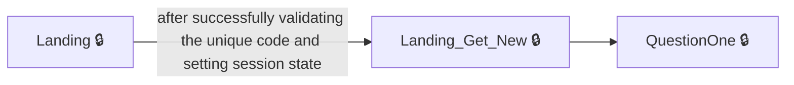

# User journeys: SkillsFundingAgency/das-provide-feedback-employer

Generated from `master/src`: 14 pages, 14 transitions, 1 journeys. 🔒 means sign-in is required. Dotted arrows return to a hub.

## Submit Provider Feedback

A user starts a feedback session and answers questions before reviewing and submitting their feedback.

## Pages

| Page | Route | Sign-in | Purpose |
| --- | --- | --- | --- |
| `Confirmation` | `feedback-confirmation` | Yes | Shows a confirmation that feedback has been submitted. |
| `FeedbackAlreadySubmitted` | `/{encodedAccountId}/feedback-submitted` | Yes | Informs the user that feedback has already been submitted. |
| `Landing` | — | Yes | Starts the feedback process using a unique code from the user. |
| `Landing_Get_New` | — | Yes | Lets the user begin providing feedback for a selected training provider. |
| `Provider.ClearFilters` | `/{encodedAccountId}/providers/unfilter` | Yes | Lets the user clear all filters from their list of providers. |
| `Provider.ConfirmProvider` | `/{encodedAccountId}/providers/{providerId}` | Yes | Lets the user confirm their choice of training provider before starting feedback. |
| `Provider.Filter` | `/{encodedAccountId}/providers` | Yes | Lets the user filter the list of training providers to find relevant ones. |
| `Provider.Index` | `/{encodedAccountId}/providers` | Yes | Displays the list of training providers available for feedback. |
| `Provider.ProviderConfirmed` | `/{encodedAccountId}/providers/{providerId}` | Yes | Handles the confirmation of a training provider for feedback. |
| `Provider.SortProviders` | `/{encodedAccountId}/providers/sort` | Yes | Lets the user sort the list of providers using various criteria. |
| `QuestionOne` | `question-one` | Yes | Lets the user answer the first question about provider strengths. |
| `QuestionThree` | `question-three` | Yes | Lets the user rate their overall experience with the provider. |
| `QuestionTwo` | `question-two` | Yes | Lets the user answer the second question about provider weaknesses. |
| `ReviewAnswers` | `review-answers` | Yes | Lets the user review their feedback answers before submitting. |
