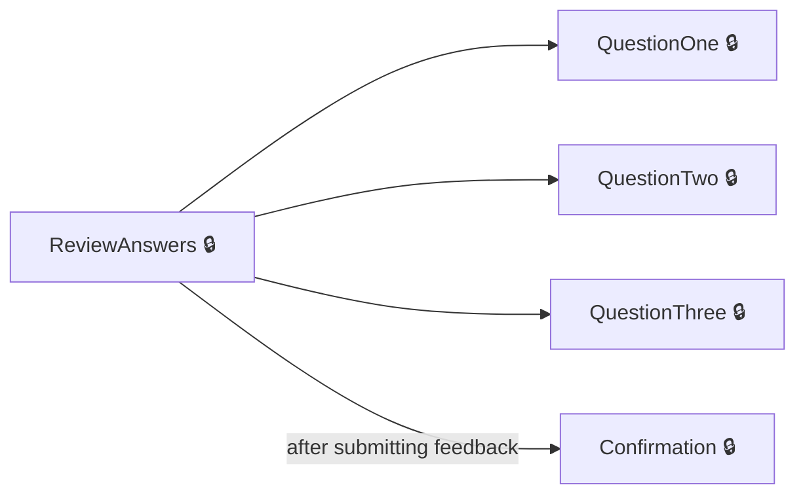
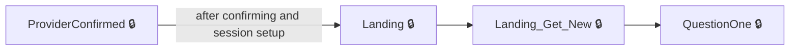

# User journeys: SkillsFundingAgency/das-provide-feedback-employer

Generated from `master/src`: 14 pages, 14 transitions, 2 journeys. 🔒 means sign-in is required. Dotted arrows return to a hub.

## Resume or edit feedback answers before confirmation

An employer reviews and edits their feedback answers before submitting.

Complete the sections in any order, returning to the hub.

## Initiate and provide feedback for a training provider

An employer confirms a provider and completes the feedback survey to final confirmation.

## Pages

| Page | Route | Sign-in | Purpose |
| --- | --- | --- | --- |
| `Confirmation` | `feedback-confirmation` | Yes | Displays a confirmation of submitted feedback. |
| `FeedbackAlreadySubmitted` | `/{encodedAccountId}/feedback-submitted` | Yes | Informs the employer they have already submitted feedback. |
| `Landing` | — | Yes | Initial entry point; prepares session and redirects to the main survey start. |
| `Landing_Get_New` | — | Yes | Lets the employer start providing feedback for a selected provider. |
| `Provider.ClearFilters` | `/{encodedAccountId}/providers/unfilter` | Yes | Clears applied filters on the provider list. |
| `Provider.ConfirmProvider` | `/{encodedAccountId}/providers/{providerId}` | Yes | Lets the employer confirm the training provider they want to give feedback on. |
| `Provider.Filter` | `/{encodedAccountId}/providers` | Yes | Lets the employer filter the list of training providers and feedback status. |
| `Provider.Index` | `/{encodedAccountId}/providers` | Yes | Shows a paginated list of training providers for feedback. |
| `Provider.ProviderConfirmed` | `/{encodedAccountId}/providers/{providerId}` | Yes | Handles confirmation of chosen training provider and performs related logic. |
| `Provider.SortProviders` | `/{encodedAccountId}/providers/sort` | Yes | Sorts the list of training providers. |
| `QuestionOne` | `question-one` | Yes | Lets the employer indicate what the provider does very well. |
| `QuestionThree` | `question-three` | Yes | Lets the employer rate the provider's training and service overall. |
| `QuestionTwo` | `question-two` | Yes | Lets the employer indicate what the provider needs to improve. |
| `ReviewAnswers` | `review-answers` | Yes | Lets the employer review their answers before final confirmation. |

## Form fields

Field definitions only: no values a user enters are recorded.

### `Provider.ConfirmProvider`

| Field | Type | Label | Required | Rules | Options |
| --- | --- | --- | --- | --- | --- |
| `Confirmed` | radios | Is this the training provider you want to give feedback on? | — | — | true, false |

### `Provider.Filter`

| Field | Type | Label | Required | Rules | Options |
| --- | --- | --- | --- | --- | --- |
| `SelectedProviderName` | select | Training provider | — | — | — |
| `SelectedFeedbackStatus` | select | Feedback status | — | — | — |

### `Provider.Index`

| Field | Type | Label | Required | Rules | Options |
| --- | --- | --- | --- | --- | --- |
| `SelectedProviderName` | select | Training provider | — | — | — |
| `SelectedFeedbackStatus` | select | Feedback status | — | — | — |

### `Provider.ProviderConfirmed`

| Field | Type | Label | Required | Rules | Options |
| --- | --- | --- | --- | --- | --- |
| `Confirmed` | radios | Is this the training provider you want to give feedback on? | — | required | true, false |

### `QuestionOne`

| Field | Type | Label | Required | Rules | Options |
| --- | --- | --- | --- | --- | --- |
| `Attributes[i].Good` | checkboxes | What is doing very well? | — | — | — |

### `QuestionThree`

| Field | Type | Label | Required | Rules | Options |
| --- | --- | --- | --- | --- | --- |
| `Rating` | radios | How would you rate?: $"{ }'s") training and service overall? | Yes | required | — |

### `QuestionTwo`

| Field | Type | Label | Required | Rules | Options |
| --- | --- | --- | --- | --- | --- |
| `Attributes[i].Bad` | checkboxes | Does need to improve any of these? | — | — | — |

