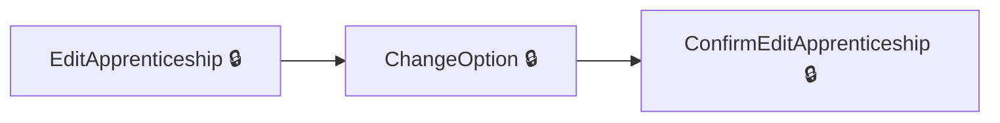
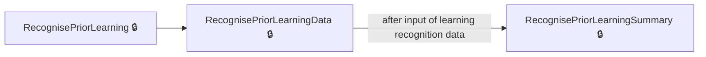

# User journeys: SkillsFundingAgency/das-providercommitments

Generated from `master/src`: 113 pages, 143 transitions, 2 journeys. 🔒 means sign-in is required. Dotted arrows return to a hub.

## Edit an Apprentice's Details

Make changes to an apprentice's details and confirm the updates.

## Input and Review Prior Learning Data

Add and review prior learning details for a draft apprenticeship.

## Pages

| Page | Route | Sign-in | Purpose |
| --- | --- | --- | --- |
| `Apprentice.ChangeHistory` | `{providerId}/apprentices/{apprenticeshipHashedId}/change-history` | Yes | Display a history of changes made to an apprentice's details. |
| `Apprentice.ChangeOption` | `{providerId}/apprentices/{apprenticeshipHashedId}/edit/change-option` | Yes | Allow the selection of new options for editing an apprentice's apprenticeship. |
| `Apprentice.ConfirmEditApprenticeship` | `{providerId}/apprentices/{apprenticeshipHashedId}/edit/confirm` | Yes | Confirm changes made to an apprentice's apprenticeship details. |
| `Apprentice.DeclinedChanges` | `{providerId}/apprentices/{apprenticeshipHashedId}/declined-changes` | Yes | Show details of changes declined for an apprentice's apprenticeship. |
| `Apprentice.EditApprenticeship` | `{providerId}/apprentices/{apprenticeshipHashedId}/edit` | Yes | Enable editing of an apprentice's apprenticeship details. |
| `Apprentice.EditApprenticeshipCourse` | `{providerId}/apprentices/{apprenticeshipHashedId}/edit/select-course` | Yes | Enable the selection of a course for editing an apprenticeship. |
| `Apprentice.GetAllChangeHistory` | `{providerId}/apprentices/change-history` | Yes | Display change history across all apprenticeships for a provider. |
| `Apprentice.InvalidIlrChanges` | `{providerId}/apprentices/{apprenticeshipHashedId}/invalid-ilr-changes` | Yes | Show invalid ILR changes for an apprentice's apprenticeship. |
| `Apprentice.ResendEmailInvitation` | `{providerId}/apprentices/{apprenticeshipHashedId}/details/resend-email-invitation` | Yes | Resend email invitations for completing apprentice records. |
| `Apprentice.ReviewApprenticeshipUpdates` | `{providerId}/apprentices/{apprenticeshipHashedId}/changes/review` | Yes | Review pending updates made to an apprentice's apprenticeship. |
| `Apprentice.SelectDeliveryModelForEdit` | `{providerId}/apprentices/{apprenticeshipHashedId}/edit/select-delivery-model` | Yes | Choose a delivery model as part of editing apprenticeship details. |
| `Apprentice.SetCourseForEdit` | `{providerId}/apprentices/{apprenticeshipHashedId}/edit/select-course` | Yes | Set the course while editing an apprenticeship. |
| `Apprentice.SetDeliveryModelForEdit` | `{providerId}/apprentices/{DraftApprenticeshipHashedId}/edit/select-delivery-model` | Yes | Set the delivery model while editing an apprenticeship draft. |
| `Apprentice.ViewApprenticeshipUpdates` | `{providerId}/apprentices/{apprenticeshipHashedId}/changes/view` | Yes | View detailed updates made to the apprenticeship of an apprentice. |
| `ApprenticeConfirm` | `{providerId}/apprentices/{apprenticeshipHashedId}/change-employer/confirm` | Yes | Confirm employer changes for an apprentice's apprenticeship. |
| `ApprenticeConfirmEmployer` | `{providerId}/apprentices/{apprenticeshipHashedId}/change-employer/confirm-employer` | Yes | Allows the provider to confirm the apprentice's employer. |
| `ApprenticeDelete` | `{providerId}/unapproved/{cohortReference}/apprentices/{DraftApprenticeshipHashedId}/Delete` | Yes | Allows a provider to delete a draft apprenticeship record. |
| `ApprenticeDetail` | `{providerId}/apprentices/{apprenticeshipHashedId}` | Yes | Displays detailed information about an apprentice. |
| `ApprenticeEmail` | `{providerId}/unapproved/{cohortReference}/apprentices/{DraftApprenticeshipHashedId}/email` | Yes | Provides a functionality to add or edit the email address for a draft apprenticeship. |
| `ApprenticePrice` | `{providerId}/apprentices/{apprenticeshipHashedId}/change-employer/price` | Yes | Lets the provider update the price for an apprentice. |
| `ApprenticeReviewApprenticeshipUpdates` | `{providerId}/apprentices/{apprenticeshipHashedId}/changes/review` | Yes | Allows the provider to review updates to apprenticeship details before confirming. |
| `ApprenticeSelectDeliveryModel` | `{providerId}/apprentices/{apprenticeshipHashedId}/change-employer/select-delivery-model` | Yes | Enables the provider to select the delivery model for changing an apprentice's employer. |
| `ApprenticeSelectEmployer` | `{providerId}/apprentices/{apprenticeshipHashedId}/change-employer/select-employer` | Yes | Allows the provider to select a new employer for the apprentice. |
| `ApprenticeSent` | `{providerId}/apprentices/{apprenticeshipHashedId}/change-employer/sent` | Yes | Confirms that changes regarding the apprentice's employer have been submitted. |
| `ApprenticeTrainingDates` | `{providerId}/apprentices/{apprenticeshipHashedId}/change-employer/training-dates` | Yes | Allows the provider to define new training dates for the apprentice after changing their employer. |
| `ApprenticeViewApprenticeshipUpdates` | `{providerId}/apprentices/{apprenticeshipHashedId}/changes/view` | Yes | Displays updates to the apprenticeship's details for review purposes. |
| `ApprenticesIndex` | `{providerId}/apprentices` | Yes | Lists apprentices for a given provider. |
| `CancelInProgressChangeOfCircumstance` | `{providerId}/apprentices/{apprenticeshipHashedId}/cancel-change-of-circumstance` | Yes | Cancels an in-progress change of circumstances for an apprenticeship. |
| `ChangeEmployer` | `{providerId}/apprentices/{apprenticeshipHashedId}/change-employer` | Yes | Starts the process to change the apprentice's employer. |
| `ChangeEmployerDetails` | `{providerId}/apprentices/{apprenticeshipHashedId}/change-employer/change-employer-details` | Yes | Displays details for changing an apprentice's employer. |
| `ChangeEmployerInform` | `{providerId}/apprentices/{apprenticeshipHashedId}/change-employer/inform` | Yes | Informs the provider about responsibilities when changing an apprentice's employer. |
| `ChangeEmployerOverlapAlert` | `{providerId}/apprentices/{apprenticeshipHashedId}/change-employer/overlap-alert` | Yes | Alerts the provider of training overlap issues when changing an apprentice's employer. |
| `ChangeOption` | `{providerId}/apprentices/{apprenticeshipHashedId}/edit/change-option` | Yes | Allows the provider to select a different apprenticeship course option for an apprentice. |
| `ChangeVersion` | `{providerId}/apprentices/{apprenticeshipHashedId}/edit/change-version` | Yes | Allows the provider to choose a new version of an apprenticeship standard for an apprentice. |
| `ChooseCohort` | `{providerId}/unapproved/choose-cohort` | Yes | Allows the provider to choose an unapproved cohort for adding apprenticeships. |
| `Cohort.Acknowledgement` | `{providerId}/unapproved/{cohortReference}/Acknowledgement` | Yes | Displays a confirmation page after approving or sending cohort changes. |
| `Cohort.AddNewDraftApprenticeship` | `{providerId}/unapproved/add-apprentice` | Yes | Guides the provider in adding a new draft apprenticeship to a cohort. |
| `Cohort.BeforeYouContinue` | `{providerId}/unapproved/add/before-you-continue` | Yes | Prompts the provider to review information before proceeding with adding a draft apprenticeship. |
| `Cohort.BeforeYouContinueMultiSelect` | `{providerId}/unapproved/add/before-you-continue-multi-select` | Yes | Prompts the provider to review information before proceeding with adding multiple apprenticeships. |
| `Cohort.ConfirmEmployer` | `{providerId}/unapproved/add/confirm-employer` | Yes | Allows providers to confirm the selected employer for creating or updating a cohort of apprenticeships. |
| `Cohort.Delete` | `{providerId}/unapproved/{cohortReference}/details/delete` | Yes | Enables the provider to delete a draft cohort. |
| `Cohort.Details` | `{providerId}/unapproved/{cohortReference}` | Yes | Displays detailed information about an unapproved cohort. |
| `Cohort.FileUploadAmendedFile` | `{providerId}/unapproved/add/file-upload/amended-file` | Yes | Allows providers to upload amended files for apprentice cohort data. |
| `Cohort.FileUploadDiscard` | `{providerId}/unapproved/add/file-upload/discard-file` | Yes | Enables providers to discard previously uploaded cohort files. |
| `Cohort.FileUploadInform` | `{providerId}/unapproved/add/file-upload/inform` | Yes | Informs providers about the file upload process for bulk apprentice data. |
| `Cohort.FileUploadReview` | `{providerId}/unapproved/add/file-upload/review` | Yes | Allows providers to review the uploaded cohort data before submission. |
| `Cohort.FileUploadReviewApprentices` | `{providerId}/unapproved/add/file-upload/review-cohort` | Yes | Enables providers to review apprentices in the uploaded cohort data. |
| `Cohort.FileUploadReviewDelete` | `{providerId}/unapproved/add/file-upload/review-delete` | Yes | Provides a way to delete uploaded apprentice data files during the review process. |
| `Cohort.FileUploadStart` | `{providerId}/unapproved/add/file-upload/start` | Yes | Starts the file upload process to add apprenticeship data from bulk upload CSV files. |
| `Cohort.NoDeclaredStandards` | `{providerId}/unapproved/NoDeclaredStandards` | Yes | Informs providers that there are no declared standards for training courses in the selected cohort. |
| `Cohort.SelectAddDraftApprenticeshipJourney` | `{providerId}/unapproved/add/select-journey` | Yes | Guides providers to select how they want to add apprenticeships to the draft cohort. |
| `Cohort.SelectCourse` | `{providerId}/unapproved/add/select-course` | Yes | Lets providers select the apprenticeship course for their cohort. |
| `Cohort.SelectDeliveryModel` | `{providerId}/unapproved/add/select-delivery-model` | Yes | Allows providers to choose the delivery model for apprenticeship training in a cohort. |
| `Cohort.SelectDraftApprenticeshipsEntryMethod` | `{providerId}/unapproved/add/entry-method` | Yes | Provides options to select how apprenticeships will be added, such as via ILR, bulk CSV, or manual input. |
| `Cohort.SelectHowManyLearnersToAdd` | `{providerId}/unapproved/add/how-many-learners` | Yes | Allows the provider to specify how many learners to add to a cohort. |
| `Cohort.SelectHowToAddApprentice` | `{providerId}/unapproved/add/select-how` | Yes | Guides the provider to choose how to add apprentices to a cohort. |
| `Cohort.SetDeliveryModel` | `{providerId}/unapproved/add/select-delivery-model` | Yes | Enables the provider to select the delivery model for apprenticeships. |
| `CohortAddApprenticeship` | `{providerId}/unapproved/add/apprenticeship` | Yes | Lets the provider add a draft apprenticeship to a cohort. |
| `CohortDraft` | `{providerId}/unapproved/draft` | Yes | Displays the draft cohorts created by the provider. |
| `CohortReview` | `{providerId}/unapproved/review` | Yes | Allows the provider to review unapproved cohorts before submission. |
| `CohortWithEmployer` | `{providerId}/unapproved/with-employer` | Yes | Shows cohorts associated with an employer but not yet approved. |
| `CohortWithTransferSender` | `{providerId}/unapproved/with-transfer-sender` | Yes | Displays cohorts linked to a transfer sender for approval. |
| `ConfirmRestart` | `{providerId}/apprentices/{apprenticeshipHashedId}/datalock/confirmrestart` | Yes | Lets the provider confirm the restart of an apprenticeship after resolving data lock issues. |
| `CreateCohortAndAddFirstApprenticeship` | `{providerId}/unapproved/add/apprenticeship` | Yes | Assists the provider in creating a new cohort and adding the first apprenticeship. |
| `Dashboard` | `{providerId}/dashboard` | Yes | Redirects the user to the provider's dashboard. |
| `DeclinedChanges` | `{providerId}/apprentices/{apprenticeshipHashedId}/declined-changes` | Yes | Enables the provider to view changes to an apprenticeship that were declined by the employer. |
| `DownloadApprentices` | `{providerId}/apprentices/download` | Yes | Lets the provider download information about apprentices in bulk. |
| `DraftApprenticeship.AddAnotherSelectMethod` | `{providerId}/unapproved/{cohortReference}/apprentices/add/select-how` | Yes | Enables the provider to select the method used to add another draft apprenticeship. |
| `DraftApprenticeship.AddDraftApprenticeship` | `{providerId}/unapproved/{cohortReference}/apprentices/add/details` | Yes | Allows the provider to add details for a new draft apprenticeship. |
| `DraftApprenticeship.AddEmail` | `{providerId}/unapproved/{cohortReference}/apprentices/{DraftApprenticeshipHashedId}/email` | Yes | Lets the provider add or edit the email address for a specific draft apprenticeship. |
| `DraftApprenticeship.AddNewDraftApprenticeship` | `{providerId}/unapproved/{cohortReference}/apprentices/add` | Yes | Allows the provider to start adding a new draft apprenticeship. |
| `DraftApprenticeship.EditDraftApprenticeship` | `{providerId}/unapproved/{cohortReference}/apprentices/{DraftApprenticeshipHashedId}/edit` | Yes | Allows the provider to edit the details of an existing draft apprenticeship. |
| `DraftApprenticeship.EditDraftApprenticeshipCourse` | `{providerId}/unapproved/{cohortReference}/apprentices/{DraftApprenticeshipHashedId}/edit/select-course` | Yes | Lets the provider edit or change the course for an existing draft apprenticeship. |
| `DraftApprenticeship.GetReservationId` | `{providerId}/unapproved/{cohortReference}/apprentices/add/reservation` | Yes | Redirects the provider to retrieve a reservation ID necessary for adding a new apprenticeship. |
| `DraftApprenticeship.PostSelectOptions` | `{providerId}/unapproved/{cohortReference}/apprentices/{DraftApprenticeshipHashedId}/select-options` | Yes | Allows the provider to save selected options for a draft apprenticeship. |
| `DraftApprenticeship.RecognisePriorLearningData` | `{providerId}/unapproved/{cohortReference}/apprentices/{DraftApprenticeshipHashedId}/recognise-prior-learning-data` | Yes | Allows input of prior learning recognition details for a draft apprenticeship. |
| `DraftApprenticeship.RecognisePriorLearningSummary` | `{providerId}/unapproved/{cohortReference}/apprentices/{DraftApprenticeshipHashedId}/recognise-prior-learning-summary` | Yes | Displays a summary of prior learning recognition details for a draft apprenticeship. |
| `DraftApprenticeship.SelectDeliveryModel` | `{providerId}/unapproved/{cohortReference}/apprentices/add/select-delivery-model` | Yes | Enables the provider to select the delivery model for a new draft apprenticeship. |
| `DraftApprenticeship.SelectDeliveryModelForEdit` | `{providerId}/unapproved/{cohortReference}/apprentices/{DraftApprenticeshipHashedId}/edit/select-delivery-model` | Yes | Lets the provider edit the delivery model for an existing draft apprenticeship. |
| `DraftApprenticeship.SelectOptions` | `{providerId}/unapproved/{cohortReference}/apprentices/{DraftApprenticeshipHashedId}/select-options` | Yes | Lets the provider select standard options for a draft apprenticeship. |
| `DraftApprenticeship.SetDeliveryModel` | `{providerId}/unapproved/{cohortReference}/apprentices/add/select-delivery-model` | Yes | Allows the user to select a delivery model while adding a new draft apprenticeship to the cohort. |
| `DraftApprenticeship.SetDeliveryModelForEdit` | `{providerId}/unapproved/{cohortReference}/apprentices/{DraftApprenticeshipHashedId}/edit/select-delivery-model` | Yes | Allows the user to select a delivery model while editing an existing draft apprenticeship. |
| `DraftApprenticeship.SetReference` | `{providerId}/unapproved/{cohortReference}/apprentices/{DraftApprenticeshipHashedId}/reference` | Yes | Defines a reference for an existing draft apprenticeship. |
| `DraftApprenticeship.ViewDraftApprenticeship` | `{providerId}/unapproved/{cohortReference}/apprentices/{DraftApprenticeshipHashedId}` | Yes | Displays the details of a specific draft apprenticeship. |
| `DraftApprenticeshipAddAnother` | `{providerId}/unapproved/{cohortReference}/apprentices/add/details` | Yes | Adds another draft apprenticeship to the cohort. |
| `DraftApprenticeshipEdit` | `{providerId}/unapproved/{cohortReference}/apprentices/{DraftApprenticeshipHashedId}/edit` | Yes | Edits the details of an existing draft apprenticeship. |
| `EditApprenticeship` | `{providerId}/apprentices/{apprenticeshipHashedId}/edit` | Yes | Allows the provider to edit apprenticeship details for an apprentice. |
| `InvalidIlrChanges` | `{providerId}/apprentices/{apprenticeshipHashedId}/invalid-ilr-changes` | Yes | Displays invalid ILR changes that need attention. |
| `Learner.LearnerSelectedForNewCohort` | `{providerId}/unapproved/add/learners/select/{learnerDataId}` | Yes | Redirects the user after selecting a learner to create a new cohort. |
| `Learner.LearnerToBeAddedToCohort` | `{providerId}/unapproved/add-another/learners/select/{learnerDataId}` | Yes | Allows the user to add a selected learner to an existing cohort. |
| `NewCohortSelectEmployer` | `{providerId}/unapproved/add/select-employer` | Yes | Guides the provider to select the employer for a new cohort. |
| `NewCohortSelectEmployerRedirect` | `{providerId}/unapproved/add/select-employer-redirect` | Yes | Redirects the provider to select multiple learners after employer selection. |
| `ProviderAccount.ProviderSignedOut` | `~/signed-out` | No | Handles the post-signout action for the provider. |
| `ProviderAccountIndex` | — | Yes | Redirects the user to their list of cohorts. |
| `ProviderSignOut` | `signout` | Yes | Allows the user to sign out. |
| `RecognisePriorLearning` | `{providerId}/unapproved/{cohortReference}/apprentices/{DraftApprenticeshipHashedId}/recognise-prior-learning` | Yes | Allows the user to indicate whether prior learning is relevant for a specific apprenticeship. |
| `RecognisePriorLearningData` | `{providerId}/unapproved/{cohortReference}/apprentices/{DraftApprenticeshipHashedId}/recognise-prior-learning-data` | Yes | Enables the user to input specific details regarding prior learning. |
| `RecognisePriorLearningDataRemove` | `{providerId}/unapproved/{cohortReference}/apprentices/{DraftApprenticeshipHashedId}/recognise-prior-learning-data-remove` | Yes | Removes prior learning data from an apprenticeship. |
| `RequestRestart` | `{providerId}/apprentices/{apprenticeshipHashedId}/datalock/requestrestart` | Yes | Lets the provider initiate a request to restart apprenticeship training after a data lock. |
| `SelectCourse` | `{providerId}/unapproved/{cohortReference}/apprentices/add/select-course` | Yes | Allows the user to select a course for a draft apprenticeship. |
| `SelectLearnerRecord` | `{providerId}/unapproved/add/learners/select` | Yes | Enables the user to select a learner record for further processing. |
| `SelectMultipleChangeEmployer` | `{providerId}/unapproved/add/change-employer` | Yes | Allows the provider to change the employer for multiple learners. |
| `SelectMultipleChangeEmployerRedirect` | `{providerId}/unapproved/add/change-employer-redirect` | Yes | Redirects the provider to select multiple learners after employer change. |
| `SelectMultipleLearnerRecords` | `{providerId}/unapproved/add/learners/select-multiple` | Yes | Allows the user to select multiple learner records for batch processing. |
| `SelectMultipleLearnerRecordsAdd` | `{providerId}/unapproved/add/learners/select-multiple-add` | Yes | Allows the user to add multiple learner records. |
| `SelectMultipleLearnerRecordsFilter` | `{providerId}/unapproved/add/learners/select-multiple-filter` | Yes | Allows the user to filter the list of multiple learner records. |
| `SelectMultipleLearnerRecordsRemove` | `{providerId}/unapproved/add/learners/select-multiple-remove` | Yes | Allows the user to remove selected learner records. |
| `SelectMultipleLearnerRecordsSort` | `{providerId}/unapproved/add/learners/select-multiple-sort` | Yes | Allows the user to sort the list of multiple learner records. |
| `SuccessSaveDraft` | `{providerId}/unapproved/add/file-upload/success-save-draft` | Yes | Shows a success message after saving a draft apprenticeship upload. |
| `SuccessSendToEmployer` | `{providerId}/unapproved/add/file-upload/success` | Yes | Confirms successful submission of apprenticeships to the employer. |
| `UpdateDataLockConfirm` | `{providerId}/apprentices/{apprenticeshipHashedId}/datalock/confirm` | Yes | Allows the provider to confirm changes related to a data lock issue for an apprenticeship. |
| `UpdateDateLock` | `{providerId}/apprentices/{apprenticeshipHashedId}/datalock` | Yes | Provides access to resolve data lock issues for an apprenticeship. |
| `setReference` | `{providerId}/unapproved/{cohortReference}/apprentices/{DraftApprenticeshipHashedId}/reference` | Yes | Sets a reference for an apprenticeship. |
