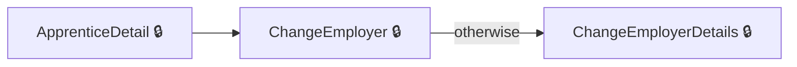
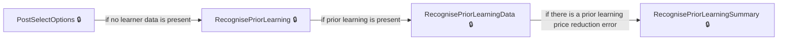
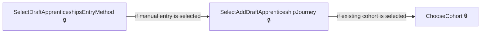
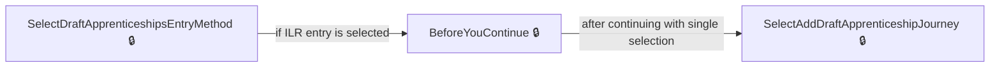
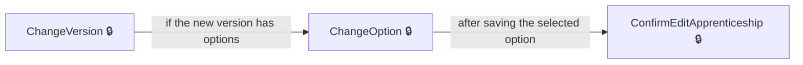
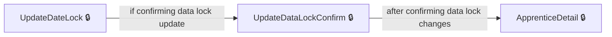

# User journeys: SkillsFundingAgency/das-providercommitments

Generated from `master/src`: 113 pages, 143 transitions, 6 journeys. 🔒 means sign-in is required. Dotted arrows return to a hub.

## Change an Apprentice's Employer

Change the employer for an apprentice, completing the required steps and obtaining confirmation.

## Record and Review Prior Learning

Record and verify prior learning for a draft apprenticeship as part of the apprenticeship setup.

## Add New Apprentice to Cohort (Manual Entry)

Add a new apprentice to a cohort using manual entry by choosing method and following the input sequence.

## Add New Apprentice Using ILR Data

Use ILR or data services to add a new apprentice to a cohort, creating a new cohort if required.

## Change Apprentice Version

Change the version of an apprenticeship and handle resulting options or confirmation.

## Handle Data Lock for Apprentice

Manage a data lock on an apprenticeship by confirming the update and reviewing details.

## Pages

| Page | Route | Sign-in | Purpose |
| --- | --- | --- | --- |
| `Apprentice.ChangeHistory` | `{providerId}/apprentices/{apprenticeshipHashedId}/change-history` | Yes | Displays the change history for a specific apprentice. |
| `Apprentice.ChangeOption` | `{providerId}/apprentices/{apprenticeshipHashedId}/edit/change-option` | Yes | Lets the user select or change the option for an apprenticeship edit. |
| `Apprentice.ConfirmEditApprenticeship` | `{providerId}/apprentices/{apprenticeshipHashedId}/edit/confirm` | Yes | Allows the user to confirm the edits made to an apprentice's record. |
| `Apprentice.DeclinedChanges` | `{providerId}/apprentices/{apprenticeshipHashedId}/declined-changes` | Yes | Shows information about declined changes to the apprentice record. |
| `Apprentice.EditApprenticeship` | `{providerId}/apprentices/{apprenticeshipHashedId}/edit` | Yes | Lets the user edit the details of an apprenticeship. |
| `Apprentice.EditApprenticeshipCourse` | `{providerId}/apprentices/{apprenticeshipHashedId}/edit/select-course` | Yes | Enables the user to select or edit the course for the apprenticeship. |
| `Apprentice.GetAllChangeHistory` | `{providerId}/apprentices/change-history` | Yes | Shows the change history for all apprenticeships. |
| `Apprentice.InvalidIlrChanges` | `{providerId}/apprentices/{apprenticeshipHashedId}/invalid-ilr-changes` | Yes | Displays information about invalid ILR changes for an apprenticeship. |
| `Apprentice.ResendEmailInvitation` | `{providerId}/apprentices/{apprenticeshipHashedId}/details/resend-email-invitation` | Yes | Allows the user to resend an invitation email to the apprentice. |
| `Apprentice.ReviewApprenticeshipUpdates` | `{providerId}/apprentices/{apprenticeshipHashedId}/changes/review` | Yes | Lets the user review updates or proposed changes to an apprenticeship. |
| `Apprentice.SelectDeliveryModelForEdit` | `{providerId}/apprentices/{apprenticeshipHashedId}/edit/select-delivery-model` | Yes | Lets the user select a delivery model while editing an apprenticeship. |
| `Apprentice.SetCourseForEdit` | `{providerId}/apprentices/{apprenticeshipHashedId}/edit/select-course` | Yes | Handles setting the course for an apprenticeship being edited. |
| `Apprentice.SetDeliveryModelForEdit` | `{providerId}/apprentices/{DraftApprenticeshipHashedId}/edit/select-delivery-model` | Yes | Handles setting the delivery model for an apprenticeship being edited. |
| `Apprentice.ViewApprenticeshipUpdates` | `{providerId}/apprentices/{apprenticeshipHashedId}/changes/view` | Yes | Lets the user view updates made to an apprenticeship, with the option to undo changes. |
| `ApprenticeConfirm` | `{providerId}/apprentices/{apprenticeshipHashedId}/change-employer/confirm` | Yes | Allows the user to confirm a change of employer for an apprentice. |
| `ApprenticeConfirmEmployer` | `{providerId}/apprentices/{apprenticeshipHashedId}/change-employer/confirm-employer` | Yes | Allows the provider to confirm the selected employer for an apprentice. |
| `ApprenticeDelete` | `{providerId}/unapproved/{cohortReference}/apprentices/{DraftApprenticeshipHashedId}/Delete` | Yes | Lets the provider delete a draft apprenticeship from a cohort. |
| `ApprenticeDetail` | `{providerId}/apprentices/{apprenticeshipHashedId}` | Yes | Displays detailed information about a specific apprentice. |
| `ApprenticeEmail` | `{providerId}/unapproved/{cohortReference}/apprentices/{DraftApprenticeshipHashedId}/email` | Yes | Allows the provider to view or edit the apprentice's email address. |
| `ApprenticePrice` | `{providerId}/apprentices/{apprenticeshipHashedId}/change-employer/price` | Yes | Lets the provider set or review the price for an apprentice after changing the employer. |
| `ApprenticeReviewApprenticeshipUpdates` | `{providerId}/apprentices/{apprenticeshipHashedId}/changes/review` | Yes | Allows the provider to review and approve or reject updates for an apprentice. |
| `ApprenticeSelectDeliveryModel` | `{providerId}/apprentices/{apprenticeshipHashedId}/change-employer/select-delivery-model` | Yes | Lets the provider select a delivery model for an apprentice when changing employer. |
| `ApprenticeSelectEmployer` | `{providerId}/apprentices/{apprenticeshipHashedId}/change-employer/select-employer` | Yes | Allows the provider to select a new employer for an apprentice. |
| `ApprenticeSent` | `{providerId}/apprentices/{apprenticeshipHashedId}/change-employer/sent` | Yes | Displays confirmation that the change of employer request has been sent. |
| `ApprenticeTrainingDates` | `{providerId}/apprentices/{apprenticeshipHashedId}/change-employer/training-dates` | Yes | Lets the provider set training dates for an apprentice after changing employer. |
| `ApprenticeViewApprenticeshipUpdates` | `{providerId}/apprentices/{apprenticeshipHashedId}/changes/view` | Yes | Shows the provider a summary of pending apprenticeship updates for an apprentice. |
| `ApprenticesIndex` | `{providerId}/apprentices` | Yes | Lists all apprentices for a provider. |
| `CancelInProgressChangeOfCircumstance` | `{providerId}/apprentices/{apprenticeshipHashedId}/cancel-change-of-circumstance` | Yes | Allows the provider to cancel an in-progress change of circumstances for an apprentice. |
| `ChangeEmployer` | `{providerId}/apprentices/{apprenticeshipHashedId}/change-employer` | Yes | Starts the change of employer process for an apprentice. |
| `ChangeEmployerDetails` | `{providerId}/apprentices/{apprenticeshipHashedId}/change-employer/change-employer-details` | Yes | Displays the details entered for the change of employer request. |
| `ChangeEmployerInform` | `{providerId}/apprentices/{apprenticeshipHashedId}/change-employer/inform` | Yes | Informs the provider about requirements or impacts when changing employer for an apprentice. |
| `ChangeEmployerOverlapAlert` | `{providerId}/apprentices/{apprenticeshipHashedId}/change-employer/overlap-alert` | Yes | Alerts the provider to overlapping training dates when changing employer for an apprentice. |
| `ChangeOption` | `{providerId}/apprentices/{apprenticeshipHashedId}/edit/change-option` | Yes | Lets the provider change the apprenticeship option for an apprentice. |
| `ChangeVersion` | `{providerId}/apprentices/{apprenticeshipHashedId}/edit/change-version` | Yes | Lets the provider update the version of the apprenticeship for an apprentice. |
| `ChooseCohort` | `{providerId}/unapproved/choose-cohort` | Yes | Lets the provider choose a cohort for adding an apprentice. |
| `Cohort.Acknowledgement` | `{providerId}/unapproved/{cohortReference}/Acknowledgement` | Yes | Displays an acknowledgement message after cohort actions. |
| `Cohort.AddNewDraftApprenticeship` | `{providerId}/unapproved/add-apprentice` | Yes | Lets the provider add a new draft apprentice to a cohort. |
| `Cohort.BeforeYouContinue` | `{providerId}/unapproved/add/before-you-continue` | Yes | Shows information to the provider before continuing with learner data selection. |
| `Cohort.BeforeYouContinueMultiSelect` | `{providerId}/unapproved/add/before-you-continue-multi-select` | Yes | Shows information before continuing with multiple learner data selections. |
| `Cohort.ConfirmEmployer` | `{providerId}/unapproved/add/confirm-employer` | Yes | Lets the provider confirm the employer for a new cohort when adding apprenticeships. |
| `Cohort.Delete` | `{providerId}/unapproved/{cohortReference}/details/delete` | Yes | Allows the provider to delete an unapproved cohort. |
| `Cohort.Details` | `{providerId}/unapproved/{cohortReference}` | Yes | Shows the details of an unapproved cohort, including options for action. |
| `Cohort.FileUploadAmendedFile` | `{providerId}/unapproved/add/file-upload/amended-file` | Yes | Lets the provider confirm uploading an amended file for bulk addition of apprenticeships. |
| `Cohort.FileUploadDiscard` | `{providerId}/unapproved/add/file-upload/discard-file` | Yes | Lets the provider discard a file uploaded for bulk addition of apprenticeships. |
| `Cohort.FileUploadInform` | `{providerId}/unapproved/add/file-upload/inform` | Yes | Informs the provider about how to upload apprentice information in bulk. |
| `Cohort.FileUploadReview` | `{providerId}/unapproved/add/file-upload/review` | Yes | Lets the provider review the uploaded file for apprenticeships before submitting. |
| `Cohort.FileUploadReviewApprentices` | `{providerId}/unapproved/add/file-upload/review-cohort` | Yes | Lets the provider review apprentices to be added from a file upload. |
| `Cohort.FileUploadReviewDelete` | `{providerId}/unapproved/add/file-upload/review-delete` | Yes | Handles deletion review after discarding a previously uploaded file. |
| `Cohort.FileUploadStart` | `{providerId}/unapproved/add/file-upload/start` | Yes | Lets the provider start the file upload process to add apprenticeships in bulk. |
| `Cohort.NoDeclaredStandards` | `{providerId}/unapproved/NoDeclaredStandards` | Yes | Informs the provider that there are no declared standards available for the employer or cohort. |
| `Cohort.SelectAddDraftApprenticeshipJourney` | `{providerId}/unapproved/add/select-journey` | Yes | Lets the provider choose to add apprenticeships to an existing or new cohort. |
| `Cohort.SelectCourse` | `{providerId}/unapproved/add/select-course` | Yes | Lets the provider select the training course for apprentices being added. |
| `Cohort.SelectDeliveryModel` | `{providerId}/unapproved/add/select-delivery-model` | Yes | Lets the provider select the delivery model for apprentices being added. |
| `Cohort.SelectDraftApprenticeshipsEntryMethod` | `{providerId}/unapproved/add/entry-method` | Yes | Lets the provider choose how to enter apprenticeships for a cohort (e.g., ILR, bulk upload, manual). |
| `Cohort.SelectHowManyLearnersToAdd` | `{providerId}/unapproved/add/how-many-learners` | Yes | Lets the provider choose how many learners to add to a new cohort. |
| `Cohort.SelectHowToAddApprentice` | `{providerId}/unapproved/add/select-how` | Yes | Lets the provider select the method for adding an apprentice to a new cohort. |
| `Cohort.SetDeliveryModel` | `{providerId}/unapproved/add/select-delivery-model` | Yes | Lets the provider choose the delivery model for apprenticeships in the cohort. |
| `CohortAddApprenticeship` | `{providerId}/unapproved/add/apprenticeship` | Yes | Allows the provider to add apprenticeship details to the cohort. |
| `CohortDraft` | `{providerId}/unapproved/draft` | Yes | Shows draft cohorts that have not been approved by the provider. |
| `CohortReview` | `{providerId}/unapproved/review` | Yes | Allows the provider to review unapproved cohorts before final submission. |
| `CohortWithEmployer` | `{providerId}/unapproved/with-employer` | Yes | Displays unapproved cohorts currently with the employer for review or action. |
| `CohortWithTransferSender` | `{providerId}/unapproved/with-transfer-sender` | Yes | Displays unapproved cohorts that involve a transfer sender. |
| `ConfirmRestart` | `{providerId}/apprentices/{apprenticeshipHashedId}/datalock/confirmrestart` | Yes | Lets the provider confirm restarting an apprentice after a data lock issue. |
| `CreateCohortAndAddFirstApprenticeship` | `{providerId}/unapproved/add/apprenticeship` | Yes | Lets the provider create a cohort and add the first apprenticeship to it. |
| `Dashboard` | `{providerId}/dashboard` | Yes | Redirects the user to the provider dashboard. |
| `DeclinedChanges` | `{providerId}/apprentices/{apprenticeshipHashedId}/declined-changes` | Yes | Shows the provider the declined changes for an apprentice. |
| `DownloadApprentices` | `{providerId}/apprentices/download` | Yes | Lets the provider download a list of apprentices. |
| `DraftApprenticeship.AddAnotherSelectMethod` | `{providerId}/unapproved/{cohortReference}/apprentices/add/select-how` | Yes | Lets the provider choose a method for adding another apprentice to the cohort. |
| `DraftApprenticeship.AddDraftApprenticeship` | `{providerId}/unapproved/{cohortReference}/apprentices/add/details` | Yes | Lets the provider enter the details for a new draft apprenticeship. |
| `DraftApprenticeship.AddEmail` | `{providerId}/unapproved/{cohortReference}/apprentices/{DraftApprenticeshipHashedId}/email` | Yes | Lets the provider add or update the email address for the draft apprenticeship. |
| `DraftApprenticeship.AddNewDraftApprenticeship` | `{providerId}/unapproved/{cohortReference}/apprentices/add` | Yes | Starts the process of adding a new draft apprenticeship to the cohort. |
| `DraftApprenticeship.EditDraftApprenticeship` | `{providerId}/unapproved/{cohortReference}/apprentices/{DraftApprenticeshipHashedId}/edit` | Yes | Lets the provider edit the details of a draft apprenticeship. |
| `DraftApprenticeship.EditDraftApprenticeshipCourse` | `{providerId}/unapproved/{cohortReference}/apprentices/{DraftApprenticeshipHashedId}/edit/select-course` | Yes | Lets the provider select or edit the course for a draft apprenticeship. |
| `DraftApprenticeship.GetReservationId` | `{providerId}/unapproved/{cohortReference}/apprentices/add/reservation` | Yes | Redirects the provider to select a funding reservation for adding another apprentice. |
| `DraftApprenticeship.PostSelectOptions` | `{providerId}/unapproved/{cohortReference}/apprentices/{DraftApprenticeshipHashedId}/select-options` | Yes | Handles saving the selected options for the draft apprenticeship's course. |
| `DraftApprenticeship.RecognisePriorLearningData` | `{providerId}/unapproved/{cohortReference}/apprentices/{DraftApprenticeshipHashedId}/recognise-prior-learning-data` | Yes | Lets the provider enter prior learning data for the draft apprenticeship. |
| `DraftApprenticeship.RecognisePriorLearningSummary` | `{providerId}/unapproved/{cohortReference}/apprentices/{DraftApprenticeshipHashedId}/recognise-prior-learning-summary` | Yes | Shows a summary and validation for entered prior learning data. |
| `DraftApprenticeship.SelectDeliveryModel` | `{providerId}/unapproved/{cohortReference}/apprentices/add/select-delivery-model` | Yes | Lets the provider choose the delivery model for a new draft apprenticeship. |
| `DraftApprenticeship.SelectDeliveryModelForEdit` | `{providerId}/unapproved/{cohortReference}/apprentices/{DraftApprenticeshipHashedId}/edit/select-delivery-model` | Yes | Lets the provider select or edit the delivery model for an existing draft apprenticeship. |
| `DraftApprenticeship.SelectOptions` | `{providerId}/unapproved/{cohortReference}/apprentices/{DraftApprenticeshipHashedId}/select-options` | Yes | Lets the provider select an option for the apprenticeship standard. |
| `DraftApprenticeship.SetDeliveryModel` | `{providerId}/unapproved/{cohortReference}/apprentices/add/select-delivery-model` | Yes | Allows the user to select the delivery model for a new draft apprenticeship record. |
| `DraftApprenticeship.SetDeliveryModelForEdit` | `{providerId}/unapproved/{cohortReference}/apprentices/{DraftApprenticeshipHashedId}/edit/select-delivery-model` | Yes | Lets the user choose the delivery model when editing an existing draft apprenticeship. |
| `DraftApprenticeship.SetReference` | `{providerId}/unapproved/{cohortReference}/apprentices/{DraftApprenticeshipHashedId}/reference` | Yes | Lets the user view or set a reference for a draft apprenticeship record. |
| `DraftApprenticeship.ViewDraftApprenticeship` | `{providerId}/unapproved/{cohortReference}/apprentices/{DraftApprenticeshipHashedId}` | Yes | Shows details of a draft apprenticeship record. |
| `DraftApprenticeshipAddAnother` | `{providerId}/unapproved/{cohortReference}/apprentices/add/details` | Yes | Displays the form for entering apprentice details when adding another to the cohort. |
| `DraftApprenticeshipEdit` | `{providerId}/unapproved/{cohortReference}/apprentices/{DraftApprenticeshipHashedId}/edit` | Yes | Allows the user to edit an existing draft apprenticeship. |
| `EditApprenticeship` | `{providerId}/apprentices/{apprenticeshipHashedId}/edit` | Yes | Lets the provider edit details of an apprentice's apprenticeship. |
| `InvalidIlrChanges` | `{providerId}/apprentices/{apprenticeshipHashedId}/invalid-ilr-changes` | Yes | Shows details of invalid ILR changes to the provider. |
| `Learner.LearnerSelectedForNewCohort` | `{providerId}/unapproved/add/learners/select/{learnerDataId}` | Yes | Initiates the process of creating a new cohort and adding an apprentice using learner data. |
| `Learner.LearnerToBeAddedToCohort` | `{providerId}/unapproved/add-another/learners/select/{learnerDataId}` | Yes | Adds a learner to an existing cohort as an apprentice. |
| `NewCohortSelectEmployer` | `{providerId}/unapproved/add/select-employer` | Yes | Lets the provider select an employer for a new cohort. |
| `NewCohortSelectEmployerRedirect` | `{providerId}/unapproved/add/select-employer-redirect` | Yes | Redirects the provider to select multiple learner records after choosing an employer. |
| `ProviderAccountIndex` | — | Yes | Redirects the user to their cohort overview page based on their identity. |
| `ProviderSignOut` | `signout` | Yes | Signs the user out of the provider service. |
| `RecognisePriorLearning` | `{providerId}/unapproved/{cohortReference}/apprentices/{DraftApprenticeshipHashedId}/recognise-prior-learning` | Yes | Lets the user identify and confirm prior learning for an apprentice. |
| `RecognisePriorLearningData` | `{providerId}/unapproved/{cohortReference}/apprentices/{DraftApprenticeshipHashedId}/recognise-prior-learning-data` | Yes | Lets the user input detailed prior learning data for a draft apprenticeship. |
| `RecognisePriorLearningDataRemove` | `{providerId}/unapproved/{cohortReference}/apprentices/{DraftApprenticeshipHashedId}/recognise-prior-learning-data-remove` | Yes | Lets the user remove prior learning data from an apprenticeship record. |
| `RequestRestart` | `{providerId}/apprentices/{apprenticeshipHashedId}/datalock/requestrestart` | Yes | Lets the provider request a restart of an apprenticeship following a data lock. |
| `SelectCourse` | `{providerId}/unapproved/{cohortReference}/apprentices/add/select-course` | Yes | Allows the user to select the training course for a new draft apprenticeship. |
| `SelectLearnerRecord` | `{providerId}/unapproved/add/learners/select` | Yes | Displays the list of learner records for selection when adding apprentices via ILR data. |
| `SelectMultipleChangeEmployer` | `{providerId}/unapproved/add/change-employer` | Yes | Allows the provider to change the employer for multiple learners during cohort creation. |
| `SelectMultipleChangeEmployerRedirect` | `{providerId}/unapproved/add/change-employer-redirect` | Yes | Redirects the provider to select multiple learner records after changing employer. |
| `SelectMultipleLearnerRecords` | `{providerId}/unapproved/add/learners/select-multiple` | Yes | Allows the user to select multiple learner records for cohort creation. |
| `SelectMultipleLearnerRecordsAdd` | `{providerId}/unapproved/add/learners/select-multiple-add` | Yes | Lets the user add multiple learner records to their current selection. |
| `SelectMultipleLearnerRecordsFilter` | `{providerId}/unapproved/add/learners/select-multiple-filter` | Yes | Lets the user filter the list of learner records for multiple selection. |
| `SelectMultipleLearnerRecordsRemove` | `{providerId}/unapproved/add/learners/select-multiple-remove` | Yes | Lets the user remove learner records from their multiple selection. |
| `SelectMultipleLearnerRecordsSort` | `{providerId}/unapproved/add/learners/select-multiple-sort` | Yes | Lets the user sort the list of learner records for multiple selection. |
| `SuccessSaveDraft` | `{providerId}/unapproved/add/file-upload/success-save-draft` | Yes | Displays a success message when draft apprenticeships are saved after file upload. |
| `SuccessSendToEmployer` | `{providerId}/unapproved/add/file-upload/success` | Yes | Shows a success message when apprenticeships are sent to the employer after file upload. |
| `UpdateDataLockConfirm` | `{providerId}/apprentices/{apprenticeshipHashedId}/datalock/confirm` | Yes | Lets the provider confirm changes made for data locks on apprenticeships. |
| `UpdateDateLock` | `{providerId}/apprentices/{apprenticeshipHashedId}/datalock` | Yes | Lets the provider update information related to a data lock for an apprentice. |
| `setReference` | `{providerId}/unapproved/{cohortReference}/apprentices/{DraftApprenticeshipHashedId}/reference` | Yes | Handles the submission of reference details for a draft apprenticeship. |
| `signed-out` | `~/signed-out` | No | Shows a sign-out confirmation or redirects to the start page. |
