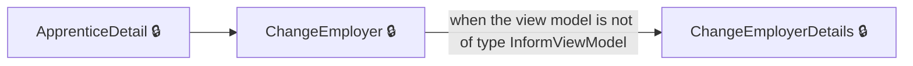
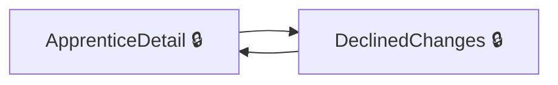
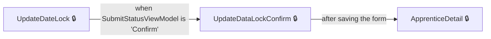
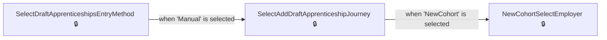
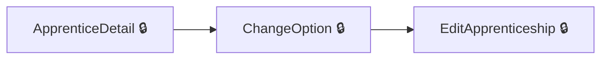

# User journeys: SkillsFundingAgency/das-providercommitments

Generated from `master/src`: 115 pages, 146 transitions, 5 journeys. 🔒 means sign-in is required. Dotted arrows return to a hub.

## Change employer for an apprentice

The provider starts the employer change process for an apprentice, providing required details and confirming.

## Handle declined or invalid changes for apprentices

The provider reviews and acknowledges declined or invalid changes to apprentice records.

## Fix a datalock mismatch for an apprentice

The provider resolves a datalock issue for an apprentice by following the restart request or confirmation process.

## Add a new draft apprenticeship cohort manually

The provider starts adding a new draft apprenticeship manually, choosing journey and employer, course, delivery model, and adds the apprenticeship.

## Edit an apprentice’s details via options

The provider edits an apprentice record by choosing which part to edit via the options screen and confirms the change.

## Pages

| Page | Route | Sign-in | Purpose |
| --- | --- | --- | --- |
| `Apprentice.ChangeHistory` | `{providerId}/apprentices/{apprenticeshipHashedId}/change-history` | Yes | Shows the change history for a specific apprentice. |
| `Apprentice.ChangeOption` | `{providerId}/apprentices/{apprenticeshipHashedId}/edit/change-option` | Yes | Lets the user change the apprenticeship option for an apprentice. |
| `Apprentice.ConfirmEditApprenticeship` | `{providerId}/apprentices/{apprenticeshipHashedId}/edit/confirm` | Yes | Lets the provider confirm the changes they have made to an apprentice record. |
| `Apprentice.DeclinedChanges` | `{providerId}/apprentices/{apprenticeshipHashedId}/declined-changes` | Yes | Displays details about declined changes for a specific apprenticeship. |
| `Apprentice.EditApprenticeship` | `{providerId}/apprentices/{apprenticeshipHashedId}/edit` | Yes | Allows editing of details for a specific apprenticeship. |
| `Apprentice.EditApprenticeshipCourse` | `{providerId}/apprentices/{apprenticeshipHashedId}/edit/select-course` | Yes | Lets the user select a new training course for the apprenticeship. |
| `Apprentice.GetAllChangeHistory` | `{providerId}/apprentices/change-history` | Yes | Shows the change history for all apprentices. |
| `Apprentice.InvalidIlrChanges` | `{providerId}/apprentices/{apprenticeshipHashedId}/invalid-ilr-changes` | Yes | Displays information about invalid ILR (Individualised Learner Record) changes for an apprenticeship. |
| `Apprentice.ResendEmailInvitation` | `{providerId}/apprentices/{apprenticeshipHashedId}/details/resend-email-invitation` | Yes | Resends the email invitation for an apprentice. |
| `Apprentice.ReviewApprenticeshipUpdates` | `{providerId}/apprentices/{apprenticeshipHashedId}/changes/review` | Yes | Allows review and approval or rejection of pending apprenticeship updates. |
| `Apprentice.SelectDeliveryModelForEdit` | `{providerId}/apprentices/{apprenticeshipHashedId}/edit/select-delivery-model` | Yes | Lets the user select a delivery model while editing an apprenticeship. |
| `Apprentice.SetCourseForEdit` | `{providerId}/apprentices/{apprenticeshipHashedId}/edit/select-course` | Yes | Processes the selected course when editing an apprenticeship. |
| `Apprentice.SetDeliveryModelForEdit` | `{providerId}/apprentices/{DraftApprenticeshipHashedId}/edit/select-delivery-model` | Yes | Processes the selected delivery model when editing an apprenticeship. |
| `Apprentice.ViewApprenticeshipUpdates` | `{providerId}/apprentices/{apprenticeshipHashedId}/changes/view` | Yes | Shows pending changes for an apprenticeship and allows undoing them. |
| `ApprenticeConfirm` | `{providerId}/apprentices/{apprenticeshipHashedId}/change-employer/confirm` | Yes | Allows confirmation of the change-of-employer process for an apprenticeship. |
| `ApprenticeConfirmEmployer` | `{providerId}/apprentices/{apprenticeshipHashedId}/change-employer/confirm-employer` | Yes | Asks the provider to confirm the new employer for the learner record. |
| `ApprenticeDelete` | `{providerId}/unapproved/{cohortReference}/apprentices/{DraftApprenticeshipHashedId}/Delete` | Yes | Lets the provider confirm removal of the draft apprenticeship record. |
| `ApprenticeDetail` | `{providerId}/apprentices/{apprenticeshipHashedId}` | Yes | Shows the details of an individual apprentice. |
| `ApprenticeEmail` | `{providerId}/unapproved/{cohortReference}/apprentices/{DraftApprenticeshipHashedId}/email` | Yes | Lets the user add or edit the apprentice's email address. |
| `ApprenticePrice` | `{providerId}/apprentices/{apprenticeshipHashedId}/change-employer/price` | Yes | Lets the user set the price (and employment price if applicable) for the apprenticeship when changing employer. |
| `ApprenticeReviewApprenticeshipUpdates` | `{providerId}/apprentices/{apprenticeshipHashedId}/changes/review` | Yes | Allows the user to review and approve or reject proposed changes to apprenticeship details. |
| `ApprenticeSelectDeliveryModel` | `{providerId}/apprentices/{apprenticeshipHashedId}/change-employer/select-delivery-model` | Yes | Lets the user select the delivery model for the apprenticeship. |
| `ApprenticeSelectEmployer` | `{providerId}/apprentices/{apprenticeshipHashedId}/change-employer/select-employer` | Yes | Lets the user search for and select a new employer during the change-of-employer process. |
| `ApprenticeSent` | `{providerId}/apprentices/{apprenticeshipHashedId}/change-employer/sent` | Yes | Lets the provider know that the change of employer has been saved and sent to the employer to approve. |
| `ApprenticeTrainingDates` | `{providerId}/apprentices/{apprenticeshipHashedId}/change-employer/training-dates` | Yes | Lets the user provide training dates for the apprenticeship when changing employer. |
| `ApprenticeViewApprenticeshipUpdates` | `{providerId}/apprentices/{apprenticeshipHashedId}/changes/view` | Yes | Allows the user to view and optionally undo recent changes to the apprenticeship. |
| `ApprenticesIndex` | `{providerId}/apprentices` | Yes | Lets the provider search and filter their list of apprentices. |
| `CancelInProgressChangeOfCircumstance` | `{providerId}/apprentices/{apprenticeshipHashedId}/cancel-change-of-circumstance` | Yes | Cancels any in-progress change to an apprentice's circumstances and returns to their details. |
| `ChangeEmployer` | `{providerId}/apprentices/{apprenticeshipHashedId}/change-employer` | Yes | Starts the process to change an apprentice's employer. |
| `ChangeEmployerDetails` | `{providerId}/apprentices/{apprenticeshipHashedId}/change-employer/change-employer-details` | Yes | Shows the details of the employer change request for an apprentice. |
| `ChangeEmployerInform` | `{providerId}/apprentices/{apprenticeshipHashedId}/change-employer/inform` | Yes | Informs the provider about conditions or information related to changing an apprentice’s employer. |
| `ChangeEmployerOverlapAlert` | `{providerId}/apprentices/{apprenticeshipHashedId}/change-employer/overlap-alert` | Yes | Alerts the provider of any overlapping training dates when changing an apprentice's employer. |
| `ChangeOption` | `{providerId}/apprentices/{apprenticeshipHashedId}/edit/change-option` | Yes | Lets the user select an option to change for the apprenticeship, such as course, delivery model, or version. |
| `ChangeVersion` | `{providerId}/apprentices/{apprenticeshipHashedId}/edit/change-version` | Yes | Allows the provider to change the version of the apprentice's training course. |
| `ChooseCohort` | `{providerId}/unapproved/choose-cohort` | Yes | Lets the user choose a cohort to work with. |
| `Cohort.Acknowledgement` | `{providerId}/unapproved/{cohortReference}/Acknowledgement` | Yes | Shows acknowledgement after sending or approving a cohort. |
| `Cohort.AddNewDraftApprenticeship` | `{providerId}/unapproved/add-apprentice` | Yes | Starts the process of adding a new draft apprenticeship to a cohort. |
| `Cohort.BeforeYouContinue` | `{providerId}/unapproved/add/before-you-continue` | Yes | Prepares the user before continuing to the draft apprenticeship journey. |
| `Cohort.BeforeYouContinueMultiSelect` | `{providerId}/unapproved/add/before-you-continue-multi-select` | Yes | Prepares the user before continuing to add multiple draft apprenticeships. |
| `Cohort.ConfirmEmployer` | `{providerId}/unapproved/add/confirm-employer` | Yes | Lets the provider confirm the selected employer before adding learner details. |
| `Cohort.Delete` | `{providerId}/unapproved/{cohortReference}/details/delete` | Yes | Lets the user confirm they want to remove the entire cohort and all its learners. |
| `Cohort.Details` | `{providerId}/unapproved/{cohortReference}` | Yes | Shows details for a cohort, and lets the user choose actions such as approving, sending, or making requests. |
| `Cohort.FileUploadAmendedFile` | `{providerId}/unapproved/add/file-upload/amended-file` | Yes | Lets the user confirm they want to upload a new (amended) file for the cohort bulk upload. |
| `Cohort.FileUploadDiscard` | `{providerId}/unapproved/add/file-upload/discard-file` | Yes | Lets the user confirm whether they want to discard a file uploaded as part of the cohort bulk upload process. |
| `Cohort.FileUploadInform` | `{providerId}/unapproved/add/file-upload/inform` | Yes | Informs the user about the file upload process for adding apprentices in bulk. |
| `Cohort.FileUploadReview` | `{providerId}/unapproved/add/file-upload/review` | Yes | Lets the provider review the details from the uploaded file and choose how to proceed. |
| `Cohort.FileUploadReviewApprentices` | `{providerId}/unapproved/add/file-upload/review-cohort` | Yes | Displays the list of apprentices from the uploaded file for review. |
| `Cohort.FileUploadReviewDelete` | `{providerId}/unapproved/add/file-upload/review-delete` | Yes | Allows reviewing or deleting a file upload (for bulk apprentice entry). |
| `Cohort.FileUploadStart` | `{providerId}/unapproved/add/file-upload/start` | Yes | Lets the user start the process of uploading an apprentice file for bulk upload. |
| `Cohort.NoDeclaredStandards` | `{providerId}/unapproved/NoDeclaredStandards` | Yes | Informs the user that no standards have been declared for the cohort. |
| `Cohort.SelectAddDraftApprenticeshipJourney` | `{providerId}/unapproved/add/select-journey` | Yes | Lets the provider choose whether to create a new cohort or add to an existing one. |
| `Cohort.SelectCourse` | `{providerId}/unapproved/add/select-course` | Yes | Lets the provider select the apprenticeship training course for the learner. |
| `Cohort.SelectDeliveryModel` | `{providerId}/unapproved/add/select-delivery-model` | Yes | Lets the user select the delivery model for the apprenticeship before proceeding to add the first apprentice. |
| `Cohort.SelectDraftApprenticeshipsEntryMethod` | `{providerId}/unapproved/add/entry-method` | Yes | Lets the provider select how they want to add draft apprenticeship details. |
| `Cohort.SelectHowManyLearnersToAdd` | `{providerId}/unapproved/add/how-many-learners` | Yes | Lets the provider select how many learners they want to add. |
| `Cohort.SelectHowToAddApprentice` | `{providerId}/unapproved/add/select-how` | Yes | Lets the provider choose how to add learner details. |
| `Cohort.SetDeliveryModel` | `{providerId}/unapproved/add/select-delivery-model` | Yes | Lets the user select the delivery model for a cohort or apprenticeship. |
| `CohortAddApprenticeship` | `{providerId}/unapproved/add/apprenticeship` | Yes | Lets the user add a draft apprenticeship to a cohort. |
| `CohortDraft` | `{providerId}/unapproved/draft` | Yes | Shows draft cohorts that haven't been fully processed. |
| `CohortReview` | `{providerId}/unapproved/review` | Yes | Lets the user review cohorts before approval or sending. |
| `CohortWithEmployer` | `{providerId}/unapproved/with-employer` | Yes | Shows cohorts that are with the employer for review or approval. |
| `CohortWithTransferSender` | `{providerId}/unapproved/with-transfer-sender` | Yes | Shows cohorts with a transfer sender for the provider. |
| `ConfirmRestart` | `{providerId}/apprentices/{apprenticeshipHashedId}/datalock/confirmrestart` | Yes | Lets the provider confirm sending a data lock restart request to the employer. |
| `CreateCohortAndAddFirstApprenticeship` | `{providerId}/unapproved/add/apprenticeship` | Yes | Lets the provider add the first apprenticeship to a new cohort. |
| `Dashboard` | `{providerId}/dashboard` | Yes | Redirects the provider to the main dashboard where overall account and apprenticeship information can be accessed. |
| `DeclinedChanges` | `{providerId}/apprentices/{apprenticeshipHashedId}/declined-changes` | Yes | Allows the provider to acknowledge or handle declined changes for an apprentice. |
| `DownloadApprentices` | `{providerId}/apprentices/download` | Yes | Lets the provider download a file containing their apprentices’ data. |
| `DraftApprenticeship.AddAnotherSelectMethod` | `{providerId}/unapproved/{cohortReference}/apprentices/add/select-how` | Yes | Lets the provider choose how to add learner details to a cohort. |
| `DraftApprenticeship.AddDraftApprenticeship` | `{providerId}/unapproved/{cohortReference}/apprentices/add/details` | Yes | Allows the user to add details for a new draft apprenticeship record. |
| `DraftApprenticeship.AddEmail` | `{providerId}/unapproved/{cohortReference}/apprentices/{DraftApprenticeshipHashedId}/email` | Yes | Processes the form submission to add an email address to a draft apprenticeship. |
| `DraftApprenticeship.AddNewDraftApprenticeship` | `{providerId}/unapproved/{cohortReference}/apprentices/add` | Yes | Begins the process of adding a new draft apprenticeship. |
| `DraftApprenticeship.EditDraftApprenticeship` | `{providerId}/unapproved/{cohortReference}/apprentices/{DraftApprenticeshipHashedId}/edit` | Yes | Allows the user to edit details for a draft apprenticeship. |
| `DraftApprenticeship.EditDraftApprenticeshipCourse` | `{providerId}/unapproved/{cohortReference}/apprentices/{DraftApprenticeshipHashedId}/edit/select-course` | Yes | Allows the provider to select and edit the apprenticeship training course for a learner. |
| `DraftApprenticeship.GetReservationId` | `{providerId}/unapproved/{cohortReference}/apprentices/add/reservation` | Yes | Redirects the user to select a reservation for the draft apprenticeship. |
| `DraftApprenticeship.PostSelectOptions` | `{providerId}/unapproved/{cohortReference}/apprentices/{DraftApprenticeshipHashedId}/select-options` | Yes | Processes the form submission for selecting standard options for an apprenticeship. |
| `DraftApprenticeship.RecognisePriorLearningData` | `{providerId}/unapproved/{cohortReference}/apprentices/{DraftApprenticeshipHashedId}/recognise-prior-learning-data` | Yes | Lets the user enter data about prior learning for the apprenticeship. |
| `DraftApprenticeship.RecognisePriorLearningSummary` | `{providerId}/unapproved/{cohortReference}/apprentices/{DraftApprenticeshipHashedId}/recognise-prior-learning-summary` | Yes | Shows a summary of the recognition of prior learning entered for the apprenticeship. |
| `DraftApprenticeship.SelectDeliveryModel` | `{providerId}/unapproved/{cohortReference}/apprentices/add/select-delivery-model` | Yes | Enables the user to select the delivery model for the apprenticeship. |
| `DraftApprenticeship.SelectDeliveryModelForEdit` | `{providerId}/unapproved/{cohortReference}/apprentices/{DraftApprenticeshipHashedId}/edit/select-delivery-model` | Yes | Allows the provider to select the delivery model for an apprenticeship when editing. |
| `DraftApprenticeship.SelectOptions` | `{providerId}/unapproved/{cohortReference}/apprentices/{DraftApprenticeshipHashedId}/select-options` | Yes | Lets the provider select a standard option for the apprentice's course from available options. |
| `DraftApprenticeship.SetDeliveryModel` | `{providerId}/unapproved/{cohortReference}/apprentices/add/select-delivery-model` | Yes | Processes the selected delivery model for a draft apprenticeship. |
| `DraftApprenticeship.SetDeliveryModelForEdit` | `{providerId}/unapproved/{cohortReference}/apprentices/{DraftApprenticeshipHashedId}/edit/select-delivery-model` | Yes | Processes the selected delivery model for an apprenticeship during editing. |
| `DraftApprenticeship.SetReference` | `{providerId}/unapproved/{cohortReference}/apprentices/{DraftApprenticeshipHashedId}/reference` | Yes | Lets the user set or change the internal reference for a draft apprenticeship. |
| `DraftApprenticeship.ViewDraftApprenticeship` | `{providerId}/unapproved/{cohortReference}/apprentices/{DraftApprenticeshipHashedId}` | Yes | Displays the details of a draft apprenticeship record for review. |
| `DraftApprenticeshipAddAnother` | `{providerId}/unapproved/{cohortReference}/apprentices/add/details` | Yes | Starts the process to add another apprentice to the cohort. |
| `DraftApprenticeshipEdit` | `{providerId}/unapproved/{cohortReference}/apprentices/{DraftApprenticeshipHashedId}/edit` | Yes | Allows the provider to edit all details of a draft apprenticeship record. |
| `EditApprenticeship` | `{providerId}/apprentices/{apprenticeshipHashedId}/edit` | Yes | Allows the provider to edit details for a specific apprentice. |
| `InvalidIlrChanges` | `{providerId}/apprentices/{apprenticeshipHashedId}/invalid-ilr-changes` | Yes | Warns the provider about invalid ILR changes for the apprentice. |
| `Learner.LearnerSelectedForNewCohort` | `{providerId}/unapproved/add/learners/select/{learnerDataId}` | Yes | Redirects after a learner is selected to be added to a new cohort. |
| `Learner.LearnerToBeAddedToCohort` | `{providerId}/unapproved/add-another/learners/select/{learnerDataId}` | Yes | Redirects after a learner is chosen to be added to an existing cohort. |
| `Learner.SelectMultipleLearnerRecords` | `{providerId}/unapproved/add/learners/select-multiple` | Yes | Allows the provider to select multiple learners to add to a cohort. |
| `NewCohortSelectEmployer` | `{providerId}/unapproved/add/select-employer` | Yes | Lets the provider search for and select an employer for a new cohort. |
| `NewCohortSelectEmployerRedirect` | `{providerId}/unapproved/add/select-employer-redirect` | Yes | Redirects to select multiple learner records after employer selection. |
| `ProviderAccountIndex` | — | Yes | Entry page that redirects users based on their provider account; initial landing for provider services. |
| `ProviderSignOut` | `signout` | Yes | Signs the provider out of the service. |
| `RecognisePriorLearning` | `{providerId}/unapproved/{cohortReference}/apprentices/{DraftApprenticeshipHashedId}/recognise-prior-learning` | Yes | Allows the provider to indicate whether the apprentice has prior learning to be recognised. |
| `RecognisePriorLearningData` | `{providerId}/unapproved/{cohortReference}/apprentices/{DraftApprenticeshipHashedId}/recognise-prior-learning-data` | Yes | Lets the provider enter details about the apprentice's prior learning, including training hours, price reduction, and duration. |
| `RecognisePriorLearningDataRemove` | `{providerId}/unapproved/{cohortReference}/apprentices/{DraftApprenticeshipHashedId}/recognise-prior-learning-data-remove` | Yes | Removes prior learning data from the apprenticeship record. |
| `RequestRestart` | `{providerId}/apprentices/{apprenticeshipHashedId}/datalock/requestrestart` | Yes | Lets the provider choose how to fix a data lock mismatch. |
| `SelectCourse` | `{providerId}/unapproved/{cohortReference}/apprentices/add/select-course` | Yes | Lets the provider select the apprenticeship training course for the new apprentice. |
| `SelectLearnerRecord` | `{providerId}/unapproved/add/learners/select` | Yes | Lets the provider search and filter learners to select one for a cohort. |
| `SelectMultipleChangeEmployer` | `{providerId}/unapproved/add/change-employer` | Yes | Lets the provider change the employer and search for a new employer for multiple learners. |
| `SelectMultipleChangeEmployerRedirect` | `{providerId}/unapproved/add/change-employer-redirect` | Yes | Redirects to select multiple learner records after changing employer. |
| `SelectMultipleLearnerRecords` | `{providerId}/unapproved/add/learners/select-multiple` | Yes | Allows the provider to search for and filter multiple learners to select for bulk actions such as adding them to a cohort. |
| `SelectMultipleLearnerRecordsAdd` | `{providerId}/unapproved/add/learners/select-multiple-add` | Yes | Redirects the provider after adding multiple learners to a cohort. |
| `SelectMultipleLearnerRecordsFilter` | `{providerId}/unapproved/add/learners/select-multiple-filter` | Yes | Redirects after applying filter to multiple learner records. |
| `SelectMultipleLearnerRecordsRemove` | `{providerId}/unapproved/add/learners/select-multiple-remove` | Yes | Redirects after removing a learner from the multiple selection. |
| `SelectMultipleLearnerRecordsRemoveAll` | `{providerId}/unapproved/add/learners/select-multiple-remove-all` | Yes | Redirects after removing all learners from the multiple selection. |
| `SelectMultipleLearnerRecordsSort` | `{providerId}/unapproved/add/learners/select-multiple-sort` | Yes | Redirects after sorting the selected learners. |
| `SuccessSaveDraft` | `{providerId}/unapproved/add/file-upload/success-save-draft` | Yes | Shows confirmation after successfully saving draft apprenticeships via file upload. |
| `SuccessSendToEmployer` | `{providerId}/unapproved/add/file-upload/success` | Yes | Shows confirmation after successfully sending draft apprenticeships to the employer via file upload. |
| `UpdateDataLockConfirm` | `{providerId}/apprentices/{apprenticeshipHashedId}/datalock/confirm` | Yes | Asks the provider to confirm submitting a request regarding a data lock issue on the apprentice record. |
| `UpdateDateLock` | `{providerId}/apprentices/{apprenticeshipHashedId}/datalock` | Yes | Lets the user choose how to resolve a data lock mismatch for an apprenticeship. |
| `setReference` | `{providerId}/unapproved/{cohortReference}/apprentices/{DraftApprenticeshipHashedId}/reference` | Yes | Allows the provider to set or update their reference for this apprenticeship record. |
| `signed-out` | `~/signed-out` | No | Shows the signed out page or redirects the user after they have signed out of their account. |

## Form fields

Field definitions only: no values a user enters are recorded.

### `Apprentice.ConfirmEditApprenticeship`

| Field | Type | Label | Required | Rules | Options |
| --- | --- | --- | --- | --- | --- |
| `ConfirmChanges` | radios | Do you want to make these changes? | — | required | Yes, change these details, No, don't change these details |

### `Apprentice.EditApprenticeshipCourse`

| Field | Type | Label | Required | Rules | Options |
| --- | --- | --- | --- | --- | --- |
| `CourseCode` | select | Apprenticeship training course | — | — | — |

### `Apprentice.SelectDeliveryModelForEdit`

| Field | Type | Label | Required | Rules | Options |
| --- | --- | --- | --- | --- | --- |
| `DeliveryModel` | radios | Select delivery model | — | — | — |

### `ApprenticeConfirmEmployer`

| Field | Type | Label | Required | Rules | Options |
| --- | --- | --- | --- | --- | --- |
| `Confirm` | radios | Is this the new employer you'd like to move the learner record to? | — | required; must not select a Flexi-Job Apprenticeship Agency if the delivery model is PortableFlexiJob and IsFlexiJobAgency is true | Yes, confirm, No, choose a different employer |

### `ApprenticeDelete`

| Field | Type | Label | Required | Rules | Options |
| --- | --- | --- | --- | --- | --- |
| `DeleteConfirmed` | radios | Are you sure you want to remove the record for? | — | required; must be selected to confirm deletion | Yes, remove the record, No, don't remove this learner |

### `ApprenticeEmail`

| Field | Type | Label | Required | Rules | Options |
| --- | --- | --- | --- | --- | --- |
| `Email` | text | Email address | — | — | — |

### `ApprenticePrice`

| Field | Type | Label | Required | Rules | Options |
| --- | --- | --- | --- | --- | --- |
| `EmploymentPrice` | text | — | — | required when delivery model is PortableFlexiJob; must be at least 1; must not exceed Price; required valid number | — |
| `Price` | text | — | — | required; must be at least 1; must be at most 100,000; required valid number | — |

### `ApprenticeReviewApprenticeshipUpdates`

| Field | Type | Label | Required | Rules | Options |
| --- | --- | --- | --- | --- | --- |
| `ApproveAddStandardToTraining` | radios | Would you like to? | — | required when the course code is not valid; must indicate if you want to add or reject the standard | Add this standard to your standard training venues, Reject these changes |
| `ApproveChanges` | radios | Are you happy to approve these changes? | — | required when the course code is valid; must confirm if you want to approve these changes | Yes, approve these changes, No, reject these changes |
| `UndoChanges` | radios | Do you want to undo these changes? | — | — | Yes, undo these changes, No, keep these changes |

### `ApprenticeSelectDeliveryModel`

| Field | Type | Label | Required | Rules | Options |
| --- | --- | --- | --- | --- | --- |
| `DeliveryModel` | radios | Select delivery model | — | required | — |

### `ApprenticeSelectEmployer`

| Field | Type | Label | Required | Rules | Options |
| --- | --- | --- | --- | --- | --- |
| `searchTerm` | text | Search by employer name, account name or agreement ID | — | — | — |

### `ApprenticeViewApprenticeshipUpdates`

| Field | Type | Label | Required | Rules | Options |
| --- | --- | --- | --- | --- | --- |
| `UndoChanges` | radios | Do you want to undo these changes? | — | required; must confirm if you want to undo these changes | Yes, undo these changes, No, keep these changes |

### `ApprenticesIndex`

| Field | Type | Label | Required | Rules | Options |
| --- | --- | --- | --- | --- | --- |
| `searchTerm` | text | Search by learner name or unique learner number (ULN) | — | — | — |
| `selectedEmployer` | select | Employer | — | — | — |
| `selectedCourse` | select | Training course | — | — | — |
| `selectedStatus` | select | Learner confirmation | — | — | — |
| `selectedStartDate` | select | Planned start date | — | — | — |
| `selectedEndDate` | select | Planned end date | — | — | — |
| `selectedAlert` | select | Alert | — | — | — |
| `selectedApprenticeConfirmation` | select | — | — | — | — |
| `selectedDeliveryModel` | select | Training delivery model | — | — | — |

### `ChangeOption`

| Field | Type | Label | Required | Rules | Options |
| --- | --- | --- | --- | --- | --- |
| `SelectedOption` | radios | — | — | required; must not be the same as CurrentOption unless returning to another change screen | Confirm option at a later date |

### `ChangeVersion`

| Field | Type | Label | Required | Rules | Options |
| --- | --- | --- | --- | --- | --- |
| `SelectedVersion` | radios | — | — | — | — |

### `Cohort.ConfirmEmployer`

| Field | Type | Label | Required | Rules | Options |
| --- | --- | --- | --- | --- | --- |
| `Confirm` | radios | Is this the employer you'd like to add learner details for? | — | — | Yes, use, No, choose a different employer |

### `Cohort.Delete`

| Field | Type | Label | Required | Rules | Options |
| --- | --- | --- | --- | --- | --- |
| `Confirm` | radios | Are you sure you want to remove this entire cohort and all the learners in it? | — | required (must confirm if you would like to remove this cohort) | Yes, remove cohort, No, don't remove cohort |

### `Cohort.Details`

| Field | Type | Label | Required | Rules | Options |
| --- | --- | --- | --- | --- | --- |
| `RplVerified` | checkboxes | — | — | required and must be true when 'selection' is Approve or Send | I confirm I’ve checked RPL for each apprentice and added details where needed |
| `selection` | radios | — | — | required (must choose an option) | — |
| `approvemessage` | textarea | — | — | — | — |
| `sendmessage` | textarea | — | — | — | — |

### `Cohort.FileUploadAmendedFile`

| Field | Type | Label | Required | Rules | Options |
| --- | --- | --- | --- | --- | --- |
| `Confirm` | radios | Are you sure you want to upload an amended file? | — | required (must confirm if you want to upload a new file) | Yes, No |

### `Cohort.FileUploadDiscard`

| Field | Type | Label | Required | Rules | Options |
| --- | --- | --- | --- | --- | --- |
| `FileDiscardConfirmed` | radios | — | — | required (must confirm you want to discard this file) | Yes, No |

### `Cohort.FileUploadReview`

| Field | Type | Label | Required | Rules | Options |
| --- | --- | --- | --- | --- | --- |
| `SelectedOption` | radios | — | — | required; must not be null | — |

### `Cohort.SelectAddDraftApprenticeshipJourney`

| Field | Type | Label | Required | Rules | Options |
| --- | --- | --- | --- | --- | --- |
| `Selection` | radios | Do you want to create a new cohort? | — | required; must not be null | Yes, create a new cohort, No, add to an existing cohort |

### `Cohort.SelectCourse`

| Field | Type | Label | Required | Rules | Options |
| --- | --- | --- | --- | --- | --- |
| `CourseCode` | select | Apprenticeship training course | — | required; must not be empty | — |

### `Cohort.SelectDeliveryModel`

| Field | Type | Label | Required | Rules | Options |
| --- | --- | --- | --- | --- | --- |
| `DeliveryModel` | radios | Select delivery model | — | required (must be selected) | — |

### `Cohort.SelectDraftApprenticeshipsEntryMethod`

| Field | Type | Label | Required | Rules | Options |
| --- | --- | --- | --- | --- | --- |
| `Selection` | radios | How do you want to add learner details? | — | — | Choose details from ILR (individual learner record), Add 1 or more learners from ILR (individual learner record), Upload a CSV file, Manually add details |

### `Cohort.SelectHowManyLearnersToAdd`

| Field | Type | Label | Required | Rules | Options |
| --- | --- | --- | --- | --- | --- |
| `Selection` | radios | How many learners would you like to add? | — | — | 1 learner at a time, 2 or more learners at once |

### `Cohort.SelectHowToAddApprentice`

| Field | Type | Label | Required | Rules | Options |
| --- | --- | --- | --- | --- | --- |
| `Selection` | radios | How do you want to add learner details? | — | required; must not be null | Choose details from ILR (individual learner record), Manually add details |

### `ConfirmRestart`

| Field | Type | Label | Required | Rules | Options |
| --- | --- | --- | --- | --- | --- |
| `SendRequestToEmployer` | radios | Do you want to ask the employer to make these changes? | — | required; must be selected | Yes, request this change, No, leave for now |

### `DeclinedChanges`

| Field | Type | Label | Required | Rules | Options |
| --- | --- | --- | --- | --- | --- |
| `deleteAlertField` | radios | Do you want to delete this alert? (Model.RequestSets.Count > 1) { } | — | — | Yes, delete the alert, No, keep the alert |

### `DraftApprenticeship.AddAnotherSelectMethod`

| Field | Type | Label | Required | Rules | Options |
| --- | --- | --- | --- | --- | --- |
| `Selection` | radios | How do you want to add learner details? | — | required; must be selected | Choose details from ILR (Individual learner record), Manually add details |

### `DraftApprenticeship.EditDraftApprenticeshipCourse`

| Field | Type | Label | Required | Rules | Options |
| --- | --- | --- | --- | --- | --- |
| `CourseCode` | select | Apprenticeship training course | — | required; must not be empty | — |

### `DraftApprenticeship.SelectDeliveryModelForEdit`

| Field | Type | Label | Required | Rules | Options |
| --- | --- | --- | --- | --- | --- |
| `DeliveryModel` | radios | Select delivery model | — | required; must not be empty | — |

### `DraftApprenticeship.SelectOptions`

| Field | Type | Label | Required | Rules | Options |
| --- | --- | --- | --- | --- | --- |
| `SelectedOption` | radios | Select a standard option from the list | — | required; must be selected | Confirm option at a later date |

### `DraftApprenticeship.SetReference`

| Field | Type | Label | Required | Rules | Options |
| --- | --- | --- | --- | --- | --- |
| `Reference` | text | Reference | — | — | — |

### `DraftApprenticeshipEdit`

| Field | Type | Label | Required | Rules | Options |
| --- | --- | --- | --- | --- | --- |
| `Uln` | text | Unique learner number | — | — | — |
| `FirstName` | text | First name | — | — | — |
| `LastName` | text | Last name | — | — | — |
| `Email` | text | Email address | — | — | — |
| `BirthDay` | number | Day | — | — | — |
| `BirthMonth` | number | Month | — | — | — |
| `BirthYear` | number | Year | — | — | — |
| `StartMonth` | number | Month | — | — | — |
| `StartYear` | number | Year | — | — | — |
| `EndMonth` | number | Month | — | — | — |
| `EndYear` | number | Year | — | — | — |
| `EmploymentEndMonth` | number | Month | — | — | — |
| `EmploymentEndYear` | number | Year | — | — | — |
| `Cost` | text | Total agreed apprenticeship price (excluding VAT) | — | — | — |
| `EmploymentPrice` | text | Agreed training price for this period of employment (excluding VAT) | — | — | — |
| `Reference` | text | Reference (optional) | — | — | — |

### `EditApprenticeship`

| Field | Type | Label | Required | Rules | Options |
| --- | --- | --- | --- | --- | --- |
| `FirstName` | text | — | — | — | — |
| `LastName` | text | — | — | — | — |
| `Email` | text | Email address | — | — | — |
| `BirthDay` | number | — | — | — | — |
| `BirthMonth` | number | — | — | — | — |
| `BirthYear` | number | — | — | — | — |
| `StartMonth` | number | — | — | — | — |
| `StartYear` | number | — | — | — | — |
| `EndMonth` | number | — | — | — | — |
| `EndYear` | number | — | — | — | — |
| `EmploymentEndMonth` | number | Month | — | — | — |
| `EmploymentEndYear` | number | Year | — | — | — |
| `EmploymentPrice` | number | Agreed training price for this period of employment (excluding VAT) | — | — | — |
| `Cost` | number | — | — | — | — |
| `ProviderReference` | text | — | — | — | — |

### `InvalidIlrChanges`

| Field | Type | Label | Required | Rules | Options |
| --- | --- | --- | --- | --- | --- |
| `deleteAlertField` | radios | Do you want to delete this alert? (Model.RequestSets.Count > 1) { } | — | — | Yes, delete the alert, No, keep the alert |

### `NewCohortSelectEmployer`

| Field | Type | Label | Required | Rules | Options |
| --- | --- | --- | --- | --- | --- |
| `searchTerm` | text | Search by employer name, account name or agreement ID | — | — | — |

### `RecognisePriorLearning`

| Field | Type | Label | Required | Rules | Options |
| --- | --- | --- | --- | --- | --- |
| `IsTherePriorLearning` | radios | Recognition of prior learning (RPL) | — | — | Yes, No |

### `RecognisePriorLearningData`

| Field | Type | Label | Required | Rules | Options |
| --- | --- | --- | --- | --- | --- |
| `TrainingTotalHours` | text | Total off-the-job training time for this apprenticeship standard | — | — | — |
| `DurationReducedByHours` | text | Off-the-job training time reduction due to prior learning | — | — | — |
| `IsDurationReducedByRpl` | radios | Have you reduced the actual apprenticeship duration due to RPL? | — | — | Yes, No |
| `DurationReducedBy` | text | — | — | — | — |
| `PriceReduced` | text | Price reduction due to prior learning | — | — | — |

### `RequestRestart`

| Field | Type | Label | Required | Rules | Options |
| --- | --- | --- | --- | --- | --- |
| `SubmitStatusViewModel` | radios | How do you want to fix the mismatch? | — | required; must be selected | Ask the employer to fix the mismatch, I'll update the ILR later |

### `SelectCourse`

| Field | Type | Label | Required | Rules | Options |
| --- | --- | --- | --- | --- | --- |
| `CourseCode` | select | Apprenticeship training course | — | required; must be selected | — |

### `SelectLearnerRecord`

| Field | Type | Label | Required | Rules | Options |
| --- | --- | --- | --- | --- | --- |
| `searchTerm` | text | Search name or ULN of learner | — | — | — |
| `FilterModel.StartMonth` | select | — | — | — | — |
| `FilterModel.StartYear` | select | — | — | — | — |
| `FilterModel.CourseCode` | select | — | — | — | — |
| `FilterModel.LearningType` | select | — | — | — | — |

### `SelectMultipleChangeEmployer`

| Field | Type | Label | Required | Rules | Options |
| --- | --- | --- | --- | --- | --- |
| `searchTerm` | text | Search by employer name, account name or agreement ID | — | — | — |

### `SelectMultipleLearnerRecords`

| Field | Type | Label | Required | Rules | Options |
| --- | --- | --- | --- | --- | --- |
| `searchTerm` | text | Search name or ULN of learner | — | — | — |
| `FilterModel.StartMonth` | select | — | — | — | — |
| `FilterModel.StartYear` | select | — | — | — | — |
| `FilterModel.CourseCode` | select | — | — | — | — |
| `FilterModel.LearningType` | select | — | — | — | — |

### `UpdateDataLockConfirm`

| Field | Type | Label | Required | Rules | Options |
| --- | --- | --- | --- | --- | --- |
| `SubmitStatusViewModel` | radios | Do you want to request? | — | — | Yes, request, No, leave for now |

### `UpdateDateLock`

| Field | Type | Label | Required | Rules | Options |
| --- | --- | --- | --- | --- | --- |
| `SubmitStatusViewModel` | radios | How do you want to fix the mismatch? | — | required | Request these details are updated to match the ILR, Leave for now |

