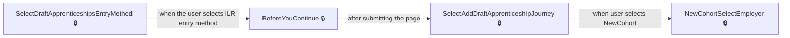
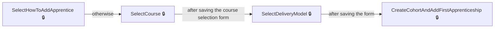
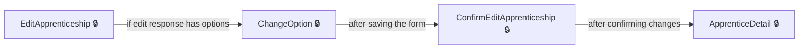
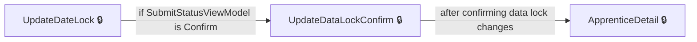
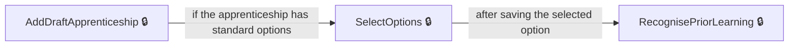
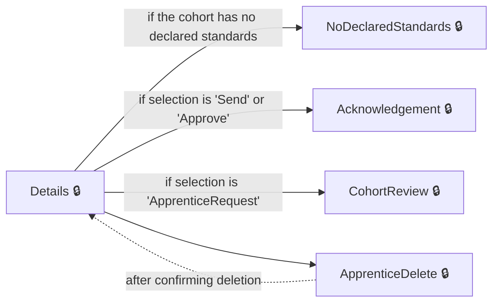
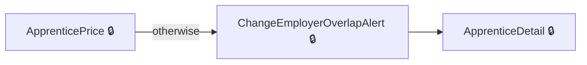
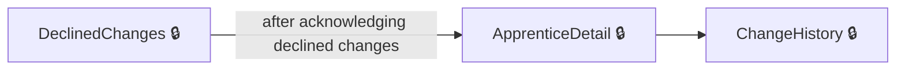
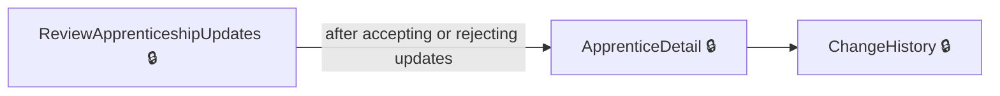
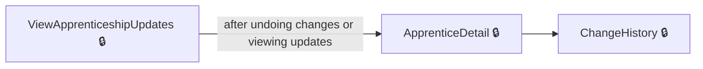

# User journeys: SkillsFundingAgency/das-providercommitments

Generated from `master/src`: 113 pages, 143 transitions, 10 journeys. 🔒 means sign-in is required. Dotted arrows return to a hub.

## Add New Apprenticeship to a Cohort

Allows a provider to add a new apprentice to a cohort from entry through specification, including creating a new cohort or using an existing one.

## Manually Add Apprentice to Cohort

Provider manually enters details for a new apprentice when adding to a cohort.

## Edit an Existing Apprenticeship

User edits an apprenticeship, selects options, and confirms or cancels changes.

## Handle Data Lock on an Apprenticeship

Provider resolves a data lock issue by reviewing and confirming a restart.

## Add Details for Draft Apprentice to a Cohort

Provider enters new draft apprentice details and handles required options or prior learning.

## Manage Cohort Details and Actions

Provider accesses a cohort details hub, from where they can review, acknowledge, or delete cohorts, and manage apprentices within.

Complete the sections in any order, returning to the hub.

## Handle Overlapping Training Dates When Changing Employer

Provider encounters an overlap alert when changing an apprentice's employer and resolves it.

## Acknowledge Declined or Invalid Apprentice Changes

Provider acknowledges declined or invalid change records for an apprentice and returns to the apprentice details.

## Review and Respond to Apprenticeship Updates

Provider reviews proposed updates to an apprenticeship and then returns to apprentice details.

## View and Undo Recent Updates to an Apprenticeship

Provider views recent updates to an apprenticeship and can return to the apprentice detail or view full history.

## Pages

| Page | Route | Sign-in | Purpose |
| --- | --- | --- | --- |
| `Apprentice.ChangeHistory` | `{providerId}/apprentices/{apprenticeshipHashedId}/change-history` | Yes | Shows the change history for a specific apprentice. |
| `Apprentice.ChangeOption` | `{providerId}/apprentices/{apprenticeshipHashedId}/edit/change-option` | Yes | Lets the user select which option to change for the apprentice. |
| `Apprentice.ConfirmEditApprenticeship` | `{providerId}/apprentices/{apprenticeshipHashedId}/edit/confirm` | Yes | Lets the user confirm if they want to make the proposed changes to an apprenticeship. |
| `Apprentice.DeclinedChanges` | `{providerId}/apprentices/{apprenticeshipHashedId}/declined-changes` | Yes | Displays changes to the apprentice record that have been declined. |
| `Apprentice.EditApprenticeship` | `{providerId}/apprentices/{apprenticeshipHashedId}/edit` | Yes | Allows the user to edit details for a specific apprenticeship. |
| `Apprentice.EditApprenticeshipCourse` | `{providerId}/apprentices/{apprenticeshipHashedId}/edit/select-course` | Yes | Lets the user select the apprenticeship training course to edit. |
| `Apprentice.GetAllChangeHistory` | `{providerId}/apprentices/change-history` | Yes | Shows change history for all apprentices. |
| `Apprentice.InvalidIlrChanges` | `{providerId}/apprentices/{apprenticeshipHashedId}/invalid-ilr-changes` | Yes | Shows invalid changes from the Individualised Learner Record (ILR) for an apprentice. |
| `Apprentice.ResendEmailInvitation` | `{providerId}/apprentices/{apprenticeshipHashedId}/details/resend-email-invitation` | Yes | Allows the user to resend an email invitation to the apprentice. |
| `Apprentice.ReviewApprenticeshipUpdates` | `{providerId}/apprentices/{apprenticeshipHashedId}/changes/review` | Yes | Lets the user review updates to an apprenticeship before confirming. |
| `Apprentice.SelectDeliveryModelForEdit` | `{providerId}/apprentices/{apprenticeshipHashedId}/edit/select-delivery-model` | Yes | Allows the user to select the delivery model for an apprenticeship edit. |
| `Apprentice.SetCourseForEdit` | `{providerId}/apprentices/{apprenticeshipHashedId}/edit/select-course` | Yes | — |
| `Apprentice.SetDeliveryModelForEdit` | `{providerId}/apprentices/{DraftApprenticeshipHashedId}/edit/select-delivery-model` | Yes | — |
| `Apprentice.ViewApprenticeshipUpdates` | `{providerId}/apprentices/{apprenticeshipHashedId}/changes/view` | Yes | Displays proposed updates to an apprenticeship, allowing undo. |
| `ApprenticeConfirm` | `{providerId}/apprentices/{apprenticeshipHashedId}/change-employer/confirm` | Yes | Lets the user confirm changes to the apprentice's employer. |
| `ApprenticeConfirmEmployer` | `{providerId}/apprentices/{apprenticeshipHashedId}/change-employer/confirm-employer` | Yes | Lets the user confirm if the selected employer is correct for the apprentice. |
| `ApprenticeDelete` | `{providerId}/unapproved/{cohortReference}/apprentices/{DraftApprenticeshipHashedId}/Delete` | Yes | Lets the provider confirm removal of a draft apprentice record. |
| `ApprenticeDetail` | `{providerId}/apprentices/{apprenticeshipHashedId}` | Yes | Shows details about a specific apprentice. |
| `ApprenticeEmail` | `{providerId}/unapproved/{cohortReference}/apprentices/{DraftApprenticeshipHashedId}/email` | Yes | Lets the provider add or update the apprentice's email address. |
| `ApprenticePrice` | `{providerId}/apprentices/{apprenticeshipHashedId}/change-employer/price` | Yes | Lets the user enter the price and employment price for an apprenticeship when changing employer. |
| `ApprenticeReviewApprenticeshipUpdates` | `{providerId}/apprentices/{apprenticeshipHashedId}/changes/review` | Yes | Lets the provider review and approve or reject changes to an apprentice's training. |
| `ApprenticeSelectDeliveryModel` | `{providerId}/apprentices/{apprenticeshipHashedId}/change-employer/select-delivery-model` | Yes | Allows the user to select the delivery model for the apprenticeship when changing employer. |
| `ApprenticeSelectEmployer` | `{providerId}/apprentices/{apprenticeshipHashedId}/change-employer/select-employer` | Yes | Enables the user to search and select an employer for the apprentice. |
| `ApprenticeSent` | `{providerId}/apprentices/{apprenticeshipHashedId}/change-employer/sent` | Yes | Shows confirmation that the apprenticeship change has been sent to the employer. |
| `ApprenticeTrainingDates` | `{providerId}/apprentices/{apprenticeshipHashedId}/change-employer/training-dates` | Yes | Lets the user provide new training dates for the apprenticeship when changing employer. |
| `ApprenticeViewApprenticeshipUpdates` | `{providerId}/apprentices/{apprenticeshipHashedId}/changes/view` | Yes | Lets the provider view and optionally undo recent updates to an apprenticeship. |
| `ApprenticesIndex` | `{providerId}/apprentices` | Yes | Lets the user search and filter the list of apprentices. |
| `CancelInProgressChangeOfCircumstance` | `{providerId}/apprentices/{apprenticeshipHashedId}/cancel-change-of-circumstance` | Yes | Cancels an in-progress change of circumstance for an apprentice. |
| `ChangeEmployer` | `{providerId}/apprentices/{apprenticeshipHashedId}/change-employer` | Yes | Starts the process to change an apprentice's employer. |
| `ChangeEmployerDetails` | `{providerId}/apprentices/{apprenticeshipHashedId}/change-employer/change-employer-details` | Yes | Shows details of the ongoing employer change request for an apprentice. |
| `ChangeEmployerInform` | `{providerId}/apprentices/{apprenticeshipHashedId}/change-employer/inform` | Yes | Shows information to the user about changing the employer for an apprentice. |
| `ChangeEmployerOverlapAlert` | `{providerId}/apprentices/{apprenticeshipHashedId}/change-employer/overlap-alert` | Yes | Alerts the user about overlapping training dates for the apprenticeship change. |
| `ChangeOption` | `{providerId}/apprentices/{apprenticeshipHashedId}/edit/change-option` | Yes | Allows the user to select a new option when editing an apprenticeship, or return/cancel changes. |
| `ChangeVersion` | `{providerId}/apprentices/{apprenticeshipHashedId}/edit/change-version` | Yes | Lets the user select a version for the apprenticeship. |
| `ChooseCohort` | `{providerId}/unapproved/choose-cohort` | Yes | Lets the provider select a cohort to work with. |
| `Cohort.Acknowledgement` | `{providerId}/unapproved/{cohortReference}/Acknowledgement` | Yes | Displays acknowledgement after an action is completed for a cohort. |
| `Cohort.AddNewDraftApprenticeship` | `{providerId}/unapproved/add-apprentice` | Yes | Starts the process of adding a new apprentice to a cohort. |
| `Cohort.BeforeYouContinue` | `{providerId}/unapproved/add/before-you-continue` | Yes | Introduces the user to the next steps before continuing with adding apprentices. |
| `Cohort.BeforeYouContinueMultiSelect` | `{providerId}/unapproved/add/before-you-continue-multi-select` | Yes | Lets the provider continue after selecting multiple apprentices. |
| `Cohort.ConfirmEmployer` | `{providerId}/unapproved/add/confirm-employer` | Yes | Asks the provider to confirm the employer before proceeding to add learner details for a cohort. |
| `Cohort.Delete` | `{providerId}/unapproved/{cohortReference}/details/delete` | Yes | Lets the provider confirm removing an entire cohort and all its learners. |
| `Cohort.Details` | `{providerId}/unapproved/{cohortReference}` | Yes | Shows the details of a cohort and lets the provider select what action to take. |
| `Cohort.FileUploadAmendedFile` | `{providerId}/unapproved/add/file-upload/amended-file` | Yes | Lets the provider confirm uploading an amended file during bulk upload. |
| `Cohort.FileUploadDiscard` | `{providerId}/unapproved/add/file-upload/discard-file` | Yes | Lets the provider confirm if they want to discard a file during bulk upload. |
| `Cohort.FileUploadInform` | `{providerId}/unapproved/add/file-upload/inform` | Yes | Informs the provider about the file upload process for adding apprentices via bulk upload. |
| `Cohort.FileUploadReview` | `{providerId}/unapproved/add/file-upload/review` | Yes | Lets the provider review and choose what to do with a file upload of apprentice data before progressing. |
| `Cohort.FileUploadReviewApprentices` | `{providerId}/unapproved/add/file-upload/review-cohort` | Yes | Shows a review of apprentices included in the uploaded file. |
| `Cohort.FileUploadReviewDelete` | `{providerId}/unapproved/add/file-upload/review-delete` | Yes | Handles review and deletion of a file upload for apprentices. |
| `Cohort.FileUploadStart` | `{providerId}/unapproved/add/file-upload/start` | Yes | Allows the provider to start the file upload process for adding apprentices by uploading a CSV file. |
| `Cohort.NoDeclaredStandards` | `{providerId}/unapproved/NoDeclaredStandards` | Yes | Informs the provider that there are no declared standards available. |
| `Cohort.SelectAddDraftApprenticeshipJourney` | `{providerId}/unapproved/add/select-journey` | Yes | Lets the provider choose whether to create a new cohort or use an existing one for adding apprentices. |
| `Cohort.SelectCourse` | `{providerId}/unapproved/add/select-course` | Yes | Lets the provider select the apprenticeship course for the new entry. |
| `Cohort.SelectDeliveryModel` | `{providerId}/unapproved/add/select-delivery-model` | Yes | Lets the provider select an apprenticeship delivery model when adding a cohort. |
| `Cohort.SelectDraftApprenticeshipsEntryMethod` | `{providerId}/unapproved/add/entry-method` | Yes | Lets the provider select how they want to add apprentice details (e.g., manually, by upload, etc). |
| `Cohort.SelectHowManyLearnersToAdd` | `{providerId}/unapproved/add/how-many-learners` | Yes | Lets the provider indicate how many learners they want to add. |
| `Cohort.SelectHowToAddApprentice` | `{providerId}/unapproved/add/select-how` | Yes | Lets the provider select how to add apprentice learner details. |
| `Cohort.SetDeliveryModel` | `{providerId}/unapproved/add/select-delivery-model` | Yes | Lets the provider select a delivery model for apprentices. |
| `CohortAddApprenticeship` | `{providerId}/unapproved/add/apprenticeship` | Yes | Adds an apprenticeship to a cohort. |
| `CohortDraft` | `{providerId}/unapproved/draft` | Yes | Shows draft cohorts to the provider. |
| `CohortReview` | `{providerId}/unapproved/review` | Yes | Provides a review of the provider's cohorts. |
| `CohortWithEmployer` | `{providerId}/unapproved/with-employer` | Yes | Shows cohorts associated with an employer. |
| `CohortWithTransferSender` | `{providerId}/unapproved/with-transfer-sender` | Yes | Shows the list of unapproved cohorts that have a transfer sender. |
| `ConfirmRestart` | `{providerId}/apprentices/{apprenticeshipHashedId}/datalock/confirmrestart` | Yes | Lets the provider confirm whether to ask the employer to make changes to resolve the data mismatch. |
| `CreateCohortAndAddFirstApprenticeship` | `{providerId}/unapproved/add/apprenticeship` | Yes | Allows the provider to add the first apprenticeship to a new unapproved cohort. |
| `Dashboard` | `{providerId}/dashboard` | Yes | Redirects the user to the main dashboard. |
| `DeclinedChanges` | `{providerId}/apprentices/{apprenticeshipHashedId}/declined-changes` | Yes | Shows unacknowledged or declined changes for the apprentice. |
| `DownloadApprentices` | `{providerId}/apprentices/download` | Yes | Lets the user download the list of apprentices. |
| `DraftApprenticeship.AddAnotherSelectMethod` | `{providerId}/unapproved/{cohortReference}/apprentices/add/select-how` | Yes | Lets the user choose how they want to add learner details. |
| `DraftApprenticeship.AddDraftApprenticeship` | `{providerId}/unapproved/{cohortReference}/apprentices/add/details` | Yes | Lets the provider add details for a new draft apprenticeship to a cohort. |
| `DraftApprenticeship.AddEmail` | `{providerId}/unapproved/{cohortReference}/apprentices/{DraftApprenticeshipHashedId}/email` | Yes | Lets the provider add or update the email address for a draft apprentice. |
| `DraftApprenticeship.AddNewDraftApprenticeship` | `{providerId}/unapproved/{cohortReference}/apprentices/add` | Yes | Starts the process to add a new draft apprenticeship to a cohort. |
| `DraftApprenticeship.EditDraftApprenticeship` | `{providerId}/unapproved/{cohortReference}/apprentices/{DraftApprenticeshipHashedId}/edit` | Yes | Lets the provider edit details of a draft apprenticeship in a cohort. |
| `DraftApprenticeship.EditDraftApprenticeshipCourse` | `{providerId}/unapproved/{cohortReference}/apprentices/{DraftApprenticeshipHashedId}/edit/select-course` | Yes | Lets the user select or edit the apprenticeship training course for a learner. |
| `DraftApprenticeship.GetReservationId` | `{providerId}/unapproved/{cohortReference}/apprentices/add/reservation` | Yes | Redirects the provider to reserve funding for adding a draft apprenticeship. |
| `DraftApprenticeship.PostSelectOptions` | `{providerId}/unapproved/{cohortReference}/apprentices/{DraftApprenticeshipHashedId}/select-options` | Yes | Processes the selection of standard options for a draft apprenticeship. |
| `DraftApprenticeship.RecognisePriorLearningData` | `{providerId}/unapproved/{cohortReference}/apprentices/{DraftApprenticeshipHashedId}/recognise-prior-learning-data` | Yes | Lets the provider enter prior learning data for a draft apprenticeship. |
| `DraftApprenticeship.RecognisePriorLearningSummary` | `{providerId}/unapproved/{cohortReference}/apprentices/{DraftApprenticeshipHashedId}/recognise-prior-learning-summary` | Yes | Shows a summary of prior learning data for a draft apprenticeship. |
| `DraftApprenticeship.SelectDeliveryModel` | `{providerId}/unapproved/{cohortReference}/apprentices/add/select-delivery-model` | Yes | Lets the provider select the apprenticeship delivery model for a draft apprenticeship. |
| `DraftApprenticeship.SelectDeliveryModelForEdit` | `{providerId}/unapproved/{cohortReference}/apprentices/{DraftApprenticeshipHashedId}/edit/select-delivery-model` | Yes | Lets the user select the apprenticeship delivery model for editing a draft record. |
| `DraftApprenticeship.SelectOptions` | `{providerId}/unapproved/{cohortReference}/apprentices/{DraftApprenticeshipHashedId}/select-options` | Yes | Lets the provider select a standard option for the apprenticeship course. |
| `DraftApprenticeship.SetDeliveryModel` | `{providerId}/unapproved/{cohortReference}/apprentices/add/select-delivery-model` | Yes | Processes the selected delivery model for a new draft apprenticeship. |
| `DraftApprenticeship.SetDeliveryModelForEdit` | `{providerId}/unapproved/{cohortReference}/apprentices/{DraftApprenticeshipHashedId}/edit/select-delivery-model` | Yes | Processes the selected delivery model when editing a draft apprenticeship. |
| `DraftApprenticeship.SetReference` | `{providerId}/unapproved/{cohortReference}/apprentices/{DraftApprenticeshipHashedId}/reference` | Yes | Lets the provider add or update the reference for a draft apprenticeship. |
| `DraftApprenticeship.ViewDraftApprenticeship` | `{providerId}/unapproved/{cohortReference}/apprentices/{DraftApprenticeshipHashedId}` | Yes | Displays the details of a draft apprentice for review. |
| `DraftApprenticeshipAddAnother` | `{providerId}/unapproved/{cohortReference}/apprentices/add/details` | Yes | Lets the provider add another apprentice’s details to the cohort. |
| `DraftApprenticeshipEdit` | `{providerId}/unapproved/{cohortReference}/apprentices/{DraftApprenticeshipHashedId}/edit` | Yes | Lets the user edit the draft apprenticeship record, including learner and training details. |
| `EditApprenticeship` | `{providerId}/apprentices/{apprenticeshipHashedId}/edit` | Yes | Lets the user edit the details of an apprenticeship. |
| `InvalidIlrChanges` | `{providerId}/apprentices/{apprenticeshipHashedId}/invalid-ilr-changes` | Yes | Shows invalid ILR changes for the apprentice that haven't been acknowledged. |
| `Learner.LearnerSelectedForNewCohort` | `{providerId}/unapproved/add/learners/select/{learnerDataId}` | Yes | Redirects after a learner is selected for a new cohort. |
| `Learner.LearnerToBeAddedToCohort` | `{providerId}/unapproved/add-another/learners/select/{learnerDataId}` | Yes | Redirects after selecting a learner to add to an existing cohort. |
| `NewCohortSelectEmployer` | `{providerId}/unapproved/add/select-employer` | Yes | Allows the provider to select an employer when creating a new unapproved cohort. |
| `NewCohortSelectEmployerRedirect` | `{providerId}/unapproved/add/select-employer-redirect` | Yes | Redirects the user to the multiple learner records selection page after choosing an employer. |
| `ProviderAccountIndex` | — | Yes | Redirects the user to the cohort page for the provider. |
| `ProviderSignOut` | `signout` | Yes | Signs out the user from the service. |
| `RecognisePriorLearning` | `{providerId}/unapproved/{cohortReference}/apprentices/{DraftApprenticeshipHashedId}/recognise-prior-learning` | Yes | Lets the provider specify whether the apprentice has prior learning to be recognised. |
| `RecognisePriorLearningData` | `{providerId}/unapproved/{cohortReference}/apprentices/{DraftApprenticeshipHashedId}/recognise-prior-learning-data` | Yes | Lets the provider enter details about prior learning, including any reduction in training or price. |
| `RecognisePriorLearningDataRemove` | `{providerId}/unapproved/{cohortReference}/apprentices/{DraftApprenticeshipHashedId}/recognise-prior-learning-data-remove` | Yes | Removes the prior learning data from the draft apprentice record. |
| `RequestRestart` | `{providerId}/apprentices/{apprenticeshipHashedId}/datalock/requestrestart` | Yes | Allows the provider to decide how they want to fix a data mismatch for an apprenticeship. |
| `SelectCourse` | `{providerId}/unapproved/{cohortReference}/apprentices/add/select-course` | Yes | Lets the provider select an apprenticeship training course for the apprentice. |
| `SelectLearnerRecord` | `{providerId}/unapproved/add/learners/select` | Yes | Lets the user search and filter learner records to select from. |
| `SelectMultipleChangeEmployer` | `{providerId}/unapproved/add/change-employer` | Yes | Allows selection of an employer when changing the employer for multiple draft apprenticeships. |
| `SelectMultipleChangeEmployerRedirect` | `{providerId}/unapproved/add/change-employer-redirect` | Yes | Redirects to select multiple learner records after changing employer. |
| `SelectMultipleLearnerRecords` | `{providerId}/unapproved/add/learners/select-multiple` | Yes | Allows the user to select multiple learner records by searching and filtering. |
| `SelectMultipleLearnerRecordsAdd` | `{providerId}/unapproved/add/learners/select-multiple-add` | Yes | Adds multiple learner records to the selection. |
| `SelectMultipleLearnerRecordsFilter` | `{providerId}/unapproved/add/learners/select-multiple-filter` | Yes | Applies filters to the multiple learner records selection. |
| `SelectMultipleLearnerRecordsRemove` | `{providerId}/unapproved/add/learners/select-multiple-remove` | Yes | Removes learner records from the multiple selection. |
| `SelectMultipleLearnerRecordsSort` | `{providerId}/unapproved/add/learners/select-multiple-sort` | Yes | Changes the sorting of the multiple learner records selection. |
| `SuccessSaveDraft` | `{providerId}/unapproved/add/file-upload/success-save-draft` | Yes | Informs the user that the draft apprenticeships have been saved as a result of a successful file upload. |
| `SuccessSendToEmployer` | `{providerId}/unapproved/add/file-upload/success` | Yes | Informs the user that apprenticeships have been sent to the employer as a result of a successful file upload. |
| `UpdateDataLockConfirm` | `{providerId}/apprentices/{apprenticeshipHashedId}/datalock/confirm` | Yes | Lets the user confirm whether they want to request a fix for a data lock issue. |
| `UpdateDateLock` | `{providerId}/apprentices/{apprenticeshipHashedId}/datalock` | Yes | Lets the user confirm how they want to resolve a data lock mismatch for an apprenticeship. |
| `setReference` | `{providerId}/unapproved/{cohortReference}/apprentices/{DraftApprenticeshipHashedId}/reference` | Yes | Lets the provider set a reference for the draft apprentice. |
| `signed-out` | `~/signed-out` | No | Shows that the user has been signed out and lets them navigate further. |

## Form fields

Field definitions only: no values a user enters are recorded.

### `Apprentice.ConfirmEditApprenticeship`

| Field | Type | Label | Required | Rules | Options |
| --- | --- | --- | --- | --- | --- |
| `ConfirmChanges` | radios | Do you want to make these changes? | — | required (cannot be null); enforced by validator | Yes, change these details, No, don't change these details |

### `Apprentice.EditApprenticeshipCourse`

| Field | Type | Label | Required | Rules | Options |
| --- | --- | --- | --- | --- | --- |
| `CourseCode` | select | Apprenticeship training course | — | — | — |

### `Apprentice.SelectDeliveryModelForEdit`

| Field | Type | Label | Required | Rules | Options |
| --- | --- | --- | --- | --- | --- |
| `DeliveryModel` | radios | Select delivery model | — | — | — |

### `ApprenticeConfirmEmployer`

| Field | Type | Label | Required | Rules | Options |
| --- | --- | --- | --- | --- | --- |
| `Confirm` | radios | Is this the new employer you'd like to move the learner record to? | — | required (cannot be null); must not select Flexi-Job Agency for Portable Flexi-Job delivery model | Yes, confirm, No, choose a different employer |

### `ApprenticeDelete`

| Field | Type | Label | Required | Rules | Options |
| --- | --- | --- | --- | --- | --- |
| `DeleteConfirmed` | radios | Are you sure you want to remove the record for? | — | required; must be confirmed | Yes, remove the record, No, don't remove this learner |

### `ApprenticeEmail`

| Field | Type | Label | Required | Rules | Options |
| --- | --- | --- | --- | --- | --- |
| `Email` | text | Email address | — | — | — |

### `ApprenticePrice`

| Field | Type | Label | Required | Rules | Options |
| --- | --- | --- | --- | --- | --- |
| `EmploymentPrice` | text | — | — | required when delivery model is PortableFlexiJob; must be at least 1; must not exceed Price when both are greater than 1; at most equal to Price | — |
| `Price` | text | — | — | required; must be at least 1; at most 100000 | — |

### `ApprenticeReviewApprenticeshipUpdates`

| Field | Type | Label | Required | Rules | Options |
| --- | --- | --- | --- | --- | --- |
| `ApproveAddStandardToTraining` | radios | Would you like to? | — | required when the course code is not valid; must indicate approval or rejection | Add this standard to your standard training venues, Reject these changes |
| `ApproveChanges` | radios | Are you happy to approve these changes? | — | required when the course code is valid; must indicate approval | Yes, approve these changes, No, reject these changes |
| `UndoChanges` | radios | Do you want to undo these changes? | — | — | Yes, undo these changes, No, keep these changes |

### `ApprenticeSelectDeliveryModel`

| Field | Type | Label | Required | Rules | Options |
| --- | --- | --- | --- | --- | --- |
| `DeliveryModel` | radios | Select delivery model | — | required | — |

### `ApprenticeSelectEmployer`

| Field | Type | Label | Required | Rules | Options |
| --- | --- | --- | --- | --- | --- |
| `searchTerm` | text | Search by employer name, account name or agreement ID | — | — | — |

### `ApprenticeViewApprenticeshipUpdates`

| Field | Type | Label | Required | Rules | Options |
| --- | --- | --- | --- | --- | --- |
| `UndoChanges` | radios | Do you want to undo these changes? | — | required; must indicate if changes should be undone | Yes, undo these changes, No, keep these changes |

### `ApprenticesIndex`

| Field | Type | Label | Required | Rules | Options |
| --- | --- | --- | --- | --- | --- |
| `searchTerm` | text | Search by learner name or unique learner number (ULN) | — | — | — |
| `selectedEmployer` | select | Employer | — | — | — |
| `selectedCourse` | select | Training course | — | — | — |
| `selectedStatus` | select | Learner confirmation | — | — | — |
| `selectedStartDate` | select | Planned start date | — | — | — |
| `selectedEndDate` | select | Planned end date | — | — | — |
| `selectedAlert` | select | Alert | — | — | — |
| `selectedApprenticeConfirmation` | select | — | — | — | — |
| `selectedDeliveryModel` | select | Training delivery model | — | — | — |

### `ChangeOption`

| Field | Type | Label | Required | Rules | Options |
| --- | --- | --- | --- | --- | --- |
| `SelectedOption` | radios | — | — | required; must be different from CurrentOption unless returning to another page | Confirm option at a later date |

### `ChangeVersion`

| Field | Type | Label | Required | Rules | Options |
| --- | --- | --- | --- | --- | --- |
| `SelectedVersion` | radios | — | — | — | — |

### `Cohort.ConfirmEmployer`

| Field | Type | Label | Required | Rules | Options |
| --- | --- | --- | --- | --- | --- |
| `Confirm` | radios | Is this the employer you'd like to add learner details for? | — | — | Yes, use, No, choose a different employer |

### `Cohort.Delete`

| Field | Type | Label | Required | Rules | Options |
| --- | --- | --- | --- | --- | --- |
| `Confirm` | radios | Are you sure you want to remove this entire cohort and all the learners in it? | — | required; must not be null | Yes, remove cohort, No, don't remove cohort |

### `Cohort.Details`

| Field | Type | Label | Required | Rules | Options |
| --- | --- | --- | --- | --- | --- |
| `RplVerified` | checkboxes | — | — | required and must be true when selection is 'Send' or 'Approve'; otherwise optional | I confirm I’ve checked RPL for each apprentice and added details where needed |
| `selection` | radios | — | — | required; must not be empty | — |
| `approvemessage` | textarea | — | — | — | — |
| `sendmessage` | textarea | — | — | — | — |

### `Cohort.FileUploadAmendedFile`

| Field | Type | Label | Required | Rules | Options |
| --- | --- | --- | --- | --- | --- |
| `Confirm` | radios | Are you sure you want to upload an amended file? | — | required; must not be null | Yes, No |

### `Cohort.FileUploadDiscard`

| Field | Type | Label | Required | Rules | Options |
| --- | --- | --- | --- | --- | --- |
| `FileDiscardConfirmed` | radios | — | — | required; must not be null | Yes, No |

### `Cohort.FileUploadReview`

| Field | Type | Label | Required | Rules | Options |
| --- | --- | --- | --- | --- | --- |
| `SelectedOption` | radios | — | — | required | — |

### `Cohort.SelectAddDraftApprenticeshipJourney`

| Field | Type | Label | Required | Rules | Options |
| --- | --- | --- | --- | --- | --- |
| `Selection` | radios | Do you want to create a new cohort? | — | required | Yes, create a new cohort, No, add to an existing cohort |

### `Cohort.SelectCourse`

| Field | Type | Label | Required | Rules | Options |
| --- | --- | --- | --- | --- | --- |
| `CourseCode` | select | Apprenticeship training course | — | required | — |

### `Cohort.SelectDeliveryModel`

| Field | Type | Label | Required | Rules | Options |
| --- | --- | --- | --- | --- | --- |
| `DeliveryModel` | radios | Select delivery model | — | required; must not be null | — |

### `Cohort.SelectDraftApprenticeshipsEntryMethod`

| Field | Type | Label | Required | Rules | Options |
| --- | --- | --- | --- | --- | --- |
| `Selection` | radios | How do you want to add learner details? | — | — | Choose details from ILR (individual learner record), Add 1 or more learners from ILR (individual learner record), Upload a CSV file, Manually add details |

### `Cohort.SelectHowManyLearnersToAdd`

| Field | Type | Label | Required | Rules | Options |
| --- | --- | --- | --- | --- | --- |
| `Selection` | radios | How many learners would you like to add? | — | — | 1 learner at a time, 2 or more learners at once |

### `Cohort.SelectHowToAddApprentice`

| Field | Type | Label | Required | Rules | Options |
| --- | --- | --- | --- | --- | --- |
| `Selection` | radios | How do you want to add learner details? | — | required | Choose details from ILR (individual learner record), Manually add details |

### `ConfirmRestart`

| Field | Type | Label | Required | Rules | Options |
| --- | --- | --- | --- | --- | --- |
| `SendRequestToEmployer` | radios | Do you want to ask the employer to make these changes? | — | required; must confirm if the employer should make these changes | Yes, request this change, No, leave for now |

### `DeclinedChanges`

| Field | Type | Label | Required | Rules | Options |
| --- | --- | --- | --- | --- | --- |
| `deleteAlertField` | radios | Do you want to delete this alert? (Model.RequestSets.Count > 1) { } | — | — | Yes, delete the alert, No, keep the alert |

### `DraftApprenticeship.AddAnotherSelectMethod`

| Field | Type | Label | Required | Rules | Options |
| --- | --- | --- | --- | --- | --- |
| `Selection` | radios | How do you want to add learner details? | — | required | Choose details from ILR (Individual learner record), Manually add details |

### `DraftApprenticeship.EditDraftApprenticeshipCourse`

| Field | Type | Label | Required | Rules | Options |
| --- | --- | --- | --- | --- | --- |
| `CourseCode` | select | Apprenticeship training course | — | required | — |

### `DraftApprenticeship.SelectDeliveryModelForEdit`

| Field | Type | Label | Required | Rules | Options |
| --- | --- | --- | --- | --- | --- |
| `DeliveryModel` | radios | Select delivery model | — | required | — |

### `DraftApprenticeship.SelectOptions`

| Field | Type | Label | Required | Rules | Options |
| --- | --- | --- | --- | --- | --- |
| `SelectedOption` | radios | Select a standard option from the list | — | required | Confirm option at a later date |

### `DraftApprenticeship.SetReference`

| Field | Type | Label | Required | Rules | Options |
| --- | --- | --- | --- | --- | --- |
| `Reference` | text | Reference | — | — | — |

### `DraftApprenticeshipEdit`

| Field | Type | Label | Required | Rules | Options |
| --- | --- | --- | --- | --- | --- |
| `Uln` | text | Unique learner number | — | — | — |
| `FirstName` | text | First name | — | — | — |
| `LastName` | text | Last name | — | — | — |
| `Email` | text | Email address | — | — | — |
| `BirthDay` | number | Day | — | — | — |
| `BirthMonth` | number | Month | — | — | — |
| `BirthYear` | number | Year | — | — | — |
| `StartMonth` | number | Month | — | — | — |
| `StartYear` | number | Year | — | — | — |
| `EndMonth` | number | Month | — | — | — |
| `EndYear` | number | Year | — | — | — |
| `EmploymentEndMonth` | number | Month | — | — | — |
| `EmploymentEndYear` | number | Year | — | — | — |
| `Cost` | text | Total agreed apprenticeship price (excluding VAT) | — | — | — |
| `EmploymentPrice` | text | Agreed training price for this period of employment (excluding VAT) | — | — | — |
| `Reference` | text | Reference (optional) | — | — | — |

### `EditApprenticeship`

| Field | Type | Label | Required | Rules | Options |
| --- | --- | --- | --- | --- | --- |
| `FirstName` | text | — | — | — | — |
| `LastName` | text | — | — | — | — |
| `Email` | text | Email address | — | — | — |
| `BirthDay` | number | — | — | — | — |
| `BirthMonth` | number | — | — | — | — |
| `BirthYear` | number | — | — | — | — |
| `StartMonth` | number | — | — | — | — |
| `StartYear` | number | — | — | — | — |
| `EndMonth` | number | — | — | — | — |
| `EndYear` | number | — | — | — | — |
| `EmploymentEndMonth` | number | Month | — | — | — |
| `EmploymentEndYear` | number | Year | — | — | — |
| `EmploymentPrice` | number | Agreed training price for this period of employment (excluding VAT) | — | — | — |
| `Cost` | number | — | — | — | — |
| `ProviderReference` | text | — | — | — | — |

### `InvalidIlrChanges`

| Field | Type | Label | Required | Rules | Options |
| --- | --- | --- | --- | --- | --- |
| `deleteAlertField` | radios | Do you want to delete this alert? (Model.RequestSets.Count > 1) { } | — | — | Yes, delete the alert, No, keep the alert |

### `NewCohortSelectEmployer`

| Field | Type | Label | Required | Rules | Options |
| --- | --- | --- | --- | --- | --- |
| `searchTerm` | text | Search by employer name, account name or agreement ID | — | — | — |

### `RecognisePriorLearning`

| Field | Type | Label | Required | Rules | Options |
| --- | --- | --- | --- | --- | --- |
| `IsTherePriorLearning` | radios | Recognition of prior learning (RPL) | — | — | Yes, No |

### `RecognisePriorLearningData`

| Field | Type | Label | Required | Rules | Options |
| --- | --- | --- | --- | --- | --- |
| `TrainingTotalHours` | text | Total off-the-job training time for this apprenticeship standard | — | — | — |
| `DurationReducedByHours` | text | Off-the-job training time reduction due to prior learning | — | — | — |
| `IsDurationReducedByRpl` | radios | Have you reduced the actual apprenticeship duration due to RPL? | — | — | Yes, No |
| `DurationReducedBy` | text | — | — | — | — |
| `PriceReduced` | text | Price reduction due to prior learning | — | — | — |

### `RequestRestart`

| Field | Type | Label | Required | Rules | Options |
| --- | --- | --- | --- | --- | --- |
| `SubmitStatusViewModel` | radios | How do you want to fix the mismatch? | — | required; must select how to fix the mismatch | Ask the employer to fix the mismatch, I'll update the ILR later |

### `SelectCourse`

| Field | Type | Label | Required | Rules | Options |
| --- | --- | --- | --- | --- | --- |
| `CourseCode` | select | Apprenticeship training course | — | required | — |

### `SelectLearnerRecord`

| Field | Type | Label | Required | Rules | Options |
| --- | --- | --- | --- | --- | --- |
| `searchTerm` | text | Search name or ULN of learner | — | — | — |
| `FilterModel.StartMonth` | select | — | — | — | — |
| `FilterModel.StartYear` | select | — | — | — | — |
| `FilterModel.CourseCode` | select | — | — | — | — |
| `FilterModel.LearningType` | select | — | — | — | — |

### `SelectMultipleChangeEmployer`

| Field | Type | Label | Required | Rules | Options |
| --- | --- | --- | --- | --- | --- |
| `searchTerm` | text | Search by employer name, account name or agreement ID | — | — | — |

### `SelectMultipleLearnerRecords`

| Field | Type | Label | Required | Rules | Options |
| --- | --- | --- | --- | --- | --- |
| `searchTerm` | text | Search name or ULN of learner | — | — | — |
| `FilterModel.StartMonth` | select | — | — | — | — |
| `FilterModel.StartYear` | select | — | — | — | — |
| `FilterModel.CourseCode` | select | — | — | — | — |
| `FilterModel.LearningType` | select | — | — | — | — |

### `UpdateDataLockConfirm`

| Field | Type | Label | Required | Rules | Options |
| --- | --- | --- | --- | --- | --- |
| `SubmitStatusViewModel` | radios | Do you want to request? | — | — | Yes, request, No, leave for now |

### `UpdateDateLock`

| Field | Type | Label | Required | Rules | Options |
| --- | --- | --- | --- | --- | --- |
| `SubmitStatusViewModel` | radios | How do you want to fix the mismatch? | — | required | Request these details are updated to match the ILR, Leave for now |

