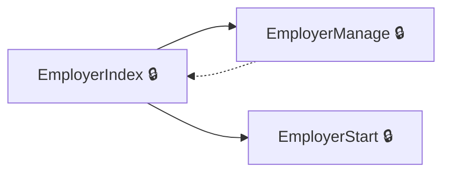
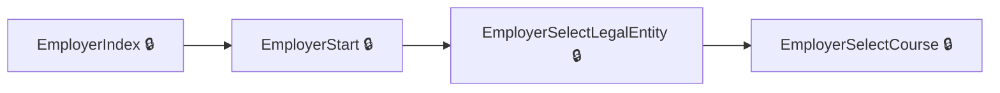
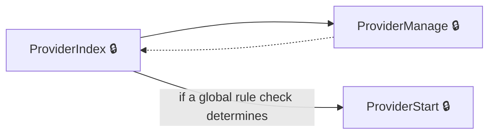
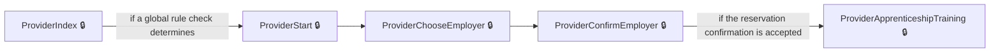

# User journeys: SkillsFundingAgency/das-reservations

Generated from `master/src`: 30 pages, 29 transitions, 4 journeys. 🔒 means sign-in is required. Dotted arrows return to a hub.

## Manage and View Employer Reservations

Employers can view, manage, and start new funding reservations from their main reservations dashboard.

Complete the sections in any order, returning to the hub.

## Start and Complete a New Employer Reservation

Employers can begin the reservation process and proceed to select a legal entity and course for apprenticeship funding.

## Manage and View Provider Reservations

Providers manage and view all reservations for various employers and courses from their dashboard.

Complete the sections in any order, returning to the hub.

## Create a Reservation as Provider

Providers create a reservation for an apprenticeship by choosing an employer, confirming the reservation, and selecting training options.

## Pages

| Page | Route | Sign-in | Purpose |
| --- | --- | --- | --- |
| `EmployerChangeEmail` | `{employerAccountId}/service/email/change` | Unknown | Redirects the employer to the main reservations page after a request to change their email. |
| `EmployerChangePassword` | `{employerAccountId}/service/password/change` | Unknown | Redirects the employer to the main reservations page after a request to change their password. |
| `EmployerCourseGuidance` | `accounts/{employerAccountId}/reservations/{id}/course-guidance` | Yes | Provides guidance to the employer about selecting a training course. |
| `EmployerIndex` | `accounts/{employerAccountId}/reservations` | Yes | Shows the main reservations page for employers, where they can view available actions. |
| `EmployerManage` | `accounts/{employerAccountId}/reservations/manage` | Yes | Allows the employer to view and manage their funding reservations. |
| `EmployerOwnerSignAgreement` | `accounts/{employerAccountId}/reservations/owner-sign-agreement` | Yes | Lets the employer's account owner sign the funding agreement if not already signed. |
| `EmployerSaveRuleNotificationChoiceNoReservation` | `accounts/{employerAccountId}/reservations/saveRuleNotificationChoice` | Yes | — |
| `EmployerSelectCourse` | `accounts/{employerAccountId}/reservations/{id}/select-course` | Yes | Allows the employer to select the apprenticeship training course for their reservation. |
| `EmployerSelectCourseRuleCheck` | `accounts/{employerAccountId}/reservations/{id}/select-course-rule-check` | Yes | — |
| `EmployerSelectLegalEntity` | `accounts/{employerAccountId}/reservations/select-legal-entity/{id?}` | Yes | Allows the employer to select the legal entity for the reservation. |
| `EmployerStart` | `accounts/{employerAccountId}/reservations/start` | Yes | Lets the employer start the funding reservation process. |
| `EmployerTransactorSignAgreement` | `accounts/{employerAccountId}/reservations/transactor-sign-agreement` | Yes | Allows a transactor (non-owner) to sign the employer agreement if required. |
| `Home.Dashboard` | `dashboard` | Unknown | Redirects to the main system dashboard. |
| `ProviderApprenticeshipTraining` | `{ukPrn}/reservations/{id}/apprenticeship-training/{fromReview?}` | Yes | Lets the provider select the course and training start date for an apprenticeship. |
| `ProviderChooseEmployer` | `{ukPrn}/reservations/choose-employer` | Yes | Lets the provider choose an employer from a filtered list. |
| `ProviderCompleted` | `{ukPrn}/reservations/{id}/completed/{accountLegalEntityPublicHashedId}` | Yes | Shows the completed reservation details for the provider. |
| `ProviderConfirmEmployer` | `{ukPrn}/reservations/confirm-employer/{id?}` | Yes | Lets the provider confirm whether to reserve funds for a selected employer. |
| `ProviderCreateApprenticeshipTraining` | `{ukPrn}/reservations/{id}/apprenticeship-training` | Yes | Lets the provider create a reservation for apprenticeship training by choosing course and start date. |
| `ProviderDelete` | `{ukPrn}/reservations/{id}/delete` | Yes | Allows the provider to delete a reservation. |
| `ProviderDeleteCompleted` | `{ukPrn}/reservations/{id}/delete-completed` | Yes | Shows confirmation after the provider has deleted a reservation. |
| `ProviderEmployerAgreementNotSigned` | `{ukPrn}/reservations/employer-agreement-not-signed/{id?}` | Yes | Informs the provider that the employer agreement has not been signed. |
| `ProviderFeatureNotAvailable` | `{ukPrn}/notAvailable` | Unknown | Informs providers that the requested feature is not available. |
| `ProviderIndex` | `{ukPrn}/reservations` | Yes | Shows the main reservation dashboard for the provider. |
| `ProviderManage` | `{ukPrn}/reservations/manage` | Yes | Lets the provider view and filter reservations for employers and courses. |
| `ProviderPostCompleted` | `{ukPrn}/reservations/{id}/completed/{accountLegalEntityPublicHashedId}` | Yes | — |
| `ProviderPostReview` | `{ukPrn}/reservations/{id}/review` | Yes | — |
| `ProviderReview` | `{ukPrn}/reservations/{id}/review` | Yes | Lets the provider review the reservation details before confirmation. |
| `ProviderSelect` | `{ukPrn}/reservations/{accountLegalEntityPublicHashedId}/select` | Yes | Lets the provider select a reservation or create a new one for an employer. |
| `ProviderStart` | `{ukPrn}/reservations/start` | Yes | Starts the reservation process for the provider, possibly showing funding rules or employer permissions. |
| `p-signed-out` | `~/p-signed-out` | No | Shows the signed-out page for providers. |

## Form fields

Field definitions only: no values a user enters are recorded.

### `EmployerSelectCourse`

| Field | Type | Label | Required | Rules | Options |
| --- | --- | --- | --- | --- | --- |
| `ApprenticeTrainingKnown` | radios | Do you know which training course your learner will take? | — | — | Yes, No |
| `SelectedCourseId` | select | — | — | — | — |

### `EmployerSelectLegalEntity`

| Field | Type | Label | Required | Rules | Options |
| --- | --- | --- | --- | --- | --- |
| `LegalEntity` | radios | — | — | — | — |

### `ProviderApprenticeshipTraining`

| Field | Type | Label | Required | Rules | Options |
| --- | --- | --- | --- | --- | --- |
| `StartDate` | radios | When will the training start? | — | — | — |
| `SelectedCourseId` | select | — | — | — | — |

### `ProviderChooseEmployer`

| Field | Type | Label | Required | Rules | Options |
| --- | --- | --- | --- | --- | --- |
| `searchTerm` | text | — | — | — | — |

### `ProviderConfirmEmployer`

| Field | Type | Label | Required | Rules | Options |
| --- | --- | --- | --- | --- | --- |
| `Confirm` | radios | Are you sure you want to reserve funds for this employer? | — | required; must indicate whether to secure funds for this employer | Yes, use, No, choose a different employer |

### `ProviderCreateApprenticeshipTraining`

| Field | Type | Label | Required | Rules | Options |
| --- | --- | --- | --- | --- | --- |
| `StartDate` | radios | When will the training start? | — | — | — |
| `SelectedCourseId` | select | — | — | — | — |

### `ProviderManage`

| Field | Type | Label | Required | Rules | Options |
| --- | --- | --- | --- | --- | --- |
| `searchTerm` | text | Search employer name or course | — | — | — |
| `selectedEmployer` | select | Employer | — | — | — |
| `selectedCourse` | select | Training course | — | — | — |
| `FilterModel.SelectedLearningType` | select | — | — | — | — |
| `selectedStartDate` | select | Start date | — | — | — |

