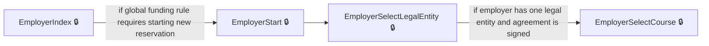
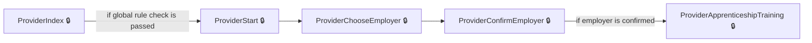
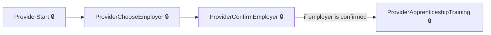
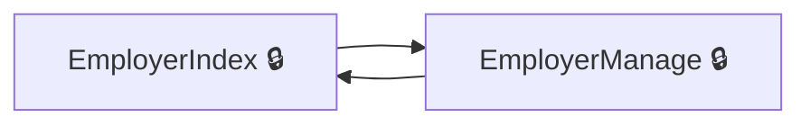
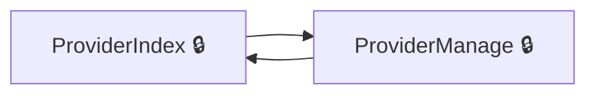
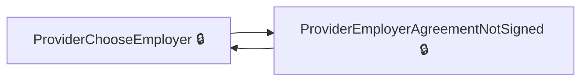

# User journeys: SkillsFundingAgency/das-reservations

Generated from `master/src`: 30 pages, 29 transitions, 7 journeys. 🔒 means sign-in is required. Dotted arrows return to a hub.

## Employer: Create a New Reservation

Employers begin a new apprenticeship reservation, selecting the legal entity and course as required.

## Provider: Create Reservation for Employer

Providers create a new apprenticeship reservation by selecting and confirming an employer, then supplying training details.

## Employer: Start a New Reservation

Employers begin the process of making a new reservation, selecting a legal entity before appointing a course.

## Provider: Create a Reservation for an Employer

Providers initiate the reservation process, selecting and confirming the employer before entering apprenticeship training details.

## Employer: Navigation Between Manage and Home

Employers navigate back and forth between the manage reservations page and their reservation home page.

## Provider: Navigation Between Manage and Main Reservations

Providers switch between their reservations management dashboard and the provider main reservations page.

## Provider: Handle Employer Agreement Not Signed

Providers attempting to reserve for an employer with an unsigned agreement are shown an information page, then returned.

## Pages

| Page | Route | Sign-in | Purpose |
| --- | --- | --- | --- |
| `EmployerChangeEmail` | `{employerAccountId}/service/email/change` | Unknown | Redirects employers after requesting an email change. |
| `EmployerChangePassword` | `{employerAccountId}/service/password/change` | Unknown | Redirects employers after requesting a password change. |
| `EmployerCourseGuidance` | `accounts/{employerAccountId}/reservations/{id}/course-guidance` | Yes | Provides guidance to employers about apprenticeship courses. |
| `EmployerIndex` | `accounts/{employerAccountId}/reservations` | Yes | Shows the main employer reservations page listing options for reservation management. |
| `EmployerManage` | `accounts/{employerAccountId}/reservations/manage` | Yes | Lets employers manage their reservations, view details, and access further actions. |
| `EmployerOwnerSignAgreement` | `accounts/{employerAccountId}/reservations/owner-sign-agreement` | Yes | Allows employer owners to sign the necessary agreement for reservations. |
| `EmployerSaveRuleNotificationChoiceNoReservation` | `accounts/{employerAccountId}/reservations/saveRuleNotificationChoice` | Yes | Allows an employer to record their notification choice for funding rules without creating a reservation. |
| `EmployerSelectCourse` | `accounts/{employerAccountId}/reservations/{id}/select-course` | Yes | Lets employers choose an apprenticeship course for a reservation. |
| `EmployerSelectCourseRuleCheck` | `accounts/{employerAccountId}/reservations/{id}/select-course-rule-check` | Yes | Checks for any funding rules before the employer selects a course for a reservation. |
| `EmployerSelectLegalEntity` | `accounts/{employerAccountId}/reservations/select-legal-entity/{id?}` | Yes | Enables employers to select a legal entity associated with their account for reservations. |
| `EmployerStart` | `accounts/{employerAccountId}/reservations/start` | Yes | Displays the employer reservation start page and informs about applicable funding/global rules. |
| `EmployerTransactorSignAgreement` | `accounts/{employerAccountId}/reservations/transactor-sign-agreement` | Yes | Allows employer transactors to sign the agreement when required for making a reservation. |
| `Home.Dashboard` | `dashboard` | Unknown | Redirects to the main dashboard page for users. |
| `ProviderApprenticeshipTraining` | `{ukPrn}/reservations/{id}/apprenticeship-training/{fromReview?}` | Yes | Lets the provider select apprenticeship training details for a reservation. |
| `ProviderChooseEmployer` | `{ukPrn}/reservations/choose-employer` | Yes | Lets the provider choose an employer for whom to create a reservation. |
| `ProviderCompleted` | `{ukPrn}/reservations/{id}/completed/{accountLegalEntityPublicHashedId}` | Yes | Shows confirmation that the provider's reservation is completed and next steps. |
| `ProviderConfirmEmployer` | `{ukPrn}/reservations/confirm-employer/{id?}` | Yes | Allows the provider to confirm the selected employer for a new reservation. |
| `ProviderCreateApprenticeshipTraining` | `{ukPrn}/reservations/{id}/apprenticeship-training` | Yes | Processes provider input for creating apprenticeship training and advances the reservation. |
| `ProviderDelete` | `{ukPrn}/reservations/{id}/delete` | Yes | Allows providers to delete a reservation. |
| `ProviderDeleteCompleted` | `{ukPrn}/reservations/{id}/delete-completed` | Yes | Shows a confirmation that a reservation has been deleted by a provider. |
| `ProviderEmployerAgreementNotSigned` | `{ukPrn}/reservations/employer-agreement-not-signed/{id?}` | Yes | Informs the provider that the employer's agreement is not signed and displays relevant details. |
| `ProviderFeatureNotAvailable` | `{ukPrn}/notAvailable` | Unknown | Shows a page indicating a feature is not available for the provider. |
| `ProviderIndex` | `{ukPrn}/reservations` | Yes | Provides the provider's main reservations page with links to start or manage reservations. |
| `ProviderManage` | `{ukPrn}/reservations/manage` | Yes | Displays a list of reservations managed by a provider, allowing filtering and navigation. |
| `ProviderPostCompleted` | `{ukPrn}/reservations/{id}/completed/{accountLegalEntityPublicHashedId}` | Yes | Processes provider selections on the completed reservation page and redirects based on choices. |
| `ProviderPostReview` | `{ukPrn}/reservations/{id}/review` | Yes | Processes provider input after reviewing a reservation and creates the reservation. |
| `ProviderReview` | `{ukPrn}/reservations/{id}/review` | Yes | Allows the provider to review reservation details before completion. |
| `ProviderSelect` | `{ukPrn}/reservations/{accountLegalEntityPublicHashedId}/select` | Yes | Lets the provider select from available reservations or reserve new funding for a legal entity. |
| `ProviderStart` | `{ukPrn}/reservations/start` | Yes | Guides the provider through starting the reservation creation process. |
| `p-signed-out` | `~/p-signed-out` | No | Displays the signed out page for providers. |
