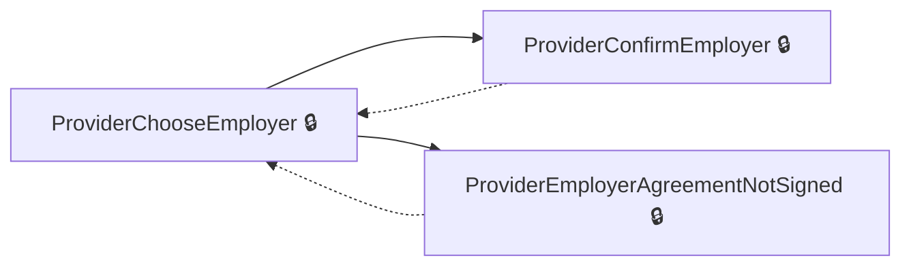

# User journeys: SkillsFundingAgency/das-reservations

Generated from `master/src`: 30 pages, 28 transitions, 1 journeys. 🔒 means sign-in is required. Dotted arrows return to a hub.

## Provider Confirm Employer Selection

Allows a provider to confirm the employer selected for a reservation.

Complete the sections in any order, returning to the hub.

## Pages

| Page | Route | Sign-in | Purpose |
| --- | --- | --- | --- |
| `EmployerChangeEmail` | `{employerAccountId}/service/email/change` | Unknown | Redirects employers to update their email addresses. |
| `EmployerChangePassword` | `{employerAccountId}/service/password/change` | Unknown | Redirects employers to change their account passwords. |
| `EmployerCourseGuidance` | `accounts/{employerAccountId}/reservations/{id}/course-guidance` | Yes | Provides guidance to employers on course selection. |
| `EmployerIndex` | `accounts/{employerAccountId}/reservations` | Yes | Displays a summary page for employer reservations. |
| `EmployerManage` | `accounts/{employerAccountId}/reservations/manage` | Yes | Allows employers to manage existing reservations. |
| `EmployerOwnerSignAgreement` | `accounts/{employerAccountId}/reservations/owner-sign-agreement` | Yes | Allows employer owners to sign an agreement. |
| `EmployerSaveRuleNotificationChoiceNoReservation` | `accounts/{employerAccountId}/reservations/saveRuleNotificationChoice` | Yes | Enables employers to save their choice regarding reservation funding rules notifications. |
| `EmployerSelectCourse` | `accounts/{employerAccountId}/reservations/{id}/select-course` | Yes | Enables employers to select a course for reservation. |
| `EmployerSelectCourseRuleCheck` | `accounts/{employerAccountId}/reservations/{id}/select-course-rule-check` | Yes | Checks funding rules before allowing employers to select a course. |
| `EmployerSelectLegalEntity` | `accounts/{employerAccountId}/reservations/select-legal-entity/{id?}` | Yes | Allows employers to choose a legal entity for reservations. |
| `EmployerStart` | `accounts/{employerAccountId}/reservations/start` | Yes | Initiates employer reservations process. |
| `EmployerTransactorSignAgreement` | `accounts/{employerAccountId}/reservations/transactor-sign-agreement` | Yes | Allows transactor roles to sign employer agreements. |
| `Home.Dashboard` | `dashboard` | Unknown | Redirects to the overarching dashboard for the application. |
| `Home.ProviderSignedOut` | `~/p-signed-out` | No | Confirms the provider has been signed out. |
| `ProviderApprenticeshipTraining` | `{ukPrn}/reservations/{id}/apprenticeship-training/{fromReview?}` | Yes | Allows the provider to specify apprenticeship training details for a reservation. |
| `ProviderChooseEmployer` | `{ukPrn}/reservations/choose-employer` | Yes | Lets the provider choose an employer to work with for apprenticeship reservations. |
| `ProviderCompleted` | `{ukPrn}/reservations/{id}/completed/{accountLegalEntityPublicHashedId}` | Yes | Confirms that the apprenticeship reservation process is completed for providers. |
| `ProviderConfirmEmployer` | `{ukPrn}/reservations/confirm-employer/{id?}` | Yes | Allows the provider to confirm the selected employer for securing funds. |
| `ProviderCreateApprenticeshipTraining` | `{ukPrn}/reservations/{id}/apprenticeship-training` | Yes | Processes the creation of apprenticeship training details for a reservation. |
| `ProviderDelete` | `{ukPrn}/reservations/{id}/delete` | Yes | Allows providers to delete reservations. |
| `ProviderDeleteCompleted` | `{ukPrn}/reservations/{id}/delete-completed` | Yes | Confirms reservation deletion has been completed by providers. |
| `ProviderEmployerAgreementNotSigned` | `{ukPrn}/reservations/employer-agreement-not-signed/{id?}` | Yes | Notifies the provider that the selected employer's agreement is not signed. |
| `ProviderFeatureNotAvailable` | `{ukPrn}/notAvailable` | Unknown | Displays a message when a feature is unavailable to providers. |
| `ProviderIndex` | `{ukPrn}/reservations` | Yes | Serves as the starting point for providers to navigate reservations-related tasks. |
| `ProviderManage` | `{ukPrn}/reservations/manage` | Yes | Allows a provider to manage reservations on their dashboard. |
| `ProviderPostCompleted` | `{ukPrn}/reservations/{id}/completed/{accountLegalEntityPublicHashedId}` | Yes | Handles actions after a provider finishes the reservation process. |
| `ProviderPostReview` | `{ukPrn}/reservations/{id}/review` | Yes | Allows providers to finalize details after reviewing a reservation. |
| `ProviderReview` | `{ukPrn}/reservations/{id}/review` | Yes | Displays the review page for providers to inspect and modify reservation details. |
| `ProviderSelect` | `{ukPrn}/reservations/{accountLegalEntityPublicHashedId}/select` | Yes | Allows a provider to select an existing reservation or make a new one. |
| `ProviderStart` | `{ukPrn}/reservations/start` | Yes | Displays a starting view for providers to handle reservation rules or agreements. |
