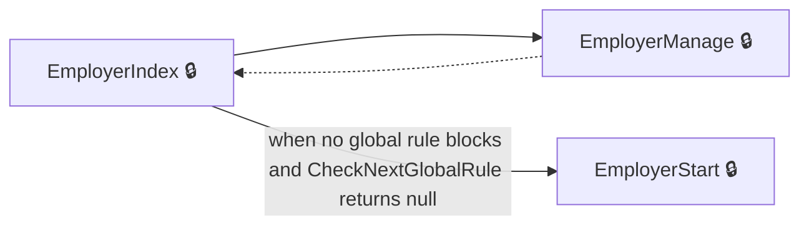
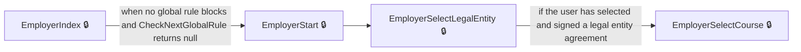
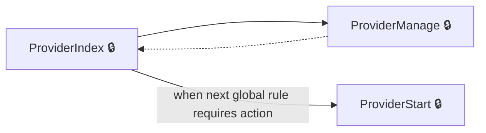
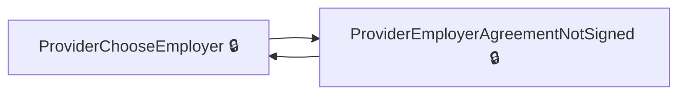
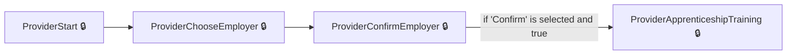
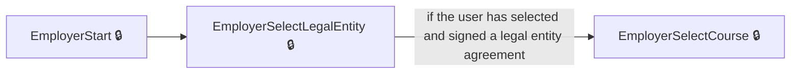

# User journeys: SkillsFundingAgency/das-reservations

Generated from `master/src`: 30 pages, 29 transitions, 6 journeys. 🔒 means sign-in is required. Dotted arrows return to a hub.

## Manage Reservations as Employer

Employers view and manage their existing reservations through the employer dashboard.

Complete the sections in any order, returning to the hub.

## Create a New Employer Reservation

Employers start the process of creating a new reservation, selecting legal entity and course.

## Manage Reservations as Provider

Providers access their reservation dashboard and manage their existing reservations.

Complete the sections in any order, returning to the hub.

## Handle Provider Employer Agreement Not Signed

Providers are notified if the employer agreement is not signed and can return to employer selection.

## Provider Makes a Reservation

A provider starts, selects an employer, confirms, and chooses apprenticeship training for a new reservation.

## Employer Creates a Reservation

An employer starts the reservation process, selects a legal entity, and then selects a course.

## Pages

| Page | Route | Sign-in | Purpose |
| --- | --- | --- | --- |
| `EmployerChangeEmail` | `{employerAccountId}/service/email/change` | Unknown | Handles the process for the employer to change their email address. |
| `EmployerChangePassword` | `{employerAccountId}/service/password/change` | Unknown | Handles the process for the employer to change their password. |
| `EmployerCourseGuidance` | `accounts/{employerAccountId}/reservations/{id}/course-guidance` | Yes | Provides guidance to the employer about selecting a course for their apprentice. |
| `EmployerIndex` | `accounts/{employerAccountId}/reservations` | Yes | Shows the employer's reservation dashboard and checks global funding rules. |
| `EmployerManage` | `accounts/{employerAccountId}/reservations/manage` | Yes | Lets the employer manage their existing reservations. |
| `EmployerOwnerSignAgreement` | `accounts/{employerAccountId}/reservations/owner-sign-agreement` | Yes | Lets the employer with owner role sign the employer agreement so reservations can be made. |
| `EmployerSaveRuleNotificationChoiceNoReservation` | `accounts/{employerAccountId}/reservations/saveRuleNotificationChoice` | Yes | Processes employer choices for rule notifications without a reservation. |
| `EmployerSelectCourse` | `accounts/{employerAccountId}/reservations/{id}/select-course` | Yes | Lets the employer select which course their apprentice will take, or indicate if they don't know. |
| `EmployerSelectCourseRuleCheck` | `accounts/{employerAccountId}/reservations/{id}/select-course-rule-check` | Yes | Checks rule eligibility before an employer selects a course. |
| `EmployerSelectLegalEntity` | `accounts/{employerAccountId}/reservations/select-legal-entity/{id?}` | Yes | Lets the employer select which legal entity will be used for the reservation. |
| `EmployerStart` | `accounts/{employerAccountId}/reservations/start` | Yes | Starts a new reservation process for the employer. |
| `EmployerTransactorSignAgreement` | `accounts/{employerAccountId}/reservations/transactor-sign-agreement` | Yes | Displays information to the transactor user and allows them to sign the employer agreement. |
| `Home.Dashboard` | `dashboard` | Unknown | Redirects the user to the main dashboard. |
| `ProviderApprenticeshipTraining` | `{ukPrn}/reservations/{id}/apprenticeship-training/{fromReview?}` | Yes | Lets the provider select apprenticeship training course and start date. |
| `ProviderChooseEmployer` | `{ukPrn}/reservations/choose-employer` | Yes | Lets the provider choose an employer for a reservation. |
| `ProviderCompleted` | `{ukPrn}/reservations/{id}/completed/{accountLegalEntityPublicHashedId}` | Yes | Shows that the reservation has been completed by the provider. |
| `ProviderConfirmEmployer` | `{ukPrn}/reservations/confirm-employer/{id?}` | Yes | Lets the provider confirm if they want to reserve funds for a specific employer. |
| `ProviderCreateApprenticeshipTraining` | `{ukPrn}/reservations/{id}/apprenticeship-training` | Yes | Processes the provider's selection of apprenticeship training course and start date. |
| `ProviderDelete` | `{ukPrn}/reservations/{id}/delete` | Yes | Lets a provider delete a reservation. |
| `ProviderDeleteCompleted` | `{ukPrn}/reservations/{id}/delete-completed` | Yes | Confirms that a reservation has been deleted by the provider. |
| `ProviderEmployerAgreementNotSigned` | `{ukPrn}/reservations/employer-agreement-not-signed/{id?}` | Yes | Notifies the provider when the employer agreement is not signed. |
| `ProviderFeatureNotAvailable` | `{ukPrn}/notAvailable` | Unknown | Informs the provider that a feature is not available. |
| `ProviderIndex` | `{ukPrn}/reservations` | Yes | Provider homepage for managing reservations. |
| `ProviderManage` | `{ukPrn}/reservations/manage` | Yes | Lets the provider view and filter their reservations. |
| `ProviderPostCompleted` | `{ukPrn}/reservations/{id}/completed/{accountLegalEntityPublicHashedId}` | Yes | Handles post-completion actions after the provider completes a reservation. |
| `ProviderPostReview` | `{ukPrn}/reservations/{id}/review` | Yes | Handles actions after the provider reviews the reservation. |
| `ProviderReview` | `{ukPrn}/reservations/{id}/review` | Yes | Lets the provider review the reservation before finalising. |
| `ProviderSelect` | `{ukPrn}/reservations/{accountLegalEntityPublicHashedId}/select` | Yes | Lets the provider select a reservation from available options. |
| `ProviderStart` | `{ukPrn}/reservations/start` | Yes | Initial provider landing page to start managing reservations. |
| `p-signed-out` | `~/p-signed-out` | No | Shows the 'provider signed out' screen or redirects to provider dashboard. |

## Form fields

Field definitions only: no values a user enters are recorded.

### `EmployerSelectCourse`

| Field | Type | Label | Required | Rules | Options |
| --- | --- | --- | --- | --- | --- |
| `ApprenticeTrainingKnown` | radios | Do you know which training course your learner will take? | — | required; must indicate whether the training course is known | Yes, No |
| `SelectedCourseId` | select | — | — | required when 'ApprenticeTrainingKnown' is true; must be a valid course identifier | — |

### `EmployerSelectLegalEntity`

| Field | Type | Label | Required | Rules | Options |
| --- | --- | --- | --- | --- | --- |
| `LegalEntity` | radios | — | — | required; must select a legal entity | — |

### `ProviderApprenticeshipTraining`

| Field | Type | Label | Required | Rules | Options |
| --- | --- | --- | --- | --- | --- |
| `StartDate` | radios | When will the training start? | — | required; cannot select a past date for some apprenticeship types | — |
| `SelectedCourseId` | select | — | — | required | — |

### `ProviderChooseEmployer`

| Field | Type | Label | Required | Rules | Options |
| --- | --- | --- | --- | --- | --- |
| `searchTerm` | text | — | — | — | — |

### `ProviderConfirmEmployer`

| Field | Type | Label | Required | Rules | Options |
| --- | --- | --- | --- | --- | --- |
| `Confirm` | radios | Are you sure you want to reserve funds for this employer? | — | required; must be selected | Yes, use, No, choose a different employer |

### `ProviderCreateApprenticeshipTraining`

| Field | Type | Label | Required | Rules | Options |
| --- | --- | --- | --- | --- | --- |
| `StartDate` | radios | When will the training start? | — | required; cannot select a past date for some apprenticeship types | — |
| `SelectedCourseId` | select | — | — | required | — |

### `ProviderManage`

| Field | Type | Label | Required | Rules | Options |
| --- | --- | --- | --- | --- | --- |
| `searchTerm` | text | Search employer name or course | — | — | — |
| `selectedEmployer` | select | Employer | — | — | — |
| `selectedCourse` | select | Training course | — | — | — |
| `FilterModel.SelectedLearningType` | select | — | — | — | — |
| `selectedStartDate` | select | Start date | — | — | — |

