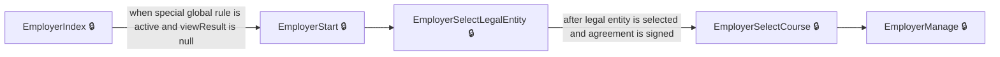
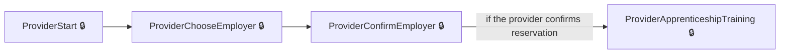
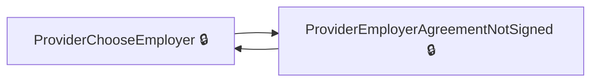
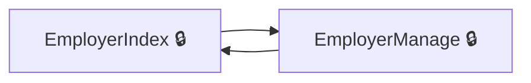
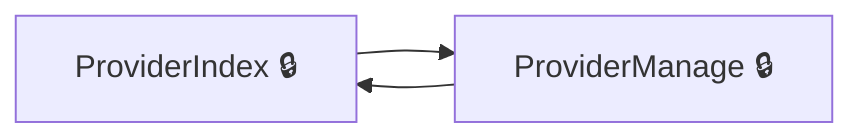

# User journeys: SkillsFundingAgency/das-reservations

Generated from `master/src`: 30 pages, 29 transitions, 6 journeys. 🔒 means sign-in is required. Dotted arrows return to a hub.

## Create Reservation as Employer

An employer creates a new apprenticeship reservation, selecting legal entity and course details.

## Create Reservation as Provider

A provider selects an employer, confirms the employer, and enters training details to reserve funding.

## Handle Employer Agreement not Signed (Provider)

A provider encounters an employer who has not signed the agreement and is routed back.

## Complete Employer Reservation

An employer makes a new apprenticeship reservation, selecting legal entity and training course.

## Review Employer Reservations

An employer views and manages existing apprenticeship reservations from the main reservations area.

## Manage Provider Reservations

A provider accesses and manages existing reservations.

## Pages

| Page | Route | Sign-in | Purpose |
| --- | --- | --- | --- |
| `EmployerChangeEmail` | `{employerAccountId}/service/email/change` | Unknown | Redirects the employer to change their email address. |
| `EmployerChangePassword` | `{employerAccountId}/service/password/change` | Unknown | Redirects the employer to change their password. |
| `EmployerCourseGuidance` | `accounts/{employerAccountId}/reservations/{id}/course-guidance` | Yes | Provides guidance to the employer about selecting an apprenticeship training course. |
| `EmployerIndex` | `accounts/{employerAccountId}/reservations` | Yes | Shows the main reservations page for the employer. |
| `EmployerManage` | `accounts/{employerAccountId}/reservations/manage` | Yes | Lets the employer manage their existing reservations. |
| `EmployerOwnerSignAgreement` | `accounts/{employerAccountId}/reservations/owner-sign-agreement` | Yes | Lets the employer who owns the account sign the agreement. |
| `EmployerSaveRuleNotificationChoiceNoReservation` | `accounts/{employerAccountId}/reservations/saveRuleNotificationChoice` | Yes | — |
| `EmployerSelectCourse` | `accounts/{employerAccountId}/reservations/{id}/select-course` | Yes | Lets the employer select the apprenticeship training course for a reservation. |
| `EmployerSelectCourseRuleCheck` | `accounts/{employerAccountId}/reservations/{id}/select-course-rule-check` | Yes | — |
| `EmployerSelectLegalEntity` | `accounts/{employerAccountId}/reservations/select-legal-entity/{id?}` | Yes | Lets the employer choose the legal entity for the reservation. |
| `EmployerStart` | `accounts/{employerAccountId}/reservations/start` | Yes | Starts a new reservation process for the employer. |
| `EmployerTransactorSignAgreement` | `accounts/{employerAccountId}/reservations/transactor-sign-agreement` | Yes | Allows a transactor (non-owner) employer to sign the agreement. |
| `Home.Dashboard` | `dashboard` | Unknown | Redirects users to the dashboard. |
| `ProviderApprenticeshipTraining` | `{ukPrn}/reservations/{id}/apprenticeship-training/{fromReview?}` | Yes | Lets the provider select apprenticeship course and training start date for a reservation. |
| `ProviderChooseEmployer` | `{ukPrn}/reservations/choose-employer` | Yes | Lets the provider select an employer to reserve funding for. |
| `ProviderCompleted` | `{ukPrn}/reservations/{id}/completed/{accountLegalEntityPublicHashedId}` | Yes | Shows completion details after a provider has made a reservation. |
| `ProviderConfirmEmployer` | `{ukPrn}/reservations/confirm-employer/{id?}` | Yes | Allows the provider to confirm the selected employer before reserving funds. |
| `ProviderCreateApprenticeshipTraining` | `{ukPrn}/reservations/{id}/apprenticeship-training` | Yes | Processes the provider apprenticeship training form submission to enter course and start date. |
| `ProviderDelete` | `{ukPrn}/reservations/{id}/delete` | Yes | Lets the provider delete a reservation. |
| `ProviderDeleteCompleted` | `{ukPrn}/reservations/{id}/delete-completed` | Yes | Informs the provider that the reservation has been successfully deleted. |
| `ProviderEmployerAgreementNotSigned` | `{ukPrn}/reservations/employer-agreement-not-signed/{id?}` | Yes | Shows that the selected employer has not signed the necessary agreement. |
| `ProviderFeatureNotAvailable` | `{ukPrn}/notAvailable` | Unknown | Shows a page that a feature is not available for this provider. |
| `ProviderIndex` | `{ukPrn}/reservations` | Yes | Landing page for providers to manage or create reservations. |
| `ProviderManage` | `{ukPrn}/reservations/manage` | Yes | Displays a list of reservations for providers and allows filtering by employer, course, start date, and learning type. |
| `ProviderPostCompleted` | `{ukPrn}/reservations/{id}/completed/{accountLegalEntityPublicHashedId}` | Yes | — |
| `ProviderPostReview` | `{ukPrn}/reservations/{id}/review` | Yes | — |
| `ProviderReview` | `{ukPrn}/reservations/{id}/review` | Yes | Lets the provider review reservation details before final confirmation. |
| `ProviderSelect` | `{ukPrn}/reservations/{accountLegalEntityPublicHashedId}/select` | Yes | Allows the provider to choose an available reservation for a legal entity. |
| `ProviderStart` | `{ukPrn}/reservations/start` | Yes | Entry page for provider reservation flow, may display funding restrictions or guidance. |
| `p-signed-out` | `~/p-signed-out` | No | Indicates the provider has signed out. |

## Form fields

Field definitions only: no values a user enters are recorded.

### `EmployerSelectCourse`

| Field | Type | Label | Required | Rules | Options |
| --- | --- | --- | --- | --- | --- |
| `ApprenticeTrainingKnown` | radios | Do you know which training course your learner will take? | — | — | Yes, No |
| `SelectedCourseId` | select | — | — | — | — |

### `EmployerSelectLegalEntity`

| Field | Type | Label | Required | Rules | Options |
| --- | --- | --- | --- | --- | --- |
| `LegalEntity` | radios | — | — | required; must select one legal entity | — |

### `ProviderApprenticeshipTraining`

| Field | Type | Label | Required | Rules | Options |
| --- | --- | --- | --- | --- | --- |
| `StartDate` | radios | When will the training start? | — | — | — |
| `SelectedCourseId` | select | — | — | — | — |

### `ProviderChooseEmployer`

| Field | Type | Label | Required | Rules | Options |
| --- | --- | --- | --- | --- | --- |
| `searchTerm` | text | — | — | — | — |

### `ProviderConfirmEmployer`

| Field | Type | Label | Required | Rules | Options |
| --- | --- | --- | --- | --- | --- |
| `Confirm` | radios | Are you sure you want to reserve funds for this employer? | — | required | Yes, use, No, choose a different employer |

### `ProviderCreateApprenticeshipTraining`

| Field | Type | Label | Required | Rules | Options |
| --- | --- | --- | --- | --- | --- |
| `StartDate` | radios | When will the training start? | — | — | — |
| `SelectedCourseId` | select | — | — | — | — |

### `ProviderManage`

| Field | Type | Label | Required | Rules | Options |
| --- | --- | --- | --- | --- | --- |
| `searchTerm` | text | Search employer name or course | — | — | — |
| `selectedEmployer` | select | Employer | — | — | — |
| `selectedCourse` | select | Training course | — | — | — |
| `FilterModel.SelectedLearningType` | select | — | — | — | — |
| `selectedStartDate` | select | Start date | — | — | — |

