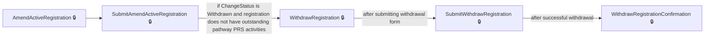
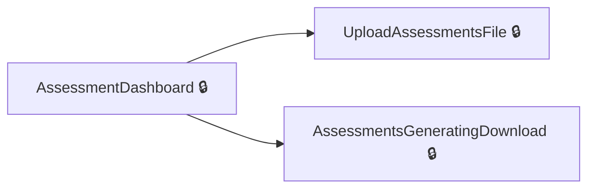
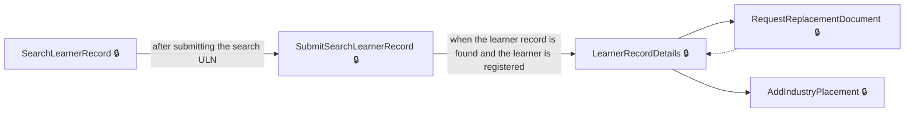
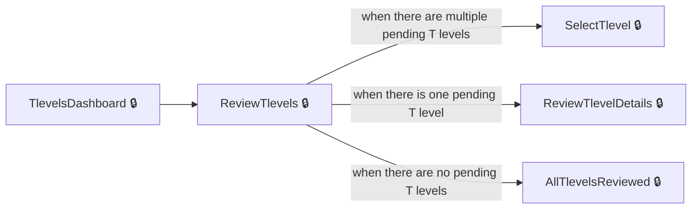
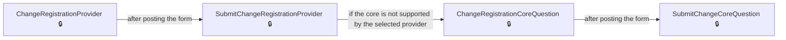
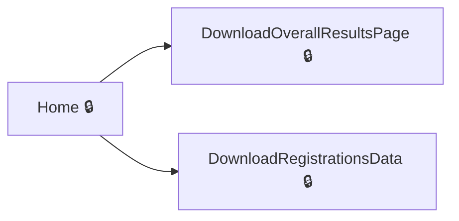
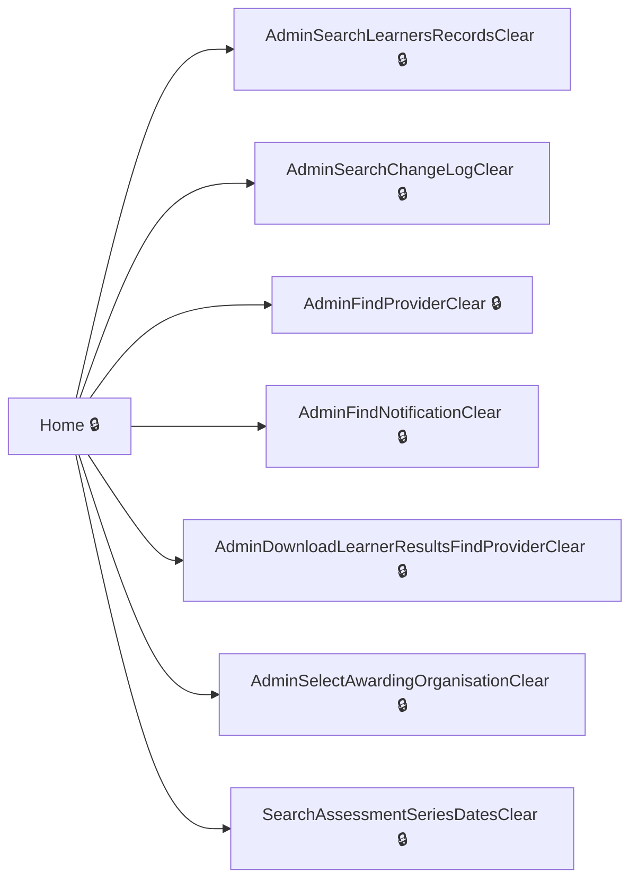

# User journeys: SkillsFundingAgency/tl-results-and-certification

Generated from `master/src`: 496 pages, 778 transitions, 11 journeys. 🔒 means sign-in is required. Dotted arrows return to a hub.

## Register a Learner

Register a new learner by entering their details and submitting the registration for confirmation.

## Amend or Withdraw a Registration

Amend an active or withdrawn learner registration, including withdrawal, deletion, or reactivation.

## Reregister a Withdrawn Learner

Reregister a previously withdrawn learner for a new course after withdrawal is confirmed.

```mermaid
flowchart LR
  p0["WithdrawRegistrationConfirmation 🔒"] --> p1["ReregisterProvider 🔒"]
  p1["ReregisterProvider 🔒"] --> p2["SubmitReregisterProvider 🔒"]
  p2["SubmitReregisterProvider 🔒"] -->|"after selecting provider"| p3["ReregisterCore 🔒"]
  p3["ReregisterCore 🔒"] --> p4["SubmitReregisterCore 🔒"]
  p4["SubmitReregisterCore 🔒"] -->|"if selected core is valid"| p5["ReregisterSpecialismQuestion 🔒"]
  p5["ReregisterSpecialismQuestion 🔒"] --> p6["SubmitReregisterSpecialismQuestion 🔒"]
  p6["SubmitReregisterSpecialismQuestion 🔒"] -->|"if HasLearnerDecidedSpecialism is true"| p7["ReregisterSpecialisms 🔒"]
  p7["ReregisterSpecialisms 🔒"] --> p8["SubmitReregisterSpecialisms 🔒"]
  p8["SubmitReregisterSpecialisms 🔒"] -->|"if not in change mode"| p9["ReregisterAcademicYear 🔒"]
  p9["ReregisterAcademicYear 🔒"] --> p10["SubmitReregisterAcademicYear 🔒"]
  p10["SubmitReregisterAcademicYear 🔒"] -->|"after saving the academic year"| p11["ReregisterCheckAndSubmit 🔒"]
  p11["ReregisterCheckAndSubmit 🔒"] --> p12["SubmitReregisterCheckAndSubmit 🔒"]
  p12["SubmitReregisterCheckAndSubmit 🔒"] -->|"after successful reregistration"| p13["ReregistrationConfirmation 🔒"]
```

## Manage Assessment Entries

Add, review, or remove assessment entries for a learner.

Complete the sections in any order, returning to the hub.

## Manage Learner Records

Search for learners and view or update their records, including requesting documents and adding placements.

Complete the sections in any order, returning to the hub.

## Review and Confirm T Levels

Review pending T Level details and confirm or raise a query as needed.

Complete the sections in any order, returning to the hub.

## Request a Post-results Review or Appeal

Request a review or appeal of assessment results for a learner, including submitting known outcomes.

```mermaid
flowchart LR
  p0["PrsAddAppeal 🔒"] --> p1["SubmitPrsAddAppeal 🔒"]
  p1["SubmitPrsAddAppeal 🔒"] -->|"if IsAppealRequested is true"| p2["PrsAddAppealOutcomeKnown 🔒"]
  p2["PrsAddAppealOutcomeKnown 🔒"] --> p3["SubmitPrsAddAppealOutcomeKnown 🔒"]
  p3["SubmitPrsAddAppealOutcomeKnown 🔒"] -->|"if AppealOutcome is GradeNotChanged"| p4["PrsAppealCheckAndSubmit 🔒"]
  p4["PrsAppealCheckAndSubmit 🔒"] --> p5["SubmitPrsAppealCheckAndSubmit 🔒"]
```

## Change Registration Details

Change key fields in a learner's registration such as core, provider, name, or date of birth.

## Download Data Files

View dashboards and download available data for assessments, registrations, results, or withdrawals.

Complete the sections in any order, returning to the hub.

## Add or Amend Postal Address

Add or update the postal address for a provider or learner where required.

```mermaid
flowchart LR
  p0["ManagePostalAddress 🔒"] --> p1["AddAddress 🔒"]
  p1["AddAddress 🔒"] --> p2["AddAddressPostcode 🔒"]
  p2["AddAddressPostcode 🔒"] --> p3["SubmitAddAddressPostcode 🔒"]
  p3["SubmitAddAddressPostcode 🔒"] -->|"after saving the form"| p4["AddAddressSelect 🔒"]
  p4["AddAddressSelect 🔒"] --> p5["SubmitAddAddressSelect 🔒"]
  p5["SubmitAddAddressSelect 🔒"] -->|"after saving the form"| p6["AddAddressCheckAndSubmit 🔒"]
  p6["AddAddressCheckAndSubmit 🔒"] --> p7["SubmitAddAddressCheckAndSubmit 🔒"]
  p7["SubmitAddAddressCheckAndSubmit 🔒"] -->|"after saving the form"| p8["AddAddressConfirmation 🔒"]
```

## Admin: Manage Learner and Provider Data

As an admin, review, update, and manage learner records and provider information from the admin home.

Complete the sections in any order, returning to the hub.

## Pages

| Page | Route | Sign-in | Purpose |
| --- | --- | --- | --- |
| `AccessibilityStatement` | `accessibility-statement` | No | Shows information about accessibility for the service. |
| `Account.PostSignIn` | — | Yes | Redirects the user after signing in, depending on their authentication and access. |
| `AccountProfile` | `account-profile` | Yes | Redirects the user to their profile page if configured. |
| `AddAddress` | `add-address` | Yes | Starts the process to add a new postal address. |
| `AddAddressCancel` | `add-postal-address-cancel` | Yes | Lets the user cancel adding a postal address. |
| `AddAddressCheckAndSubmit` | `add-postal-address-check-and-submit` | Yes | Allows the user to review and submit the postal address before adding it. |
| `AddAddressConfirmation` | `add-postal-address-confirmation` | Yes | Shows confirmation that the postal address has been added successfully. |
| `AddAddressManually` | `add-address-manually/{isFromSelectAddress:bool?}/{isFromAddressMissing:bool?}` | Yes | Redirects the user to enter a new postal address manually. |
| `AddAddressNotFound` | `add-postal-address-no-addresses-found` | Yes | Informs the user that no addresses were found for the provided postcode. |
| `AddAddressPostcode` | `add-postal-address-postcode/{showPostcode:bool?}/{isFromAddressMissing:bool?}` | Yes | Lets the user provide the postcode for the postal address they want to add. |
| `AddAddressSelect` | `add-postal-address-select` | Yes | Lets the user select an address from a list and optionally enter a department name. |
| `AddCoreAssessmentEntry` | `assessment-entry-add-core/{profileId}` | Yes | Lets an admin add an assessment entry for a learner's core component. |
| `AddCoreResult` | `select-core-result/{profileId}/{assessmentId}` | Yes | Lets the user select and add a core result for a learner's assessment. |
| `AddIndustryPlacement` | `add-industry-placement/{profileId}` | Yes | Starts the process of adding an industry placement for a learner. |
| `AddPostalAddressManual` | `add-postal-address-manual/{isFromSelectAddress:bool?}/{isFromAddressMissing:bool?}` | Yes | Lets the user manually enter a postal address, including optional department and organisation names. |
| `AddProviderTlevels` | `add-additional-tlevels/{providerId}` | Yes | Lets the user add additional T Levels for a provider. |
| `AddRegistration` | `add-registration-unique-learner` | Yes | Begins the manual registration process for a learner (ULN). |
| `AddRegistrationAcademicYear` | `add-registration-academic-year/{isChangeMode:bool?}` | Yes | Lets the user select the academic year for the learner's registration. |
| `AddRegistrationCheckAndSubmit` | `add-registration-check-and-submit` | Yes | Allows the user to review and confirm all details for a learner's registration before submission. |
| `AddRegistrationConfirmation` | `add-registration-confirmation` | Yes | Confirms that the learner's registration has been successfully added. |
| `AddRegistrationCore` | `add-registration-core/{isChangeMode:bool?}` | Yes | Lets the user select a core for the learner's registration. |
| `AddRegistrationDateofBirth` | `add-registration-date-of-birth/{isChangeMode:bool?}` | Yes | Lets the user enter the learner's date of birth for the registration. |
| `AddRegistrationLearnersName` | `add-registration-learners-name/{isChangeMode:bool?}` | Yes | Lets the user enter the learner's name for the registration. |
| `AddRegistrationProvider` | `add-registration-provider/{isChangeMode:bool?}` | Yes | Lets the user select the provider for the learner's registration. |
| `AddRegistrationSpecialismQuestion` | `add-registration-learner-decided-specialism-question/{isChangeMode:bool?}` | Yes | Lets the user specify if the learner has chosen a specialism for their registration. |
| `AddRegistrationSpecialisms` | `add-registration-specialism/{isChangeMode:bool?}` | Yes | Lets the user select a specialism for the learner's registration if applicable. |
| `AddRegistrationUln` | `add-registration-unique-learner-number/{isChangeMode:bool?}` | Yes | Lets the user enter the Unique Learner Number (ULN) for the learner's registration. |
| `AddSpecialismAssessmentEntry` | `assessment-entry-add-specialisms/{profileId}/{specialismsId}` | Yes | Lets an admin add an assessment entry for a learner's specialism component. |
| `AddSpecialismResult` | `select-specialism-result/{profileId}/{assessmentId}` | Yes | Lets the user select and add a specialism result for a learner's assessment. |
| `AddWithdrawnStatus` | `manage-learners-add-withdrawn-status/{profileId}` | Yes | Allows the user to indicate if a learner is pending withdrawal. |
| `AdminAddAppealOutcomeChangeGradeCore` | `admin/add-appeal-outcome-change-grade-core/{registrationPathwayId}/{assessmentId}` | Yes | Allows an admin to select a new core grade for an appeal outcome. |
| `AdminAddAppealOutcomeChangeGradeCoreClear` | `admin/add-appeal-outcome-change-grade-core-clear/{registrationPathwayId}/{assessmentId}` | Yes | Clears the grade selection for appeal outcome (core component). |
| `AdminAddAppealOutcomeChangeGradeSpecialism` | `admin/add-appeal-outcome-change-grade-specialism/{registrationPathwayId}/{assessmentId}` | Yes | Allows an admin to select a new specialism grade for an appeal outcome. |
| `AdminAddAppealOutcomeChangeGradeSpecialismClear` | `admin/add-appeal-outcome-change-grade-specialism-clear/{registrationPathwayId}/{assessmentId}` | Yes | Clears the grade selection for appeal outcome (specialism component). |
| `AdminAddCoreAppealOutcome` | `admin/add-appeal-outcome-core` | Yes | Lets the administrator add an appeal outcome for a core assessment. |
| `AdminAddCoreAppealOutcomeClear` | `admin/add-appeal-outcome-core-clear` | Yes | Clears the cached appeal outcome data for a core assessment. |
| `AdminAddCoreRommOutcome` | `admin/add-romm-outcome-core` | Yes | Lets the administrator add a ROMM outcome for a core assessment. |
| `AdminAddCoreRommOutcomeClear` | `admin/add-romm-outcome-core-clear` | Yes | Clears the cached ROMM outcome data for a core assessment. |
| `AdminAddNotification` | `admin/add-notification` | Yes | Allows an admin to create a new notification. |
| `AdminAddPathwayResult` | `admin/add-assessment-result-core/{registrationPathwayId}/{assessmentId}` | Yes | Lets the administrator add a result for a pathway assessment. |
| `AdminAddPathwayResultClear` | `admin/add-assessment-result-core-clear/{registrationPathwayId}/{assessmentId}` | Yes | Clears the cached pathway result addition for an administrator. |
| `AdminAddPathwayResultReviewChanges` | `admin/review-changes-assessment-result-core` | Yes | Lets the administrator review changes before confirming a new pathway assessment result. |
| `AdminAddProvider` | `admin/add-provider` | Yes | Lets an admin add a new provider to the system. |
| `AdminAddRommOutcomeChangeGradeCore` | `admin/add-romm-outcome-change-grade-core/{registrationPathwayId}/{assessmentId}` | Yes | Lets the administrator select a new grade after a ROMM outcome change for a core assessment. |
| `AdminAddRommOutcomeChangeGradeCoreClear` | `admin/add-romm-outcome-change-grade-core-clear/{registrationPathwayId}/{assessmentId}` | Yes | Clears the cached grade change data for a ROMM outcome in a core assessment. |
| `AdminAddRommOutcomeChangeGradeSpecialism` | `admin/add-romm-outcome-change-grade-specialism/{registrationPathwayId}/{assessmentId}` | Yes | Lets the administrator select a new grade after a ROMM outcome change for a specialism assessment. |
| `AdminAddRommOutcomeChangeGradeSpecialismClear` | `admin/add-romm-outcome-change-grade-specialism-clear/{registrationPathwayId}/{assessmentId}` | Yes | Clears the cached grade change data for a ROMM outcome in a specialism assessment. |
| `AdminAddSpecialismAppealOutcome` | `admin/add-appeal-outcome-specialism` | Yes | Lets the administrator add an appeal outcome for a specialism assessment. |
| `AdminAddSpecialismAppealOutcomeClear` | `admin/add-appeal-outcome-specialism-clear` | Yes | Clears the cached appeal outcome data for a specialism assessment. |
| `AdminAddSpecialismResult` | `admin/add-assessment-result-specialism/{registrationPathwayId}/{assessmentId}` | Yes | Lets the administrator add a result for a specialism assessment. |
| `AdminAddSpecialismResultClear` | `admin/add-assessment-result-specialism-clear/{registrationPathwayId}/{assessmentId}` | Yes | Clears the cached specialism result addition for an administrator. |
| `AdminAddSpecialismResultReviewChanges` | `admin/review-changes-assessment-result-specialism` | Yes | Lets the administrator review changes before confirming a new specialism assessment result. |
| `AdminAddSpecialismRommOutcome` | `admin/add-romm-outcome-specialism` | Yes | Lets the administrator add a ROMM outcome for a specialism assessment. |
| `AdminAddSpecialismRommOutcomeClear` | `admin/add-romm-outcome-specialism-clear` | Yes | Clears the cached ROMM outcome data for a specialism assessment. |
| `AdminAssessmentSeriesDateDetails` | `admin/assessment-series-date/{assessmentId}` | Yes | Displays detailed information about a specific assessment series date to admins. |
| `AdminChangeIndustryPlacement` | `admin/change-industry-placement/{registrationPathwayId}` | Yes | Lets the admin change the industry placement status for a learner. |
| `AdminChangeIndustryPlacementClear` | `admin/change-industry-placement-clear/{registrationPathwayId}` | Yes | Clears any cached data about the industry placement change for a learner before starting again. |
| `AdminChangePathwayResult` | `admin/change-assessment-result-core/{registrationPathwayId}/{assessmentId}` | Yes | Allows the admin to change the pathway result (core result) for a learner assessment. |
| `AdminChangePathwayResultClear` | `admin/change-assessment-result-core-clear/{registrationPathwayId}/{assessmentId}` | Yes | Clears any cached data about the pathway result change for a learner before starting again. |
| `AdminChangePathwayResultReviewChanges` | `admin/change-assessment-result-core-review-changes` | Yes | Lets the admin review the details and provide information before making a pathway result change. |
| `AdminChangeSpecialismResult` | `admin/change-assessment-result-specialism/{registrationPathwayId}/{assessmentId}` | Yes | Allows the admin to change the specialism result for a learner assessment. |
| `AdminChangeSpecialismResultClear` | `admin/change-assessment-result-specialism-clear/{registrationPathwayId}/{assessmentId}` | Yes | Clears any cached data about the specialism result change for a learner before starting again. |
| `AdminChangeSpecialismResultReviewChanges` | `admin/change-assessment-result-specialism-review-changes` | Yes | Lets the admin review the details and provide information before making a specialism result change. |
| `AdminChangeUln` | `admin/change-uln/{registrationPathwayId}` | Yes | Lets the admin change the ULN (Unique Learner Number) for a learner. |
| `AdminChangeUlnClear` | `admin/change-uln-clear/{registrationPathwayId}` | Yes | Clears any cached data about the ULN change for a learner before starting again. |
| `AdminCoreComponentAssessmentEntry` | `admin/add-assessment-entry-core/{registrationPathwayId}` | Yes | Allows the admin to add an assessment entry for a learner's core component. |
| `AdminCoreComponentAssessmentEntryClear` | `admin/add-assessment-core-entry-clear/{registrationPathwayId}` | Yes | Clears any cached data about adding a core assessment entry before starting again. |
| `AdminDeleteNotification` | `admin/delete-notification/{notificationId}` | Yes | Lets the admin review notification details before deletion. |
| `AdminDownloadCoreResultsDataLink` | `admin/download-core-results/{awardingOrganisationUkprn}/{fileId}` | Yes | Allows admins to download core results data files for an awarding organisation. |
| `AdminDownloadLearnerResultsByProvider` | `admin/download-learner-results-provider/{providerId}` | Yes | Lets an administrator download learner results for a specific provider. |
| `AdminDownloadLearnerResultsCsv` | `admin/download-learner-results-file-csv/{ukprn}` | Yes | Lets an administrator download learner results as a CSV file for a provider. |
| `AdminDownloadLearnerResultsFindProvider` | `admin/download-learner-results-find-provider` | Yes | Lets an administrator search for a provider to download learner results. |
| `AdminDownloadLearnerResultsFindProviderClear` | `admin/download-learner-results-find-provider-clear` | Yes | Clears previously entered search criteria for finding a provider before downloading learner results. |
| `AdminDownloadLearnerResultsPdf` | `admin/download-learner-results-file-pdf/{ukprn}` | Yes | Lets an administrator download learner result slips as a PDF file for a provider. |
| `AdminDownloadLearnerResultsSubmitFindProvider` | `admin/download-learner-results-find-provider` | Yes | Processes the provider search and moves to results download for the found provider. |
| `AdminDownloadResultsRommsByAwardingOrganisation` | `admin/download-results-romms-awarding-organisation/{awardingOrganisationUkprn}` | Yes | Shows download options for results and ROMM data for a selected awarding organisation. |
| `AdminDownloadRommsDataLink` | `admin/download-romms-data/{awardingOrganisationUkprn}/{fileId}` | Yes | Allows admins to download ROMM data files for an awarding organisation. |
| `AdminDownloadSpecialismResultsDataLink` | `admin/download-specialism-results/{awardingOrganisationUkprn}/{fileId}` | Yes | Allows admins to download specialism results data files for an awarding organisation. |
| `AdminEditNotification` | `admin/edit-notification` | Yes | Allows an admin to edit an existing notification. |
| `AdminEditProvider` | `admin/edit-provider/{providerId}` | Yes | Lets an admin edit an existing provider's details. |
| `AdminFindNotification` | `admin/find-notification/{pageNumber:int?}` | Yes | Lets the admin search and filter notifications. |
| `AdminFindNotificationClear` | `admin/find-notification-clear` | Yes | Clears applied filters for notification search. |
| `AdminFindProvider` | `admin/find-provider` | Yes | Lets an admin search for providers by name or identifier. |
| `AdminFindProviderClear` | `admin/find-provider-clear` | Yes | Clears the provider search criteria or results. |
| `AdminHome` | `admin/home` | Yes | Redirects to the application's home page after clearing admin dashboard cache. |
| `AdminIndustryPlacementSpecialConsiderationHours` | `admin/industry-placement-hours` | Yes | Lets the admin specify the number of hours completed under special consideration for an industry placement. |
| `AdminIndustryPlacementSpecialConsiderationReasons` | `admin/industry-placement-incomplete` | Yes | Lets the admin specify reasons for incomplete industry placement when special consideration applies. |
| `AdminLearnerRecord` | `admin/learner-record/{pathwayid}` | Yes | Shows the learner's record for administrators. |
| `AdminNotificationDetails` | `admin/notification-details/{notificationId}` | Yes | Displays details for a specific notification. |
| `AdminOccupationalSpecialisAssessmentEntry` | `admin/add-assessment-entry-specialism/{registrationPathwayId}/{specialismsId}` | Yes | Allows the administrator to add a specialism assessment entry for a learner. |
| `AdminOccupationalSpecialisAssessmentEntryClear` | `admin/add-assessment-specialism-entry-clear/{registrationPathwayId}/{specialismsId}` | Yes | Removes cached occupational specialism assessment entry data for the learner before returning to entry page. |
| `AdminOpenPathwayAppeal` | `admin/open-appeal-core` | Yes | Lets the administrator start an appeal process for a pathway (core assessment). |
| `AdminOpenPathwayAppealClear` | `admin/open-appeal-core-clear` | Yes | Clears the cached appeal open data for a pathway (core assessment). |
| `AdminOpenPathwayAppealReviewChanges` | `admin/review-changes-appeal-core/{registrationPathwayId}/{assessmentId}` | Yes | Lets the administrator review and submit details for opening a core appeal, including contact and reason details. |
| `AdminOpenPathwayRomm` | `admin/open-romm-core` | Yes | Lets the admin initiate opening a ROMM (Review of Marking and Moderation) for a pathway core. |
| `AdminOpenPathwayRommClear` | `admin/open-romm-core-clear` | Yes | Clears the cached ROMM form data for pathway core before reloading the ROMM opening process. |
| `AdminOpenPathwayRommReviewChanges` | `admin/review-changes-romm-core` | Yes | Allows the admin to review and confirm the details and justification for opening a pathway core ROMM. |
| `AdminOpenSpecialismAppeal` | `admin/open-appeal-specialism` | Yes | Lets the admin initiate opening an appeal for a specialism result. |
| `AdminOpenSpecialismAppealClear` | `admin/open-appeal-specialism-clear` | Yes | Clears the cached appeal form data for specialism before reloading the appeal process. |
| `AdminOpenSpecialismAppealReviewChanges` | `admin/review-changes-appeal-specialism/{registrationPathwayId}/{assessmentId}` | Yes | Allows the admin to review and confirm the details and justification for opening a specialism appeal. |
| `AdminOpenSpecialismRomm` | `admin/open-romm-specialism` | Yes | Lets the admin initiate opening a ROMM for a specialism result. |
| `AdminOpenSpecialismRommClear` | `admin/open-romm-specialism-clear` | Yes | Clears the cached ROMM form data for specialism before reloading the ROMM opening process. |
| `AdminOpenSpecialismRommReviewChanges` | `admin/review-changes-romm-specialism` | Yes | Allows the admin to review and confirm the details and justification for opening a specialism ROMM. |
| `AdminProviderDetails` | `admin/provider-details/{providerId}` | Yes | Shows the details of a provider to the admin. |
| `AdminRequestReplacementDocument` | `admin/request-replacement-document/{registrationPathwayId}` | Yes | Allows the administrator to request a replacement document for a learner. |
| `AdminReviewChangeUln` | `admin/review-change-uln/{registrationPathwayId}` | Yes | Allows the administrator to review and confirm a change of ULN for the learner before processing. |
| `AdminReviewChangesAppealOutcomeCore` | `admin/add-appeal-outcome-change-grade-review-changes-core` | Yes | Lets the admin review and confirm the details and justification for changing a core appeal outcome (grade change). |
| `AdminReviewChangesAppealOutcomeSpecialism` | `admin/add-appeal-outcome-change-grade-review-changes-specialism` | Yes | Lets the admin review and confirm the details and justification for changing a specialism appeal outcome (grade change). |
| `AdminReviewChangesCoreAssessmentEntry` | `admin/review-changes-assesment-entry-core/{registrationPathwayId}` | Yes | Allows review and confirmation of changes to a core assessment entry before completing. |
| `AdminReviewChangesIndustryPlacement` | `admin/review-changes-industry-placement/{pathwayId}` | Yes | Allows review and confirmation of changes to a learner's industry placement before completing. |
| `AdminReviewChangesRommOutcomeCore` | `admin/add-romm-outcome-change-grade-review-changes-core` | Yes | Lets the admin review and confirm the details and justification for changing a core ROMM outcome (grade change). |
| `AdminReviewChangesRommOutcomeSpecialism` | `admin/add-romm-outcome-change-grade-review-changes-specialism` | Yes | Lets the admin review and confirm the details and justification for changing a specialism ROMM outcome (grade change). |
| `AdminReviewChangesSpecialismAssessmentEntry` | `admin/review-changes-assesment-entry-specialism/{registrationPathwayId}` | Yes | Allows review and confirmation of changes to a specialism assessment entry before completing. |
| `AdminReviewRemoveCoreAssessmentEntry` | `admin/review-remove-assessment-entry-core` | Yes | Allows review and confirmation of removing a core assessment entry before completing. |
| `AdminReviewRemoveSpecialismAssessmentEntry` | `admin/review-remove-assessment-entry-specialism/{registrationPathwayId}` | Yes | Allows review and confirmation of removing a specialism assessment entry before completing. |
| `AdminSearchChangeLog` | `admin/change-log/{pageNumber:int?}` | Yes | Allows the admin to view and search the change log records. |
| `AdminSearchChangeLogClear` | `admin/change-log-clear` | Yes | Clears the search criteria and cached data for the change log. |
| `AdminSearchLearnersRecords` | `admin/search-learner-records/{pageNumber:int?}` | Yes | Lets the administrator search for learner records and apply filters. |
| `AdminSearchLearnersRecordsClear` | `admin/search-learner-records-clear` | Yes | Clears search filters for learner records before returning to search page. |
| `AdminSelectAwardingOrganisation` | `admin/select-awarding-organisation` | Yes | Lets admins select an awarding organisation. |
| `AdminSelectAwardingOrganisationClear` | `admin/select-awarding-organisation-clear` | Yes | Clears the selected awarding organisation. |
| `AdminSubmitChangeIndustryPlacement` | `admin/submit-change-industry-placement` | Yes | Allows the administrator to change a learner's industry placement status. |
| `AdminSubmitFindProvider` | `admin/find-provider` | Yes | Processes the provider search form and redirects to details if found. |
| `AdminSubmitSelectAwardingOrganisation` | `admin/select-awarding-organisation` | Yes | Lets the admin select an awarding organisation to download results and ROMM data. |
| `AdminViewChangeAddPathwayResultRecord` | `admin/view-change-record/7/{changeLogId}` | Yes | Displays details about a change log record for adding a pathway result. |
| `AdminViewChangeAddSpecialismResultRecord` | `admin/view-change-record/8/{changeLogId}` | Yes | Displays details about a change log record for adding a specialism result. |
| `AdminViewChangeCoreAssessmentRecord` | `admin/view-change-record/3/{changeLogId}` | Yes | Displays details about a change log record for a core assessment entry change. |
| `AdminViewChangeIPRecord` | `admin/view-change-record/2/{changeLogId}` | Yes | Displays details about a change log record for an industry placement change. |
| `AdminViewChangePathwayResultRecord` | `admin/view-change-record/9/{changeLogId}` | Yes | Displays details about a change log record for a pathway result change. |
| `AdminViewChangeRemoveCoreAssessmentRecord` | `admin/view-change-record/5/{changeLogId}` | Yes | Displays details about a change log record for removing a core assessment entry. |
| `AdminViewChangeRemoveSpecialismAssessmentRecord` | `admin/view-change-record/6/{changeLogId}` | Yes | Displays details about a change log record for removing a specialism assessment entry. |
| `AdminViewChangeSpecialismAssessmentRecord` | `admin/view-change-record/4/{changeLogId}` | Yes | Displays details about a change log record for a specialism assessment entry change. |
| `AdminViewChangeSpecialismResultRecord` | `admin/view-change-record/10/{changeLogId}` | Yes | Displays details about a change log record for a specialism result entry change. |
| `AdminViewChangeStartYearRecord` | `admin/view-change-record/1/{changeLogId}` | Yes | Displays details about a change log record for a start year change. |
| `AdminViewChangeUlnRecord` | `admin/view-change-record/21/{changeLogId}` | Yes | Displays details about a change log record for a ULN change. |
| `AdminViewOpenPathwayAppealRecord` | `admin/view-change-record/15/{changeLogId}` | Yes | Displays details about a change log record for opening a pathway appeal. |
| `AdminViewOpenPathwayRommRecord` | `admin/view-change-record/11/{changeLogId}` | Yes | Shows the details of an opened Pathway ROMM change record for an administrator. |
| `AdminViewOpenSpecialismAppealRecord` | `admin/view-change-record/16/{changeLogId}` | Yes | Shows the details of an opened Specialism Appeal change record for an administrator. |
| `AdminViewOpenSpecialismRommRecord` | `admin/view-change-record/12/{changeLogId}` | Yes | Shows the details of an opened Specialism ROMM change record for an administrator. |
| `AdminViewPathwayAppealOutcomeRecord` | `admin/view-change-record/17/{changeLogId}` | Yes | Shows the outcome of a Pathway Appeal change record for an administrator. |
| `AdminViewPathwayRommOutcomeRecord` | `admin/view-change-record/13/{changeLogId}` | Yes | Shows the outcome of a Pathway ROMM change record for an administrator. |
| `AdminViewSpecialismAppealOutcomeRecord` | `admin/view-change-record/18/{changeLogId}` | Yes | Shows the outcome of a Specialism Appeal change record for an administrator. |
| `AdminViewSpecialismRommOutcomeRecord` | `admin/view-change-record/14/{changeLogId}` | Yes | Shows the outcome of a Specialism ROMM change record for an administrator. |
| `AllTlevelsReviewed` | `all-tlevels-reviewed` | Yes | Advises the user that all T Levels have been reviewed. |
| `AmendActiveRegistration` | `amend-active-registration/{profileId}/{changeStatusId:int?}` | Yes | Allows the user to amend an active learner registration's status. |
| `AmendWithdrawRegistration` | `amend-withdrawn-registration/{profileId}/{changeStatusId:int?}` | Yes | Allows the user to amend a withdrawn learner registration's status. |
| `AssessmentDashboard` | `assessment-entries` | Yes | Displays assessment management options and overview to the admin. |
| `AssessmentDetails` | `assessment-entry-learner-details/{profileId}` | Yes | Shows details of a learner's assessment entries. |
| `AssessmentWithdrawnDetails` | `assessment-entries-learner-withdrawn/{profileId}` | Yes | Shows assessment details for a learner with withdrawn status. |
| `AssessmentsDownloadData` | `assessments-download-data` | Yes | Lets the user download assessment data. |
| `AssessmentsDownloadDataLink` | `download-assessments-data/{id}/{componentType}` | Yes | Downloads the assessment data file for a specific component. |
| `AssessmentsGeneratingDownload` | `assessments-generating-download` | Yes | Informs the user that assessment data is being prepared for download. |
| `AssessmentsNoRecordsFound` | `assessments-no-records-found` | Yes | Informs the user that no assessment records were found to download. |
| `AssessmentsUploadSuccessful` | `assessment-entries-upload-confirmation` | Yes | Confirms that the assessment entries file upload was successful. |
| `AssessmentsUploadUnsuccessful` | `assessment-entries-upload-unsuccessful` | Yes | Informs the user that the assessment entries file upload failed. |
| `CannotChangeAcademicYear` | `academic-year-cannot-change/{profileId}` | Yes | Informs the user that the academic year for this registration cannot be changed. |
| `ChangeAcademicYear` | `academic-year-change/{profileId}` | Yes | Allows the user to change the academic year for a learner's registration. |
| `ChangeAcademicYearConfirmation` | `academic-year-change-confirmation` | Yes | Shows a confirmation message after a registration's academic year has been changed. |
| `ChangeBackToActiveAOMessage` | `restore-learner-ao-message/{profileId}` | Yes | Displays a message after changing a learner’s status back to active, concerning the awarding organisation. |
| `ChangeBackToActiveStatus` | `restore-learner-ao/{profileId}` | Yes | Allows the user to change a withdrawn learner’s status back to active. |
| `ChangeBackToActiveStatusHaveYouToldAwardingOrganisation` | `restore-learner-have-you-told-ao/{profileId}` | Yes | Asks if the user has informed the awarding organisation about changing the learner’s status back to active. |
| `ChangeCoreResult` | `change-core-result/{profileId}/{assessmentId}` | Yes | Lets the user change the core result for a learner's assessment. |
| `ChangeRegistrationConfirmation` | `registration-details-change-confirmation` | Yes | Shows a confirmation message after details of a registration have been changed. |
| `ChangeRegistrationCore` | `change-core/{profileId}` | Yes | Shows the page for changing the core for a registration. |
| `ChangeRegistrationCoreQuestion` | `change-core-and-provider/{profileId}` | Yes | Lets the user confirm whether the core should be changed when the selected provider does not offer the same core. |
| `ChangeRegistrationDateofBirth` | `change-registration-learners-date-of-birth/{profileId}` | Yes | Shows the page for changing a learner's date of birth in a registration. |
| `ChangeRegistrationLearnersName` | `change-registration-learners-name/{profileId}` | Yes | Shows the page for changing a learner's name in a registration. |
| `ChangeRegistrationProvider` | `change-registration-provider/{profileId}/{isback:bool?}` | Yes | Shows the page for changing the provider in a registration. |
| `ChangeRegistrationProviderAndCoreNeedToWithdraw` | `change-registration-provider-and-core-need-to-withdraw` | Yes | Informs the user that they need to withdraw the registration due to provider and core change. |
| `ChangeRegistrationProviderNotOfferingSameCore` | `change-registration-provider-not-offering-core` | Yes | Informs the user that the selected provider does not offer the same core as the current registration. |
| `ChangeRegistrationSpecialismQuestion` | `change-registration-learner-decided-specialism-question/{profileId}` | Yes | Lets the user indicate if the learner has decided which specialism to take as part of their registration. |
| `ChangeRegistrationSpecialisms` | `change-registration-select-specialism/{profileId}` | Yes | Shows the page for changing the specialisms for a registration. |
| `ChangeSpecialismRestriction` | `registration-specialism-change-restriction/{profileId}` | Yes | Informs the user that specialism change is restricted for the registration. |
| `ChangeSpecialismResult` | `change-specialism-result/{profileId}/{assessmentId}` | Yes | Lets the user change the specialism result for a learner's assessment. |
| `ChangeStartYear` | `admin/change-start-year/{registrationPathwayId}` | Yes | Allows the administrator to change the start academic year for a learner. |
| `ChangeStartYearClear` | `admin/change-start-year-clear/{registrationPathwayId}` | Yes | Clears cached start year change data for the learner before returning to change year page. |
| `ChangeWithdrawnStatusHaveYouToldAwardingOrganisation` | `manage-add-withdrawn-status-ao-message/{profileId}` | Yes | Lets the user confirm whether they have told the awarding organisation about the learner's withdrawn status. |
| `ConfirmTlevel` | `confirm-tlevel` | Yes | Lets the user confirm if the T Level details are correct. |
| `ConfirmedTlevels` | `confirmed-tlevels` | Yes | Shows the user the list of confirmed T Levels. |
| `Contact` | `contact-us` | No | Lets the user view ways to contact support for the service. |
| `CookieDetails` | `cookie-details` | No | Shows details about cookies used by the service. |
| `Cookies` | `cookies` | No | Lets the user make choices about cookies for the site. |
| `DeleteRegistration` | `delete-registration/{profileId}` | Yes | Allows the user to initiate the deletion of a learner's registration. |
| `DownloadAssessmentEntriesDataFormatAndRulesGuide` | `tlevels-assessment-entries-data-format-and-rules` | No | Lets the user download the assessment entries data format and rules guide. |
| `DownloadAssessmentEntriesTemplate` | `tlevels-assessment-entries-template` | No | Lets the user download the template file for bulk uploading assessment entries. |
| `DownloadLearnerOverallResultSlipsFile` | `download-learner-tlevel-result-slips-file/{profileId}` | Yes | Lets the user download T Level result slips for a specific learner. |
| `DownloadOverallResultSlipsFile` | `download-tlevel-result-slips-file` | Yes | Lets the user download all T Level result slips for learners in bulk. |
| `DownloadOverallResultsFile` | `download-tlevel-results-file` | Yes | Lets the user download a CSV file of overall T Level results for learners. |
| `DownloadOverallResultsPage` | `download-tlevel-results` | Yes | Displays download options for T Level results and result slips. |
| `DownloadRegistrationDataFormatAndRulesGuide` | `tlevels-registration-data-format-and-rules` | No | Lets the user download the registration data format and rules guide. |
| `DownloadRegistrationDataTemplate` | `tlevels-registration-data-template` | No | Lets the user download the template file for bulk uploading registration data. |
| `DownloadRegistrationsData` | `download-registrations-data` | Yes | Lets the user start downloading registrations data. |
| `DownloadRegistrationsDataFor` | `download-registrations-data-for` | Yes | Shows available registration data for a selected start year. |
| `DownloadRegistrationsDataForLink` | `download-registrations-data-for/{id}` | Yes | Lets the user download registration data for a specific identifier. |
| `DownloadResultsDataFormatAndRulesGuide` | `tlevels-results-data-format-and-rules` | No | Lets the user download the results data format and rules guide. |
| `DownloadResultsTemplate` | `tlevels-results-template` | No | Lets the user download a template for bulk upload of results data. |
| `DownloadRommDataFormatAndRulesGuide` | `tlevels-romm-data-format-and-rules` | No | Lets the user download the ROMM data format and rules guide. |
| `DownloadRommDataTemplate` | `tlevels-romm-data-template` | No | Lets the user download the template for bulk uploading ROMM data. |
| `DownloadWithdrawalsDataFormatAndRulesGuide` | `tlevels-withdrawals-data-format-and-rules` | No | Lets the user download the withdrawals data format and rules guide. |
| `DownloadWithdrawalsDataTemplate` | `tlevels-withdrawal-data-template` | No | Lets the user download the template for bulk uploading withdrawal data. |
| `EntrySeries` | `assessment-entry-add-core/{profileId}` | Yes | Lets the user opt in or out of adding a core assessment entry for a learner. |
| `FindProvider` | `find-provider/{isback:bool?}` | Yes | Allows the user to search for a provider. |
| `Home` | `home` | Yes | Displays the main dashboard page for users after logging in. |
| `Home.Index` | — | No | Acts as the home page for the website. |
| `IndustryPlacementsUploadSuccessful` | `upload-ip-file-success` | Yes | Confirms to the user that the industry placements upload was successful. |
| `IndustryPlacementsUploadUnsuccessful` | `ip-upload-unsuccessful` | Yes | Informs the user that the industry placements upload was not successful. |
| `IpCheckAndSubmit` | `industry-placement-check-your-answers` | Yes | Lets the user review and submit details for an industry placement. |
| `IpCheckAndSubmitCancel` | `industry-placement-check-your-answers-cancel/{profileId}` | Yes | Cancels the check-and-submit industry placement process for a learner. |
| `IpCompletion` | `industry-placement-completion/{profileId}/{isChangeMode:bool?}` | Yes | Lets the user specify the completion status of the learner's industry placement. |
| `IpSpecialConsiderationHours` | `industry-placement-special-consideration-hours/{isChangeMode:bool?}` | Yes | Allows the user to enter the number of hours for industry placement special consideration. |
| `IpSpecialConsiderationReasons` | `industry-placement-special-consideration-reasons/{isChangeMode:bool?}` | Yes | Allows the user to provide reasons for special consideration in an industry placement. |
| `LearnerRecordDetails` | `learner-record-page/{profileId}` | Yes | Shows the learner's record details. |
| `ManagePostalAddress` | `manage-postal-address` | Yes | Lets the user view and manage their current postal address details. |
| `NoConfirmedTlevels` | `no-confirmed-tlevels` | Yes | Informs the user that there are no confirmed T Levels. |
| `NoQueriedTlevels` | `no-queried-tlevels` | Yes | Informs the user that there are no queried T Levels. |
| `PathwayNotEligibleForAcademicYearChange` | `pathway-not-eligible-for-academic-year-change/{profileId}` | Yes | Informs the user that the registration pathway is not eligible for an academic year change. |
| `PendingWithdrawalsDownloadDataLink` | `download-pending-withdrawals-data/{id}` | Yes | Provides access to download pending withdrawals data. |
| `PostalAddressMissing` | `postal-address-missing` | Yes | Notifies the user that a postal address is missing and prompts them to add it or return home. |
| `ProblemWithAssessmentsUpload` | `assessment-entries-file-upload-service-problem` | Yes | Informs the user of a problem with the assessment entries file upload service. |
| `ProblemWithRegistrationsUpload` | `problem-with-registrations-upload` | Yes | Informs the user there was a problem with uploading registration files. |
| `ProblemWithResultsUpload` | `results-file-upload-service-problem` | Yes | Displays an error page when there's a problem with uploading results. |
| `ProviderGuidance` | `provider-guidance` | Yes | Provides guidance and instructions for providers. |
| `ProviderTimeline` | `provider-timeline` | Yes | Displays a timeline relevant to providers. |
| `ProviderTlevelConfirmation` | `submit-successful` | Yes | Shows confirmation after provider T Levels are submitted. |
| `ProviderTlevels` | `provider-tlevels/{providerId}/{navigation:bool?}` | Yes | Displays T Levels for a selected provider. |
| `PrsAddAppeal` | `post-results-add-appeal/{profileId}/{assessmentId}/{componentType}/{isBack:bool?}` | Yes | Lets the user request an appeal for post-results. |
| `PrsAddAppealOutcome` | `post-results-add-appeal-outcome/{profileId}/{assessmentId}/{componentType}/{outcomeTypeId:int?}` | Yes | Lets the user record the outcome of an appeal. |
| `PrsAddAppealOutcomeKnown` | `post-results-appeal-outcome-known/{profileId}/{assessmentId}/{componentType}/{outcomeKnownTypeId:int?}` | Yes | Lets the user record the outcome when the appeal outcome is already known. |
| `PrsAddRomm` | `post-results-add-romm/{profileId}/{assessmentId}/{componentType}/{isBack:bool?}` | Yes | Lets the user request a review of marking and moderation (ROMM) for post-results. |
| `PrsAddRommOutcome` | `post-results-add-romm-outcome/{profileId}/{assessmentId}/{componentType}/{outcomeTypeId:int?}` | Yes | Lets the user record the outcome of a ROMM request. |
| `PrsAddRommOutcomeKnown` | `post-results-romm-outcome-known/{profileId}/{assessmentId}/{componentType}/{outcomeKnownTypeId:int?}` | Yes | Lets the user record the outcome when the ROMM outcome is already known. |
| `PrsAppealCheckAndSubmit` | `post-results-appeal-check` | Yes | Lets the user review and submit the appeal details. |
| `PrsAppealGradeChange` | `post-results-appeal-change-grade/{profileId}/{assessmentId}/{componentType}/{isAppealOutcomeJourney:bool?}/{isChangeMode:bool?}` | Yes | Lets the user change the grade following an appeal outcome. |
| `PrsCancelAppealUpdate` | `post-results-cancel-appeal-update` | Yes | Confirms the user's intent to cancel an appeal update. |
| `PrsCancelGradeChangeRequest` | `post-results-cancel-final-grade-change-request/{profileId}/{assessmentId}/{componentType}/{isResultJourney:bool?}` | Yes | Confirms the user's intent to cancel a final grade change request. |
| `PrsCancelRommUpdate` | `post-results-cancel-ROMM-update` | Yes | Confirms the user's intent to cancel a ROMM update. |
| `PrsGradeChangeRequest` | `post-results-final-grade-change-request/{profileId}/{assessmentId}/{componentType}` | Yes | Lets the user request a change to the learner's final grade. |
| `PrsGradeChangeRequestConfirmation` | `post-results-final-grade-change-request-sent` | Yes | Shows confirmation that the final grade change request has been sent. |
| `PrsLearnerDetails` | `post-results-learners-grades/{profileId}` | Yes | Shows details about the learner's grades and post-results activity. |
| `PrsNoResults` | `post-results-no-results/{profileId}` | Yes | Informs the user that there are no results available for the learner. |
| `PrsRommCheckAndSubmit` | `post-results-romm-check` | Yes | Allows the user to check and submit a ROMM outcome for a learner. |
| `PrsRommGradeChange` | `post-results-romm-change-grade/{profileId}/{assessmentId}/{componentType}/{isRommOutcomeJourney:bool?}/{isChangeMode:bool?}` | Yes | Allows the user to change the grade as an outcome of a ROMM. |
| `PrsUlnWithdrawn` | `post-results-learner-withdrawn/{profileId}` | Yes | Shows details for a learner whose record has been withdrawn. |
| `QueriedTlevels` | `queried-tlevels` | Yes | Shows the user the list of queried T Levels. |
| `QueryServiceProblem` | `query-service-problem` | Yes | Informs the user of a problem with the service when querying T Level details. |
| `QueryTlevelDetails` | `query-t-level/{id}/{isBackToConfirmed:bool?}` | Yes | Lets the user report an issue or query regarding a T level's details. |
| `QueryTlevelSent` | `tlevel-query-sent` | Yes | Confirms to the user that their T level query has been submitted. |
| `RegistrationCancelledConfirmation` | `registration-deleted-confirmation` | Yes | Confirms that a learner's registration has been cancelled (deleted). |
| `RegistrationCannotBeDeleted` | `registration-cannot-be-deleted` | Yes | Explains why a registration cannot be deleted. |
| `RegistrationCannotBeWithdrawn` | `registration-cannot-be-withdrawn` | Yes | Explains why a registration cannot be withdrawn. |
| `RegistrationDashboard` | `registrations` | Yes | Shows the main dashboard for managing learner registrations. |
| `RegistrationDetails` | `search-for-registration-registration-details/{profileId}` | Yes | Shows the details for a learner's registration. |
| `RegistrationsDownloadData` | `registrations-download-data` | Yes | Lets the user view and access links to download registration data or pending withdrawals data. |
| `RegistrationsDownloadDataLink` | `download-registrations-data/{id}` | Yes | Enables the user to download registration data as a file. |
| `RegistrationsGeneratingDownload` | `registrations-generating-download` | Yes | Shows progress or status while the registration data download is being prepared. |
| `RegistrationsNoRecordsFound` | `registrations-no-records-found` | Yes | Notifies the user that there are no registration records found for download. |
| `RegistrationsUploadSuccessful` | `upload-registrations-file-success` | Yes | Confirms to the user that a registration file upload was successful. |
| `RegistrationsUploadUnsuccessful` | `registrations-upload-unsuccessful` | Yes | Informs the user that a registration file upload was unsuccessful. |
| `RejoinRegistration` | `reactivate-registration-same-course/{profileId}/{isFromCoreDenialPage:bool?}/{isChangeMode:bool?}` | Yes | Lets the user confirm if a withdrawn learner can rejoin their previous course registration. |
| `RejoinRegistrationConfirmation` | `registration-reactivated-confirmation` | Yes | Shows confirmation that a learner's course registration has been reactivated. |
| `RemoveAssessmentEntryCore` | `admin/remove-assessment-entry-core/{registrationPathwayId}/{assessmentId}` | Yes | Lets the admin decide whether to remove a learner's core assessment entry. |
| `RemoveAssessmentEntryCoreClear` | `admin/remove-assessment-entry-core-clear/{registrationPathwayId}/{assessmentId}` | Yes | Clears the remove assessment entry core form and redirects to the confirmation page. |
| `RemoveAssessmentSpecialismEntry` | `admin/remove-assessment-entry-specialism/{registrationPathwayId}/{assessmentId}` | Yes | Lets the admin decide whether to remove a learner's specialism assessment entry. |
| `RemoveAssessmentSpecialismEntryClear` | `admin/remove-assessment-entry-specialism-clear/{registrationPathwayId}/{assessmentId}` | Yes | Clears the remove assessment entry specialism form and redirects to the confirmation page. |
| `RemoveCoreAssessmentEntry` | `assessment-entry-remove-core/{assessmentId}` | Yes | Lets the user confirm removal of a core assessment entry. |
| `RemoveProviderTlevel` | `remove-tlevel/{id}/{navigation:bool?}` | Yes | Lets the user choose to remove a T Level from a provider. |
| `RemoveProviderTlevelConfirmation` | `tlevel-removed-confirmation` | Yes | Shows confirmation that a T Level was removed from a provider. |
| `RemoveSpecialismAssessmentEntries` | `assessment-entry-remove-specialisms/{profileId}/{specialismAssessmentIds}` | Yes | Lets the user confirm removal of specialism assessment entries. |
| `RequestReplacementDocument` | `request-replacement-document/{profileId}` | Yes | Lets the user request a replacement document for a learner. |
| `RequestSoaAlreadySubmitted` | `request-statement-of-achievement-already-requested/{profileId}/{pathwayId}` | Yes | Informs the user that a statement of achievement has already been requested for the learner profile. |
| `RequestSoaCancel` | `request-statement-of-achievement-cancel/{profileId}` | Yes | Allows the user to cancel a statement of achievement request for a learner. |
| `RequestSoaChangeComponentAchievements` | `request-statement-of-achievement-change-learner-components/{profileId}` | Yes | Lets the user change the learner's component achievement details for the statement of achievement. |
| `RequestSoaChangePostalAddress` | `request-statement-of-achievement-change-postal-address/{profileId}` | Yes | Lets the user change the learner's postal address for the statement of achievement. |
| `RequestSoaCheckAndSubmit` | `request-statement-of-achievement-check-and-submit/{profileId}` | Yes | Allows the user to review and submit a statement of achievement request for the learner. |
| `RequestSoaConfirmation` | `request-statement-of-achievement-confirmation` | Yes | Confirms to the user that the statement of achievement request was submitted successfully. |
| `RequestSoaNotAvailableNoIpStatus` | `/request-statement-of-achievement-not-available-no-ip-status` | Yes | Informs the user that a statement of achievement cannot be requested due to missing industry placement status. |
| `RequestSoaNotAvailableNoResults` | `request-statement-of-achievement-not-available-no-results` | Yes | Informs the user that a statement of achievement cannot be requested due to missing results. |
| `RequestSoaUlnNotFound` | `request-statement-of-achievement-ULN-not-registered` | Yes | Informs the user that the supplied Unique Learner Number is not registered. |
| `RequestSoaUlnNotWithdrawn` | `request-statement-of-achievement-ULN-not-withdrawn` | Yes | Informs the user that the supplied Unique Learner Number is not withdrawn. |
| `RequestSoaUniqueLearnerNumber` | `request-statement-of-achievement-unique-learner-number` | Yes | Lets the user enter a Unique Learner Number to request a statement of achievement. |
| `ReregisterAcademicYear` | `register-learner-new-course-select-academic-year/{profileId}/{isChangeMode:bool?}` | Yes | Lets the user select an academic year for a learner's new course registration after withdrawal. |
| `ReregisterCannotSelectSameCore` | `cannot-select-same-core/{profileId}/{isChangeMode:bool?}` | Yes | Informs the user that the same core cannot be selected for re-registration. |
| `ReregisterCheckAndSubmit` | `register-learner-new-course-check-and-submit/{profileId}` | Yes | Allows the user to review and submit a new course registration for a withdrawn learner. |
| `ReregisterCore` | `register-learner-new-course-select-core/{profileId}/{isChangeMode:bool?}` | Yes | Lets the user select the core for the learner's new course registration. |
| `ReregisterProvider` | `register-learner-new-course-select-provider/{profileId}/{isChangeMode:bool?}/{isFromConfirmation:bool?}` | Yes | Lets the user select the provider for the learner's new course registration. |
| `ReregisterSpecialismQuestion` | `register-learner-new-course-has-learner-decided-specialism/{profileId}/{isChangeMode:bool?}` | Yes | Asks whether the learner has decided on a specialism for their new course registration. |
| `ReregisterSpecialisms` | `register-learner-new-course-select-specialism/{profileId}/{isChangeMode:bool?}` | Yes | Lets the user select specialisms for the learner's new course registration. |
| `ReregistrationConfirmation` | `new-course-registration-confirmation` | Yes | Shows confirmation that a new course registration has been completed for a withdrawn learner. |
| `ResultDetails` | `learner-results/{profileId}` | Yes | Displays the learner's result details. |
| `ResultReviewsAndAppeals` | `results-reviews-appeals-and-grade-changes` | Yes | Displays the reviews, appeals, and grade changes options for results. |
| `ResultWithdrawnDetails` | `results-learner-withdrawn/{profileId}` | Yes | Shows details when a learner's result has been withdrawn. |
| `ResultsDashboard` | `results` | Yes | Shows an overview and navigation for managing results. |
| `ResultsDownloadData` | `results-download-data` | Yes | Displays links for downloading result data. |
| `ResultsDownloadDataLink` | `download-results-data/{id}/{componentType}` | Yes | Provides a file download for results data. |
| `ResultsGeneratingDownload` | `results-generating-download` | Yes | Indicates that results data is being generated for download. |
| `ResultsNoRecordsFound` | `results-no-records-found` | Yes | Informs the user that no result records were found. |
| `ResultsUploadSuccessful` | `results-upload-confirmation` | Yes | Confirms a successful results file upload. |
| `ResultsUploadUnsuccessful` | `results-upload-unsuccessful` | Yes | Displays errors for an unsuccessful results file upload. |
| `ReviewChangeAcademicYear` | `review-academic-year-change/{profileId}` | Yes | Lets the user review changes to a learner's academic year before submitting. |
| `ReviewChangeStartYear` | `admin/review-changes-start-year/{pathwayId}` | Yes | Lets the admin review and provide details of a start year change for a learner. |
| `ReviewTlevelDetails` | `review-t-level-details/{id}/{isback:bool?}` | Yes | Allows the user to review a T level’s details and confirm if everything is correct. |
| `ReviewTlevels` | `review-tlevels` | Yes | Guides the user through reviewing multiple T levels. |
| `RommsDownloadData` | `romms-download-data` | Yes | Displays options or links for downloading ROMMs data. |
| `RommsDownloadDataLink` | `download-romms-data/{id}` | Yes | Downloads a ROMMs data file. |
| `RommsGeneratingDownload` | `romms-generating-download` | Yes | Shows a page indicating that ROMMs data is being generated for download. |
| `RommsNoRecordsFound` | `romms-no-records-found` | Yes | Informs the user that no ROMMs records were found to download. |
| `RommsUploadSuccessful` | `romms-upload-success` | Yes | Confirms that the ROMMs file upload was successful. |
| `RommsUploadUnsuccessful` | `romms-upload-unsuccessful` | Yes | Indicates that the ROMMs upload was unsuccessful. |
| `SearchAssessmentSeriesDates` | `admin/search-assessment-series-dates` | Yes | Allows admins to search and filter assessment series dates. |
| `SearchAssessmentSeriesDatesClear` | `admin/search-assessment-series-dates-clear` | Yes | Clears the search filters for assessment series dates. |
| `SearchLearnerClearFilters` | `manage-learners-clearfilters/{academicYear}` | Yes | Clears all learner search filters. |
| `SearchLearnerClearKey` | `manage-learners-clearsearchkey/{academicYear}` | Yes | Clears the learner search keyword. |
| `SearchLearnerDetails` | `manage-learners/{academicYear}/{pageNumber:int?}` | Yes | Shows the list of learners and lets the user search or filter them. |
| `SearchLearnerRecord` | `search-learner-records` | Yes | Lets the user search for a learner record using a ULN. |
| `SearchLearnerRecordNotFound` | `search-learner-record-ULN-not-registered` | Yes | Informs the user that the learner record was not found. |
| `SearchRegistration` | `search-learner` | Yes | Allows the user to search for learner registrations and apply academic year or search key filters. |
| `SearchRegistrationClear` | `search-learner-clear` | Yes | Clears the current learner search and redirects back to the search page. |
| `SelectProviderTlevels` | `select-providers-tlevels/{providerId}` | Yes | Allows the user to select T Levels for a provider. |
| `SelectTlevel` | `select-tlevel/{id:int?}` | Yes | Lets the user select which T level to review. |
| `SelectTlevelSubmit` | `select-tlevel` | Yes | — |
| `ServiceUnavailable` | `service-unavailable` | No | Informs the user that the service is currently unavailable. |
| `SignOutComplete` | `signout-complete` | No | Redirects the user after sign-out is complete, either to a configured sign-out URL or the home page. |
| `SignOutDsi` | `sign-out` | Yes | Signs the user out and redirects them to a sign-out page. |
| `StartReviewsAndAppeals` | `post-results-reviews-appeals-and-grade-changes` | Yes | Starts the reviews, appeals, and grade changes process. |
| `StatementsOfAchievementNotAvailable` | `SoA-unavailable` | Yes | Informs the user that statements of achievement are not currently available. |
| `SubmitAddAddressCancel` | `add-postal-address-cancel` | Yes | — |
| `SubmitAddAddressCheckAndSubmit` | `add-postal-address-check-and-submit` | Yes | — |
| `SubmitAddAddressNotFound` | `add-postal-address-no-addresses-found` | Yes | — |
| `SubmitAddAddressPostcode` | `add-postal-address-postcode` | Yes | — |
| `SubmitAddAddressSelect` | `add-postal-address-select` | Yes | — |
| `SubmitAddCoreAppealOutcome` | `admin/add-appeal-outcome-core` | Yes | Lets the admin submit a decision on the appeal outcome for a pathway core. |
| `SubmitAddCoreResult` | `select-core-result` | Yes | Lets the user submit a core result for a learner. |
| `SubmitAddCoreRommOutcome` | `admin/add-romm-outcome-core` | Yes | Lets the admin submit a decision on the ROMM outcome for a pathway core. |
| `SubmitAddPostalAddressManual` | `add-postal-address-manual` | Yes | — |
| `SubmitAddProviderTlevels` | `add-additional-tlevels` | Yes | Submits selected T Levels to add for a provider. |
| `SubmitAddSpecialismAppealOutcome` | `admin/add-appeal-outcome-specialism` | Yes | Lets the admin record the outcome of an appeal for a learner's specialism. |
| `SubmitAddSpecialismAssessmentEntry` | `assessment-entry-add-specialisms/{profileId}/{specialismsId}` | Yes | Lets the user opt in or out of adding specialism assessment entries for a learner. |
| `SubmitAddSpecialismResult` | `select-specialism-result/{profileId}/{assessmentId}` | Yes | Lets the user submit a specialism result for a learner. |
| `SubmitAddSpecialismRommOutcome` | `admin/add-romm-outcome-specialism` | Yes | Lets the admin record the outcome of a ROMM (Review of Marking and Moderation) for a learner's specialism. |
| `SubmitAdminAddAppealOutcomeChangeGradeCore` | `admin/add-appeal-outcome-change-grade-core` | Yes | Lets the admin select the new grade for the core component after an appeal outcome requires a grade change. |
| `SubmitAdminAddAppealOutcomeChangeGradeSpecialism` | `admin/add-appeal-outcome-change-grade-specialism` | Yes | Lets the admin select the new grade for the specialism after an appeal outcome requires a grade change. |
| `SubmitAdminAddNotification` | `admin/add-notification` | Yes | — |
| `SubmitAdminAddPathwayResult` | `admin/add-assessment-result-core` | Yes | Lets the admin select a grade to add a pathway result for a learner's assessment. |
| `SubmitAdminAddPathwayResultReviewChanges` | `admin/review-changes-assessment-result-core` | Yes | Allows the admin to review and confirm changes to a pathway assessment result, including contact and reason information. |
| `SubmitAdminAddProvider` | `admin/add-provider` | Yes | Processes the add provider form and redirects after submission. |
| `SubmitAdminAddRommOutcomeChangeGradeCore` | `admin/add-romm-outcome-change-grade-core` | Yes | Lets the admin select the new grade for the core component after a ROMM outcome requires a grade change. |
| `SubmitAdminAddRommOutcomeChangeGradeSpecialism` | `admin/add-romm-outcome-change-grade-specialism` | Yes | Lets the admin select the new grade for the specialism after a ROMM outcome requires a grade change. |
| `SubmitAdminAddSpecialismResult` | `admin/add-assessment-result-specialism` | Yes | Lets the admin select a grade to add a specialism result for a learner's assessment. |
| `SubmitAdminAddSpecialismResultReviewChanges` | `admin/review-changes-assessment-result-specialism` | Yes | Allows the admin to review and confirm changes to a specialism assessment result, including contact and reason information. |
| `SubmitAdminChangePathwayResult` | `admin/change-assessment-result-core` | Yes | Lets the admin select a grade to change a pathway result for a learner's assessment. |
| `SubmitAdminChangePathwayResultReviewChanges` | `admin/change-assessment-result-core-review-changes` | Yes | Allows the admin to review and confirm changes to a changed pathway assessment result, including contact and reason information. |
| `SubmitAdminChangeSpecialismResult` | `admin/change-assessment-result-specialism` | Yes | Lets the admin select a grade to change a specialism result for a learner's assessment. |
| `SubmitAdminChangeSpecialismResultReviewChanges` | `admin/change-assessment-result-specialism-review-changes` | Yes | Allows the admin to review and confirm changes to a changed specialism assessment result, including contact and reason information. |
| `SubmitAdminDeleteNotification` | `admin/delete-notification` | Yes | — |
| `SubmitAdminEditNotification` | `admin/edit-notification` | Yes | — |
| `SubmitAdminEditProvider` | `admin/edit-provider` | Yes | Processes the edit provider form and redirects after submission. |
| `SubmitAdminFindNotificationApplyFilters` | `admin/find-notification-apply-filters` | Yes | — |
| `SubmitAdminFindNotificationClearFilters` | `admin/find-notification-clear-filters` | Yes | — |
| `SubmitAdminIndustryPlacementSpecialConsiderationHours` | `admin/industry-placement-hours` | Yes | Allows the admin to specify the number of industry placement hours for special consideration. |
| `SubmitAdminIndustryPlacementSpecialConsiderationReasons` | `admin/industry-placement-incomplete` | Yes | Lets the admin specify reasons for incomplete industry placement when special consideration applies. |
| `SubmitAdminOpenPathwayAppeal` | `admin/open-appeal-core` | Yes | Lets the admin request to open an appeal for the core pathway. |
| `SubmitAdminOpenPathwayAppealReviewChanges` | `admin/review-changes-appeal-core/{registrationPathwayId}/{assessmentId}` | Yes | Lets the admin review and confirm changes for opening an appeal for a core pathway. |
| `SubmitAdminOpenPathwayRomm` | `admin/open-romm-core` | Yes | Lets the admin request to open a ROMM for the core pathway. |
| `SubmitAdminOpenPathwayRommReviewChanges` | `admin/review-changes-romm-core` | Yes | Lets the admin review and confirm changes for opening a ROMM for a core pathway. |
| `SubmitAdminOpenSpecialismAppeal` | `admin/open-appeal-specialism` | Yes | Lets the admin request to open an appeal for a learner's specialism. |
| `SubmitAdminOpenSpecialismAppealReviewChanges` | `admin/review-changes-appeal-specialism/{registrationPathwayId}/{assessmentId}` | Yes | Lets the admin review and confirm changes for opening an appeal for a specialism. |
| `SubmitAdminOpenSpecialismRomm` | `admin/open-romm-specialism` | Yes | Lets the admin request to open a ROMM for a learner's specialism. |
| `SubmitAdminOpenSpecialismRommReviewChanges` | `admin/review-changes-romm-specialism` | Yes | Lets the admin review and confirm changes for opening a ROMM for a specialism. |
| `SubmitAdminRequestReplacementDocument` | `admin/request-replacement-document` | Yes | Allows the administrator to submit a request for a replacement document for a learner. |
| `SubmitAdminReviewChangesAppealOutcomeCore` | `admin/add-appeal-outcome-change-grade-review-changes-core` | Yes | Lets the admin review and confirm changes for an appeal outcome that includes a grade change to the core component. |
| `SubmitAdminReviewChangesAppealOutcomeSpecialism` | `admin/add-Appeal-outcome-change-grade-review-changes-specialism` | Yes | Allows an admin to review and submit changes for a specialism appeal outcome after grade change. |
| `SubmitAdminReviewChangesRommOutcomeCore` | `admin/add-romm-outcome-change-grade-review-changes-core` | Yes | Lets an admin review and submit changes for a core ROMM outcome after grade change. |
| `SubmitAdminReviewChangesRommOutcomeSpecialism` | `admin/add-romm-outcome-change-grade-review-changes-specialism` | Yes | Lets an admin review and submit changes for a specialism ROMM outcome after grade change. |
| `SubmitAdminSearchChangeLogClearKey` | `admin/change-log-clear-key` | Yes | Clears the admin search change log key. |
| `SubmitAdminSearchChangeLogSearchKey` | `admin/change-log-search-key` | Yes | Searches the admin change log by a given key. |
| `SubmitAdminSearchLearnerClearFilters` | `admin/search-learner-records-clear-filters` | Yes | Allows the administrator to clear all search filters when searching for learner records. |
| `SubmitAdminSearchLearnerClearKey` | `admin/search-learner-records-clear-key` | Yes | Allows the administrator to clear the search key when searching for learner records. |
| `SubmitAdminSearchLearnerRecordsApplyFilters` | `admin/search-learner-records-filters` | Yes | Allows the administrator to apply filters when searching for learner records. |
| `SubmitAdminSearchLearnerRecordsApplySearchKey` | `admin/search-learner-records-search-key` | Yes | Allows the administrator to apply a search key when searching for learner records. |
| `SubmitAmendActiveRegistration` | `amend-active-registration` | Yes | Lets the user select the amend action for an active registration (withdraw or delete). |
| `SubmitAmendWithdrawRegistration` | `amend-withdrawn-registration` | Yes | Lets the user select the amend action for a withdrawn registration (rejoin or re-register). |
| `SubmitAssessmentsGeneratingDownload` | `assessments-generating-download` | Yes | — |
| `SubmitChangeAcademicYear` | `submit-academic-year-change/{profileId}` | Yes | Lets the user select a new academic year for a registration. |
| `SubmitChangeBackToActiveAOMessage` | `restore-learner-ao-message` | Yes | — |
| `SubmitChangeBackToActiveStatus` | `restore-learner-ao` | Yes | Lets the user select if they want to change the learner back to active. |
| `SubmitChangeBackToActiveStatusHaveYouToldAwardingOrganisation` | `restore-learner-have-you-told-ao` | Yes | Lets the user confirm if they've told the awarding organisation about changing the learner's status back to active. |
| `SubmitChangeCoreQuestion` | `change-core-and-provider` | Yes | Lets the user confirm if they want to change the learner's core subject when the new provider does not offer the same core. |
| `SubmitChangeCoreResult` | `change-core-result/{profileId}/{assessmentId}` | Yes | Lets the user change an existing core result for a learner. |
| `SubmitChangeRegistrationDateofBirth` | `change-registration-learners-date-of-birth` | Yes | Lets the user submit a change to the learner's date of birth for a registration. |
| `SubmitChangeRegistrationLearnersName` | `change-registration-learners-name` | Yes | Lets the user submit a change to the learner's name for a registration. |
| `SubmitChangeRegistrationProvider` | `change-registration-provider` | Yes | Lets the user submit a change to the provider for a learner's registration. |
| `SubmitChangeRegistrationSpecialismQuestion` | `change-registration-learner-decided-specialism-question` | Yes | Lets the user answer whether the learner has decided on a specialism for their registration. |
| `SubmitChangeRegistrationSpecialisms` | `change-registration-select-specialism` | Yes | Lets the user submit selected specialisms for a learner's registration. |
| `SubmitChangeSpecialismResult` | `change-specialism-result/{profileId}/{assessmentId}` | Yes | Lets the user change an existing specialism result for a learner. |
| `SubmitChangeStartYear` | `admin/submit-change-start-year` | Yes | Lets the administrator select the academic start year for a learner's pathway. |
| `SubmitChangeUln` | `admin/change-uln/{registrationPathwayId}` | Yes | Lets the administrator change the Unique Learner Number (ULN) for a learner's registration pathway. |
| `SubmitChangeWithdrawnStatusHaveYouToldAwardingOrganisation` | `manage-add-withdrawn-status-ao-message` | Yes | Lets the user confirm if they've told the awarding organisation about the learner's withdrawn status (form submission). |
| `SubmitCoreComponentAssessmentEntry` | `admin/submit-add-assessment-entry-core` | Yes | Lets the administrator add a core component assessment entry for a learner. |
| `SubmitDeleteRegistration` | `delete-registration` | Yes | Lets the user confirm or cancel the deletion of a learner registration. |
| `SubmitFindProvider` | `find-provider` | Yes | Processes the provider search request. |
| `SubmitIpCheckAndSubmit` | `industry-placement-check-your-answers` | Yes | Allows the user to submit and confirm their industry placement details. |
| `SubmitIpCompletion` | `industry-placement-completion/{profileId}/{isChangeMode:bool?}` | Yes | Processes the submission of the industry placement completion form. |
| `SubmitIpSpecialConsiderationHours` | `industry-placement-special-consideration-hours/{isChangeMode:bool?}` | Yes | Processes the submission of the special consideration hours form. |
| `SubmitIpSpecialConsiderationReasons` | `industry-placement-special-consideration-reasons/{isChangeMode:bool?}` | Yes | Processes the submission of the special consideration reasons form. |
| `SubmitOccupationalSpecialisAssessmentEntry` | `admin/submit-add-assessment-entry-specialism` | Yes | Lets the administrator add an occupational specialism assessment entry for a learner. |
| `SubmitPrsAddAppeal` | `post-results-add-appeal/{profileId}/{assessmentId}/{componentType}/{isBack:bool?}` | Yes | Submits the user's request to add an appeal for a learner. |
| `SubmitPrsAddAppealOutcome` | `post-results-add-appeal-outcome/{profileId}/{assessmentId}/{componentType}/{outcomeTypeId:int?}` | Yes | Submits the outcome of an appeal. |
| `SubmitPrsAddAppealOutcomeKnown` | `post-results-appeal-outcome-known/{profileId}/{assessmentId}/{componentType}/{outcomeKnownTypeId:int?}` | Yes | Submits the known outcome of an appeal. |
| `SubmitPrsAddRomm` | `post-results-add-romm/{profileId}/{assessmentId}/{componentType}/{isBack:bool?}` | Yes | Submits the user's request to add a ROMM for a learner. |
| `SubmitPrsAddRommOutcome` | `post-results-add-romm-outcome/{profileId}/{assessmentId}/{componentType}/{outcomeTypeId:int?}` | Yes | Lets the user submit the outcome of a ROMM request for a learner. |
| `SubmitPrsAddRommOutcomeKnown` | `post-results-romm-outcome-known/{profileId}/{assessmentId}/{componentType}/{outcomeKnownTypeId:int?}` | Yes | Lets the user submit the outcome of a known ROMM request for a learner. |
| `SubmitPrsAppealCheckAndSubmit` | `post-results-appeal-check` | Yes | Allows the user to confirm and submit an appeal outcome for a learner. |
| `SubmitPrsAppealGradeChange` | `post-results-appeal-change-grade/{profileId}/{assessmentId}/{componentType}/{isAppealOutcomeJourney:bool?}/{isChangeMode:bool?}` | Yes | Lets the user submit a grade change as part of an appeal outcome. |
| `SubmitPrsCancelAppealUpdate` | `post-results-cancel-appeal-update` | Yes | Lets the user confirm cancellation of an appeal update. |
| `SubmitPrsCancelGradeChangeRequest` | `post-results-cancel-final-grade-change-request/{profileId}/{assessmentId}/{componentType}/{isResultJourney:bool?}` | Yes | Lets the user confirm cancellation of a final grade change request. |
| `SubmitPrsCancelRommUpdate` | `post-results-cancel-ROMM-update` | Yes | Lets the user confirm cancellation of a ROMM update. |
| `SubmitPrsGradeChangeRequest` | `post-results-final-grade-change-request/{profileId}/{assessmentId}/{componentType}` | Yes | Allows the user to request a final grade change for a learner. |
| `SubmitPrsGradeChangeRequestConfirmation` | `post-results-final-grade-change-request-sent` | Yes | Shows a confirmation after successfully submitting a grade change request. |
| `SubmitPrsRommCheckAndSubmit` | `post-results-romm-check` | Yes | Allows the user to confirm and submit a ROMM outcome for a learner. |
| `SubmitPrsRommGradeChange` | `post-results-romm-change-grade/{profileId}/{assessmentId}/{componentType}/{isRommOutcomeJourney:bool?}/{isChangeMode:bool?}` | Yes | Lets the user submit a grade change as part of a ROMM outcome. |
| `SubmitRegistrationAcademicYear` | `add-registration-academic-year` | Yes | Handles the final selection of academic year in the registration process. |
| `SubmitRegistrationCheckAndSubmit` | `add-registration-check-and-submit` | Yes | Provides a final review and submission step for a learner registration. |
| `SubmitRegistrationCore` | `add-registration-core` | Yes | Captures or processes the selected core subject for registration. |
| `SubmitRegistrationDateofBirth` | `add-registration-date-of-birth` | Yes | Captures or processes the learner's date of birth during registration. |
| `SubmitRegistrationLearnersName` | `add-registration-learners-name` | Yes | Captures or processes the learner's name during registration. |
| `SubmitRegistrationProvider` | `add-registration-provider` | Yes | Handles the provider selection step in the registration process. |
| `SubmitRegistrationSpecialismQuestion` | `add-registration-learner-decided-specialism-question` | Yes | Handles whether the learner has decided on a specialism for registration. |
| `SubmitRegistrationSpecialisms` | `add-registration-specialism` | Yes | Saves the selected specialisms for a registration and moves to the next step. |
| `SubmitRegistrationUln` | `add-registration-unique-learner-number` | Yes | Saves the unique learner number (ULN) when adding a registration and checks for existing records. |
| `SubmitRegistrationsGeneratingDownload` | `registrations-generating-download` | Yes | Handles the process after requesting to generate a download of registration data. |
| `SubmitRejoinRegistration` | `reactivate-registration-same-course` | Yes | Lets the user reactivate a withdrawn registration for the same course. |
| `SubmitRemoveAssessmentEntryCore` | `admin/remove-assessment-entry-core` | Yes | Lets the administrator remove a core assessment entry for a learner. |
| `SubmitRemoveAssessmentSpecialismEntry` | `admin/remove-assessment-entry-specialism` | Yes | Lets the administrator remove a specialism assessment entry for a learner. |
| `SubmitRemoveCoreAssessmentEntry` | `assessment-entry-remove-core/{assessmentId}` | Yes | — |
| `SubmitRemoveProviderTlevel` | `remove-tlevel` | Yes | Submits a request to remove a T Level from a provider. |
| `SubmitRemoveSpecialismAssessmentEntries` | `assessment-entry-remove-specialisms/{profileId}/{specialismAssessmentIds}` | Yes | — |
| `SubmitRequestReplacementDocument` | `request-replacement-document/{profileId}` | Yes | Handles the request to print a replacement document for a learner. |
| `SubmitRequestSoaCancel` | `request-statement-of-achievement-cancel` | Yes | Lets the user confirm whether they want to cancel their request for a statement of achievement. |
| `SubmitRequestSoaCheckAndSubmit` | `request-statement-of-achievement-check-and-submit` | Yes | Handles the submission of the request for a statement of achievement after final review. |
| `SubmitRequestSoaUniqueLearnerNumber` | `request-statement-of-achievement-unique-learner-number` | Yes | Processes the form with a Unique Learner Number for requesting a statement of achievement. |
| `SubmitReregisterAcademicYear` | `register-learner-new-course-select-academic-year` | Yes | Lets the user select an academic year when registering a learner on a new course. |
| `SubmitReregisterCheckAndSubmit` | `register-learner-new-course-check-and-submit` | Yes | Lets the user check and submit the reregistration details for a learner on a new course. |
| `SubmitReregisterCore` | `register-learner-new-course-select-core` | Yes | Lets the user select the core for a learner's new course registration. |
| `SubmitReregisterProvider` | `register-learner-new-course-select-provider` | Yes | Lets the user select the provider for the learner's new course registration. |
| `SubmitReregisterSpecialismQuestion` | `register-learner-new-course-has-learner-decided-specialism` | Yes | Lets the user answer whether the learner has decided on a specialism for their new course registration. |
| `SubmitReregisterSpecialisms` | `register-learner-new-course-select-specialism` | Yes | Lets the user submit selected specialisms for a learner's new course registration. |
| `SubmitResultsGeneratingDownload` | `results-generating-download` | Yes | Requests generation of results data download. |
| `SubmitReviewChangeAcademicYear` | `review-academic-year-change` | Yes | Lets the user review and confirm changes to the academic year for a registration. |
| `SubmitReviewChangeStartYear` | `admin/submit-review-changes-start-year` | Yes | Lets the administrator review and confirm changes to a learner's academic start year. |
| `SubmitReviewChangeUln` | `admin/review-change-uln/{registrationPathwayId}` | Yes | Lets the administrator review and confirm the change of ULN for a learner. |
| `SubmitReviewChangesCoreAssessmentEntry` | `admin/submit-review-changes-assessment-entry-core` | Yes | Lets the administrator review and confirm changes when adding a core assessment entry for a learner. |
| `SubmitReviewChangesIndustryPlacement` | `admin/submit-review-changes-industry-placement` | Yes | Lets the administrator review and confirm changes related to a learner's industry placement. |
| `SubmitReviewChangesSpecialismAssessmentEntry` | `admin/submit-review-changes-assessment-entry-specialism` | Yes | Lets an administrator review and confirm changes to a learner's specialism assessment entry. |
| `SubmitReviewRemoveCoreAssessmentEntry` | `admin/review-remove-assessment-entry-core` | Yes | Lets an administrator review and confirm the removal of a learner's core assessment entry. |
| `SubmitReviewRemoveSpecialismAssessmentEntry` | `admin/review-remove-assessment-entry-specialism` | Yes | Lets an administrator review and confirm the removal of a learner's specialism assessment entry. |
| `SubmitRommsGeneratingDownload` | `romms-generating-download` | Yes | Shows progress while generating a ROMMs download. |
| `SubmitSearchAssessmentSeriesDatesApplyFilters` | `admin/search-assessment-series-dates-apply-filters` | Yes | Applies the selected filters for searching assessment series dates. |
| `SubmitSearchAssessmentSeriesDatesClearFilters` | `admin/search-assessment-series-dates-clear-filters` | Yes | Clears applied filters for searching assessment series dates. |
| `SubmitSearchLearnerApplyFilters` | `manage-learners-applyfilters` | Yes | Lets the user apply filters to a search of learners. |
| `SubmitSearchLearnerDetails` | `manage-learners/{academicYear}` | Yes | Lets the user search for learner details for a given academic year. |
| `SubmitSearchLearnerRecord` | `search-learner-records` | Yes | Lets the user search for a learner record by their unique learner number. |
| `SubmitSearchRegistrationClearFilters` | `search-learner-clear-filters` | Yes | — |
| `SubmitSearchRegistrationClearKey` | `search-learner-clear-key` | Yes | — |
| `SubmitSearchRegistrationFilters` | `search-learner-filters` | Yes | — |
| `SubmitSearchRegistrationSearchKey` | `search-learner-search-key` | Yes | — |
| `SubmitTlevelIssue` | `query-t-level/{id}/{isBackToConfirmed:bool?}` | Yes | Processes the submitted T level issue or query from the user. |
| `SubmitUploadAssessmentsFile` | `upload-assessment-entries-file` | Yes | Allows the user to upload an assessment entries file. |
| `SubmitUploadIndustryPlacementsFile` | `upload-industry-placements-file` | Yes | Processes the submission of the industry placements upload file. |
| `SubmitUploadRegistrationsFile` | `upload-registrations-file` | Yes | Uploads a registrations file in bulk for processing. |
| `SubmitUploadResultsFile` | `upload-results-file` | Yes | Lets the user upload a results file. |
| `SubmitUploadRommsFile` | `upload-romms-file` | Yes | Lets the user upload a ROMMs file for processing. |
| `SubmitUploadWithdrawalsFile` | `upload-withdrawals-file` | Yes | Uploads a withdrawals file in bulk for processing. |
| `SubmitWithdrawLearnerAOMessage` | `withdraw-learner-ao-message` | Yes | Handles confirmation about informing the awarding organisation after learner withdrawal. |
| `SubmitWithdrawRegistration` | `withdraw-registration` | Yes | Lets the user confirm withdrawal of a learner's registration. |
| `SubmitWithdrawnStatus` | `manage-add-withdrawn-status` | Yes | Lets the user indicate if a learner is pending withdrawal. |
| `TermsAndConditions` | `terms-and-conditions` | No | Displays the terms and conditions for using the service. |
| `Timeout` | `timeout` | No | Informs the user that their session has timed out. |
| `TlevelDataFormatAndRulesGuide` | `tlevel-data-format-and-rules-guides` | No | Provides links or information about T Level data format and rules guides. |
| `TlevelDetails` | `tlevel-details/{id}` | Yes | Displays details about a specific T level. |
| `TlevelDetailsQueriedConfirmation` | `tlevel-details-queried-confirmation/{id}` | Yes | Shows confirmation after a T level has been queried. |
| `TlevelQueriedDetails` | `tlevel-queried-details/{id}` | Yes | Displays details about a T level that has been queried. |
| `TlevelsDashboard` | `tlevels` | Yes | Provides an overview dashboard of available T levels. |
| `UlnCannotBeRegistered` | `ULN-cannot-be-registered` | Yes | Shows an error indicating the ULN cannot be registered. |
| `UploadAssessmentsFile` | `upload-assessment-entries-file/{requestErrorTypeId:int?}` | Yes | Allows the user to access the form to upload an assessment entries file. |
| `UploadIndustryPlacementsFile` | `upload-industry-placements-file/{requestErrorTypeId:int?}` | Yes | Lets the user upload a file of industry placements for processing. |
| `UploadRegistrationsFile` | `upload-registrations-file/{requestErrorTypeId:int?}` | Yes | Displays the form for uploading a registrations file. |
| `UploadResultsFile` | `upload-results-file/{requestErrorTypeId:int?}` | Yes | Allows a user to upload a results file for processing. |
| `UploadRommsFile` | `upload-romms-file/{requestErrorTypeId:int?}` | Yes | Page for uploading a ROMMs file and handling error state. |
| `UploadWithdrawalsFile` | `upload-withdrawals-file/{requestErrorTypeId:int?}` | Yes | Displays the form for uploading a withdrawals file. |
| `UserGuide` | `user-guide` | No | Provides guidance and support for using the service. |
| `WithdrawLearnerAOMessage` | `withdraw-learner-ao-message/{profileId}` | Yes | Shows a message after the user has chosen not to inform the awarding organisation about learner withdrawal. |
| `WithdrawRegistration` | `withdraw-registration/{profileId}/{withdrawBackLinkOptionId:int?}` | Yes | Lets the user decide if a registration should be withdrawn. |
| `WithdrawRegistrationConfirmation` | `registration-withdrawn-confirmation` | Yes | Confirms that the learner's registration has been withdrawn. |
| `WithdrawalsUploadSuccessful` | `upload-withdrawals-file-success` | Yes | Confirms that the withdrawals file was uploaded successfully. |
| `WithdrawalsUploadUnsuccessful` | `withdrawals-upload-unsuccessful` | Yes | Displays information about an unsuccessful withdrawals file upload. |
| `YourProviders` | `your-providers` | Yes | Shows a list of the user's providers. |

## Form fields

Field definitions only: no values a user enters are recorded.

### `AddAddressCancel`

| Field | Type | Label | Required | Rules | Options |
| --- | --- | --- | --- | --- | --- |
| `CancelAddAddress` | radios | — | — | — | true, false |

### `AddAddressPostcode`

| Field | Type | Label | Required | Rules | Options |
| --- | --- | --- | --- | --- | --- |
| `Postcode` | text | — | Yes | required | — |

### `AddAddressSelect`

| Field | Type | Label | Required | Rules | Options |
| --- | --- | --- | --- | --- | --- |
| `SelectedAddressUprn` | select | — | Yes | required | — |
| `DepartmentName` | text | — | — | — | — |

### `AddCoreAssessmentEntry`

| Field | Type | Label | Required | Rules | Options |
| --- | --- | --- | --- | --- | --- |
| `IsOpted` | radios | — | — | — | — |

### `AddCoreResult`

| Field | Type | Label | Required | Rules | Options |
| --- | --- | --- | --- | --- | --- |
| `SelectedGradeCode` | radios | — | Yes | required | — |

### `AddPostalAddressManual`

| Field | Type | Label | Required | Rules | Options |
| --- | --- | --- | --- | --- | --- |
| `DepartmentName` | text | — | — | — | — |
| `OrganisationName` | text | — | — | — | — |
| `AddressLine1` | text | — | Yes | required | — |
| `AddressLine2` | text | — | — | — | — |
| `Town` | text | — | Yes | required | — |
| `Postcode` | text | — | Yes | required | — |

### `AddSpecialismAssessmentEntry`

| Field | Type | Label | Required | Rules | Options |
| --- | --- | --- | --- | --- | --- |
| `IsOpted` | radios | — | — | — | — |

### `AddSpecialismResult`

| Field | Type | Label | Required | Rules | Options |
| --- | --- | --- | --- | --- | --- |
| `SelectedGradeCode` | radios | — | Yes | required | — |

### `AddWithdrawnStatus`

| Field | Type | Label | Required | Rules | Options |
| --- | --- | --- | --- | --- | --- |
| `IsPendingWithdrawl` | radios | — | Yes | required | true, false |

### `AdminAddAppealOutcomeChangeGradeCore`

| Field | Type | Label | Required | Rules | Options |
| --- | --- | --- | --- | --- | --- |
| `SelectedGradeId` | radios | — | Yes | required | — |

### `AdminAddAppealOutcomeChangeGradeSpecialism`

| Field | Type | Label | Required | Rules | Options |
| --- | --- | --- | --- | --- | --- |
| `SelectedGradeId` | radios | — | Yes | required | — |

### `AdminAddNotification`

| Field | Type | Label | Required | Rules | Options |
| --- | --- | --- | --- | --- | --- |
| `Title` | text | — | — | — | — |
| `Target` | radios | — | — | — | — |
| `Content` | textarea | — | — | — | — |
| `StartDay` | text | — | — | — | — |
| `StartMonth` | text | — | — | — | — |
| `StartYear` | text | — | — | — | — |
| `EndDay` | text | — | — | — | — |
| `EndMonth` | text | — | — | — | — |
| `EndYear` | text | — | — | — | — |

### `AdminAddPathwayResult`

| Field | Type | Label | Required | Rules | Options |
| --- | --- | --- | --- | --- | --- |
| `SelectedGradeId` | radios | — | Yes | required | — |

### `AdminAddPathwayResultReviewChanges`

| Field | Type | Label | Required | Rules | Options |
| --- | --- | --- | --- | --- | --- |
| `ContactName` | text | — | Yes | required | — |
| `Day` | text | — | — | — | — |
| `Month` | text | — | — | — | — |
| `Year` | text | — | — | — | — |
| `ChangeReason` | textarea | — | Yes | required | — |
| `ZendeskTicketId` | text | — | — | — | — |

### `AdminAddProvider`

| Field | Type | Label | Required | Rules | Options |
| --- | --- | --- | --- | --- | --- |
| `UkPrn` | text | — | Yes | required | — |
| `Name` | text | — | Yes | max 256 characters; required; max 256 characters | — |
| `DisplayName` | text | — | Yes | max 256 characters; required; max 256 characters | — |

### `AdminAddRommOutcomeChangeGradeCore`

| Field | Type | Label | Required | Rules | Options |
| --- | --- | --- | --- | --- | --- |
| `SelectedGradeId` | radios | — | Yes | required | — |

### `AdminAddRommOutcomeChangeGradeSpecialism`

| Field | Type | Label | Required | Rules | Options |
| --- | --- | --- | --- | --- | --- |
| `SelectedGradeId` | radios | — | Yes | required | — |

### `AdminAddSpecialismResult`

| Field | Type | Label | Required | Rules | Options |
| --- | --- | --- | --- | --- | --- |
| `SelectedGradeId` | radios | — | Yes | required | — |

### `AdminAddSpecialismResultReviewChanges`

| Field | Type | Label | Required | Rules | Options |
| --- | --- | --- | --- | --- | --- |
| `ContactName` | text | — | Yes | required | — |
| `Day` | text | — | — | — | — |
| `Month` | text | — | — | — | — |
| `Year` | text | — | — | — | — |
| `ChangeReason` | textarea | — | Yes | required | — |
| `ZendeskTicketId` | text | — | — | — | — |

### `AdminChangeIndustryPlacement`

| Field | Type | Label | Required | Rules | Options |
| --- | --- | --- | --- | --- | --- |
| `IndustryPlacementStatusTo` | radios | — | Yes | required | — |

### `AdminChangePathwayResult`

| Field | Type | Label | Required | Rules | Options |
| --- | --- | --- | --- | --- | --- |
| `SelectedGradeId` | radios | — | Yes | required | — |

### `AdminChangePathwayResultReviewChanges`

| Field | Type | Label | Required | Rules | Options |
| --- | --- | --- | --- | --- | --- |
| `ContactName` | text | — | Yes | required | — |
| `Day` | text | — | — | — | — |
| `Month` | text | — | — | — | — |
| `Year` | text | — | — | — | — |
| `ChangeReason` | textarea | — | Yes | required | — |
| `ZendeskTicketId` | text | — | — | — | — |

### `AdminChangeSpecialismResult`

| Field | Type | Label | Required | Rules | Options |
| --- | --- | --- | --- | --- | --- |
| `SelectedGradeId` | radios | — | Yes | required | — |

### `AdminChangeSpecialismResultReviewChanges`

| Field | Type | Label | Required | Rules | Options |
| --- | --- | --- | --- | --- | --- |
| `ContactName` | text | — | Yes | required | — |
| `Day` | text | — | — | — | — |
| `Month` | text | — | — | — | — |
| `Year` | text | — | — | — | — |
| `ChangeReason` | textarea | — | Yes | required | — |
| `ZendeskTicketId` | text | — | — | — | — |

### `AdminChangeUln`

| Field | Type | Label | Required | Rules | Options |
| --- | --- | --- | --- | --- | --- |
| `UlnTo` | text | — | — | must be different from current ULN; must not already be registered | — |

### `AdminCoreComponentAssessmentEntry`

| Field | Type | Label | Required | Rules | Options |
| --- | --- | --- | --- | --- | --- |
| `AssessmentYearTo` | radios | — | Yes | required | — |

### `AdminDownloadLearnerResultsFindProvider`

| Field | Type | Label | Required | Rules | Options |
| --- | --- | --- | --- | --- | --- |
| `Search` | text | — | Yes | max 400 characters; required; at most 400 characters | — |

### `AdminDownloadLearnerResultsSubmitFindProvider`

| Field | Type | Label | Required | Rules | Options |
| --- | --- | --- | --- | --- | --- |
| `Search` | text | — | Yes | max 400 characters; required; at most 400 characters | — |

### `AdminEditNotification`

| Field | Type | Label | Required | Rules | Options |
| --- | --- | --- | --- | --- | --- |
| `Title` | text | — | — | — | — |
| `Target` | radios | — | — | — | — |
| `Content` | textarea | — | — | — | — |
| `StartDay` | text | — | — | — | — |
| `StartMonth` | text | — | — | — | — |
| `StartYear` | text | — | — | — | — |
| `EndDay` | text | — | — | — | — |
| `EndMonth` | text | — | — | — | — |
| `EndYear` | text | — | — | — | — |

### `AdminEditProvider`

| Field | Type | Label | Required | Rules | Options |
| --- | --- | --- | --- | --- | --- |
| `UkPrn` | text | — | Yes | required | — |
| `Name` | text | — | Yes | max 256 characters; required; max 256 characters | — |
| `DisplayName` | text | — | Yes | max 256 characters; required; max 256 characters | — |
| `IsActive` | radios | — | — | — | true, false |

### `AdminFindNotification`

| Field | Type | Label | Required | Rules | Options |
| --- | --- | --- | --- | --- | --- |
| `SearchLearnerFilters.IndustryPlacementStatus[status.i].IsSelected` | checkboxes | — | — | — | — |
| `SearchLearnerFilters.Tlevels[tlevel.i].IsSelected` | checkboxes | — | — | — | — |

### `AdminFindProvider`

| Field | Type | Label | Required | Rules | Options |
| --- | --- | --- | --- | --- | --- |
| `Search` | text | — | Yes | max 400 characters; required; max 400 characters | — |

### `AdminIndustryPlacementSpecialConsiderationHours`

| Field | Type | Label | Required | Rules | Options |
| --- | --- | --- | --- | --- | --- |
| `Hours` | text | — | Yes | required | — |

### `AdminOccupationalSpecialisAssessmentEntry`

| Field | Type | Label | Required | Rules | Options |
| --- | --- | --- | --- | --- | --- |
| `AssessmentYearTo` | radios | — | Yes | required | — |

### `AdminOpenPathwayAppealReviewChanges`

| Field | Type | Label | Required | Rules | Options |
| --- | --- | --- | --- | --- | --- |
| `ContactName` | text | — | Yes | required | — |
| `Day` | text | — | — | — | — |
| `Month` | text | — | — | — | — |
| `Year` | text | — | — | — | — |
| `ChangeReason` | textarea | — | Yes | required | — |
| `ZendeskTicketId` | text | — | — | — | — |

### `AdminOpenPathwayRommReviewChanges`

| Field | Type | Label | Required | Rules | Options |
| --- | --- | --- | --- | --- | --- |
| `ContactName` | text | — | Yes | required | — |
| `Day` | text | — | — | — | — |
| `Month` | text | — | — | — | — |
| `Year` | text | — | — | — | — |
| `ChangeReason` | textarea | — | Yes | required | — |
| `ZendeskTicketId` | text | — | — | — | — |

### `AdminOpenSpecialismAppealReviewChanges`

| Field | Type | Label | Required | Rules | Options |
| --- | --- | --- | --- | --- | --- |
| `ContactName` | text | — | Yes | required | — |
| `Day` | text | — | — | — | — |
| `Month` | text | — | — | — | — |
| `Year` | text | — | — | — | — |
| `ChangeReason` | textarea | — | Yes | required | — |
| `ZendeskTicketId` | text | — | — | — | — |

### `AdminOpenSpecialismRommReviewChanges`

| Field | Type | Label | Required | Rules | Options |
| --- | --- | --- | --- | --- | --- |
| `ContactName` | text | — | Yes | required | — |
| `Day` | text | — | — | — | — |
| `Month` | text | — | — | — | — |
| `Year` | text | — | — | — | — |
| `ChangeReason` | textarea | — | Yes | required | — |
| `ZendeskTicketId` | text | — | — | — | — |

### `AdminReviewChangeUln`

| Field | Type | Label | Required | Rules | Options |
| --- | --- | --- | --- | --- | --- |
| `ContactName` | text | — | Yes | max 100 characters; required; max 100 characters | — |
| `Day` | text | — | — | — | — |
| `Month` | text | — | — | — | — |
| `Year` | text | — | — | — | — |
| `ChangeReason` | textarea | — | Yes | max 2000 characters; required; max 2000 characters | — |
| `ZendeskId` | text | — | — | max 10 characters; max 10 characters | — |

### `AdminReviewChangesAppealOutcomeCore`

| Field | Type | Label | Required | Rules | Options |
| --- | --- | --- | --- | --- | --- |
| `ContactName` | text | — | Yes | required | — |
| `Day` | text | — | — | — | — |
| `Month` | text | — | — | — | — |
| `Year` | text | — | — | — | — |
| `ChangeReason` | textarea | — | Yes | required | — |
| `ZendeskTicketId` | text | — | — | — | — |

### `AdminReviewChangesAppealOutcomeSpecialism`

| Field | Type | Label | Required | Rules | Options |
| --- | --- | --- | --- | --- | --- |
| `ContactName` | text | — | Yes | required | — |
| `Day` | text | — | — | — | — |
| `Month` | text | — | — | — | — |
| `Year` | text | — | — | — | — |
| `ChangeReason` | textarea | — | Yes | required | — |
| `ZendeskTicketId` | text | — | — | — | — |

### `AdminReviewChangesCoreAssessmentEntry`

| Field | Type | Label | Required | Rules | Options |
| --- | --- | --- | --- | --- | --- |
| `ContactName` | text | — | Yes | max 100 characters; required; max 100 characters | — |
| `Day` | text | — | — | — | — |
| `Month` | text | — | — | — | — |
| `Year` | text | — | — | — | — |
| `ChangeReason` | textarea | — | Yes | required | — |
| `ZendeskId` | text | — | — | — | — |

### `AdminReviewChangesIndustryPlacement`

| Field | Type | Label | Required | Rules | Options |
| --- | --- | --- | --- | --- | --- |
| `ContactName` | text | — | Yes | required | — |
| `Day` | text | — | — | — | — |
| `Month` | text | — | — | — | — |
| `Year` | text | — | — | — | — |
| `ChangeReason` | textarea | — | Yes | required | — |
| `ZendeskId` | text | — | — | — | — |

### `AdminReviewChangesRommOutcomeCore`

| Field | Type | Label | Required | Rules | Options |
| --- | --- | --- | --- | --- | --- |
| `ContactName` | text | — | Yes | required | — |
| `Day` | text | — | — | — | — |
| `Month` | text | — | — | — | — |
| `Year` | text | — | — | — | — |
| `ChangeReason` | textarea | — | Yes | required | — |
| `ZendeskTicketId` | text | — | — | — | — |

### `AdminReviewChangesRommOutcomeSpecialism`

| Field | Type | Label | Required | Rules | Options |
| --- | --- | --- | --- | --- | --- |
| `ContactName` | text | — | Yes | required | — |
| `Day` | text | — | — | — | — |
| `Month` | text | — | — | — | — |
| `Year` | text | — | — | — | — |
| `ChangeReason` | textarea | — | Yes | required | — |
| `ZendeskTicketId` | text | — | — | — | — |

### `AdminReviewChangesSpecialismAssessmentEntry`

| Field | Type | Label | Required | Rules | Options |
| --- | --- | --- | --- | --- | --- |
| `ContactName` | text | — | Yes | max 100 characters; required; max 100 characters | — |
| `Day` | text | — | — | — | — |
| `Month` | text | — | — | — | — |
| `Year` | text | — | — | — | — |
| `ChangeReason` | textarea | — | Yes | required | — |
| `ZendeskId` | text | — | — | — | — |

### `AdminReviewRemoveCoreAssessmentEntry`

| Field | Type | Label | Required | Rules | Options |
| --- | --- | --- | --- | --- | --- |
| `ContactName` | text | — | Yes | required | — |
| `Day` | text | — | — | — | — |
| `Month` | text | — | — | — | — |
| `Year` | text | — | — | — | — |
| `ChangeReason` | textarea | — | Yes | required | — |
| `ZendeskId` | text | — | — | — | — |

### `AdminReviewRemoveSpecialismAssessmentEntry`

| Field | Type | Label | Required | Rules | Options |
| --- | --- | --- | --- | --- | --- |
| `ContactName` | text | — | Yes | required | — |
| `Day` | text | — | — | — | — |
| `Month` | text | — | — | — | — |
| `Year` | text | — | — | — | — |
| `ChangeReason` | textarea | — | Yes | required | — |
| `ZendeskId` | text | — | — | — | — |

### `AdminSearchChangeLog`

| Field | Type | Label | Required | Rules | Options |
| --- | --- | --- | --- | --- | --- |
| `SearchKey` | text | — | — | — | — |

### `AdminSearchLearnersRecords`

| Field | Type | Label | Required | Rules | Options |
| --- | --- | --- | --- | --- | --- |
| `Search` | text | — | — | — | — |
| `AwardingOrganisations[awardingOrganisation.i].IsSelected` | checkboxes | — | — | — | — |
| `AcademicYears[academicYear.i].IsSelected` | checkboxes | — | — | — | — |
| `SearchKey` | text | — | — | — | — |

### `AdminSelectAwardingOrganisation`

| Field | Type | Label | Required | Rules | Options |
| --- | --- | --- | --- | --- | --- |
| `SelectedAwardingOrganisationUkprn` | radios | — | Yes | required | — |

### `AdminSubmitChangeIndustryPlacement`

| Field | Type | Label | Required | Rules | Options |
| --- | --- | --- | --- | --- | --- |
| `IndustryPlacementStatusTo` | radios | — | Yes | required | — |

### `AdminSubmitFindProvider`

| Field | Type | Label | Required | Rules | Options |
| --- | --- | --- | --- | --- | --- |
| `Search` | text | — | Yes | max 400 characters; required; max 400 characters | — |

### `AdminSubmitSelectAwardingOrganisation`

| Field | Type | Label | Required | Rules | Options |
| --- | --- | --- | --- | --- | --- |
| `SelectedAwardingOrganisationUkprn` | radios | — | Yes | required | — |

### `AmendActiveRegistration`

| Field | Type | Label | Required | Rules | Options |
| --- | --- | --- | --- | --- | --- |
| `ChangeStatus` | radios | — | Yes | required | — |

### `AmendWithdrawRegistration`

| Field | Type | Label | Required | Rules | Options |
| --- | --- | --- | --- | --- | --- |
| `ChangeStatus` | radios | — | Yes | required | — |

### `ChangeAcademicYear`

| Field | Type | Label | Required | Rules | Options |
| --- | --- | --- | --- | --- | --- |
| `AcademicYearChangeTo` | radios | — | Yes | required | — |

### `ChangeBackToActiveStatus`

| Field | Type | Label | Required | Rules | Options |
| --- | --- | --- | --- | --- | --- |
| `ChangeBackToActive` | radios | — | Yes | required | true, false |

### `ChangeBackToActiveStatusHaveYouToldAwardingOrganisation`

| Field | Type | Label | Required | Rules | Options |
| --- | --- | --- | --- | --- | --- |
| `HaveYouToldAwardingOrganisation` | radios | — | Yes | required | true, false |

### `ChangeCoreResult`

| Field | Type | Label | Required | Rules | Options |
| --- | --- | --- | --- | --- | --- |
| `SelectedGradeCode` | radios | — | Yes | required | — |

### `ChangeRegistrationCoreQuestion`

| Field | Type | Label | Required | Rules | Options |
| --- | --- | --- | --- | --- | --- |
| `CanChangeCore` | radios | — | Yes | required | true, false |

### `ChangeRegistrationSpecialismQuestion`

| Field | Type | Label | Required | Rules | Options |
| --- | --- | --- | --- | --- | --- |
| `HasLearnerDecidedSpecialism` | radios | — | Yes | required | true, false |

### `ChangeSpecialismResult`

| Field | Type | Label | Required | Rules | Options |
| --- | --- | --- | --- | --- | --- |
| `SelectedGradeCode` | radios | — | Yes | required | — |

### `ChangeStartYear`

| Field | Type | Label | Required | Rules | Options |
| --- | --- | --- | --- | --- | --- |
| `AcademicYearTo` | radios | — | Yes | required | — |

### `ChangeWithdrawnStatusHaveYouToldAwardingOrganisation`

| Field | Type | Label | Required | Rules | Options |
| --- | --- | --- | --- | --- | --- |
| `HaveYouToldAwardingOrganisation` | radios | — | Yes | required | true, false |

### `ConfirmTlevel`

| Field | Type | Label | Required | Rules | Options |
| --- | --- | --- | --- | --- | --- |
| `IsEverythingCorrect` | radios | — | Yes | required | true, false |

### `Cookies`

| Field | Type | Label | Required | Rules | Options |
| --- | --- | --- | --- | --- | --- |
| `cookie-answer` | radios | — | — | — | true, false |

### `DeleteRegistration`

| Field | Type | Label | Required | Rules | Options |
| --- | --- | --- | --- | --- | --- |
| `DeleteRegistration` | radios | — | Yes | required | true, false |

### `EntrySeries`

| Field | Type | Label | Required | Rules | Options |
| --- | --- | --- | --- | --- | --- |
| `IsOpted` | radios | — | — | required | — |

### `FindProvider`

| Field | Type | Label | Required | Rules | Options |
| --- | --- | --- | --- | --- | --- |
| `Search` | text | — | Yes | max 400 characters; required; at most 400 characters | — |

### `IpCompletion`

| Field | Type | Label | Required | Rules | Options |
| --- | --- | --- | --- | --- | --- |
| `IndustryPlacementStatus` | radios | — | Yes | required | — |

### `IpSpecialConsiderationHours`

| Field | Type | Label | Required | Rules | Options |
| --- | --- | --- | --- | --- | --- |
| `Hours` | text | — | Yes | required | — |

### `PrsAddAppeal`

| Field | Type | Label | Required | Rules | Options |
| --- | --- | --- | --- | --- | --- |
| `IsAppealRequested` | radios | — | Yes | required | true, false |

### `PrsAddAppealOutcome`

| Field | Type | Label | Required | Rules | Options |
| --- | --- | --- | --- | --- | --- |
| `AppealOutcome` | radios | — | Yes | required | — |

### `PrsAddAppealOutcomeKnown`

| Field | Type | Label | Required | Rules | Options |
| --- | --- | --- | --- | --- | --- |
| `AppealOutcome` | radios | — | Yes | required | — |

### `PrsAddRomm`

| Field | Type | Label | Required | Rules | Options |
| --- | --- | --- | --- | --- | --- |
| `IsRommRequested` | radios | — | Yes | required | true, false |

### `PrsAddRommOutcome`

| Field | Type | Label | Required | Rules | Options |
| --- | --- | --- | --- | --- | --- |
| `RommOutcome` | radios | — | Yes | required | — |

### `PrsAddRommOutcomeKnown`

| Field | Type | Label | Required | Rules | Options |
| --- | --- | --- | --- | --- | --- |
| `RommOutcome` | radios | — | Yes | required | — |

### `PrsAppealGradeChange`

| Field | Type | Label | Required | Rules | Options |
| --- | --- | --- | --- | --- | --- |
| `SelectedGradeCode` | radios | — | Yes | required | — |

### `PrsCancelAppealUpdate`

| Field | Type | Label | Required | Rules | Options |
| --- | --- | --- | --- | --- | --- |
| `AreYouSureToCancel` | radios | — | Yes | required | true, false |

### `PrsCancelGradeChangeRequest`

| Field | Type | Label | Required | Rules | Options |
| --- | --- | --- | --- | --- | --- |
| `AreYouSureToCancel` | radios | — | Yes | required | true, false |

### `PrsCancelRommUpdate`

| Field | Type | Label | Required | Rules | Options |
| --- | --- | --- | --- | --- | --- |
| `AreYouSureToCancel` | radios | — | Yes | required | true, false |

### `PrsGradeChangeRequest`

| Field | Type | Label | Required | Rules | Options |
| --- | --- | --- | --- | --- | --- |
| `ChangeRequestData` | textarea | — | Yes | required | — |

### `PrsGradeChangeRequestConfirmation`

| Field | Type | Label | Required | Rules | Options |
| --- | --- | --- | --- | --- | --- |
| `NavigationOption` | radios | — | — | — | — |

### `PrsRommGradeChange`

| Field | Type | Label | Required | Rules | Options |
| --- | --- | --- | --- | --- | --- |
| `SelectedGradeCode` | radios | — | Yes | required | — |

### `QueryTlevelDetails`

| Field | Type | Label | Required | Rules | Options |
| --- | --- | --- | --- | --- | --- |
| `Query` | textarea | — | Yes | max 1000 characters; required; at most 1000 characters | — |

### `RejoinRegistration`

| Field | Type | Label | Required | Rules | Options |
| --- | --- | --- | --- | --- | --- |
| `CanRejoin` | radios | — | Yes | required | true, false |

### `RemoveAssessmentEntryCore`

| Field | Type | Label | Required | Rules | Options |
| --- | --- | --- | --- | --- | --- |
| `DoYouWantToRemoveThisAssessmentEntry` | radios | — | Yes | required | true, false |

### `RemoveAssessmentSpecialismEntry`

| Field | Type | Label | Required | Rules | Options |
| --- | --- | --- | --- | --- | --- |
| `DoYouWantToRemoveThisAssessmentEntry` | radios | — | Yes | required | true, false |

### `RemoveCoreAssessmentEntry`

| Field | Type | Label | Required | Rules | Options |
| --- | --- | --- | --- | --- | --- |
| `CanRemoveAssessmentEntry` | radios | — | Yes | required | true, false |

### `RemoveProviderTlevel`

| Field | Type | Label | Required | Rules | Options |
| --- | --- | --- | --- | --- | --- |
| `CanRemoveTlevel` | radios | — | Yes | required | true, false |

### `RemoveSpecialismAssessmentEntries`

| Field | Type | Label | Required | Rules | Options |
| --- | --- | --- | --- | --- | --- |
| `CanRemoveAssessmentEntry` | radios | — | Yes | required | true, false |

### `RequestSoaCancel`

| Field | Type | Label | Required | Rules | Options |
| --- | --- | --- | --- | --- | --- |
| `CancelRequest` | radios | — | Yes | required | true, false |

### `RequestSoaUniqueLearnerNumber`

| Field | Type | Label | Required | Rules | Options |
| --- | --- | --- | --- | --- | --- |
| `SearchUln` | text | — | Yes | required | — |

### `ReviewChangeStartYear`

| Field | Type | Label | Required | Rules | Options |
| --- | --- | --- | --- | --- | --- |
| `ContactName` | text | — | Yes | required | — |
| `Day` | text | — | — | — | — |
| `Month` | text | — | — | — | — |
| `Year` | text | — | — | — | — |
| `ChangeReason` | textarea | — | Yes | required | — |
| `ZendeskId` | text | — | — | — | — |

### `ReviewTlevelDetails`

| Field | Type | Label | Required | Rules | Options |
| --- | --- | --- | --- | --- | --- |
| `IsEverythingCorrect` | radios | — | Yes | required | true, false |

### `SearchAssessmentSeriesDates`

| Field | Type | Label | Required | Rules | Options |
| --- | --- | --- | --- | --- | --- |
| `SearchLearnerFilters.IndustryPlacementStatus[status.i].IsSelected` | checkboxes | — | — | — | — |
| `SearchLearnerFilters.Tlevels[tlevel.i].IsSelected` | checkboxes | — | — | — | — |

### `SearchLearnerDetails`

| Field | Type | Label | Required | Rules | Options |
| --- | --- | --- | --- | --- | --- |
| `SearchLearnerFilters.IndustryPlacementStatus[status.i].IsSelected` | checkboxes | — | — | — | — |
| `SearchLearnerFilters.Tlevels[tlevel.i].IsSelected` | checkboxes | — | — | — | — |
| `SearchKey` | text | — | — | — | — |

### `SearchLearnerRecord`

| Field | Type | Label | Required | Rules | Options |
| --- | --- | --- | --- | --- | --- |
| `SearchUln` | text | — | Yes | required | — |

### `SearchRegistration`

| Field | Type | Label | Required | Rules | Options |
| --- | --- | --- | --- | --- | --- |
| `Search` | text | — | — | — | — |
| `AcademicYears[academicYear.i].IsSelected` | checkboxes | — | — | — | — |
| `SearchKey` | text | — | — | — | — |

### `SubmitAddAddressPostcode`

| Field | Type | Label | Required | Rules | Options |
| --- | --- | --- | --- | --- | --- |
| `Postcode` | text | — | Yes | required | — |

### `SubmitAddAddressSelect`

| Field | Type | Label | Required | Rules | Options |
| --- | --- | --- | --- | --- | --- |
| `SelectedAddressUprn` | select | — | Yes | required | — |
| `DepartmentName` | text | — | — | — | — |

### `SubmitAddCoreAppealOutcome`

| Field | Type | Label | Required | Rules | Options |
| --- | --- | --- | --- | --- | --- |
| `WhatIsAppealOutcome` | radios | — | Yes | required | true, false |

### `SubmitAddCoreResult`

| Field | Type | Label | Required | Rules | Options |
| --- | --- | --- | --- | --- | --- |
| `SelectedGradeCode` | radios | — | Yes | required | — |

### `SubmitAddCoreRommOutcome`

| Field | Type | Label | Required | Rules | Options |
| --- | --- | --- | --- | --- | --- |
| `WhatIsRommOutcome` | radios | — | Yes | required | true, false |

### `SubmitAddPostalAddressManual`

| Field | Type | Label | Required | Rules | Options |
| --- | --- | --- | --- | --- | --- |
| `DepartmentName` | text | — | — | — | — |
| `OrganisationName` | text | — | — | — | — |
| `AddressLine1` | text | — | Yes | required | — |
| `AddressLine2` | text | — | — | — | — |
| `Town` | text | — | Yes | required | — |
| `Postcode` | text | — | Yes | required | — |

### `SubmitAddSpecialismAppealOutcome`

| Field | Type | Label | Required | Rules | Options |
| --- | --- | --- | --- | --- | --- |
| `WhatIsAppealOutcome` | radios | — | Yes | required | true, false |

### `SubmitAddSpecialismAssessmentEntry`

| Field | Type | Label | Required | Rules | Options |
| --- | --- | --- | --- | --- | --- |
| `IsOpted` | radios | — | — | required | — |

### `SubmitAddSpecialismResult`

| Field | Type | Label | Required | Rules | Options |
| --- | --- | --- | --- | --- | --- |
| `SelectedGradeCode` | radios | — | Yes | required | — |

### `SubmitAddSpecialismRommOutcome`

| Field | Type | Label | Required | Rules | Options |
| --- | --- | --- | --- | --- | --- |
| `WhatIsRommOutcome` | radios | — | Yes | required | true, false |

### `SubmitAdminAddAppealOutcomeChangeGradeCore`

| Field | Type | Label | Required | Rules | Options |
| --- | --- | --- | --- | --- | --- |
| `SelectedGradeId` | radios | — | Yes | required | — |

### `SubmitAdminAddAppealOutcomeChangeGradeSpecialism`

| Field | Type | Label | Required | Rules | Options |
| --- | --- | --- | --- | --- | --- |
| `SelectedGradeId` | radios | — | Yes | required | — |

### `SubmitAdminAddNotification`

| Field | Type | Label | Required | Rules | Options |
| --- | --- | --- | --- | --- | --- |
| `Title` | text | — | — | — | — |
| `Target` | radios | — | — | — | — |
| `Content` | textarea | — | — | — | — |
| `StartDay` | text | — | — | — | — |
| `StartMonth` | text | — | — | — | — |
| `StartYear` | text | — | — | — | — |
| `EndDay` | text | — | — | — | — |
| `EndMonth` | text | — | — | — | — |
| `EndYear` | text | — | — | — | — |

### `SubmitAdminAddPathwayResult`

| Field | Type | Label | Required | Rules | Options |
| --- | --- | --- | --- | --- | --- |
| `SelectedGradeId` | radios | — | Yes | required | — |

### `SubmitAdminAddPathwayResultReviewChanges`

| Field | Type | Label | Required | Rules | Options |
| --- | --- | --- | --- | --- | --- |
| `ContactName` | text | — | Yes | required | — |
| `Day` | text | — | — | — | — |
| `Month` | text | — | — | — | — |
| `Year` | text | — | — | — | — |
| `ChangeReason` | textarea | — | Yes | required | — |
| `ZendeskTicketId` | text | — | — | — | — |

### `SubmitAdminAddProvider`

| Field | Type | Label | Required | Rules | Options |
| --- | --- | --- | --- | --- | --- |
| `UkPrn` | text | — | Yes | required | — |
| `Name` | text | — | Yes | max 256 characters; required; max 256 characters | — |
| `DisplayName` | text | — | Yes | max 256 characters; required; max 256 characters | — |

### `SubmitAdminAddRommOutcomeChangeGradeCore`

| Field | Type | Label | Required | Rules | Options |
| --- | --- | --- | --- | --- | --- |
| `SelectedGradeId` | radios | — | Yes | required | — |

### `SubmitAdminAddRommOutcomeChangeGradeSpecialism`

| Field | Type | Label | Required | Rules | Options |
| --- | --- | --- | --- | --- | --- |
| `SelectedGradeId` | radios | — | Yes | required | — |

### `SubmitAdminAddSpecialismResult`

| Field | Type | Label | Required | Rules | Options |
| --- | --- | --- | --- | --- | --- |
| `SelectedGradeId` | radios | — | Yes | required | — |

### `SubmitAdminAddSpecialismResultReviewChanges`

| Field | Type | Label | Required | Rules | Options |
| --- | --- | --- | --- | --- | --- |
| `ContactName` | text | — | Yes | required | — |
| `Day` | text | — | — | — | — |
| `Month` | text | — | — | — | — |
| `Year` | text | — | — | — | — |
| `ChangeReason` | textarea | — | Yes | required | — |
| `ZendeskTicketId` | text | — | — | — | — |

### `SubmitAdminChangePathwayResult`

| Field | Type | Label | Required | Rules | Options |
| --- | --- | --- | --- | --- | --- |
| `SelectedGradeId` | radios | — | Yes | required | — |

### `SubmitAdminChangePathwayResultReviewChanges`

| Field | Type | Label | Required | Rules | Options |
| --- | --- | --- | --- | --- | --- |
| `ContactName` | text | — | Yes | required | — |
| `Day` | text | — | — | — | — |
| `Month` | text | — | — | — | — |
| `Year` | text | — | — | — | — |
| `ChangeReason` | textarea | — | Yes | required | — |
| `ZendeskTicketId` | text | — | — | — | — |

### `SubmitAdminChangeSpecialismResult`

| Field | Type | Label | Required | Rules | Options |
| --- | --- | --- | --- | --- | --- |
| `SelectedGradeId` | radios | — | Yes | required | — |

### `SubmitAdminChangeSpecialismResultReviewChanges`

| Field | Type | Label | Required | Rules | Options |
| --- | --- | --- | --- | --- | --- |
| `ContactName` | text | — | Yes | required | — |
| `Day` | text | — | — | — | — |
| `Month` | text | — | — | — | — |
| `Year` | text | — | — | — | — |
| `ChangeReason` | textarea | — | Yes | required | — |
| `ZendeskTicketId` | text | — | — | — | — |

### `SubmitAdminEditNotification`

| Field | Type | Label | Required | Rules | Options |
| --- | --- | --- | --- | --- | --- |
| `Title` | text | — | — | — | — |
| `Target` | radios | — | — | — | — |
| `Content` | textarea | — | — | — | — |
| `StartDay` | text | — | — | — | — |
| `StartMonth` | text | — | — | — | — |
| `StartYear` | text | — | — | — | — |
| `EndDay` | text | — | — | — | — |
| `EndMonth` | text | — | — | — | — |
| `EndYear` | text | — | — | — | — |

### `SubmitAdminEditProvider`

| Field | Type | Label | Required | Rules | Options |
| --- | --- | --- | --- | --- | --- |
| `UkPrn` | text | — | Yes | required | — |
| `Name` | text | — | Yes | max 256 characters; required; max 256 characters | — |
| `DisplayName` | text | — | Yes | max 256 characters; required; max 256 characters | — |
| `IsActive` | radios | — | — | — | true, false |

### `SubmitAdminIndustryPlacementSpecialConsiderationHours`

| Field | Type | Label | Required | Rules | Options |
| --- | --- | --- | --- | --- | --- |
| `Hours` | text | — | Yes | required | — |

### `SubmitAdminOpenPathwayAppealReviewChanges`

| Field | Type | Label | Required | Rules | Options |
| --- | --- | --- | --- | --- | --- |
| `ContactName` | text | — | Yes | required | — |
| `Day` | text | — | — | — | — |
| `Month` | text | — | — | — | — |
| `Year` | text | — | — | — | — |
| `ChangeReason` | textarea | — | Yes | required | — |
| `ZendeskTicketId` | text | — | — | — | — |

### `SubmitAdminOpenPathwayRommReviewChanges`

| Field | Type | Label | Required | Rules | Options |
| --- | --- | --- | --- | --- | --- |
| `ContactName` | text | — | Yes | required | — |
| `Day` | text | — | — | — | — |
| `Month` | text | — | — | — | — |
| `Year` | text | — | — | — | — |
| `ChangeReason` | textarea | — | Yes | required | — |
| `ZendeskTicketId` | text | — | — | — | — |

### `SubmitAdminOpenSpecialismAppealReviewChanges`

| Field | Type | Label | Required | Rules | Options |
| --- | --- | --- | --- | --- | --- |
| `ContactName` | text | — | Yes | required | — |
| `Day` | text | — | — | — | — |
| `Month` | text | — | — | — | — |
| `Year` | text | — | — | — | — |
| `ChangeReason` | textarea | — | Yes | required | — |
| `ZendeskTicketId` | text | — | — | — | — |

### `SubmitAdminOpenSpecialismRommReviewChanges`

| Field | Type | Label | Required | Rules | Options |
| --- | --- | --- | --- | --- | --- |
| `ContactName` | text | — | Yes | required | — |
| `Day` | text | — | — | — | — |
| `Month` | text | — | — | — | — |
| `Year` | text | — | — | — | — |
| `ChangeReason` | textarea | — | Yes | required | — |
| `ZendeskTicketId` | text | — | — | — | — |

### `SubmitAdminReviewChangesAppealOutcomeCore`

| Field | Type | Label | Required | Rules | Options |
| --- | --- | --- | --- | --- | --- |
| `ContactName` | text | — | Yes | required | — |
| `Day` | text | — | — | — | — |
| `Month` | text | — | — | — | — |
| `Year` | text | — | — | — | — |
| `ChangeReason` | textarea | — | Yes | required | — |
| `ZendeskTicketId` | text | — | — | — | — |

### `SubmitAdminReviewChangesAppealOutcomeSpecialism`

| Field | Type | Label | Required | Rules | Options |
| --- | --- | --- | --- | --- | --- |
| `ContactName` | text | — | Yes | required | — |
| `Day` | text | — | — | — | — |
| `Month` | text | — | — | — | — |
| `Year` | text | — | — | — | — |
| `ChangeReason` | textarea | — | Yes | required | — |
| `ZendeskTicketId` | text | — | — | — | — |

### `SubmitAdminReviewChangesRommOutcomeCore`

| Field | Type | Label | Required | Rules | Options |
| --- | --- | --- | --- | --- | --- |
| `ContactName` | text | — | Yes | required | — |
| `Day` | text | — | — | — | — |
| `Month` | text | — | — | — | — |
| `Year` | text | — | — | — | — |
| `ChangeReason` | textarea | — | Yes | required | — |
| `ZendeskTicketId` | text | — | — | — | — |

### `SubmitAdminReviewChangesRommOutcomeSpecialism`

| Field | Type | Label | Required | Rules | Options |
| --- | --- | --- | --- | --- | --- |
| `ContactName` | text | — | Yes | required | — |
| `Day` | text | — | — | — | — |
| `Month` | text | — | — | — | — |
| `Year` | text | — | — | — | — |
| `ChangeReason` | textarea | — | Yes | required | — |
| `ZendeskTicketId` | text | — | — | — | — |

### `SubmitAmendActiveRegistration`

| Field | Type | Label | Required | Rules | Options |
| --- | --- | --- | --- | --- | --- |
| `ChangeStatus` | radios | — | Yes | required | — |

### `SubmitAmendWithdrawRegistration`

| Field | Type | Label | Required | Rules | Options |
| --- | --- | --- | --- | --- | --- |
| `ChangeStatus` | radios | — | Yes | required | — |

### `SubmitChangeAcademicYear`

| Field | Type | Label | Required | Rules | Options |
| --- | --- | --- | --- | --- | --- |
| `AcademicYearChangeTo` | radios | — | Yes | required | — |

### `SubmitChangeBackToActiveStatus`

| Field | Type | Label | Required | Rules | Options |
| --- | --- | --- | --- | --- | --- |
| `ChangeBackToActive` | radios | — | Yes | required | true, false |

### `SubmitChangeBackToActiveStatusHaveYouToldAwardingOrganisation`

| Field | Type | Label | Required | Rules | Options |
| --- | --- | --- | --- | --- | --- |
| `HaveYouToldAwardingOrganisation` | radios | — | Yes | required | true, false |

### `SubmitChangeCoreQuestion`

| Field | Type | Label | Required | Rules | Options |
| --- | --- | --- | --- | --- | --- |
| `CanChangeCore` | radios | — | Yes | required | true, false |

### `SubmitChangeCoreResult`

| Field | Type | Label | Required | Rules | Options |
| --- | --- | --- | --- | --- | --- |
| `SelectedGradeCode` | radios | — | Yes | required | — |

### `SubmitChangeRegistrationSpecialismQuestion`

| Field | Type | Label | Required | Rules | Options |
| --- | --- | --- | --- | --- | --- |
| `HasLearnerDecidedSpecialism` | radios | — | Yes | required | true, false |

### `SubmitChangeSpecialismResult`

| Field | Type | Label | Required | Rules | Options |
| --- | --- | --- | --- | --- | --- |
| `SelectedGradeCode` | radios | — | Yes | required | — |

### `SubmitChangeStartYear`

| Field | Type | Label | Required | Rules | Options |
| --- | --- | --- | --- | --- | --- |
| `AcademicYearTo` | radios | — | Yes | required | — |

### `SubmitChangeUln`

| Field | Type | Label | Required | Rules | Options |
| --- | --- | --- | --- | --- | --- |
| `UlnTo` | text | — | — | must be different from current ULN; must not already be registered | — |

### `SubmitChangeWithdrawnStatusHaveYouToldAwardingOrganisation`

| Field | Type | Label | Required | Rules | Options |
| --- | --- | --- | --- | --- | --- |
| `HaveYouToldAwardingOrganisation` | radios | — | Yes | required | true, false |

### `SubmitCoreComponentAssessmentEntry`

| Field | Type | Label | Required | Rules | Options |
| --- | --- | --- | --- | --- | --- |
| `AssessmentYearTo` | radios | — | Yes | required | — |

### `SubmitDeleteRegistration`

| Field | Type | Label | Required | Rules | Options |
| --- | --- | --- | --- | --- | --- |
| `DeleteRegistration` | radios | — | Yes | required | true, false |

### `SubmitFindProvider`

| Field | Type | Label | Required | Rules | Options |
| --- | --- | --- | --- | --- | --- |
| `Search` | text | — | Yes | max 400 characters; required; at most 400 characters | — |

### `SubmitIpCompletion`

| Field | Type | Label | Required | Rules | Options |
| --- | --- | --- | --- | --- | --- |
| `IndustryPlacementStatus` | radios | — | Yes | required | — |

### `SubmitIpSpecialConsiderationHours`

| Field | Type | Label | Required | Rules | Options |
| --- | --- | --- | --- | --- | --- |
| `Hours` | text | — | Yes | required | — |

### `SubmitOccupationalSpecialisAssessmentEntry`

| Field | Type | Label | Required | Rules | Options |
| --- | --- | --- | --- | --- | --- |
| `AssessmentYearTo` | radios | — | Yes | required | — |

### `SubmitPrsAddAppeal`

| Field | Type | Label | Required | Rules | Options |
| --- | --- | --- | --- | --- | --- |
| `IsAppealRequested` | radios | — | Yes | required | true, false |

### `SubmitPrsAddAppealOutcome`

| Field | Type | Label | Required | Rules | Options |
| --- | --- | --- | --- | --- | --- |
| `AppealOutcome` | radios | — | Yes | required | — |

### `SubmitPrsAddAppealOutcomeKnown`

| Field | Type | Label | Required | Rules | Options |
| --- | --- | --- | --- | --- | --- |
| `AppealOutcome` | radios | — | Yes | required | — |

### `SubmitPrsAddRomm`

| Field | Type | Label | Required | Rules | Options |
| --- | --- | --- | --- | --- | --- |
| `IsRommRequested` | radios | — | Yes | required | true, false |

### `SubmitPrsAddRommOutcome`

| Field | Type | Label | Required | Rules | Options |
| --- | --- | --- | --- | --- | --- |
| `RommOutcome` | radios | — | Yes | required | — |

### `SubmitPrsAddRommOutcomeKnown`

| Field | Type | Label | Required | Rules | Options |
| --- | --- | --- | --- | --- | --- |
| `RommOutcome` | radios | — | Yes | required | — |

### `SubmitPrsAppealGradeChange`

| Field | Type | Label | Required | Rules | Options |
| --- | --- | --- | --- | --- | --- |
| `SelectedGradeCode` | radios | — | Yes | required | — |

### `SubmitPrsCancelAppealUpdate`

| Field | Type | Label | Required | Rules | Options |
| --- | --- | --- | --- | --- | --- |
| `AreYouSureToCancel` | radios | — | Yes | required | true, false |

### `SubmitPrsCancelGradeChangeRequest`

| Field | Type | Label | Required | Rules | Options |
| --- | --- | --- | --- | --- | --- |
| `AreYouSureToCancel` | radios | — | Yes | required | true, false |

### `SubmitPrsCancelRommUpdate`

| Field | Type | Label | Required | Rules | Options |
| --- | --- | --- | --- | --- | --- |
| `AreYouSureToCancel` | radios | — | Yes | required | true, false |

### `SubmitPrsGradeChangeRequest`

| Field | Type | Label | Required | Rules | Options |
| --- | --- | --- | --- | --- | --- |
| `ChangeRequestData` | textarea | — | Yes | required | — |

### `SubmitPrsRommGradeChange`

| Field | Type | Label | Required | Rules | Options |
| --- | --- | --- | --- | --- | --- |
| `SelectedGradeCode` | radios | — | Yes | required | — |

### `SubmitRejoinRegistration`

| Field | Type | Label | Required | Rules | Options |
| --- | --- | --- | --- | --- | --- |
| `CanRejoin` | radios | — | Yes | required | true, false |

### `SubmitRemoveAssessmentEntryCore`

| Field | Type | Label | Required | Rules | Options |
| --- | --- | --- | --- | --- | --- |
| `DoYouWantToRemoveThisAssessmentEntry` | radios | — | Yes | required | true, false |

### `SubmitRemoveAssessmentSpecialismEntry`

| Field | Type | Label | Required | Rules | Options |
| --- | --- | --- | --- | --- | --- |
| `DoYouWantToRemoveThisAssessmentEntry` | radios | — | Yes | required | true, false |

### `SubmitRemoveCoreAssessmentEntry`

| Field | Type | Label | Required | Rules | Options |
| --- | --- | --- | --- | --- | --- |
| `CanRemoveAssessmentEntry` | radios | — | Yes | required | true, false |

### `SubmitRemoveProviderTlevel`

| Field | Type | Label | Required | Rules | Options |
| --- | --- | --- | --- | --- | --- |
| `CanRemoveTlevel` | radios | — | Yes | required | true, false |

### `SubmitRemoveSpecialismAssessmentEntries`

| Field | Type | Label | Required | Rules | Options |
| --- | --- | --- | --- | --- | --- |
| `CanRemoveAssessmentEntry` | radios | — | Yes | required | true, false |

### `SubmitRequestSoaCancel`

| Field | Type | Label | Required | Rules | Options |
| --- | --- | --- | --- | --- | --- |
| `CancelRequest` | radios | — | Yes | required | true, false |

### `SubmitRequestSoaUniqueLearnerNumber`

| Field | Type | Label | Required | Rules | Options |
| --- | --- | --- | --- | --- | --- |
| `SearchUln` | text | — | Yes | required | — |

### `SubmitReviewChangeStartYear`

| Field | Type | Label | Required | Rules | Options |
| --- | --- | --- | --- | --- | --- |
| `ContactName` | text | — | Yes | required | — |
| `Day` | text | — | — | — | — |
| `Month` | text | — | — | — | — |
| `Year` | text | — | — | — | — |
| `ChangeReason` | textarea | — | Yes | required | — |
| `ZendeskId` | text | — | — | — | — |

### `SubmitReviewChangeUln`

| Field | Type | Label | Required | Rules | Options |
| --- | --- | --- | --- | --- | --- |
| `UlnTo` | text | — | — | — | — |
| `ContactName` | text | — | Yes | max 100 characters; required; max 100 characters | — |
| `Day` | text | — | — | — | — |
| `Month` | text | — | — | — | — |
| `Year` | text | — | — | — | — |
| `ChangeReason` | textarea | — | Yes | max 2000 characters; required; max 2000 characters | — |
| `ZendeskId` | text | — | — | max 10 characters; max 10 characters | — |

### `SubmitReviewChangesCoreAssessmentEntry`

| Field | Type | Label | Required | Rules | Options |
| --- | --- | --- | --- | --- | --- |
| `ContactName` | text | — | Yes | max 100 characters; required; max 100 characters | — |
| `Day` | text | — | — | — | — |
| `Month` | text | — | — | — | — |
| `Year` | text | — | — | — | — |
| `ChangeReason` | textarea | — | Yes | required | — |
| `ZendeskId` | text | — | — | — | — |

### `SubmitReviewChangesIndustryPlacement`

| Field | Type | Label | Required | Rules | Options |
| --- | --- | --- | --- | --- | --- |
| `ContactName` | text | — | Yes | required | — |
| `Day` | text | — | — | — | — |
| `Month` | text | — | — | — | — |
| `Year` | text | — | — | — | — |
| `ChangeReason` | textarea | — | Yes | required | — |
| `ZendeskId` | text | — | — | — | — |

### `SubmitReviewChangesSpecialismAssessmentEntry`

| Field | Type | Label | Required | Rules | Options |
| --- | --- | --- | --- | --- | --- |
| `ContactName` | text | — | Yes | max 100 characters; required; at most 100 characters | — |
| `Day` | text | — | — | — | — |
| `Month` | text | — | — | — | — |
| `Year` | text | — | — | — | — |
| `ChangeReason` | textarea | — | Yes | required | — |
| `ZendeskId` | text | — | — | — | — |

### `SubmitReviewRemoveCoreAssessmentEntry`

| Field | Type | Label | Required | Rules | Options |
| --- | --- | --- | --- | --- | --- |
| `ContactName` | text | — | Yes | required | — |
| `Day` | text | — | — | — | — |
| `Month` | text | — | — | — | — |
| `Year` | text | — | — | — | — |
| `ChangeReason` | textarea | — | Yes | required | — |
| `ZendeskId` | text | — | — | — | — |

### `SubmitReviewRemoveSpecialismAssessmentEntry`

| Field | Type | Label | Required | Rules | Options |
| --- | --- | --- | --- | --- | --- |
| `ContactName` | text | — | Yes | required | — |
| `Day` | text | — | — | — | — |
| `Month` | text | — | — | — | — |
| `Year` | text | — | — | — | — |
| `ChangeReason` | textarea | — | Yes | required | — |
| `ZendeskId` | text | — | — | — | — |

### `SubmitSearchLearnerRecord`

| Field | Type | Label | Required | Rules | Options |
| --- | --- | --- | --- | --- | --- |
| `SearchUln` | text | — | Yes | required | — |

### `SubmitTlevelIssue`

| Field | Type | Label | Required | Rules | Options |
| --- | --- | --- | --- | --- | --- |
| `Query` | textarea | — | Yes | max 1000 characters; required; at most 1000 characters | — |

### `SubmitUploadAssessmentsFile`

| Field | Type | Label | Required | Rules | Options |
| --- | --- | --- | --- | --- | --- |
| `File` | file | — | Yes | required | — |

### `SubmitUploadIndustryPlacementsFile`

| Field | Type | Label | Required | Rules | Options |
| --- | --- | --- | --- | --- | --- |
| `File` | file | — | Yes | required | — |

### `SubmitUploadRegistrationsFile`

| Field | Type | Label | Required | Rules | Options |
| --- | --- | --- | --- | --- | --- |
| `File` | file | — | Yes | required | — |

### `SubmitUploadResultsFile`

| Field | Type | Label | Required | Rules | Options |
| --- | --- | --- | --- | --- | --- |
| `File` | file | — | Yes | required | — |

### `SubmitUploadRommsFile`

| Field | Type | Label | Required | Rules | Options |
| --- | --- | --- | --- | --- | --- |
| `File` | file | — | Yes | required | — |

### `SubmitUploadWithdrawalsFile`

| Field | Type | Label | Required | Rules | Options |
| --- | --- | --- | --- | --- | --- |
| `File` | file | — | Yes | required | — |

### `SubmitWithdrawRegistration`

| Field | Type | Label | Required | Rules | Options |
| --- | --- | --- | --- | --- | --- |
| `CanWithdraw` | radios | — | Yes | required | true, false |

### `SubmitWithdrawnStatus`

| Field | Type | Label | Required | Rules | Options |
| --- | --- | --- | --- | --- | --- |
| `IsPendingWithdrawl` | radios | — | Yes | required | true, false |

### `UploadAssessmentsFile`

| Field | Type | Label | Required | Rules | Options |
| --- | --- | --- | --- | --- | --- |
| `File` | file | — | Yes | required | — |

### `UploadIndustryPlacementsFile`

| Field | Type | Label | Required | Rules | Options |
| --- | --- | --- | --- | --- | --- |
| `File` | file | — | Yes | required | — |

### `UploadRegistrationsFile`

| Field | Type | Label | Required | Rules | Options |
| --- | --- | --- | --- | --- | --- |
| `File` | file | — | Yes | required | — |

### `UploadResultsFile`

| Field | Type | Label | Required | Rules | Options |
| --- | --- | --- | --- | --- | --- |
| `File` | file | — | Yes | required | — |

### `UploadRommsFile`

| Field | Type | Label | Required | Rules | Options |
| --- | --- | --- | --- | --- | --- |
| `File` | file | — | Yes | required | — |

### `UploadWithdrawalsFile`

| Field | Type | Label | Required | Rules | Options |
| --- | --- | --- | --- | --- | --- |
| `File` | file | — | Yes | required | — |

### `WithdrawRegistration`

| Field | Type | Label | Required | Rules | Options |
| --- | --- | --- | --- | --- | --- |
| `CanWithdraw` | radios | — | Yes | required | true, false |

