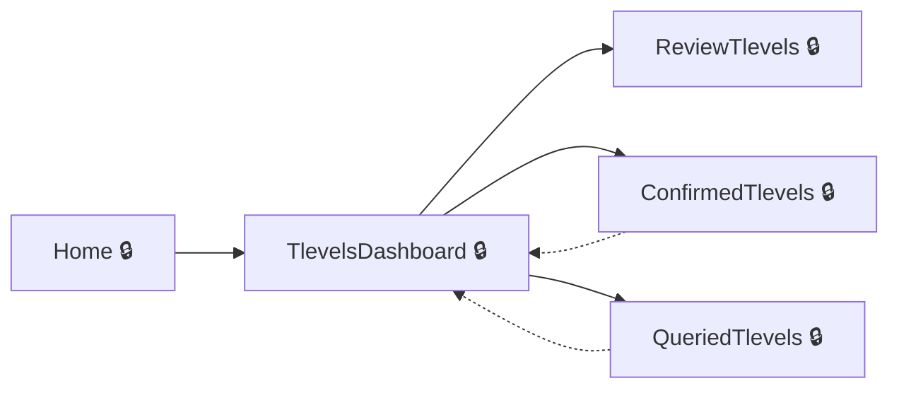
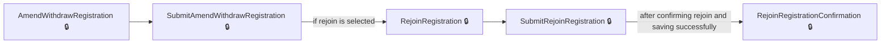
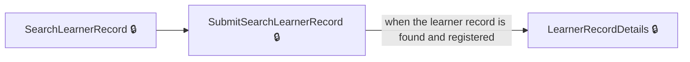
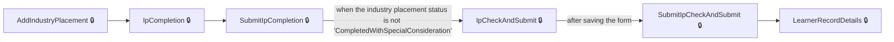
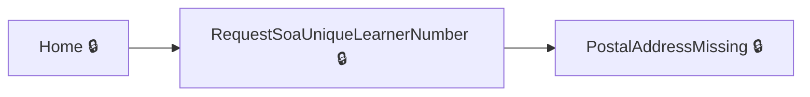

# User journeys: SkillsFundingAgency/tl-results-and-certification

Generated from `master/src`: 490 pages, 767 transitions, 7 journeys. 🔒 means sign-in is required. Dotted arrows return to a hub.

## Register a new learner

Register a learner by entering their unique learner number and details, progressing through the add registration flow to confirmation.

```mermaid
flowchart LR
  p0["AddRegistration 🔒"] -->|"after removing cached registration data"| p1["AddRegistrationUln 🔒"]
  p1["AddRegistrationUln 🔒"] --> p2["SubmitRegistrationUln 🔒"]
  p2["SubmitRegistrationUln 🔒"] -->|"when IsChangeMode is false"| p3["AddRegistrationLearnersName 🔒"]
  p3["AddRegistrationLearnersName 🔒"] --> p4["SubmitRegistrationLearnersName 🔒"]
  p4["SubmitRegistrationLearnersName 🔒"] -->|"if not in change mode"| p5["AddRegistrationDateofBirth 🔒"]
  p5["AddRegistrationDateofBirth 🔒"] --> p6["SubmitRegistrationDateofBirth 🔒"]
  p6["SubmitRegistrationDateofBirth 🔒"] -->|"if not in change mode"| p7["AddRegistrationProvider 🔒"]
  p7["AddRegistrationProvider 🔒"] --> p8["SubmitRegistrationProvider 🔒"]
  p8["SubmitRegistrationProvider 🔒"] -->|"after submitting provider selection"| p9["AddRegistrationCore 🔒"]
  p9["AddRegistrationCore 🔒"] --> p10["SubmitRegistrationCore 🔒"]
  p10["SubmitRegistrationCore 🔒"] -->|"after submitting core selection"| p11["AddRegistrationSpecialismQuestion 🔒"]
  p11["AddRegistrationSpecialismQuestion 🔒"] --> p12["SubmitRegistrationSpecialismQuestion 🔒"]
  p12["SubmitRegistrationSpecialismQuestion 🔒"] -->|"if learner has decided on specialism"| p13["AddRegistrationSpecialisms 🔒"]
  p13["AddRegistrationSpecialisms 🔒"] --> p14["SubmitRegistrationSpecialisms 🔒"]
  p14["SubmitRegistrationSpecialisms 🔒"] --> p15["AddRegistrationAcademicYear 🔒"]
  p15["AddRegistrationAcademicYear 🔒"] --> p16["SubmitRegistrationAcademicYear 🔒"]
  p16["SubmitRegistrationAcademicYear 🔒"] -->|"after submitting academic year"| p17["AddRegistrationCheckAndSubmit 🔒"]
  p17["AddRegistrationCheckAndSubmit 🔒"] --> p18["SubmitRegistrationCheckAndSubmit 🔒"]
  p18["SubmitRegistrationCheckAndSubmit 🔒"] -->|"after submitting check and submit"| p19["AddRegistrationConfirmation 🔒"]
```

## Manage T Levels

Review pending T levels, confirm or query details, and manage confirmed or queried T levels from the dashboard.

Complete the sections in any order, returning to the hub.

## Review and confirm T Level details

Review the details of individual T levels and either confirm or raise a query about them.

## Manage or reinstate withdrawn learner registrations

Reinstate a previously withdrawn registration or register the learner to a new course.

## Search for and review a learner’s record

Search for a learner using their unique learner number and view detailed information on their record.

## Change or update a learner’s industry placement status

Add or edit industry placement details such as status, special consideration, and reasons from a learner's record.

## Request a statement of achievement for a learner

Request a statement of achievement by searching for a withdrawn learner and completing the submission steps.

## Pages

| Page | Route | Sign-in | Purpose |
| --- | --- | --- | --- |
| `AccessibilityStatement` | `accessibility-statement` | No | Displays accessibility information for the service. |
| `Account.PostSignIn` | — | Yes | Handles post-sign-in logic, redirecting users based on authentication and permissions. |
| `AccountProfile` | `account-profile` | Yes | Redirects the user to their DfE Sign-In account profile page. |
| `AddAddress` | `add-address` | Yes | Initiates adding a new postal address for the provider. |
| `AddAddressCancel` | `add-postal-address-cancel` | Yes | Allows the user to confirm cancellation of adding a postal address. |
| `AddAddressCheckAndSubmit` | `add-postal-address-check-and-submit` | Yes | Shows the user a summary of the postal address details before submitting. |
| `AddAddressConfirmation` | `add-postal-address-confirmation` | Yes | Displays confirmation that the postal address has been added. |
| `AddAddressManually` | `add-address-manually/{isFromSelectAddress:bool?}/{isFromAddressMissing:bool?}` | Yes | Redirects the user to manually enter a postal address. |
| `AddAddressNotFound` | `add-postal-address-no-addresses-found` | Yes | Informs the user that no addresses were found for the entered postcode. |
| `AddAddressPostcode` | `add-postal-address-postcode/{showPostcode:bool?}/{isFromAddressMissing:bool?}` | Yes | Allows the user to enter the postcode for the new postal address. |
| `AddAddressSelect` | `add-postal-address-select` | Yes | Lets the user select a postal address from a list based on postcode lookup. |
| `AddCoreAssessmentEntry` | `assessment-entry-add-core/{profileId}` | Yes | Allows an admin to add a core assessment entry for a learner. |
| `AddCoreResult` | `select-core-result/{profileId}/{assessmentId}` | Yes | Lets the user add a core result for a learner. |
| `AddIndustryPlacement` | `add-industry-placement/{profileId}` | Yes | Begins the process of adding an industry placement for a learner. |
| `AddPostalAddressManual` | `add-postal-address-manual/{isFromSelectAddress:bool?}/{isFromAddressMissing:bool?}` | Yes | Allows the user to manually enter details for a new postal address. |
| `AddProviderTlevels` | `add-additional-tlevels/{providerId}` | Yes | Lets the user add additional T levels to a provider. |
| `AddRegistration` | `add-registration-unique-learner` | Yes | Begins the process to add a registration for a unique learner. |
| `AddRegistrationAcademicYear` | `add-registration-academic-year/{isChangeMode:bool?}` | Yes | Lets the user select the academic year for a new registration. |
| `AddRegistrationCheckAndSubmit` | `add-registration-check-and-submit` | Yes | Shows a summary of the registration for the user to check and submit. |
| `AddRegistrationConfirmation` | `add-registration-confirmation` | Yes | Confirms that the registration has been successfully added. |
| `AddRegistrationCore` | `add-registration-core/{isChangeMode:bool?}` | Yes | Lets the user select the core subject for the registration. |
| `AddRegistrationDateofBirth` | `add-registration-date-of-birth/{isChangeMode:bool?}` | Yes | Lets the user enter the learner's date of birth. |
| `AddRegistrationLearnersName` | `add-registration-learners-name/{isChangeMode:bool?}` | Yes | Lets the user enter the learner's name for the registration. |
| `AddRegistrationProvider` | `add-registration-provider/{isChangeMode:bool?}` | Yes | Lets the user choose the provider for the registration. |
| `AddRegistrationSpecialismQuestion` | `add-registration-learner-decided-specialism-question/{isChangeMode:bool?}` | Yes | Lets the user specify if the learner has decided on a specialism. |
| `AddRegistrationSpecialisms` | `add-registration-specialism/{isChangeMode:bool?}` | Yes | Lets the user select the learner's specialism for the registration. |
| `AddRegistrationUln` | `add-registration-unique-learner-number/{isChangeMode:bool?}` | Yes | Lets the user enter the unique learner number (ULN) for the registration. |
| `AddSpecialismAssessmentEntry` | `assessment-entry-add-specialisms/{profileId}/{specialismsId}` | Yes | Allows an admin to add a specialism assessment entry for a learner. |
| `AddSpecialismResult` | `select-specialism-result/{profileId}/{assessmentId}` | Yes | Lets the user add a specialism result for a learner. |
| `AddWithdrawnStatus` | `manage-learners-add-withdrawn-status/{profileId}` | Yes | Lets the user set a learner’s withdrawn status. |
| `AdminAddAppealOutcomeChangeGradeCore` | `admin/add-appeal-outcome-change-grade-core/{registrationPathwayId}/{assessmentId}` | Yes | Allows the admin to select a new grade for a learner's core appeal outcome. |
| `AdminAddAppealOutcomeChangeGradeCoreClear` | `admin/add-appeal-outcome-change-grade-core-clear/{registrationPathwayId}/{assessmentId}` | Yes | Clears changes made for appeal outcome grade (core). |
| `AdminAddAppealOutcomeChangeGradeSpecialism` | `admin/add-appeal-outcome-change-grade-specialism/{registrationPathwayId}/{assessmentId}` | Yes | Allows the admin to select a new grade for a learner's specialism appeal outcome. |
| `AdminAddAppealOutcomeChangeGradeSpecialismClear` | `admin/add-appeal-outcome-change-grade-specialism-clear/{registrationPathwayId}/{assessmentId}` | Yes | Clears changes made for appeal outcome grade (specialism). |
| `AdminAddCoreAppealOutcome` | `admin/add-appeal-outcome-core` | Yes | Lets the admin add an appeal outcome for a learner's core component. |
| `AdminAddCoreAppealOutcomeClear` | `admin/add-appeal-outcome-core-clear` | Yes | Clears cached data for adding a core appeal outcome and redirects to start the process again. |
| `AdminAddCoreRommOutcome` | `admin/add-romm-outcome-core` | Yes | Lets the admin add a ROMM (Review of Marking and Moderation) outcome for a learner's core component. |
| `AdminAddCoreRommOutcomeClear` | `admin/add-romm-outcome-core-clear` | Yes | Clears cached data for adding a core ROMM outcome and redirects to start the process again. |
| `AdminAddNotification` | `admin/add-notification` | Yes | Lets the admin create a new notification. |
| `AdminAddPathwayResult` | `admin/add-assessment-result-core/{registrationPathwayId}/{assessmentId}` | Yes | Allows admin users to add a pathway assessment result for a learner. |
| `AdminAddPathwayResultClear` | `admin/add-assessment-result-core-clear/{registrationPathwayId}/{assessmentId}` | Yes | Clears the add pathway result form and resets to the entry page. |
| `AdminAddPathwayResultReviewChanges` | `admin/review-changes-assessment-result-core` | Yes | Lets admin users review and confirm details before submitting a new pathway assessment result. |
| `AdminAddProvider` | `admin/add-provider` | Yes | Allows an admin to add a new provider to the system. |
| `AdminAddRommOutcomeChangeGradeCore` | `admin/add-romm-outcome-change-grade-core/{registrationPathwayId}/{assessmentId}` | Yes | Lets the admin change the grade for a core component as part of the ROMM outcome process. |
| `AdminAddRommOutcomeChangeGradeCoreClear` | `admin/add-romm-outcome-change-grade-core-clear/{registrationPathwayId}/{assessmentId}` | Yes | Clears cached data for changing the grade during ROMM outcome for a core component and redirects to the start of that process. |
| `AdminAddRommOutcomeChangeGradeSpecialism` | `admin/add-romm-outcome-change-grade-specialism/{registrationPathwayId}/{assessmentId}` | Yes | Lets the admin change the grade for a specialism component as part of the ROMM outcome process. |
| `AdminAddRommOutcomeChangeGradeSpecialismClear` | `admin/add-romm-outcome-change-grade-specialism-clear/{registrationPathwayId}/{assessmentId}` | Yes | Clears cached data for changing the grade during ROMM outcome for a specialism and redirects to the start of that process. |
| `AdminAddSpecialismAppealOutcome` | `admin/add-appeal-outcome-specialism` | Yes | Lets the admin add an appeal outcome for a learner's specialism component. |
| `AdminAddSpecialismAppealOutcomeClear` | `admin/add-appeal-outcome-specialism-clear` | Yes | Clears cached data for adding a specialism appeal outcome and redirects to start the process again. |
| `AdminAddSpecialismResult` | `admin/add-assessment-result-specialism/{registrationPathwayId}/{assessmentId}` | Yes | Allows admin users to add a specialism assessment result for a learner. |
| `AdminAddSpecialismResultClear` | `admin/add-assessment-result-specialism-clear/{registrationPathwayId}/{assessmentId}` | Yes | Clears the add specialism result form and resets to the entry page. |
| `AdminAddSpecialismResultReviewChanges` | `admin/review-changes-assessment-result-specialism` | Yes | Lets admin users review and confirm details before submitting a new specialism assessment result. |
| `AdminAddSpecialismRommOutcome` | `admin/add-romm-outcome-specialism` | Yes | Lets the admin add a ROMM outcome for a learner's specialism component. |
| `AdminAddSpecialismRommOutcomeClear` | `admin/add-romm-outcome-specialism-clear` | Yes | Clears cached data for adding a specialism ROMM outcome and redirects to start the process again. |
| `AdminAssessmentSeriesDateDetails` | `admin/assessment-series-date/{assessmentId}` | Yes | Shows details for a specific assessment series date. |
| `AdminChangeIndustryPlacement` | `admin/change-industry-placement/{registrationPathwayId}` | Yes | Allows admin users to update the industry placement status for a learner. |
| `AdminChangeIndustryPlacementClear` | `admin/change-industry-placement-clear/{registrationPathwayId}` | Yes | Clears cached data and returns to the start of the industry placement change process. |
| `AdminChangePathwayResult` | `admin/change-assessment-result-core/{registrationPathwayId}/{assessmentId}` | Yes | Lets the admin change a learner's pathway result. |
| `AdminChangePathwayResultClear` | `admin/change-assessment-result-core-clear/{registrationPathwayId}/{assessmentId}` | Yes | Clears cached pathway result change data and returns to start of the pathway result change process. |
| `AdminChangePathwayResultReviewChanges` | `admin/change-assessment-result-core-review-changes` | Yes | Lets the admin review and provide details for the pathway result change before submission. |
| `AdminChangeSpecialismResult` | `admin/change-assessment-result-specialism/{registrationPathwayId}/{assessmentId}` | Yes | Lets the admin change a learner's specialism assessment result. |
| `AdminChangeSpecialismResultClear` | `admin/change-assessment-result-specialism-clear/{registrationPathwayId}/{assessmentId}` | Yes | Clears cached specialism result change data and returns to start of the specialism result change process. |
| `AdminChangeSpecialismResultReviewChanges` | `admin/change-assessment-result-specialism-review-changes` | Yes | Lets the admin review and provide details for the specialism result change before submission. |
| `AdminCoreComponentAssessmentEntry` | `admin/add-assessment-entry-core/{registrationPathwayId}` | Yes | Lets the admin add a core component assessment entry for a learner. |
| `AdminCoreComponentAssessmentEntryClear` | `admin/add-assessment-core-entry-clear/{registrationPathwayId}` | Yes | Clears cached data and returns to start of the core component assessment entry process. |
| `AdminDeleteNotification` | `admin/delete-notification/{notificationId}` | Yes | Allows the admin to confirm deletion of a notification. |
| `AdminDownloadCoreResultsDataLink` | `admin/download-core-results/{awardingOrganisationUkprn}/{fileId}` | Yes | Provides a link to download core results data for an awarding organisation. |
| `AdminDownloadLearnerResultsByProvider` | `admin/download-learner-results-provider/{providerId}` | Yes | Lets the administrator view available learner results to download for a specific provider. |
| `AdminDownloadLearnerResultsCsv` | `admin/download-learner-results-file-csv/{ukprn}` | Yes | Lets the administrator download learner results for a provider as a CSV file. |
| `AdminDownloadLearnerResultsFindProvider` | `admin/download-learner-results-find-provider` | Yes | Lets the administrator search for a provider in order to download learner results. |
| `AdminDownloadLearnerResultsFindProviderClear` | `admin/download-learner-results-find-provider-clear` | Yes | Clears the previously entered provider search and redirects to the provider search page. |
| `AdminDownloadLearnerResultsPdf` | `admin/download-learner-results-file-pdf/{ukprn}` | Yes | Lets the admin download learner result slips as a PDF file for a given provider. |
| `AdminDownloadLearnerResultsSubmitFindProvider` | `admin/download-learner-results-find-provider` | Yes | Lets the admin search for a provider to find their learner results. |
| `AdminDownloadResultsRommsByAwardingOrganisation` | `admin/download-results-romms-awarding-organisation/{awardingOrganisationUkprn}` | Yes | Lets the admin access downloadable results and ROMM data for an awarding organisation. |
| `AdminDownloadRommsDataLink` | `admin/download-romms-data/{awardingOrganisationUkprn}/{fileId}` | Yes | Provides a link to download ROMMS report data for an awarding organisation. |
| `AdminDownloadSpecialismResultsDataLink` | `admin/download-specialism-results/{awardingOrganisationUkprn}/{fileId}` | Yes | Provides a link to download specialism results data for an awarding organisation. |
| `AdminEditNotification` | `admin/edit-notification` | Yes | Lets the admin edit an existing notification. |
| `AdminEditProvider` | `admin/edit-provider/{providerId}` | Yes | Allows an admin to edit the details of an existing provider. |
| `AdminFindNotification` | `admin/find-notification/{pageNumber:int?}` | Yes | Lets the admin filter and search notifications. |
| `AdminFindNotificationClear` | `admin/find-notification-clear` | Yes | Clears notification search filters. |
| `AdminFindProvider` | `admin/find-provider` | Yes | Allows an admin to search for a provider using a search term. |
| `AdminFindProviderClear` | `admin/find-provider-clear` | Yes | Clears the previously entered provider search data. |
| `AdminHome` | `admin/home` | Yes | Redirects the admin to the site's main home page. |
| `AdminIndustryPlacementSpecialConsiderationHours` | `admin/industry-placement-hours` | Yes | Lets the admin enter hours for special consideration in industry placement. |
| `AdminIndustryPlacementSpecialConsiderationReasons` | `admin/industry-placement-incomplete` | Yes | Lets the admin provide reasons for special consideration in industry placement. |
| `AdminLearnerRecord` | `admin/learner-record/{pathwayid}` | Yes | Shows the full record for a learner, including their pathway and assessment information. |
| `AdminNotificationDetails` | `admin/notification-details/{notificationId}` | Yes | Shows details for a specific admin notification. |
| `AdminOccupationalSpecialisAssessmentEntry` | `admin/add-assessment-entry-specialism/{registrationPathwayId}/{specialismsId}` | Yes | Lets the admin add an occupational specialism assessment entry for a learner. |
| `AdminOccupationalSpecialisAssessmentEntryClear` | `admin/add-assessment-specialism-entry-clear/{registrationPathwayId}/{specialismsId}` | Yes | Clears cached occupational specialism assessment entry data and returns to start of the entry process. |
| `AdminOpenPathwayAppeal` | `admin/open-appeal-core` | Yes | Lets the admin initiate an appeal for a learner's pathway core component. |
| `AdminOpenPathwayAppealClear` | `admin/open-appeal-core-clear` | Yes | Clears cached data for opening a pathway appeal and redirects to start the process again. |
| `AdminOpenPathwayAppealReviewChanges` | `admin/review-changes-appeal-core/{registrationPathwayId}/{assessmentId}` | Yes | Lets the admin review and confirm details before opening an appeal for a learner's pathway core component. |
| `AdminOpenPathwayRomm` | `admin/open-romm-core` | Yes | Starts the process of opening a ROMM (Review of Marking and Moderation) for a core pathway for a learner. |
| `AdminOpenPathwayRommClear` | `admin/open-romm-core-clear` | Yes | Clears cached data and returns to the ROMM (Review of Marking and Moderation) core pathway page. |
| `AdminOpenPathwayRommReviewChanges` | `admin/review-changes-romm-core` | Yes | Lets the administrator review and confirm the changes for opening a ROMM on a core pathway. |
| `AdminOpenSpecialismAppeal` | `admin/open-appeal-specialism` | Yes | Starts the process of opening an appeal for a specialism for a learner. |
| `AdminOpenSpecialismAppealClear` | `admin/open-appeal-specialism-clear` | Yes | Clears cached data and returns to the specialism appeal page. |
| `AdminOpenSpecialismAppealReviewChanges` | `admin/review-changes-appeal-specialism/{registrationPathwayId}/{assessmentId}` | Yes | Lets the administrator review and confirm the changes for opening an appeal on a specialism. |
| `AdminOpenSpecialismRomm` | `admin/open-romm-specialism` | Yes | Starts the process of opening a ROMM for a specialism for a learner. |
| `AdminOpenSpecialismRommClear` | `admin/open-romm-specialism-clear` | Yes | Clears cached data and returns to the ROMM specialism start page. |
| `AdminOpenSpecialismRommReviewChanges` | `admin/review-changes-romm-specialism` | Yes | Lets the administrator review and confirm the changes for opening a ROMM for a specialism. |
| `AdminProviderDetails` | `admin/provider-details/{providerId}` | Yes | Displays details of a specific provider. |
| `AdminRequestReplacementDocument` | `admin/request-replacement-document/{registrationPathwayId}` | Yes | Lets the admin request a replacement document for a learner. |
| `AdminReviewChangesAppealOutcomeCore` | `admin/add-appeal-outcome-change-grade-review-changes-core` | Yes | Lets the administrator review and confirm the changes for an appeal outcome (core) grade change. |
| `AdminReviewChangesAppealOutcomeSpecialism` | `admin/add-appeal-outcome-change-grade-review-changes-specialism` | Yes | Lets the administrator review and confirm the changes for an appeal outcome (specialism) grade change. |
| `AdminReviewChangesCoreAssessmentEntry` | `admin/review-changes-assesment-entry-core/{registrationPathwayId}` | Yes | Allows the admin to review and confirm changes to a learner's core assessment entry. |
| `AdminReviewChangesIndustryPlacement` | `admin/review-changes-industry-placement/{pathwayId}` | Yes | Allows the admin to review and confirm changes to a learner's industry placement. |
| `AdminReviewChangesRommOutcomeCore` | `admin/add-romm-outcome-change-grade-review-changes-core` | Yes | Lets the administrator review and confirm the changes for a ROMM outcome (core) grade change. |
| `AdminReviewChangesRommOutcomeSpecialism` | `admin/add-romm-outcome-change-grade-review-changes-specialism` | Yes | Lets the administrator review and confirm the changes for a ROMM outcome (specialism) grade change. |
| `AdminReviewChangesSpecialismAssessmentEntry` | `admin/review-changes-assesment-entry-specialism/{registrationPathwayId}` | Yes | Allows the admin to review and confirm changes to a learner's specialism assessment entry. |
| `AdminReviewRemoveCoreAssessmentEntry` | `admin/review-remove-assessment-entry-core` | Yes | Allows the admin to review and confirm removal of a learner's core assessment entry. |
| `AdminReviewRemoveSpecialismAssessmentEntry` | `admin/review-remove-assessment-entry-specialism/{registrationPathwayId}` | Yes | Allows the admin to review and confirm removal of a learner's specialism assessment entry. |
| `AdminSearchChangeLog` | `admin/change-log/{pageNumber:int?}` | Yes | Allows the admin to search and view change log records, optionally filtered by a search key. |
| `AdminSearchChangeLogClear` | `admin/change-log-clear` | Yes | Clears the change log search data and returns to the change log search page. |
| `AdminSearchLearnersRecords` | `admin/search-learner-records/{pageNumber:int?}` | Yes | Lets the admin search learner records and filter by awarding organisation and academic year. |
| `AdminSearchLearnersRecordsClear` | `admin/search-learner-records-clear` | Yes | Clears the search filters for learner records. |
| `AdminSelectAwardingOrganisation` | `admin/select-awarding-organisation` | Yes | Lets the admin select an awarding organisation to manage or download results. |
| `AdminSelectAwardingOrganisationClear` | `admin/select-awarding-organisation-clear` | Yes | Clears the selected awarding organisation and returns to the selection page. |
| `AdminSubmitChangeIndustryPlacement` | `admin/submit-change-industry-placement` | Yes | Lets the admin submit a change to a learner's industry placement status. |
| `AdminSubmitFindProvider` | `admin/find-provider` | Yes | Submits the provider search form and processes the search. |
| `AdminSubmitSelectAwardingOrganisation` | `admin/select-awarding-organisation` | Yes | Lets the admin choose an awarding organisation for downloading results or ROMMs. |
| `AdminViewChangeAddPathwayResultRecord` | `admin/view-change-record/7/{changeLogId}` | Yes | Shows details about adding a pathway result change log record. |
| `AdminViewChangeAddSpecialismResultRecord` | `admin/view-change-record/8/{changeLogId}` | Yes | Shows details about adding a specialism result change log record. |
| `AdminViewChangeCoreAssessmentRecord` | `admin/view-change-record/3/{changeLogId}` | Yes | Shows details about a core assessment change log record. |
| `AdminViewChangeIPRecord` | `admin/view-change-record/2/{changeLogId}` | Yes | Shows details about an industry placement change log record. |
| `AdminViewChangePathwayResultRecord` | `admin/view-change-record/9/{changeLogId}` | Yes | Shows details about a pathway result change log record. |
| `AdminViewChangeRemoveCoreAssessmentRecord` | `admin/view-change-record/5/{changeLogId}` | Yes | Shows details about removing a core assessment change log record. |
| `AdminViewChangeRemoveSpecialismAssessmentRecord` | `admin/view-change-record/6/{changeLogId}` | Yes | Shows details about removing a specialism assessment change log record. |
| `AdminViewChangeSpecialismAssessmentRecord` | `admin/view-change-record/4/{changeLogId}` | Yes | Shows details about a specialism assessment change log record. |
| `AdminViewChangeSpecialismResultRecord` | `admin/view-change-record/10/{changeLogId}` | Yes | Shows details about a specialism result change log record. |
| `AdminViewChangeStartYearRecord` | `admin/view-change-record/1/{changeLogId}` | Yes | Shows details about a start year change log record. |
| `AdminViewOpenPathwayAppealRecord` | `admin/view-change-record/15/{changeLogId}` | Yes | Shows details about opening a pathway appeal change log record. |
| `AdminViewOpenPathwayRommRecord` | `admin/view-change-record/11/{changeLogId}` | Yes | Shows details about opening a pathway ROMM change log record. |
| `AdminViewOpenSpecialismAppealRecord` | `admin/view-change-record/16/{changeLogId}` | Yes | Displays details of an open specialism appeal change log record for admin review. |
| `AdminViewOpenSpecialismRommRecord` | `admin/view-change-record/12/{changeLogId}` | Yes | Shows details of an open specialism ROMM (review of marking and moderation) change log record for admin review. |
| `AdminViewPathwayAppealOutcomeRecord` | `admin/view-change-record/17/{changeLogId}` | Yes | Displays the outcome of a pathway appeal change log record for admin review. |
| `AdminViewPathwayRommOutcomeRecord` | `admin/view-change-record/13/{changeLogId}` | Yes | Displays the outcome of a pathway ROMM (review of marking and moderation) change log record for admin review. |
| `AdminViewSpecialismAppealOutcomeRecord` | `admin/view-change-record/18/{changeLogId}` | Yes | Displays the outcome of a specialism appeal change log record for admin review. |
| `AdminViewSpecialismRommOutcomeRecord` | `admin/view-change-record/14/{changeLogId}` | Yes | Displays the outcome of a specialism ROMM (review of marking and moderation) change log record for admin review. |
| `AllTlevelsReviewed` | `all-tlevels-reviewed` | Yes | Notifies the user that all T levels have been reviewed. |
| `AmendActiveRegistration` | `amend-active-registration/{profileId}/{changeStatusId:int?}` | Yes | Enables the user to amend the active registration status for a learner. |
| `AmendWithdrawRegistration` | `amend-withdrawn-registration/{profileId}/{changeStatusId:int?}` | Yes | Enables the user to amend the withdrawn registration status for a learner. |
| `AssessmentDashboard` | `assessment-entries` | Yes | Shows the main assessment dashboard. |
| `AssessmentDetails` | `assessment-entry-learner-details/{profileId}` | Yes | Displays details about a learner's assessment entries. |
| `AssessmentWithdrawnDetails` | `assessment-entries-learner-withdrawn/{profileId}` | Yes | Shows details for a learner who has withdrawn from assessments. |
| `AssessmentsDownloadData` | `assessments-download-data` | Yes | Displays download options for assessment entries data. |
| `AssessmentsDownloadDataLink` | `download-assessments-data/{id}/{componentType}` | Yes | Provides the downloaded assessment data file for the selected component type. |
| `AssessmentsGeneratingDownload` | `assessments-generating-download` | Yes | Allows the user to generate a download for assessment entries data. |
| `AssessmentsNoRecordsFound` | `assessments-no-records-found` | Yes | Informs the user that there are no records found for assessment data export. |
| `AssessmentsUploadSuccessful` | `assessment-entries-upload-confirmation` | Yes | Notifies the user that their assessment entry upload was successful. |
| `AssessmentsUploadUnsuccessful` | `assessment-entries-upload-unsuccessful` | Yes | Notifies the user that their assessment entry upload was unsuccessful. |
| `CannotChangeAcademicYear` | `academic-year-cannot-change/{profileId}` | Yes | Informs the user that the academic year for a registration cannot be changed. |
| `ChangeAcademicYear` | `academic-year-change/{profileId}` | Yes | Lets the user choose a different academic year for the registration. |
| `ChangeAcademicYearConfirmation` | `academic-year-change-confirmation` | Yes | Shows a confirmation message after an academic year change for a learner registration. |
| `ChangeBackToActiveAOMessage` | `restore-learner-ao-message/{profileId}` | Yes | Shows a message after changing a withdrawn learner back to active status. |
| `ChangeBackToActiveStatus` | `restore-learner-ao/{profileId}` | Yes | Lets the user change a learner's status from withdrawn back to active. |
| `ChangeBackToActiveStatusHaveYouToldAwardingOrganisation` | `restore-learner-have-you-told-ao/{profileId}` | Yes | Asks the user to confirm if they have informed the awarding organisation about reinstating the learner. |
| `ChangeCoreResult` | `change-core-result/{profileId}/{assessmentId}` | Yes | Lets the user change an existing core result for a learner. |
| `ChangeRegistrationConfirmation` | `registration-details-change-confirmation` | Yes | Shows a confirmation message after a learner registration detail change. |
| `ChangeRegistrationCore` | `change-core/{profileId}` | Yes | Lets the user change the core subject for a learner registration. |
| `ChangeRegistrationCoreQuestion` | `change-core-and-provider/{profileId}` | Yes | Asks if the learner's core subject can be changed after choosing a provider that does not offer the current core. |
| `ChangeRegistrationDateofBirth` | `change-registration-learners-date-of-birth/{profileId}` | Yes | Lets the user change the learner's date of birth on the registration. |
| `ChangeRegistrationLearnersName` | `change-registration-learners-name/{profileId}` | Yes | Lets the user change the learner's name on the registration. |
| `ChangeRegistrationProvider` | `change-registration-provider/{profileId}/{isback:bool?}` | Yes | Lets the user change the training provider for a learner registration. |
| `ChangeRegistrationProviderAndCoreNeedToWithdraw` | `change-registration-provider-and-core-need-to-withdraw` | Yes | Shows information explaining the learner needs to be withdrawn before changing provider and core. |
| `ChangeRegistrationProviderNotOfferingSameCore` | `change-registration-provider-not-offering-core` | Yes | Shows information when the chosen provider does not support the current core subject for the learner. |
| `ChangeRegistrationSpecialismQuestion` | `change-registration-learner-decided-specialism-question/{profileId}` | Yes | Asks if the learner has decided which specialism to take. |
| `ChangeRegistrationSpecialisms` | `change-registration-select-specialism/{profileId}` | Yes | Lets the user select the learner's specialism(s) after answering the specialism question. |
| `ChangeSpecialismRestriction` | `registration-specialism-change-restriction/{profileId}` | Yes | Shows a restriction notice if a change of specialism cannot proceed. |
| `ChangeSpecialismResult` | `change-specialism-result/{profileId}/{assessmentId}` | Yes | Lets the user change an existing specialism result for a learner. |
| `ChangeStartYear` | `admin/change-start-year/{registrationPathwayId}` | Yes | Lets the admin change the academic start year of a learner's record. |
| `ChangeStartYearClear` | `admin/change-start-year-clear/{registrationPathwayId}` | Yes | Clears the academic year selection for the learner's record. |
| `ChangeWithdrawnStatusHaveYouToldAwardingOrganisation` | `manage-add-withdrawn-status-ao-message/{profileId}` | Yes | Lets the user indicate whether they have informed the awarding organisation about the learner's withdrawn status. |
| `ConfirmTlevel` | `confirm-tlevel` | Yes | Lets the user review and confirm the details of a T level. |
| `ConfirmedTlevels` | `confirmed-tlevels` | Yes | Displays a list of confirmed T levels. |
| `Contact` | `contact-us` | No | Shows contact details for technical and general support. |
| `CookieDetails` | `cookie-details` | No | Shows details about the cookies used by the website. |
| `Cookies` | `cookies` | No | Lets the user choose cookie preferences for the website. |
| `DeleteRegistration` | `delete-registration/{profileId}` | Yes | Lets the user confirm deletion of a learner registration. |
| `DownloadAssessmentEntriesDataFormatAndRulesGuide` | `tlevels-assessment-entries-data-format-and-rules` | No | Allows the user to download a document describing the format and rules for uploading assessment entries. |
| `DownloadAssessmentEntriesTemplate` | `tlevels-assessment-entries-template` | No | Allows the user to download a template CSV file for uploading assessment entries data. |
| `DownloadLearnerOverallResultSlipsFile` | `download-learner-tlevel-result-slips-file/{profileId}` | Yes | Lets the user download overall result slips for a specific learner. |
| `DownloadOverallResultSlipsFile` | `download-tlevel-result-slips-file` | Yes | Lets the user download overall result slips for multiple learners. |
| `DownloadOverallResultsFile` | `download-tlevel-results-file` | Yes | Lets the user download overall results as a CSV file. |
| `DownloadOverallResultsPage` | `download-tlevel-results` | Yes | Shows options for downloading overall results and result slips. |
| `DownloadRegistrationDataFormatAndRulesGuide` | `tlevels-registration-data-format-and-rules` | No | Allows the user to download a document describing the format and rules for registration data uploads. |
| `DownloadRegistrationDataTemplate` | `tlevels-registration-data-template` | No | Allows the user to download a template CSV file for registration data uploads. |
| `DownloadRegistrationsData` | `download-registrations-data` | Yes | Lets the user begin downloading registrations data. |
| `DownloadRegistrationsDataFor` | `download-registrations-data-for` | Yes | Lets the user download registrations data for a specific year. |
| `DownloadRegistrationsDataForLink` | `download-registrations-data-for/{id}` | Yes | Downloads the registrations data file for a given identifier. |
| `DownloadResultsDataFormatAndRulesGuide` | `tlevels-results-data-format-and-rules` | No | Allows the user to download a document describing results data file format and upload rules. |
| `DownloadResultsTemplate` | `tlevels-results-template` | No | Allows the user to download a CSV template for uploading results data. |
| `DownloadRommDataFormatAndRulesGuide` | `tlevels-romm-data-format-and-rules` | No | Allows the user to download the ROMM data format and rules document. |
| `DownloadRommDataTemplate` | `tlevels-romm-data-template` | No | Allows the user to download a template CSV for ROMM data uploads. |
| `DownloadWithdrawalsDataFormatAndRulesGuide` | `tlevels-withdrawals-data-format-and-rules` | No | Allows the user to download the data format and rules document for withdrawals uploads. |
| `DownloadWithdrawalsDataTemplate` | `tlevels-withdrawal-data-template` | No | Allows the user to download a withdrawal data upload template CSV. |
| `EntrySeries` | `assessment-entry-add-core/{profileId}` | Yes | Lets the user add a core assessment entry for a learner. |
| `FindProvider` | `find-provider/{isback:bool?}` | Yes | Lets the user search for a provider. |
| `Home` | `home` | Yes | Displays the main dashboard with options for navigation across provider, registration, assessment, results, and admin functions. |
| `Home.Index` | — | No | Shows the home page or redirects authenticated users. |
| `IndustryPlacementsUploadSuccessful` | `upload-ip-file-success` | Yes | Informs the user that the file upload of industry placements was successful. |
| `IndustryPlacementsUploadUnsuccessful` | `ip-upload-unsuccessful` | Yes | Informs the user that the upload of industry placements was unsuccessful. |
| `IpCheckAndSubmit` | `industry-placement-check-your-answers` | Yes | Shows a summary of industry placement details before submission. |
| `IpCheckAndSubmitCancel` | `industry-placement-check-your-answers-cancel/{profileId}` | Yes | Cancels the industry placement check and submit process for a learner. |
| `IpCompletion` | `industry-placement-completion/{profileId}/{isChangeMode:bool?}` | Yes | Lets the user indicate the industry placement status for a learner. |
| `IpSpecialConsiderationHours` | `industry-placement-special-consideration-hours/{isChangeMode:bool?}` | Yes | Lets the user enter the number of hours for special consideration on an industry placement. |
| `IpSpecialConsiderationReasons` | `industry-placement-special-consideration-reasons/{isChangeMode:bool?}` | Yes | Lets the user provide reasons for special consideration in an industry placement. |
| `LearnerRecordDetails` | `learner-record-page/{profileId}` | Yes | Shows the learner's record details. |
| `ManagePostalAddress` | `manage-postal-address` | Yes | Allows the user to view and manage the current postal address. |
| `NoConfirmedTlevels` | `no-confirmed-tlevels` | Yes | Informs the user that there are no confirmed T levels. |
| `NoQueriedTlevels` | `no-queried-tlevels` | Yes | Informs the user that there are no queried T levels. |
| `PathwayNotEligibleForAcademicYearChange` | `pathway-not-eligible-for-academic-year-change/{profileId}` | Yes | Shows a notice to the user when the pathway is not eligible for an academic year change. |
| `PendingWithdrawalsDownloadDataLink` | `download-pending-withdrawals-data/{id}` | Yes | Lets the user download pending withdrawals data as a CSV file. |
| `PostalAddressMissing` | `postal-address-missing` | Yes | Informs the user that the postal address is missing. |
| `ProblemWithAssessmentsUpload` | `assessment-entries-file-upload-service-problem` | Yes | Informs the user of a problem encountered during assessment entry upload. |
| `ProblemWithRegistrationsUpload` | `problem-with-registrations-upload` | Yes | Informs the user there was a problem uploading registration files. |
| `ProblemWithResultsUpload` | `results-file-upload-service-problem` | Yes | Shows a problem with the results upload service. |
| `ProviderGuidance` | `provider-guidance` | Yes | Provides guidance information for providers. |
| `ProviderTimeline` | `provider-timeline` | Yes | Shows the timeline for providers. |
| `ProviderTlevelConfirmation` | `submit-successful` | Yes | Shows confirmation after adding T levels to a provider. |
| `ProviderTlevels` | `provider-tlevels/{providerId}/{navigation:bool?}` | Yes | Shows the T levels associated with a provider. |
| `PrsAddAppeal` | `post-results-add-appeal/{profileId}/{assessmentId}/{componentType}/{isBack:bool?}` | Yes | Lets the user start an appeal request for a result. |
| `PrsAddAppealOutcome` | `post-results-add-appeal-outcome/{profileId}/{assessmentId}/{componentType}/{outcomeTypeId:int?}` | Yes | Lets the user record the outcome of an appeal request. |
| `PrsAddAppealOutcomeKnown` | `post-results-appeal-outcome-known/{profileId}/{assessmentId}/{componentType}/{outcomeKnownTypeId:int?}` | Yes | Lets the user record a known appeal outcome. |
| `PrsAddRomm` | `post-results-add-romm/{profileId}/{assessmentId}/{componentType}/{isBack:bool?}` | Yes | Lets the user request a ROMM (Review of Marking and Moderation). |
| `PrsAddRommOutcome` | `post-results-add-romm-outcome/{profileId}/{assessmentId}/{componentType}/{outcomeTypeId:int?}` | Yes | Lets the user record the outcome of a ROMM request. |
| `PrsAddRommOutcomeKnown` | `post-results-romm-outcome-known/{profileId}/{assessmentId}/{componentType}/{outcomeKnownTypeId:int?}` | Yes | Lets the user record a known ROMM outcome. |
| `PrsAppealCheckAndSubmit` | `post-results-appeal-check` | Yes | Lets the user review and submit their appeal request. |
| `PrsAppealGradeChange` | `post-results-appeal-change-grade/{profileId}/{assessmentId}/{componentType}/{isAppealOutcomeJourney:bool?}/{isChangeMode:bool?}` | Yes | Lets the user request a grade change following an appeal. |
| `PrsCancelAppealUpdate` | `post-results-cancel-appeal-update` | Yes | Lets the user cancel their appeal request update. |
| `PrsCancelGradeChangeRequest` | `post-results-cancel-final-grade-change-request/{profileId}/{assessmentId}/{componentType}/{isResultJourney:bool?}` | Yes | Lets the user cancel their final grade change request. |
| `PrsCancelRommUpdate` | `post-results-cancel-ROMM-update` | Yes | Lets the user cancel the ROMM update. |
| `PrsGradeChangeRequest` | `post-results-final-grade-change-request/{profileId}/{assessmentId}/{componentType}` | Yes | Lets the user request a final grade change. |
| `PrsGradeChangeRequestConfirmation` | `post-results-final-grade-change-request-sent` | Yes | Shows confirmation that a final grade change request has been sent. |
| `PrsLearnerDetails` | `post-results-learners-grades/{profileId}` | Yes | Shows a learner's grades and results. |
| `PrsNoResults` | `post-results-no-results/{profileId}` | Yes | Notifies that there are no results available for the learner. |
| `PrsRommCheckAndSubmit` | `post-results-romm-check` | Yes | Allows the user to check and submit the ROMM grade change outcome for a learner. |
| `PrsRommGradeChange` | `post-results-romm-change-grade/{profileId}/{assessmentId}/{componentType}/{isRommOutcomeJourney:bool?}/{isChangeMode:bool?}` | Yes | Lets the user select a new grade for a learner as part of the ROMM process. |
| `PrsUlnWithdrawn` | `post-results-learner-withdrawn/{profileId}` | Yes | Shows that the learner has been withdrawn, with details. |
| `QueriedTlevels` | `queried-tlevels` | Yes | Displays a list of T levels that have been queried. |
| `QueryServiceProblem` | `query-service-problem` | Yes | Informs the user there is a problem with the query service. |
| `QueryTlevelDetails` | `query-t-level/{id}/{isBackToConfirmed:bool?}` | Yes | Lets the user submit a query or issue about a specific T level's details. |
| `QueryTlevelSent` | `tlevel-query-sent` | Yes | Confirms that the user's T level query has been submitted. |
| `RegistrationCancelledConfirmation` | `registration-deleted-confirmation` | Yes | Confirms a learner registration has been deleted. |
| `RegistrationCannotBeDeleted` | `registration-cannot-be-deleted` | Yes | Shows a notice to the user when the registration cannot be deleted (for example, due to outstanding assessment results or industry placement). |
| `RegistrationCannotBeWithdrawn` | `registration-cannot-be-withdrawn` | Yes | Shows a notice to the user when the registration cannot be withdrawn (for example, due to outstanding PRS activities). |
| `RegistrationDashboard` | `registrations` | Yes | Shows the main registrations dashboard with options for registration management. |
| `RegistrationDetails` | `search-for-registration-registration-details/{profileId}` | Yes | Shows the details of a learner's registration. |
| `RegistrationsDownloadData` | `registrations-download-data` | Yes | Lets the user download registrations data or pending withdrawals. |
| `RegistrationsDownloadDataLink` | `download-registrations-data/{id}` | Yes | Provides a download link for registrations data. |
| `RegistrationsGeneratingDownload` | `registrations-generating-download` | Yes | Indicates that registrations data is being generated for download. |
| `RegistrationsNoRecordsFound` | `registrations-no-records-found` | Yes | Informs the user that no registration records were found to download. |
| `RegistrationsUploadSuccessful` | `upload-registrations-file-success` | Yes | Confirms that the upload of registrations was successful. |
| `RegistrationsUploadUnsuccessful` | `registrations-upload-unsuccessful` | Yes | Informs the user that the upload of registrations was unsuccessful. |
| `RejoinRegistration` | `reactivate-registration-same-course/{profileId}/{isFromCoreDenialPage:bool?}/{isChangeMode:bool?}` | Yes | Allows a user to decide whether to reactivate a withdrawn learner's registration to the same course. |
| `RejoinRegistrationConfirmation` | `registration-reactivated-confirmation` | Yes | Confirms a registration has been reactivated. |
| `RemoveAssessmentEntryCore` | `admin/remove-assessment-entry-core/{registrationPathwayId}/{assessmentId}` | Yes | Lets the admin remove a core assessment entry for a learner. |
| `RemoveAssessmentEntryCoreClear` | `admin/remove-assessment-entry-core-clear/{registrationPathwayId}/{assessmentId}` | Yes | Clears the removal selection for a core assessment entry. |
| `RemoveAssessmentSpecialismEntry` | `admin/remove-assessment-entry-specialism/{registrationPathwayId}/{assessmentId}` | Yes | Lets the admin remove a specialism assessment entry for a learner. |
| `RemoveAssessmentSpecialismEntryClear` | `admin/remove-assessment-entry-specialism-clear/{registrationPathwayId}/{assessmentId}` | Yes | Clears the removal selection for a specialism assessment entry. |
| `RemoveCoreAssessmentEntry` | `assessment-entry-remove-core/{assessmentId}` | Yes | Lets the user confirm removal of a core assessment entry. |
| `RemoveProviderTlevel` | `remove-tlevel/{id}/{navigation:bool?}` | Yes | Lets the user confirm whether to remove a T level from a provider. |
| `RemoveProviderTlevelConfirmation` | `tlevel-removed-confirmation` | Yes | Shows confirmation after removing a T level from a provider. |
| `RemoveSpecialismAssessmentEntries` | `assessment-entry-remove-specialisms/{profileId}/{specialismAssessmentIds}` | Yes | Lets the user confirm removal of one or more specialism assessment entries. |
| `RequestReplacementDocument` | `request-replacement-document/{profileId}` | Yes | Allows the user to request a replacement document for a learner. |
| `RequestSoaAlreadySubmitted` | `request-statement-of-achievement-already-requested/{profileId}/{pathwayId}` | Yes | Informs the user that a request for a statement of achievement has already been submitted for this learner. |
| `RequestSoaCancel` | `request-statement-of-achievement-cancel/{profileId}` | Yes | Allows the user to cancel the statement of achievement request process. |
| `RequestSoaChangeComponentAchievements` | `request-statement-of-achievement-change-learner-components/{profileId}` | Yes | Allows the user to change the learner's component achievement selection for the statement of achievement. |
| `RequestSoaChangePostalAddress` | `request-statement-of-achievement-change-postal-address/{profileId}` | Yes | Allows the user to change the postal address for the statement of achievement request. |
| `RequestSoaCheckAndSubmit` | `request-statement-of-achievement-check-and-submit/{profileId}` | Yes | Allows the user to review the statement of achievement details and submit the request. |
| `RequestSoaConfirmation` | `request-statement-of-achievement-confirmation` | Yes | Shows confirmation that the statement of achievement request has been submitted. |
| `RequestSoaNotAvailableNoIpStatus` | `/request-statement-of-achievement-not-available-no-ip-status` | Yes | Informs the user that the statement of achievement request cannot be submitted because the industry placement status is missing. |
| `RequestSoaNotAvailableNoResults` | `request-statement-of-achievement-not-available-no-results` | Yes | Informs the user that the statement of achievement request cannot be submitted because results are missing. |
| `RequestSoaUlnNotFound` | `request-statement-of-achievement-ULN-not-registered` | Yes | Informs the user that the specified Unique Learner Number (ULN) is not registered. |
| `RequestSoaUlnNotWithdrawn` | `request-statement-of-achievement-ULN-not-withdrawn` | Yes | Informs the user that the specified ULN is not in withdrawn status and cannot proceed. |
| `RequestSoaUniqueLearnerNumber` | `request-statement-of-achievement-unique-learner-number` | Yes | Allows the user to enter a Unique Learner Number (ULN) to request a statement of achievement. |
| `ReregisterAcademicYear` | `register-learner-new-course-select-academic-year/{profileId}/{isChangeMode:bool?}` | Yes | Lets the user select the academic year for registering a learner onto a new course. |
| `ReregisterCannotSelectSameCore` | `cannot-select-same-core/{profileId}/{isChangeMode:bool?}` | Yes | Informs the user that the same core cannot be selected for re-registration. |
| `ReregisterCheckAndSubmit` | `register-learner-new-course-check-and-submit/{profileId}` | Yes | Displays a summary for the user to review and submit their re-registration of the learner onto a new course. |
| `ReregisterCore` | `register-learner-new-course-select-core/{profileId}/{isChangeMode:bool?}` | Yes | Allows the user to select the core for registering a learner onto a new course. |
| `ReregisterProvider` | `register-learner-new-course-select-provider/{profileId}/{isChangeMode:bool?}/{isFromConfirmation:bool?}` | Yes | Allows the user to select the provider for registering a learner onto a new course. |
| `ReregisterSpecialismQuestion` | `register-learner-new-course-has-learner-decided-specialism/{profileId}/{isChangeMode:bool?}` | Yes | Asks whether the learner has decided their specialism for a new course registration. |
| `ReregisterSpecialisms` | `register-learner-new-course-select-specialism/{profileId}/{isChangeMode:bool?}` | Yes | Allows the user to select the learner's specialism for a new course registration. |
| `ReregistrationConfirmation` | `new-course-registration-confirmation` | Yes | Confirms the new course registration of a learner has been completed. |
| `ResultDetails` | `learner-results/{profileId}` | Yes | Shows the detailed results for a learner, including any notification banners. |
| `ResultReviewsAndAppeals` | `results-reviews-appeals-and-grade-changes` | Yes | Displays options and information for reviewing results, submitting appeals and requesting grade changes. |
| `ResultWithdrawnDetails` | `results-learner-withdrawn/{profileId}` | Yes | Displays the results for a learner whose registration has been withdrawn. |
| `ResultsDashboard` | `results` | Yes | Main dashboard for results management, providing access to other results-related actions. |
| `ResultsDownloadData` | `results-download-data` | Yes | Displays download links for results data when available. |
| `ResultsDownloadDataLink` | `download-results-data/{id}/{componentType}` | Yes | Provides data file downloads for results by ID and component type. |
| `ResultsGeneratingDownload` | `results-generating-download` | Yes | Informs the user that the results data download is being generated. |
| `ResultsNoRecordsFound` | `results-no-records-found` | Yes | Informs the user when no records are found for download. |
| `ResultsUploadSuccessful` | `results-upload-confirmation` | Yes | Shows confirmation that results upload was successful. |
| `ResultsUploadUnsuccessful` | `results-upload-unsuccessful` | Yes | Shows information about an unsuccessful results upload. |
| `ReviewChangeAcademicYear` | `review-academic-year-change/{profileId}` | Yes | Lets the user review proposed academic year changes before submitting. |
| `ReviewChangeStartYear` | `admin/review-changes-start-year/{pathwayId}` | Yes | Lets the admin review and submit changes to the learner's start year. |
| `ReviewTlevelDetails` | `review-t-level-details/{id}/{isback:bool?}` | Yes | Lets the user review a specific T level's details and confirm if everything is correct. |
| `ReviewTlevels` | `review-tlevels` | Yes | Redirects the user to review one or all pending T levels. |
| `RommsDownloadData` | `romms-download-data` | Yes | Displays information and links for downloading ROMMs data. |
| `RommsDownloadDataLink` | `download-romms-data/{id}` | Yes | Serves the ROMMs data file for download after export. |
| `RommsGeneratingDownload` | `romms-generating-download` | Yes | Shows a progress or waiting page while ROMMs download is being generated. |
| `RommsNoRecordsFound` | `romms-no-records-found` | Yes | Informs the user that no ROMMs records were found to download. |
| `RommsUploadSuccessful` | `romms-upload-success` | Yes | Confirms that a ROMMs file upload has succeeded and displays summary statistics. |
| `RommsUploadUnsuccessful` | `romms-upload-unsuccessful` | Yes | Informs the user that the ROMMs file upload was unsuccessful. |
| `SearchAssessmentSeriesDates` | `admin/search-assessment-series-dates` | Yes | Lets the admin search for assessment series dates using filters. |
| `SearchAssessmentSeriesDatesClear` | `admin/search-assessment-series-dates-clear` | Yes | Clears search filters for assessment series dates and returns to the search page. |
| `SearchLearnerClearFilters` | `manage-learners-clearfilters/{academicYear}` | Yes | Clears applied learner search filters. |
| `SearchLearnerClearKey` | `manage-learners-clearsearchkey/{academicYear}` | Yes | Clears the learner search key. |
| `SearchLearnerDetails` | `manage-learners/{academicYear}/{pageNumber:int?}` | Yes | Allows searching for learners with various filters and search criteria. |
| `SearchLearnerRecord` | `search-learner-records` | Yes | Allows searching for a learner record by unique learner number (ULN). |
| `SearchLearnerRecordNotFound` | `search-learner-record-ULN-not-registered` | Yes | Informs the user that the searched learner record was not found. |
| `SearchRegistration` | `search-learner` | Yes | Allows the user to search for learner registrations and apply academic year and search filters. |
| `SearchRegistrationClear` | `search-learner-clear` | Yes | Clears the current search and redirects the user to the search registration page. |
| `SelectProviderTlevels` | `select-providers-tlevels/{providerId}` | Yes | Lets the user select T levels for a provider. |
| `SelectTlevel` | `select-tlevel/{id:int?}` | Yes | Lets the user select a T level to review from a list. |
| `SelectTlevelSubmit` | `select-tlevel` | Yes | Processes the selection of a T level to review and redirects the user accordingly. |
| `ServiceUnavailable` | `service-unavailable` | No | Lets the user know when the service will become available again. |
| `SignOutComplete` | `signout-complete` | No | Completes the sign out process and redirects to the configured location or home page. |
| `SignOutDsi` | `sign-out` | Yes | Signs the user out of the service and redirects to the DfE Sign-In logout page. |
| `StartReviewsAndAppeals` | `post-results-reviews-appeals-and-grade-changes` | Yes | Allows the user to initiate the reviews and appeals process. |
| `StatementsOfAchievementNotAvailable` | `SoA-unavailable` | Yes | Lets the user know that statements of achievement are currently unavailable. |
| `SubmitAddAddressCancel` | `add-postal-address-cancel` | Yes | — |
| `SubmitAddAddressCheckAndSubmit` | `add-postal-address-check-and-submit` | Yes | — |
| `SubmitAddAddressNotFound` | `add-postal-address-no-addresses-found` | Yes | — |
| `SubmitAddAddressPostcode` | `add-postal-address-postcode` | Yes | — |
| `SubmitAddAddressSelect` | `add-postal-address-select` | Yes | — |
| `SubmitAddCoreAppealOutcome` | `admin/add-appeal-outcome-core` | Yes | Allows the administrator to submit the appeal outcome (core) for a learner. |
| `SubmitAddCoreResult` | `select-core-result` | Yes | Allows the user to add a result for a core component for a learner. |
| `SubmitAddCoreRommOutcome` | `admin/add-romm-outcome-core` | Yes | Allows the administrator to submit the ROMM outcome (core) for a learner. |
| `SubmitAddPostalAddressManual` | `add-postal-address-manual` | Yes | — |
| `SubmitAddProviderTlevels` | `add-additional-tlevels` | Yes | Processes adding additional T levels to a provider. |
| `SubmitAddSpecialismAppealOutcome` | `admin/add-appeal-outcome-specialism` | Yes | Allows an admin to submit the outcome of a specialism appeal for a learner. |
| `SubmitAddSpecialismAssessmentEntry` | `assessment-entry-add-specialisms/{profileId}/{specialismsId}` | Yes | Lets the user add specialism assessment entries for a learner. |
| `SubmitAddSpecialismResult` | `select-specialism-result/{profileId}/{assessmentId}` | Yes | Allows the user to add a result for a specialism component for a learner. |
| `SubmitAddSpecialismRommOutcome` | `admin/add-romm-outcome-specialism` | Yes | Allows an admin to submit the outcome of a specialism ROMM (review of marking and moderation) for a learner. |
| `SubmitAdminAddAppealOutcomeChangeGradeCore` | `admin/add-appeal-outcome-change-grade-core` | Yes | Allows an admin to select a new grade when the outcome of a core appeal requires a grade change. |
| `SubmitAdminAddAppealOutcomeChangeGradeSpecialism` | `admin/add-appeal-outcome-change-grade-specialism` | Yes | Allows an admin to select a new grade when the outcome of a specialism appeal requires a grade change. |
| `SubmitAdminAddNotification` | `admin/add-notification` | Yes | Processes creation of a new admin notification. |
| `SubmitAdminAddPathwayResult` | `admin/add-assessment-result-core` | Yes | Lets the admin select and submit a grade for a learner's pathway result. |
| `SubmitAdminAddPathwayResultReviewChanges` | `admin/review-changes-assessment-result-core` | Yes | Lets the admin review and finalize the addition of a pathway result for a learner. |
| `SubmitAdminAddProvider` | `admin/add-provider` | Yes | Processes the addition of a new provider after form submission. |
| `SubmitAdminAddRommOutcomeChangeGradeCore` | `admin/add-romm-outcome-change-grade-core` | Yes | Allows an admin to select a new grade when the outcome of a core ROMM requires a grade change. |
| `SubmitAdminAddRommOutcomeChangeGradeSpecialism` | `admin/add-romm-outcome-change-grade-specialism` | Yes | Allows an admin to select a new grade when the outcome of a specialism ROMM requires a grade change. |
| `SubmitAdminAddSpecialismResult` | `admin/add-assessment-result-specialism` | Yes | Lets the admin select and submit a grade for a learner's specialism result. |
| `SubmitAdminAddSpecialismResultReviewChanges` | `admin/review-changes-assessment-result-specialism` | Yes | Lets the admin review and finalize the addition of a specialism result for a learner. |
| `SubmitAdminChangePathwayResult` | `admin/change-assessment-result-core` | Yes | Lets the admin change the grade for a learner's pathway result. |
| `SubmitAdminChangePathwayResultReviewChanges` | `admin/change-assessment-result-core-review-changes` | Yes | Lets the admin review and finalize the change to a learner's pathway result. |
| `SubmitAdminChangeSpecialismResult` | `admin/change-assessment-result-specialism` | Yes | Lets the admin change the grade for a learner's specialism result. |
| `SubmitAdminChangeSpecialismResultReviewChanges` | `admin/change-assessment-result-specialism-review-changes` | Yes | Lets the admin review and finalize the change to a learner's specialism result. |
| `SubmitAdminDeleteNotification` | `admin/delete-notification` | Yes | Processes deletion of an admin notification. |
| `SubmitAdminEditNotification` | `admin/edit-notification` | Yes | Processes editing of an admin notification. |
| `SubmitAdminEditProvider` | `admin/edit-provider` | Yes | Processes updates to an existing provider's details after form submission. |
| `SubmitAdminFindNotificationApplyFilters` | `admin/find-notification-apply-filters` | Yes | Applies selected filters to notification search. |
| `SubmitAdminFindNotificationClearFilters` | `admin/find-notification-clear-filters` | Yes | Clears applied notification search filters. |
| `SubmitAdminIndustryPlacementSpecialConsiderationHours` | `admin/industry-placement-hours` | Yes | Lets the admin enter special consideration hours for a learner's industry placement. |
| `SubmitAdminIndustryPlacementSpecialConsiderationReasons` | `admin/industry-placement-incomplete` | Yes | Lets the admin add reasons for special consideration in a learner's industry placement. |
| `SubmitAdminOpenPathwayAppeal` | `admin/open-appeal-core` | Yes | Lets an admin open a new appeal for a learner's core pathway. |
| `SubmitAdminOpenPathwayAppealReviewChanges` | `admin/review-changes-appeal-core/{registrationPathwayId}/{assessmentId}` | Yes | Allows the admin to review and confirm the changes for a core pathway appeal, including contact info and reason for the change. |
| `SubmitAdminOpenPathwayRomm` | `admin/open-romm-core` | Yes | Lets an admin open a new ROMM (review of marking and moderation) for a learner's core pathway. |
| `SubmitAdminOpenPathwayRommReviewChanges` | `admin/review-changes-romm-core` | Yes | Allows the admin to review and confirm the changes for a core pathway ROMM, including contact info and reason for the change. |
| `SubmitAdminOpenSpecialismAppeal` | `admin/open-appeal-specialism` | Yes | Lets an admin open a new appeal for a learner's specialism. |
| `SubmitAdminOpenSpecialismAppealReviewChanges` | `admin/review-changes-appeal-specialism/{registrationPathwayId}/{assessmentId}` | Yes | Allows the admin to review and confirm the changes for a specialism appeal, including contact info and reason for the change. |
| `SubmitAdminOpenSpecialismRomm` | `admin/open-romm-specialism` | Yes | Lets an admin open a new ROMM (review of marking and moderation) for a learner's specialism. |
| `SubmitAdminOpenSpecialismRommReviewChanges` | `admin/review-changes-romm-specialism` | Yes | Allows the admin to review and confirm the changes for a specialism ROMM, including contact info and reason for the change. |
| `SubmitAdminRequestReplacementDocument` | `admin/request-replacement-document` | Yes | Lets the admin request a replacement document for a learner. |
| `SubmitAdminReviewChangesAppealOutcomeCore` | `admin/add-appeal-outcome-change-grade-review-changes-core` | Yes | Allows the admin to review and confirm the changes when adding an appeal outcome for a core, including contact info and reason for the change. |
| `SubmitAdminReviewChangesAppealOutcomeSpecialism` | `admin/add-Appeal-outcome-change-grade-review-changes-specialism` | Yes | Submits a change of grade for a specialism after an appeal, allowing the admin to confirm changes and provide details. |
| `SubmitAdminReviewChangesRommOutcomeCore` | `admin/add-romm-outcome-change-grade-review-changes-core` | Yes | Submits a change of grade for a core component following a ROMM (review of marking and moderation), allowing the admin to confirm changes and provide details. |
| `SubmitAdminReviewChangesRommOutcomeSpecialism` | `admin/add-romm-outcome-change-grade-review-changes-specialism` | Yes | Submits a change of grade for a specialism following a ROMM, allowing the admin to confirm changes and provide details. |
| `SubmitAdminSearchChangeLogClearKey` | `admin/change-log-clear-key` | Yes | Clears the search key used in change log filtering. |
| `SubmitAdminSearchChangeLogSearchKey` | `admin/change-log-search-key` | Yes | Updates the search key used for filtering change log records. |
| `SubmitAdminSearchLearnerClearFilters` | `admin/search-learner-records-clear-filters` | Yes | Lets the admin clear applied filters on the learner record search. |
| `SubmitAdminSearchLearnerClearKey` | `admin/search-learner-records-clear-key` | Yes | Lets the admin clear the applied search key in the learner record search. |
| `SubmitAdminSearchLearnerRecordsApplyFilters` | `admin/search-learner-records-filters` | Yes | Lets the admin apply selected filters to the learner record search. |
| `SubmitAdminSearchLearnerRecordsApplySearchKey` | `admin/search-learner-records-search-key` | Yes | Lets the administrator apply a search key to filter learner records. |
| `SubmitAmendActiveRegistration` | `amend-active-registration` | Yes | Lets the user change the status of an active registration. |
| `SubmitAmendWithdrawRegistration` | `amend-withdrawn-registration` | Yes | Lets the user change the status of a withdrawn registration. |
| `SubmitAssessmentsGeneratingDownload` | `assessments-generating-download` | Yes | Handles the generation of assessment entries export and download. |
| `SubmitChangeAcademicYear` | `submit-academic-year-change/{profileId}` | Yes | Lets the user select which academic year to change a registration to. |
| `SubmitChangeBackToActiveAOMessage` | `restore-learner-ao-message` | Yes | Shows an informational message after changing a learner back to active. |
| `SubmitChangeBackToActiveStatus` | `restore-learner-ao` | Yes | Allows the user to choose whether to change a learner's status back to active. |
| `SubmitChangeBackToActiveStatusHaveYouToldAwardingOrganisation` | `restore-learner-have-you-told-ao` | Yes | Lets the user indicate if they have told the awarding organisation when reinstating a learner from pending withdrawal. |
| `SubmitChangeCoreQuestion` | `change-core-and-provider` | Yes | Lets the user answer if changing the provider also requires changing the core. |
| `SubmitChangeCoreResult` | `change-core-result/{profileId}/{assessmentId}` | Yes | Enables the user to change the result for a core component for a learner. |
| `SubmitChangeRegistrationDateofBirth` | `change-registration-learners-date-of-birth` | Yes | Lets the user submit changes to the learner's date of birth for a registration. |
| `SubmitChangeRegistrationLearnersName` | `change-registration-learners-name` | Yes | Lets the user submit changes to the learner's name for a registration. |
| `SubmitChangeRegistrationProvider` | `change-registration-provider` | Yes | Lets the user submit changes to the provider for a learner's registration. |
| `SubmitChangeRegistrationSpecialismQuestion` | `change-registration-learner-decided-specialism-question` | Yes | Lets the user answer whether the learner has decided their specialism choice. |
| `SubmitChangeRegistrationSpecialisms` | `change-registration-select-specialism` | Yes | Lets the user select the specialism(s) for the learner's registration. |
| `SubmitChangeSpecialismResult` | `change-specialism-result/{profileId}/{assessmentId}` | Yes | Allows the user to change the result for a specialism component for a learner. |
| `SubmitChangeStartYear` | `admin/submit-change-start-year` | Yes | Lets the administrator select a new academic year for a learner record. |
| `SubmitChangeWithdrawnStatusHaveYouToldAwardingOrganisation` | `manage-add-withdrawn-status-ao-message` | Yes | Processes the user's answer about telling the awarding organisation regarding withdrawn status. |
| `SubmitCoreComponentAssessmentEntry` | `admin/submit-add-assessment-entry-core` | Yes | Lets the administrator add a new core component assessment entry for a learner. |
| `SubmitDeleteRegistration` | `delete-registration` | Yes | Lets the user confirm whether to delete a registration. |
| `SubmitFindProvider` | `find-provider` | Yes | Processes provider search. |
| `SubmitIpCheckAndSubmit` | `industry-placement-check-your-answers` | Yes | Lets the user review and submit industry placement details. |
| `SubmitIpCompletion` | `industry-placement-completion/{profileId}/{isChangeMode:bool?}` | Yes | — |
| `SubmitIpSpecialConsiderationHours` | `industry-placement-special-consideration-hours/{isChangeMode:bool?}` | Yes | — |
| `SubmitIpSpecialConsiderationReasons` | `industry-placement-special-consideration-reasons/{isChangeMode:bool?}` | Yes | — |
| `SubmitOccupationalSpecialisAssessmentEntry` | `admin/submit-add-assessment-entry-specialism` | Yes | Lets the administrator add a new occupational specialism assessment entry for a learner. |
| `SubmitPrsAddAppeal` | `post-results-add-appeal/{profileId}/{assessmentId}/{componentType}/{isBack:bool?}` | Yes | Processes whether the user is requesting an appeal for a learner. |
| `SubmitPrsAddAppealOutcome` | `post-results-add-appeal-outcome/{profileId}/{assessmentId}/{componentType}/{outcomeTypeId:int?}` | Yes | Processes the selected outcome for an appeal (e.g. grade changed, not changed, withdrawn). |
| `SubmitPrsAddAppealOutcomeKnown` | `post-results-appeal-outcome-known/{profileId}/{assessmentId}/{componentType}/{outcomeKnownTypeId:int?}` | Yes | Processes the known outcome for an appeal (e.g. grade changed, not changed, withdrawn) when the user already knows the result. |
| `SubmitPrsAddRomm` | `post-results-add-romm/{profileId}/{assessmentId}/{componentType}/{isBack:bool?}` | Yes | Processes whether the user is requesting a ROMM for a learner. |
| `SubmitPrsAddRommOutcome` | `post-results-add-romm-outcome/{profileId}/{assessmentId}/{componentType}/{outcomeTypeId:int?}` | Yes | Lets the user submit the outcome for a ROMM (Review of Marking and Moderation) request for a learner. |
| `SubmitPrsAddRommOutcomeKnown` | `post-results-romm-outcome-known/{profileId}/{assessmentId}/{componentType}/{outcomeKnownTypeId:int?}` | Yes | Lets the user submit a known outcome for a ROMM request for a learner. |
| `SubmitPrsAppealCheckAndSubmit` | `post-results-appeal-check` | Yes | Lets the user submit and confirm appeal outcome details for a learner. |
| `SubmitPrsAppealGradeChange` | `post-results-appeal-change-grade/{profileId}/{assessmentId}/{componentType}/{isAppealOutcomeJourney:bool?}/{isChangeMode:bool?}` | Yes | Lets the user select and submit a new grade as the outcome of an appeal for a learner. |
| `SubmitPrsCancelAppealUpdate` | `post-results-cancel-appeal-update` | Yes | Lets the user confirm if they wish to cancel an appeal update. |
| `SubmitPrsCancelGradeChangeRequest` | `post-results-cancel-final-grade-change-request/{profileId}/{assessmentId}/{componentType}/{isResultJourney:bool?}` | Yes | Lets the user confirm if they wish to cancel a final grade change request. |
| `SubmitPrsCancelRommUpdate` | `post-results-cancel-ROMM-update` | Yes | Lets the user confirm if they wish to cancel a ROMM update. |
| `SubmitPrsGradeChangeRequest` | `post-results-final-grade-change-request/{profileId}/{assessmentId}/{componentType}` | Yes | Lets the user submit a request for a final grade change for a learner. |
| `SubmitPrsGradeChangeRequestConfirmation` | `post-results-final-grade-change-request-sent` | Yes | Confirms the submission of a grade change request. |
| `SubmitPrsRommCheckAndSubmit` | `post-results-romm-check` | Yes | Lets the user check and submit ROMM outcome details for a learner. |
| `SubmitPrsRommGradeChange` | `post-results-romm-change-grade/{profileId}/{assessmentId}/{componentType}/{isRommOutcomeJourney:bool?}/{isChangeMode:bool?}` | Yes | Lets the user select and submit a new grade as a ROMM outcome for a learner. |
| `SubmitRegistrationAcademicYear` | `add-registration-academic-year` | Yes | Lets the user select the academic year for a registration. |
| `SubmitRegistrationCheckAndSubmit` | `add-registration-check-and-submit` | Yes | Lets the user check and confirm registration details before submission. |
| `SubmitRegistrationCore` | `add-registration-core` | Yes | Lets the user select the learner's core for registration. |
| `SubmitRegistrationDateofBirth` | `add-registration-date-of-birth` | Yes | Lets the user enter the learner's date of birth for registration. |
| `SubmitRegistrationLearnersName` | `add-registration-learners-name` | Yes | Lets the user enter the learner's name for registration. |
| `SubmitRegistrationProvider` | `add-registration-provider` | Yes | Lets the user select the provider for registration. |
| `SubmitRegistrationSpecialismQuestion` | `add-registration-learner-decided-specialism-question` | Yes | Lets the user answer whether the learner has decided on a specialism. |
| `SubmitRegistrationSpecialisms` | `add-registration-specialism` | Yes | Submits the selected specialisms in the registration process. |
| `SubmitRegistrationUln` | `add-registration-unique-learner-number` | Yes | Submits the Unique Learner Number as part of the registration process. |
| `SubmitRegistrationsGeneratingDownload` | `registrations-generating-download` | Yes | Submits a request to generate a download of exported registration and withdrawal data. |
| `SubmitRejoinRegistration` | `reactivate-registration-same-course` | Yes | Lets the user confirm whether the learner can rejoin the registration for the same course. |
| `SubmitRemoveAssessmentEntryCore` | `admin/remove-assessment-entry-core` | Yes | Lets the administrator remove a core assessment entry for a learner. |
| `SubmitRemoveAssessmentSpecialismEntry` | `admin/remove-assessment-entry-specialism` | Yes | Lets the administrator remove a specialism assessment entry for a learner. |
| `SubmitRemoveCoreAssessmentEntry` | `assessment-entry-remove-core/{assessmentId}` | Yes | Handles confirmation and removal of a core assessment entry. |
| `SubmitRemoveProviderTlevel` | `remove-tlevel` | Yes | Processes whether a T level should be removed from a provider. |
| `SubmitRemoveSpecialismAssessmentEntries` | `assessment-entry-remove-specialisms/{profileId}/{specialismAssessmentIds}` | Yes | Handles confirmation and removal of specialism assessment entries. |
| `SubmitRequestReplacementDocument` | `request-replacement-document/{profileId}` | Yes | Submits the request for a replacement document for a learner. |
| `SubmitRequestSoaCancel` | `request-statement-of-achievement-cancel` | Yes | Allows the user to confirm if they want to cancel the statement of achievement request. |
| `SubmitRequestSoaCheckAndSubmit` | `request-statement-of-achievement-check-and-submit` | Yes | Enables the user to check and submit their statement of achievement request. |
| `SubmitRequestSoaUniqueLearnerNumber` | `request-statement-of-achievement-unique-learner-number` | Yes | Processes the form submission when the user enters a Unique Learner Number (ULN) to request a statement of achievement. |
| `SubmitReregisterAcademicYear` | `register-learner-new-course-select-academic-year` | Yes | Lets the user select the academic year for registering the learner to a new course. |
| `SubmitReregisterCheckAndSubmit` | `register-learner-new-course-check-and-submit` | Yes | Lets the user review and submit the new course registration details for the learner. |
| `SubmitReregisterCore` | `register-learner-new-course-select-core` | Yes | Lets the user select a core for the learner's new course registration. |
| `SubmitReregisterProvider` | `register-learner-new-course-select-provider` | Yes | Lets the user select a provider for registering the learner to a new course. |
| `SubmitReregisterSpecialismQuestion` | `register-learner-new-course-has-learner-decided-specialism` | Yes | Lets the user answer whether the learner has decided their specialism for a new course registration. |
| `SubmitReregisterSpecialisms` | `register-learner-new-course-select-specialism` | Yes | Lets the user select specialism(s) for the learner's new course registration. |
| `SubmitResultsGeneratingDownload` | `results-generating-download` | Yes | Handles generation of results data export and redirects appropriately. |
| `SubmitReviewChangeAcademicYear` | `review-academic-year-change` | Yes | Lets the user review and submit the change to the academic year of a registration. |
| `SubmitReviewChangeStartYear` | `admin/submit-review-changes-start-year` | Yes | Lets the administrator review and submit the change to the learner's start year. |
| `SubmitReviewChangesCoreAssessmentEntry` | `admin/submit-review-changes-assessment-entry-core` | Yes | Lets the administrator review and submit a new core assessment entry. |
| `SubmitReviewChangesIndustryPlacement` | `admin/submit-review-changes-industry-placement` | Yes | Lets the administrator review and submit changes to a learner's industry placement. |
| `SubmitReviewChangesSpecialismAssessmentEntry` | `admin/submit-review-changes-assessment-entry-specialism` | Yes | Lets the administrator review and submit a new specialism assessment entry. |
| `SubmitReviewRemoveCoreAssessmentEntry` | `admin/review-remove-assessment-entry-core` | Yes | Lets the administrator review and confirm the removal of a core assessment entry. |
| `SubmitReviewRemoveSpecialismAssessmentEntry` | `admin/review-remove-assessment-entry-specialism` | Yes | Lets the administrator review and confirm the removal of a specialism assessment entry. |
| `SubmitRommsGeneratingDownload` | `romms-generating-download` | Yes | Handles generating downloadable ROMMs data. |
| `SubmitSearchAssessmentSeriesDatesApplyFilters` | `admin/search-assessment-series-dates-apply-filters` | Yes | Applies selected search filters and redirects to show updated results. |
| `SubmitSearchAssessmentSeriesDatesClearFilters` | `admin/search-assessment-series-dates-clear-filters` | Yes | Clears applied filters and redirects to the search page. |
| `SubmitSearchLearnerApplyFilters` | `manage-learners-applyfilters` | Yes | Lets the training provider apply filters to the learner search results. |
| `SubmitSearchLearnerDetails` | `manage-learners/{academicYear}` | Yes | Lets the training provider search for learners using detailed criteria. |
| `SubmitSearchLearnerRecord` | `search-learner-records` | Yes | Lets the training provider search for a learner record by ULN. |
| `SubmitSearchRegistrationClearFilters` | `search-learner-clear-filters` | Yes | Clears all applied filters from the search registration. |
| `SubmitSearchRegistrationClearKey` | `search-learner-clear-key` | Yes | Clears the applied search key from the search registration. |
| `SubmitSearchRegistrationFilters` | `search-learner-filters` | Yes | Applies filters to the search registration results. |
| `SubmitSearchRegistrationSearchKey` | `search-learner-search-key` | Yes | Applies the search key to filter learner registrations. |
| `SubmitTlevelIssue` | `query-t-level/{id}/{isBackToConfirmed:bool?}` | Yes | Submits the user’s query or issue about a T level. |
| `SubmitUploadAssessmentsFile` | `upload-assessment-entries-file` | Yes | Lets the user upload an assessment entries CSV file. |
| `SubmitUploadIndustryPlacementsFile` | `upload-industry-placements-file` | Yes | Lets the user upload a data file of industry placements for bulk import. |
| `SubmitUploadRegistrationsFile` | `upload-registrations-file` | Yes | Uploads a file containing registration data for bulk processing. |
| `SubmitUploadResultsFile` | `upload-results-file` | Yes | Handles file upload for results and processes the bulk results upload. |
| `SubmitUploadRommsFile` | `upload-romms-file` | Yes | Lets the user upload a ROMMs file for processing. |
| `SubmitUploadWithdrawalsFile` | `upload-withdrawals-file` | Yes | Uploads a file containing withdrawal data for bulk processing. |
| `SubmitWithdrawLearnerAOMessage` | `withdraw-learner-ao-message` | Yes | Processes the submission of the withdrawal message to the awarding organisation. |
| `SubmitWithdrawRegistration` | `withdraw-registration` | Yes | Lets the user confirm whether to withdraw the learner's registration. |
| `SubmitWithdrawnStatus` | `manage-add-withdrawn-status` | Yes | Lets the training provider set the withdrawn status for a learner. |
| `TermsAndConditions` | `terms-and-conditions` | No | Displays the terms and conditions for using the service. |
| `Timeout` | `timeout` | No | Informs the user that their session has timed out. |
| `TlevelDataFormatAndRulesGuide` | `tlevel-data-format-and-rules-guides` | No | Shows a page listing or linking all available T-level data format and rules guides. |
| `TlevelDetails` | `tlevel-details/{id}` | Yes | Shows details for a specific T level. |
| `TlevelDetailsQueriedConfirmation` | `tlevel-details-queried-confirmation/{id}` | Yes | Confirms the details after a T level has been queried. |
| `TlevelQueriedDetails` | `tlevel-queried-details/{id}` | Yes | Shows the details for a T level that has been queried. |
| `TlevelsDashboard` | `tlevels` | Yes | Shows an overview dashboard of all T levels. |
| `UlnCannotBeRegistered` | `ULN-cannot-be-registered` | Yes | Informs the user that the supplied Unique Learner Number cannot be registered. |
| `UploadAssessmentsFile` | `upload-assessment-entries-file/{requestErrorTypeId:int?}` | Yes | Shows the form for uploading an assessment entries CSV file; displays errors for invalid or missing files. |
| `UploadIndustryPlacementsFile` | `upload-industry-placements-file/{requestErrorTypeId:int?}` | Yes | Shows the upload form for submitting an industry placements file, possibly displaying errors. |
| `UploadRegistrationsFile` | `upload-registrations-file/{requestErrorTypeId:int?}` | Yes | Lets the user select a registration file for upload, optionally displaying errors. |
| `UploadResultsFile` | `upload-results-file/{requestErrorTypeId:int?}` | Yes | Allows the user to upload a results file for processing. |
| `UploadRommsFile` | `upload-romms-file/{requestErrorTypeId:int?}` | Yes | Lets the user select a ROMMs file to upload for processing. |
| `UploadWithdrawalsFile` | `upload-withdrawals-file/{requestErrorTypeId:int?}` | Yes | Lets the user select a withdrawals file for upload, optionally displaying errors. |
| `UserGuide` | `user-guide` | No | Provides guidance for using the service. |
| `WithdrawLearnerAOMessage` | `withdraw-learner-ao-message/{profileId}` | Yes | Shows the message to send to the awarding organisation when withdrawing a learner. |
| `WithdrawRegistration` | `withdraw-registration/{profileId}/{withdrawBackLinkOptionId:int?}` | Yes | Lets the user choose whether to withdraw the learner's registration, with a provided backlink option. |
| `WithdrawRegistrationConfirmation` | `registration-withdrawn-confirmation` | Yes | Shows the confirmation that a registration has been withdrawn. |
| `WithdrawalsUploadSuccessful` | `upload-withdrawals-file-success` | Yes | Shows confirmation that a withdrawals file was uploaded successfully. |
| `WithdrawalsUploadUnsuccessful` | `withdrawals-upload-unsuccessful` | Yes | Shows errors for an unsuccessful withdrawals file upload. |
| `YourProviders` | `your-providers` | Yes | Shows the list of providers associated with the user. |

## Form fields

Field definitions only: no values a user enters are recorded.

### `AddAddressCancel`

| Field | Type | Label | Required | Rules | Options |
| --- | --- | --- | --- | --- | --- |
| `CancelAddAddress` | radios | — | — | — | true, false |

### `AddAddressPostcode`

| Field | Type | Label | Required | Rules | Options |
| --- | --- | --- | --- | --- | --- |
| `Postcode` | text | — | Yes | required | — |

### `AddAddressSelect`

| Field | Type | Label | Required | Rules | Options |
| --- | --- | --- | --- | --- | --- |
| `SelectedAddressUprn` | select | — | Yes | required | — |
| `DepartmentName` | text | — | — | — | — |

### `AddCoreAssessmentEntry`

| Field | Type | Label | Required | Rules | Options |
| --- | --- | --- | --- | --- | --- |
| `IsOpted` | radios | — | — | — | — |

### `AddCoreResult`

| Field | Type | Label | Required | Rules | Options |
| --- | --- | --- | --- | --- | --- |
| `SelectedGradeCode` | radios | — | Yes | required | — |

### `AddPostalAddressManual`

| Field | Type | Label | Required | Rules | Options |
| --- | --- | --- | --- | --- | --- |
| `DepartmentName` | text | — | — | — | — |
| `OrganisationName` | text | — | — | — | — |
| `AddressLine1` | text | — | Yes | required | — |
| `AddressLine2` | text | — | — | — | — |
| `Town` | text | — | Yes | required | — |
| `Postcode` | text | — | Yes | required | — |

### `AddSpecialismAssessmentEntry`

| Field | Type | Label | Required | Rules | Options |
| --- | --- | --- | --- | --- | --- |
| `IsOpted` | radios | — | — | — | — |

### `AddSpecialismResult`

| Field | Type | Label | Required | Rules | Options |
| --- | --- | --- | --- | --- | --- |
| `SelectedGradeCode` | radios | — | Yes | required | — |

### `AddWithdrawnStatus`

| Field | Type | Label | Required | Rules | Options |
| --- | --- | --- | --- | --- | --- |
| `IsPendingWithdrawl` | radios | — | Yes | required | true, false |

### `AdminAddAppealOutcomeChangeGradeCore`

| Field | Type | Label | Required | Rules | Options |
| --- | --- | --- | --- | --- | --- |
| `SelectedGradeId` | radios | — | Yes | required | — |

### `AdminAddAppealOutcomeChangeGradeSpecialism`

| Field | Type | Label | Required | Rules | Options |
| --- | --- | --- | --- | --- | --- |
| `SelectedGradeId` | radios | — | Yes | required | — |

### `AdminAddNotification`

| Field | Type | Label | Required | Rules | Options |
| --- | --- | --- | --- | --- | --- |
| `Title` | text | — | — | — | — |
| `Target` | radios | — | — | — | — |
| `Content` | textarea | — | — | — | — |
| `StartDay` | text | — | — | — | — |
| `StartMonth` | text | — | — | — | — |
| `StartYear` | text | — | — | — | — |
| `EndDay` | text | — | — | — | — |
| `EndMonth` | text | — | — | — | — |
| `EndYear` | text | — | — | — | — |

### `AdminAddPathwayResult`

| Field | Type | Label | Required | Rules | Options |
| --- | --- | --- | --- | --- | --- |
| `SelectedGradeId` | radios | — | Yes | required | — |

### `AdminAddPathwayResultReviewChanges`

| Field | Type | Label | Required | Rules | Options |
| --- | --- | --- | --- | --- | --- |
| `ContactName` | text | — | Yes | required | — |
| `Day` | text | — | — | — | — |
| `Month` | text | — | — | — | — |
| `Year` | text | — | — | — | — |
| `ChangeReason` | textarea | — | Yes | required | — |
| `ZendeskTicketId` | text | — | — | — | — |

### `AdminAddProvider`

| Field | Type | Label | Required | Rules | Options |
| --- | --- | --- | --- | --- | --- |
| `UkPrn` | text | — | Yes | required | — |
| `Name` | text | — | Yes | max 256 characters; required; max 256 characters | — |
| `DisplayName` | text | — | Yes | max 256 characters; required; max 256 characters | — |

### `AdminAddRommOutcomeChangeGradeCore`

| Field | Type | Label | Required | Rules | Options |
| --- | --- | --- | --- | --- | --- |
| `SelectedGradeId` | radios | — | Yes | required | — |

### `AdminAddRommOutcomeChangeGradeSpecialism`

| Field | Type | Label | Required | Rules | Options |
| --- | --- | --- | --- | --- | --- |
| `SelectedGradeId` | radios | — | Yes | required | — |

### `AdminAddSpecialismResult`

| Field | Type | Label | Required | Rules | Options |
| --- | --- | --- | --- | --- | --- |
| `SelectedGradeId` | radios | — | Yes | required | — |

### `AdminAddSpecialismResultReviewChanges`

| Field | Type | Label | Required | Rules | Options |
| --- | --- | --- | --- | --- | --- |
| `ContactName` | text | — | Yes | required | — |
| `Day` | text | — | — | — | — |
| `Month` | text | — | — | — | — |
| `Year` | text | — | — | — | — |
| `ChangeReason` | textarea | — | Yes | required | — |
| `ZendeskTicketId` | text | — | — | — | — |

### `AdminChangeIndustryPlacement`

| Field | Type | Label | Required | Rules | Options |
| --- | --- | --- | --- | --- | --- |
| `IndustryPlacementStatusTo` | radios | — | Yes | required | — |

### `AdminChangePathwayResult`

| Field | Type | Label | Required | Rules | Options |
| --- | --- | --- | --- | --- | --- |
| `SelectedGradeId` | radios | — | Yes | required | — |

### `AdminChangePathwayResultReviewChanges`

| Field | Type | Label | Required | Rules | Options |
| --- | --- | --- | --- | --- | --- |
| `ContactName` | text | — | Yes | required | — |
| `Day` | text | — | — | — | — |
| `Month` | text | — | — | — | — |
| `Year` | text | — | — | — | — |
| `ChangeReason` | textarea | — | Yes | required | — |
| `ZendeskTicketId` | text | — | — | — | — |

### `AdminChangeSpecialismResult`

| Field | Type | Label | Required | Rules | Options |
| --- | --- | --- | --- | --- | --- |
| `SelectedGradeId` | radios | — | Yes | required | — |

### `AdminChangeSpecialismResultReviewChanges`

| Field | Type | Label | Required | Rules | Options |
| --- | --- | --- | --- | --- | --- |
| `ContactName` | text | — | Yes | required | — |
| `Day` | text | — | — | — | — |
| `Month` | text | — | — | — | — |
| `Year` | text | — | — | — | — |
| `ChangeReason` | textarea | — | Yes | required | — |
| `ZendeskTicketId` | text | — | — | — | — |

### `AdminCoreComponentAssessmentEntry`

| Field | Type | Label | Required | Rules | Options |
| --- | --- | --- | --- | --- | --- |
| `AssessmentYearTo` | radios | — | Yes | required | — |

### `AdminDownloadLearnerResultsFindProvider`

| Field | Type | Label | Required | Rules | Options |
| --- | --- | --- | --- | --- | --- |
| `Search` | text | — | Yes | max 400 characters; required; at most 400 characters | — |

### `AdminDownloadLearnerResultsSubmitFindProvider`

| Field | Type | Label | Required | Rules | Options |
| --- | --- | --- | --- | --- | --- |
| `Search` | text | — | Yes | max 400 characters; required; at most 400 characters | — |

### `AdminEditNotification`

| Field | Type | Label | Required | Rules | Options |
| --- | --- | --- | --- | --- | --- |
| `Title` | text | — | — | — | — |
| `Target` | radios | — | — | — | — |
| `Content` | textarea | — | — | — | — |
| `StartDay` | text | — | — | — | — |
| `StartMonth` | text | — | — | — | — |
| `StartYear` | text | — | — | — | — |
| `EndDay` | text | — | — | — | — |
| `EndMonth` | text | — | — | — | — |
| `EndYear` | text | — | — | — | — |

### `AdminEditProvider`

| Field | Type | Label | Required | Rules | Options |
| --- | --- | --- | --- | --- | --- |
| `UkPrn` | text | — | Yes | required | — |
| `Name` | text | — | Yes | max 256 characters; required; max 256 characters | — |
| `DisplayName` | text | — | Yes | max 256 characters; required; max 256 characters | — |
| `IsActive` | radios | — | — | — | true, false |

### `AdminFindNotification`

| Field | Type | Label | Required | Rules | Options |
| --- | --- | --- | --- | --- | --- |
| `SearchLearnerFilters.IndustryPlacementStatus[status.i].IsSelected` | checkboxes | — | — | — | — |
| `SearchLearnerFilters.Tlevels[tlevel.i].IsSelected` | checkboxes | — | — | — | — |

### `AdminFindProvider`

| Field | Type | Label | Required | Rules | Options |
| --- | --- | --- | --- | --- | --- |
| `Search` | text | — | Yes | max 400 characters; required; max 400 characters | — |

### `AdminIndustryPlacementSpecialConsiderationHours`

| Field | Type | Label | Required | Rules | Options |
| --- | --- | --- | --- | --- | --- |
| `Hours` | text | — | Yes | required | — |

### `AdminOccupationalSpecialisAssessmentEntry`

| Field | Type | Label | Required | Rules | Options |
| --- | --- | --- | --- | --- | --- |
| `AssessmentYearTo` | radios | — | Yes | required | — |

### `AdminOpenPathwayAppealReviewChanges`

| Field | Type | Label | Required | Rules | Options |
| --- | --- | --- | --- | --- | --- |
| `ContactName` | text | — | Yes | required | — |
| `Day` | text | — | — | — | — |
| `Month` | text | — | — | — | — |
| `Year` | text | — | — | — | — |
| `ChangeReason` | textarea | — | Yes | required | — |
| `ZendeskTicketId` | text | — | — | — | — |

### `AdminOpenPathwayRommReviewChanges`

| Field | Type | Label | Required | Rules | Options |
| --- | --- | --- | --- | --- | --- |
| `ContactName` | text | — | Yes | required | — |
| `Day` | text | — | — | — | — |
| `Month` | text | — | — | — | — |
| `Year` | text | — | — | — | — |
| `ChangeReason` | textarea | — | Yes | required | — |
| `ZendeskTicketId` | text | — | — | — | — |

### `AdminOpenSpecialismAppealReviewChanges`

| Field | Type | Label | Required | Rules | Options |
| --- | --- | --- | --- | --- | --- |
| `ContactName` | text | — | Yes | required | — |
| `Day` | text | — | — | — | — |
| `Month` | text | — | — | — | — |
| `Year` | text | — | — | — | — |
| `ChangeReason` | textarea | — | Yes | required | — |
| `ZendeskTicketId` | text | — | — | — | — |

### `AdminOpenSpecialismRommReviewChanges`

| Field | Type | Label | Required | Rules | Options |
| --- | --- | --- | --- | --- | --- |
| `ContactName` | text | — | Yes | required | — |
| `Day` | text | — | — | — | — |
| `Month` | text | — | — | — | — |
| `Year` | text | — | — | — | — |
| `ChangeReason` | textarea | — | Yes | required | — |
| `ZendeskTicketId` | text | — | — | — | — |

### `AdminReviewChangesAppealOutcomeCore`

| Field | Type | Label | Required | Rules | Options |
| --- | --- | --- | --- | --- | --- |
| `ContactName` | text | — | Yes | required | — |
| `Day` | text | — | — | — | — |
| `Month` | text | — | — | — | — |
| `Year` | text | — | — | — | — |
| `ChangeReason` | textarea | — | Yes | required | — |
| `ZendeskTicketId` | text | — | — | — | — |

### `AdminReviewChangesAppealOutcomeSpecialism`

| Field | Type | Label | Required | Rules | Options |
| --- | --- | --- | --- | --- | --- |
| `ContactName` | text | — | Yes | required | — |
| `Day` | text | — | — | — | — |
| `Month` | text | — | — | — | — |
| `Year` | text | — | — | — | — |
| `ChangeReason` | textarea | — | Yes | required | — |
| `ZendeskTicketId` | text | — | — | — | — |

### `AdminReviewChangesCoreAssessmentEntry`

| Field | Type | Label | Required | Rules | Options |
| --- | --- | --- | --- | --- | --- |
| `ContactName` | text | — | Yes | max 100 characters; required; at most 100 characters | — |
| `Day` | text | — | — | — | — |
| `Month` | text | — | — | — | — |
| `Year` | text | — | — | — | — |
| `ChangeReason` | textarea | — | Yes | required | — |
| `ZendeskId` | text | — | — | — | — |

### `AdminReviewChangesIndustryPlacement`

| Field | Type | Label | Required | Rules | Options |
| --- | --- | --- | --- | --- | --- |
| `ContactName` | text | — | Yes | required | — |
| `Day` | text | — | — | — | — |
| `Month` | text | — | — | — | — |
| `Year` | text | — | — | — | — |
| `ChangeReason` | textarea | — | Yes | required | — |
| `ZendeskId` | text | — | — | — | — |

### `AdminReviewChangesRommOutcomeCore`

| Field | Type | Label | Required | Rules | Options |
| --- | --- | --- | --- | --- | --- |
| `ContactName` | text | — | Yes | required | — |
| `Day` | text | — | — | — | — |
| `Month` | text | — | — | — | — |
| `Year` | text | — | — | — | — |
| `ChangeReason` | textarea | — | Yes | required | — |
| `ZendeskTicketId` | text | — | — | — | — |

### `AdminReviewChangesRommOutcomeSpecialism`

| Field | Type | Label | Required | Rules | Options |
| --- | --- | --- | --- | --- | --- |
| `ContactName` | text | — | Yes | required | — |
| `Day` | text | — | — | — | — |
| `Month` | text | — | — | — | — |
| `Year` | text | — | — | — | — |
| `ChangeReason` | textarea | — | Yes | required | — |
| `ZendeskTicketId` | text | — | — | — | — |

### `AdminReviewChangesSpecialismAssessmentEntry`

| Field | Type | Label | Required | Rules | Options |
| --- | --- | --- | --- | --- | --- |
| `ContactName` | text | — | Yes | max 100 characters; required; at most 100 characters | — |
| `Day` | text | — | — | — | — |
| `Month` | text | — | — | — | — |
| `Year` | text | — | — | — | — |
| `ChangeReason` | textarea | — | Yes | required | — |
| `ZendeskId` | text | — | — | — | — |

### `AdminReviewRemoveCoreAssessmentEntry`

| Field | Type | Label | Required | Rules | Options |
| --- | --- | --- | --- | --- | --- |
| `ContactName` | text | — | Yes | required | — |
| `Day` | text | — | — | — | — |
| `Month` | text | — | — | — | — |
| `Year` | text | — | — | — | — |
| `ChangeReason` | textarea | — | Yes | required | — |
| `ZendeskId` | text | — | — | — | — |

### `AdminReviewRemoveSpecialismAssessmentEntry`

| Field | Type | Label | Required | Rules | Options |
| --- | --- | --- | --- | --- | --- |
| `ContactName` | text | — | Yes | required | — |
| `Day` | text | — | — | — | — |
| `Month` | text | — | — | — | — |
| `Year` | text | — | — | — | — |
| `ChangeReason` | textarea | — | Yes | required | — |
| `ZendeskId` | text | — | — | — | — |

### `AdminSearchChangeLog`

| Field | Type | Label | Required | Rules | Options |
| --- | --- | --- | --- | --- | --- |
| `SearchKey` | text | — | — | — | — |

### `AdminSearchLearnersRecords`

| Field | Type | Label | Required | Rules | Options |
| --- | --- | --- | --- | --- | --- |
| `Search` | text | — | — | — | — |
| `AwardingOrganisations[awardingOrganisation.i].IsSelected` | checkboxes | — | — | — | — |
| `AcademicYears[academicYear.i].IsSelected` | checkboxes | — | — | — | — |
| `SearchKey` | text | — | — | — | — |

### `AdminSelectAwardingOrganisation`

| Field | Type | Label | Required | Rules | Options |
| --- | --- | --- | --- | --- | --- |
| `SelectedAwardingOrganisationUkprn` | radios | — | Yes | required | — |

### `AdminSubmitChangeIndustryPlacement`

| Field | Type | Label | Required | Rules | Options |
| --- | --- | --- | --- | --- | --- |
| `IndustryPlacementStatusTo` | radios | — | Yes | required | — |

### `AdminSubmitFindProvider`

| Field | Type | Label | Required | Rules | Options |
| --- | --- | --- | --- | --- | --- |
| `Search` | text | — | Yes | max 400 characters; required; max 400 characters | — |

### `AdminSubmitSelectAwardingOrganisation`

| Field | Type | Label | Required | Rules | Options |
| --- | --- | --- | --- | --- | --- |
| `SelectedAwardingOrganisationUkprn` | radios | — | Yes | required | — |

### `AmendActiveRegistration`

| Field | Type | Label | Required | Rules | Options |
| --- | --- | --- | --- | --- | --- |
| `ChangeStatus` | radios | — | Yes | required | — |

### `AmendWithdrawRegistration`

| Field | Type | Label | Required | Rules | Options |
| --- | --- | --- | --- | --- | --- |
| `ChangeStatus` | radios | — | Yes | required | — |

### `ChangeAcademicYear`

| Field | Type | Label | Required | Rules | Options |
| --- | --- | --- | --- | --- | --- |
| `AcademicYearChangeTo` | radios | — | Yes | required | — |

### `ChangeBackToActiveStatus`

| Field | Type | Label | Required | Rules | Options |
| --- | --- | --- | --- | --- | --- |
| `ChangeBackToActive` | radios | — | Yes | required | true, false |

### `ChangeBackToActiveStatusHaveYouToldAwardingOrganisation`

| Field | Type | Label | Required | Rules | Options |
| --- | --- | --- | --- | --- | --- |
| `HaveYouToldAwardingOrganisation` | radios | — | Yes | required | true, false |

### `ChangeCoreResult`

| Field | Type | Label | Required | Rules | Options |
| --- | --- | --- | --- | --- | --- |
| `SelectedGradeCode` | radios | — | Yes | required | — |

### `ChangeRegistrationCoreQuestion`

| Field | Type | Label | Required | Rules | Options |
| --- | --- | --- | --- | --- | --- |
| `CanChangeCore` | radios | — | Yes | required | true, false |

### `ChangeRegistrationSpecialismQuestion`

| Field | Type | Label | Required | Rules | Options |
| --- | --- | --- | --- | --- | --- |
| `HasLearnerDecidedSpecialism` | radios | — | Yes | required | true, false |

### `ChangeSpecialismResult`

| Field | Type | Label | Required | Rules | Options |
| --- | --- | --- | --- | --- | --- |
| `SelectedGradeCode` | radios | — | Yes | required | — |

### `ChangeStartYear`

| Field | Type | Label | Required | Rules | Options |
| --- | --- | --- | --- | --- | --- |
| `AcademicYearTo` | radios | — | Yes | required | — |

### `ChangeWithdrawnStatusHaveYouToldAwardingOrganisation`

| Field | Type | Label | Required | Rules | Options |
| --- | --- | --- | --- | --- | --- |
| `HaveYouToldAwardingOrganisation` | radios | — | Yes | required | true, false |

### `ConfirmTlevel`

| Field | Type | Label | Required | Rules | Options |
| --- | --- | --- | --- | --- | --- |
| `IsEverythingCorrect` | radios | — | Yes | required | true, false |

### `Cookies`

| Field | Type | Label | Required | Rules | Options |
| --- | --- | --- | --- | --- | --- |
| `cookie-answer` | radios | — | — | — | true, false |

### `DeleteRegistration`

| Field | Type | Label | Required | Rules | Options |
| --- | --- | --- | --- | --- | --- |
| `DeleteRegistration` | radios | — | Yes | required | true, false |

### `EntrySeries`

| Field | Type | Label | Required | Rules | Options |
| --- | --- | --- | --- | --- | --- |
| `IsOpted` | radios | — | — | required | — |

### `FindProvider`

| Field | Type | Label | Required | Rules | Options |
| --- | --- | --- | --- | --- | --- |
| `Search` | text | — | Yes | max 400 characters; required; at most 400 characters | — |

### `IpCompletion`

| Field | Type | Label | Required | Rules | Options |
| --- | --- | --- | --- | --- | --- |
| `IndustryPlacementStatus` | radios | — | Yes | required | — |

### `IpSpecialConsiderationHours`

| Field | Type | Label | Required | Rules | Options |
| --- | --- | --- | --- | --- | --- |
| `Hours` | text | — | Yes | required | — |

### `PrsAddAppeal`

| Field | Type | Label | Required | Rules | Options |
| --- | --- | --- | --- | --- | --- |
| `IsAppealRequested` | radios | — | Yes | required | true, false |

### `PrsAddAppealOutcome`

| Field | Type | Label | Required | Rules | Options |
| --- | --- | --- | --- | --- | --- |
| `AppealOutcome` | radios | — | Yes | required | — |

### `PrsAddAppealOutcomeKnown`

| Field | Type | Label | Required | Rules | Options |
| --- | --- | --- | --- | --- | --- |
| `AppealOutcome` | radios | — | Yes | required | — |

### `PrsAddRomm`

| Field | Type | Label | Required | Rules | Options |
| --- | --- | --- | --- | --- | --- |
| `IsRommRequested` | radios | — | Yes | required | true, false |

### `PrsAddRommOutcome`

| Field | Type | Label | Required | Rules | Options |
| --- | --- | --- | --- | --- | --- |
| `RommOutcome` | radios | — | Yes | required | — |

### `PrsAddRommOutcomeKnown`

| Field | Type | Label | Required | Rules | Options |
| --- | --- | --- | --- | --- | --- |
| `RommOutcome` | radios | — | Yes | required | — |

### `PrsAppealGradeChange`

| Field | Type | Label | Required | Rules | Options |
| --- | --- | --- | --- | --- | --- |
| `SelectedGradeCode` | radios | — | Yes | required | — |

### `PrsCancelAppealUpdate`

| Field | Type | Label | Required | Rules | Options |
| --- | --- | --- | --- | --- | --- |
| `AreYouSureToCancel` | radios | — | Yes | required | true, false |

### `PrsCancelGradeChangeRequest`

| Field | Type | Label | Required | Rules | Options |
| --- | --- | --- | --- | --- | --- |
| `AreYouSureToCancel` | radios | — | Yes | required | true, false |

### `PrsCancelRommUpdate`

| Field | Type | Label | Required | Rules | Options |
| --- | --- | --- | --- | --- | --- |
| `AreYouSureToCancel` | radios | — | Yes | required | true, false |

### `PrsGradeChangeRequest`

| Field | Type | Label | Required | Rules | Options |
| --- | --- | --- | --- | --- | --- |
| `ChangeRequestData` | textarea | — | Yes | required | — |

### `PrsGradeChangeRequestConfirmation`

| Field | Type | Label | Required | Rules | Options |
| --- | --- | --- | --- | --- | --- |
| `NavigationOption` | radios | — | — | — | — |

### `PrsRommGradeChange`

| Field | Type | Label | Required | Rules | Options |
| --- | --- | --- | --- | --- | --- |
| `SelectedGradeCode` | radios | — | Yes | required | — |

### `QueryTlevelDetails`

| Field | Type | Label | Required | Rules | Options |
| --- | --- | --- | --- | --- | --- |
| `Query` | textarea | — | Yes | max 1000 characters; required; at most 1000 characters | — |

### `RejoinRegistration`

| Field | Type | Label | Required | Rules | Options |
| --- | --- | --- | --- | --- | --- |
| `CanRejoin` | radios | — | Yes | required | true, false |

### `RemoveAssessmentEntryCore`

| Field | Type | Label | Required | Rules | Options |
| --- | --- | --- | --- | --- | --- |
| `DoYouWantToRemoveThisAssessmentEntry` | radios | — | Yes | required | true, false |

### `RemoveAssessmentSpecialismEntry`

| Field | Type | Label | Required | Rules | Options |
| --- | --- | --- | --- | --- | --- |
| `DoYouWantToRemoveThisAssessmentEntry` | radios | — | Yes | required | true, false |

### `RemoveCoreAssessmentEntry`

| Field | Type | Label | Required | Rules | Options |
| --- | --- | --- | --- | --- | --- |
| `CanRemoveAssessmentEntry` | radios | — | Yes | required | true, false |

### `RemoveProviderTlevel`

| Field | Type | Label | Required | Rules | Options |
| --- | --- | --- | --- | --- | --- |
| `CanRemoveTlevel` | radios | — | Yes | required | true, false |

### `RemoveSpecialismAssessmentEntries`

| Field | Type | Label | Required | Rules | Options |
| --- | --- | --- | --- | --- | --- |
| `CanRemoveAssessmentEntry` | radios | — | Yes | required | true, false |

### `RequestSoaCancel`

| Field | Type | Label | Required | Rules | Options |
| --- | --- | --- | --- | --- | --- |
| `CancelRequest` | radios | — | Yes | required | true, false |

### `RequestSoaUniqueLearnerNumber`

| Field | Type | Label | Required | Rules | Options |
| --- | --- | --- | --- | --- | --- |
| `SearchUln` | text | — | Yes | required | — |

### `ReviewChangeStartYear`

| Field | Type | Label | Required | Rules | Options |
| --- | --- | --- | --- | --- | --- |
| `ContactName` | text | — | Yes | required | — |
| `Day` | text | — | — | — | — |
| `Month` | text | — | — | — | — |
| `Year` | text | — | — | — | — |
| `ChangeReason` | textarea | — | Yes | required | — |
| `ZendeskId` | text | — | — | — | — |

### `ReviewTlevelDetails`

| Field | Type | Label | Required | Rules | Options |
| --- | --- | --- | --- | --- | --- |
| `IsEverythingCorrect` | radios | — | Yes | required | true, false |

### `SearchAssessmentSeriesDates`

| Field | Type | Label | Required | Rules | Options |
| --- | --- | --- | --- | --- | --- |
| `SearchLearnerFilters.IndustryPlacementStatus[status.i].IsSelected` | checkboxes | — | — | — | — |
| `SearchLearnerFilters.Tlevels[tlevel.i].IsSelected` | checkboxes | — | — | — | — |

### `SearchLearnerDetails`

| Field | Type | Label | Required | Rules | Options |
| --- | --- | --- | --- | --- | --- |
| `SearchLearnerFilters.IndustryPlacementStatus[status.i].IsSelected` | checkboxes | — | — | — | — |
| `SearchLearnerFilters.Tlevels[tlevel.i].IsSelected` | checkboxes | — | — | — | — |
| `SearchKey` | text | — | — | — | — |

### `SearchLearnerRecord`

| Field | Type | Label | Required | Rules | Options |
| --- | --- | --- | --- | --- | --- |
| `SearchUln` | text | — | Yes | required | — |

### `SearchRegistration`

| Field | Type | Label | Required | Rules | Options |
| --- | --- | --- | --- | --- | --- |
| `Search` | text | — | — | — | — |
| `AcademicYears[academicYear.i].IsSelected` | checkboxes | — | — | — | — |
| `SearchKey` | text | — | — | — | — |

### `SubmitAddAddressPostcode`

| Field | Type | Label | Required | Rules | Options |
| --- | --- | --- | --- | --- | --- |
| `Postcode` | text | — | Yes | required | — |

### `SubmitAddAddressSelect`

| Field | Type | Label | Required | Rules | Options |
| --- | --- | --- | --- | --- | --- |
| `SelectedAddressUprn` | select | — | Yes | required | — |
| `DepartmentName` | text | — | — | — | — |

### `SubmitAddCoreAppealOutcome`

| Field | Type | Label | Required | Rules | Options |
| --- | --- | --- | --- | --- | --- |
| `WhatIsAppealOutcome` | radios | — | Yes | required | true, false |

### `SubmitAddCoreResult`

| Field | Type | Label | Required | Rules | Options |
| --- | --- | --- | --- | --- | --- |
| `SelectedGradeCode` | radios | — | Yes | required | — |

### `SubmitAddCoreRommOutcome`

| Field | Type | Label | Required | Rules | Options |
| --- | --- | --- | --- | --- | --- |
| `WhatIsRommOutcome` | radios | — | Yes | required | true, false |

### `SubmitAddPostalAddressManual`

| Field | Type | Label | Required | Rules | Options |
| --- | --- | --- | --- | --- | --- |
| `DepartmentName` | text | — | — | — | — |
| `OrganisationName` | text | — | — | — | — |
| `AddressLine1` | text | — | Yes | required | — |
| `AddressLine2` | text | — | — | — | — |
| `Town` | text | — | Yes | required | — |
| `Postcode` | text | — | Yes | required | — |

### `SubmitAddSpecialismAppealOutcome`

| Field | Type | Label | Required | Rules | Options |
| --- | --- | --- | --- | --- | --- |
| `WhatIsAppealOutcome` | radios | — | Yes | required | true, false |

### `SubmitAddSpecialismAssessmentEntry`

| Field | Type | Label | Required | Rules | Options |
| --- | --- | --- | --- | --- | --- |
| `IsOpted` | radios | — | — | required | — |

### `SubmitAddSpecialismResult`

| Field | Type | Label | Required | Rules | Options |
| --- | --- | --- | --- | --- | --- |
| `SelectedGradeCode` | radios | — | Yes | required | — |

### `SubmitAddSpecialismRommOutcome`

| Field | Type | Label | Required | Rules | Options |
| --- | --- | --- | --- | --- | --- |
| `WhatIsRommOutcome` | radios | — | Yes | required | true, false |

### `SubmitAdminAddAppealOutcomeChangeGradeCore`

| Field | Type | Label | Required | Rules | Options |
| --- | --- | --- | --- | --- | --- |
| `SelectedGradeId` | radios | — | Yes | required | — |

### `SubmitAdminAddAppealOutcomeChangeGradeSpecialism`

| Field | Type | Label | Required | Rules | Options |
| --- | --- | --- | --- | --- | --- |
| `SelectedGradeId` | radios | — | Yes | required | — |

### `SubmitAdminAddNotification`

| Field | Type | Label | Required | Rules | Options |
| --- | --- | --- | --- | --- | --- |
| `Title` | text | — | — | — | — |
| `Target` | radios | — | — | — | — |
| `Content` | textarea | — | — | — | — |
| `StartDay` | text | — | — | — | — |
| `StartMonth` | text | — | — | — | — |
| `StartYear` | text | — | — | — | — |
| `EndDay` | text | — | — | — | — |
| `EndMonth` | text | — | — | — | — |
| `EndYear` | text | — | — | — | — |

### `SubmitAdminAddPathwayResult`

| Field | Type | Label | Required | Rules | Options |
| --- | --- | --- | --- | --- | --- |
| `SelectedGradeId` | radios | — | Yes | required | — |

### `SubmitAdminAddPathwayResultReviewChanges`

| Field | Type | Label | Required | Rules | Options |
| --- | --- | --- | --- | --- | --- |
| `ContactName` | text | — | Yes | required | — |
| `Day` | text | — | — | — | — |
| `Month` | text | — | — | — | — |
| `Year` | text | — | — | — | — |
| `ChangeReason` | textarea | — | Yes | required | — |
| `ZendeskTicketId` | text | — | — | — | — |

### `SubmitAdminAddProvider`

| Field | Type | Label | Required | Rules | Options |
| --- | --- | --- | --- | --- | --- |
| `UkPrn` | text | — | Yes | required | — |
| `Name` | text | — | Yes | max 256 characters; required; max 256 characters | — |
| `DisplayName` | text | — | Yes | max 256 characters; required; max 256 characters | — |

### `SubmitAdminAddRommOutcomeChangeGradeCore`

| Field | Type | Label | Required | Rules | Options |
| --- | --- | --- | --- | --- | --- |
| `SelectedGradeId` | radios | — | Yes | required | — |

### `SubmitAdminAddRommOutcomeChangeGradeSpecialism`

| Field | Type | Label | Required | Rules | Options |
| --- | --- | --- | --- | --- | --- |
| `SelectedGradeId` | radios | — | Yes | required | — |

### `SubmitAdminAddSpecialismResult`

| Field | Type | Label | Required | Rules | Options |
| --- | --- | --- | --- | --- | --- |
| `SelectedGradeId` | radios | — | Yes | required | — |

### `SubmitAdminAddSpecialismResultReviewChanges`

| Field | Type | Label | Required | Rules | Options |
| --- | --- | --- | --- | --- | --- |
| `ContactName` | text | — | Yes | required | — |
| `Day` | text | — | — | — | — |
| `Month` | text | — | — | — | — |
| `Year` | text | — | — | — | — |
| `ChangeReason` | textarea | — | Yes | required | — |
| `ZendeskTicketId` | text | — | — | — | — |

### `SubmitAdminChangePathwayResult`

| Field | Type | Label | Required | Rules | Options |
| --- | --- | --- | --- | --- | --- |
| `SelectedGradeId` | radios | — | Yes | required | — |

### `SubmitAdminChangePathwayResultReviewChanges`

| Field | Type | Label | Required | Rules | Options |
| --- | --- | --- | --- | --- | --- |
| `ContactName` | text | — | Yes | required | — |
| `Day` | text | — | — | — | — |
| `Month` | text | — | — | — | — |
| `Year` | text | — | — | — | — |
| `ChangeReason` | textarea | — | Yes | required | — |
| `ZendeskTicketId` | text | — | — | — | — |

### `SubmitAdminChangeSpecialismResult`

| Field | Type | Label | Required | Rules | Options |
| --- | --- | --- | --- | --- | --- |
| `SelectedGradeId` | radios | — | Yes | required | — |

### `SubmitAdminChangeSpecialismResultReviewChanges`

| Field | Type | Label | Required | Rules | Options |
| --- | --- | --- | --- | --- | --- |
| `ContactName` | text | — | Yes | required | — |
| `Day` | text | — | — | — | — |
| `Month` | text | — | — | — | — |
| `Year` | text | — | — | — | — |
| `ChangeReason` | textarea | — | Yes | required | — |
| `ZendeskTicketId` | text | — | — | — | — |

### `SubmitAdminEditNotification`

| Field | Type | Label | Required | Rules | Options |
| --- | --- | --- | --- | --- | --- |
| `Title` | text | — | — | — | — |
| `Target` | radios | — | — | — | — |
| `Content` | textarea | — | — | — | — |
| `StartDay` | text | — | — | — | — |
| `StartMonth` | text | — | — | — | — |
| `StartYear` | text | — | — | — | — |
| `EndDay` | text | — | — | — | — |
| `EndMonth` | text | — | — | — | — |
| `EndYear` | text | — | — | — | — |

### `SubmitAdminEditProvider`

| Field | Type | Label | Required | Rules | Options |
| --- | --- | --- | --- | --- | --- |
| `UkPrn` | text | — | Yes | required | — |
| `Name` | text | — | Yes | max 256 characters; required; max 256 characters | — |
| `DisplayName` | text | — | Yes | max 256 characters; required; max 256 characters | — |
| `IsActive` | radios | — | — | — | true, false |

### `SubmitAdminIndustryPlacementSpecialConsiderationHours`

| Field | Type | Label | Required | Rules | Options |
| --- | --- | --- | --- | --- | --- |
| `Hours` | text | — | Yes | required | — |

### `SubmitAdminOpenPathwayAppealReviewChanges`

| Field | Type | Label | Required | Rules | Options |
| --- | --- | --- | --- | --- | --- |
| `ContactName` | text | — | Yes | required | — |
| `Day` | text | — | — | — | — |
| `Month` | text | — | — | — | — |
| `Year` | text | — | — | — | — |
| `ChangeReason` | textarea | — | Yes | required | — |
| `ZendeskTicketId` | text | — | — | — | — |

### `SubmitAdminOpenPathwayRommReviewChanges`

| Field | Type | Label | Required | Rules | Options |
| --- | --- | --- | --- | --- | --- |
| `ContactName` | text | — | Yes | required | — |
| `Day` | text | — | — | — | — |
| `Month` | text | — | — | — | — |
| `Year` | text | — | — | — | — |
| `ChangeReason` | textarea | — | Yes | required | — |
| `ZendeskTicketId` | text | — | — | — | — |

### `SubmitAdminOpenSpecialismAppealReviewChanges`

| Field | Type | Label | Required | Rules | Options |
| --- | --- | --- | --- | --- | --- |
| `ContactName` | text | — | Yes | required | — |
| `Day` | text | — | — | — | — |
| `Month` | text | — | — | — | — |
| `Year` | text | — | — | — | — |
| `ChangeReason` | textarea | — | Yes | required | — |
| `ZendeskTicketId` | text | — | — | — | — |

### `SubmitAdminOpenSpecialismRommReviewChanges`

| Field | Type | Label | Required | Rules | Options |
| --- | --- | --- | --- | --- | --- |
| `ContactName` | text | — | Yes | required | — |
| `Day` | text | — | — | — | — |
| `Month` | text | — | — | — | — |
| `Year` | text | — | — | — | — |
| `ChangeReason` | textarea | — | Yes | required | — |
| `ZendeskTicketId` | text | — | — | — | — |

### `SubmitAdminReviewChangesAppealOutcomeCore`

| Field | Type | Label | Required | Rules | Options |
| --- | --- | --- | --- | --- | --- |
| `ContactName` | text | — | Yes | required | — |
| `Day` | text | — | — | — | — |
| `Month` | text | — | — | — | — |
| `Year` | text | — | — | — | — |
| `ChangeReason` | textarea | — | Yes | required | — |
| `ZendeskTicketId` | text | — | — | — | — |

### `SubmitAdminReviewChangesAppealOutcomeSpecialism`

| Field | Type | Label | Required | Rules | Options |
| --- | --- | --- | --- | --- | --- |
| `ContactName` | text | — | Yes | required | — |
| `Day` | text | — | — | — | — |
| `Month` | text | — | — | — | — |
| `Year` | text | — | — | — | — |
| `ChangeReason` | textarea | — | Yes | required | — |
| `ZendeskTicketId` | text | — | — | — | — |

### `SubmitAdminReviewChangesRommOutcomeCore`

| Field | Type | Label | Required | Rules | Options |
| --- | --- | --- | --- | --- | --- |
| `ContactName` | text | — | Yes | required | — |
| `Day` | text | — | — | — | — |
| `Month` | text | — | — | — | — |
| `Year` | text | — | — | — | — |
| `ChangeReason` | textarea | — | Yes | required | — |
| `ZendeskTicketId` | text | — | — | — | — |

### `SubmitAdminReviewChangesRommOutcomeSpecialism`

| Field | Type | Label | Required | Rules | Options |
| --- | --- | --- | --- | --- | --- |
| `ContactName` | text | — | Yes | required | — |
| `Day` | text | — | — | — | — |
| `Month` | text | — | — | — | — |
| `Year` | text | — | — | — | — |
| `ChangeReason` | textarea | — | Yes | required | — |
| `ZendeskTicketId` | text | — | — | — | — |

### `SubmitAmendActiveRegistration`

| Field | Type | Label | Required | Rules | Options |
| --- | --- | --- | --- | --- | --- |
| `ChangeStatus` | radios | — | Yes | required | — |

### `SubmitAmendWithdrawRegistration`

| Field | Type | Label | Required | Rules | Options |
| --- | --- | --- | --- | --- | --- |
| `ChangeStatus` | radios | — | Yes | required | — |

### `SubmitChangeAcademicYear`

| Field | Type | Label | Required | Rules | Options |
| --- | --- | --- | --- | --- | --- |
| `AcademicYearChangeTo` | radios | — | Yes | required | — |

### `SubmitChangeBackToActiveStatus`

| Field | Type | Label | Required | Rules | Options |
| --- | --- | --- | --- | --- | --- |
| `ChangeBackToActive` | radios | — | Yes | required | true, false |

### `SubmitChangeBackToActiveStatusHaveYouToldAwardingOrganisation`

| Field | Type | Label | Required | Rules | Options |
| --- | --- | --- | --- | --- | --- |
| `HaveYouToldAwardingOrganisation` | radios | — | Yes | required | true, false |

### `SubmitChangeCoreQuestion`

| Field | Type | Label | Required | Rules | Options |
| --- | --- | --- | --- | --- | --- |
| `CanChangeCore` | radios | — | Yes | required | true, false |

### `SubmitChangeCoreResult`

| Field | Type | Label | Required | Rules | Options |
| --- | --- | --- | --- | --- | --- |
| `SelectedGradeCode` | radios | — | Yes | required | — |

### `SubmitChangeRegistrationSpecialismQuestion`

| Field | Type | Label | Required | Rules | Options |
| --- | --- | --- | --- | --- | --- |
| `HasLearnerDecidedSpecialism` | radios | — | Yes | required | true, false |

### `SubmitChangeSpecialismResult`

| Field | Type | Label | Required | Rules | Options |
| --- | --- | --- | --- | --- | --- |
| `SelectedGradeCode` | radios | — | Yes | required | — |

### `SubmitChangeStartYear`

| Field | Type | Label | Required | Rules | Options |
| --- | --- | --- | --- | --- | --- |
| `AcademicYearTo` | radios | — | Yes | required | — |

### `SubmitChangeWithdrawnStatusHaveYouToldAwardingOrganisation`

| Field | Type | Label | Required | Rules | Options |
| --- | --- | --- | --- | --- | --- |
| `HaveYouToldAwardingOrganisation` | radios | — | Yes | required | true, false |

### `SubmitCoreComponentAssessmentEntry`

| Field | Type | Label | Required | Rules | Options |
| --- | --- | --- | --- | --- | --- |
| `AssessmentYearTo` | radios | — | Yes | required | — |

### `SubmitDeleteRegistration`

| Field | Type | Label | Required | Rules | Options |
| --- | --- | --- | --- | --- | --- |
| `DeleteRegistration` | radios | — | Yes | required | true, false |

### `SubmitFindProvider`

| Field | Type | Label | Required | Rules | Options |
| --- | --- | --- | --- | --- | --- |
| `Search` | text | — | Yes | max 400 characters; required; at most 400 characters | — |

### `SubmitIpCompletion`

| Field | Type | Label | Required | Rules | Options |
| --- | --- | --- | --- | --- | --- |
| `IndustryPlacementStatus` | radios | — | Yes | required | — |

### `SubmitIpSpecialConsiderationHours`

| Field | Type | Label | Required | Rules | Options |
| --- | --- | --- | --- | --- | --- |
| `Hours` | text | — | Yes | required | — |

### `SubmitOccupationalSpecialisAssessmentEntry`

| Field | Type | Label | Required | Rules | Options |
| --- | --- | --- | --- | --- | --- |
| `AssessmentYearTo` | radios | — | Yes | required | — |

### `SubmitPrsAddAppeal`

| Field | Type | Label | Required | Rules | Options |
| --- | --- | --- | --- | --- | --- |
| `IsAppealRequested` | radios | — | Yes | required | true, false |

### `SubmitPrsAddAppealOutcome`

| Field | Type | Label | Required | Rules | Options |
| --- | --- | --- | --- | --- | --- |
| `AppealOutcome` | radios | — | Yes | required | — |

### `SubmitPrsAddAppealOutcomeKnown`

| Field | Type | Label | Required | Rules | Options |
| --- | --- | --- | --- | --- | --- |
| `AppealOutcome` | radios | — | Yes | required | — |

### `SubmitPrsAddRomm`

| Field | Type | Label | Required | Rules | Options |
| --- | --- | --- | --- | --- | --- |
| `IsRommRequested` | radios | — | Yes | required | true, false |

### `SubmitPrsAddRommOutcome`

| Field | Type | Label | Required | Rules | Options |
| --- | --- | --- | --- | --- | --- |
| `RommOutcome` | radios | — | Yes | required | — |

### `SubmitPrsAddRommOutcomeKnown`

| Field | Type | Label | Required | Rules | Options |
| --- | --- | --- | --- | --- | --- |
| `RommOutcome` | radios | — | Yes | required | — |

### `SubmitPrsAppealGradeChange`

| Field | Type | Label | Required | Rules | Options |
| --- | --- | --- | --- | --- | --- |
| `SelectedGradeCode` | radios | — | Yes | required | — |

### `SubmitPrsCancelAppealUpdate`

| Field | Type | Label | Required | Rules | Options |
| --- | --- | --- | --- | --- | --- |
| `AreYouSureToCancel` | radios | — | Yes | required | true, false |

### `SubmitPrsCancelGradeChangeRequest`

| Field | Type | Label | Required | Rules | Options |
| --- | --- | --- | --- | --- | --- |
| `AreYouSureToCancel` | radios | — | Yes | required | true, false |

### `SubmitPrsCancelRommUpdate`

| Field | Type | Label | Required | Rules | Options |
| --- | --- | --- | --- | --- | --- |
| `AreYouSureToCancel` | radios | — | Yes | required | true, false |

### `SubmitPrsGradeChangeRequest`

| Field | Type | Label | Required | Rules | Options |
| --- | --- | --- | --- | --- | --- |
| `ChangeRequestData` | textarea | — | Yes | required | — |

### `SubmitPrsRommGradeChange`

| Field | Type | Label | Required | Rules | Options |
| --- | --- | --- | --- | --- | --- |
| `SelectedGradeCode` | radios | — | Yes | required | — |

### `SubmitRejoinRegistration`

| Field | Type | Label | Required | Rules | Options |
| --- | --- | --- | --- | --- | --- |
| `CanRejoin` | radios | — | Yes | required | true, false |

### `SubmitRemoveAssessmentEntryCore`

| Field | Type | Label | Required | Rules | Options |
| --- | --- | --- | --- | --- | --- |
| `DoYouWantToRemoveThisAssessmentEntry` | radios | — | Yes | required | true, false |

### `SubmitRemoveAssessmentSpecialismEntry`

| Field | Type | Label | Required | Rules | Options |
| --- | --- | --- | --- | --- | --- |
| `DoYouWantToRemoveThisAssessmentEntry` | radios | — | Yes | required | true, false |

### `SubmitRemoveCoreAssessmentEntry`

| Field | Type | Label | Required | Rules | Options |
| --- | --- | --- | --- | --- | --- |
| `CanRemoveAssessmentEntry` | radios | — | Yes | required | true, false |

### `SubmitRemoveProviderTlevel`

| Field | Type | Label | Required | Rules | Options |
| --- | --- | --- | --- | --- | --- |
| `CanRemoveTlevel` | radios | — | Yes | required | true, false |

### `SubmitRemoveSpecialismAssessmentEntries`

| Field | Type | Label | Required | Rules | Options |
| --- | --- | --- | --- | --- | --- |
| `CanRemoveAssessmentEntry` | radios | — | Yes | required | true, false |

### `SubmitRequestSoaCancel`

| Field | Type | Label | Required | Rules | Options |
| --- | --- | --- | --- | --- | --- |
| `CancelRequest` | radios | — | Yes | required | true, false |

### `SubmitRequestSoaUniqueLearnerNumber`

| Field | Type | Label | Required | Rules | Options |
| --- | --- | --- | --- | --- | --- |
| `SearchUln` | text | — | Yes | required | — |

### `SubmitReviewChangeStartYear`

| Field | Type | Label | Required | Rules | Options |
| --- | --- | --- | --- | --- | --- |
| `ContactName` | text | — | Yes | required | — |
| `Day` | text | — | — | — | — |
| `Month` | text | — | — | — | — |
| `Year` | text | — | — | — | — |
| `ChangeReason` | textarea | — | Yes | required | — |
| `ZendeskId` | text | — | — | — | — |

### `SubmitReviewChangesCoreAssessmentEntry`

| Field | Type | Label | Required | Rules | Options |
| --- | --- | --- | --- | --- | --- |
| `ContactName` | text | — | Yes | max 100 characters; required; at most 100 characters | — |
| `Day` | text | — | — | — | — |
| `Month` | text | — | — | — | — |
| `Year` | text | — | — | — | — |
| `ChangeReason` | textarea | — | Yes | required | — |
| `ZendeskId` | text | — | — | — | — |

### `SubmitReviewChangesIndustryPlacement`

| Field | Type | Label | Required | Rules | Options |
| --- | --- | --- | --- | --- | --- |
| `ContactName` | text | — | Yes | required | — |
| `Day` | text | — | — | — | — |
| `Month` | text | — | — | — | — |
| `Year` | text | — | — | — | — |
| `ChangeReason` | textarea | — | Yes | required | — |
| `ZendeskId` | text | — | — | — | — |

### `SubmitReviewChangesSpecialismAssessmentEntry`

| Field | Type | Label | Required | Rules | Options |
| --- | --- | --- | --- | --- | --- |
| `ContactName` | text | — | Yes | max 100 characters; required; at most 100 characters | — |
| `Day` | text | — | — | — | — |
| `Month` | text | — | — | — | — |
| `Year` | text | — | — | — | — |
| `ChangeReason` | textarea | — | Yes | required | — |
| `ZendeskId` | text | — | — | — | — |

### `SubmitReviewRemoveCoreAssessmentEntry`

| Field | Type | Label | Required | Rules | Options |
| --- | --- | --- | --- | --- | --- |
| `ContactName` | text | — | Yes | required | — |
| `Day` | text | — | — | — | — |
| `Month` | text | — | — | — | — |
| `Year` | text | — | — | — | — |
| `ChangeReason` | textarea | — | Yes | required | — |
| `ZendeskId` | text | — | — | — | — |

### `SubmitReviewRemoveSpecialismAssessmentEntry`

| Field | Type | Label | Required | Rules | Options |
| --- | --- | --- | --- | --- | --- |
| `ContactName` | text | — | Yes | required | — |
| `Day` | text | — | — | — | — |
| `Month` | text | — | — | — | — |
| `Year` | text | — | — | — | — |
| `ChangeReason` | textarea | — | Yes | required | — |
| `ZendeskId` | text | — | — | — | — |

### `SubmitSearchLearnerRecord`

| Field | Type | Label | Required | Rules | Options |
| --- | --- | --- | --- | --- | --- |
| `SearchUln` | text | — | Yes | required | — |

### `SubmitTlevelIssue`

| Field | Type | Label | Required | Rules | Options |
| --- | --- | --- | --- | --- | --- |
| `Query` | textarea | — | Yes | max 1000 characters; required; at most 1000 characters | — |

### `SubmitUploadAssessmentsFile`

| Field | Type | Label | Required | Rules | Options |
| --- | --- | --- | --- | --- | --- |
| `File` | file | — | Yes | required | — |

### `SubmitUploadIndustryPlacementsFile`

| Field | Type | Label | Required | Rules | Options |
| --- | --- | --- | --- | --- | --- |
| `File` | file | — | Yes | required | — |

### `SubmitUploadRegistrationsFile`

| Field | Type | Label | Required | Rules | Options |
| --- | --- | --- | --- | --- | --- |
| `File` | file | — | Yes | required | — |

### `SubmitUploadResultsFile`

| Field | Type | Label | Required | Rules | Options |
| --- | --- | --- | --- | --- | --- |
| `File` | file | — | Yes | required | — |

### `SubmitUploadRommsFile`

| Field | Type | Label | Required | Rules | Options |
| --- | --- | --- | --- | --- | --- |
| `File` | file | — | Yes | required | — |

### `SubmitUploadWithdrawalsFile`

| Field | Type | Label | Required | Rules | Options |
| --- | --- | --- | --- | --- | --- |
| `File` | file | — | Yes | required | — |

### `SubmitWithdrawRegistration`

| Field | Type | Label | Required | Rules | Options |
| --- | --- | --- | --- | --- | --- |
| `CanWithdraw` | radios | — | Yes | required | true, false |

### `SubmitWithdrawnStatus`

| Field | Type | Label | Required | Rules | Options |
| --- | --- | --- | --- | --- | --- |
| `IsPendingWithdrawl` | radios | — | Yes | required | true, false |

### `UploadAssessmentsFile`

| Field | Type | Label | Required | Rules | Options |
| --- | --- | --- | --- | --- | --- |
| `File` | file | — | Yes | required | — |

### `UploadIndustryPlacementsFile`

| Field | Type | Label | Required | Rules | Options |
| --- | --- | --- | --- | --- | --- |
| `File` | file | — | Yes | required | — |

### `UploadRegistrationsFile`

| Field | Type | Label | Required | Rules | Options |
| --- | --- | --- | --- | --- | --- |
| `File` | file | — | Yes | required | — |

### `UploadResultsFile`

| Field | Type | Label | Required | Rules | Options |
| --- | --- | --- | --- | --- | --- |
| `File` | file | — | Yes | required | — |

### `UploadRommsFile`

| Field | Type | Label | Required | Rules | Options |
| --- | --- | --- | --- | --- | --- |
| `File` | file | — | Yes | required | — |

### `UploadWithdrawalsFile`

| Field | Type | Label | Required | Rules | Options |
| --- | --- | --- | --- | --- | --- |
| `File` | file | — | Yes | required | — |

### `WithdrawRegistration`

| Field | Type | Label | Required | Rules | Options |
| --- | --- | --- | --- | --- | --- |
| `CanWithdraw` | radios | — | Yes | required | true, false |

