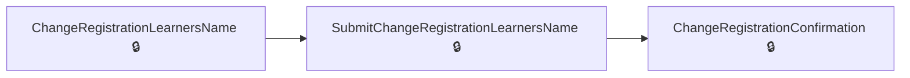
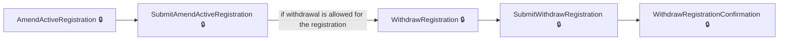
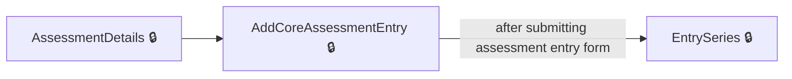
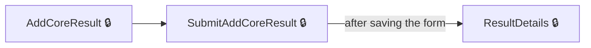
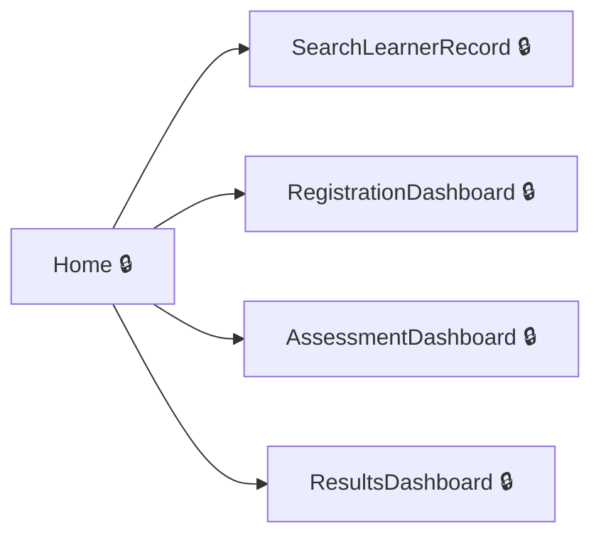

# User journeys: SkillsFundingAgency/tl-results-and-certification

Generated from `master/src`: 496 pages, 778 transitions, 9 journeys. 🔒 means sign-in is required. Dotted arrows return to a hub.

## Add a new learner registration

Complete all steps to register a new learner, from entering their ULN to submitting the registration and receiving confirmation.

## Change learner registration details

Update essential details of an existing learner’s registration such as name, date of birth, provider, core, or specialism.

## Withdraw or delete a learner registration

Initiate and complete the process to withdraw or delete a learner’s registration, including confirmation steps.

## Rejoin or reregister a withdrawn learner

Return a withdrawn learner to an active registration or register them for a new course after withdrawal.

```mermaid
flowchart LR
  p0["AmendWithdrawRegistration 🔒"] --> p1["SubmitAmendWithdrawRegistration 🔒"]
  p1["SubmitAmendWithdrawRegistration 🔒"] -->|"if reregister is selected"| p2["ReregisterProvider 🔒"]
  p2["ReregisterProvider 🔒"] --> p3["SubmitReregisterProvider 🔒"]
  p3["SubmitReregisterProvider 🔒"] --> p4["ReregisterCore 🔒"]
  p4["ReregisterCore 🔒"] --> p5["SubmitReregisterCore 🔒"]
  p5["SubmitReregisterCore 🔒"] --> p6["ReregisterSpecialismQuestion 🔒"]
  p6["ReregisterSpecialismQuestion 🔒"] --> p7["SubmitReregisterSpecialismQuestion 🔒"]
  p7["SubmitReregisterSpecialismQuestion 🔒"] --> p8["ReregisterSpecialisms 🔒"]
  p8["ReregisterSpecialisms 🔒"] --> p9["SubmitReregisterSpecialisms 🔒"]
  p9["SubmitReregisterSpecialisms 🔒"] --> p10["ReregisterAcademicYear 🔒"]
  p10["ReregisterAcademicYear 🔒"] --> p11["SubmitReregisterAcademicYear 🔒"]
  p11["SubmitReregisterAcademicYear 🔒"] --> p12["ReregisterCheckAndSubmit 🔒"]
  p12["ReregisterCheckAndSubmit 🔒"] --> p13["SubmitReregisterCheckAndSubmit 🔒"]
  p13["SubmitReregisterCheckAndSubmit 🔒"] --> p14["ReregistrationConfirmation 🔒"]
```

## Add or amend assessment entries for a learner

Record or update assessment entries for a core or specialism component for an individual learner.

## Enter or change a learner's assessment result

Submit or amend the result (grade) for a core or specialism assessment component for a learner.

## Complete industry placement recording

Add, review, and submit an industry placement status, with routes for special consideration if needed.

```mermaid
flowchart LR
  p0["AddIndustryPlacement 🔒"] --> p1["IpCompletion 🔒"]
  p1["IpCompletion 🔒"] --> p2["SubmitIpCompletion 🔒"]
  p2["SubmitIpCompletion 🔒"] -->|"otherwise after saving completion status"| p3["IpCheckAndSubmit 🔒"]
  p3["IpCheckAndSubmit 🔒"] -->|"after submitting the check and submit form"| p4["SubmitIpCheckAndSubmit 🔒"]
  p4["SubmitIpCheckAndSubmit 🔒"] -->|"if processing is successful"| p5["LearnerRecordDetails 🔒"]
```

## Access and manage provider T-levels

Search for a provider, manage T-levels assigned to them, and confirm changes.

## View, search, and update learners

Use dashboards and search to view, filter, and update learner records and details.

Complete the sections in any order, returning to the hub.

## Pages

| Page | Route | Sign-in | Purpose |
| --- | --- | --- | --- |
| `AccessibilityStatement` | `accessibility-statement` | No | Provides the accessibility statement for the website. |
| `Account.PostSignIn` | — | Yes | Redirects the user after sign in depending on their authentication status and access. |
| `AccountProfile` | `account-profile` | Yes | Lets the user view or update their account profile. |
| `AddAddress` | `add-address` | Yes | Redirects to adding an address by postcode for the provider. |
| `AddAddressCancel` | `add-postal-address-cancel` | Yes | Lets the user confirm if they want to cancel adding a new postal address. |
| `AddAddressCheckAndSubmit` | `add-postal-address-check-and-submit` | Yes | Shows a summary of the new postal address and allows the user to check and submit it. |
| `AddAddressConfirmation` | `add-postal-address-confirmation` | Yes | Displays confirmation that a new postal address has been added. |
| `AddAddressManually` | `add-address-manually/{isFromSelectAddress:bool?}/{isFromAddressMissing:bool?}` | Yes | Redirects the user to manually enter a postal address. |
| `AddAddressNotFound` | `add-postal-address-no-addresses-found` | Yes | Informs the user that no addresses were found for the entered postcode. |
| `AddAddressPostcode` | `add-postal-address-postcode/{showPostcode:bool?}/{isFromAddressMissing:bool?}` | Yes | Allows the user to enter a postcode to find postal addresses. |
| `AddAddressSelect` | `add-postal-address-select` | Yes | Allows the user to select a postal address from a list of found addresses and optionally provide a department name. |
| `AddCoreAssessmentEntry` | `assessment-entry-add-core/{profileId}` | Yes | Lets the user add a core assessment entry for a learner. |
| `AddCoreResult` | `select-core-result/{profileId}/{assessmentId}` | Yes | Lets the user select a grade for a learner's core assessment result. |
| `AddIndustryPlacement` | `add-industry-placement/{profileId}` | Yes | Lets the user start adding or changing a learner's industry placement record. |
| `AddPostalAddressManual` | `add-postal-address-manual/{isFromSelectAddress:bool?}/{isFromAddressMissing:bool?}` | Yes | Allows the user to manually enter the postal address details. |
| `AddProviderTlevels` | `add-additional-tlevels/{providerId}` | Yes | Lets the user add additional T-levels for a provider. |
| `AddRegistration` | `add-registration-unique-learner` | Yes | Starts the process of adding a learner registration by unique learner number. |
| `AddRegistrationAcademicYear` | `add-registration-academic-year/{isChangeMode:bool?}` | Yes | Lets the user select the academic year for a new learner registration. |
| `AddRegistrationCheckAndSubmit` | `add-registration-check-and-submit` | Yes | Allows the user to check a new learner registration before submitting it. |
| `AddRegistrationConfirmation` | `add-registration-confirmation` | Yes | Shows confirmation that a new registration has been added. |
| `AddRegistrationCore` | `add-registration-core/{isChangeMode:bool?}` | Yes | Lets the user select the core subject for the learner registration. |
| `AddRegistrationDateofBirth` | `add-registration-date-of-birth/{isChangeMode:bool?}` | Yes | Allows the user to enter the learner's date of birth during registration. |
| `AddRegistrationLearnersName` | `add-registration-learners-name/{isChangeMode:bool?}` | Yes | Allows the user to enter the learner's name during registration. |
| `AddRegistrationProvider` | `add-registration-provider/{isChangeMode:bool?}` | Yes | Lets the user select the provider for the learner registration. |
| `AddRegistrationSpecialismQuestion` | `add-registration-learner-decided-specialism-question/{isChangeMode:bool?}` | Yes | Asks whether the learner has decided on a specialism during registration. |
| `AddRegistrationSpecialisms` | `add-registration-specialism/{isChangeMode:bool?}` | Yes | Lets the user select specialisms for the learner registration. |
| `AddRegistrationUln` | `add-registration-unique-learner-number/{isChangeMode:bool?}` | Yes | Allows the user to enter the Unique Learner Number (ULN) for registration. |
| `AddSpecialismAssessmentEntry` | `assessment-entry-add-specialisms/{profileId}/{specialismsId}` | Yes | Lets the user add a specialism assessment entry for a learner. |
| `AddSpecialismResult` | `select-specialism-result/{profileId}/{assessmentId}` | Yes | Lets the user select a grade for a learner's specialism assessment result. |
| `AddWithdrawnStatus` | `manage-learners-add-withdrawn-status/{profileId}` | Yes | Lets the user add a pending withdrawn status for a learner. |
| `AdminAddAppealOutcomeChangeGradeCore` | `admin/add-appeal-outcome-change-grade-core/{registrationPathwayId}/{assessmentId}` | Yes | Lets the admin select a new grade for the core appeal outcome. |
| `AdminAddAppealOutcomeChangeGradeCoreClear` | `admin/add-appeal-outcome-change-grade-core-clear/{registrationPathwayId}/{assessmentId}` | Yes | Clears the selected grade for core appeal outcome before restarting the process. |
| `AdminAddAppealOutcomeChangeGradeSpecialism` | `admin/add-appeal-outcome-change-grade-specialism/{registrationPathwayId}/{assessmentId}` | Yes | Lets the admin select a new grade for the specialism appeal outcome. |
| `AdminAddAppealOutcomeChangeGradeSpecialismClear` | `admin/add-appeal-outcome-change-grade-specialism-clear/{registrationPathwayId}/{assessmentId}` | Yes | Clears the selected grade for specialism appeal outcome before restarting the process. |
| `AdminAddCoreAppealOutcome` | `admin/add-appeal-outcome-core` | Yes | Lets the admin add an appeal outcome for a core assessment. |
| `AdminAddCoreAppealOutcomeClear` | `admin/add-appeal-outcome-core-clear` | Yes | Clears the cached data for adding a core appeal outcome and redirects to start again. |
| `AdminAddCoreRommOutcome` | `admin/add-romm-outcome-core` | Yes | Lets the admin add a ROMM outcome for a core assessment. |
| `AdminAddCoreRommOutcomeClear` | `admin/add-romm-outcome-core-clear` | Yes | Clears the cached data for adding a core ROMM outcome and redirects to start again. |
| `AdminAddNotification` | `admin/add-notification` | Yes | Allows the admin to add a new notification. |
| `AdminAddPathwayResult` | `admin/add-assessment-result-core/{registrationPathwayId}/{assessmentId}` | Yes | Allows the admin to add a result for a pathway assessment. |
| `AdminAddPathwayResultClear` | `admin/add-assessment-result-core-clear/{registrationPathwayId}/{assessmentId}` | Yes | Clears any cached pathway result data and returns to pathway result entry. |
| `AdminAddPathwayResultReviewChanges` | `admin/review-changes-assessment-result-core` | Yes | Lets the admin review the details and changes before confirming a new pathway result. |
| `AdminAddProvider` | `admin/add-provider` | Yes | Lets the admin add a new provider. |
| `AdminAddRommOutcomeChangeGradeCore` | `admin/add-romm-outcome-change-grade-core/{registrationPathwayId}/{assessmentId}` | Yes | Lets the admin select a new grade for a core assessment after a ROMM outcome indicates a change is needed. |
| `AdminAddRommOutcomeChangeGradeCoreClear` | `admin/add-romm-outcome-change-grade-core-clear/{registrationPathwayId}/{assessmentId}` | Yes | Clears the cached data for changing the core grade after ROMM and redirects to the grade selection page. |
| `AdminAddRommOutcomeChangeGradeSpecialism` | `admin/add-romm-outcome-change-grade-specialism/{registrationPathwayId}/{assessmentId}` | Yes | Lets the admin select a new grade for a specialism assessment after a ROMM outcome indicates a change is needed. |
| `AdminAddRommOutcomeChangeGradeSpecialismClear` | `admin/add-romm-outcome-change-grade-specialism-clear/{registrationPathwayId}/{assessmentId}` | Yes | Clears the cached data for changing the specialism grade after ROMM and redirects to the grade selection page. |
| `AdminAddSpecialismAppealOutcome` | `admin/add-appeal-outcome-specialism` | Yes | Lets the admin add an appeal outcome for a specialism assessment. |
| `AdminAddSpecialismAppealOutcomeClear` | `admin/add-appeal-outcome-specialism-clear` | Yes | Clears the cached data for adding an appeal outcome for a specialism and redirects to start again. |
| `AdminAddSpecialismResult` | `admin/add-assessment-result-specialism/{registrationPathwayId}/{assessmentId}` | Yes | Allows the admin to add a result for a specialism assessment. |
| `AdminAddSpecialismResultClear` | `admin/add-assessment-result-specialism-clear/{registrationPathwayId}/{assessmentId}` | Yes | Clears any cached specialism result data and returns to specialism result entry. |
| `AdminAddSpecialismResultReviewChanges` | `admin/review-changes-assessment-result-specialism` | Yes | Lets the admin review the details and changes before confirming a new specialism result. |
| `AdminAddSpecialismRommOutcome` | `admin/add-romm-outcome-specialism` | Yes | Lets the admin add a ROMM outcome for a specialism assessment. |
| `AdminAddSpecialismRommOutcomeClear` | `admin/add-romm-outcome-specialism-clear` | Yes | Clears the cached data for adding a ROMM outcome for a specialism and redirects to start again. |
| `AdminAssessmentSeriesDateDetails` | `admin/assessment-series-date/{assessmentId}` | Yes | Displays details for a specific assessment series date to admins. |
| `AdminChangeIndustryPlacement` | `admin/change-industry-placement/{registrationPathwayId}` | Yes | Lets the admin change a learner's industry placement status. |
| `AdminChangeIndustryPlacementClear` | `admin/change-industry-placement-clear/{registrationPathwayId}` | Yes | Clears the change-industry-placement form for the admin. |
| `AdminChangePathwayResult` | `admin/change-assessment-result-core/{registrationPathwayId}/{assessmentId}` | Yes | Lets the admin change a learner's pathway/core assessment result. |
| `AdminChangePathwayResultClear` | `admin/change-assessment-result-core-clear/{registrationPathwayId}/{assessmentId}` | Yes | Clears the change-pathway-result form for the admin. |
| `AdminChangePathwayResultReviewChanges` | `admin/change-assessment-result-core-review-changes` | Yes | Lets the admin review and confirm a change to a pathway result. |
| `AdminChangeSpecialismResult` | `admin/change-assessment-result-specialism/{registrationPathwayId}/{assessmentId}` | Yes | Lets the admin change a learner's specialism assessment result. |
| `AdminChangeSpecialismResultClear` | `admin/change-assessment-result-specialism-clear/{registrationPathwayId}/{assessmentId}` | Yes | Clears the change-specialism-result form for the admin. |
| `AdminChangeSpecialismResultReviewChanges` | `admin/change-assessment-result-specialism-review-changes` | Yes | Lets the admin review and confirm a change to a specialism result. |
| `AdminChangeUln` | `admin/change-uln/{registrationPathwayId}` | Yes | Lets the admin change a learner's Unique Learner Number (ULN). |
| `AdminChangeUlnClear` | `admin/change-uln-clear/{registrationPathwayId}` | Yes | Clears the ULN change form for the admin. |
| `AdminCoreComponentAssessmentEntry` | `admin/add-assessment-entry-core/{registrationPathwayId}` | Yes | Lets the admin add a core component assessment entry for a learner. |
| `AdminCoreComponentAssessmentEntryClear` | `admin/add-assessment-core-entry-clear/{registrationPathwayId}` | Yes | Clears the add-assessment-entry-core form for the admin. |
| `AdminDeleteNotification` | `admin/delete-notification/{notificationId}` | Yes | Lets the admin review and delete a notification. |
| `AdminDownloadCoreResultsDataLink` | `admin/download-core-results/{awardingOrganisationUkprn}/{fileId}` | Yes | Allows downloading core results data for a selected awarding organisation. |
| `AdminDownloadLearnerResultsByProvider` | `admin/download-learner-results-provider/{providerId}` | Yes | Lets the administrator download learner results for a specific provider. |
| `AdminDownloadLearnerResultsCsv` | `admin/download-learner-results-file-csv/{ukprn}` | Yes | Lets the administrator download learner results as a CSV file for a provider. |
| `AdminDownloadLearnerResultsFindProvider` | `admin/download-learner-results-find-provider` | Yes | Lets the administrator find a provider to download learner results. |
| `AdminDownloadLearnerResultsFindProviderClear` | `admin/download-learner-results-find-provider-clear` | Yes | Clears the provider search for downloading learner results. |
| `AdminDownloadLearnerResultsPdf` | `admin/download-learner-results-file-pdf/{ukprn}` | Yes | Lets the administrator download learner results as a PDF file for a provider. |
| `AdminDownloadLearnerResultsSubmitFindProvider` | `admin/download-learner-results-find-provider` | Yes | Processes the provider find form and redirects to the provider's learner results download page. |
| `AdminDownloadResultsRommsByAwardingOrganisation` | `admin/download-results-romms-awarding-organisation/{awardingOrganisationUkprn}` | Yes | Displays available download links for ROMMS and results for a selected awarding organisation. |
| `AdminDownloadRommsDataLink` | `admin/download-romms-data/{awardingOrganisationUkprn}/{fileId}` | Yes | Allows downloading ROMMS data for a selected awarding organisation. |
| `AdminDownloadSpecialismResultsDataLink` | `admin/download-specialism-results/{awardingOrganisationUkprn}/{fileId}` | Yes | Allows downloading specialism results data for a selected awarding organisation. |
| `AdminEditNotification` | `admin/edit-notification` | Yes | Lets the admin edit an existing notification. |
| `AdminEditProvider` | `admin/edit-provider/{providerId}` | Yes | Lets the admin edit an existing provider. |
| `AdminFindNotification` | `admin/find-notification/{pageNumber:int?}` | Yes | Lets the admin search for notifications using filters. |
| `AdminFindNotificationClear` | `admin/find-notification-clear` | Yes | Clears search notification filters for the admin. |
| `AdminFindProvider` | `admin/find-provider` | Yes | Lets the admin search for a provider. |
| `AdminFindProviderClear` | `admin/find-provider-clear` | Yes | Lets the admin clear their provider search criteria. |
| `AdminHome` | `admin/home` | Yes | Redirects the admin to the site home page. |
| `AdminIndustryPlacementSpecialConsiderationHours` | `admin/industry-placement-hours` | Yes | Lets the admin enter hours for special consideration industry placement. |
| `AdminIndustryPlacementSpecialConsiderationReasons` | `admin/industry-placement-incomplete` | Yes | Lets the admin enter reasons for special consideration industry placement. |
| `AdminLearnerRecord` | `admin/learner-record/{pathwayid}` | Yes | Displays the learner's record and details for administration purposes. |
| `AdminNotificationDetails` | `admin/notification-details/{notificationId}` | Yes | Displays details of a specific notification for the admin. |
| `AdminOccupationalSpecialisAssessmentEntry` | `admin/add-assessment-entry-specialism/{registrationPathwayId}/{specialismsId}` | Yes | Allows the admin to add a specialism assessment entry for a learner. |
| `AdminOccupationalSpecialisAssessmentEntryClear` | `admin/add-assessment-specialism-entry-clear/{registrationPathwayId}/{specialismsId}` | Yes | Clears the cached specialism assessment entry and redirects to entry page. |
| `AdminOpenPathwayAppeal` | `admin/open-appeal-core` | Yes | Lets the admin open an appeal for a core assessment. |
| `AdminOpenPathwayAppealClear` | `admin/open-appeal-core-clear` | Yes | Clears the cached data for opening a core appeal and redirects to start again. |
| `AdminOpenPathwayAppealReviewChanges` | `admin/review-changes-appeal-core/{registrationPathwayId}/{assessmentId}` | Yes | Lets the admin review and submit details for opening a core appeal. |
| `AdminOpenPathwayRomm` | `admin/open-romm-core` | Yes | Allows an admin to start opening a ROMM process for a learner's core pathway assessment. |
| `AdminOpenPathwayRommClear` | `admin/open-romm-core-clear` | Yes | Clears cached ROMM data for the pathway and returns to the start of the ROMM process. |
| `AdminOpenPathwayRommReviewChanges` | `admin/review-changes-romm-core` | Yes | Lets the admin review and confirm details for opening a core pathway ROMM, including reasons and contact information. |
| `AdminOpenSpecialismAppeal` | `admin/open-appeal-specialism` | Yes | Allows an admin to start opening an appeal process for a learner's specialism assessment. |
| `AdminOpenSpecialismAppealClear` | `admin/open-appeal-specialism-clear` | Yes | Clears cached appeal data for the specialism and returns to the start of the appeal process. |
| `AdminOpenSpecialismAppealReviewChanges` | `admin/review-changes-appeal-specialism/{registrationPathwayId}/{assessmentId}` | Yes | Lets the admin review and confirm details for opening a specialism appeal, including reasons and contact information. |
| `AdminOpenSpecialismRomm` | `admin/open-romm-specialism` | Yes | Allows an admin to start opening a ROMM process for a learner's specialism assessment. |
| `AdminOpenSpecialismRommClear` | `admin/open-romm-specialism-clear` | Yes | Clears cached ROMM data for the specialism and returns to the start of the specialism ROMM process. |
| `AdminOpenSpecialismRommReviewChanges` | `admin/review-changes-romm-specialism` | Yes | Lets the admin review and confirm details for opening a specialism ROMM, including reasons and contact information. |
| `AdminProviderDetails` | `admin/provider-details/{providerId}` | Yes | Shows the details of a provider. |
| `AdminRequestReplacementDocument` | `admin/request-replacement-document/{registrationPathwayId}` | Yes | Enables the admin to request a replacement certificate document for a learner. |
| `AdminReviewChangeUln` | `admin/review-change-uln/{registrationPathwayId}` | Yes | Allows the admin to review and confirm details for changing a learner's Unique Learner Number (ULN). |
| `AdminReviewChangesAppealOutcomeCore` | `admin/add-appeal-outcome-change-grade-review-changes-core` | Yes | Lets the admin review and confirm the changes when adding an appeal outcome to a core assessment. |
| `AdminReviewChangesAppealOutcomeSpecialism` | `admin/add-appeal-outcome-change-grade-review-changes-specialism` | Yes | Lets the admin review and confirm the changes when adding an appeal outcome to a specialism assessment. |
| `AdminReviewChangesCoreAssessmentEntry` | `admin/review-changes-assesment-entry-core/{registrationPathwayId}` | Yes | Lets the admin review and confirm changes to a learner's core assessment entry. |
| `AdminReviewChangesIndustryPlacement` | `admin/review-changes-industry-placement/{pathwayId}` | Yes | Lets the admin review and confirm changes to a learner's industry placement record. |
| `AdminReviewChangesRommOutcomeCore` | `admin/add-romm-outcome-change-grade-review-changes-core` | Yes | Lets the admin review and confirm the changes when adding a ROMM outcome to a core assessment. |
| `AdminReviewChangesRommOutcomeSpecialism` | `admin/add-romm-outcome-change-grade-review-changes-specialism` | Yes | Lets the admin review and confirm the changes when adding a ROMM outcome to a specialism assessment. |
| `AdminReviewChangesSpecialismAssessmentEntry` | `admin/review-changes-assesment-entry-specialism/{registrationPathwayId}` | Yes | Lets the admin review and confirm changes to a learner's specialism assessment entry. |
| `AdminReviewRemoveCoreAssessmentEntry` | `admin/review-remove-assessment-entry-core` | Yes | Enables the admin to review and confirm removal of a learner's core assessment entry. |
| `AdminReviewRemoveSpecialismAssessmentEntry` | `admin/review-remove-assessment-entry-specialism/{registrationPathwayId}` | Yes | Enables the admin to review and confirm removal of a learner's specialism assessment entry. |
| `AdminSearchChangeLog` | `admin/change-log/{pageNumber:int?}` | Yes | Lets the admin search and view the change log records, optionally by entering a search key. |
| `AdminSearchChangeLogClear` | `admin/change-log-clear` | Yes | Clears the search criteria for the change log and returns to the search page. |
| `AdminSearchLearnersRecords` | `admin/search-learner-records/{pageNumber:int?}` | Yes | Allows the admin to search for learner records using search and filter options. |
| `AdminSearchLearnersRecordsClear` | `admin/search-learner-records-clear` | Yes | Clears previously applied search filters and criteria for learner records. |
| `AdminSelectAwardingOrganisation` | `admin/select-awarding-organisation` | Yes | Allows the admin to select an awarding organisation from a list. |
| `AdminSelectAwardingOrganisationClear` | `admin/select-awarding-organisation-clear` | Yes | Clears the awarding organisation selection. |
| `AdminSubmitChangeIndustryPlacement` | `admin/submit-change-industry-placement` | Yes | Allows the admin to submit a change to the learner's industry placement status. |
| `AdminSubmitFindProvider` | `admin/find-provider` | Yes | Processes the admin's provider search. |
| `AdminSubmitSelectAwardingOrganisation` | `admin/select-awarding-organisation` | Yes | Lets the admin select an awarding organisation. |
| `AdminViewChangeAddPathwayResultRecord` | `admin/view-change-record/7/{changeLogId}` | Yes | Shows details of a change log record related to adding a pathway result. |
| `AdminViewChangeAddSpecialismResultRecord` | `admin/view-change-record/8/{changeLogId}` | Yes | Shows details of a change log record related to adding a specialism result. |
| `AdminViewChangeCoreAssessmentRecord` | `admin/view-change-record/3/{changeLogId}` | Yes | Shows details of a change log record related to a core assessment. |
| `AdminViewChangeIPRecord` | `admin/view-change-record/2/{changeLogId}` | Yes | Shows details of a change log record related to industry placement. |
| `AdminViewChangePathwayResultRecord` | `admin/view-change-record/9/{changeLogId}` | Yes | Shows details of a change log record related to changing a pathway result. |
| `AdminViewChangeRemoveCoreAssessmentRecord` | `admin/view-change-record/5/{changeLogId}` | Yes | Shows details of a change log record related to removing a core assessment. |
| `AdminViewChangeRemoveSpecialismAssessmentRecord` | `admin/view-change-record/6/{changeLogId}` | Yes | Shows details of a change log record related to removing a specialism assessment. |
| `AdminViewChangeSpecialismAssessmentRecord` | `admin/view-change-record/4/{changeLogId}` | Yes | Shows details of a change log record related to a specialism assessment. |
| `AdminViewChangeSpecialismResultRecord` | `admin/view-change-record/10/{changeLogId}` | Yes | Shows details of a change log record related to changing a specialism result. |
| `AdminViewChangeStartYearRecord` | `admin/view-change-record/1/{changeLogId}` | Yes | Shows details of a change log record related to start year changes. |
| `AdminViewChangeUlnRecord` | `admin/view-change-record/21/{changeLogId}` | Yes | Shows details of a change log record related to changing ULN. |
| `AdminViewOpenPathwayAppealRecord` | `admin/view-change-record/15/{changeLogId}` | Yes | Shows details of a change log record related to opening a pathway appeal. |
| `AdminViewOpenPathwayRommRecord` | `admin/view-change-record/11/{changeLogId}` | Yes | Lets the admin view the details of an open pathway ROMM record. |
| `AdminViewOpenSpecialismAppealRecord` | `admin/view-change-record/16/{changeLogId}` | Yes | Lets the admin view the details of an open specialism appeal record. |
| `AdminViewOpenSpecialismRommRecord` | `admin/view-change-record/12/{changeLogId}` | Yes | Lets the admin view the details of an open specialism ROMM record. |
| `AdminViewPathwayAppealOutcomeRecord` | `admin/view-change-record/17/{changeLogId}` | Yes | Lets the admin view the outcome of a pathway appeal record. |
| `AdminViewPathwayRommOutcomeRecord` | `admin/view-change-record/13/{changeLogId}` | Yes | Lets the admin view the outcome of a pathway ROMM record. |
| `AdminViewSpecialismAppealOutcomeRecord` | `admin/view-change-record/18/{changeLogId}` | Yes | Lets the admin view the outcome of a specialism appeal record. |
| `AdminViewSpecialismRommOutcomeRecord` | `admin/view-change-record/14/{changeLogId}` | Yes | Lets the admin view the outcome of a specialism ROMM record. |
| `AllTlevelsReviewed` | `all-tlevels-reviewed` | Yes | Informs the user that all T levels have been reviewed. |
| `AmendActiveRegistration` | `amend-active-registration/{profileId}/{changeStatusId:int?}` | Yes | Allows the user to change the status of an active learner registration. |
| `AmendWithdrawRegistration` | `amend-withdrawn-registration/{profileId}/{changeStatusId:int?}` | Yes | Allows the user to change the status of a withdrawn learner registration. |
| `AssessmentDashboard` | `assessment-entries` | Yes | Shows an overview of assessment entries and related options. |
| `AssessmentDetails` | `assessment-entry-learner-details/{profileId}` | Yes | Shows assessment details for a particular learner. |
| `AssessmentWithdrawnDetails` | `assessment-entries-learner-withdrawn/{profileId}` | Yes | Shows details for a learner whose assessment entries have been withdrawn. |
| `AssessmentsDownloadData` | `assessments-download-data` | Yes | Provides the user with options to download assessment entries data. |
| `AssessmentsDownloadDataLink` | `download-assessments-data/{id}/{componentType}` | Yes | Lets the user download a specific set of assessments data. |
| `AssessmentsGeneratingDownload` | `assessments-generating-download` | Yes | Informs the user that assessment entries data is being processed for download. |
| `AssessmentsNoRecordsFound` | `assessments-no-records-found` | Yes | Notifies the user that no assessment records were found for export. |
| `AssessmentsUploadSuccessful` | `assessment-entries-upload-confirmation` | Yes | Confirms that assessment entries were uploaded successfully. |
| `AssessmentsUploadUnsuccessful` | `assessment-entries-upload-unsuccessful` | Yes | Informs the user an assessment entries upload was unsuccessful. |
| `CannotChangeAcademicYear` | `academic-year-cannot-change/{profileId}` | Yes | Informs the user that the academic year cannot be changed for this registration. |
| `ChangeAcademicYear` | `academic-year-change/{profileId}` | Yes | Lets the user select a new academic year for a registration. |
| `ChangeAcademicYearConfirmation` | `academic-year-change-confirmation` | Yes | Shows the confirmation after an academic year change for a learner registration. |
| `ChangeBackToActiveAOMessage` | `restore-learner-ao-message/{profileId}` | Yes | Shows a message for a learner being restored to active status after withdrawal. |
| `ChangeBackToActiveStatus` | `restore-learner-ao/{profileId}` | Yes | Lets the user change a learner's status back to active from withdrawn. |
| `ChangeBackToActiveStatusHaveYouToldAwardingOrganisation` | `restore-learner-have-you-told-ao/{profileId}` | Yes | Asks if the user has informed the Awarding Organisation when changing a learner's status back to active. |
| `ChangeCoreResult` | `change-core-result/{profileId}/{assessmentId}` | Yes | Lets the user change a previously recorded core assessment result. |
| `ChangeRegistrationConfirmation` | `registration-details-change-confirmation` | Yes | Shows a confirmation when a registration detail has been changed. |
| `ChangeRegistrationCore` | `change-core/{profileId}` | Yes | Lets the user view and start changing the core for a learner registration. |
| `ChangeRegistrationCoreQuestion` | `change-core-and-provider/{profileId}` | Yes | Asks whether the user would like to change the core after provider changed to one that does not support the current core. |
| `ChangeRegistrationDateofBirth` | `change-registration-learners-date-of-birth/{profileId}` | Yes | Lets the user start changing the learner's date of birth in their registration. |
| `ChangeRegistrationLearnersName` | `change-registration-learners-name/{profileId}` | Yes | Lets the user start changing the learner's name in their registration. |
| `ChangeRegistrationProvider` | `change-registration-provider/{profileId}/{isback:bool?}` | Yes | Lets the user start changing the provider for a learner's registration. |
| `ChangeRegistrationProviderAndCoreNeedToWithdraw` | `change-registration-provider-and-core-need-to-withdraw` | Yes | Informs user that registration needs to be withdrawn because changing provider and core is required. |
| `ChangeRegistrationProviderNotOfferingSameCore` | `change-registration-provider-not-offering-core` | Yes | Informs user the selected provider does not offer the same core as the current registration. |
| `ChangeRegistrationSpecialismQuestion` | `change-registration-learner-decided-specialism-question/{profileId}` | Yes | Asks if the learner has decided specialism for registration changes. |
| `ChangeRegistrationSpecialisms` | `change-registration-select-specialism/{profileId}` | Yes | Lets the user select specialisms for the learner's registration change. |
| `ChangeSpecialismRestriction` | `registration-specialism-change-restriction/{profileId}` | Yes | Informs the user that specialism changes are restricted for the registration. |
| `ChangeSpecialismResult` | `change-specialism-result/{profileId}/{assessmentId}` | Yes | Lets the user change a previously recorded specialism assessment result. |
| `ChangeStartYear` | `admin/change-start-year/{registrationPathwayId}` | Yes | Allows the admin to change the academic start year for the learner's record. |
| `ChangeStartYearClear` | `admin/change-start-year-clear/{registrationPathwayId}` | Yes | Clears the change start year form and redirects to the change start year page. |
| `ChangeWithdrawnStatusHaveYouToldAwardingOrganisation` | `manage-add-withdrawn-status-ao-message/{profileId}` | Yes | Allows the user to indicate whether the awarding organisation has been informed about the learner's withdrawn status. |
| `ConfirmTlevel` | `confirm-tlevel` | Yes | Lets the user confirm the details of a T level review. |
| `ConfirmedTlevels` | `confirmed-tlevels` | Yes | Displays the list of confirmed T levels. |
| `Contact` | `contact-us` | No | Provides information for contacting technical support. |
| `CookieDetails` | `cookie-details` | No | Shows details about cookies used by the website. |
| `Cookies` | `cookies` | No | Lets the user manage their cookie preferences. |
| `DeleteRegistration` | `delete-registration/{profileId}` | Yes | Allows the user to delete a registration. |
| `DownloadAssessmentEntriesDataFormatAndRulesGuide` | `tlevels-assessment-entries-data-format-and-rules` | No | Lets the user download the guide describing the format and rules for assessment entries data. |
| `DownloadAssessmentEntriesTemplate` | `tlevels-assessment-entries-template` | No | Lets the user download the template file for uploading assessment entries. |
| `DownloadLearnerOverallResultSlipsFile` | `download-learner-tlevel-result-slips-file/{profileId}` | Yes | Lets the user download an individual learner's T Level result slip file. |
| `DownloadOverallResultSlipsFile` | `download-tlevel-result-slips-file` | Yes | Lets the user download all learners' T Level result slips as a file. |
| `DownloadOverallResultsFile` | `download-tlevel-results-file` | Yes | Lets the user download a file containing all learners' T Level overall results. |
| `DownloadOverallResultsPage` | `download-tlevel-results` | Yes | Lets the user start the T Level overall results download process and see available options. |
| `DownloadRegistrationDataFormatAndRulesGuide` | `tlevels-registration-data-format-and-rules` | No | Lets the user download the guide describing the format and rules for registration data. |
| `DownloadRegistrationDataTemplate` | `tlevels-registration-data-template` | No | Lets the user download the template file for uploading registration data. |
| `DownloadRegistrationsData` | `download-registrations-data` | Yes | Lets the user choose to download registration data. |
| `DownloadRegistrationsDataFor` | `download-registrations-data-for` | Yes | Lets the user download registration data for a specific start year. |
| `DownloadRegistrationsDataForLink` | `download-registrations-data-for/{id}` | Yes | Lets the user download a data file for registrations. |
| `DownloadResultsDataFormatAndRulesGuide` | `tlevels-results-data-format-and-rules` | No | Lets the user download the guide describing the format and rules for results data. |
| `DownloadResultsTemplate` | `tlevels-results-template` | No | Lets the user download the template file for uploading results data. |
| `DownloadRommDataFormatAndRulesGuide` | `tlevels-romm-data-format-and-rules` | No | Lets the user download the guide describing the format and rules for ROMM (Review of Marking and Moderation) data. |
| `DownloadRommDataTemplate` | `tlevels-romm-data-template` | No | Lets the user download the template file for uploading ROMM data. |
| `DownloadWithdrawalsDataFormatAndRulesGuide` | `tlevels-withdrawals-data-format-and-rules` | No | Lets the user download the guide describing the format and rules for withdrawals data. |
| `DownloadWithdrawalsDataTemplate` | `tlevels-withdrawal-data-template` | No | Lets the user download the template file for uploading withdrawal data. |
| `EntrySeries` | `assessment-entry-add-core/{profileId}` | Yes | Allows the user to add a core assessment entry for a learner. |
| `FindProvider` | `find-provider/{isback:bool?}` | Yes | Lets the user search for a provider. |
| `Home` | `home` | Yes | Provides access to main dashboard links and navigation. |
| `Home.Index` | — | No | Welcomes unauthenticated users and redirects authenticated users to their dashboard. |
| `IndustryPlacementsUploadSuccessful` | `upload-ip-file-success` | Yes | Confirms to the user that the industry placements file upload was successful. |
| `IndustryPlacementsUploadUnsuccessful` | `ip-upload-unsuccessful` | Yes | Notifies the user that their industry placements file upload was unsuccessful. |
| `IpCheckAndSubmit` | `industry-placement-check-your-answers` | Yes | Lets the user review their answers about industry placement before submitting. |
| `IpCheckAndSubmitCancel` | `industry-placement-check-your-answers-cancel/{profileId}` | Yes | Lets the user cancel the industry placement submission process and return to learner details. |
| `IpCompletion` | `industry-placement-completion/{profileId}/{isChangeMode:bool?}` | Yes | Allows the user to select the industry placement completion status for a learner. |
| `IpSpecialConsiderationHours` | `industry-placement-special-consideration-hours/{isChangeMode:bool?}` | Yes | Lets the user enter the hours for special consideration regarding industry placement. |
| `IpSpecialConsiderationReasons` | `industry-placement-special-consideration-reasons/{isChangeMode:bool?}` | Yes | Allows the user to specify reasons for special consideration after entering hours. |
| `LearnerRecordDetails` | `learner-record-page/{profileId}` | Yes | Shows detailed information about the selected learner's record. |
| `ManagePostalAddress` | `manage-postal-address` | Yes | Shows the current postal address and provides options to manage it. |
| `NoConfirmedTlevels` | `no-confirmed-tlevels` | Yes | Shows that there are no confirmed T levels. |
| `NoQueriedTlevels` | `no-queried-tlevels` | Yes | Indicates that there are no queried T levels. |
| `PathwayNotEligibleForAcademicYearChange` | `pathway-not-eligible-for-academic-year-change/{profileId}` | Yes | Informs user that the registration pathway is not eligible for an academic year change. |
| `PendingWithdrawalsDownloadDataLink` | `download-pending-withdrawals-data/{id}` | Yes | Provides a link for downloading pending withdrawals data. |
| `PostalAddressMissing` | `postal-address-missing` | Yes | Informs the user that the provider's postal address is missing. |
| `ProblemWithAssessmentsUpload` | `assessment-entries-file-upload-service-problem` | Yes | Tells the user there was a problem with the assessment entries file upload service. |
| `ProblemWithRegistrationsUpload` | `problem-with-registrations-upload` | Yes | Shows a page when there is a problem with uploading registration data. |
| `ProblemWithResultsUpload` | `results-file-upload-service-problem` | Yes | Informs the user that there was a problem with uploading the results file. |
| `ProviderGuidance` | `provider-guidance` | Yes | Provides guidance and information for training providers. |
| `ProviderTimeline` | `provider-timeline` | Yes | Displays a timeline relevant to the provider's activities. |
| `ProviderTlevelConfirmation` | `submit-successful` | Yes | Displays confirmation that T-levels were successfully submitted for a provider. |
| `ProviderTlevels` | `provider-tlevels/{providerId}/{navigation:bool?}` | Yes | Shows T-levels associated with a provider. |
| `PrsAddAppeal` | `post-results-add-appeal/{profileId}/{assessmentId}/{componentType}/{isBack:bool?}` | Yes | Lets the user indicate if they wish to request an appeal for a learner's result. |
| `PrsAddAppealOutcome` | `post-results-add-appeal-outcome/{profileId}/{assessmentId}/{componentType}/{outcomeTypeId:int?}` | Yes | Lets the user select the outcome of an appeal request for a learner's result. |
| `PrsAddAppealOutcomeKnown` | `post-results-appeal-outcome-known/{profileId}/{assessmentId}/{componentType}/{outcomeKnownTypeId:int?}` | Yes | Lets the user specify a known outcome for an appeal request. |
| `PrsAddRomm` | `post-results-add-romm/{profileId}/{assessmentId}/{componentType}/{isBack:bool?}` | Yes | Lets the user indicate if they wish to request a ROMM (Review of Marking and Moderation) for a learner's result. |
| `PrsAddRommOutcome` | `post-results-add-romm-outcome/{profileId}/{assessmentId}/{componentType}/{outcomeTypeId:int?}` | Yes | Lets the user select the outcome of a ROMM request. |
| `PrsAddRommOutcomeKnown` | `post-results-romm-outcome-known/{profileId}/{assessmentId}/{componentType}/{outcomeKnownTypeId:int?}` | Yes | Lets the user specify a known outcome for a ROMM request. |
| `PrsAppealCheckAndSubmit` | `post-results-appeal-check` | Yes | Shows the final check and submit page for an appeal request. |
| `PrsAppealGradeChange` | `post-results-appeal-change-grade/{profileId}/{assessmentId}/{componentType}/{isAppealOutcomeJourney:bool?}/{isChangeMode:bool?}` | Yes | Lets the user select a new grade after an appeal resulted in a grade change. |
| `PrsCancelAppealUpdate` | `post-results-cancel-appeal-update` | Yes | Lets the user confirm if they wish to cancel the appeal update process. |
| `PrsCancelGradeChangeRequest` | `post-results-cancel-final-grade-change-request/{profileId}/{assessmentId}/{componentType}/{isResultJourney:bool?}` | Yes | Lets the user confirm if they wish to cancel a final grade change request. |
| `PrsCancelRommUpdate` | `post-results-cancel-ROMM-update` | Yes | Lets the user confirm if they wish to cancel the ROMM update process. |
| `PrsGradeChangeRequest` | `post-results-final-grade-change-request/{profileId}/{assessmentId}/{componentType}` | Yes | Lets the user enter details to request a final grade change for a learner. |
| `PrsGradeChangeRequestConfirmation` | `post-results-final-grade-change-request-sent` | Yes | Shows confirmation that a grade change request was submitted and allows navigation options. |
| `PrsLearnerDetails` | `post-results-learners-grades/{profileId}` | Yes | Displays the post-results service grades for a specific learner. |
| `PrsNoResults` | `post-results-no-results/{profileId}` | Yes | Informs the user that there are no results for a specified learner. |
| `PrsRommCheckAndSubmit` | `post-results-romm-check` | Yes | Lets the user review and confirm the outcome of a ROMM (Review of Marking and Moderation) request. |
| `PrsRommGradeChange` | `post-results-romm-change-grade/{profileId}/{assessmentId}/{componentType}/{isRommOutcomeJourney:bool?}/{isChangeMode:bool?}` | Yes | Lets the user select a new grade if the ROMM outcome is that the grade has changed. |
| `PrsUlnWithdrawn` | `post-results-learner-withdrawn/{profileId}` | Yes | Shows details when a learner is withdrawn from the results and certification process. |
| `QueriedTlevels` | `queried-tlevels` | Yes | Displays the list of queried T levels. |
| `QueryServiceProblem` | `query-service-problem` | Yes | Notifies the user of a problem with the query service. |
| `QueryTlevelDetails` | `query-t-level/{id}/{isBackToConfirmed:bool?}` | Yes | Lets the user submit a query about specific T Level details. |
| `QueryTlevelSent` | `tlevel-query-sent` | Yes | Informs the user their T Level query has been sent. |
| `RegistrationCancelledConfirmation` | `registration-deleted-confirmation` | Yes | Shows confirmation that a registration has been cancelled (deleted). |
| `RegistrationCannotBeDeleted` | `registration-cannot-be-deleted` | Yes | Informs user that the learner registration cannot be deleted. |
| `RegistrationCannotBeWithdrawn` | `registration-cannot-be-withdrawn` | Yes | Informs user that the learner registration cannot be withdrawn. |
| `RegistrationDashboard` | `registrations` | Yes | Shows a dashboard for managing learner registrations. |
| `RegistrationDetails` | `search-for-registration-registration-details/{profileId}` | Yes | Displays a registered learner's details, including academic years. |
| `RegistrationsDownloadData` | `registrations-download-data` | Yes | Shows download links for registration data and pending withdrawals. |
| `RegistrationsDownloadDataLink` | `download-registrations-data/{id}` | Yes | Lets the user download the registrations data file for a specific ID. |
| `RegistrationsGeneratingDownload` | `registrations-generating-download` | Yes | Indicates registrations data downloads are being generated. |
| `RegistrationsNoRecordsFound` | `registrations-no-records-found` | Yes | Notifies the user that no registration records were found for their query. |
| `RegistrationsUploadSuccessful` | `upload-registrations-file-success` | Yes | Confirms successful upload of the registrations file. |
| `RegistrationsUploadUnsuccessful` | `registrations-upload-unsuccessful` | Yes | Shows details about an unsuccessful registrations file upload. |
| `RejoinRegistration` | `reactivate-registration-same-course/{profileId}/{isFromCoreDenialPage:bool?}/{isChangeMode:bool?}` | Yes | Lets the user decide whether to reactivate a withdrawn registration for the same course. |
| `RejoinRegistrationConfirmation` | `registration-reactivated-confirmation` | Yes | Shows confirmation that the registration has been reactivated for the same course. |
| `RemoveAssessmentEntryCore` | `admin/remove-assessment-entry-core/{registrationPathwayId}/{assessmentId}` | Yes | Lets the admin decide whether to remove a core assessment entry for a learner. |
| `RemoveAssessmentEntryCoreClear` | `admin/remove-assessment-entry-core-clear/{registrationPathwayId}/{assessmentId}` | Yes | Clears cached data for removing a core assessment entry and reloads the removal page. |
| `RemoveAssessmentSpecialismEntry` | `admin/remove-assessment-entry-specialism/{registrationPathwayId}/{assessmentId}` | Yes | Lets the admin decide whether to remove a specialism assessment entry for a learner. |
| `RemoveAssessmentSpecialismEntryClear` | `admin/remove-assessment-entry-specialism-clear/{registrationPathwayId}/{assessmentId}` | Yes | Clears cached data for removing a specialism assessment entry and reloads the removal page. |
| `RemoveCoreAssessmentEntry` | `assessment-entry-remove-core/{assessmentId}` | Yes | Lets the user choose whether to remove a core assessment entry. |
| `RemoveProviderTlevel` | `remove-tlevel/{id}/{navigation:bool?}` | Yes | Lets the user remove a T-level from a provider. |
| `RemoveProviderTlevelConfirmation` | `tlevel-removed-confirmation` | Yes | Displays confirmation that a T-level was removed from a provider. |
| `RemoveSpecialismAssessmentEntries` | `assessment-entry-remove-specialisms/{profileId}/{specialismAssessmentIds}` | Yes | Lets the user choose whether to remove specialism assessment entries. |
| `RequestReplacementDocument` | `request-replacement-document/{profileId}` | Yes | Lets the user request a replacement document for a learner. |
| `RequestSoaAlreadySubmitted` | `request-statement-of-achievement-already-requested/{profileId}/{pathwayId}` | Yes | Notifies the user that a statement of achievement has already been requested for the learner. |
| `RequestSoaCancel` | `request-statement-of-achievement-cancel/{profileId}` | Yes | Lets the user confirm cancelling a statement of achievement request. |
| `RequestSoaChangeComponentAchievements` | `request-statement-of-achievement-change-learner-components/{profileId}` | Yes | Allows the user to change learner component achievements before submitting a statement of achievement request. |
| `RequestSoaChangePostalAddress` | `request-statement-of-achievement-change-postal-address/{profileId}` | Yes | Allows the user to change the learner's postal address before submitting a statement of achievement request. |
| `RequestSoaCheckAndSubmit` | `request-statement-of-achievement-check-and-submit/{profileId}` | Yes | Lets the user review and submit the statement of achievement request for a learner. |
| `RequestSoaConfirmation` | `request-statement-of-achievement-confirmation` | Yes | Shows confirmation that a statement of achievement request has been submitted. |
| `RequestSoaNotAvailableNoIpStatus` | `/request-statement-of-achievement-not-available-no-ip-status` | Yes | Displays that the statement of achievement is not available due to missing industry placement status. |
| `RequestSoaNotAvailableNoResults` | `request-statement-of-achievement-not-available-no-results` | Yes | Displays that the statement of achievement is not available because results are missing. |
| `RequestSoaUlnNotFound` | `request-statement-of-achievement-ULN-not-registered` | Yes | Informs the user that the Unique Learner Number (ULN) was not found or not registered. |
| `RequestSoaUlnNotWithdrawn` | `request-statement-of-achievement-ULN-not-withdrawn` | Yes | Notifies the user that the ULN is not withdrawn and therefore the statement of achievement cannot be processed. |
| `RequestSoaUniqueLearnerNumber` | `request-statement-of-achievement-unique-learner-number` | Yes | Lets the user enter a Unique Learner Number to request a statement of achievement. |
| `ReregisterAcademicYear` | `register-learner-new-course-select-academic-year/{profileId}/{isChangeMode:bool?}` | Yes | Allows the user to select the academic year for registering the learner on a new course. |
| `ReregisterCannotSelectSameCore` | `cannot-select-same-core/{profileId}/{isChangeMode:bool?}` | Yes | Informs the user that they cannot select the same core as was withdrawn when reregistering. |
| `ReregisterCheckAndSubmit` | `register-learner-new-course-check-and-submit/{profileId}` | Yes | Lets the user review and submit the reregistration details for a new course. |
| `ReregisterCore` | `register-learner-new-course-select-core/{profileId}/{isChangeMode:bool?}` | Yes | Allows the user to select the core subject for registering the learner on a new course. |
| `ReregisterProvider` | `register-learner-new-course-select-provider/{profileId}/{isChangeMode:bool?}/{isFromConfirmation:bool?}` | Yes | Allows the user to select the provider for registering the learner on a new course. |
| `ReregisterSpecialismQuestion` | `register-learner-new-course-has-learner-decided-specialism/{profileId}/{isChangeMode:bool?}` | Yes | Asks whether the learner has decided on a specialism for the new course registration. |
| `ReregisterSpecialisms` | `register-learner-new-course-select-specialism/{profileId}/{isChangeMode:bool?}` | Yes | Allows the user to select specialisms for the learner as part of registering them on a new course. |
| `ReregistrationConfirmation` | `new-course-registration-confirmation` | Yes | Shows confirmation that a new course registration has been submitted. |
| `ResultDetails` | `learner-results/{profileId}` | Yes | Shows the learner's results details. |
| `ResultReviewsAndAppeals` | `results-reviews-appeals-and-grade-changes` | Yes | Provides options relating to reviews, appeals, and grade changes for results. |
| `ResultWithdrawnDetails` | `results-learner-withdrawn/{profileId}` | Yes | Shows withdrawn details for a learner's results. |
| `ResultsDashboard` | `results` | Yes | Displays the dashboard for managing results. |
| `ResultsDownloadData` | `results-download-data` | Yes | Shows available download links for result data exports. |
| `ResultsDownloadDataLink` | `download-results-data/{id}/{componentType}` | Yes | Provides a direct download file for results data based on component type. |
| `ResultsGeneratingDownload` | `results-generating-download` | Yes | Shows a page while results data export is being generated. |
| `ResultsNoRecordsFound` | `results-no-records-found` | Yes | Informs the user that no records were found for the results download. |
| `ResultsUploadSuccessful` | `results-upload-confirmation` | Yes | Displays confirmation that results upload was successful. |
| `ResultsUploadUnsuccessful` | `results-upload-unsuccessful` | Yes | Displays information about an unsuccessful results upload. |
| `ReviewChangeAcademicYear` | `review-academic-year-change/{profileId}` | Yes | Lets the user review their requested academic year change before submitting. |
| `ReviewChangeStartYear` | `admin/review-changes-start-year/{pathwayId}` | Yes | Lets the admin review and confirm details for changing a learner's start year. |
| `ReviewTlevelDetails` | `review-t-level-details/{id}/{isback:bool?}` | Yes | Lets the user review T Level details and indicate if everything is correct. |
| `ReviewTlevels` | `review-tlevels` | Yes | Lets the user review a list of T Levels pending confirmation. |
| `RommsDownloadData` | `romms-download-data` | Yes | Lets the user view options for downloading ROMM data. |
| `RommsDownloadDataLink` | `download-romms-data/{id}` | Yes | Downloads the specified ROMM data file. |
| `RommsGeneratingDownload` | `romms-generating-download` | Yes | Informs the user that ROMM data is being generated for download. |
| `RommsNoRecordsFound` | `romms-no-records-found` | Yes | Informs the user that there are no ROMM records available to download. |
| `RommsUploadSuccessful` | `romms-upload-success` | Yes | Shows confirmation that the ROMM file upload was successful. |
| `RommsUploadUnsuccessful` | `romms-upload-unsuccessful` | Yes | Shows the outcome when the ROMM file upload was unsuccessful. |
| `SearchAssessmentSeriesDates` | `admin/search-assessment-series-dates` | Yes | Allows the admin to search for assessment series dates and apply filters. |
| `SearchAssessmentSeriesDatesClear` | `admin/search-assessment-series-dates-clear` | Yes | Clears any search criteria or filters for assessment series dates. |
| `SearchLearnerClearFilters` | `manage-learners-clearfilters/{academicYear}` | Yes | Clears all filter selections for searching learner records. |
| `SearchLearnerClearKey` | `manage-learners-clearsearchkey/{academicYear}` | Yes | Clears the search key used in learner record searches. |
| `SearchLearnerDetails` | `manage-learners/{academicYear}/{pageNumber:int?}` | Yes | Lets users filter, search, and view registered learners for a given academic year. |
| `SearchLearnerRecord` | `search-learner-records` | Yes | Lets the user search learner records using their ULN (Unique Learner Number). |
| `SearchLearnerRecordNotFound` | `search-learner-record-ULN-not-registered` | Yes | Informs the user that the searched ULN is not registered. |
| `SearchRegistration` | `search-learner` | Yes | Lets the user search for a learner's registration by entering a search key and optional filter criteria. |
| `SearchRegistrationClear` | `search-learner-clear` | Yes | Clears the current search registration filters and redirects to the search page. |
| `SelectProviderTlevels` | `select-providers-tlevels/{providerId}` | Yes | Lets the user select T-levels for a provider. |
| `SelectTlevel` | `select-tlevel/{id:int?}` | Yes | Lets the user select a T Level to review from a list. |
| `SelectTlevelSubmit` | `select-tlevel` | Yes | — |
| `ServiceUnavailable` | `service-unavailable` | No | Shows information when the service is unavailable, including when it will be available again. |
| `SignOutComplete` | `signout-complete` | No | Completes the sign out process and redirects the user. |
| `SignOutDsi` | `sign-out` | Yes | Signs the user out of their DSI session and redirects them. |
| `StartReviewsAndAppeals` | `post-results-reviews-appeals-and-grade-changes` | Yes | Provides a starting point for reviews, appeals, and grade changes. |
| `StatementsOfAchievementNotAvailable` | `SoA-unavailable` | Yes | Informs the user that statements of achievement are currently unavailable. |
| `SubmitAddAddressCancel` | `add-postal-address-cancel` | Yes | — |
| `SubmitAddAddressCheckAndSubmit` | `add-postal-address-check-and-submit` | Yes | — |
| `SubmitAddAddressNotFound` | `add-postal-address-no-addresses-found` | Yes | — |
| `SubmitAddAddressPostcode` | `add-postal-address-postcode` | Yes | — |
| `SubmitAddAddressSelect` | `add-postal-address-select` | Yes | — |
| `SubmitAddCoreAppealOutcome` | `admin/add-appeal-outcome-core` | Yes | Lets the admin submit the outcome decision for a core appeal. |
| `SubmitAddCoreResult` | `select-core-result` | Yes | Allows the user to submit a new core result for a learner. |
| `SubmitAddCoreRommOutcome` | `admin/add-romm-outcome-core` | Yes | Lets the admin submit the outcome decision for a core ROMM. |
| `SubmitAddPostalAddressManual` | `add-postal-address-manual` | Yes | — |
| `SubmitAddProviderTlevels` | `add-additional-tlevels` | Yes | — |
| `SubmitAddSpecialismAppealOutcome` | `admin/add-appeal-outcome-specialism` | Yes | Lets the admin specify the outcome of a specialism appeal for a learner. |
| `SubmitAddSpecialismAssessmentEntry` | `assessment-entry-add-specialisms/{profileId}/{specialismsId}` | Yes | Processes the addition of a specialism assessment entry for a learner. |
| `SubmitAddSpecialismResult` | `select-specialism-result/{profileId}/{assessmentId}` | Yes | Allows the user to submit a new specialism result for a learner. |
| `SubmitAddSpecialismRommOutcome` | `admin/add-romm-outcome-specialism` | Yes | Lets the admin specify the outcome of a specialism ROMM (Review of Marking and Moderation) for a learner. |
| `SubmitAdminAddAppealOutcomeChangeGradeCore` | `admin/add-appeal-outcome-change-grade-core` | Yes | Lets the admin select a new grade for a core component after an appeal outcome. |
| `SubmitAdminAddAppealOutcomeChangeGradeSpecialism` | `admin/add-appeal-outcome-change-grade-specialism` | Yes | Lets the admin select a new grade for a specialism after an appeal outcome. |
| `SubmitAdminAddNotification` | `admin/add-notification` | Yes | Processes the addition of a new admin notification. |
| `SubmitAdminAddPathwayResult` | `admin/add-assessment-result-core` | Yes | Lets the admin select a grade to add a pathway assessment result for a learner. |
| `SubmitAdminAddPathwayResultReviewChanges` | `admin/review-changes-assessment-result-core` | Yes | Lets the admin review and confirm details for adding a pathway assessment result. |
| `SubmitAdminAddProvider` | `admin/add-provider` | Yes | Submits a new provider record. |
| `SubmitAdminAddRommOutcomeChangeGradeCore` | `admin/add-romm-outcome-change-grade-core` | Yes | Lets the admin select a new grade for a core component after a ROMM outcome. |
| `SubmitAdminAddRommOutcomeChangeGradeSpecialism` | `admin/add-romm-outcome-change-grade-specialism` | Yes | Lets the admin select a new grade for a specialism after a ROMM outcome. |
| `SubmitAdminAddSpecialismResult` | `admin/add-assessment-result-specialism` | Yes | Lets the admin select a grade to add a specialism assessment result for a learner. |
| `SubmitAdminAddSpecialismResultReviewChanges` | `admin/review-changes-assessment-result-specialism` | Yes | Lets the admin review and confirm details for adding a specialism assessment result. |
| `SubmitAdminChangePathwayResult` | `admin/change-assessment-result-core` | Yes | Lets the admin select a new grade to change an existing pathway assessment result for a learner. |
| `SubmitAdminChangePathwayResultReviewChanges` | `admin/change-assessment-result-core-review-changes` | Yes | Lets the admin review and confirm details for changing a pathway assessment result. |
| `SubmitAdminChangeSpecialismResult` | `admin/change-assessment-result-specialism` | Yes | Lets the admin select a new grade to change an existing specialism assessment result for a learner. |
| `SubmitAdminChangeSpecialismResultReviewChanges` | `admin/change-assessment-result-specialism-review-changes` | Yes | Lets the admin review and confirm details for changing a specialism assessment result. |
| `SubmitAdminDeleteNotification` | `admin/delete-notification` | Yes | Processes the admin's request to delete a notification. |
| `SubmitAdminEditNotification` | `admin/edit-notification` | Yes | Processes the admin's changes to an existing notification. |
| `SubmitAdminEditProvider` | `admin/edit-provider` | Yes | Submits provider changes. |
| `SubmitAdminFindNotificationApplyFilters` | `admin/find-notification-apply-filters` | Yes | Applies selected search filters when searching for notifications. |
| `SubmitAdminFindNotificationClearFilters` | `admin/find-notification-clear-filters` | Yes | Clears all applied notification search filters. |
| `SubmitAdminIndustryPlacementSpecialConsiderationHours` | `admin/industry-placement-hours` | Yes | Lets the admin enter the number of hours for special consideration in industry placement. |
| `SubmitAdminIndustryPlacementSpecialConsiderationReasons` | `admin/industry-placement-incomplete` | Yes | Lets the admin record reasons for incomplete industry placement with special consideration. |
| `SubmitAdminOpenPathwayAppeal` | `admin/open-appeal-core` | Yes | Lets the admin start the process of opening an appeal for a core pathway. |
| `SubmitAdminOpenPathwayAppealReviewChanges` | `admin/review-changes-appeal-core/{registrationPathwayId}/{assessmentId}` | Yes | Lets the admin review and confirm the changes when opening a core pathway appeal. |
| `SubmitAdminOpenPathwayRomm` | `admin/open-romm-core` | Yes | Lets the admin start the process of opening a ROMM for a core pathway. |
| `SubmitAdminOpenPathwayRommReviewChanges` | `admin/review-changes-romm-core` | Yes | Lets the admin review and confirm the changes when opening a core pathway ROMM. |
| `SubmitAdminOpenSpecialismAppeal` | `admin/open-appeal-specialism` | Yes | Lets the admin start the process of opening an appeal for a specialism. |
| `SubmitAdminOpenSpecialismAppealReviewChanges` | `admin/review-changes-appeal-specialism/{registrationPathwayId}/{assessmentId}` | Yes | Lets the admin review and confirm the changes when opening a specialism appeal. |
| `SubmitAdminOpenSpecialismRomm` | `admin/open-romm-specialism` | Yes | Lets the admin start the process of opening a ROMM for a specialism. |
| `SubmitAdminOpenSpecialismRommReviewChanges` | `admin/review-changes-romm-specialism` | Yes | Lets the admin review and confirm the changes when opening a specialism ROMM. |
| `SubmitAdminRequestReplacementDocument` | `admin/request-replacement-document` | Yes | Lets the admin submit a request for a replacement learner document. |
| `SubmitAdminReviewChangesAppealOutcomeCore` | `admin/add-appeal-outcome-change-grade-review-changes-core` | Yes | Lets the admin review and confirm the change of grade after an appeal outcome for a core pathway. |
| `SubmitAdminReviewChangesAppealOutcomeSpecialism` | `admin/add-Appeal-outcome-change-grade-review-changes-specialism` | Yes | Allows the admin to submit review changes for an appeal outcome relating to a specialism result. |
| `SubmitAdminReviewChangesRommOutcomeCore` | `admin/add-romm-outcome-change-grade-review-changes-core` | Yes | Allows the admin to submit review changes for a ROMM outcome relating to a core result. |
| `SubmitAdminReviewChangesRommOutcomeSpecialism` | `admin/add-romm-outcome-change-grade-review-changes-specialism` | Yes | Allows the admin to submit review changes for a ROMM outcome relating to a specialism result. |
| `SubmitAdminSearchChangeLogClearKey` | `admin/change-log-clear-key` | Yes | Clears the search key for the admin change log. |
| `SubmitAdminSearchChangeLogSearchKey` | `admin/change-log-search-key` | Yes | Applies a search key to filter admin change logs. |
| `SubmitAdminSearchLearnerClearFilters` | `admin/search-learner-records-clear-filters` | Yes | Lets the admin clear applied learner search filters. |
| `SubmitAdminSearchLearnerClearKey` | `admin/search-learner-records-clear-key` | Yes | Lets the admin clear the learner search keyword. |
| `SubmitAdminSearchLearnerRecordsApplyFilters` | `admin/search-learner-records-filters` | Yes | Lets the admin apply search filters to learner records. |
| `SubmitAdminSearchLearnerRecordsApplySearchKey` | `admin/search-learner-records-search-key` | Yes | Lets the admin apply a search keyword to learner records. |
| `SubmitAmendActiveRegistration` | `amend-active-registration` | Yes | Lets the user select the desired change status for an active registration. |
| `SubmitAmendWithdrawRegistration` | `amend-withdrawn-registration` | Yes | Lets the user select the desired change status for a withdrawn registration. |
| `SubmitAssessmentsGeneratingDownload` | `assessments-generating-download` | Yes | Processes the request to generate and download assessment entries data. |
| `SubmitChangeAcademicYear` | `submit-academic-year-change/{profileId}` | Yes | Lets the user select which academic year the registration should change to. |
| `SubmitChangeBackToActiveAOMessage` | `restore-learner-ao-message` | Yes | Shows a confirmation message after changing a learner’s status back to active with the awarding organisation. |
| `SubmitChangeBackToActiveStatus` | `restore-learner-ao` | Yes | Allows the user to confirm changing a learner's status from withdrawn back to active. |
| `SubmitChangeBackToActiveStatusHaveYouToldAwardingOrganisation` | `restore-learner-have-you-told-ao` | Yes | Lets the user indicate whether the awarding organisation has been informed when reinstating a learner from withdrawn to active. |
| `SubmitChangeCoreQuestion` | `change-core-and-provider` | Yes | Lets the user specify if the core can be changed after choosing a provider that does not offer the same core. |
| `SubmitChangeCoreResult` | `change-core-result/{profileId}/{assessmentId}` | Yes | Allows the user to change a previously submitted core result. |
| `SubmitChangeRegistrationDateofBirth` | `change-registration-learners-date-of-birth` | Yes | Lets the user submit a change to a learner's date of birth. |
| `SubmitChangeRegistrationLearnersName` | `change-registration-learners-name` | Yes | Lets the user submit a change to a learner's name. |
| `SubmitChangeRegistrationProvider` | `change-registration-provider` | Yes | Lets the user submit a change to a learner's training provider. |
| `SubmitChangeRegistrationSpecialismQuestion` | `change-registration-learner-decided-specialism-question` | Yes | Lets the user answer whether the learner has decided on a specialism. |
| `SubmitChangeRegistrationSpecialisms` | `change-registration-select-specialism` | Yes | Lets the user submit changes to a learner’s selected specialism options. |
| `SubmitChangeSpecialismResult` | `change-specialism-result/{profileId}/{assessmentId}` | Yes | Allows the user to change a previously submitted specialism result. |
| `SubmitChangeStartYear` | `admin/submit-change-start-year` | Yes | Lets the admin select a new academic start year for a learner record. |
| `SubmitChangeUln` | `admin/change-uln/{registrationPathwayId}` | Yes | Lets the admin enter a new Unique Learner Number (ULN) for a learner record. |
| `SubmitChangeWithdrawnStatusHaveYouToldAwardingOrganisation` | `manage-add-withdrawn-status-ao-message` | Yes | Confirms whether the awarding organisation has been informed when changing a learner's status to withdrawn. |
| `SubmitCoreComponentAssessmentEntry` | `admin/submit-add-assessment-entry-core` | Yes | Lets the admin add a core assessment entry for a learner. |
| `SubmitDeleteRegistration` | `delete-registration` | Yes | Allows the user to confirm the deletion of a registration. |
| `SubmitFindProvider` | `find-provider` | Yes | — |
| `SubmitIpCheckAndSubmit` | `industry-placement-check-your-answers` | Yes | Enables the user to check and confirm their industry placement details before submitting. |
| `SubmitIpCompletion` | `industry-placement-completion/{profileId}/{isChangeMode:bool?}` | Yes | Processes the submitted industry placement completion status. |
| `SubmitIpSpecialConsiderationHours` | `industry-placement-special-consideration-hours/{isChangeMode:bool?}` | Yes | Processes the submitted special consideration hours for industry placement. |
| `SubmitIpSpecialConsiderationReasons` | `industry-placement-special-consideration-reasons/{isChangeMode:bool?}` | Yes | Processes the submitted reasons for special consideration regarding industry placement. |
| `SubmitOccupationalSpecialisAssessmentEntry` | `admin/submit-add-assessment-entry-specialism` | Yes | Lets the admin add a specialism assessment entry for a learner. |
| `SubmitPrsAddAppeal` | `post-results-add-appeal/{profileId}/{assessmentId}/{componentType}/{isBack:bool?}` | Yes | Submits the user's request to add an appeal for a result. |
| `SubmitPrsAddAppealOutcome` | `post-results-add-appeal-outcome/{profileId}/{assessmentId}/{componentType}/{outcomeTypeId:int?}` | Yes | Allows the user to select and submit the outcome of an appeal. |
| `SubmitPrsAddAppealOutcomeKnown` | `post-results-appeal-outcome-known/{profileId}/{assessmentId}/{componentType}/{outcomeKnownTypeId:int?}` | Yes | Allows the user to select and submit a known outcome for an appeal. |
| `SubmitPrsAddRomm` | `post-results-add-romm/{profileId}/{assessmentId}/{componentType}/{isBack:bool?}` | Yes | Lets the user submit a ROMM request for a learner's result. |
| `SubmitPrsAddRommOutcome` | `post-results-add-romm-outcome/{profileId}/{assessmentId}/{componentType}/{outcomeTypeId:int?}` | Yes | Lets the user submit the outcome for a ROMM (Review of Marking and Moderation) request. |
| `SubmitPrsAddRommOutcomeKnown` | `post-results-romm-outcome-known/{profileId}/{assessmentId}/{componentType}/{outcomeKnownTypeId:int?}` | Yes | Lets the user submit a known outcome for a ROMM request. |
| `SubmitPrsAppealCheckAndSubmit` | `post-results-appeal-check` | Yes | Allows the user to check and submit an appeal outcome for a post-result. |
| `SubmitPrsAppealGradeChange` | `post-results-appeal-change-grade/{profileId}/{assessmentId}/{componentType}/{isAppealOutcomeJourney:bool?}/{isChangeMode:bool?}` | Yes | Lets the user select a new grade during the appeal process. |
| `SubmitPrsCancelAppealUpdate` | `post-results-cancel-appeal-update` | Yes | Lets the user confirm cancellation of an appeal update. |
| `SubmitPrsCancelGradeChangeRequest` | `post-results-cancel-final-grade-change-request/{profileId}/{assessmentId}/{componentType}/{isResultJourney:bool?}` | Yes | Lets the user confirm cancellation of a final grade change request. |
| `SubmitPrsCancelRommUpdate` | `post-results-cancel-ROMM-update` | Yes | Lets the user confirm cancellation of a ROMM outcome update. |
| `SubmitPrsGradeChangeRequest` | `post-results-final-grade-change-request/{profileId}/{assessmentId}/{componentType}` | Yes | Lets the user request a final grade change by entering reasons. |
| `SubmitPrsGradeChangeRequestConfirmation` | `post-results-final-grade-change-request-sent` | Yes | Shows confirmation that a final grade change request has been sent. |
| `SubmitPrsRommCheckAndSubmit` | `post-results-romm-check` | Yes | Allows the user to check and submit the outcome for a ROMM process. |
| `SubmitPrsRommGradeChange` | `post-results-romm-change-grade/{profileId}/{assessmentId}/{componentType}/{isRommOutcomeJourney:bool?}/{isChangeMode:bool?}` | Yes | Lets the user select a new grade for ROMM process grade change. |
| `SubmitRegistrationAcademicYear` | `add-registration-academic-year` | Yes | Records the chosen academic year for the registration process. |
| `SubmitRegistrationCheckAndSubmit` | `add-registration-check-and-submit` | Yes | Final confirmation and submission of the registration data. |
| `SubmitRegistrationCore` | `add-registration-core` | Yes | Records the selected core for the learner's registration. |
| `SubmitRegistrationDateofBirth` | `add-registration-date-of-birth` | Yes | Records the learner's date of birth for the registration. |
| `SubmitRegistrationLearnersName` | `add-registration-learners-name` | Yes | Records the learner's name for registration. |
| `SubmitRegistrationProvider` | `add-registration-provider` | Yes | Records the provider selected for the learner's registration. |
| `SubmitRegistrationSpecialismQuestion` | `add-registration-learner-decided-specialism-question` | Yes | Records whether the learner has decided on a specialism. |
| `SubmitRegistrationSpecialisms` | `add-registration-specialism` | Yes | Handles submitting selected specialisms for a learner's registration. |
| `SubmitRegistrationUln` | `add-registration-unique-learner-number` | Yes | Handles submitting the unique learner number (ULN) for registration. |
| `SubmitRegistrationsGeneratingDownload` | `registrations-generating-download` | Yes | Processes generation of registration and pending withdrawal data downloads. |
| `SubmitRejoinRegistration` | `reactivate-registration-same-course` | Yes | Lets the user confirm if a withdrawn registration should be rejoined. |
| `SubmitRemoveAssessmentEntryCore` | `admin/remove-assessment-entry-core` | Yes | Lets the admin confirm removal of a core assessment entry for a learner. |
| `SubmitRemoveAssessmentSpecialismEntry` | `admin/remove-assessment-entry-specialism` | Yes | Lets the admin confirm removal of a specialism assessment entry for a learner. |
| `SubmitRemoveCoreAssessmentEntry` | `assessment-entry-remove-core/{assessmentId}` | Yes | Processes the removal of a core assessment entry. |
| `SubmitRemoveProviderTlevel` | `remove-tlevel` | Yes | — |
| `SubmitRemoveSpecialismAssessmentEntries` | `assessment-entry-remove-specialisms/{profileId}/{specialismAssessmentIds}` | Yes | Processes the removal of specialism assessment entries. |
| `SubmitRequestReplacementDocument` | `request-replacement-document/{profileId}` | Yes | Processes the request for a replacement document for a learner. |
| `SubmitRequestSoaCancel` | `request-statement-of-achievement-cancel` | Yes | Lets the user confirm whether to cancel the statement of achievement request. |
| `SubmitRequestSoaCheckAndSubmit` | `request-statement-of-achievement-check-and-submit` | Yes | Allows the user to confirm and submit their request for a statement of achievement. |
| `SubmitRequestSoaUniqueLearnerNumber` | `request-statement-of-achievement-unique-learner-number` | Yes | Processes the user's ULN input to determine if a statement of achievement can be requested. |
| `SubmitReregisterAcademicYear` | `register-learner-new-course-select-academic-year` | Yes | Lets the user submit the academic year for a new course registration after withdrawal. |
| `SubmitReregisterCheckAndSubmit` | `register-learner-new-course-check-and-submit` | Yes | Lets the user check and submit all details for a new course registration after withdrawal. |
| `SubmitReregisterCore` | `register-learner-new-course-select-core` | Yes | Lets the user submit the core subject for a new course registration after withdrawal. |
| `SubmitReregisterProvider` | `register-learner-new-course-select-provider` | Yes | Lets the user submit the provider for a new course registration after withdrawal. |
| `SubmitReregisterSpecialismQuestion` | `register-learner-new-course-has-learner-decided-specialism` | Yes | Lets the user submit whether the learner has decided on a specialism for a new course registration after withdrawal. |
| `SubmitReregisterSpecialisms` | `register-learner-new-course-select-specialism` | Yes | Lets the user submit the specialism selection for a new course registration after withdrawal. |
| `SubmitResultsGeneratingDownload` | `results-generating-download` | Yes | Handles the results download generation process when the form is posted. |
| `SubmitReviewChangeAcademicYear` | `review-academic-year-change` | Yes | Lets the user review and confirm a change to the registration academic year. |
| `SubmitReviewChangeStartYear` | `admin/submit-review-changes-start-year` | Yes | Lets the admin review and provide details for a change to the learner's start year. |
| `SubmitReviewChangeUln` | `admin/review-change-uln/{registrationPathwayId}` | Yes | Lets the admin review and provide details for the ULN change. |
| `SubmitReviewChangesCoreAssessmentEntry` | `admin/submit-review-changes-assessment-entry-core` | Yes | Lets the admin review and provide details for adding a core assessment entry. |
| `SubmitReviewChangesIndustryPlacement` | `admin/submit-review-changes-industry-placement` | Yes | Lets the admin review and provide details for industry placement changes. |
| `SubmitReviewChangesSpecialismAssessmentEntry` | `admin/submit-review-changes-assessment-entry-specialism` | Yes | Lets the administrator review and submit changes to a learner's specialism assessment entry. |
| `SubmitReviewRemoveCoreAssessmentEntry` | `admin/review-remove-assessment-entry-core` | Yes | Lets the administrator review and submit removal of a learner's core assessment entry. |
| `SubmitReviewRemoveSpecialismAssessmentEntry` | `admin/review-remove-assessment-entry-specialism` | Yes | Lets the administrator review and submit removal of a learner's specialism assessment entry. |
| `SubmitRommsGeneratingDownload` | `romms-generating-download` | Yes | Shows progress or confirmation for generating ROMMs data for download. |
| `SubmitSearchAssessmentSeriesDatesApplyFilters` | `admin/search-assessment-series-dates-apply-filters` | Yes | Applies selected search filters for assessment series dates and updates the results. |
| `SubmitSearchAssessmentSeriesDatesClearFilters` | `admin/search-assessment-series-dates-clear-filters` | Yes | Clears all applied filters for the assessment series dates search. |
| `SubmitSearchLearnerApplyFilters` | `manage-learners-applyfilters` | Yes | Lets the user apply filters to the list of learners and view updated results. |
| `SubmitSearchLearnerDetails` | `manage-learners/{academicYear}` | Yes | Lets the user search for learners by academic year or view filtered learner results. |
| `SubmitSearchLearnerRecord` | `search-learner-records` | Yes | Lets the user search for a learner's record using their ULN. |
| `SubmitSearchRegistrationClearFilters` | `search-learner-clear-filters` | Yes | Clears all applied filters for searching learner registration. |
| `SubmitSearchRegistrationClearKey` | `search-learner-clear-key` | Yes | Clears the search key applied for learner registration search. |
| `SubmitSearchRegistrationFilters` | `search-learner-filters` | Yes | Applies selected filters to the learner registration search. |
| `SubmitSearchRegistrationSearchKey` | `search-learner-search-key` | Yes | Applies the search key for learner registration search. |
| `SubmitTlevelIssue` | `query-t-level/{id}/{isBackToConfirmed:bool?}` | Yes | Submits a user's query or issue about a T Level. |
| `SubmitUploadAssessmentsFile` | `upload-assessment-entries-file` | Yes | Lets the user upload a file for assessment entries. |
| `SubmitUploadIndustryPlacementsFile` | `upload-industry-placements-file` | Yes | Processes the submitted industry placements file upload. |
| `SubmitUploadRegistrationsFile` | `upload-registrations-file` | Yes | Handles submission of the registration file upload form. |
| `SubmitUploadResultsFile` | `upload-results-file` | Yes | Allows the user to upload a results file. |
| `SubmitUploadRommsFile` | `upload-romms-file` | Yes | Lets the user upload a ROMMs (Review of Moderation) data file. |
| `SubmitUploadWithdrawalsFile` | `upload-withdrawals-file` | Yes | Handles submission of withdrawals file upload form. |
| `SubmitWithdrawLearnerAOMessage` | `withdraw-learner-ao-message` | Yes | Posts confirmation that the withdrawal message about a learner was viewed. |
| `SubmitWithdrawRegistration` | `withdraw-registration` | Yes | Lets the user confirm if the registration should be withdrawn. |
| `SubmitWithdrawnStatus` | `manage-add-withdrawn-status` | Yes | Lets the user set or confirm a learner's pending withdrawal status. |
| `TermsAndConditions` | `terms-and-conditions` | No | Shows the terms and conditions of the service. |
| `Timeout` | `timeout` | No | Informs the user that their session has timed out. |
| `TlevelDataFormatAndRulesGuide` | `tlevel-data-format-and-rules-guides` | No | Shows guidance about data format and rules for T Level documents. |
| `TlevelDetails` | `tlevel-details/{id}` | Yes | Displays the details of a specific T Level. |
| `TlevelDetailsQueriedConfirmation` | `tlevel-details-queried-confirmation/{id}` | Yes | Confirms the T Level has been queried. |
| `TlevelQueriedDetails` | `tlevel-queried-details/{id}` | Yes | Displays the details of a queried T Level. |
| `TlevelsDashboard` | `tlevels` | Yes | Shows the dashboard for all T Levels. |
| `UlnCannotBeRegistered` | `ULN-cannot-be-registered` | Yes | Shows an error when the supplied ULN cannot be registered. |
| `UploadAssessmentsFile` | `upload-assessment-entries-file/{requestErrorTypeId:int?}` | Yes | Displays the form for uploading an assessment entries file, optionally with an error type indicator. |
| `UploadIndustryPlacementsFile` | `upload-industry-placements-file/{requestErrorTypeId:int?}` | Yes | Lets the user upload a file containing industry placements data. |
| `UploadRegistrationsFile` | `upload-registrations-file/{requestErrorTypeId:int?}` | Yes | Lets users choose a file for uploading registrations. |
| `UploadResultsFile` | `upload-results-file/{requestErrorTypeId:int?}` | Yes | Allows the user to upload a results CSV file for processing. |
| `UploadRommsFile` | `upload-romms-file/{requestErrorTypeId:int?}` | Yes | Lets the user select and upload a ROMMs file, possibly showing error types. |
| `UploadWithdrawalsFile` | `upload-withdrawals-file/{requestErrorTypeId:int?}` | Yes | Lets users choose a file for uploading withdrawals. |
| `UserGuide` | `user-guide` | No | Provides a user guide and technical support contact. |
| `WithdrawLearnerAOMessage` | `withdraw-learner-ao-message/{profileId}` | Yes | Shows a message about the learner's withdrawal status to the awarding organisation. |
| `WithdrawRegistration` | `withdraw-registration/{profileId}/{withdrawBackLinkOptionId:int?}` | Yes | Lets the user choose whether to withdraw the registration from an active registration. |
| `WithdrawRegistrationConfirmation` | `registration-withdrawn-confirmation` | Yes | Shows confirmation that a learner's registration has been withdrawn. |
| `WithdrawalsUploadSuccessful` | `upload-withdrawals-file-success` | Yes | Confirms that withdrawals file upload was successful. |
| `WithdrawalsUploadUnsuccessful` | `withdrawals-upload-unsuccessful` | Yes | Shows that withdrawals file upload was unsuccessful. |
| `YourProviders` | `your-providers` | Yes | Shows a list of the user's providers. |

## Form fields

Field definitions only: no values a user enters are recorded.

### `AddAddressCancel`

| Field | Type | Label | Required | Rules | Options |
| --- | --- | --- | --- | --- | --- |
| `CancelAddAddress` | radios | — | — | — | true, false |

### `AddAddressPostcode`

| Field | Type | Label | Required | Rules | Options |
| --- | --- | --- | --- | --- | --- |
| `Postcode` | text | — | Yes | required | — |

### `AddAddressSelect`

| Field | Type | Label | Required | Rules | Options |
| --- | --- | --- | --- | --- | --- |
| `SelectedAddressUprn` | select | — | Yes | required | — |
| `DepartmentName` | text | — | — | — | — |

### `AddCoreAssessmentEntry`

| Field | Type | Label | Required | Rules | Options |
| --- | --- | --- | --- | --- | --- |
| `IsOpted` | radios | — | — | — | — |

### `AddCoreResult`

| Field | Type | Label | Required | Rules | Options |
| --- | --- | --- | --- | --- | --- |
| `SelectedGradeCode` | radios | — | Yes | required | — |

### `AddPostalAddressManual`

| Field | Type | Label | Required | Rules | Options |
| --- | --- | --- | --- | --- | --- |
| `DepartmentName` | text | — | — | — | — |
| `OrganisationName` | text | — | — | — | — |
| `AddressLine1` | text | — | Yes | required | — |
| `AddressLine2` | text | — | — | — | — |
| `Town` | text | — | Yes | required | — |
| `Postcode` | text | — | Yes | required | — |

### `AddSpecialismAssessmentEntry`

| Field | Type | Label | Required | Rules | Options |
| --- | --- | --- | --- | --- | --- |
| `IsOpted` | radios | — | — | — | — |

### `AddSpecialismResult`

| Field | Type | Label | Required | Rules | Options |
| --- | --- | --- | --- | --- | --- |
| `SelectedGradeCode` | radios | — | Yes | required | — |

### `AddWithdrawnStatus`

| Field | Type | Label | Required | Rules | Options |
| --- | --- | --- | --- | --- | --- |
| `IsPendingWithdrawl` | radios | — | Yes | required | true, false |

### `AdminAddAppealOutcomeChangeGradeCore`

| Field | Type | Label | Required | Rules | Options |
| --- | --- | --- | --- | --- | --- |
| `SelectedGradeId` | radios | — | Yes | required | — |

### `AdminAddAppealOutcomeChangeGradeSpecialism`

| Field | Type | Label | Required | Rules | Options |
| --- | --- | --- | --- | --- | --- |
| `SelectedGradeId` | radios | — | Yes | required | — |

### `AdminAddNotification`

| Field | Type | Label | Required | Rules | Options |
| --- | --- | --- | --- | --- | --- |
| `Title` | text | — | — | — | — |
| `Target` | radios | — | — | — | — |
| `Content` | textarea | — | — | — | — |
| `StartDay` | text | — | — | — | — |
| `StartMonth` | text | — | — | — | — |
| `StartYear` | text | — | — | — | — |
| `EndDay` | text | — | — | — | — |
| `EndMonth` | text | — | — | — | — |
| `EndYear` | text | — | — | — | — |

### `AdminAddPathwayResult`

| Field | Type | Label | Required | Rules | Options |
| --- | --- | --- | --- | --- | --- |
| `SelectedGradeId` | radios | — | Yes | required | — |

### `AdminAddPathwayResultReviewChanges`

| Field | Type | Label | Required | Rules | Options |
| --- | --- | --- | --- | --- | --- |
| `ContactName` | text | — | Yes | required | — |
| `Day` | text | — | — | — | — |
| `Month` | text | — | — | — | — |
| `Year` | text | — | — | — | — |
| `ChangeReason` | textarea | — | Yes | required | — |
| `ZendeskTicketId` | text | — | — | — | — |

### `AdminAddProvider`

| Field | Type | Label | Required | Rules | Options |
| --- | --- | --- | --- | --- | --- |
| `UkPrn` | text | — | Yes | required | — |
| `Name` | text | — | Yes | max 256 characters; required; max 256 characters | — |
| `DisplayName` | text | — | Yes | max 256 characters; required; max 256 characters | — |

### `AdminAddRommOutcomeChangeGradeCore`

| Field | Type | Label | Required | Rules | Options |
| --- | --- | --- | --- | --- | --- |
| `SelectedGradeId` | radios | — | Yes | required | — |

### `AdminAddRommOutcomeChangeGradeSpecialism`

| Field | Type | Label | Required | Rules | Options |
| --- | --- | --- | --- | --- | --- |
| `SelectedGradeId` | radios | — | Yes | required | — |

### `AdminAddSpecialismResult`

| Field | Type | Label | Required | Rules | Options |
| --- | --- | --- | --- | --- | --- |
| `SelectedGradeId` | radios | — | Yes | required | — |

### `AdminAddSpecialismResultReviewChanges`

| Field | Type | Label | Required | Rules | Options |
| --- | --- | --- | --- | --- | --- |
| `ContactName` | text | — | Yes | required | — |
| `Day` | text | — | — | — | — |
| `Month` | text | — | — | — | — |
| `Year` | text | — | — | — | — |
| `ChangeReason` | textarea | — | Yes | required | — |
| `ZendeskTicketId` | text | — | — | — | — |

### `AdminChangeIndustryPlacement`

| Field | Type | Label | Required | Rules | Options |
| --- | --- | --- | --- | --- | --- |
| `IndustryPlacementStatusTo` | radios | — | Yes | required | — |

### `AdminChangePathwayResult`

| Field | Type | Label | Required | Rules | Options |
| --- | --- | --- | --- | --- | --- |
| `SelectedGradeId` | radios | — | Yes | required | — |

### `AdminChangePathwayResultReviewChanges`

| Field | Type | Label | Required | Rules | Options |
| --- | --- | --- | --- | --- | --- |
| `ContactName` | text | — | Yes | required | — |
| `Day` | text | — | — | — | — |
| `Month` | text | — | — | — | — |
| `Year` | text | — | — | — | — |
| `ChangeReason` | textarea | — | Yes | required | — |
| `ZendeskTicketId` | text | — | — | — | — |

### `AdminChangeSpecialismResult`

| Field | Type | Label | Required | Rules | Options |
| --- | --- | --- | --- | --- | --- |
| `SelectedGradeId` | radios | — | Yes | required | — |

### `AdminChangeSpecialismResultReviewChanges`

| Field | Type | Label | Required | Rules | Options |
| --- | --- | --- | --- | --- | --- |
| `ContactName` | text | — | Yes | required | — |
| `Day` | text | — | — | — | — |
| `Month` | text | — | — | — | — |
| `Year` | text | — | — | — | — |
| `ChangeReason` | textarea | — | Yes | required | — |
| `ZendeskTicketId` | text | — | — | — | — |

### `AdminChangeUln`

| Field | Type | Label | Required | Rules | Options |
| --- | --- | --- | --- | --- | --- |
| `UlnTo` | text | — | — | must not match current ULN; must not already be registered | — |

### `AdminCoreComponentAssessmentEntry`

| Field | Type | Label | Required | Rules | Options |
| --- | --- | --- | --- | --- | --- |
| `AssessmentYearTo` | radios | — | Yes | required | — |

### `AdminDownloadLearnerResultsFindProvider`

| Field | Type | Label | Required | Rules | Options |
| --- | --- | --- | --- | --- | --- |
| `Search` | text | — | Yes | max 400 characters; required; at most 400 characters | — |

### `AdminDownloadLearnerResultsSubmitFindProvider`

| Field | Type | Label | Required | Rules | Options |
| --- | --- | --- | --- | --- | --- |
| `Search` | text | — | Yes | max 400 characters; required; at most 400 characters | — |

### `AdminEditNotification`

| Field | Type | Label | Required | Rules | Options |
| --- | --- | --- | --- | --- | --- |
| `Title` | text | — | — | — | — |
| `Target` | radios | — | — | — | — |
| `Content` | textarea | — | — | — | — |
| `StartDay` | text | — | — | — | — |
| `StartMonth` | text | — | — | — | — |
| `StartYear` | text | — | — | — | — |
| `EndDay` | text | — | — | — | — |
| `EndMonth` | text | — | — | — | — |
| `EndYear` | text | — | — | — | — |

### `AdminEditProvider`

| Field | Type | Label | Required | Rules | Options |
| --- | --- | --- | --- | --- | --- |
| `UkPrn` | text | — | Yes | required | — |
| `Name` | text | — | Yes | max 256 characters; required; max 256 characters | — |
| `DisplayName` | text | — | Yes | max 256 characters; required; max 256 characters | — |
| `IsActive` | radios | — | — | — | true, false |

### `AdminFindNotification`

| Field | Type | Label | Required | Rules | Options |
| --- | --- | --- | --- | --- | --- |
| `SearchLearnerFilters.IndustryPlacementStatus[status.i].IsSelected` | checkboxes | — | — | — | — |
| `SearchLearnerFilters.Tlevels[tlevel.i].IsSelected` | checkboxes | — | — | — | — |

### `AdminFindProvider`

| Field | Type | Label | Required | Rules | Options |
| --- | --- | --- | --- | --- | --- |
| `Search` | text | — | Yes | max 400 characters; required; max 400 characters | — |

### `AdminIndustryPlacementSpecialConsiderationHours`

| Field | Type | Label | Required | Rules | Options |
| --- | --- | --- | --- | --- | --- |
| `Hours` | text | — | Yes | required | — |

### `AdminOccupationalSpecialisAssessmentEntry`

| Field | Type | Label | Required | Rules | Options |
| --- | --- | --- | --- | --- | --- |
| `AssessmentYearTo` | radios | — | Yes | required | — |

### `AdminOpenPathwayAppealReviewChanges`

| Field | Type | Label | Required | Rules | Options |
| --- | --- | --- | --- | --- | --- |
| `ContactName` | text | — | Yes | required | — |
| `Day` | text | — | — | — | — |
| `Month` | text | — | — | — | — |
| `Year` | text | — | — | — | — |
| `ChangeReason` | textarea | — | Yes | required | — |
| `ZendeskTicketId` | text | — | — | — | — |

### `AdminOpenPathwayRommReviewChanges`

| Field | Type | Label | Required | Rules | Options |
| --- | --- | --- | --- | --- | --- |
| `ContactName` | text | — | Yes | required | — |
| `Day` | text | — | — | — | — |
| `Month` | text | — | — | — | — |
| `Year` | text | — | — | — | — |
| `ChangeReason` | textarea | — | Yes | required | — |
| `ZendeskTicketId` | text | — | — | — | — |

### `AdminOpenSpecialismAppealReviewChanges`

| Field | Type | Label | Required | Rules | Options |
| --- | --- | --- | --- | --- | --- |
| `ContactName` | text | — | Yes | required | — |
| `Day` | text | — | — | — | — |
| `Month` | text | — | — | — | — |
| `Year` | text | — | — | — | — |
| `ChangeReason` | textarea | — | Yes | required | — |
| `ZendeskTicketId` | text | — | — | — | — |

### `AdminOpenSpecialismRommReviewChanges`

| Field | Type | Label | Required | Rules | Options |
| --- | --- | --- | --- | --- | --- |
| `ContactName` | text | — | Yes | required | — |
| `Day` | text | — | — | — | — |
| `Month` | text | — | — | — | — |
| `Year` | text | — | — | — | — |
| `ChangeReason` | textarea | — | Yes | required | — |
| `ZendeskTicketId` | text | — | — | — | — |

### `AdminReviewChangeUln`

| Field | Type | Label | Required | Rules | Options |
| --- | --- | --- | --- | --- | --- |
| `ContactName` | text | — | Yes | max 100 characters; required; max 100 characters | — |
| `Day` | text | — | — | — | — |
| `Month` | text | — | — | — | — |
| `Year` | text | — | — | — | — |
| `ChangeReason` | textarea | — | Yes | max 2000 characters; required; max 2000 characters | — |
| `ZendeskId` | text | — | — | max 10 characters; max 10 characters | — |

### `AdminReviewChangesAppealOutcomeCore`

| Field | Type | Label | Required | Rules | Options |
| --- | --- | --- | --- | --- | --- |
| `ContactName` | text | — | Yes | required | — |
| `Day` | text | — | — | — | — |
| `Month` | text | — | — | — | — |
| `Year` | text | — | — | — | — |
| `ChangeReason` | textarea | — | Yes | required | — |
| `ZendeskTicketId` | text | — | — | — | — |

### `AdminReviewChangesAppealOutcomeSpecialism`

| Field | Type | Label | Required | Rules | Options |
| --- | --- | --- | --- | --- | --- |
| `ContactName` | text | — | Yes | required | — |
| `Day` | text | — | — | — | — |
| `Month` | text | — | — | — | — |
| `Year` | text | — | — | — | — |
| `ChangeReason` | textarea | — | Yes | required | — |
| `ZendeskTicketId` | text | — | — | — | — |

### `AdminReviewChangesCoreAssessmentEntry`

| Field | Type | Label | Required | Rules | Options |
| --- | --- | --- | --- | --- | --- |
| `ContactName` | text | — | Yes | max 100 characters; required; max 100 characters | — |
| `Day` | text | — | — | — | — |
| `Month` | text | — | — | — | — |
| `Year` | text | — | — | — | — |
| `ChangeReason` | textarea | — | Yes | required | — |
| `ZendeskId` | text | — | — | — | — |

### `AdminReviewChangesIndustryPlacement`

| Field | Type | Label | Required | Rules | Options |
| --- | --- | --- | --- | --- | --- |
| `ContactName` | text | — | Yes | required | — |
| `Day` | text | — | — | — | — |
| `Month` | text | — | — | — | — |
| `Year` | text | — | — | — | — |
| `ChangeReason` | textarea | — | Yes | required | — |
| `ZendeskId` | text | — | — | — | — |

### `AdminReviewChangesRommOutcomeCore`

| Field | Type | Label | Required | Rules | Options |
| --- | --- | --- | --- | --- | --- |
| `ContactName` | text | — | Yes | required | — |
| `Day` | text | — | — | — | — |
| `Month` | text | — | — | — | — |
| `Year` | text | — | — | — | — |
| `ChangeReason` | textarea | — | Yes | required | — |
| `ZendeskTicketId` | text | — | — | — | — |

### `AdminReviewChangesRommOutcomeSpecialism`

| Field | Type | Label | Required | Rules | Options |
| --- | --- | --- | --- | --- | --- |
| `ContactName` | text | — | Yes | required | — |
| `Day` | text | — | — | — | — |
| `Month` | text | — | — | — | — |
| `Year` | text | — | — | — | — |
| `ChangeReason` | textarea | — | Yes | required | — |
| `ZendeskTicketId` | text | — | — | — | — |

### `AdminReviewChangesSpecialismAssessmentEntry`

| Field | Type | Label | Required | Rules | Options |
| --- | --- | --- | --- | --- | --- |
| `ContactName` | text | — | Yes | max 100 characters; required; max 100 characters | — |
| `Day` | text | — | — | — | — |
| `Month` | text | — | — | — | — |
| `Year` | text | — | — | — | — |
| `ChangeReason` | textarea | — | Yes | required | — |
| `ZendeskId` | text | — | — | — | — |

### `AdminReviewRemoveCoreAssessmentEntry`

| Field | Type | Label | Required | Rules | Options |
| --- | --- | --- | --- | --- | --- |
| `ContactName` | text | — | Yes | required | — |
| `Day` | text | — | — | — | — |
| `Month` | text | — | — | — | — |
| `Year` | text | — | — | — | — |
| `ChangeReason` | textarea | — | Yes | required | — |
| `ZendeskId` | text | — | — | — | — |

### `AdminReviewRemoveSpecialismAssessmentEntry`

| Field | Type | Label | Required | Rules | Options |
| --- | --- | --- | --- | --- | --- |
| `ContactName` | text | — | Yes | required | — |
| `Day` | text | — | — | — | — |
| `Month` | text | — | — | — | — |
| `Year` | text | — | — | — | — |
| `ChangeReason` | textarea | — | Yes | required | — |
| `ZendeskId` | text | — | — | — | — |

### `AdminSearchChangeLog`

| Field | Type | Label | Required | Rules | Options |
| --- | --- | --- | --- | --- | --- |
| `SearchKey` | text | — | — | — | — |

### `AdminSearchLearnersRecords`

| Field | Type | Label | Required | Rules | Options |
| --- | --- | --- | --- | --- | --- |
| `Search` | text | — | — | — | — |
| `AwardingOrganisations[awardingOrganisation.i].IsSelected` | checkboxes | — | — | — | — |
| `AcademicYears[academicYear.i].IsSelected` | checkboxes | — | — | — | — |
| `SearchKey` | text | — | — | — | — |

### `AdminSelectAwardingOrganisation`

| Field | Type | Label | Required | Rules | Options |
| --- | --- | --- | --- | --- | --- |
| `SelectedAwardingOrganisationUkprn` | radios | — | Yes | required | — |

### `AdminSubmitChangeIndustryPlacement`

| Field | Type | Label | Required | Rules | Options |
| --- | --- | --- | --- | --- | --- |
| `IndustryPlacementStatusTo` | radios | — | Yes | required | — |

### `AdminSubmitFindProvider`

| Field | Type | Label | Required | Rules | Options |
| --- | --- | --- | --- | --- | --- |
| `Search` | text | — | Yes | max 400 characters; required; max 400 characters | — |

### `AdminSubmitSelectAwardingOrganisation`

| Field | Type | Label | Required | Rules | Options |
| --- | --- | --- | --- | --- | --- |
| `SelectedAwardingOrganisationUkprn` | radios | — | Yes | required | — |

### `AmendActiveRegistration`

| Field | Type | Label | Required | Rules | Options |
| --- | --- | --- | --- | --- | --- |
| `ChangeStatus` | radios | — | Yes | required | — |

### `AmendWithdrawRegistration`

| Field | Type | Label | Required | Rules | Options |
| --- | --- | --- | --- | --- | --- |
| `ChangeStatus` | radios | — | Yes | required | — |

### `ChangeAcademicYear`

| Field | Type | Label | Required | Rules | Options |
| --- | --- | --- | --- | --- | --- |
| `AcademicYearChangeTo` | radios | — | Yes | required | — |

### `ChangeBackToActiveStatus`

| Field | Type | Label | Required | Rules | Options |
| --- | --- | --- | --- | --- | --- |
| `ChangeBackToActive` | radios | — | Yes | required | true, false |

### `ChangeBackToActiveStatusHaveYouToldAwardingOrganisation`

| Field | Type | Label | Required | Rules | Options |
| --- | --- | --- | --- | --- | --- |
| `HaveYouToldAwardingOrganisation` | radios | — | Yes | required | true, false |

### `ChangeCoreResult`

| Field | Type | Label | Required | Rules | Options |
| --- | --- | --- | --- | --- | --- |
| `SelectedGradeCode` | radios | — | Yes | required | — |

### `ChangeRegistrationCoreQuestion`

| Field | Type | Label | Required | Rules | Options |
| --- | --- | --- | --- | --- | --- |
| `CanChangeCore` | radios | — | Yes | required | true, false |

### `ChangeRegistrationSpecialismQuestion`

| Field | Type | Label | Required | Rules | Options |
| --- | --- | --- | --- | --- | --- |
| `HasLearnerDecidedSpecialism` | radios | — | Yes | required | true, false |

### `ChangeSpecialismResult`

| Field | Type | Label | Required | Rules | Options |
| --- | --- | --- | --- | --- | --- |
| `SelectedGradeCode` | radios | — | Yes | required | — |

### `ChangeStartYear`

| Field | Type | Label | Required | Rules | Options |
| --- | --- | --- | --- | --- | --- |
| `AcademicYearTo` | radios | — | Yes | required | — |

### `ChangeWithdrawnStatusHaveYouToldAwardingOrganisation`

| Field | Type | Label | Required | Rules | Options |
| --- | --- | --- | --- | --- | --- |
| `HaveYouToldAwardingOrganisation` | radios | — | Yes | required | true, false |

### `ConfirmTlevel`

| Field | Type | Label | Required | Rules | Options |
| --- | --- | --- | --- | --- | --- |
| `IsEverythingCorrect` | radios | — | Yes | required | true, false |

### `Cookies`

| Field | Type | Label | Required | Rules | Options |
| --- | --- | --- | --- | --- | --- |
| `cookie-answer` | radios | — | — | — | true, false |

### `DeleteRegistration`

| Field | Type | Label | Required | Rules | Options |
| --- | --- | --- | --- | --- | --- |
| `DeleteRegistration` | radios | — | Yes | required | true, false |

### `EntrySeries`

| Field | Type | Label | Required | Rules | Options |
| --- | --- | --- | --- | --- | --- |
| `IsOpted` | radios | — | — | required (must select an option) | — |

### `FindProvider`

| Field | Type | Label | Required | Rules | Options |
| --- | --- | --- | --- | --- | --- |
| `Search` | text | — | Yes | max 400 characters; required; at most 400 characters | — |

### `IpCompletion`

| Field | Type | Label | Required | Rules | Options |
| --- | --- | --- | --- | --- | --- |
| `IndustryPlacementStatus` | radios | — | Yes | required | — |

### `IpSpecialConsiderationHours`

| Field | Type | Label | Required | Rules | Options |
| --- | --- | --- | --- | --- | --- |
| `Hours` | text | — | Yes | required | — |

### `PrsAddAppeal`

| Field | Type | Label | Required | Rules | Options |
| --- | --- | --- | --- | --- | --- |
| `IsAppealRequested` | radios | — | Yes | required | true, false |

### `PrsAddAppealOutcome`

| Field | Type | Label | Required | Rules | Options |
| --- | --- | --- | --- | --- | --- |
| `AppealOutcome` | radios | — | Yes | required | — |

### `PrsAddAppealOutcomeKnown`

| Field | Type | Label | Required | Rules | Options |
| --- | --- | --- | --- | --- | --- |
| `AppealOutcome` | radios | — | Yes | required | — |

### `PrsAddRomm`

| Field | Type | Label | Required | Rules | Options |
| --- | --- | --- | --- | --- | --- |
| `IsRommRequested` | radios | — | Yes | required | true, false |

### `PrsAddRommOutcome`

| Field | Type | Label | Required | Rules | Options |
| --- | --- | --- | --- | --- | --- |
| `RommOutcome` | radios | — | Yes | required | — |

### `PrsAddRommOutcomeKnown`

| Field | Type | Label | Required | Rules | Options |
| --- | --- | --- | --- | --- | --- |
| `RommOutcome` | radios | — | Yes | required | — |

### `PrsAppealGradeChange`

| Field | Type | Label | Required | Rules | Options |
| --- | --- | --- | --- | --- | --- |
| `SelectedGradeCode` | radios | — | Yes | required | — |

### `PrsCancelAppealUpdate`

| Field | Type | Label | Required | Rules | Options |
| --- | --- | --- | --- | --- | --- |
| `AreYouSureToCancel` | radios | — | Yes | required | true, false |

### `PrsCancelGradeChangeRequest`

| Field | Type | Label | Required | Rules | Options |
| --- | --- | --- | --- | --- | --- |
| `AreYouSureToCancel` | radios | — | Yes | required | true, false |

### `PrsCancelRommUpdate`

| Field | Type | Label | Required | Rules | Options |
| --- | --- | --- | --- | --- | --- |
| `AreYouSureToCancel` | radios | — | Yes | required | true, false |

### `PrsGradeChangeRequest`

| Field | Type | Label | Required | Rules | Options |
| --- | --- | --- | --- | --- | --- |
| `ChangeRequestData` | textarea | — | Yes | required | — |

### `PrsGradeChangeRequestConfirmation`

| Field | Type | Label | Required | Rules | Options |
| --- | --- | --- | --- | --- | --- |
| `NavigationOption` | radios | — | — | — | — |

### `PrsRommGradeChange`

| Field | Type | Label | Required | Rules | Options |
| --- | --- | --- | --- | --- | --- |
| `SelectedGradeCode` | radios | — | Yes | required | — |

### `QueryTlevelDetails`

| Field | Type | Label | Required | Rules | Options |
| --- | --- | --- | --- | --- | --- |
| `Query` | textarea | — | Yes | max 1000 characters; required; at most 1000 characters | — |

### `RejoinRegistration`

| Field | Type | Label | Required | Rules | Options |
| --- | --- | --- | --- | --- | --- |
| `CanRejoin` | radios | — | Yes | required | true, false |

### `RemoveAssessmentEntryCore`

| Field | Type | Label | Required | Rules | Options |
| --- | --- | --- | --- | --- | --- |
| `DoYouWantToRemoveThisAssessmentEntry` | radios | — | Yes | required | true, false |

### `RemoveAssessmentSpecialismEntry`

| Field | Type | Label | Required | Rules | Options |
| --- | --- | --- | --- | --- | --- |
| `DoYouWantToRemoveThisAssessmentEntry` | radios | — | Yes | required | true, false |

### `RemoveCoreAssessmentEntry`

| Field | Type | Label | Required | Rules | Options |
| --- | --- | --- | --- | --- | --- |
| `CanRemoveAssessmentEntry` | radios | — | Yes | required (must select an option) | true, false |

### `RemoveProviderTlevel`

| Field | Type | Label | Required | Rules | Options |
| --- | --- | --- | --- | --- | --- |
| `CanRemoveTlevel` | radios | — | Yes | required | true, false |

### `RemoveSpecialismAssessmentEntries`

| Field | Type | Label | Required | Rules | Options |
| --- | --- | --- | --- | --- | --- |
| `CanRemoveAssessmentEntry` | radios | — | Yes | required (must select an option) | true, false |

### `RequestSoaCancel`

| Field | Type | Label | Required | Rules | Options |
| --- | --- | --- | --- | --- | --- |
| `CancelRequest` | radios | — | Yes | required | true, false |

### `RequestSoaUniqueLearnerNumber`

| Field | Type | Label | Required | Rules | Options |
| --- | --- | --- | --- | --- | --- |
| `SearchUln` | text | — | Yes | required | — |

### `ReviewChangeStartYear`

| Field | Type | Label | Required | Rules | Options |
| --- | --- | --- | --- | --- | --- |
| `ContactName` | text | — | Yes | required | — |
| `Day` | text | — | — | — | — |
| `Month` | text | — | — | — | — |
| `Year` | text | — | — | — | — |
| `ChangeReason` | textarea | — | Yes | required | — |
| `ZendeskId` | text | — | — | — | — |

### `ReviewTlevelDetails`

| Field | Type | Label | Required | Rules | Options |
| --- | --- | --- | --- | --- | --- |
| `IsEverythingCorrect` | radios | — | Yes | required | true, false |

### `SearchAssessmentSeriesDates`

| Field | Type | Label | Required | Rules | Options |
| --- | --- | --- | --- | --- | --- |
| `SearchLearnerFilters.IndustryPlacementStatus[status.i].IsSelected` | checkboxes | — | — | — | — |
| `SearchLearnerFilters.Tlevels[tlevel.i].IsSelected` | checkboxes | — | — | — | — |

### `SearchLearnerDetails`

| Field | Type | Label | Required | Rules | Options |
| --- | --- | --- | --- | --- | --- |
| `SearchLearnerFilters.IndustryPlacementStatus[status.i].IsSelected` | checkboxes | — | — | — | — |
| `SearchLearnerFilters.Tlevels[tlevel.i].IsSelected` | checkboxes | — | — | — | — |
| `SearchKey` | text | — | — | — | — |

### `SearchLearnerRecord`

| Field | Type | Label | Required | Rules | Options |
| --- | --- | --- | --- | --- | --- |
| `SearchUln` | text | — | Yes | required | — |

### `SearchRegistration`

| Field | Type | Label | Required | Rules | Options |
| --- | --- | --- | --- | --- | --- |
| `Search` | text | — | — | — | — |
| `AcademicYears[academicYear.i].IsSelected` | checkboxes | — | — | — | — |
| `SearchKey` | text | — | — | — | — |

### `SubmitAddAddressPostcode`

| Field | Type | Label | Required | Rules | Options |
| --- | --- | --- | --- | --- | --- |
| `Postcode` | text | — | Yes | required | — |

### `SubmitAddAddressSelect`

| Field | Type | Label | Required | Rules | Options |
| --- | --- | --- | --- | --- | --- |
| `SelectedAddressUprn` | select | — | Yes | required | — |
| `DepartmentName` | text | — | — | — | — |

### `SubmitAddCoreAppealOutcome`

| Field | Type | Label | Required | Rules | Options |
| --- | --- | --- | --- | --- | --- |
| `WhatIsAppealOutcome` | radios | — | Yes | required | true, false |

### `SubmitAddCoreResult`

| Field | Type | Label | Required | Rules | Options |
| --- | --- | --- | --- | --- | --- |
| `SelectedGradeCode` | radios | — | Yes | required | — |

### `SubmitAddCoreRommOutcome`

| Field | Type | Label | Required | Rules | Options |
| --- | --- | --- | --- | --- | --- |
| `WhatIsRommOutcome` | radios | — | Yes | required | true, false |

### `SubmitAddPostalAddressManual`

| Field | Type | Label | Required | Rules | Options |
| --- | --- | --- | --- | --- | --- |
| `DepartmentName` | text | — | — | — | — |
| `OrganisationName` | text | — | — | — | — |
| `AddressLine1` | text | — | Yes | required | — |
| `AddressLine2` | text | — | — | — | — |
| `Town` | text | — | Yes | required | — |
| `Postcode` | text | — | Yes | required | — |

### `SubmitAddSpecialismAppealOutcome`

| Field | Type | Label | Required | Rules | Options |
| --- | --- | --- | --- | --- | --- |
| `WhatIsAppealOutcome` | radios | — | Yes | required | true, false |

### `SubmitAddSpecialismAssessmentEntry`

| Field | Type | Label | Required | Rules | Options |
| --- | --- | --- | --- | --- | --- |
| `IsOpted` | radios | — | — | required (must select an option) | — |

### `SubmitAddSpecialismResult`

| Field | Type | Label | Required | Rules | Options |
| --- | --- | --- | --- | --- | --- |
| `SelectedGradeCode` | radios | — | Yes | required | — |

### `SubmitAddSpecialismRommOutcome`

| Field | Type | Label | Required | Rules | Options |
| --- | --- | --- | --- | --- | --- |
| `WhatIsRommOutcome` | radios | — | Yes | required | true, false |

### `SubmitAdminAddAppealOutcomeChangeGradeCore`

| Field | Type | Label | Required | Rules | Options |
| --- | --- | --- | --- | --- | --- |
| `SelectedGradeId` | radios | — | Yes | required | — |

### `SubmitAdminAddAppealOutcomeChangeGradeSpecialism`

| Field | Type | Label | Required | Rules | Options |
| --- | --- | --- | --- | --- | --- |
| `SelectedGradeId` | radios | — | Yes | required | — |

### `SubmitAdminAddNotification`

| Field | Type | Label | Required | Rules | Options |
| --- | --- | --- | --- | --- | --- |
| `Title` | text | — | — | — | — |
| `Target` | radios | — | — | — | — |
| `Content` | textarea | — | — | — | — |
| `StartDay` | text | — | — | — | — |
| `StartMonth` | text | — | — | — | — |
| `StartYear` | text | — | — | — | — |
| `EndDay` | text | — | — | — | — |
| `EndMonth` | text | — | — | — | — |
| `EndYear` | text | — | — | — | — |

### `SubmitAdminAddPathwayResult`

| Field | Type | Label | Required | Rules | Options |
| --- | --- | --- | --- | --- | --- |
| `SelectedGradeId` | radios | — | Yes | required | — |

### `SubmitAdminAddPathwayResultReviewChanges`

| Field | Type | Label | Required | Rules | Options |
| --- | --- | --- | --- | --- | --- |
| `ContactName` | text | — | Yes | required | — |
| `Day` | text | — | — | — | — |
| `Month` | text | — | — | — | — |
| `Year` | text | — | — | — | — |
| `ChangeReason` | textarea | — | Yes | required | — |
| `ZendeskTicketId` | text | — | — | — | — |

### `SubmitAdminAddProvider`

| Field | Type | Label | Required | Rules | Options |
| --- | --- | --- | --- | --- | --- |
| `UkPrn` | text | — | Yes | required | — |
| `Name` | text | — | Yes | max 256 characters; required; max 256 characters | — |
| `DisplayName` | text | — | Yes | max 256 characters; required; max 256 characters | — |

### `SubmitAdminAddRommOutcomeChangeGradeCore`

| Field | Type | Label | Required | Rules | Options |
| --- | --- | --- | --- | --- | --- |
| `SelectedGradeId` | radios | — | Yes | required | — |

### `SubmitAdminAddRommOutcomeChangeGradeSpecialism`

| Field | Type | Label | Required | Rules | Options |
| --- | --- | --- | --- | --- | --- |
| `SelectedGradeId` | radios | — | Yes | required | — |

### `SubmitAdminAddSpecialismResult`

| Field | Type | Label | Required | Rules | Options |
| --- | --- | --- | --- | --- | --- |
| `SelectedGradeId` | radios | — | Yes | required | — |

### `SubmitAdminAddSpecialismResultReviewChanges`

| Field | Type | Label | Required | Rules | Options |
| --- | --- | --- | --- | --- | --- |
| `ContactName` | text | — | Yes | required | — |
| `Day` | text | — | — | — | — |
| `Month` | text | — | — | — | — |
| `Year` | text | — | — | — | — |
| `ChangeReason` | textarea | — | Yes | required | — |
| `ZendeskTicketId` | text | — | — | — | — |

### `SubmitAdminChangePathwayResult`

| Field | Type | Label | Required | Rules | Options |
| --- | --- | --- | --- | --- | --- |
| `SelectedGradeId` | radios | — | Yes | required | — |

### `SubmitAdminChangePathwayResultReviewChanges`

| Field | Type | Label | Required | Rules | Options |
| --- | --- | --- | --- | --- | --- |
| `ContactName` | text | — | Yes | required | — |
| `Day` | text | — | — | — | — |
| `Month` | text | — | — | — | — |
| `Year` | text | — | — | — | — |
| `ChangeReason` | textarea | — | Yes | required | — |
| `ZendeskTicketId` | text | — | — | — | — |

### `SubmitAdminChangeSpecialismResult`

| Field | Type | Label | Required | Rules | Options |
| --- | --- | --- | --- | --- | --- |
| `SelectedGradeId` | radios | — | Yes | required | — |

### `SubmitAdminChangeSpecialismResultReviewChanges`

| Field | Type | Label | Required | Rules | Options |
| --- | --- | --- | --- | --- | --- |
| `ContactName` | text | — | Yes | required | — |
| `Day` | text | — | — | — | — |
| `Month` | text | — | — | — | — |
| `Year` | text | — | — | — | — |
| `ChangeReason` | textarea | — | Yes | required | — |
| `ZendeskTicketId` | text | — | — | — | — |

### `SubmitAdminEditNotification`

| Field | Type | Label | Required | Rules | Options |
| --- | --- | --- | --- | --- | --- |
| `Title` | text | — | — | — | — |
| `Target` | radios | — | — | — | — |
| `Content` | textarea | — | — | — | — |
| `StartDay` | text | — | — | — | — |
| `StartMonth` | text | — | — | — | — |
| `StartYear` | text | — | — | — | — |
| `EndDay` | text | — | — | — | — |
| `EndMonth` | text | — | — | — | — |
| `EndYear` | text | — | — | — | — |

### `SubmitAdminEditProvider`

| Field | Type | Label | Required | Rules | Options |
| --- | --- | --- | --- | --- | --- |
| `UkPrn` | text | — | Yes | required | — |
| `Name` | text | — | Yes | max 256 characters; required; max 256 characters | — |
| `DisplayName` | text | — | Yes | max 256 characters; required; max 256 characters | — |
| `IsActive` | radios | — | — | — | true, false |

### `SubmitAdminIndustryPlacementSpecialConsiderationHours`

| Field | Type | Label | Required | Rules | Options |
| --- | --- | --- | --- | --- | --- |
| `Hours` | text | — | Yes | required | — |

### `SubmitAdminOpenPathwayAppealReviewChanges`

| Field | Type | Label | Required | Rules | Options |
| --- | --- | --- | --- | --- | --- |
| `ContactName` | text | — | Yes | required | — |
| `Day` | text | — | — | — | — |
| `Month` | text | — | — | — | — |
| `Year` | text | — | — | — | — |
| `ChangeReason` | textarea | — | Yes | required | — |
| `ZendeskTicketId` | text | — | — | — | — |

### `SubmitAdminOpenPathwayRommReviewChanges`

| Field | Type | Label | Required | Rules | Options |
| --- | --- | --- | --- | --- | --- |
| `ContactName` | text | — | Yes | required | — |
| `Day` | text | — | — | — | — |
| `Month` | text | — | — | — | — |
| `Year` | text | — | — | — | — |
| `ChangeReason` | textarea | — | Yes | required | — |
| `ZendeskTicketId` | text | — | — | — | — |

### `SubmitAdminOpenSpecialismAppealReviewChanges`

| Field | Type | Label | Required | Rules | Options |
| --- | --- | --- | --- | --- | --- |
| `ContactName` | text | — | Yes | required | — |
| `Day` | text | — | — | — | — |
| `Month` | text | — | — | — | — |
| `Year` | text | — | — | — | — |
| `ChangeReason` | textarea | — | Yes | required | — |
| `ZendeskTicketId` | text | — | — | — | — |

### `SubmitAdminOpenSpecialismRommReviewChanges`

| Field | Type | Label | Required | Rules | Options |
| --- | --- | --- | --- | --- | --- |
| `ContactName` | text | — | Yes | required | — |
| `Day` | text | — | — | — | — |
| `Month` | text | — | — | — | — |
| `Year` | text | — | — | — | — |
| `ChangeReason` | textarea | — | Yes | required | — |
| `ZendeskTicketId` | text | — | — | — | — |

### `SubmitAdminReviewChangesAppealOutcomeCore`

| Field | Type | Label | Required | Rules | Options |
| --- | --- | --- | --- | --- | --- |
| `ContactName` | text | — | Yes | required | — |
| `Day` | text | — | — | — | — |
| `Month` | text | — | — | — | — |
| `Year` | text | — | — | — | — |
| `ChangeReason` | textarea | — | Yes | required | — |
| `ZendeskTicketId` | text | — | — | — | — |

### `SubmitAdminReviewChangesAppealOutcomeSpecialism`

| Field | Type | Label | Required | Rules | Options |
| --- | --- | --- | --- | --- | --- |
| `ContactName` | text | — | Yes | required | — |
| `Day` | text | — | — | — | — |
| `Month` | text | — | — | — | — |
| `Year` | text | — | — | — | — |
| `ChangeReason` | textarea | — | Yes | required | — |
| `ZendeskTicketId` | text | — | — | — | — |

### `SubmitAdminReviewChangesRommOutcomeCore`

| Field | Type | Label | Required | Rules | Options |
| --- | --- | --- | --- | --- | --- |
| `ContactName` | text | — | Yes | required | — |
| `Day` | text | — | — | — | — |
| `Month` | text | — | — | — | — |
| `Year` | text | — | — | — | — |
| `ChangeReason` | textarea | — | Yes | required | — |
| `ZendeskTicketId` | text | — | — | — | — |

### `SubmitAdminReviewChangesRommOutcomeSpecialism`

| Field | Type | Label | Required | Rules | Options |
| --- | --- | --- | --- | --- | --- |
| `ContactName` | text | — | Yes | required | — |
| `Day` | text | — | — | — | — |
| `Month` | text | — | — | — | — |
| `Year` | text | — | — | — | — |
| `ChangeReason` | textarea | — | Yes | required | — |
| `ZendeskTicketId` | text | — | — | — | — |

### `SubmitAmendActiveRegistration`

| Field | Type | Label | Required | Rules | Options |
| --- | --- | --- | --- | --- | --- |
| `ChangeStatus` | radios | — | Yes | required | — |

### `SubmitAmendWithdrawRegistration`

| Field | Type | Label | Required | Rules | Options |
| --- | --- | --- | --- | --- | --- |
| `ChangeStatus` | radios | — | Yes | required | — |

### `SubmitChangeAcademicYear`

| Field | Type | Label | Required | Rules | Options |
| --- | --- | --- | --- | --- | --- |
| `AcademicYearChangeTo` | radios | — | Yes | required | — |

### `SubmitChangeBackToActiveStatus`

| Field | Type | Label | Required | Rules | Options |
| --- | --- | --- | --- | --- | --- |
| `ChangeBackToActive` | radios | — | Yes | required | true, false |

### `SubmitChangeBackToActiveStatusHaveYouToldAwardingOrganisation`

| Field | Type | Label | Required | Rules | Options |
| --- | --- | --- | --- | --- | --- |
| `HaveYouToldAwardingOrganisation` | radios | — | Yes | required | true, false |

### `SubmitChangeCoreQuestion`

| Field | Type | Label | Required | Rules | Options |
| --- | --- | --- | --- | --- | --- |
| `CanChangeCore` | radios | — | Yes | required | true, false |

### `SubmitChangeCoreResult`

| Field | Type | Label | Required | Rules | Options |
| --- | --- | --- | --- | --- | --- |
| `SelectedGradeCode` | radios | — | Yes | required | — |

### `SubmitChangeRegistrationSpecialismQuestion`

| Field | Type | Label | Required | Rules | Options |
| --- | --- | --- | --- | --- | --- |
| `HasLearnerDecidedSpecialism` | radios | — | Yes | required | true, false |

### `SubmitChangeSpecialismResult`

| Field | Type | Label | Required | Rules | Options |
| --- | --- | --- | --- | --- | --- |
| `SelectedGradeCode` | radios | — | Yes | required | — |

### `SubmitChangeStartYear`

| Field | Type | Label | Required | Rules | Options |
| --- | --- | --- | --- | --- | --- |
| `AcademicYearTo` | radios | — | Yes | required | — |

### `SubmitChangeUln`

| Field | Type | Label | Required | Rules | Options |
| --- | --- | --- | --- | --- | --- |
| `UlnTo` | text | — | — | must be different from current ULN; must not already be registered elsewhere | — |

### `SubmitChangeWithdrawnStatusHaveYouToldAwardingOrganisation`

| Field | Type | Label | Required | Rules | Options |
| --- | --- | --- | --- | --- | --- |
| `HaveYouToldAwardingOrganisation` | radios | — | Yes | required | true, false |

### `SubmitCoreComponentAssessmentEntry`

| Field | Type | Label | Required | Rules | Options |
| --- | --- | --- | --- | --- | --- |
| `AssessmentYearTo` | radios | — | Yes | required | — |

### `SubmitDeleteRegistration`

| Field | Type | Label | Required | Rules | Options |
| --- | --- | --- | --- | --- | --- |
| `DeleteRegistration` | radios | — | Yes | required | true, false |

### `SubmitFindProvider`

| Field | Type | Label | Required | Rules | Options |
| --- | --- | --- | --- | --- | --- |
| `Search` | text | — | Yes | max 400 characters; required; at most 400 characters | — |

### `SubmitIpCompletion`

| Field | Type | Label | Required | Rules | Options |
| --- | --- | --- | --- | --- | --- |
| `IndustryPlacementStatus` | radios | — | Yes | required | — |

### `SubmitIpSpecialConsiderationHours`

| Field | Type | Label | Required | Rules | Options |
| --- | --- | --- | --- | --- | --- |
| `Hours` | text | — | Yes | required | — |

### `SubmitOccupationalSpecialisAssessmentEntry`

| Field | Type | Label | Required | Rules | Options |
| --- | --- | --- | --- | --- | --- |
| `AssessmentYearTo` | radios | — | Yes | required | — |

### `SubmitPrsAddAppeal`

| Field | Type | Label | Required | Rules | Options |
| --- | --- | --- | --- | --- | --- |
| `IsAppealRequested` | radios | — | Yes | required | true, false |

### `SubmitPrsAddAppealOutcome`

| Field | Type | Label | Required | Rules | Options |
| --- | --- | --- | --- | --- | --- |
| `AppealOutcome` | radios | — | Yes | required | — |

### `SubmitPrsAddAppealOutcomeKnown`

| Field | Type | Label | Required | Rules | Options |
| --- | --- | --- | --- | --- | --- |
| `AppealOutcome` | radios | — | Yes | required | — |

### `SubmitPrsAddRomm`

| Field | Type | Label | Required | Rules | Options |
| --- | --- | --- | --- | --- | --- |
| `IsRommRequested` | radios | — | Yes | required | true, false |

### `SubmitPrsAddRommOutcome`

| Field | Type | Label | Required | Rules | Options |
| --- | --- | --- | --- | --- | --- |
| `RommOutcome` | radios | — | Yes | required | — |

### `SubmitPrsAddRommOutcomeKnown`

| Field | Type | Label | Required | Rules | Options |
| --- | --- | --- | --- | --- | --- |
| `RommOutcome` | radios | — | Yes | required | — |

### `SubmitPrsAppealGradeChange`

| Field | Type | Label | Required | Rules | Options |
| --- | --- | --- | --- | --- | --- |
| `SelectedGradeCode` | radios | — | Yes | required | — |

### `SubmitPrsCancelAppealUpdate`

| Field | Type | Label | Required | Rules | Options |
| --- | --- | --- | --- | --- | --- |
| `AreYouSureToCancel` | radios | — | Yes | required | true, false |

### `SubmitPrsCancelGradeChangeRequest`

| Field | Type | Label | Required | Rules | Options |
| --- | --- | --- | --- | --- | --- |
| `AreYouSureToCancel` | radios | — | Yes | required | true, false |

### `SubmitPrsCancelRommUpdate`

| Field | Type | Label | Required | Rules | Options |
| --- | --- | --- | --- | --- | --- |
| `AreYouSureToCancel` | radios | — | Yes | required | true, false |

### `SubmitPrsGradeChangeRequest`

| Field | Type | Label | Required | Rules | Options |
| --- | --- | --- | --- | --- | --- |
| `ChangeRequestData` | textarea | — | Yes | required | — |

### `SubmitPrsRommGradeChange`

| Field | Type | Label | Required | Rules | Options |
| --- | --- | --- | --- | --- | --- |
| `SelectedGradeCode` | radios | — | Yes | required | — |

### `SubmitRejoinRegistration`

| Field | Type | Label | Required | Rules | Options |
| --- | --- | --- | --- | --- | --- |
| `CanRejoin` | radios | — | Yes | required | true, false |

### `SubmitRemoveAssessmentEntryCore`

| Field | Type | Label | Required | Rules | Options |
| --- | --- | --- | --- | --- | --- |
| `DoYouWantToRemoveThisAssessmentEntry` | radios | — | Yes | required | true, false |

### `SubmitRemoveAssessmentSpecialismEntry`

| Field | Type | Label | Required | Rules | Options |
| --- | --- | --- | --- | --- | --- |
| `DoYouWantToRemoveThisAssessmentEntry` | radios | — | Yes | required | true, false |

### `SubmitRemoveCoreAssessmentEntry`

| Field | Type | Label | Required | Rules | Options |
| --- | --- | --- | --- | --- | --- |
| `CanRemoveAssessmentEntry` | radios | — | Yes | required (must select an option) | true, false |

### `SubmitRemoveProviderTlevel`

| Field | Type | Label | Required | Rules | Options |
| --- | --- | --- | --- | --- | --- |
| `CanRemoveTlevel` | radios | — | Yes | required | true, false |

### `SubmitRemoveSpecialismAssessmentEntries`

| Field | Type | Label | Required | Rules | Options |
| --- | --- | --- | --- | --- | --- |
| `CanRemoveAssessmentEntry` | radios | — | Yes | required (must select an option) | true, false |

### `SubmitRequestSoaCancel`

| Field | Type | Label | Required | Rules | Options |
| --- | --- | --- | --- | --- | --- |
| `CancelRequest` | radios | — | Yes | required | true, false |

### `SubmitRequestSoaUniqueLearnerNumber`

| Field | Type | Label | Required | Rules | Options |
| --- | --- | --- | --- | --- | --- |
| `SearchUln` | text | — | Yes | required | — |

### `SubmitReviewChangeStartYear`

| Field | Type | Label | Required | Rules | Options |
| --- | --- | --- | --- | --- | --- |
| `ContactName` | text | — | Yes | required | — |
| `Day` | text | — | — | — | — |
| `Month` | text | — | — | — | — |
| `Year` | text | — | — | — | — |
| `ChangeReason` | textarea | — | Yes | required | — |
| `ZendeskId` | text | — | — | — | — |

### `SubmitReviewChangeUln`

| Field | Type | Label | Required | Rules | Options |
| --- | --- | --- | --- | --- | --- |
| `UlnTo` | text | — | — | — | — |
| `ContactName` | text | — | Yes | max 100 characters; required; max 100 characters | — |
| `Day` | text | — | — | — | — |
| `Month` | text | — | — | — | — |
| `Year` | text | — | — | — | — |
| `ChangeReason` | textarea | — | Yes | max 2000 characters; required; max 2000 characters | — |
| `ZendeskId` | text | — | — | max 10 characters; max 10 characters | — |

### `SubmitReviewChangesCoreAssessmentEntry`

| Field | Type | Label | Required | Rules | Options |
| --- | --- | --- | --- | --- | --- |
| `ContactName` | text | — | Yes | max 100 characters; required; max 100 characters | — |
| `Day` | text | — | — | — | — |
| `Month` | text | — | — | — | — |
| `Year` | text | — | — | — | — |
| `ChangeReason` | textarea | — | Yes | required | — |
| `ZendeskId` | text | — | — | — | — |

### `SubmitReviewChangesIndustryPlacement`

| Field | Type | Label | Required | Rules | Options |
| --- | --- | --- | --- | --- | --- |
| `ContactName` | text | — | Yes | required | — |
| `Day` | text | — | — | — | — |
| `Month` | text | — | — | — | — |
| `Year` | text | — | — | — | — |
| `ChangeReason` | textarea | — | Yes | required | — |
| `ZendeskId` | text | — | — | — | — |

### `SubmitReviewChangesSpecialismAssessmentEntry`

| Field | Type | Label | Required | Rules | Options |
| --- | --- | --- | --- | --- | --- |
| `ContactName` | text | — | Yes | max 100 characters; required; at most 100 characters | — |
| `Day` | text | — | — | — | — |
| `Month` | text | — | — | — | — |
| `Year` | text | — | — | — | — |
| `ChangeReason` | textarea | — | Yes | required | — |
| `ZendeskId` | text | — | — | — | — |

### `SubmitReviewRemoveCoreAssessmentEntry`

| Field | Type | Label | Required | Rules | Options |
| --- | --- | --- | --- | --- | --- |
| `ContactName` | text | — | Yes | required | — |
| `Day` | text | — | — | — | — |
| `Month` | text | — | — | — | — |
| `Year` | text | — | — | — | — |
| `ChangeReason` | textarea | — | Yes | required | — |
| `ZendeskId` | text | — | — | — | — |

### `SubmitReviewRemoveSpecialismAssessmentEntry`

| Field | Type | Label | Required | Rules | Options |
| --- | --- | --- | --- | --- | --- |
| `ContactName` | text | — | Yes | required | — |
| `Day` | text | — | — | — | — |
| `Month` | text | — | — | — | — |
| `Year` | text | — | — | — | — |
| `ChangeReason` | textarea | — | Yes | required | — |
| `ZendeskId` | text | — | — | — | — |

### `SubmitSearchLearnerRecord`

| Field | Type | Label | Required | Rules | Options |
| --- | --- | --- | --- | --- | --- |
| `SearchUln` | text | — | Yes | required | — |

### `SubmitTlevelIssue`

| Field | Type | Label | Required | Rules | Options |
| --- | --- | --- | --- | --- | --- |
| `Query` | textarea | — | Yes | max 1000 characters; required; at most 1000 characters | — |

### `SubmitUploadAssessmentsFile`

| Field | Type | Label | Required | Rules | Options |
| --- | --- | --- | --- | --- | --- |
| `File` | file | — | Yes | required | — |

### `SubmitUploadIndustryPlacementsFile`

| Field | Type | Label | Required | Rules | Options |
| --- | --- | --- | --- | --- | --- |
| `File` | file | — | Yes | required | — |

### `SubmitUploadRegistrationsFile`

| Field | Type | Label | Required | Rules | Options |
| --- | --- | --- | --- | --- | --- |
| `File` | file | — | Yes | required | — |

### `SubmitUploadResultsFile`

| Field | Type | Label | Required | Rules | Options |
| --- | --- | --- | --- | --- | --- |
| `File` | file | — | Yes | required | — |

### `SubmitUploadRommsFile`

| Field | Type | Label | Required | Rules | Options |
| --- | --- | --- | --- | --- | --- |
| `File` | file | — | Yes | required | — |

### `SubmitUploadWithdrawalsFile`

| Field | Type | Label | Required | Rules | Options |
| --- | --- | --- | --- | --- | --- |
| `File` | file | — | Yes | required | — |

### `SubmitWithdrawRegistration`

| Field | Type | Label | Required | Rules | Options |
| --- | --- | --- | --- | --- | --- |
| `CanWithdraw` | radios | — | Yes | required | true, false |

### `SubmitWithdrawnStatus`

| Field | Type | Label | Required | Rules | Options |
| --- | --- | --- | --- | --- | --- |
| `IsPendingWithdrawl` | radios | — | Yes | required | true, false |

### `UploadAssessmentsFile`

| Field | Type | Label | Required | Rules | Options |
| --- | --- | --- | --- | --- | --- |
| `File` | file | — | Yes | required | — |

### `UploadIndustryPlacementsFile`

| Field | Type | Label | Required | Rules | Options |
| --- | --- | --- | --- | --- | --- |
| `File` | file | — | Yes | required | — |

### `UploadRegistrationsFile`

| Field | Type | Label | Required | Rules | Options |
| --- | --- | --- | --- | --- | --- |
| `File` | file | — | Yes | required | — |

### `UploadResultsFile`

| Field | Type | Label | Required | Rules | Options |
| --- | --- | --- | --- | --- | --- |
| `File` | file | — | Yes | required | — |

### `UploadRommsFile`

| Field | Type | Label | Required | Rules | Options |
| --- | --- | --- | --- | --- | --- |
| `File` | file | — | Yes | required | — |

### `UploadWithdrawalsFile`

| Field | Type | Label | Required | Rules | Options |
| --- | --- | --- | --- | --- | --- |
| `File` | file | — | Yes | required | — |

### `WithdrawRegistration`

| Field | Type | Label | Required | Rules | Options |
| --- | --- | --- | --- | --- | --- |
| `CanWithdraw` | radios | — | Yes | required | true, false |

